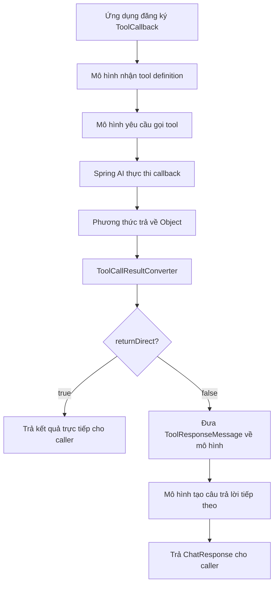

# Tùy chỉnh `returnDirect` và bộ chuyển đổi kết quả

Sau khi một tool được thực thi, Spring AI cần quyết định kết quả sẽ đi theo đường nào và được biểu diễn ra sao. Mặc định, kết quả từ phương thức Java được chuyển thành chuỗi, đưa vào tool response rồi gửi lại cho mô hình để mô hình tiếp tục suy luận và tạo câu trả lời. Có hai điểm tùy chỉnh quan trọng:

- `returnDirect` quyết định kết quả có được gửi thẳng về caller hay tiếp tục quay lại mô hình.
- `ToolCallResultConverter` quyết định đối tượng Java trả về từ tool được chuyển thành chuỗi như thế nào.

Hai cơ chế này giải quyết hai câu hỏi khác nhau. `returnDirect` điều khiển luồng hội thoại; converter điều khiển cách biểu diễn dữ liệu. Có thể kết hợp chúng: một công cụ trả kết quả đã định dạng trực tiếp cho người dùng, hoặc một công cụ trả dữ liệu JSON gọn cho mô hình tổng hợp ở lượt tiếp theo.

Trong module `SPRING_AI_TOOL_CALLING`, mô hình chỉ yêu cầu gọi công cụ thông qua tên và đối số. Ứng dụng vẫn thực thi callback, kiểm tra quyền và quy tắc nghiệp vụ. `returnDirect` không bỏ qua bước thực thi; converter cũng không thay thế validation, authorization hay transaction.

## 1. Vị trí của hai cơ chế trong vòng đời tool calling

Một chu trình thông thường gồm các bước:

1. Ứng dụng đăng ký tool definition với tên, mô tả và schema đầu vào.
2. Mô hình chọn công cụ và trả về tool call.
3. Spring AI ánh xạ tool call tới `ToolCallback` và thực thi mã Java.
4. Giá trị Java trả về được chuyển thành chuỗi bởi `ToolCallResultConverter`.
5. Spring AI đọc metadata `returnDirect` để quyết định đưa chuỗi kết quả về caller hay gửi lại cho mô hình.



Trong sơ đồ, converter chạy sau khi phương thức tool hoàn tất. Kết quả sau chuyển đổi là chuỗi mà Spring AI sử dụng trong tool response. Nếu `returnDirect` bật, chuỗi đó được trả thẳng theo đường kết quả trực tiếp; nếu tắt, chuỗi được gửi lại cho mô hình để mô hình tiếp tục hội thoại.

## 2. `returnDirect` thay đổi điều gì?

Mặc định, `returnDirect` là `false`. Kết quả công cụ được đưa trở lại mô hình như một thông điệp phản hồi công cụ. Mô hình có thể đọc kết quả, kết hợp với câu hỏi ban đầu, gọi thêm công cụ hoặc tạo câu trả lời cuối.

Khi đặt `returnDirect = true`, Spring AI kết thúc vòng tool calling sau khi thực thi công cụ và trả kết quả trực tiếp về caller. Mô hình không nhận lại kết quả đó và không có lượt gọi model tiếp theo để viết lại, tóm tắt hay diễn giải nội dung.

Ví dụ phù hợp với `returnDirect = true`:

- Một công cụ truy xuất tài liệu đã tạo sẵn nội dung cuối cùng mà ứng dụng muốn trả về.
- Một công cụ tìm kiếm trả về danh sách kết quả đã được định dạng theo hợp đồng API.
- Một công cụ trả về dữ liệu chuẩn hóa mà không cần mô hình viết thêm lời giải thích.
- Một công cụ được thiết kế để kết thúc lượt suy luận tại một điểm xác định.

Ví dụ nên giữ `returnDirect = false`:

- Công cụ chỉ cung cấp một mẩu dữ liệu để mô hình giải thích cho người dùng.
- Mô hình cần gọi tiếp công cụ khác dựa trên kết quả vừa nhận.
- Kết quả cần được kết hợp với ngữ cảnh hội thoại hoặc dịch sang ngôn ngữ của người dùng.
- Mô hình cần giải thích giới hạn, so sánh hoặc trình bày khuyến nghị dựa trên dữ liệu công cụ.

| Cấu hình | Đường đi của kết quả | Khi nào dùng |
|---|---|---|
| `returnDirect = false` | Tool result → mô hình → câu trả lời cuối | Cần mô hình tiếp tục suy luận hoặc diễn đạt |
| `returnDirect = true` | Tool result → caller | Kết quả công cụ đã là đầu ra mong muốn |

`returnDirect` không phải công tắc bật/tắt việc thực thi. Công cụ vẫn được gọi theo tool call hợp lệ và phải đi qua validation, authorization, giới hạn tài nguyên và kiểm soát tác động phụ như bình thường.

## 3. Khai báo `returnDirect` bằng `@Tool`

Với công cụ khai báo bằng annotation, đặt `returnDirect = true` trên `@Tool`:

```java
import org.springframework.ai.tool.annotation.Tool;
import org.springframework.ai.tool.annotation.ToolParam;
import org.springframework.stereotype.Component;

@Component
public class DocumentTools {

    private final DocumentSearchService searchService;

    public DocumentTools(DocumentSearchService searchService) {
        this.searchService = searchService;
    }

    @Tool(
            name = "searchPolicyDocument",
            description = "Tìm tài liệu chính sách theo từ khóa và trả về phần nội dung phù hợp đã định dạng.",
            returnDirect = true)
    public PolicySearchResult searchPolicyDocument(
            @ToolParam(description = "Từ khóa hoặc câu hỏi cần tìm trong tài liệu chính sách") String query) {
        return searchService.searchAndFormat(query);
    }
}
```

Khi mô hình gọi `searchPolicyDocument`, Spring AI thực thi phương thức, chuyển `PolicySearchResult` thành chuỗi, rồi trả chuỗi đó trực tiếp cho caller. Mô hình không nhận lại tool result để viết thêm câu trả lời.

Nếu bỏ `returnDirect = true`, giá trị mặc định là `false`; Spring AI gửi kết quả về mô hình. Mô hình có thể diễn giải các đoạn tài liệu, trả lời câu hỏi hoặc gọi thêm công cụ nếu cần.

Chọn chế độ dựa trên sản phẩm cần trả về gì. Nếu giao diện muốn nhận một payload có cấu trúc để tự hiển thị, có thể dùng đường trực tiếp và để ứng dụng xử lý chuỗi JSON. Nếu giao diện cần câu trả lời tự nhiên, hãy để mô hình nhận kết quả và tạo câu trả lời cuối.

## 4. Đặt `returnDirect` cho ToolCallback tạo theo cách lập trình

Khi dùng `FunctionToolCallback` hoặc `MethodToolCallback`, metadata của công cụ được cấu hình bằng `ToolMetadata`. Ví dụ với callback từ function:

```java
import org.springframework.ai.tool.ToolCallback;
import org.springframework.ai.tool.metadata.ToolMetadata;
import org.springframework.ai.tool.function.FunctionToolCallback;

ToolMetadata metadata = ToolMetadata.builder()
        .returnDirect(true)
        .build();

ToolCallback policySearch = FunctionToolCallback
        .builder("searchPolicyDocument", documentSearchService::searchAndFormat)
        .description("Tìm tài liệu chính sách và trả về kết quả đã định dạng.")
        .inputType(PolicySearchQuery.class)
        .toolMetadata(metadata)
        .build();
```

Với `MethodToolCallback.Builder`, cũng truyền `ToolMetadata` qua `.toolMetadata(...)`. Sau đó đăng ký callback trong request `ChatClient` như các tool khác:

```java
String result = chatClient.prompt()
        .user("Tìm quy định hoàn tiền cho đơn hàng đã giao.")
        .tools(policySearch)
        .call()
        .content();
```

Đoạn code minh họa API của Spring AI 2.x. Tên package, builder và cách cấu hình cần đối chiếu với phiên bản Spring AI mà dự án đang dùng; `ToolMetadata.builder().returnDirect(true)` là điểm cấu hình metadata của callback.

## 5. Quy tắc khi một lượt có nhiều tool call

Một assistant message có thể yêu cầu nhiều công cụ trong cùng một vòng. Spring AI chỉ áp dụng hành vi trả trực tiếp nếu **tất cả** công cụ được gọi trong vòng đó đều có `returnDirect = true`.

Ví dụ:

| Các tool call trong cùng một vòng | Metadata `returnDirect` | Hành vi |
|---|---|---|
| `searchPolicyDocument`, `getOrderStatus` | `true`, `true` | Có thể trả kết quả trực tiếp cho caller |
| `searchPolicyDocument`, `getOrderStatus` | `true`, `false` | Kết quả của vòng được gửi lại cho mô hình |

Điều kiện này tránh tình huống một phần kết quả bị trả thẳng trong khi phần khác cần mô hình tổng hợp. Nếu có công cụ trả dữ liệu để mô hình dùng tiếp, hãy để cả lượt đi qua mô hình bằng cách cấu hình các công cụ liên quan với `returnDirect = false`.

Đừng dựa vào thứ tự callback hoàn tất để suy ra kết quả direct. Hãy thiết kế metadata cho cả tập công cụ mà mô hình có thể gọi trong cùng một vòng và kiểm thử trường hợp hỗn hợp.

## 6. ToolCallResultConverter làm nhiệm vụ gì?

Phương thức tool có thể trả về một object Java như record, DTO hoặc một kiểu dữ liệu đơn giản. Giao thức tool calling cần nội dung chuỗi để đưa vào tool response. `ToolCallResultConverter` thực hiện chuyển đổi đó.

Interface có dạng:

```java
@FunctionalInterface
public interface ToolCallResultConverter {
    String convert(Object result, Type returnType);
}
```

Spring AI cung cấp `DefaultToolCallResultConverter`. Mặc định, converter này dùng Jackson để tuần tự hóa kết quả thành JSON. Vì vậy, nếu phương thức trả về một DTO:

```java
public record OrderStatusView(
        String orderId,
        String status,
        String carrier,
        String estimatedDelivery) {
}
```

tool result có thể được biểu diễn như sau:

```json
{
  "orderId": "ORD-2048",
  "status": "SHIPPED",
  "carrier": "VNPost",
  "estimatedDelivery": "2026-11-28"
}
```

JSON có cấu trúc phù hợp khi mô hình cần đọc các trường riêng biệt, so sánh dữ liệu hoặc quyết định bước tiếp theo. Tuy nhiên, không phải lúc nào JSON mặc định cũng là định dạng mong muốn. Có thể cần chuỗi văn bản ngắn, một định dạng đặc thù của hệ thống hoặc chỉ một phần dữ liệu đã được chọn lọc.

Converter chỉ chuyển đổi kết quả đã có. Nó không gọi lại service, không truy vấn cơ sở dữ liệu, không xác thực quyền và không nên chứa quy tắc nghiệp vụ.

## 7. Viết converter tùy chỉnh

Giả sử service trả `OrderStatusView`, nhưng mô hình chỉ cần một bản tóm tắt ngắn để trả lời câu hỏi trạng thái. Có thể tạo converter riêng:

```java
import java.lang.reflect.Type;

import org.springframework.ai.tool.execution.DefaultToolCallResultConverter;
import org.springframework.ai.tool.execution.ToolCallResultConverter;

public class OrderStatusResultConverter implements ToolCallResultConverter {

    private final ToolCallResultConverter defaultConverter =
            new DefaultToolCallResultConverter();

    @Override
    public String convert(Object result, Type returnType) {
        if (result instanceof OrderStatusView order) {
            return "Đơn hàng %s đang ở trạng thái %s. Đơn vị vận chuyển: %s. Dự kiến giao: %s."
                    .formatted(
                            order.orderId(),
                            order.status(),
                            order.carrier(),
                            order.estimatedDelivery());
        }

        return defaultConverter.convert(result, returnType);
    }
}
```

Converter xử lý riêng `OrderStatusView`; các kiểu khác được chuyển bằng converter mặc định. Cách fallback này giúp tránh vô tình làm hỏng những công cụ khác nếu converter được dùng chung hoặc có thêm kiểu trả về mới.

Một converter tốt nên:

- Trả về chuỗi ổn định, dễ đọc và có giới hạn kích thước.
- Chỉ đưa vào những trường mà mô hình hoặc caller thực sự cần.
- Giữ nguyên ý nghĩa và đơn vị của dữ liệu.
- Xử lý rõ trường hợp `null` hoặc kiểu trả về không được hỗ trợ.
- Không ghi log hoặc phát tán thông tin nhạy cảm từ object đầu vào.
- Không thực hiện tác động phụ, truy vấn mạng hoặc thao tác nghiệp vụ.

Nếu mô hình cần xử lý dữ liệu có cấu trúc, JSON thường là lựa chọn tốt hơn văn xuôi. Nếu kết quả được trả trực tiếp cho giao diện hoặc người dùng, một chuỗi đã định dạng có thể phù hợp hơn. Định dạng nên theo nhu cầu của consumer cuối cùng.

## 8. Gắn converter vào `@Tool`

Với khai báo bằng annotation, chỉ định class converter qua thuộc tính `resultConverter`:

```java
@Component
public class OrderTools {

    private final OrderQueryService orderQueryService;

    public OrderTools(OrderQueryService orderQueryService) {
        this.orderQueryService = orderQueryService;
    }

    @Tool(
            name = "getOrderStatus",
            description = "Tra cứu trạng thái đơn hàng theo mã đơn hàng.",
            resultConverter = OrderStatusResultConverter.class)
    public OrderStatusView getOrderStatus(
            @ToolParam(description = "Mã đơn hàng") String orderId) {
        return orderQueryService.findStatus(orderId);
    }
}
```

Spring AI dùng converter được khai báo để chuyển kết quả phương thức thành chuỗi. Converter class cần có constructor phù hợp với cách framework khởi tạo; ví dụ trên dùng constructor mặc định và không phụ thuộc bean bên ngoài.

Có thể kết hợp `resultConverter` với `returnDirect`:

```java
@Tool(
        name = "getOrderStatusSummary",
        description = "Lấy bản tóm tắt trạng thái đơn hàng đã định dạng để trả trực tiếp cho caller.",
        returnDirect = true,
        resultConverter = OrderStatusResultConverter.class)
public OrderStatusView getOrderStatusSummary(String orderId) {
    return orderQueryService.findStatus(orderId);
}
```

Trong ví dụ kết hợp, phương thức trả object; converter tạo chuỗi tóm tắt; `returnDirect` yêu cầu Spring AI trả chuỗi đó cho caller mà không gửi lại mô hình. Nếu đặt `returnDirect = false`, chính chuỗi tóm tắt sẽ được gửi lại cho mô hình.

## 9. Gắn converter vào callback lập trình

Với `FunctionToolCallback.Builder`, dùng `.toolCallResultConverter(...)` để cung cấp implementation:

```java
ToolMetadata metadata = ToolMetadata.builder()
        .returnDirect(true)
        .build();

ToolCallback orderStatusCallback = FunctionToolCallback
        .builder("getOrderStatusSummary", orderQueryService::findStatus)
        .description("Tra cứu trạng thái đơn hàng và trả về bản tóm tắt.")
        .inputType(OrderQuery.class)
        .toolMetadata(metadata)
        .toolCallResultConverter(new OrderStatusResultConverter())
        .build();
```

`MethodToolCallback.Builder` cũng cung cấp phương thức `.toolCallResultConverter(...)`. Như vậy, callback tạo từ method hoặc function đều có thể tùy chỉnh cách biểu diễn kết quả. Nếu không cung cấp converter, Spring AI sử dụng `DefaultToolCallResultConverter`.

Khi tạo callback theo cách lập trình, có thể kết hợp converter và metadata ở cùng builder. Hãy giữ converter có phạm vi trách nhiệm hẹp và kiểm thử độc lập bằng các giá trị trả về đại diện.

## 10. Chọn định dạng kết quả theo người nhận

Một quyết định hữu ích là xác định ai sẽ đọc chuỗi sau chuyển đổi:

| Người nhận kết quả | Định dạng thường phù hợp | Lý do |
|---|---|---|
| Mô hình cần suy luận tiếp | JSON có trường rõ ràng | Mô hình dễ lấy dữ kiện và kết hợp với công cụ khác |
| Người dùng cuối qua `returnDirect` | Văn bản ngắn, đã định dạng | Có thể hiển thị ngay mà không cần lượt diễn đạt của mô hình |
| Backend khác cần xử lý tiếp | JSON theo hợp đồng ổn định | Dễ parse và kiểm tra schema |
| Công cụ trả kết quả lớn | DTO rút gọn hoặc tham chiếu có kiểm soát | Giảm token, độ trễ và nguy cơ lộ dữ liệu |

Ví dụ, một công cụ tìm tài liệu có thể trả JSON gồm `documentId`, `title`, `snippet` và `sourceUrl` để mô hình trích dẫn và giải thích. Nếu `returnDirect = true`, có thể trả một chuỗi văn bản đã định dạng hoặc một payload mà ứng dụng phía client hiểu được. Không gửi toàn bộ nội dung tài liệu nếu chỉ cần một đoạn trích ngắn.

Không nên dùng converter để biến object tùy ý thành chuỗi dài. Kết quả càng lớn thì chi phí token và nguy cơ vượt giới hạn ngữ cảnh càng cao khi gửi lại mô hình. Hãy giới hạn số phần tử, cắt ngắn trường văn bản và loại bỏ trường nội bộ trước khi chuyển đổi.

## 11. Bảo mật và xử lý lỗi

Kết quả converter có thể được gửi tới mô hình hoặc trả trực tiếp cho caller. Cả hai đường đều cần kiểm soát dữ liệu:

- Chỉ trả DTO chứa trường được phép công bố. Tránh tuần tự hóa trực tiếp JPA entity hoặc object chứa token, email nội bộ, thông tin thanh toán và dữ liệu cá nhân không cần thiết.
- Kiểm tra quyền trước khi phương thức tool trả dữ liệu. `returnDirect` không bỏ qua authorization.
- Không đưa stack trace, câu lệnh SQL, thông tin kết nối hoặc bí mật vào chuỗi kết quả.
- Không tin dữ liệu từ công cụ bên ngoài. Nếu kết quả được gửi lại mô hình, nội dung đó vẫn có thể chứa chỉ thị không đáng tin cậy.
- Giới hạn kích thước kết quả và loại bỏ các trường không cần thiết.

Converter không phải nơi xử lý exception. Khi tool ném lỗi, Spring AI có cơ chế `ToolExecutionExceptionProcessor` để quyết định chuyển thông điệp lỗi về mô hình hay ném lỗi cho caller theo cấu hình. Hãy xử lý lỗi nghiệp vụ dự kiến ở service/tool và giữ lỗi kỹ thuật trong log phía server. Không biến exception thành một kết quả thành công giả chỉ để thỏa mãn converter.

Đối với thao tác ghi, hãy đặt transaction, kiểm tra quyền và idempotency trong business service. Nếu một công cụ ghi dữ liệu được cấu hình `returnDirect = true`, kết quả trực tiếp chỉ thay đổi cách trả phản hồi sau thực thi; nó không cung cấp cơ chế xác nhận trước khi chạy. Hãy dùng cơ chế xác nhận phù hợp cho thao tác nhạy cảm.

## 12. Những kiểu trả về cần chú ý

Kết quả cần có thể chuyển đổi thành chuỗi. Với kiểu POJO hoặc record đơn giản, converter mặc định có thể tuần tự hóa bằng Jackson. Một số kiểu không được Spring AI tự động unwrap hoặc chuyển đổi theo cách mà mô hình hiểu được.

Đặc biệt, với method tool, tránh dùng `Optional`, `CompletableFuture`, `Future`, `Mono`, `Flux` hoặc các kiểu functional làm kiểu trả về. Spring AI không tự unwrap các kiểu này thành giá trị bên trong để gửi cho mô hình. Hãy trả giá trị đồng bộ có thể tuần tự hóa, hoặc thiết kế lớp adapter đồng bộ phù hợp với giới hạn của API tool đang sử dụng. Với tham số tùy chọn, dùng `@ToolParam(required = false)` hoặc `@Nullable` thay cho `Optional` theo hướng dẫn phiên bản.

Nếu phương thức trả `void`, kết quả mặc định được biểu diễn theo quy tắc của converter mặc định. Nếu caller cần biết thao tác đã hoàn tất với mã nghiệp vụ cụ thể, nên trả một DTO kết quả rõ ràng thay vì dựa vào một chuỗi xác nhận chung.

## 13. Kiểm thử returnDirect và result converter

Hãy kiểm thử cả lựa chọn đường đi và nội dung chuỗi được tạo ra.

| Ca kiểm thử | Điều cần xác minh |
|---|---|
| `returnDirect = false` với một tool | Tool result được gửi lại mô hình; mô hình có thể tạo câu trả lời tiếp theo |
| `returnDirect = true` với một tool | Chu trình dừng sau thực thi và kết quả được trả về caller |
| Nhiều tool cùng `returnDirect = true` | Kết quả của vòng có thể được trả trực tiếp |
| Nhiều tool có metadata trộn `true` và `false` | Kết quả được gửi lại mô hình, không direct cho cả nhóm |
| Converter nhận DTO hợp lệ | Chuỗi có đúng trường, định dạng, đơn vị và nội dung mong đợi |
| Converter nhận `null` hoặc kiểu không nhận diện | Hành vi fallback hoặc lỗi được xác định rõ |
| Kết quả chứa dữ liệu nhạy cảm | Những trường bị cấm không xuất hiện trong chuỗi |
| Converter tạo kết quả lớn | Giới hạn kích thước và số phần tử được áp dụng |
| Tool ném exception | Exception processor xử lý đúng chính sách; converter không tạo kết quả thành công giả |

Có thể kiểm thử converter bằng unit test mà không cần gọi model:

```java
class OrderStatusResultConverterTest {

    private final OrderStatusResultConverter converter =
            new OrderStatusResultConverter();

    @Test
    void formatsOrderStatusForDirectResponse() {
        OrderStatusView result = new OrderStatusView(
                "ORD-2048", "SHIPPED", "VNPost", "2026-11-28");

        String converted = converter.convert(result, OrderStatusView.class);

        assertThat(converted)
                .contains("ORD-2048")
                .contains("SHIPPED")
                .contains("VNPost");
    }
}
```

Trong kiểm thử tích hợp với `ChatClient`, dùng model giả lập để xác minh callback được gọi đúng một lần, số lượt gọi model đúng kỳ vọng và kết quả direct không tạo thêm lượt gọi mô hình. Với chế độ mặc định, xác minh tool response được đưa lại mô hình trước khi nhận câu trả lời cuối.

## 14. Lỗi cấu hình thường gặp

| Lỗi | Hậu quả | Cách xử lý |
|---|---|---|
| Bật `returnDirect` cho công cụ mà mô hình cần dùng tiếp | Mô hình không nhận được dữ liệu để suy luận tiếp | Để `returnDirect = false` |
| Nghĩ `returnDirect` bỏ qua thực thi | Hiểu sai thứ tự xử lý và có thể bỏ qua kiểm soát nghiệp vụ | Nhớ rằng callback vẫn chạy trước khi trả kết quả |
| Nhiều tool call nhưng chỉ một tool bật direct | Toàn bộ kết quả của vòng được gửi lại mô hình | Cấu hình nhất quán cho mọi tool có thể được gọi cùng lượt |
| Converter trả JSON sai định dạng | Mô hình hoặc client không parse được kết quả | Dùng Jackson hoặc kiểm thử định dạng đầu ra |
| Converter trả toàn bộ entity | Lộ trường nội bộ và tăng kích thước prompt | Trả DTO hẹp và chuyển đổi có chọn lọc |
| Converter chứa logic truy vấn hoặc phân quyền | Khó kiểm thử và sai ranh giới trách nhiệm | Đưa logic vào business service; converter chỉ định dạng |
| Dùng `returnDirect` nhưng mong mô hình diễn đạt lại | Caller nhận chuỗi công cụ thay vì câu trả lời tự nhiên | Tắt direct hoặc tự định dạng chuỗi cho caller |
| Dựa vào converter để che exception | Lỗi có thể bị trình bày như thành công | Dùng exception processor và hợp đồng lỗi riêng |

## 15. Checklist trước khi tùy chỉnh

- Xác định rõ kết quả có phải câu trả lời cuối hay còn cần mô hình xử lý.
- Chỉ bật `returnDirect` khi caller có thể sử dụng kết quả công cụ trực tiếp.
- Nếu một vòng có nhiều tool call, kiểm tra metadata `returnDirect` của tất cả công cụ.
- Dùng converter mặc định khi JSON là định dạng phù hợp.
- Viết `ToolCallResultConverter` tùy chỉnh khi cần định dạng, rút gọn hoặc chuẩn hóa riêng.
- Giữ converter thuần chuyển đổi, không truy vấn dữ liệu hoặc kiểm tra quyền.
- Trả DTO tối thiểu và giới hạn kích thước kết quả.
- Kiểm thử đường direct, đường quay lại mô hình, nhiều tool call và lỗi.
- Đảm bảo lỗi được xử lý bởi exception policy phù hợp, không biến thành kết quả thành công giả.

`returnDirect` giúp ứng dụng chọn nơi kết thúc vòng tool calling; `ToolCallResultConverter` giúp định dạng giá trị trả về thành chuỗi mà đường xử lý tiếp theo có thể sử dụng. Khi chọn đúng đường đi và giới hạn dữ liệu ngay từ converter, tích hợp Spring AI vừa giảm lượt gọi mô hình không cần thiết vừa giữ được hợp đồng kết quả rõ ràng, an toàn.

## 16. Tài liệu tham khảo

- [Spring AI — Tool Calling Reference](https://docs.spring.io/spring-ai/reference/api/tools.html): khai báo `@Tool`, `ToolMetadata`, `returnDirect`, converter mặc định và callback lập trình.
- [Spring AI — ToolCallingAdvisor](https://docs.spring.io/spring-ai/reference/api/tools/tool-calling-advisor.html): cách advisor điều phối vòng lặp và trả kết quả trực tiếp.
- [ToolCallResultConverter API](https://docs.spring.io/spring-ai/docs/current/api/org/springframework/ai/tool/execution/ToolCallResultConverter.html): chữ ký `convert(Object result, Type returnType)`.

Các ví dụ builder trong bài minh họa API Spring AI 2.x. `ToolCallResultConverter` và metadata `returnDirect` có từ Spring AI 1.0.0; khi áp dụng vào dự án, hãy chọn đúng phiên bản tài liệu theo dependency đang khai báo.
