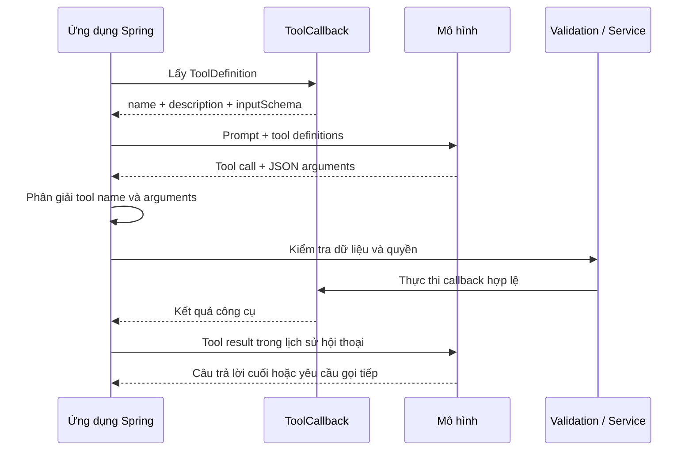

# Vai trò của JSON Schema trong hợp đồng gọi công cụ

Khi mô hình yêu cầu ứng dụng gọi một công cụ, nó phải gửi các tham số theo một cấu trúc mà ứng dụng có thể hiểu và chuyển thành dữ liệu Java. JSON Schema mô tả cấu trúc đó: tên trường, kiểu dữ liệu, trường bắt buộc, giá trị được phép và một số giới hạn của từng giá trị. Spring AI dùng schema đầu vào để công bố hợp đồng của `@Tool` hoặc `ToolCallback` cho mô hình.

Trong Spring AI Tool Calling, schema là cầu nối giữa quyết định của mô hình và mã thực thi của ứng dụng. Một schema rõ ràng giúp mô hình tạo arguments đúng hình dạng, giúp callback chuyển đổi dữ liệu có cấu trúc và giúp nhóm phát triển thống nhất cách gọi dịch vụ nghiệp vụ. Schema cũng là một phần của giao diện công cụ cần được quản lý như API: khi thay đổi tên hoặc kiểu trường, các lời gọi do mô hình tạo có thể thay đổi theo.

Sau bài học, bạn có thể:

- Giải thích vì sao mỗi công cụ cần một schema đầu vào.
- Đọc các thành phần `type`, `properties`, `required`, `enum`, `items` và các ràng buộc giá trị trong JSON Schema.
- Hiểu Spring AI tạo schema từ phương thức `@Tool`, `@ToolParam` và kiểu đầu vào của `FunctionToolCallback` như thế nào.
- Phân biệt việc mô tả cấu trúc với việc kiểm tra dữ liệu và phân quyền ở phía ứng dụng.
- Thiết kế schema dễ hiểu, có giới hạn và ổn định cho mô hình.

## 1. JSON Schema là hợp đồng đầu vào của công cụ

Giả sử ứng dụng cung cấp công cụ `search_products` để tìm sản phẩm trong catalog. Mô hình cần biết công cụ nhận những tham số nào trước khi có thể tạo yêu cầu gọi. Nếu công cụ nhận từ khóa, danh mục, mức giá tối đa và số lượng kết quả, schema phải mô tả được các trường này cùng kiểu dữ liệu tương ứng.

Một JSON Schema khái niệm cho công cụ trên có thể như sau:

```json
{
  "type": "object",
  "properties": {
    "keyword": {
      "type": "string",
      "description": "Từ khóa tìm kiếm tên hoặc mô tả sản phẩm",
      "minLength": 2,
      "maxLength": 80
    },
    "category": {
      "type": "string",
      "description": "Nhóm sản phẩm cần tìm",
      "enum": ["BOOK", "DEVICE", "ACCESSORY"]
    },
    "maxPrice": {
      "type": "number",
      "description": "Giá tối đa tính bằng VND",
      "minimum": 0
    },
    "limit": {
      "type": "integer",
      "description": "Số kết quả tối đa",
      "minimum": 1,
      "maximum": 20
    }
  },
  "required": ["keyword"],
  "additionalProperties": false
}
```

Schema này nói rằng đầu vào là một JSON object. `keyword` phải có mặt và là chuỗi từ 2 đến 80 ký tự. `category` chỉ nhận một trong ba giá trị. `maxPrice` là số không âm. `limit` là số nguyên từ 1 đến 20. Các trường không được liệt kê sẽ bị từ chối nếu bộ kiểm tra áp dụng `additionalProperties: false`.

Khi mô hình quyết định gọi công cụ, arguments có thể có dạng:

```json
{
  "keyword": "Spring Boot",
  "category": "BOOK",
  "maxPrice": 500000,
  "limit": 5
}
```

Mô hình không cần biết lớp repository, câu SQL hay cấu trúc bảng. Nó chỉ cần tuân theo hợp đồng đầu vào. Ứng dụng nhận arguments, chuyển thành kiểu Java và thực thi logic nghiệp vụ.

## 2. Đọc các thành phần quan trọng của schema

JSON Schema có nhiều từ khóa. Với tool calling, các thành phần sau thường tạo nên phần lớn hợp đồng đầu vào:

| Từ khóa | Ý nghĩa | Ví dụ |
| --- | --- | --- |
| `type` | Kiểu của giá trị hoặc object | `"type": "object"`, `"type": "string"` |
| `properties` | Danh sách trường của object | `"properties": {"keyword": ...}` |
| `required` | Danh sách trường bắt buộc phải xuất hiện | `"required": ["keyword"]` |
| `description` | Giải thích mục đích, định dạng hoặc đơn vị | `"description": "Giá tối đa tính bằng VND"` |
| `enum` | Tập giá trị được phép | `"enum": ["BOOK", "DEVICE"]` |
| `items` | Schema của từng phần tử trong array | `"items": {"type": "string"}` |
| `minimum`, `maximum` | Giới hạn số | `"minimum": 1`, `"maximum": 20` |
| `minLength`, `maxLength` | Giới hạn độ dài chuỗi | `"minLength": 2` |
| `pattern` | Mẫu ký tự mà chuỗi phải khớp | `"pattern": "^[A-Z]{2}-[0-9]{4}$"` |
| `additionalProperties` | Có cho phép trường ngoài danh sách hay không | `false` để đóng object |

### Kiểu dữ liệu

Các kiểu thường gặp gồm:

- `string`: văn bản, mã định danh, ngày ở dạng chuỗi hoặc từ khóa.
- `integer`: số nguyên, ví dụ số trang hoặc số lượng kết quả.
- `number`: số có thể có phần thập phân, ví dụ tỷ lệ hoặc giá trị tiền.
- `boolean`: giá trị đúng hoặc sai.
- `array`: danh sách phần tử, cần mô tả kiểu từng phần tử bằng `items`.
- `object`: một cấu trúc gồm nhiều trường con được mô tả trong `properties`.

Chọn kiểu phù hợp với ý nghĩa dữ liệu. Không dùng `string` cho một số lượng chỉ vì đầu vào đến từ JSON; dùng `integer` nếu service cần số nguyên. Mã như `"000127"` nên là chuỗi để giữ số 0 ở đầu và tránh việc mô hình hiểu nhầm đó là phép tính.

### Trường bắt buộc và trường tùy chọn

`required` quy định trường nào phải xuất hiện trong object. Trong ví dụ trên, `keyword` bắt buộc còn `category`, `maxPrice` và `limit` có thể vắng mặt.

Trường không có trong `required` là tùy chọn; điều đó không đồng nghĩa trường đó tự động chấp nhận giá trị `null`. Nếu schema khai báo `type: "string"`, một giá trị null vẫn không phải chuỗi. Khi muốn cho phép null, schema phải mô tả rõ kiểu null theo dialect được hỗ trợ. Trong nhiều API, cách đơn giản hơn là bỏ hẳn trường tùy chọn khi không có giá trị.

### Giá trị giới hạn và danh sách

Dùng `enum` khi số lựa chọn hữu hạn và ổn định, chẳng hạn loại sắp xếp `PRICE_ASC`, `PRICE_DESC` hoặc `NEWEST`. Dùng `minimum` và `maximum` để giới hạn số, `minLength` và `maxLength` để giới hạn chuỗi. Với array, `items` mô tả từng phần tử; có thể bổ sung giới hạn số phần tử nếu dialect và nhà cung cấp hỗ trợ.

Giới hạn nên có ý nghĩa nghiệp vụ. Ví dụ `limit` tối đa 20 giúp tránh một truy vấn vô tình tải hàng nghìn bản ghi. Mô tả cũng cần ghi rõ đơn vị và quy ước: giá theo VND hay USD, thời gian theo UTC hay múi giờ địa phương, số lượng là đơn vị sản phẩm hay thùng.

## 3. Spring AI tạo schema từ @Tool và @ToolParam

Với method tool, Spring AI đọc chữ ký phương thức và annotation để xây dựng `ToolDefinition`, trong đó có tên, mô tả và chuỗi JSON Schema đầu vào. `@Tool` mô tả công cụ; `@ToolParam` mô tả từng tham số.

Ví dụ một công cụ tra cứu đơn hàng:

```java
@Component
public class OrderTools {

    private final OrderQueryService orderQueryService;

    public OrderTools(OrderQueryService orderQueryService) {
        this.orderQueryService = orderQueryService;
    }

    @Tool(
        name = "find_orders",
        description = "Tìm đơn hàng theo mã khách hàng và trạng thái. "
                + "Dùng khi người dùng muốn tra cứu danh sách đơn hàng."
    )
    public List<OrderSummary> findOrders(
            @ToolParam(description = "Mã khách hàng cần tra cứu") String customerCode,
            @ToolParam(
                description = "Trạng thái đơn hàng; bỏ qua nếu muốn lấy mọi trạng thái",
                required = false) String status,
            @ToolParam(
                description = "Số kết quả tối đa, từ 1 đến 20",
                required = false) Integer limit) {

        int safeLimit = limit == null ? 10 : Math.min(Math.max(limit, 1), 20);
        return orderQueryService.findOrders(customerCode, status, safeLimit);
    }
}
```

Trong ví dụ này, `customerCode` là tham số bắt buộc theo mặc định. `status` và `limit` được đánh dấu tùy chọn. Phương thức vẫn phải xử lý trường hợp tham số tùy chọn không được gửi đến, ví dụ `limit == null`.

`@ToolParam` hỗ trợ cung cấp mô tả và tính bắt buộc. Đừng dựa vào mô tả để thay thế kiểm tra dữ liệu trong code. Nếu cần giới hạn số kết quả từ 1 đến 20, phương thức hoặc service vẫn phải kiểm tra giá trị thực tế trước khi truy vấn.

Tên tham số Java có thể phụ thuộc vào metadata biên dịch. Vì vậy, nên mô tả rõ tham số và dùng annotation theo API Spring AI đang dùng thay vì giả định tên biến luôn đủ để mô hình hiểu. Với một công cụ có nhiều tham số, các mô tả ngắn, cụ thể giúp schema trở thành hợp đồng dễ đọc.

## 4. Dùng kiểu đầu vào với FunctionToolCallback

Khi muốn đóng gói nhiều trường trong một object, có thể dùng kiểu request riêng. `FunctionToolCallback` nhận kiểu đầu vào qua `inputType`, từ đó Spring AI tạo schema cho object đó.

```java
public record ProductSearchRequest(
        String keyword,
        String category,
        Integer limit) {
}
```

Tạo callback từ hàm nghiệp vụ:

```java
ToolCallback searchProducts = FunctionToolCallback
        .builder("search_products", catalogService::search)
        .description("Tìm sản phẩm theo từ khóa và bộ lọc tùy chọn")
        .inputType(ProductSearchRequest.class)
        .build();
```

Hàm `catalogService.search` nhận `ProductSearchRequest` và thực hiện truy vấn. Với cách này, schema mô tả một object đầu vào duy nhất thay vì một danh sách tham số rời. Đây là lựa chọn hữu ích khi request có nhiều trường liên quan, cần tái sử dụng ở nhiều nơi hoặc cần kiểm thử độc lập.

Khi cần mô tả sâu hơn về trường của DTO, hãy dùng annotation và cơ chế tạo schema được hỗ trợ trong phiên bản Spring AI/Jackson của dự án. Sau khi tạo callback, kiểm tra schema thực tế để xác nhận các mô tả, kiểu, trường bắt buộc và giới hạn đã được biểu diễn đúng.

## 5. Schema được gửi đến mô hình và arguments quay về ứng dụng

Schema đầu vào được đóng gói trong định nghĩa công cụ gửi đến nhà cung cấp mô hình. Mô hình đọc tên, mô tả và schema để quyết định có gọi công cụ hay không, sau đó tạo arguments theo cấu trúc đã công bố.



Với callback đã tạo, có thể xem định nghĩa mà callback công bố để kiểm tra schema:

```java
ToolDefinition definition = searchProducts.getToolDefinition();

log.debug("Tool name: {}", definition.name());
log.debug("Tool description: {}", definition.description());
log.debug("Tool input schema: {}", definition.inputSchema());
```

`inputSchema()` là schema thực tế gắn với định nghĩa callback. Đây là thứ cần kiểm tra khi nghi ngờ mô hình không nhận đúng trường hoặc schema sinh ra khác với dự kiến. Không nên chỉ nhìn vào Java method rồi mặc định schema gửi đi chắc chắn đúng.

Khi mô hình trả về tool call, arguments là dữ liệu JSON. Spring AI dùng callback tương ứng để chuyển arguments sang kiểu đầu vào và gọi mã thực thi. Nếu tên công cụ không khớp, JSON sai định dạng hoặc không thể chuyển đổi sang kiểu Java, quá trình thực thi có thể thất bại trước khi service nghiệp vụ được gọi.

## 6. JSON Schema giúp mô hình tạo đầu vào tốt hơn như thế nào?

Một schema chất lượng giúp giảm sự mơ hồ ở nhiều điểm:

- **Tên trường cụ thể**: `customerCode` rõ hơn `value` hoặc `data`.
- **Kiểu dữ liệu đúng**: `limit` là `integer`, còn `customerCode` là `string`.
- **Mô tả có ngữ cảnh**: ghi rõ đây là mã khách hàng, không phải tên hiển thị.
- **Đơn vị và định dạng**: ghi rõ `maxPrice` tính bằng VND hoặc ngày theo `YYYY-MM-DD`.
- **Trường bắt buộc tối thiểu**: chỉ bắt buộc những dữ liệu không thể thực hiện tác vụ nếu thiếu.
- **Giới hạn thực tế**: dùng enum và miền giá trị để giảm các lựa chọn không hợp lệ.
- **Cấu trúc vừa đủ**: không yêu cầu mô hình cung cấp dữ liệu mà server có thể tự xác định.

Ví dụ, không nên yêu cầu mô hình gửi `tenantId`, `actorId`, `createdBy` hoặc quyền truy cập. Đây là dữ liệu nội bộ do server xác lập. Đưa chúng vào schema sẽ khiến mô hình có thể tạo giá trị cho những thông tin mà nó không có thẩm quyền quyết định. Hãy truyền các dữ liệu này bằng `ToolContext` hoặc lấy trực tiếp từ security context phía ứng dụng.

Schema cũng không nên phơi bày cấu trúc nội bộ của database. Một trường `customerCode` trong hợp đồng nghiệp vụ tốt hơn việc yêu cầu mô hình gửi tên bảng, tên cột hoặc điều kiện SQL.

## 7. Schema không thay thế validation và phân quyền

JSON Schema là hợp đồng để mô hình tạo arguments. Nó không phải ranh giới bảo mật của ứng dụng. Mô hình có thể tạo giá trị không hợp lệ, nhà cung cấp có thể chỉ hỗ trợ một tập con từ khóa schema, và dữ liệu có thể thay đổi sau khi được sinh ra.

Trước khi gọi service, ứng dụng vẫn cần kiểm tra:

1. **Cấu trúc**: JSON có parse được không, có đúng kiểu Java không, trường bắt buộc có mặt không?
2. **Giới hạn**: chuỗi có quá dài không, số có nằm trong miền cho phép không, danh sách có vượt giới hạn không?
3. **Tính hợp lệ nghiệp vụ**: trạng thái có cho phép thao tác không, ngày bắt đầu có trước ngày kết thúc không, SKU có tồn tại không?
4. **Quyền truy cập**: người dùng hiện tại có được xem hoặc thay đổi tài nguyên này không?
5. **Giới hạn vận hành**: truy vấn có timeout không, số kết quả có bị giới hạn không, số lần gọi có nằm trong quota không?

Ví dụ schema có `limit` tối đa 20 vẫn không đủ để bảo vệ service nếu code không kiểm tra. Callback nên chuẩn hóa và xác thực đầu vào trước khi gọi repository:

```java
public List<OrderSummary> findOrders(
        String customerCode, String status, Integer limit) {

    if (customerCode == null || customerCode.isBlank()) {
        throw new IllegalArgumentException("customerCode là bắt buộc");
    }

    int safeLimit = limit == null ? 10 : limit;
    if (safeLimit < 1 || safeLimit > 20) {
        throw new IllegalArgumentException("limit phải nằm trong khoảng 1 đến 20");
    }

    return orderQueryService.findOrdersForCurrentActor(
            customerCode.trim(), status, safeLimit);
}
```

Trong hệ thống đa tenant, `findOrdersForCurrentActor` cần lấy actor và tenant từ ngữ cảnh xác thực của server. Không cho phép mô hình tự cung cấp danh tính hoặc quyền truy cập thông qua arguments.

## 8. Lưu ý về dialect và hỗ trợ của nhà cung cấp mô hình

JSON Schema là một chuẩn có nhiều phiên bản và nhiều từ khóa. API tool calling của từng nhà cung cấp có thể chỉ hỗ trợ một tập con hoặc áp đặt thêm quy tắc, ví dụ giới hạn kiểu dữ liệu, cách biểu diễn union, object lồng nhau hoặc chế độ strict schema.

Vì vậy:

- Dùng các cấu trúc cơ bản như `object`, `properties`, `required`, `string`, `integer`, `number`, `boolean`, `array` và `enum` khi có thể.
- Chỉ dùng các từ khóa nâng cao như `pattern`, `oneOf`, `anyOf`, `format` hoặc ràng buộc lồng nhau sau khi xác nhận nhà cung cấp và model hỗ trợ.
- Nếu bật chế độ strict schema, kiểm tra yêu cầu cụ thể của nhà cung cấp; một số chế độ yêu cầu khai báo tất cả trường trong `required` và dùng `additionalProperties: false`, kể cả khi trường có thể nhận giá trị rỗng hoặc null theo schema tương ứng.
- Kiểm thử trên đúng model và phiên bản API mà ứng dụng sẽ triển khai. Schema hợp lệ theo JSON Schema tổng quát chưa chắc được mọi endpoint chấp nhận.

Spring AI giúp chuẩn hóa việc khai báo và gửi tool definition, nhưng không loại bỏ khác biệt giữa các nhà cung cấp. Khi đổi model, hãy kiểm tra lại schema được gửi và chạy kiểm thử tích hợp với những trường tùy chọn, enum, object lồng nhau và array.

## 9. Những lỗi thiết kế schema thường gặp

| Lỗi | Hậu quả | Cách cải thiện |
| --- | --- | --- |
| Mô tả chung chung như `value` hoặc `input` | Mô hình khó hiểu cần gửi dữ liệu gì | Đặt tên theo khái niệm nghiệp vụ, ví dụ `customerCode`. |
| Đánh dấu mọi trường là bắt buộc | Mô hình phải đoán dữ liệu không cần thiết | Chỉ yêu cầu trường tối thiểu để thực hiện tác vụ. |
| Không ghi đơn vị hoặc định dạng | Giá trị có thể đúng kiểu nhưng sai ý nghĩa | Ghi rõ VND, UTC, mã SKU hoặc định dạng ngày. |
| Dùng `string` cho số lượng | Service phải tự chuyển đổi và dễ nhận dữ liệu sai | Dùng `integer` hoặc `number` theo ý nghĩa. |
| Enum quá rộng hoặc không cập nhật | Mô hình có thể chọn giá trị service không hiểu | Giữ danh sách nhỏ, ổn định và đồng bộ với nghiệp vụ. |
| Đưa ID nội bộ hoặc quyền vào schema | Mô hình có thể tạo hoặc sửa dữ liệu nhạy cảm | Lấy từ `ToolContext` hoặc security context phía server. |
| Nghĩ schema đã thay thế validation | Dữ liệu không hợp lệ vẫn có thể đến callback | Kiểm tra lại ở service trước khi thực thi. |
| Thay schema mà không kiểm thử tương thích | Lời gọi cũ hoặc model có thể không còn tương thích | Quản lý thay đổi như API và chạy test hồi quy. |

## 10. Quy trình thiết kế và kiểm thử schema

Khi thêm một tool mới, có thể áp dụng quy trình sau:

1. Xác định tác vụ nghiệp vụ và dữ liệu tối thiểu cần có để thực hiện.
2. Chọn kiểu JSON phù hợp cho từng trường.
3. Viết tên và mô tả rõ ràng, nêu đơn vị, định dạng và giới hạn.
4. Đánh dấu trường bắt buộc và tùy chọn đúng với nghiệp vụ.
5. Tạo callback bằng `@Tool`/`@ToolParam` hoặc `FunctionToolCallback` với kiểu đầu vào riêng.
6. Đọc `ToolDefinition.inputSchema()` để xác nhận schema thực tế.
7. Kiểm tra arguments hợp lệ, thiếu trường, sai kiểu, giá trị ngoài giới hạn và trường thừa.
8. Kiểm thử với model/provider đích để xác nhận schema được chấp nhận và mô hình tạo arguments có thể chuyển đổi.
9. Kiểm tra validation, phân quyền, timeout và giới hạn kết quả trong service.

Khi thay đổi schema đang được sử dụng, hãy cân nhắc tương thích ngược. Đổi tên trường, thay kiểu `string` thành `integer`, hoặc chuyển trường tùy chọn thành bắt buộc đều có thể làm thay đổi cách mô hình gọi tool. Nếu cần thay đổi lớn, tạo phiên bản công cụ mới hoặc duy trì giai đoạn chuyển tiếp để cập nhật prompt, callback và các bài kiểm thử.

## 11. Những điểm cần nhớ

- JSON Schema mô tả hình dạng arguments mà mô hình cần gửi khi gọi công cụ.
- `type`, `properties`, `required`, `description`, `enum` và các ràng buộc giá trị tạo nên hợp đồng đầu vào.
- Spring AI tạo `ToolDefinition` từ method tool và metadata annotation; `FunctionToolCallback` có thể dùng một kiểu đầu vào riêng qua `inputType`.
- Kiểm tra `ToolDefinition.inputSchema()` để biết schema thực tế được công bố.
- Schema giúp mô hình tạo dữ liệu đúng cấu trúc, nhưng validation nghiệp vụ và phân quyền luôn phải được thực hiện ở phía ứng dụng.
- Khả năng hỗ trợ từ khóa JSON Schema khác nhau giữa các model và nhà cung cấp; cần kiểm thử với endpoint triển khai thực tế.

## Tài liệu tham khảo

- [Spring AI Reference — Tool Calling](https://docs.spring.io/spring-ai/reference/api/tools.html)
- [Spring AI Reference — Tool Definitions and Callbacks](https://docs.spring.io/spring-ai/reference/api/tools.html#_tool_definitions)
- [JSON Schema — Understanding JSON Schema](https://json-schema.org/understanding-json-schema/)

Các ví dụ theo API Spring AI 2.x. Khi dự án sử dụng phiên bản khác, hãy đối chiếu tài liệu của đúng phiên bản và xác minh schema được tạo trước khi đưa công cụ vào vận hành.
