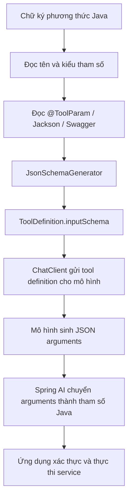

# Sinh schema từ tham số Java và kiểu dữ liệu đầu vào

Khi một công cụ được đưa vào yêu cầu của mô hình, Spring AI gửi kèm một **input schema** để mô hình biết cần cung cấp những trường nào, kiểu dữ liệu ra sao và trường nào bắt buộc. Với công cụ khai báo bằng `@Tool`, Spring AI có thể sinh JSON Schema trực tiếp từ danh sách tham số Java. Nhà phát triển bổ sung mô tả và trạng thái bắt buộc bằng `@ToolParam`, hoặc dùng các annotation tương thích từ Jackson và Swagger.

Input schema là hợp đồng đầu vào của tool call. Nó giúp mô hình tạo arguments có cấu trúc, nhưng không thay thế việc kiểm tra dữ liệu trong ứng dụng. Ứng dụng vẫn phải xác thực định dạng, phạm vi nghiệp vụ và quyền truy cập trước khi thực thi service.

## 1. Từ chữ ký Java đến JSON Schema

Giả sử hệ thống quản lý kho có công cụ tra cứu số lượng hàng. Phương thức Java mô tả các tham số mà công cụ chấp nhận:

```java
@Tool(
    name = "findInventory",
    description = "Tra cứu số lượng có thể bán của một mã hàng tại một kho cụ thể."
)
public InventorySummary findInventory(
        @ToolParam(description = "Mã SKU chính xác của sản phẩm") String sku,
        @ToolParam(description = "Mã kho, ví dụ HCM-01") String warehouseCode,
        @ToolParam(description = "Chỉ lấy kết quả có số lượng tối thiểu này", required = false)
        Integer minAvailable) {
    return inventoryService.findAvailability(sku, warehouseCode, minAvailable);
}
```

Spring AI đọc chữ ký phương thức và tạo schema có dạng khái quát:

```json
{
  "type": "object",
  "properties": {
    "sku": {
      "type": "string",
      "description": "Mã SKU chính xác của sản phẩm"
    },
    "warehouseCode": {
      "type": "string",
      "description": "Mã kho, ví dụ HCM-01"
    },
    "minAvailable": {
      "type": "integer",
      "format": "int32",
      "description": "Chỉ lấy kết quả có số lượng tối thiểu này"
    }
  },
  "required": ["sku", "warehouseCode"]
}
```

Schema thực tế có thể có thêm metadata hoặc cách biểu diễn phụ thuộc phiên bản Spring AI, bộ sinh schema và provider. Điểm cần giữ là mỗi tham số đầu vào trở thành một thuộc tính trong object; kiểu Java cung cấp kiểu schema cơ bản; annotation bổ sung mô tả và trạng thái bắt buộc.

Luồng xử lý có thể hình dung như sau:



`ToolDefinition` là hợp đồng được gửi cho mô hình, gồm tên công cụ, mô tả và `inputSchema`. `JsonSchemaGenerator` được Spring AI dùng để tạo schema từ tham số phương thức hoặc kiểu đầu vào của function tool.

## 2. Ánh xạ các kiểu Java phổ biến

JSON Schema chỉ có một số kiểu dữ liệu nền tảng. Bộ sinh schema chuyển kiểu Java sang các kiểu gần tương ứng để mô hình tạo JSON phù hợp.

| Kiểu Java | Biểu diễn JSON Schema thường gặp | Ví dụ JSON |
| --- | --- | --- |
| `String`, `char`, `Character`, `UUID` | `string` | `"SKU-42"` |
| `boolean`, `Boolean` | `boolean` | `true` |
| `byte`, `short`, `int`, `long` và wrapper | `integer` | `42` |
| `float`, `double`, `BigDecimal` | `number` | `12.5` |
| `enum` | `string` với tập giá trị cho phép | `"AVAILABLE"` |
| `T[]`, `List<T>`, `Set<T>` | `array`, `items` mô tả kiểu `T` | `["A", "B"]` |
| `record` hoặc POJO | `object` với các thuộc tính | `{"sku":"SKU-42"}` |
| `Map<String, T>` | `object` với các giá trị động | `{"region":"HCM"}` |
| Ngày giờ | Thường là `string`, có thể kèm `format` | `"2026-11-27"` |

Đây là cách đọc schema phổ biến, không phải cam kết rằng mọi provider nhận chính xác cùng một tập từ khóa. Hãy kiểm tra schema được sinh trong phiên bản đang dùng, nhất là với kiểu phức tạp, generic, polymorphism và các kiểu thời gian.

### Kiểu số và giới hạn miền giá trị

`int` và `long` đều là số nguyên, còn `BigDecimal` biểu diễn số có phần thập phân. Chọn kiểu Java phù hợp với miền dữ liệu của nghiệp vụ. Nếu số lượng hàng không thể âm, schema mô tả `integer` vẫn chưa diễn đạt đầy đủ quy tắc đó trừ khi có ràng buộc tương ứng được hỗ trợ hoặc schema được tùy chỉnh.

Ví dụ mô tả miền giá trị trong annotation giúp mô hình hiểu yêu cầu:

```java
@Tool(
    description = "Tìm các sản phẩm có số lượng tồn kho đạt ngưỡng yêu cầu."
)
public List<InventoryItem> findByMinimumStock(
        @ToolParam(description = "Số lượng nguyên không âm, từ 0 trở lên") Integer minimumStock) {
    if (minimumStock == null || minimumStock < 0) {
        throw new IllegalArgumentException("minimumStock phải lớn hơn hoặc bằng 0");
    }
    return inventoryService.findByMinimumStock(minimumStock);
}
```

Mô tả bằng chữ hướng dẫn mô hình, còn kiểm tra `minimumStock < 0` mới bảo vệ quy tắc ở runtime. Không xem nội dung description là một bộ validator.

### Enum giúp giới hạn lựa chọn

Khi một tham số chỉ nhận một số lựa chọn đã biết, enum diễn đạt ý định rõ hơn một chuỗi tự do:

```java
public enum StockStatus {
    AVAILABLE,
    LOW_STOCK,
    OUT_OF_STOCK
}

@Tool(description = "Lọc sản phẩm theo trạng thái tồn kho.")
public List<InventoryItem> findByStatus(
        @ToolParam(description = "Trạng thái cần lọc") StockStatus status) {
    return inventoryService.findByStatus(status);
}
```

Schema có thể biểu diễn enum thành chuỗi với danh sách giá trị hợp lệ:

```json
{
  "type": "string",
  "enum": ["AVAILABLE", "LOW_STOCK", "OUT_OF_STOCK"],
  "description": "Trạng thái cần lọc"
}
```

Đặt tên enum dễ hiểu và ổn định. Nếu tên hằng Java khác với giá trị API mà nghiệp vụ sử dụng, hãy kiểm tra quy tắc serialize và schema để bảo đảm mô hình gửi đúng giá trị.

## 3. Dùng DTO hoặc record cho dữ liệu lồng nhau

Khi công cụ có nhiều tham số liên quan, gom chúng vào một kiểu dữ liệu giúp chữ ký phương thức dễ quản lý. Ví dụ, điều kiện tìm kiếm có thể gồm SKU, kho, trạng thái và khoảng ngày:

```java
import java.time.LocalDate;
import java.util.List;
import org.springframework.ai.tool.annotation.ToolParam;

public record DateRange(
        @ToolParam(description = "Ngày bắt đầu, định dạng ISO-8601 yyyy-MM-dd") LocalDate from,
        @ToolParam(description = "Ngày kết thúc, định dạng ISO-8601 yyyy-MM-dd") LocalDate to) {
}

public record InventoryQuery(
        @ToolParam(description = "Mã SKU cần tìm") String sku,
        @ToolParam(description = "Mã kho") String warehouseCode,
        @ToolParam(description = "Các trạng thái tồn kho được chọn") List<StockStatus> statuses,
        @ToolParam(description = "Khoảng ngày nhập hàng", required = false) DateRange receivedBetween) {
}
```

Phương thức tool nhận DTO như một tham số:

```java
@Tool(description = "Tìm tồn kho theo mã hàng, kho, trạng thái và khoảng ngày nhập.")
public List<InventoryItem> searchInventory(
        @ToolParam(description = "Bộ lọc tìm kiếm tồn kho") InventoryQuery query) {
    return inventoryService.search(query);
}
```

Vì phương thức nhận một tham số tên `query`, schema đầu vào ở cấp ngoài sẽ có thuộc tính `query` kiểu object; các thuộc tính của `InventoryQuery` được mô tả bên trong object đó. `DateRange` tiếp tục là object lồng nhau. Annotation mô tả và trạng thái bắt buộc có thể áp dụng đệ quy cho các kiểu lồng nhau.

Ví dụ rút gọn về hình dạng schema:

```json
{
  "type": "object",
  "properties": {
    "query": {
      "type": "object",
      "description": "Bộ lọc tìm kiếm tồn kho",
      "properties": {
        "sku": { "type": "string", "description": "Mã SKU cần tìm" },
        "warehouseCode": { "type": "string", "description": "Mã kho" },
        "statuses": {
          "type": "array",
          "items": {
            "type": "string",
            "enum": ["AVAILABLE", "LOW_STOCK", "OUT_OF_STOCK"]
          }
        },
        "receivedBetween": {
          "type": "object",
          "properties": {
            "from": { "type": "string", "format": "date" },
            "to": { "type": "string", "format": "date" }
          },
          "required": ["from", "to"]
        }
      },
      "required": ["sku", "warehouseCode", "statuses"]
    }
  },
  "required": ["query"]
}
```

Đây là ví dụ minh họa cấu trúc; schema thực tế cần được đọc từ `JsonSchemaGenerator` vì tên thuộc tính, metadata, `$defs` và cách xử lý kiểu lồng nhau có thể thay đổi theo kiểu dữ liệu và phiên bản.

Với một function tool có input type là DTO, có thể khai báo kiểu trực tiếp cho `FunctionToolCallback` để Spring AI sinh schema từ class đó:

```java
ToolCallback callback = FunctionToolCallback.builder(
        "searchInventory", inventoryService::search)
    .description("Tìm tồn kho theo bộ lọc có cấu trúc.")
    .inputType(InventoryQuery.class)
    .build();
```

Khác biệt cần nhớ: schema sinh từ danh sách tham số của method mô tả các tham số cấp ngoài của method; schema sinh từ `inputType` mô tả trực tiếp cấu trúc của DTO đầu vào.

## 4. Collection và kiểu dữ liệu tổng hợp

Collection thường trở thành JSON array. Kiểu phần tử quyết định schema bên trong `items`:

```java
@Tool(description = "Tra cứu thông tin của nhiều mã SKU.")
public List<InventoryItem> findMany(
        @ToolParam(description = "Danh sách mã SKU cần tra cứu") List<String> skus) {
    return inventoryService.findMany(skus);
}
```

Schema có dạng:

```json
{
  "type": "object",
  "properties": {
    "skus": {
      "type": "array",
      "items": { "type": "string" },
      "description": "Danh sách mã SKU cần tra cứu"
    }
  },
  "required": ["skus"]
}
```

Khi dùng `List<InventoryQuery>` hoặc mảng DTO, `items` sẽ mô tả object tương ứng. Hãy giới hạn số phần tử trong phần mô tả và kiểm tra giới hạn đó trong service. Không phải provider nào cũng hỗ trợ mọi từ khóa giới hạn collection giống nhau.

`Map<String, T>` phù hợp khi khóa là dữ liệu động có ý nghĩa rõ ràng. Nếu các khóa cần có tên cố định, một DTO với thuộc tính tường minh thường giúp mô hình tạo arguments chính xác hơn. Tránh dùng `Map<String, Object>` cho mọi đầu vào vì schema khó diễn đạt cấu trúc, kiểu dữ liệu và ràng buộc của từng trường.

## 5. Mô tả tham số bằng annotation

Spring AI ưu tiên `@ToolParam` để mô tả tham số tool. Các annotation khác có thể bổ sung mô tả cho class hoặc property:

| Annotation | Mục đích |
| --- | --- |
| `@ToolParam(description = "...")` | Mô tả trực tiếp tham số theo ngữ cảnh tool; được ưu tiên cao nhất |
| `@JsonClassDescription("...")` | Mô tả một kiểu DTO/class bằng Jackson |
| `@JsonPropertyDescription("...")` | Mô tả property theo Jackson |
| `@Schema(description = "...")` | Mô tả bằng annotation Swagger/OpenAPI |

Ví dụ mô tả DTO bằng Jackson:

```java
import com.fasterxml.jackson.annotation.JsonClassDescription;
import com.fasterxml.jackson.annotation.JsonPropertyDescription;

@JsonClassDescription("Điều kiện lọc một sản phẩm trong hệ thống kho.")
public record ProductFilter(
        @JsonPropertyDescription("Mã SKU duy nhất của sản phẩm") String sku,
        @JsonPropertyDescription("Mã kho cần tra cứu") String warehouseCode) {
}
```

Khi cùng một property có nhiều annotation mô tả, `@ToolParam` có mức ưu tiên cao nhất theo quy tắc của Spring AI. Hãy đặt mô tả ở đúng cấp: description của `@Tool` giải thích mục đích công cụ; description của tham số giải thích ý nghĩa và định dạng một giá trị.

## 6. Required, optional và giá trị null

Spring AI mặc định xem mọi tham số đầu vào là bắt buộc. Một tham số Java dùng wrapper như `Integer` hoặc `String` vẫn là required nếu không có metadata đánh dấu optional. Kiểu có thể nhận `null` trong Java không tự động có nghĩa là mô hình được phép bỏ qua trường.

Có thể đánh dấu tham số optional bằng các cách sau, theo thứ tự ưu tiên:

1. `@ToolParam(required = false)` của Spring AI.
2. `@JsonProperty(required = false)` của Jackson.
3. `@Schema(required = false)` của Swagger.
4. `@Nullable` của Spring Framework hoặc JSpecify.

Ví dụ:

```java
@Tool(description = "Tìm đơn hàng theo mã và có thể lọc theo trạng thái.")
public List<OrderSummary> searchOrders(
        @ToolParam(description = "Mã khách hàng") String customerId,
        @ToolParam(description = "Trạng thái đơn hàng", required = false) OrderStatus status,
        @ToolParam(description = "Số kết quả tối đa", required = false) Integer limit) {
    return orderService.search(customerId, status, limit);
}
```

Khi `status` và `limit` là optional, mô hình có thể bỏ chúng khỏi JSON arguments. Code xử lý cần xác định giá trị mặc định phù hợp nếu các trường này vắng mặt. Optional không đồng nghĩa mọi provider đều chấp nhận JSON `null`; nó chủ yếu cho biết thuộc tính không bắt buộc xuất hiện trong object.

Đừng đánh dấu required cho một giá trị mà mô hình không thể biết từ hội thoại hoặc ngữ cảnh được cung cấp. Nếu buộc phải có giá trị, hãy lấy từ nguồn tin cậy trong ứng dụng hoặc yêu cầu người dùng bổ sung trước khi gọi tool.

`Optional<T>` không được hỗ trợ làm kiểu tham số hoặc kiểu trả về của method tool trong `MethodToolCallback`. Dùng kiểu Java phù hợp cùng `@ToolParam(required = false)` hoặc `@Nullable` để thể hiện tính tùy chọn.

## 7. Tham số đặc biệt ToolContext không thuộc schema của mô hình

`ToolContext` mang dữ liệu ứng dụng cần khi thực thi như `tenantId`, `userId` hoặc request scope. Nó được truyền trực tiếp đến tool và không phải một trường JSON mà mô hình cần tạo.

```java
@Tool(description = "Tra cứu đơn hàng thuộc tenant hiện tại.")
public OrderSummary getOrder(
        @ToolParam(description = "Mã đơn hàng") String orderId,
        ToolContext toolContext) {

    String tenantId = (String) toolContext.getContext().get("tenantId");
    return orderService.findVisibleOrder(tenantId, orderId);
}
```

Trong schema gửi đến mô hình, `orderId` là thuộc tính đầu vào. `tenantId` đến từ `.toolContext(...)` hoặc ngữ cảnh tin cậy do framework/application cung cấp. Không khai báo `tenantId` như tham số thông thường chỉ để mô hình điền vào, vì điều đó cho phép mô hình đề xuất phạm vi truy cập.

`ToolContext` không tự xác thực quyền. Service vẫn phải kiểm tra người dùng được truy cập đơn hàng trong tenant đó. Không truyền credential hoặc bí mật vào context nếu tool không cần sử dụng chúng.

## 8. Kiểm tra schema được sinh ra

Đừng chỉ suy đoán schema từ chữ ký Java. Khi cần kiểm tra tên property, kiểu, required và description, có thể gọi `JsonSchemaGenerator` trong một unit test hoặc công cụ chẩn đoán:

```java
import java.lang.reflect.Method;
import org.springframework.ai.util.json.schema.JsonSchemaGenerator;

Method method = InventoryTools.class.getDeclaredMethod(
        "findInventory", String.class, String.class, Integer.class);
String inputSchema = JsonSchemaGenerator.generateForMethodInput(method);
System.out.println(inputSchema);
```

`generateForMethodInput(Method)` tạo schema từ các tham số của phương thức. `generateForType(Type)` tạo schema trực tiếp từ một kiểu Java, hữu ích khi đầu vào là DTO hoặc generic type. Các phương thức này thuộc package `org.springframework.ai.util.json.schema` trong Spring AI.

### Bảo đảm tên tham số Java có ý nghĩa

Schema cần tên property để mô hình gửi JSON đúng. Java bytecode có thể không giữ tên tham số nguồn nếu project không biên dịch với tùy chọn `-parameters`. Khi đó tên phản chiếu có thể trở thành `arg0`, `arg1`, khiến schema khó hiểu và khó dùng.

Với Gradle, có thể bật lưu tên tham số:

```groovy
tasks.withType(JavaCompile).configureEach {
    options.compilerArgs.add("-parameters")
}
```

Với Maven Compiler Plugin:

```xml
<configuration>
    <parameters>true</parameters>
</configuration>
```

Kiểm tra schema đầu ra sau khi đổi cấu hình. Tên biến trong chữ ký method nên rõ nghĩa, ổn định và phản ánh đúng nghiệp vụ; `@ToolParam` chủ yếu mô tả và đánh dấu required, không thay thế việc đặt tên property tốt.

## 9. Khi nào cần tự định nghĩa inputSchema?

Schema tự sinh từ Java thường đủ cho công cụ thông thường. Khi cần cấu trúc đặc biệt hoặc muốn kiểm soát chặt các keyword như `enum`, `minimum`, `maximum`, `minLength`, `maxLength`, `pattern` hay `additionalProperties`, có thể xây dựng `ToolDefinition` với JSON Schema tường minh:

```java
ToolDefinition definition = ToolDefinition.builder()
        .name("findInventory")
        .description("Tra cứu tồn kho theo SKU và kho.")
        .inputSchema("""
            {
              "type": "object",
              "properties": {
                "sku": {
                  "type": "string",
                  "minLength": 1,
                  "maxLength": 40
                },
                "warehouseCode": {
                  "type": "string",
                  "enum": ["HCM-01", "HN-01"]
                },
                "minimumStock": {
                  "type": "integer",
                  "minimum": 0
                }
              },
              "required": ["sku", "warehouseCode"],
              "additionalProperties": false
            }
            """)
        .build();
```

`ToolDefinition` mô tả hợp đồng mà mô hình nhìn thấy. Nếu tự tạo `ToolDefinition`, cần ghép nó với callback thực thi đúng tên và bảo đảm schema khớp hoàn toàn với dữ liệu callback thực sự nhận. Schema thủ công có thể mất đồng bộ khi method hoặc DTO thay đổi; hãy đặt schema cùng nơi quản lý tool và có kiểm thử.

Không phải tất cả model/provider hỗ trợ mọi keyword JSON Schema hoặc chế độ strict giống nhau. Trước khi dựa vào ràng buộc cụ thể, kiểm tra tài liệu provider và thử gửi schema trên model thực tế.

## 10. Schema không thay thế validation ở runtime

JSON Schema giúp mô hình hiểu định dạng và tạo arguments tốt hơn. Nó không phải ranh giới bảo mật của ứng dụng. Mô hình có thể sinh JSON sai, provider có thể áp dụng tập quy tắc schema khác nhau, và một giá trị hợp lệ về kiểu vẫn có thể vi phạm nghiệp vụ.

Trước khi gọi service, ứng dụng cần kiểm tra:

- Giá trị bắt buộc có hiện diện và không rỗng hay không.
- Chuỗi có đúng định dạng, độ dài và tập ký tự cho phép hay không.
- Số có nằm trong miền hợp lệ, có tràn hoặc gây sai số hay không.
- Ngày bắt đầu có trước ngày kết thúc hay không.
- Collection có nằm trong giới hạn số phần tử hay không.
- Mã SKU, mã khách hàng hoặc mã đơn hàng có thực sự tồn tại hay không.
- Người dùng hiện tại có quyền truy cập tài nguyên được yêu cầu hay không.

Có thể dùng Bean Validation như `@NotBlank`, `@Min`, `@Max`, `@Size` ở DTO hoặc gọi validator một cách tường minh trong lớp tool/service. Không mặc định rằng các annotation validation đều tự động được chuyển thành JSON Schema hoặc tự chạy khi Spring AI ánh xạ arguments. Hãy kiểm tra rõ schema được sinh và kích hoạt validation trong ứng dụng.

Ví dụ kiểm tra DTO trước khi gọi repository:

```java
public record InventoryQuery(
        @NotBlank String sku,
        @NotBlank String warehouseCode,
        @Min(0) Integer minimumStock) {
}

public List<InventoryItem> search(InventoryQuery query) {
    Set<ConstraintViolation<InventoryQuery>> violations =
            validator.validate(query);
    if (!violations.isEmpty()) {
        throw new IllegalArgumentException("Điều kiện tìm kiếm không hợp lệ");
    }
    return inventoryRepository.search(query);
}
```

Đoạn mã minh họa validation tường minh; ứng dụng cần inject `jakarta.validation.Validator` và xử lý lỗi theo chính sách của mình. Không đưa nội dung exception nội bộ, câu truy vấn hay thông tin xác thực vào kết quả trả về mô hình.

## 11. Giới hạn kiểu dữ liệu và khả năng tương thích

Một số kiểu Java không có cách biểu diễn đầu vào phù hợp cho mô hình hoặc không được hỗ trợ trong method tool. Với `MethodToolCallback`, tài liệu Spring AI hiện hành liệt kê các nhóm không hỗ trợ như `Optional`, kiểu bất đồng bộ (`Future`, `CompletableFuture`), kiểu reactive (`Mono`, `Flux`, `Flow`) và kiểu hàm (`Function`, `Supplier`, `Consumer`) làm tham số hoặc giá trị trả về.

Với các giá trị ngày giờ, hãy mô tả định dạng cụ thể, ví dụ ISO-8601, và parse bằng `LocalDate`, `OffsetDateTime` hoặc kiểu phù hợp sau khi nhận input. Đừng giả định mô hình luôn sinh đúng timezone hoặc định dạng chỉ vì schema có `format`.

Với DTO lồng nhau hoặc kiểu đệ quy, hãy kiểm tra schema cuối cùng, đặc biệt các tham chiếu `$ref` và `$defs`. Một số provider có giới hạn riêng với schema phức tạp hoặc từ khóa JSON Schema. Nếu provider từ chối schema, hãy giảm độ sâu, dùng DTO đơn giản hơn hoặc tự xây dựng schema tương thích.

## 12. Checklist thiết kế input schema

- [ ] Tên tham số Java rõ nghĩa và ổn định.
- [ ] Mỗi tham số có kiểu Java phù hợp với miền dữ liệu nghiệp vụ.
- [ ] Mô tả `@Tool` giải thích khi nào nên dùng công cụ.
- [ ] `@ToolParam` mô tả định dạng, đơn vị, miền giá trị và ý nghĩa của từng trường.
- [ ] Required/optional phản ánh đúng khả năng cung cấp dữ liệu từ hội thoại.
- [ ] DTO lồng nhau và collection có cấu trúc vừa đủ đơn giản.
- [ ] `ToolContext` chứa dữ liệu tin cậy không yêu cầu mô hình sinh.
- [ ] Schema sinh ra đã được đọc và kiểm tra trong test.
- [ ] Validation nghiệp vụ và kiểm tra quyền được thực thi trong ứng dụng.
- [ ] Schema tương thích với provider/model thực tế.
- [ ] Thay đổi DTO hoặc method có kiểm thử để phát hiện schema bị lệch.

## Tài liệu tham khảo

- [Spring AI — Tool Calling và JSON Schema](https://docs.spring.io/spring-ai/reference/api/tools.html)
- [Spring AI 1.0 — Tool Calling](https://docs.spring.io/spring-ai/reference/1.0/api/tools.html)
- [JsonSchemaGenerator API — Spring AI 2.1.x](https://docs.spring.io/spring-ai/docs/2.1.x/api/org/springframework/ai/util/json/schema/JsonSchemaGenerator.html)

Khi thiết kế một tool, hãy bắt đầu từ dữ liệu tối thiểu mà service cần, biểu diễn bằng kiểu Java rõ ràng, mô tả từng trường và đánh dấu đúng required/optional. Sau đó đọc schema được sinh ra, thử với provider đang dùng và giữ validation cuối cùng trong ứng dụng.
