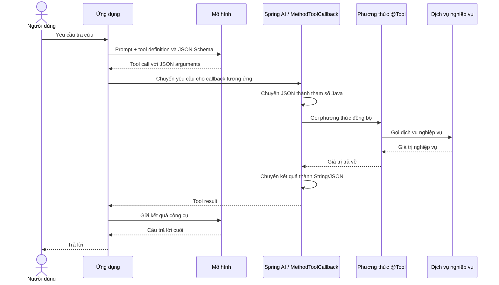

# Giới hạn kiểu Optional, bất đồng bộ và reactive ở method-based tool

Khi khai báo công cụ bằng `@Tool`, kiểu dữ liệu trong chữ ký phương thức không chỉ là chi tiết triển khai Java. Spring AI phải chuyển các tham số thành JSON Schema để mô hình biết cần gửi dữ liệu gì, sau đó chuyển kết quả thực thi thành chuỗi để gửi lại mô hình. Vì vậy, kiểu đầu vào và đầu ra cần biểu diễn được bằng một hợp đồng dữ liệu có cấu trúc và có thể chuyển đổi đồng bộ.

Trong Spring AI 2.1.0, `MethodToolCallback` không tự unwrap `Optional`, không chờ `Future`/`CompletableFuture` và không subscribe hoặc thu thập `Flow`, `Mono`, `Flux`. Các kiểu này không được hỗ trợ làm tham số hoặc kiểu trả về của method-based tool. Một phương thức có thể biên dịch hợp lệ trong Java nhưng vẫn không tạo được schema hoặc kết quả tool như mong đợi khi Spring AI đăng ký và thực thi nó.

Bài học này tập trung vào ranh giới kiểu dữ liệu của method-based tool, cách biểu diễn tham số tùy chọn và kết quả không tìm thấy, cách tích hợp tác vụ bất đồng bộ mà không trả publisher trực tiếp cho mô hình, cùng các kiểm thử giúp phát hiện chữ ký không tương thích trước khi triển khai.

## Method-based tool cần một hợp đồng dữ liệu đồng bộ

Với cách khai báo `@Tool`, Spring AI tạo `MethodToolCallback` từ phương thức Java. Callback này giữ định nghĩa công cụ gồm tên, mô tả và input schema; khi mô hình yêu cầu gọi, callback chuyển JSON arguments thành tham số Java, gọi phương thức và chuyển giá trị trả về thành chuỗi.



`ToolCallback` có phương thức thực thi đồng bộ `String call(String toolInput)` và overload nhận thêm `ToolContext`. Spring AI cung cấp `MethodToolCallback` và `FunctionToolCallback` để triển khai hợp đồng này. Với method-based tool, tham số phải có schema mà mô hình hiểu được và kết quả phải có thể chuyển đổi thành dữ liệu gửi lại mô hình.

Điều này giải thích vì sao một chữ ký như `CompletableFuture<Order>` hoặc `Mono<Order>` không có nghĩa Spring AI sẽ đợi kết quả. Callback không tự biến thành một API bất đồng bộ chỉ vì phương thức Java trả về một kiểu reactive hoặc future.

## Các kiểu không được hỗ trợ trong method-based tool

Theo tài liệu Spring AI 2.1.0, các kiểu sau không được hỗ trợ làm tham số hoặc kiểu trả về của `MethodToolCallback`:

| Kiểu | Vấn đề | Cách thiết kế phù hợp |
|---|---|---|
| `Optional<T>` | Spring AI không tự lấy giá trị bên trong `Optional` và không dùng nó như một kiểu nullable của schema | Dùng `@ToolParam(required = false)` hoặc `@Nullable` cho tham số; trả DTO/value cụ thể thay vì `Optional<T>` |
| `Future<T>`, `CompletableFuture<T>` | Callback không tự chờ future hoàn tất để lấy giá trị `T` | Phơi bày phương thức đồng bộ trả giá trị thật, hoặc chuyển tác vụ dài thành job có mã định danh |
| `Flow.Publisher<T>`, `Mono<T>`, `Flux<T>` | Spring AI không tự subscribe, await hay collect publisher | Trả một giá trị/DTO đã hoàn tất; dùng tích hợp async chuyên biệt nếu kiến trúc thực sự cần async |
| `Function`, `Supplier`, `Consumer` | `MethodToolCallbackProvider` bỏ qua phương thức `@Tool` trả functional type và ghi warning | Nếu muốn công bố function/lambda/method reference, dùng `FunctionToolCallback` theo đúng hợp đồng của nó |

Các kiểu này không có biểu diễn phù hợp trong JSON Schema hoặc không phải là giá trị kết quả có thể serialize trực tiếp cho mô hình. Việc đổi kiểu trả về trong Java mà không đổi hợp đồng tool sẽ dẫn tới lỗi đăng ký, lỗi chuyển đổi hoặc một kết quả không có ý nghĩa.

Lưu ý: `FunctionToolCallback` là một cách khai báo tool khác với `MethodToolCallback`. Nó phù hợp với `Function`, `Supplier`, `Consumer` hoặc method reference có kiểu đầu vào/đầu ra được hỗ trợ. Việc chuyển sang function-based không tự động làm cho `CompletableFuture`, `Mono` hay `Flux` được unwrap. Cần kiểm tra giới hạn riêng của function-based tool trước khi chọn cách này.

## Thay `Optional` ở tham số bằng tham số tùy chọn của schema

`Optional<T>` thường được dùng trong service Java để biểu diễn dữ liệu có thể vắng mặt. Nhưng ở biên tool, mô hình cần thấy một thuộc tính JSON có kiểu cụ thể và biết thuộc tính đó có bắt buộc hay không.

Ví dụ không phù hợp:

```java
@Tool(description = "Tìm sản phẩm theo danh mục")
public List<ProductSummary> searchProducts(
        String keyword,
        Optional<String> category) {
    // Không dùng Optional làm tham số của method-based tool.
    return productService.search(keyword, category);
}
```

Hãy dùng kiểu dữ liệu thông thường và đánh dấu thuộc tính không bắt buộc:

```java
@Tool(description = "Tìm sản phẩm theo từ khóa và danh mục nếu có")
public List<ProductSummary> searchProducts(
        @ToolParam(description = "Từ khóa tìm kiếm") String keyword,
        @ToolParam(
                description = "Mã danh mục để lọc; bỏ qua nếu muốn tìm trong mọi danh mục",
                required = false) String category) {

    if (keyword == null || keyword.isBlank()) {
        throw new IllegalArgumentException("Từ khóa tìm kiếm không được để trống.");
    }

    String normalizedCategory = (category == null || category.isBlank())
            ? null
            : category.trim();

    return productService.search(keyword.trim(), normalizedCategory);
}
```

Trong schema, `keyword` là thuộc tính bắt buộc còn `category` có thể được bỏ qua. Khi mô hình không cung cấp `category`, phương thức nhận `null` và ứng dụng quyết định hành vi mặc định. Có thể dùng `@Nullable` thay cho `@ToolParam(required = false)` nếu muốn diễn tả tính nullable bằng annotation. Không dùng kiểu primitive như `int` cho tham số tùy chọn có thể vắng mặt; dùng wrapper như `Integer` để có thể biểu diễn `null`.

Đừng đánh dấu tất cả tham số là tùy chọn chỉ để tránh lỗi schema. Nếu thiếu một tham số khiến thao tác không thể thực hiện an toàn, hãy giữ nó là bắt buộc hoặc yêu cầu người dùng bổ sung. Schema phản ánh hợp đồng đầu vào; kiểm tra ở server vẫn phải xác minh định dạng, giới hạn và quy tắc nghiệp vụ.

## Thay `Optional` ở kết quả bằng DTO có ý nghĩa

Một service có thể trả `Optional<Customer>` khi tra cứu dữ liệu:

```java
Optional<Customer> findCustomer(String customerId);
```

Không đưa nguyên kiểu `Optional<Customer>` ra chữ ký `@Tool`. Hãy unwrap nó bên trong phương thức tool và trả về một DTO có trạng thái rõ ràng:

```java
public record CustomerSummary(String id, String displayName) {
}

public record CustomerLookupResult(
        boolean found,
        CustomerSummary customer,
        String message) {
}
```

```java
@Component
public class CustomerTools {

    private final CustomerService customerService;

    public CustomerTools(CustomerService customerService) {
        this.customerService = customerService;
    }

    @Tool(description = "Tra cứu khách hàng theo mã khách hàng")
    public CustomerLookupResult lookupCustomer(
            @ToolParam(description = "Mã khách hàng") String customerId) {

        return customerService.findCustomer(customerId)
                .map(customer -> new CustomerLookupResult(
                        true,
                        new CustomerSummary(customer.id(), customer.displayName()),
                        "Đã tìm thấy khách hàng."))
                .orElseGet(() -> new CustomerLookupResult(
                        false,
                        null,
                        "Không tìm thấy khách hàng theo mã đã cung cấp."));
    }
}
```

`Optional` vẫn hữu ích bên trong tầng nghiệp vụ. Chỉ cần chuyển nó thành một kết quả cụ thể tại biên tool. DTO cho mô hình biết rõ trường hợp tìm thấy và không tìm thấy, thay vì buộc mô hình suy đoán ý nghĩa của một wrapper Java hoặc kết quả `null`.

Kết quả trả về được `ToolCallResultConverter` chuyển thành chuỗi; converter mặc định dùng Jackson để serialize. Vì vậy, nên dùng DTO có cấu trúc ổn định, trường dữ liệu tối thiểu và kiểu đơn giản. Tránh trả JPA entity, object chứa lazy relationship hoặc dữ liệu nội bộ không cần thiết.

## Không trả `Future` hoặc `CompletableFuture` trực tiếp

Một phương thức service có thể thực hiện công việc bất đồng bộ:

```java
CompletableFuture<Report> generateReportAsync(String reportId);
```

Chữ ký sau không phù hợp với method-based tool:

```java
@Tool(description = "Tạo báo cáo")
public CompletableFuture<Report> generateReport(String reportId) {
    return reportService.generateReportAsync(reportId);
}
```

Spring AI không tự gọi `get()`, `join()` hoặc chờ future hoàn tất. Nếu cần một tool đồng bộ trả về báo cáo đã tạo, hãy đặt một facade đồng bộ có timeout và chính sách lỗi rõ ràng ở tầng ứng dụng. Việc chờ kết quả phải diễn ra trên thread cho phép blocking, với timeout, giới hạn concurrency và khả năng hủy phù hợp. Không gọi `.join()` một cách tùy tiện trên request thread hoặc thread xử lý sự kiện.

Với công việc có thời gian chạy dài, không nên giữ tool call mở chỉ để đợi một future. Hãy chuyển sang mô hình job:

1. Tool nhận yêu cầu và gọi service đưa công việc vào hàng đợi.
2. Service trả về mã job và trạng thái `ACCEPTED` ngay khi đã tiếp nhận thành công.
3. Worker nền thực hiện công việc và cập nhật trạng thái.
4. Một tool đồng bộ khác tra cứu trạng thái hoặc kết quả theo mã job.

Ví dụ:

```java
public record ReportAccepted(String jobId, String status) {
}

public record ReportStatus(String jobId, String status, String downloadReference) {
}
```

```java
@Component
public class ReportTools {

    private final ReportJobService reportJobService;

    public ReportTools(ReportJobService reportJobService) {
        this.reportJobService = reportJobService;
    }

    @Tool(description = "Gửi yêu cầu tạo báo cáo và trả về mã job để theo dõi")
    public ReportAccepted startReport(
            @ToolParam(description = "Loại báo cáo cần tạo") String reportType) {
        String jobId = reportJobService.enqueue(reportType);
        return new ReportAccepted(jobId, "ACCEPTED");
    }

    @Tool(description = "Tra cứu trạng thái job tạo báo cáo theo mã job")
    public ReportStatus getReportStatus(
            @ToolParam(description = "Mã job được trả về khi gửi yêu cầu") String jobId) {
        return reportJobService.getStatus(jobId);
    }
}
```

Tool trả về một giá trị có thể serialize ngay, trong khi công việc dài được xử lý ở nền. Với thao tác có thể được gọi lặp, service cần kiểm tra quyền, dùng idempotency key hoặc mã yêu cầu phù hợp và tránh tạo nhiều job trùng nhau. Nếu mô hình tiếp tục hỏi trạng thái, giới hạn số lần polling và thời gian chờ theo ngân sách của request; với công việc rất dài, có thể kết thúc lượt hội thoại và để người dùng hỏi lại khi cần.

## Không trả `Mono`, `Flux` hoặc `Flow` trực tiếp

Trong ứng dụng reactive, service có thể trả `Mono<Customer>` hoặc `Flux<Order>`. Các kiểu publisher mô tả một quá trình phát dữ liệu, không phải dữ liệu đã được tạo sẵn. Method-based tool không tự subscribe hoặc thu thập các publisher này.

Ví dụ không phù hợp:

```java
@Tool(description = "Lấy thông tin đơn hàng")
public Mono<OrderSummary> getOrder(String orderId) {
    return orderService.findOrder(orderId);
}
```

Hoặc:

```java
@Tool(description = "Liệt kê đơn hàng")
public Flux<OrderSummary> listOrders(String customerId) {
    return orderService.findOrders(customerId);
}
```

Đổi `Flux<T>` thành `Mono<List<T>>` cũng không khiến method-based tool tự hiểu publisher. Cần thực sự thu thập kết quả ở một ranh giới phù hợp rồi trả `List<T>` hoặc một DTO đồng bộ. Nếu cần giới hạn số phần tử, hãy áp dụng ở truy vấn/service trước khi tạo kết quả gửi mô hình.

Không gọi `.block()` bên trong mọi `@Tool` method như một cách sửa nhanh. `.block()` làm mất tính non-blocking và có thể gây lỗi hoặc làm nghẽn Reactor event-loop nếu tool được thực thi trên thread đó. Chỉ dùng cầu nối blocking khi biết rõ execution context cho phép blocking, có timeout và giới hạn tải. Với hệ thống WebFlux hoặc tải lớn, nên cân nhắc tách thao tác bất đồng bộ khỏi method-based tool hoặc dùng một tích hợp async có hợp đồng riêng.

## Streaming của ChatClient không làm method-based tool thành reactive

Spring AI hỗ trợ cả `.call()` và `.stream()` cho `ChatClient`. Chế độ streaming phát các phần phản hồi của mô hình và có thể phát các delta của tên công cụ hoặc đối số khi provider hỗ trợ. Tuy nhiên, điều đó không thay đổi hợp đồng của method-based tool:

- `ToolCallback.call(...)` vẫn là lời gọi đồng bộ trả về `String`.
- `ToolCallingAdvisor` vẫn quản lý vòng lặp tool calling và chỉ thực thi tool call hoàn chỉnh.
- Các `ToolCallPart` từng phần trong stream chỉ là mảnh dữ liệu; chúng không phải một yêu cầu gọi công cụ hoàn chỉnh và không được thực thi riêng lẻ.
- Việc giao diện người dùng nhận token hoặc tool-call progress theo stream không đồng nghĩa phương thức `@Tool` có thể trả `Mono` hoặc `Flux`.

Nếu cần hiển thị tiến độ, hãy phát sự kiện tiến độ riêng từ service/job hoặc mở rộng vòng lặp/advisor theo điểm mở rộng của Spring AI. Đừng biến stream đối số JSON thành publisher kết quả của phương thức tool.

## Khi nào nên dùng FunctionToolCallback hoặc tích hợp async khác?

Spring AI có ba hướng định nghĩa tool: phương thức `@Tool`, `MethodToolCallback` và `FunctionToolCallback`. Hãy chọn theo kiểu hợp đồng cần công bố:

| Cách định nghĩa | Dùng khi | Lưu ý về kiểu |
|---|---|---|
| `@Tool` / `MethodToolCallback` | Có phương thức Java đồng bộ, muốn Spring AI tạo schema từ tham số | Không dùng `Optional`, `Future`, `CompletableFuture`, `Flow`, `Mono`, `Flux` hoặc functional type làm tham số/return |
| `FunctionToolCallback` | Muốn công bố lambda, `Function`, `Supplier`, `Consumer` hoặc method reference | Dùng input type và output có thể serialize; không mặc định rằng future/publisher được tự unwrap |
| Tích hợp MCP async | Muốn cung cấp tool qua Model Context Protocol với adapter async chuyên biệt | Đây là hợp đồng và cấu hình riêng của MCP async server/client, không phải khả năng tự động của `@Tool` method |

Nếu dùng MCP async server, hãy làm theo tài liệu MCP server tương ứng về `@McpTool`, chế độ `ASYNC` và kiểu kết quả được chấp nhận. Không đổi annotation `@Tool` thành `@McpTool` một cách máy móc: hai adapter có mục tiêu, lifecycle và cấu hình khác nhau. Với MCP, một tool call vẫn phải trả về một kết quả theo hợp đồng giao thức; stream nhiều phần tử cần được xử lý theo quy tắc riêng của server.

## Kiểm thử chữ ký và kết quả tool

Không nên đợi đến lúc mô hình gọi tool thật mới phát hiện chữ ký không tương thích. Hãy kiểm tra ở unit test hoặc integration test:

| Trường hợp | Điều cần xác minh |
|---|---|
| Tham số tùy chọn | Schema đánh dấu đúng thuộc tính không bắt buộc; khi bị bỏ qua, phương thức nhận giá trị null và áp dụng mặc định hợp lệ |
| Tham số bắt buộc | Schema giữ thuộc tính trong danh sách required; server vẫn xác thực giá trị |
| Service trả `Optional<T>` | Tool unwrap trong phương thức và trả DTO có trạng thái rõ ràng |
| Method trả `Optional`, `Future`, `CompletableFuture`, `Mono`, `Flux` hoặc `Flow` | Không đăng ký chữ ký đó như method-based tool; test cấu hình/đăng ký phải phát hiện sớm |
| Method trả DTO/collection hỗ trợ | Converter serialize được kết quả và không làm lộ trường nội bộ |
| Job bất đồng bộ | Tool trả job ID; trạng thái chuyển từ `ACCEPTED` sang trạng thái kết thúc; polling bị giới hạn |
| Lỗi timeout hoặc hủy | Lỗi được chuyển thành thông báo an toàn; không để job hoặc request chạy không giới hạn |
| ChatClient streaming | Tool chỉ chạy sau khi nhận tool call hoàn chỉnh; không thực thi từ argument delta |

Có thể kiểm tra schema bằng `ToolDefinition` tạo từ callback:

```java
ToolCallback callback = ToolCallbacks.from(new ProductTools(productService))[0];
String schema = callback.getToolDefinition().inputSchema();

assertThat(schema).contains("category");
// Kiểm tra thêm danh sách required để bảo đảm category không bắt buộc.
```

Đoạn mã trên là minh họa kiểm tra schema; trong test thực tế, nên parse chuỗi JSON thành cây JSON rồi assert cấu trúc `properties` và `required`, thay vì chỉ tìm chuỗi. Cách này ít phụ thuộc vào thứ tự thuộc tính hoặc format JSON.

Đối với kết quả, hãy kiểm thử cả trường hợp tìm thấy và không tìm thấy. Với job bất đồng bộ, kiểm tra quyền sở hữu job trước khi trả trạng thái hoặc reference tải xuống. Không cho phép model đoán `jobId` của người dùng khác rồi truy vấn dữ liệu chỉ dựa vào chuỗi đó.

## Checklist trước khi công bố method-based tool

1. Tất cả tham số có kiểu dữ liệu đơn giản hoặc DTO mà JSON Schema hỗ trợ không?
2. Tham số tùy chọn có dùng `@ToolParam(required = false)` hoặc `@Nullable` thay cho `Optional` không?
3. Phương thức có trả giá trị thực tế thay vì `Optional`, `Future`, `CompletableFuture`, `Flow`, `Mono` hoặc `Flux` không?
4. Nếu service trả `Optional`, đã unwrap ở trong tool method và chuyển thành DTO có trạng thái rõ ràng chưa?
5. Nếu công việc dài, đã dùng job ID hoặc một kiến trúc async riêng thay vì giữ tool call mở không?
6. Có tránh `.block()` trên Reactor event-loop và có giới hạn timeout/concurrency khi buộc phải bridge blocking không?
7. Kết quả đã được chuyển thành DTO tối thiểu, có thể serialize và không chứa dữ liệu nhạy cảm không?
8. Có kiểm thử schema, kết quả rỗng, lỗi, timeout, job status và streaming không?

## Kết luận

Method-based tool trong Spring AI cần một chữ ký có thể chuyển thành JSON Schema và một giá trị trả về có thể serialize đồng bộ. `Optional`, `Future`, `CompletableFuture`, `Flow`, `Mono`, `Flux` không được tự unwrap; hãy dùng tham số nullable/optional ở schema và trả DTO cụ thể. Với tác vụ dài, trả mã job để theo dõi; với yêu cầu reactive thực sự, chọn tích hợp async có hợp đồng riêng hoặc tổ chức phần chờ kết quả ở tầng điều phối ứng dụng. `ChatClient.stream()` hỗ trợ stream phản hồi hội thoại, nhưng không thay đổi chữ ký đồng bộ của `ToolCallback`.

## Tài liệu tham khảo

- [Spring AI 2.1.0 — Tool Calling](https://docs.spring.io/spring-ai/reference/api/tools.html) — các cách định nghĩa tool, `MethodToolCallback`, giới hạn `Optional`/async/reactive, `ToolCallback` và streaming.
- [Spring AI 2.1.0 — Tool Specification Reference](https://docs.spring.io/spring-ai/reference/2.1/api/tools.html) — schema đầu vào, kết quả tool, `ToolCallResultConverter` và exception processing.
- [Spring AI 2.1.0 — MCP Server Annotations](https://docs.spring.io/spring-ai/reference/api/mcp/mcp-annotations-server.html) — hợp đồng riêng của MCP sync/async server và kiểu kết quả reactive.
