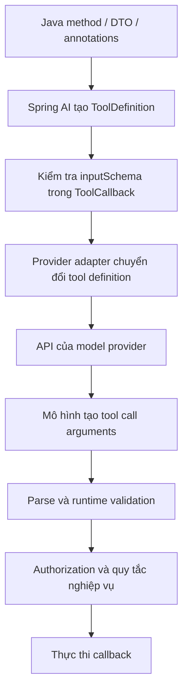

# Kiểm tra schema thực tế và mức tương thích với từng nhà cung cấp

Schema đầu vào là hợp đồng mô tả dữ liệu mà mô hình có thể gửi khi yêu cầu gọi một công cụ. Trong Spring AI, schema thường được tạo từ chữ ký phương thức `@Tool`, các annotation như `@ToolParam`, hoặc kiểu đầu vào được khai báo khi xây dựng `FunctionToolCallback`. Tuy nhiên, schema trong mã nguồn mới chỉ là điểm bắt đầu. Khi tích hợp với một model provider, cần xác minh schema mà callback thực sự công bố, schema mà adapter gửi lên API và mức độ mà model/provider hỗ trợ.

Một công cụ có thể chạy đúng trong unit test nhưng bị provider từ chối vì schema chứa keyword không được hỗ trợ. Một schema hợp lệ theo JSON Schema cũng không bảo đảm mô hình luôn tạo đối số đúng. Vì vậy, kiểm tra schema cần bao gồm cả cấu trúc, khả năng tương thích, hành vi tạo tool call và validation ở phía ứng dụng.

Trong module `SPRING_AI_TOOL_CALLING`, ứng dụng sử dụng `@Tool`, `ToolCallback`, schema đầu vào và `ToolContext` để kết nối mô hình với dịch vụ nghiệp vụ. Mục tiêu của bài này là xây dựng quy trình kiểm tra có thể lặp lại khi thay đổi DTO, Spring AI version, model, provider hoặc endpoint.

## 1. Phân biệt ba lớp schema

Khi kiểm tra tool calling, cần phân biệt ba thứ có liên quan nhưng không đồng nhất:

1. **Schema được Spring AI tạo ra:** định nghĩa đầu vào nằm trong `ToolDefinition` của callback. Đây là schema mà ứng dụng có thể kiểm tra trực tiếp trước khi gửi prompt.
2. **Schema được provider nhận:** adapter của Spring AI chuyển tool definition sang định dạng API của nhà cung cấp. Adapter có thể ánh xạ, chuẩn hóa hoặc giới hạn một số phần của schema.
3. **Đối số mô hình thực sự tạo ra:** JSON arguments trong tool call. Đây là dữ liệu runtime và vẫn phải được parse, validate và kiểm tra quyền trước khi thực thi.



Việc đọc `ToolDefinition.inputSchema()` xác nhận schema mà callback công bố. Nó không tự chứng minh payload gửi qua mạng giống hệt chuỗi đó. Muốn xác minh lớp thứ hai, cần kiểm tra request thực tế ở adapter hoặc HTTP client theo cách an toàn. Lớp thứ ba phải được kiểm tra ở ranh giới thực thi.

## 2. Lấy schema thực tế từ ToolCallback

Spring AI cung cấp `ToolDefinition` thông qua `ToolCallback`. Với phương thức được đánh dấu `@Tool`, có thể tạo callback bằng `ToolCallbacks.from(...)`, sau đó đọc tên, mô tả và input schema:

```java
import com.fasterxml.jackson.databind.JsonNode;
import com.fasterxml.jackson.databind.ObjectMapper;
import org.springframework.ai.tool.ToolCallback;
import org.springframework.ai.tool.ToolCallbacks;
import org.springframework.ai.tool.definition.ToolDefinition;

ObjectMapper objectMapper = new ObjectMapper();
ToolCallback[] callbacks = ToolCallbacks.from(orderTools);

for (ToolCallback callback : callbacks) {
    ToolDefinition definition = callback.getToolDefinition();

    String toolName = definition.name();
    String description = definition.description();
    String inputSchemaJson = definition.inputSchema();

    JsonNode schema = objectMapper.readTree(inputSchemaJson);
    System.out.println(toolName);
    System.out.println(description);
    System.out.println(schema.toPrettyString());
}
```

Đoạn mã minh họa API của Spring AI 1.x/2.x. Package hoặc chi tiết API có thể thay đổi giữa các phiên bản; hãy dùng đúng import và Javadoc của dependency trong dự án. Điểm cần kiểm tra là metadata của callback đã được tạo, thay vì chỉ suy luận schema từ chữ ký Java.

Với callback tạo từ function, cũng có thể lấy `ToolDefinition` sau khi build:

```java
ToolCallback callback = FunctionToolCallback
        .builder("getOrderStatus", orderQueryService::findStatus)
        .description("Tra cứu trạng thái đơn hàng theo mã đơn hàng.")
        .inputType(OrderQuery.class)
        .build();

String actualSchema = callback.getToolDefinition().inputSchema();
```

`inputType(OrderQuery.class)` là đầu vào để Spring AI suy ra schema. Nếu thay đổi record hoặc DTO, schema tạo ra cũng có thể thay đổi. Vì vậy, kiểm tra callback đã build là cách xác nhận kết quả của quá trình tạo schema.

## 3. Kiểm tra cấu trúc JSON Schema

Một schema object thường có các thành phần quan trọng như `type`, `properties`, `required` và `additionalProperties`. Ví dụ, một tool tra cứu đơn hàng có thể tạo schema tương tự:

```json
{
  "type": "object",
  "properties": {
    "orderId": {
      "type": "string",
      "description": "Mã đơn hàng, ví dụ ORD-2048"
    },
    "includeShipment": {
      "type": "boolean",
      "description": "Có lấy thêm thông tin vận chuyển hay không"
    }
  },
  "required": ["orderId"],
  "additionalProperties": false
}
```

Đây là schema minh họa, không phải cam kết rằng mọi phiên bản Spring AI đều sinh chính xác các trường như trên. Cấu hình Jackson, annotation, kiểu Java, schema generator và provider adapter có thể làm kết quả khác nhau.

Khi đọc schema, hãy kiểm tra:

| Thành phần | Điều cần xác minh |
|---|---|
| `type` | Root có phải object khi tool nhận một DTO hay không; kiểu từng trường có đúng ý nghĩa không |
| `properties` | Tên trường có rõ nghĩa và khớp với DTO/record không |
| `required` | Chỉ những trường thực sự bắt buộc mới xuất hiện trong danh sách |
| `description` | Mô tả của tool và từng tham số có được đưa vào schema không |
| `enum` | Các giá trị hợp lệ có đúng và không bị thiếu không |
| `items` | Kiểu phần tử của array có đúng không |
| object lồng nhau | Các `properties` và `required` ở từng cấp có đúng không |
| `additionalProperties` | Có cho phép trường không khai báo hay cần đóng schema theo provider không |
| ràng buộc | `format`, giới hạn số, độ dài và pattern có được sinh và được provider hỗ trợ không |

Không chỉ kiểm tra schema có phải JSON parse được. Một chuỗi JSON hợp lệ vẫn có thể mô tả sai kiểu, thiếu trường bắt buộc hoặc chứa keyword không tương thích.

## 4. Tự động kiểm tra các trường quan trọng

Có thể viết một kiểm tra hợp đồng nhỏ để phát hiện thay đổi schema ngoài dự kiến. Ví dụ:

```java
JsonNode schema = objectMapper.readTree(
        callback.getToolDefinition().inputSchema());

assertThat(schema.path("type").asText()).isEqualTo("object");
assertThat(schema.path("properties").has("orderId")).isTrue();
assertThat(schema.path("properties").path("orderId").path("type").asText())
        .isEqualTo("string");
assertThat(schema.path("required").toString()).contains("orderId");
```

Đây là kiểm tra minh họa bằng AssertJ. Trong dự án, nên kiểm tra các trường có ý nghĩa đối với hợp đồng thay vì khóa cứng toàn bộ thứ tự key hoặc khoảng trắng của JSON. JSON object không dựa vào thứ tự thuộc tính; snapshot test nên parse và chuẩn hóa cấu trúc trước khi so sánh.

Một lựa chọn khác là lưu schema đã chuẩn hóa làm fixture và so sánh khi build callback. Khi có thay đổi, reviewer sẽ thấy rõ trường nào được thêm, xóa, đổi kiểu hoặc chuyển từ optional sang required. Thay đổi schema là thay đổi hợp đồng với mô hình, nên cần được xem xét có chủ đích.

## 5. Schema được gửi lên provider có thể khác schema trong callback

Spring AI dùng model-specific adapter để chuyển request hội thoại và tool definitions sang giao thức của provider. Adapter có thể:

- Đổi tên hoặc lồng các trường theo cấu trúc API của provider.
- Đóng gói schema vào cấu trúc `function` hoặc `tool` tương ứng.
- Áp dụng lựa chọn tool, chế độ strict hoặc tùy chọn riêng của model.
- Chuẩn hóa hoặc giới hạn một số keyword không được provider hỗ trợ.
- Từ chối request nếu schema không thỏa điều kiện của endpoint/model.

Vì thế, cần phân biệt câu hỏi “Spring AI tạo schema gì?” với “Provider thực sự nhận payload gì?”. Câu hỏi thứ nhất có thể trả lời bằng `ToolDefinition.inputSchema()`. Câu hỏi thứ hai cần kiểm tra request đã được adapter serialize.

Khi cần xem payload, hãy dùng logging hoặc tracing ở HTTP client/provider adapter trong môi trường kiểm thử. Che API key, bearer token, thông tin người dùng, dữ liệu nghiệp vụ và nội dung nhạy cảm. Không bật log body đầy đủ trong production nếu chưa có cơ chế lọc và kiểm soát truy cập phù hợp.

Một request được gửi thành công cũng chưa chứng minh model tuân thủ schema ở mọi lần gọi. Provider có thể chấp nhận schema nhưng mô hình vẫn tạo đối số thiếu hoặc không đúng ý nghĩa. Do đó, kiểm tra request cần đi cùng kiểm thử phản hồi và validation runtime.

## 6. Vì sao mức tương thích khác nhau giữa provider?

JSON Schema có nhiều keyword và khả năng biểu diễn. Các nhà cung cấp, model và phiên bản endpoint có thể hỗ trợ những tập con khác nhau. Một số provider chỉ chấp nhận các kiểu và cấu trúc cơ bản; một số chế độ strict có thêm ràng buộc về object, trường bắt buộc và thuộc tính bổ sung.

Những điểm thường cần xác minh gồm:

- **Primitive types:** `string`, `integer`, `number`, `boolean` và cách biểu diễn `null`.
- **Required và optional:** provider có phân biệt trường bị bỏ qua với trường mang giá trị `null` không; strict mode có yêu cầu khai báo mọi property trong `required` không.
- **Enum:** kiểu dữ liệu và số lượng giá trị enum có được chấp nhận không.
- **Nested object và array:** schema lồng nhau, `items`, object bên trong array và nhiều cấp lồng có được hỗ trợ không.
- **Object mở:** `additionalProperties`, `Map<String, Object>` hoặc trường động có được chấp nhận không.
- **Constraint:** `format`, `pattern`, `minimum`, `maximum`, `minLength`, `maxLength` và các giới hạn khác có được giữ lại không.
- **Composition:** `oneOf`, `anyOf`, `allOf`, `$ref` hoặc union type có được hỗ trợ trong chế độ đang dùng không.
- **Tool calling capability:** model có hỗ trợ tool calling, nhiều tool call trong một phản hồi, parallel tool calls hoặc lựa chọn tool bắt buộc hay không.

Đặc biệt, strict mode của một số API có thể yêu cầu object đóng bằng `additionalProperties: false` và khai báo tất cả property trong `required`; trường không bắt buộc khi đó có thể cần biểu diễn bằng kiểu cho phép `null`. Đây không phải quy tắc JSON Schema phổ quát và cũng không phải mặc định chung của mọi provider. Hãy kiểm tra tài liệu đúng model, endpoint và chế độ đang cấu hình trước khi áp dụng.

Không có một ma trận tương thích cố định cho mọi model trong cùng một provider. Khả năng có thể khác giữa model family, phiên bản model, khu vực triển khai, API version và chế độ strict. Ghi lại chính xác tổ hợp đang chạy khi phát hiện khác biệt.

## 7. Thiết kế schema theo tập con chung khi cần hỗ trợ nhiều provider

Nếu một ứng dụng phải chạy với nhiều provider, nên chọn schema đơn giản và dễ chuyển đổi. Những lựa chọn thường dễ tương thích hơn gồm:

- Object đầu vào với các thuộc tính có tên rõ ràng.
- Primitive type phổ biến và enum có tập giá trị hữu hạn.
- Array có kiểu phần tử xác định.
- DTO/record có cấu trúc tường minh thay vì object động.
- Mô tả tham số bằng ngôn ngữ rõ ràng, nêu định dạng và đơn vị.
- Tránh composition phức tạp nếu chưa xác minh provider hỗ trợ.

Ví dụ, thay vì nhận một map bất kỳ:

```java
@Tool
public SearchResult search(Map<String, Object> filters) {
    // Khó mô tả chính xác cấu trúc và kiểu của từng filter.
    return searchService.search(filters);
}
```

có thể định nghĩa DTO rõ ràng:

```java
public record OrderSearchCriteria(
        String customerId,
        OrderStatus status,
        Integer limit) {
}

@Tool(
        description = "Tìm đơn hàng theo khách hàng, trạng thái và giới hạn số kết quả.")
public List<OrderSummary> searchOrders(OrderSearchCriteria criteria) {
    return orderQueryService.search(criteria);
}
```

DTO làm rõ các trường mà mô hình có thể điền và giúp ứng dụng kiểm tra từng giá trị. Nếu provider không hỗ trợ một ràng buộc nâng cao, vẫn có thể giữ kiểm tra đó trong Java bằng Bean Validation hoặc validation nghiệp vụ.

Đừng làm schema yếu đi chỉ để provider chấp nhận request. Hãy giữ các quy tắc an toàn trong ứng dụng, đồng thời đơn giản hóa phần mô tả mà mô hình cần gửi. Schema là hướng dẫn và hợp đồng truyền dữ liệu; runtime validation vẫn là hàng rào cuối cùng.

## 8. Required, optional và nullable cần được kiểm tra riêng

Ba khái niệm này thường bị nhầm lẫn:

- **Required:** property phải xuất hiện trong object arguments.
- **Optional:** property có thể bị bỏ qua.
- **Nullable:** property có thể xuất hiện với giá trị `null`.

Một trường có thể optional nhưng không nullable, hoặc required nhưng nullable, tùy hợp đồng. Một số chế độ strict của provider biểu diễn optional theo cách khác với schema thông thường, chẳng hạn yêu cầu trường luôn xuất hiện nhưng cho phép giá trị null. Vì vậy, hãy kiểm tra cả danh sách `required` và kiểu của property.

Ví dụ minh họa cho schema thông thường:

```json
{
  "type": "object",
  "properties": {
    "orderId": { "type": "string" },
    "note": { "type": "string" },
    "deliveryInstruction": { "type": ["string", "null"] }
  },
  "required": ["orderId"],
  "additionalProperties": false
}
```

Trong ví dụ này, `orderId` bắt buộc; `note` có thể bị bỏ qua nhưng nếu có thì phải là string; `deliveryInstruction` có thể bị bỏ qua và kiểu cho phép null nếu được gửi. Cách biểu diễn nullable bằng union type có thể không tương thích với mọi provider hoặc strict mode. Khi chuyển provider, phải kiểm tra lại schema cuối cùng và các trường hợp arguments thực tế.

Không suy luận optional chỉ từ việc Java dùng wrapper type. Hãy đọc schema được tạo ra, xác minh annotation như `@ToolParam(required = false)` hoặc `@Nullable`, rồi kiểm tra runtime behavior cho cả trường bị thiếu và trường có giá trị null.

## 9. Ma trận tương thích theo provider, model và endpoint

Không nên chỉ ghi “provider A hỗ trợ JSON Schema”. Hãy ghi nhận tổ hợp thực tế và các tính năng đã thử:

| Trục kiểm tra | Giá trị cần ghi nhận |
|---|---|
| Provider | Tên nhà cung cấp hoặc adapter Spring AI |
| Endpoint/API version | API version, base URL hoặc loại endpoint đang dùng |
| Model | Model ID chính xác và phiên bản nếu có |
| Tool mode | Auto, required, named tool hoặc strict mode nếu được hỗ trợ |
| Schema features | Primitive, enum, nested object, array, nullable, additionalProperties, constraints, composition |
| Tool behavior | Một tool call, nhiều tool call, parallel calls, tool choice |
| Kết quả | Request được chấp nhận, schema bị từ chối, arguments được tạo đúng, lỗi runtime |

Một bảng kiểm thử trong dự án có thể trông như sau:

| Schema fixture | Provider / model A | Provider / model B | Ghi chú |
|---|---|---|---|
| Primitive + required | PASS / FAIL / NOT TESTED | PASS / FAIL / NOT TESTED | Trường bắt buộc và kiểu cơ bản |
| Enum | PASS / FAIL / NOT TESTED | PASS / FAIL / NOT TESTED | Giá trị ngoài enum phải bị ứng dụng từ chối |
| Nested DTO | PASS / FAIL / NOT TESTED | PASS / FAIL / NOT TESTED | Kiểm tra nhiều cấp object |
| Array of object | PASS / FAIL / NOT TESTED | PASS / FAIL / NOT TESTED | Kiểm tra `items` |
| Optional / nullable | PASS / FAIL / NOT TESTED | PASS / FAIL / NOT TESTED | Phân biệt absent và null |
| Strict / closed object | PASS / FAIL / NOT TESTED | PASS / FAIL / NOT TESTED | Kiểm tra `required` và `additionalProperties` |

Các ô PASS/FAIL/NOT TESTED là trạng thái để nhóm điền sau khi chạy thử, không phải kết quả mặc định của bất kỳ provider nào. Không sao chép kết luận từ một model sang model khác nếu chưa kiểm thử.

## 10. Quy trình kiểm tra khi thêm hoặc thay đổi tool

Một quy trình có thể áp dụng trong pull request:

1. **Tạo callback:** build `ToolCallback` từ `@Tool` hoặc `FunctionToolCallback` bằng đúng dependency đang dùng.
2. **Đọc schema:** lấy `ToolDefinition.inputSchema()` và parse thành JSON tree.
3. **Kiểm tra hợp đồng:** xác minh root type, property, type, required, description, enum, nested object và các ràng buộc cần thiết.
4. **Kiểm tra schema hợp lệ:** dùng JSON parser hoặc JSON Schema validator phù hợp với dialect được dự án chọn.
5. **Kiểm tra provider:** gửi request kiểm thử tới từng tổ hợp provider/model/endpoint mà ứng dụng hỗ trợ.
6. **Kiểm tra tool call:** xác minh model trả arguments parse được và ánh xạ tới đúng callback.
7. **Kiểm tra runtime:** thử thiếu trường, sai kiểu, giá trị ngoài enum, quá giới hạn và dữ liệu không có quyền truy cập.
8. **Ghi nhận thay đổi:** cập nhật fixture, compatibility matrix và ghi chú khi schema thay đổi có ảnh hưởng tương thích.

Với CI, unit test có thể kiểm tra schema sinh ra mà không cần gọi provider. Kiểm thử provider thật nên chạy ở một stage có credential được quản lý và giới hạn chi phí, hoặc dùng lịch kiểm tra định kỳ. Không để test phụ thuộc mạng bên ngoài khiến mọi lần build thông thường trở nên không ổn định.

## 11. Kiểm tra payload gửi đi một cách an toàn

Khi schema đọc từ callback đúng nhưng provider vẫn từ chối request, cần quan sát payload sau bước chuyển đổi của adapter. Một số cách thực hiện:

- Bật log request ở mức debug trong môi trường local hoặc integration test.
- Dùng HTTP client interceptor hoặc wire logging có bộ lọc để lưu phần `tools`/`functions` cần kiểm tra.
- Dùng mock HTTP server để xác minh request body mà adapter gửi đi.
- So sánh payload đã serialize với schema trong `ToolDefinition` để xác định adapter có thay đổi cấu trúc nào.

Chỉ ghi phần cần thiết. Loại bỏ authorization header, API key, prompt chứa dữ liệu cá nhân, arguments thật và nội dung nghiệp vụ nhạy cảm. Một fixture schema giả lập đủ để kiểm tra cấu trúc; không cần lưu payload production đầy đủ.

Nếu provider trả lỗi validation, lưu mã lỗi, đường dẫn schema hoặc tên keyword bị từ chối nếu response có cung cấp. Những chi tiết đó giúp xác định lỗi nằm ở JSON syntax, schema dialect, tính năng provider không hỗ trợ hay cấu hình model.

## 12. Schema không thay thế runtime validation và authorization

Ngay cả khi provider chấp nhận schema và mô hình thường tạo arguments đúng, ứng dụng vẫn phải kiểm tra dữ liệu. Tool call có thể đến từ model không tuân thủ schema, adapter giả lập trong test, client lỗi hoặc phản hồi bị hỏng.

Ở callback/service, hãy kiểm tra:

- Giá trị bắt buộc có mặt và không rỗng.
- Chuỗi có đúng định dạng và giới hạn độ dài.
- Số nằm trong miền hợp lệ và không gây tràn hoặc tiêu tốn tài nguyên bất thường.
- Enum thuộc tập giá trị được hỗ trợ.
- Array có số phần tử hợp lý; phần tử lồng nhau cũng được kiểm tra.
- ID tham chiếu thực sự tồn tại trong phạm vi mà người dùng được phép truy cập.
- `userId`, `tenantId` và quyền được lấy từ ngữ cảnh server tin cậy, không lấy từ arguments do mô hình tạo.

Schema có thể ngăn một số lỗi sớm ở phía provider, nhưng không phải ranh giới bảo mật. Kiểm tra quyền phải nằm trong service nghiệp vụ trước khi trả dữ liệu hoặc tạo tác động phụ.

## 13. Các lỗi tương thích thường gặp

| Triệu chứng | Nguyên nhân có thể | Cách điều tra |
|---|---|---|
| Provider từ chối tool definition | Keyword hoặc cấu trúc schema không nằm trong tập được hỗ trợ | Đọc mã lỗi, kiểm tra payload sau adapter và tài liệu endpoint |
| Schema callback khác fixture mong đợi | Thay đổi DTO, annotation, Jackson hoặc Spring AI version | Parse `ToolDefinition.inputSchema()` và so sánh schema đã chuẩn hóa |
| Model không điền trường bắt buộc | Description mơ hồ, schema không phù hợp hoặc model tạo arguments sai | Kiểm tra tool definition, tool call và prompt thực tế đã làm sạch |
| Optional field luôn xuất hiện | Provider strict mode yêu cầu mọi property trong `required` | Kiểm tra cách provider biểu diễn optional/nullable |
| Nested DTO bị từ chối | Provider giới hạn nested object, `$ref` hoặc composition | Thử schema tối giản, kiểm tra adapter và giới hạn model |
| Map hoặc object động không hoạt động | Provider hạn chế `additionalProperties` hoặc object mở | Dùng DTO tường minh với tập field xác định |
| Request được chấp nhận nhưng callback vẫn lỗi | Arguments không hợp lệ theo quy tắc Java/nghiệp vụ | Kiểm tra parse, Bean Validation và service authorization |
| Chuyển model làm tool call lỗi | Khả năng tool calling hoặc schema subset khác nhau | Chạy lại compatibility matrix cho model/endpoint mới |

Khi cần giảm schema để tương thích, thay đổi từng phần và giữ lại kiểm tra runtime. Đừng xóa validation nghiệp vụ hoặc mở rộng quyền truy cập để xử lý một lỗi schema.

## 14. Checklist trước khi phát hành

- Đã đọc schema từ `ToolCallback.getToolDefinition().inputSchema()` sau khi build callback.
- JSON parse được và có đúng root type, properties, required cùng kiểu dữ liệu.
- Description, enum, array và object lồng nhau phản ánh đúng hợp đồng Java.
- Đã kiểm tra `additionalProperties`, optional và nullable theo chế độ provider.
- Đã phân biệt schema Spring AI công bố với payload adapter gửi tới provider.
- Đã kiểm thử từng provider/model/endpoint được hỗ trợ, không suy rộng kết quả từ một model.
- Đã kiểm tra tool call arguments thực tế và callback được ánh xạ đúng.
- Runtime validation và authorization vẫn được thực hiện trong ứng dụng.
- Log/tracing không làm lộ credential hoặc dữ liệu nghiệp vụ nhạy cảm.
- Schema fixture và compatibility matrix được cập nhật khi hợp đồng thay đổi.

## 15. Tài liệu tham khảo

- [Spring AI — Tool Calling](https://docs.spring.io/spring-ai/reference/api/tools.html): khai báo tool, `ToolCallback`, `ToolDefinition`, schema đầu vào và thực thi callback.
- [Spring AI — API Reference](https://docs.spring.io/spring-ai/docs/current/api/): tra cứu Javadoc đúng phiên bản của `ToolCallback`, `ToolDefinition`, `ToolCallbacks` và schema generator.
- [JSON Schema](https://json-schema.org/): khái niệm, cấu trúc và keyword của JSON Schema.

Kiểm tra schema không dừng ở việc Java tạo được JSON. Cần xác minh schema callback, payload sau adapter, tập tính năng mà provider/model chấp nhận và arguments ở runtime. Khi bốn lớp này được kiểm tra riêng, ứng dụng có thể thay đổi DTO hoặc provider có kiểm soát mà vẫn giữ validation, phân quyền và tính an toàn của dịch vụ nghiệp vụ.
