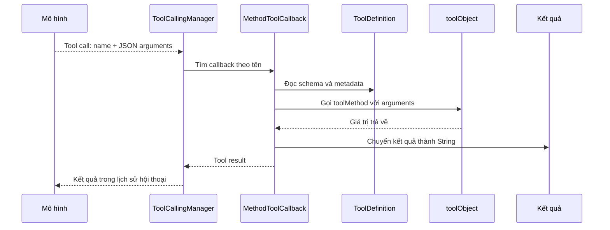

# Khi nào tạo callback từ phương thức thay cho khai báo trực tiếp

Spring AI có thể biến một phương thức Java thành công cụ cho mô hình theo hai cách chính: khai báo bằng `@Tool`, hoặc tạo `MethodToolCallback` bằng code. Cả hai cách đều đưa ra một `ToolCallback` để Spring AI sử dụng trong cùng luồng tool calling. Khác biệt nằm ở cách bạn mô tả và đăng ký công cụ.

Với `@Tool`, bạn đánh dấu phương thức và cung cấp mô tả ngay tại nơi viết logic. Đây là lựa chọn đơn giản khi bạn sở hữu lớp chứa phương thức và công cụ có cấu hình ổn định. Với `MethodToolCallback`, bạn lấy một đối tượng `Method`, tự tạo `ToolDefinition`, gắn method cùng object thực thi và tùy chỉnh metadata hoặc bộ chuyển đổi kết quả. Cách này hữu ích khi danh sách công cụ hoặc hợp đồng công cụ được quyết định lúc chạy.

Trong module Spring AI Tool Calling, `MethodToolCallback` là một cách triển khai `ToolCallback` để gọi phương thức Java. Nó cho phép ứng dụng kiểm soát tên, mô tả, schema, metadata và cách chuyển kết quả mà mô hình nhận được, trong khi phần thực thi vẫn nằm trong method nghiệp vụ.

Sau bài học, bạn có thể:

- Phân biệt khai báo công cụ bằng `@Tool` với việc tạo `MethodToolCallback`.
- Tạo callback từ một method instance bằng reflection và `MethodToolCallback.Builder`.
- Tự xây dựng `ToolDefinition` khi cần tên, mô tả hoặc schema khác mặc định.
- Cấu hình `ToolMetadata` và `ToolCallResultConverter` khi use case yêu cầu.
- Chọn đúng giữa `@Tool`, `MethodToolCallback`, `FunctionToolCallback` và việc tự triển khai `ToolCallback`.

## 1. Hai cách biến một method thành tool

Giả sử ứng dụng đã có method tra cứu thời tiết:

```java
public class WeatherOperations {

    private final WeatherService weatherService;

    public WeatherOperations(WeatherService weatherService) {
        this.weatherService = weatherService;
    }

    public WeatherReport getWeather(String city) {
        return weatherService.getCurrentWeather(city);
    }
}
```

Nếu bạn sở hữu mã nguồn và muốn công bố method này như một tool cố định, cách khai báo ngắn nhất là dùng `@Tool`:

```java
@Component
public class WeatherTools {

    private final WeatherService weatherService;

    public WeatherTools(WeatherService weatherService) {
        this.weatherService = weatherService;
    }

    @Tool(
        name = "get_current_weather",
        description = "Tra cứu thời tiết hiện tại của một thành phố theo tên"
    )
    public WeatherReport getCurrentWeather(
            @ToolParam(description = "Tên thành phố cần tra cứu") String city) {
        return weatherService.getCurrentWeather(city);
    }
}
```

Sau đó truyền object vào request:

```java
String answer = chatClient.prompt()
        .user("Thời tiết hiện tại ở Đà Nẵng thế nào?")
        .tools(weatherTools)
        .call()
        .content();
```

Spring AI đọc annotation để tạo định nghĩa và callback. Bạn không cần tự tìm `Method` hay dựng `ToolDefinition`.

Nếu muốn quyết định tên, mô tả và đăng ký bằng code, hãy tạo `MethodToolCallback` từ method có sẵn. Method không bắt buộc phải có `@Tool`:

```java
Method method = ReflectionUtils.findMethod(
        WeatherOperations.class, "getWeather", String.class);

if (method == null) {
    throw new IllegalStateException("Không tìm thấy method getWeather(String)");
}

ToolDefinition definition = ToolDefinitions.builder(method)
        .name("get_current_weather")
        .description("Tra cứu thời tiết hiện tại theo tên thành phố")
        .build();

ToolCallback callback = MethodToolCallback.builder()
        .toolDefinition(definition)
        .toolMethod(method)
        .toolObject(weatherOperations)
        .build();
```

`toolObject` là instance chứa method cần gọi. Tham số này bắt buộc với instance method; method `static` có thể bỏ qua object. Trong ví dụ, `weatherOperations` nên là bean được Spring quản lý để các dependency như `WeatherService` được inject đầy đủ.

## 2. MethodToolCallback làm nhiệm vụ gì?

`MethodToolCallback` kết hợp bốn phần:

| Phần | Vai trò |
| --- | --- |
| `ToolDefinition` | Hợp đồng mô hình nhìn thấy: tên tool, mô tả và JSON Schema đầu vào. |
| `toolMethod` | Method Java sẽ được gọi khi có tool call. |
| `toolObject` | Instance làm receiver khi gọi instance method. |
| `ToolMetadata` và `ToolCallResultConverter` | Tùy chọn điều khiển cách xử lý kết quả và cách chuyển kết quả thành chuỗi. |

Ở mức giao diện, `ToolCallback` cung cấp `getToolDefinition()`, `getToolMetadata()` và hai overload `call(...)`: một nhận JSON input, một nhận JSON input cùng `ToolContext`. `MethodToolCallback` hiện thực giao diện đó bằng cách chuyển JSON arguments thành tham số method, gọi method rồi chuyển kết quả về chuỗi để gửi cho mô hình.



`MethodToolCallback` không tự quyết định mô hình có gọi công cụ hay không. Nó cung cấp hợp đồng và mã thực thi. Mô hình quyết định yêu cầu gọi dựa trên định nghĩa; `ToolCallingManager` tìm callback phù hợp và gọi nó trong vòng lặp do `ChatClient`/`ToolCallingAdvisor` hoặc caller mức thấp điều phối.

## 3. Khi nào nên tạo MethodToolCallback?

Chọn cách tạo callback tường minh khi có một hoặc nhiều nhu cầu sau:

**Danh sách công cụ được quyết định lúc chạy.** Ví dụ một nền tảng SaaS chỉ bật công cụ tương ứng với module đã mua, tenant hiện tại hoặc vai trò người dùng. Ứng dụng có thể tạo danh sách callback từ cấu hình đã được kiểm tra rồi truyền vào đúng request.

**Bạn không muốn hoặc không thể sửa lớp chứa method.** Method nằm trong thư viện nội bộ, module dùng chung hoặc lớp adapter có sẵn. Có thể tạo callback bên ngoài mà không cần thêm annotation vào lớp đó.

**Hợp đồng công cụ cần được tùy chỉnh theo ngữ cảnh.** Cùng một method có thể được công bố với tên, mô tả hoặc schema khác nhau tùy phiên bản API, sản phẩm hoặc quy trình. Mỗi callback vẫn cần tên duy nhất trong tập tool gửi cho một request.

**Cần cấu hình metadata hoặc converter riêng.** `MethodToolCallback.Builder` cho phép đặt `ToolMetadata` và `ToolCallResultConverter`. Đây là điểm mở rộng khi kết quả cần được trả trực tiếp cho caller hoặc cần định dạng riêng trước khi gửi lại mô hình.

**Muốn xây dựng một registry công cụ rõ ràng.** Ứng dụng có thể khởi tạo callback ở cấu hình Spring, lưu thành bean, kiểm tra tên/schema khi khởi động và chỉ chọn callback phù hợp cho từng request.

Nếu phương thức thuộc lớp bạn sở hữu, công cụ luôn có cấu hình giống nhau và không cần metadata đặc biệt, `@Tool` thường dễ đọc, ít code và dễ bảo trì hơn.

## 4. Tạo callback trong cấu hình Spring

Một cách tổ chức thực tế là để method nghiệp vụ nằm trong bean, sau đó tạo `ToolCallback` bean trong lớp cấu hình. Spring AI có thể nhận callback này qua `.tools(...)`:

```java
@Component
public class WeatherOperations {

    private final WeatherService weatherService;

    public WeatherOperations(WeatherService weatherService) {
        this.weatherService = weatherService;
    }

    public WeatherReport getWeather(String city) {
        return weatherService.getCurrentWeather(city);
    }
}
```

```java
@Configuration(proxyBeanMethods = false)
public class ToolConfiguration {

    @Bean
    ToolCallback currentWeather(WeatherOperations operations) {
        Method method = ReflectionUtils.findMethod(
                WeatherOperations.class, "getWeather", String.class);

        if (method == null) {
            throw new IllegalStateException("Không tìm thấy WeatherOperations.getWeather(String)");
        }

        ToolDefinition definition = ToolDefinitions.builder(method)
                .name("get_current_weather")
                .description("Tra cứu thời tiết hiện tại theo tên thành phố")
                .build();

        return MethodToolCallback.builder()
                .toolDefinition(definition)
                .toolMethod(method)
                .toolObject(operations)
                .build();
    }
}
```

Tiêm callback vào service gọi AI:

```java
@Service
public class WeatherAssistant {

    private final ChatClient chatClient;
    private final ToolCallback currentWeather;

    public WeatherAssistant(ChatClient chatClient, ToolCallback currentWeather) {
        this.chatClient = chatClient;
        this.currentWeather = currentWeather;
    }

    public String ask(String question) {
        return chatClient.prompt()
                .user(question)
                .tools(currentWeather)
                .call()
                .content();
    }
}
```

Callback bean có thể được tái sử dụng ở nhiều request. Dù vậy, việc callback tồn tại trong Spring context không có nghĩa mọi người dùng đều nên được phép gọi nó. Hãy chọn callback theo quyền và mục đích của request, đặc biệt với công cụ ghi dữ liệu hoặc tạo tác động bên ngoài.

## 5. Tùy chỉnh ToolDefinition và JSON Schema

`ToolDefinitions.builder(method)` tạo định nghĩa dựa trên method. Cách này hữu ích khi muốn giữ schema suy ra từ tham số nhưng thay tên hoặc mô tả. Nếu cần toàn quyền khai báo schema, có thể tạo `ToolDefinition` trực tiếp:

```java
ToolDefinition definition = ToolDefinition.builder()
        .name("get_current_weather")
        .description("Tra cứu thời tiết hiện tại theo tên thành phố")
        .inputSchema("""
                {
                  "type": "object",
                  "properties": {
                    "city": {
                      "type": "string",
                      "description": "Tên thành phố cần tra cứu"
                    }
                  },
                  "required": ["city"],
                  "additionalProperties": false
                }
                """)
        .build();
```

Sau đó truyền `definition` vào builder của `MethodToolCallback` cùng `toolMethod` và `toolObject` như ví dụ trước. Khi tự viết schema, tên trường, kiểu dữ liệu và cấu trúc JSON phải khớp với cách Spring AI chuyển arguments sang tham số method. Một schema không khớp có thể khiến callback không chuyển đổi được đầu vào.

Bạn có thể kiểm tra định nghĩa trước khi đăng ký:

```java
ToolDefinition actualDefinition = callback.getToolDefinition();

log.info("Tool name: {}", actualDefinition.name());
log.info("Tool description: {}", actualDefinition.description());
log.debug("Tool schema: {}", actualDefinition.inputSchema());
```

Đây là cách xác minh tên và schema thực tế được công bố. Nên kiểm tra một lần khi khởi tạo hoặc trong test, thay vì ghi schema vào log ở mọi request.

## 6. Metadata và cách chuyển kết quả

`ToolMetadata` chứa các tùy chọn điều khiển việc xử lý tool. Một thuộc tính thường gặp là `returnDirect`: nếu bật, kết quả tool được trả thẳng cho caller thay vì gửi lại mô hình để tạo câu trả lời cuối.

```java
ToolMetadata metadata = ToolMetadata.builder()
        .returnDirect(true)
        .build();

ToolCallback callback = MethodToolCallback.builder()
        .toolDefinition(definition)
        .toolMethod(method)
        .toolObject(operations)
        .toolMetadata(metadata)
        .build();
```

Chỉ bật `returnDirect` khi kết quả đã có định dạng phù hợp cho ứng dụng hoặc giao diện hiển thị. Nếu cần mô hình giải thích, tóm tắt hoặc kết hợp kết quả với dữ liệu khác, hãy để kết quả quay lại mô hình.

`ToolCallResultConverter` chịu trách nhiệm chuyển giá trị method trả về thành chuỗi gửi cho mô hình. Spring AI dùng converter mặc định nếu bạn không cung cấp converter riêng. Tạo converter tùy chỉnh khi cần chuẩn hóa định dạng hoặc loại bỏ trường không nên gửi đến mô hình. Hãy giữ kết quả ngắn, có cấu trúc và chỉ chứa dữ liệu cần thiết.

Ví dụ, service có thể trả một entity chứa ghi chú nội bộ, dữ liệu audit và trường kỹ thuật. Converter hoặc lớp service nên chuyển nó thành DTO an toàn như:

```java
public record WeatherSummary(
        String city,
        String condition,
        Integer temperatureCelsius) {
}
```

Không dùng converter để che giấu lỗi phân quyền. Quyền truy cập và lọc dữ liệu phải được thực hiện trước khi kết quả rời khỏi service nghiệp vụ.

## 7. So sánh các cách định nghĩa công cụ

| Cách định nghĩa | Dùng khi | Điểm cần cân nhắc |
| --- | --- | --- |
| `@Tool` | Sở hữu method, tool ổn định, muốn khai báo ngay tại code | Ít cấu hình; khó thay hợp đồng theo runtime nếu chỉ dựa vào annotation. |
| `MethodToolCallback` | Muốn dựng callback từ Java `Method` và kiểm soát định nghĩa/metadata bằng code | Cần reflection, method và object đúng; nhiều code cấu hình hơn. |
| `FunctionToolCallback` | Logic phù hợp với `Function`, `Supplier`, `Consumer`, `BiFunction`, lambda hoặc method reference | Đầu vào thường là một kiểu request; không cần tìm `Method` bằng reflection. |
| Tự triển khai `ToolCallback` | Cần điều khiển toàn bộ việc phân giải và thực thi, ví dụ proxy đến hệ thống tool từ xa | Phải tự quản lý định nghĩa, metadata, context và chuyển kết quả. |

`@Tool` và `MethodToolCallback` đều là cách tạo callback dựa trên method. Nếu chỉ muốn dùng một method reference hoặc lambda như một hàm, `FunctionToolCallback` thường phù hợp hơn. Nếu tool không thực thi một method Java trong tiến trình hiện tại, ví dụ gọi một server MCP hoặc một dịch vụ tool từ xa, cân nhắc dùng callback riêng hoặc tích hợp tương ứng.

## 8. Reflection, vòng đời bean và native image

`MethodToolCallback` dùng Java reflection để tìm và gọi method. Vì vậy, hãy lưu ý một số điểm:

- Tìm method với đúng tên và danh sách kiểu tham số. Nếu overload nhiều method cùng tên, cần chỉ rõ chữ ký để tránh chọn nhầm.
- Kiểm tra kết quả `ReflectionUtils.findMethod(...)`; không tiếp tục tạo callback nếu method không tồn tại.
- Với instance method, dùng đúng object chứa method. Trong ứng dụng Spring, nên inject bean để giữ dependency injection, proxy và cấu hình lifecycle.
- Không tạo một object mới bằng `new` nếu method phụ thuộc các service cần Spring quản lý.
- Tránh tạo callback mới cho mọi request nếu định nghĩa và method không thay đổi. Hãy khởi tạo ở cấu hình hoặc cache theo khóa cấu hình đã kiểm soát.
- Với GraalVM native image/AOT, reflection cần được khai báo để native image giữ lại method. Kiểm tra hướng dẫn reflection registration của phiên bản Spring AI và kiểm thử bản native nếu ứng dụng triển khai theo cách này.

Một method private hoặc package-private có thể được dùng trong những trường hợp Spring AI hỗ trợ reflection, nhưng quyền truy cập và cấu hình native image cần được xác minh trong môi trường thực tế. Với ứng dụng thông thường, method public trên bean Spring thường dễ bảo trì hơn.

## 9. Đăng ký động nhưng vẫn kiểm soát quyền

Tạo callback bằng code rất tiện khi danh sách tool thay đổi theo request. Ví dụ một nền tảng có thể chỉ đăng ký `lookup_invoice` cho người dùng thuộc nhóm kế toán. Tuy nhiên, việc ẩn một callback khỏi danh sách tool chỉ giúp giới hạn khả năng mô hình yêu cầu gọi; nó không thay thế kiểm tra quyền ở service.

Một quy trình đăng ký có kiểm soát nên thực hiện các bước:

1. Xác thực người dùng và xác định tenant từ security context phía server.
2. Đọc danh sách capability mà người dùng được cấp từ nguồn tin cậy.
3. Chọn callback từ registry đã được ứng dụng định nghĩa trước.
4. Truyền đúng tập callback vào request `ChatClient`.
5. Trong method nghiệp vụ, kiểm tra lại quyền trên từng tài nguyên và hành động.
6. Ghi audit cho thao tác có tác động và giới hạn timeout, số lần gọi, kích thước kết quả.

Không tạo tên method, tên class hoặc đoạn code Java trực tiếp từ nội dung mô hình gửi về. Tool name trong tool call chỉ được dùng để tra cứu trong registry callback đã được ứng dụng cho phép.

Ví dụ chọn callback theo quyền:

```java
List<ToolCallback> availableTools = new ArrayList<>();
availableTools.add(orderLookupTool);

if (authorizationService.canViewInvoices(currentActor)) {
    availableTools.add(invoiceLookupTool);
}

return chatClient.prompt()
        .user(question)
        .tools(availableTools)
        .call()
        .content();
```

`currentActor` phải đến từ security context đã xác thực. `authorizationService` và các method tool vẫn cần kiểm tra quyền chi tiết, vì quyền có thể thay đổi hoặc tài nguyên cụ thể có thể nằm ngoài phạm vi của actor.

## 10. Xử lý lỗi và kiểm thử MethodToolCallback

Lỗi có thể xảy ra khi không tìm thấy method, schema không khớp tham số, callback không có target object, method ném exception hoặc converter không thể tuần tự hóa kết quả. Nên phát hiện lỗi cấu hình càng sớm càng tốt, thường là lúc khởi tạo bean hoặc trong test.

Các kiểm thử quan trọng gồm:

- Tạo callback thành công với method và object hợp lệ.
- Kiểm tra `getToolDefinition()` trả đúng tên, mô tả và schema.
- Gọi callback với JSON hợp lệ và xác minh method nhận đúng tham số.
- Gọi với JSON thiếu trường, sai kiểu hoặc giá trị ngoài giới hạn và xác minh lỗi được xử lý theo chính sách.
- Kiểm tra `ToolContext` được chuyển đến method nếu method sử dụng context.
- Kiểm tra `returnDirect` và converter tùy chỉnh nếu cấu hình chúng.
- Xác minh callback không cho phép truy cập dữ liệu của tenant hoặc actor khác.
- Kiểm tra method được gọi đúng một lần trong một tool call và side effect không bị lặp khi retry.

Không cần gọi mô hình thật trong mọi unit test. Có thể kiểm thử callback trực tiếp và dùng phản hồi chat model giả để kiểm tra vòng lặp tích hợp. Kiểm thử với provider thật nên tập trung vào việc schema được chấp nhận và mô hình chọn tool hợp lý.

## 11. Cách chọn trong một dự án thực tế

Hãy bắt đầu bằng câu hỏi: “Method này có cần được biến thành một tool khác nhau tùy runtime không?”

- Nếu câu trả lời là không, method thuộc code bạn sở hữu và mô tả tool ổn định, dùng `@Tool`.
- Nếu câu trả lời là có, hoặc bạn cần kiểm soát riêng `ToolDefinition`, `ToolMetadata` hay converter, dùng `MethodToolCallback`.
- Nếu logic là một function/lambda/method reference có kiểu đầu vào rõ ràng, dùng `FunctionToolCallback`.
- Nếu cần proxy hoặc tự điều khiển toàn bộ giao thức thực thi, triển khai `ToolCallback` hoặc dùng connector phù hợp.

Dù chọn cách nào, mô hình chỉ nhận tên, mô tả và schema. Ứng dụng vẫn chịu trách nhiệm chọn callback được phép, xác thực arguments, kiểm tra quyền, gọi service, xử lý lỗi và trả kết quả an toàn.

## Tài liệu tham khảo

- [Spring AI Reference — Defining Tools](https://docs.spring.io/spring-ai/reference/api/tools.html)
- [Spring AI API — MethodToolCallback](https://docs.spring.io/spring-ai/docs/2.1.x/api/org/springframework/ai/tool/method/MethodToolCallback.html)
- [Spring AI API — MethodToolCallback.Builder](https://docs.spring.io/spring-ai/docs/2.1.x/api/org/springframework/ai/tool/method/MethodToolCallback.Builder.html)
- [Spring AI API — ToolDefinitions](https://docs.spring.io/spring-ai/docs/2.1.x/api/org/springframework/ai/tool/support/ToolDefinitions.html)

Các ví dụ dùng API Spring AI 2.1.x. Nếu dự án dùng nhánh 1.x hoặc 2.0.x, hãy đối chiếu tài liệu đúng phiên bản vì tên builder và một số chi tiết chuyển đổi API có thể khác nhau.
