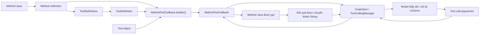

# Chọn Method và đối tượng chứa phương thức

`MethodToolCallback` cần xác định chính xác hai thành phần đi cùng nhau: `Method` mô tả phương thức Java sẽ được gọi, còn `toolObject` là instance chứa phương thức đó khi đây là method instance. Chọn sai `Method` có thể khiến callback gọi nhầm overload; ghép sai object có thể làm lời gọi thất bại hoặc bỏ qua Spring proxy.

Nắm rõ cặp `Method` và `toolObject` là nền tảng để dựng `MethodToolCallback` đúng cách. Sau khi chọn đúng phương thức và đối tượng thực thi, ứng dụng mới gắn `ToolDefinition`, schema và metadata để callback có thể tham gia vòng tool calling của Spring AI.

## 1. MethodToolCallback nằm ở đâu trong kiến trúc tool calling?

Spring AI mô hình hóa công cụ bằng interface `ToolCallback`. Interface này kết hợp hai phần: định nghĩa mà mô hình nhìn thấy và hành vi thực thi mà ứng dụng gọi.

| Thành phần | Vai trò |
| --- | --- |
| `ToolDefinition` | Tên, mô tả và JSON Schema của đầu vào được gửi cho mô hình |
| `ToolMetadata` | Metadata điều khiển cách xử lý kết quả, ví dụ `returnDirect` |
| `ToolCallback` | Hợp đồng chung để đọc definition/metadata và thực thi công cụ |
| `MethodToolCallback` | Adapter gọi một phương thức Java bằng reflection |
| `ToolCallingManager` | Tìm callback phù hợp, thực thi tool call và tạo kết quả cho vòng hội thoại |

`MethodToolCallback` triển khai `ToolCallback`. Nó cung cấp `getToolDefinition()`, `getToolMetadata()` và `call(...)`. Phương thức `call` nhận JSON arguments, có thể nhận thêm `ToolContext`, gọi method Java tương ứng và chuyển kết quả thành chuỗi để gửi về mô hình.



Điểm phân biệt quan trọng: `MethodToolCallback` là adapter thực thi cho một method cụ thể. Nó không tự quyết định khi nào mô hình cần gọi method. Mô hình quyết định dựa trên tool definition; `ToolCallingManager` hoặc vòng điều phối của `ChatClient` quyết định thời điểm thực thi.

## 2. Chuẩn bị phương thức Java

Bắt đầu bằng một service nghiệp vụ có phương thức đọc tồn kho. Phương thức không cần annotation `@Tool` khi ta tự tạo `ToolDefinition` và `MethodToolCallback`:

```java
import org.springframework.ai.chat.model.ToolContext;
import org.springframework.ai.tool.annotation.ToolParam;
import org.springframework.stereotype.Component;

@Component
public class InventoryOperations {

    private final InventoryService inventoryService;

    public InventoryOperations(InventoryService inventoryService) {
        this.inventoryService = inventoryService;
    }

    public InventorySummary findAvailability(
            @ToolParam(description = "Mã SKU chính xác của sản phẩm") String sku,
            ToolContext toolContext) {

        String tenantId = (String) toolContext.getContext().get("tenantId");
        return inventoryService.findAvailability(tenantId, sku);
    }
}
```

Phương thức nhận SKU từ arguments do mô hình tạo và nhận `ToolContext` từ ứng dụng. `ToolContext` là tham số đặc biệt: nó không trở thành một trường trong JSON Schema của mô hình. Ứng dụng có thể đặt tenant, user hoặc request context đã xác thực vào đó.

Trong ví dụ, service nghiệp vụ vẫn chịu trách nhiệm truy vấn dữ liệu và kiểm tra phạm vi truy cập. Mô tả tool chỉ giúp mô hình hiểu mục đích và cách dùng; nó không thực thi truy vấn và cũng không cấp quyền. Callback là lớp chuyển tiếp từ giao thức tool calling đến method của ứng dụng.

## 3. Chọn Method và đối tượng chứa phương thức

`MethodToolCallback` cần một đối tượng `java.lang.reflect.Method`. Spring Framework cung cấp `ReflectionUtils.findMethod(...)` để tìm method theo tên và kiểu tham số:

```java
import java.lang.reflect.Method;
import org.springframework.util.ReflectionUtils;

Method method = ReflectionUtils.findMethod(
        InventoryOperations.class,
        "findAvailability",
        String.class,
        ToolContext.class);

if (method == null) {
    throw new IllegalStateException("Không tìm thấy method findAvailability");
}
```

Nếu class có nhiều overload cùng tên, hãy truyền đầy đủ kiểu tham số để chọn đúng method. Tìm chỉ bằng tên có thể khiến callback gắn nhầm method hoặc không tìm được method mong muốn.

Có thể dùng Java Reflection thuần với `Class.getDeclaredMethod(...)` hoặc `Class.getMethod(...)`. `getMethod` chỉ tìm method public; `getDeclaredMethod` tìm method được khai báo trực tiếp trên class. `ReflectionUtils.findMethod` là tiện ích Spring và trả về `null` nếu không tìm thấy.

Sau khi tìm được method, cần xác định object dùng làm receiver khi gọi nó:

| Loại method | `toolObject` | Cách chọn |
| --- | --- | --- |
| Instance method | Bắt buộc | Truyền instance có thể nhận method đó; trong ứng dụng Spring nên dùng bean đã được inject |
| Static method | Có thể bỏ qua | Method được gọi trên class, không cần instance |

Ví dụ với instance method:

```java
Method method = ReflectionUtils.findMethod(
        InventoryOperations.class,
        "findAvailability",
        String.class,
        ToolContext.class);

InventoryOperations toolObject = inventoryOperations;

if (method == null || !method.getDeclaringClass().isInstance(toolObject)) {
    throw new IllegalStateException("Method và toolObject không tương thích");
}
```

`toolObject` cần tương thích với class khai báo method. Một instance được tạo bằng `new` có thể chạy được, nhưng nếu lớp phụ thuộc vào injection, transaction, method security hoặc các Spring interceptor thì hãy truyền bean được quản lý bởi Spring. Việc tự tạo object có thể khiến những cơ chế đó không hoạt động.

Với method static, builder chỉ cần method và definition:

```java
Method method = ReflectionUtils.findMethod(
        DateTimeTools.class, "getCurrentDateTime");

ToolCallback callback = MethodToolCallback.builder()
        .toolDefinition(ToolDefinitions.builder(method)
                .name("current_time")
                .description("Lấy thời gian hiện tại.")
                .build())
        .toolMethod(method)
        .build(); // Không cần toolObject cho static method
```

### Method được lấy từ class hay interface?

Nếu ứng dụng không dùng proxy, thường có thể tìm method trực tiếp trên class triển khai. Khi Spring tạo JDK dynamic proxy, object bean chỉ công khai các method của interface mà proxy triển khai. Một `Method` lấy từ class triển khai có thể không tương thích với proxy đó. Trong trường hợp này, hãy tìm method trên interface mà proxy công khai, hoặc chọn chiến lược proxy phù hợp rồi kiểm thử callback bằng đúng bean được inject.

Với CGLIB class-based proxy, proxy là subclass của class triển khai nên method được khai báo trên class thường vẫn tương thích. Dù dùng kiểu proxy nào, hãy kiểm tra method invocation qua callback có đi qua `@Transactional`, `@PreAuthorize` và các interceptor cần thiết hay không.

### Visibility và native image

Spring AI hỗ trợ method có visibility khác nhau, nhưng method public trên một class rõ ràng thường dễ tìm, dễ kiểm thử và dễ tích hợp hơn. Khi biên dịch GraalVM native image/AOT, reflection có thể cần runtime hints hoặc đăng ký member cần invoke. Đảm bảo class chứa method được Spring quản lý hoặc cung cấp reflection metadata phù hợp cho môi trường build.

## 4. Sinh ToolDefinition từ Method

`ToolDefinition` là hợp đồng gửi cho mô hình. Nó gồm tên công cụ, mô tả và JSON Schema đầu vào. `ToolDefinitions.builder(method)` tạo builder từ method, đọc kiểu tham số và tạo schema tự động:

```java
import org.springframework.ai.tool.definition.ToolDefinition;
import org.springframework.ai.tool.support.ToolDefinitions;

ToolDefinition definition = ToolDefinitions.builder(method)
        .name("find_inventory")
        .description("Tra cứu số lượng có thể bán của một mã SKU trong tenant hiện tại.")
        .build();
```

Builder sinh schema từ tham số Java. Annotation `@ToolParam` có thể cung cấp mô tả và đánh dấu tham số bắt buộc hoặc tùy chọn. Mặc định, các tham số được xem là bắt buộc.

Khi không cần ghi đè tên hoặc mô tả, có thể dùng `ToolDefinitions.from(method)` để tạo definition trực tiếp. Nếu method có `@Tool`, tên và mô tả từ annotation được dùng làm metadata mặc định. Với cách programmatic, ta có thể chủ động đặt tên và mô tả bằng builder.

Tên tool phải duy nhất trong tập công cụ gửi cho một yêu cầu. Nên dùng tên ngắn, ổn định, chỉ gồm chữ và số, dấu gạch dưới, dấu gạch ngang hoặc dấu chấm. Mô tả nên nói rõ công cụ làm gì, dữ liệu nào cần có và tình huống nào nên sử dụng.

### Tùy chỉnh input schema

`ToolDefinitions.builder(method)` tự sinh schema từ chữ ký method. Nếu cần kiểm soát schema, có thể ghi đè `inputSchema(...)` bằng JSON Schema tường minh:

```java
ToolDefinition definition = ToolDefinitions.builder(method)
        .name("find_inventory")
        .description("Tra cứu số lượng tồn kho theo SKU.")
        .inputSchema("""
            {
              "type": "object",
              "properties": {
                "sku": {
                  "type": "string",
                  "description": "Mã SKU chính xác",
                  "minLength": 1
                }
              },
              "required": ["sku"],
              "additionalProperties": false
            }
            """)
        .build();
```

Khi schema được tùy chỉnh, phải bảo đảm nó khớp với chữ ký method. Nếu schema cho phép thiếu `sku` nhưng method yêu cầu `String sku` và logic nghiệp vụ không chấp nhận null, callback có thể thất bại lúc chạy. Schema là hướng dẫn cho mô hình; ứng dụng vẫn cần validation runtime.

## 5. Dựng MethodToolCallback bằng Builder

Khi đã có `Method`, `ToolDefinition` và object thực thi, tạo callback:

```java
import org.springframework.ai.tool.ToolCallback;
import org.springframework.ai.tool.method.MethodToolCallback;

ToolCallback callback = MethodToolCallback.builder()
        .toolDefinition(definition)
        .toolMethod(method)
        .toolObject(inventoryOperations)
        .build();
```

Builder có các thuộc tính chính:

| Builder method | Ý nghĩa |
| --- | --- |
| `toolDefinition(...)` | Định nghĩa tên, mô tả và schema; bắt buộc |
| `toolMethod(...)` | Method Java sẽ được gọi; bắt buộc |
| `toolObject(...)` | Instance chứa method; cần cho method instance, có thể bỏ qua với method static |
| `toolMetadata(...)` | Metadata điều khiển kết quả, ví dụ `returnDirect` |
| `toolCallResultConverter(...)` | Bộ chuyển kết quả method thành chuỗi gửi cho mô hình |

Khi `build()` thành công, ta có một `ToolCallback` có thể dùng độc lập để kiểm thử hoặc đăng ký vào `ChatClient`.

### Đăng ký callback thành Spring Bean

Để tái sử dụng callback và inject vào các lớp khác, có thể tạo bean trong cấu hình Spring:

```java
import java.lang.reflect.Method;
import org.springframework.ai.chat.model.ToolContext;
import org.springframework.context.annotation.Bean;
import org.springframework.context.annotation.Configuration;
import org.springframework.ai.tool.ToolCallback;
import org.springframework.ai.tool.definition.ToolDefinition;
import org.springframework.ai.tool.method.MethodToolCallback;
import org.springframework.ai.tool.support.ToolDefinitions;
import org.springframework.util.ReflectionUtils;

@Configuration(proxyBeanMethods = false)
public class InventoryToolConfiguration {

    @Bean
    ToolCallback findInventoryCallback(InventoryOperations operations) {
        Method method = ReflectionUtils.findMethod(
                InventoryOperations.class,
                "findAvailability",
                String.class,
                ToolContext.class);

        if (method == null) {
            throw new IllegalStateException("Không tìm thấy findAvailability");
        }

        ToolDefinition definition = ToolDefinitions.builder(method)
                .name("find_inventory")
                .description("Tra cứu số lượng có thể bán của một SKU trong tenant hiện tại.")
                .build();

        return MethodToolCallback.builder()
                .toolDefinition(definition)
                .toolMethod(method)
                .toolObject(operations)
                .build();
    }
}
```

Bean được tạo một lần theo vòng đời Spring. `InventoryOperations` được inject cùng các dependency của nó, do đó method có thể dùng repository, service, transaction và các thành phần ứng dụng đã cấu hình. Spring AI 2.x cũng có thể phát hiện các bean kiểu `ToolCallback` qua `ToolCallbackResolver`; ta vẫn có thể truyền callback tường minh vào `.tools(...)` để giới hạn nó ở đúng request.

## 6. Đưa callback vào ChatClient

Khi callback đã được tạo, truyền nó vào yêu cầu chat. Cú pháp truyền callback thay đổi theo phiên bản Spring AI:

**Spring AI 2.x:**

```java
String answer = chatClient.prompt()
        .user("Hiện còn bao nhiêu sản phẩm SKU-42 trong kho?")
        .tools(findInventoryCallback)
        .toolContext(Map.of("tenantId", authenticatedTenantId))
        .call()
        .content();
```

**Spring AI 1.0.x:**

```java
String answer = ChatClient.create(chatModel)
        .prompt("Hiện còn bao nhiêu sản phẩm SKU-42 trong kho?")
        .toolCallbacks(findInventoryCallback)
        .call()
        .content();
```

Ở Spring AI 2.x, `ChatClient` sử dụng `ToolCallingAdvisor` trong advisor chain để điều phối vòng gọi công cụ. Ở Spring AI 1.x, tool calling được điều phối bên trong các implementation `ChatModel` qua `ToolCallingManager`. `MethodToolCallback` là abstraction method-backed được dùng trong cả hai cách; cần dùng đúng method đăng ký tool của phiên bản dependency đang chạy.

Có thể cấu hình callback làm công cụ mặc định cho client nếu nó phù hợp với mọi request. Tuy nhiên, callback có quyền truy cập dữ liệu hoặc thực hiện hành động nhạy cảm nên được truyền theo từng request, sau khi ứng dụng đã xác định ngữ cảnh và quyền phù hợp.

## 7. Gọi callback trực tiếp và hiểu kết quả

`MethodToolCallback` có thể được kiểm thử mà không cần gọi mô hình. `call(String toolInput)` nhận JSON arguments và trả về một chuỗi kết quả đã được chuyển đổi:

```java
String result = callback.call("""
    {
      "sku": "SKU-42"
    }
    """);
```

Nếu method cần `ToolContext`, truyền context ở tham số thứ hai:

```java
import java.util.Map;
import org.springframework.ai.chat.model.ToolContext;

Map<String, Object> contextValues = Map.of("tenantId", "tenant-demo");
ToolContext context = new ToolContext(contextValues);

String result = callback.call("""
    { "sku": "SKU-42" }
    """, context);
```

`getToolDefinition()` cho phép kiểm tra tên, mô tả và schema; `getToolMetadata()` trả về metadata điều khiển cách xử lý kết quả. Những phương thức này hữu ích khi viết test cho cấu hình callback hoặc khi ghi log kiểm tra công cụ đã đăng ký.

```java
assertThat(callback.getToolDefinition().name())
        .isEqualTo("find_inventory");
assertThat(callback.getToolDefinition().inputSchema())
        .contains("sku");
```

Kết quả của method được chuyển thành `String` vì đó là định dạng tool response gửi cho mô hình. Mặc định, `DefaultToolCallResultConverter` dùng Jackson để serialize kết quả, thường thành JSON. Nếu trả về object, DTO nên nhỏ, có trường rõ nghĩa và không chứa thông tin nội bộ không cần thiết.

## 8. ToolMetadata và returnDirect

`ToolMetadata` điều khiển cách vòng tool calling xử lý kết quả. Một thuộc tính thường dùng là `returnDirect`: nếu bật, kết quả công cụ được trả trực tiếp cho caller thay vì gửi lại mô hình để diễn giải.

```java
import org.springframework.ai.tool.metadata.ToolMetadata;

ToolMetadata metadata = ToolMetadata.builder()
        .returnDirect(true)
        .build();

ToolCallback callback = MethodToolCallback.builder()
        .toolDefinition(definition)
        .toolMethod(method)
        .toolObject(inventoryOperations)
        .toolMetadata(metadata)
        .build();
```

Chỉ dùng `returnDirect` khi output của tool đã là kết quả cuối cùng mà caller cần, ví dụ một mã trạng thái hoặc một payload đã được định dạng. Nếu cần mô hình giải thích, tổng hợp hoặc kết hợp kết quả với ngữ cảnh hội thoại, giữ hành vi mặc định để tool response được gửi lại mô hình.

Nếu mô hình yêu cầu nhiều tool call trong cùng một lượt, `returnDirect` chỉ được áp dụng khi tất cả callback được gọi đều bật cờ này. Nếu có callback không bật, kết quả của nhóm tool call sẽ được đưa lại mô hình theo vòng hội thoại.

## 9. Chuyển đổi kết quả và kiểu trả về

`MethodToolCallback.Builder` cho phép chỉ định `ToolCallResultConverter` để kiểm soát cách chuyển object Java thành chuỗi:

```java
ToolCallback callback = MethodToolCallback.builder()
        .toolDefinition(definition)
        .toolMethod(method)
        .toolObject(inventoryOperations)
        .toolCallResultConverter(customResultConverter)
        .build();
```

`ToolCallResultConverter` nhận object kết quả và kiểu trả về của method, sau đó tạo chuỗi phù hợp cho mô hình. Bộ converter mặc định dùng Jackson. Một converter tùy chỉnh hữu ích khi cần loại bỏ trường nhạy cảm, rút gọn payload hoặc chuyển kết quả sang định dạng nghiệp vụ ổn định.

Chỉ trả về kiểu dữ liệu có thể serialize. Method có thể trả `void`; tuy nhiên, nếu mô hình cần biết hành động đã hoàn thành, hãy thiết kế kết quả rõ ràng hoặc dùng converter phù hợp để tạo thông điệp dễ hiểu. Tránh trả trực tiếp entity lớn hoặc object chứa lazy proxy, quan hệ vòng hoặc trường nhạy cảm.

## 10. ToolContext và ranh giới bảo mật

Arguments trong JSON do mô hình tạo là dữ liệu không đáng tin cậy. `ToolContext` có thể mang dữ liệu do ứng dụng xác thực, nhưng callback vẫn phải kiểm tra quyền và dữ liệu nghiệp vụ.

```java
public InventorySummary findAvailability(
        @ToolParam(description = "Mã SKU") String sku,
        ToolContext toolContext) {

    String tenantId = (String) toolContext.getContext().get("tenantId");
    if (tenantId == null || tenantId.isBlank()) {
        throw new IllegalArgumentException("Thiếu tenant context");
    }

    return inventoryService.findAvailabilityForTenant(tenantId, sku);
}
```

`tenantId` cần được lấy từ principal hoặc session đã xác thực ở tầng ứng dụng, rồi truyền qua `.toolContext(...)` hoặc cơ chế ToolContext tương ứng. Không cho mô hình điền tenant, user role hoặc quyền truy cập vào JSON arguments rồi xem chúng là bằng chứng xác thực.

Khi method gọi service có `@PreAuthorize` hoặc `@Transactional`, hãy kiểm thử callback thông qua đúng Spring bean/proxy để xác nhận interceptor được áp dụng. `MethodToolCallback` dùng reflection để gọi method; nếu truyền JDK dynamic proxy, method reflection cần tương thích với interface mà proxy công khai. Với native image/AOT, bảo đảm metadata reflection cho method có thể được gọi.

## 11. Xử lý lỗi khi method thất bại

Method có thể ném exception vì input không hợp lệ, dữ liệu không tồn tại, người dùng không đủ quyền hoặc dịch vụ phụ thuộc bị lỗi. Khi callback chạy qua `ToolCallingManager`, lỗi thực thi được chuyển qua `ToolExecutionException` và `ToolExecutionExceptionProcessor`. Processor quyết định chuyển lỗi thành nội dung để mô hình nhận hoặc ném lỗi lên caller.

Không gửi stack trace, câu truy vấn SQL, token, thông tin xác thực hoặc thông tin nội bộ trong nội dung lỗi. Chỉ trả mã lỗi và thông điệp đã được kiểm soát, ví dụ `SKU_NOT_FOUND` hoặc `ACCESS_DENIED`. Chi tiết kỹ thuật nên được ghi trong log có kiểm soát, gắn correlation ID để truy vết.

Khi gọi `callback.call(...)` trực tiếp trong unit test, exception có thể xuất hiện ngay tại nơi gọi; test cần xác minh đúng hành vi mong đợi. Không giả định rằng error processor của vòng `ToolCallingManager` cũng được áp dụng khi ta gọi callback trực tiếp.

## 12. Giới hạn và lỗi thường gặp

`MethodToolCallback` hỗ trợ phần lớn kiểu Java thông dụng như primitive, POJO, enum, list, array và map. Một số kiểu không được hỗ trợ làm tham số hoặc kiểu trả về của method tool:

- `Optional`.
- Kiểu bất đồng bộ như `Future` và `CompletableFuture`.
- Kiểu reactive như `Mono`, `Flux` và `Flow`.
- Kiểu hàm như `Function`, `Supplier` và `Consumer`.

Với tham số tùy chọn, dùng `@ToolParam(required = false)` hoặc `@Nullable` thay cho `Optional`. Nếu cần expose một `Function`, `Supplier` hoặc lambda, hãy cân nhắc `FunctionToolCallback` thay vì `MethodToolCallback`.

| Biểu hiện | Nguyên nhân có thể | Cách xử lý |
| --- | --- | --- |
| Không tìm thấy method | Sai tên hoặc kiểu tham số khi reflection | Dùng đủ kiểu tham số để phân giải overload |
| Lỗi khi build callback | Thiếu `toolDefinition` hoặc `toolMethod` | Cung cấp đủ hai trường bắt buộc |
| Method instance không được gọi | Thiếu hoặc truyền sai `toolObject` | Truyền instance tương thích với declaring class |
| Mô hình không chọn tool | Tên/mô tả mơ hồ hoặc schema không phù hợp | Viết mô tả rõ mục đích, tham số và tình huống sử dụng |
| JSON không ánh xạ được | Schema và chữ ký method không đồng bộ | Kiểm tra input schema và kiểu tham số |
| Kết quả lỗi khi serialize | Return type không serialize được hoặc có dữ liệu không phù hợp | Trả DTO đơn giản hoặc cấu hình converter |
| Quyền/transaction không được áp dụng | Reflection method không tương thích với Spring proxy | Gọi qua bean/proxy đúng cách và kiểm thử interceptor |

## 13. Kiểm thử MethodToolCallback

Có thể tách kiểm thử thành ba lớp:

1. **Kiểm thử định nghĩa:** xác minh tên tool, mô tả, schema và metadata.
2. **Kiểm thử thực thi:** gọi callback bằng JSON mẫu, xác minh method/service nhận đúng tham số và kết quả được serialize.
3. **Kiểm thử tích hợp:** truyền callback vào `ChatClient`, dùng model giả hoặc stub provider để xác minh vòng tool calling và kết quả hội thoại.

Ví dụ unit test cho callback:

```java
@Test
void shouldInvokeInventoryMethodWithToolContext() {
    Map<String, Object> contextValues = Map.of("tenantId", "tenant-test");
    ToolContext context = new ToolContext(contextValues);

    String result = callback.call(
            """
            { "sku": "SKU-42" }
            """,
            context);

    verify(inventoryService).findAvailability("tenant-test", "SKU-42");
    assertThat(result).contains("SKU-42");
}
```

Ví dụ minh họa cách kiểm tra ranh giới callback; kiểu `InventorySummary`, JSON output và mock setup cần điều chỉnh theo service thực tế. Nên bổ sung test cho JSON sai, thiếu tenant, SKU không tồn tại, lỗi service, tên tool trùng và method overload.

## 14. Chọn cách tạo tool phù hợp

| Cách tạo | Khi nên dùng |
| --- | --- |
| `@Tool` + `.tools(toolObject)` | Phương thức do ứng dụng sở hữu, cấu hình đơn giản, metadata ổn định |
| `ToolCallbacks.from(toolObject)` | Muốn chuyển một object có nhiều phương thức `@Tool` thành mảng callback tường minh |
| `MethodToolCallback` | Cần chọn method bằng reflection, tạo definition động hoặc tùy chỉnh metadata/converter |
| `FunctionToolCallback` | Logic được biểu diễn tự nhiên bằng `Function`, `Supplier`, `Consumer`, `BiFunction` hoặc method reference |
| Tự triển khai `ToolCallback` | Cần toàn quyền điều khiển nguồn tool và logic thực thi, ví dụ proxy đến một hệ thống từ xa |

Không nên chọn `MethodToolCallback` chỉ vì nó có nhiều bước hơn. Giá trị của nó nằm ở khả năng điều khiển method và tool definition tại runtime. Nếu một method luôn là tool với mô tả cố định, `@Tool` thường đơn giản và dễ bảo trì hơn.

## Checklist triển khai

- [ ] Chọn đúng method và xác minh kiểu tham số khi dùng reflection.
- [ ] Cung cấp `ToolDefinition` có tên duy nhất, mô tả rõ và schema khớp chữ ký method.
- [ ] Truyền `toolObject` cho method instance; chỉ bỏ qua với method static.
- [ ] Kiểm tra `ToolContext` không bị đưa nhầm vào schema mô hình.
- [ ] Xác thực arguments, danh tính, tenant và quyền trước khi thực thi service.
- [ ] Đảm bảo method trả về dữ liệu có thể serialize; cấu hình converter nếu cần.
- [ ] Xác định rõ hành vi lỗi và `returnDirect`.
- [ ] Kiểm thử callback trực tiếp và kiểm thử tích hợp qua `ChatClient`.
- [ ] Kiểm tra proxy Spring và reflection metadata nếu dùng AOP hoặc native image.
- [ ] Dùng đúng API đăng ký callback của phiên bản Spring AI đang triển khai.

## Tài liệu tham khảo

- [Spring AI 1.0 — Methods as Tools và MethodToolCallback](https://docs.spring.io/spring-ai/reference/1.0/api/tools.html)
- [Spring AI 2.1 — Tool Calling](https://docs.spring.io/spring-ai/reference/api/tools.html)
- [MethodToolCallback API — Spring AI 2.1](https://docs.spring.io/spring-ai/docs/2.1.x/api/org/springframework/ai/tool/method/MethodToolCallback.html)
- [MethodToolCallback.Builder API — Spring AI 2.1](https://docs.spring.io/spring-ai/docs/2.1.x/api/org/springframework/ai/tool/method/MethodToolCallback.Builder.html)

`MethodToolCallback` giúp đóng gói một phương thức Java thành callback theo hợp đồng chung của Spring AI. Khi xác định đúng method, tạo definition rõ ràng, truyền đúng object và bảo vệ logic nghiệp vụ trong ứng dụng, callback có thể được đăng ký động và dùng trong cùng vòng tool calling với các công cụ khai báo bằng `@Tool` hoặc `FunctionToolCallback`.
