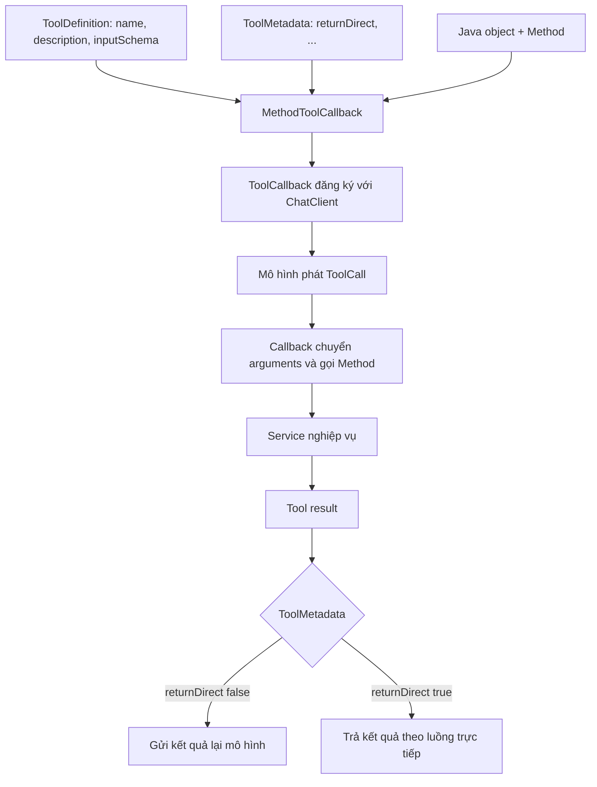

# Xây dựng ToolDefinition và metadata cho phương thức

Spring AI có thể tạo công cụ từ phương thức được đánh dấu `@Tool`. Khi cần kiểm soát tường minh định nghĩa công cụ, ứng dụng có thể tự xây dựng `ToolDefinition`, gắn định nghĩa đó với một phương thức Java bằng `MethodToolCallback` và bổ sung hành vi thực thi qua `ToolMetadata`.

Ba thành phần này có trách nhiệm khác nhau. `ToolDefinition` mô tả điều mô hình nhìn thấy: tên, mô tả và JSON Schema đầu vào. `ToolMetadata` mang metadata điều khiển cách kết quả công cụ được xử lý, chẳng hạn `returnDirect`. `MethodToolCallback` nối định nghĩa với đối tượng Java và phương thức thực sự được gọi khi có tool call.

Trong Spring AI, mô hình vẫn chỉ chọn công cụ và sinh đối số. Ứng dụng đăng ký callback, xác thực ngữ cảnh và để phương thức Java gọi service nghiệp vụ. Bài học này đi từ một phương thức đơn giản tới callback được dựng thủ công, sau đó giải thích cách đăng ký, kiểm thử và giữ ranh giới bảo mật.

Sau bài học, bạn có thể:

- Phân biệt `ToolDefinition`, `ToolMetadata` và `MethodToolCallback`.
- Tạo JSON Schema đầu vào phù hợp với chữ ký của phương thức Java.
- Dùng reflection để chọn đúng `Method` và gắn nó với đối tượng thực thi.
- Đăng ký callback thủ công với `ChatClient`.
- Chọn metadata `returnDirect` theo cách ứng dụng muốn xử lý kết quả.
- Kiểm thử định nghĩa, chuyển đổi đối số và hành vi thực thi của callback.

## 1. Ba thành phần trong một method tool callback

Một callback dựa trên phương thức có thể hiểu qua ba lớp:

| Thành phần | Câu hỏi nó trả lời | Nội dung chính |
|---|---|---|
| `ToolDefinition` | Mô hình được phép yêu cầu công cụ nào và cần gửi dữ liệu gì? | Tên, mô tả, JSON Schema đầu vào |
| `ToolMetadata` | Ứng dụng muốn framework xử lý kết quả công cụ theo metadata nào? | Ví dụ: có trả kết quả trực tiếp cho caller hay đưa lại mô hình |
| `MethodToolCallback` | Khi có yêu cầu, Java sẽ gọi phương thức nào trên đối tượng nào? | Đối tượng đích, `Method`, definition và metadata |

Luồng tổng quát:



Điểm cần nhớ là định nghĩa công cụ và mã thực thi được kết nối tại callback. Tên và schema không tự thực hiện thao tác; một phương thức Java không tự xuất hiện với mô hình nếu ứng dụng chưa đăng ký callback.

## 2. `ToolDefinition` mô tả hợp đồng mà mô hình nhìn thấy

`ToolDefinition` chứa ba phần quan trọng:

- `name`: tên công cụ duy nhất trong tập công cụ được cung cấp cho một lượt gọi.
- `description`: mô tả mục đích, điều kiện sử dụng và giới hạn của công cụ.
- `inputSchema`: JSON Schema mô tả cấu trúc đối số mà mô hình phải sinh.

Ví dụ, công cụ lấy thời tiết theo thành phố có thể công bố hợp đồng đầu vào như sau:

```json
{
  "type": "object",
  "properties": {
    "city": {
      "type": "string",
      "description": "Tên thành phố cần tra cứu thời tiết"
    }
  },
  "required": ["city"],
  "additionalProperties": false
}
```

Schema trên mô tả một object có trường `city` kiểu chuỗi. Khi mô hình yêu cầu công cụ, arguments có thể tương tự:

```json
{
  "city": "Hà Nội"
}
```

Schema là hợp đồng dữ liệu. Nó giúp mô hình tạo đúng cấu trúc, nhưng không xác nhận thành phố có tồn tại, không đảm bảo service đang hoạt động và không cấp quyền truy cập.

## 3. `ToolMetadata` điều khiển cách xử lý kết quả

`ToolMetadata` mang thông tin bổ sung về cách framework xử lý callback. Một thuộc tính thường gặp là `returnDirect`.

- `returnDirect(false)`: kết quả công cụ được đưa trở lại chu trình hội thoại để mô hình có thể diễn giải, tổng hợp hoặc tiếp tục gọi công cụ.
- `returnDirect(true)`: kết quả công cụ được trả trực tiếp theo luồng thực thi hỗ trợ `returnDirect`, không yêu cầu mô hình tạo thêm một câu trả lời diễn giải sau công cụ đó.

Ví dụ tạo metadata:

```java
ToolMetadata metadata = ToolMetadata.builder()
    .returnDirect(false)
    .build();
```

Chọn `returnDirect(false)` khi công cụ trả dữ liệu thô mà mô hình cần giải thích bằng ngôn ngữ tự nhiên, ví dụ tóm tắt thời tiết hoặc so sánh sản phẩm. Chọn `true` khi kết quả công cụ đã là nội dung phù hợp để trả trực tiếp theo hợp đồng ứng dụng, ví dụ một chuỗi xác nhận hoặc một payload đã được định dạng.

Không bật `returnDirect` chỉ để giảm một lượt gọi mô hình nếu kết quả chưa phù hợp với giao diện người dùng. Kết quả trực tiếp cần có định dạng ổn định, không chứa thông tin nội bộ và được caller xử lý đúng. Với nhiều tool call trong cùng một phản hồi, hãy kiểm tra quy tắc phối hợp `returnDirect` của phiên bản Spring AI đang dùng; không giả định một callback trả trực tiếp sẽ làm mọi kết quả trong lượt được hợp nhất theo cách mong muốn.

## 4. Chuẩn bị phương thức Java cần gọi

Ta dùng một service thời tiết giả định và một lớp adapter có phương thức `getWeather`. Phương thức có tham số `city` và trả về một DTO nhỏ.

```java
public record WeatherReport(
    String city,
    String condition,
    int temperatureCelsius
) {}
```

```java
public class WeatherTools {

    private final WeatherService weatherService;

    public WeatherTools(WeatherService weatherService) {
        this.weatherService = weatherService;
    }

    public WeatherReport getWeather(String city) {
        if (city == null || city.isBlank()) {
            throw new IllegalArgumentException("city không được để trống");
        }

        return weatherService.getCurrentWeather(city.strip());
    }
}
```

Trong ví dụ này, phương thức không cần `@Tool` vì ta sẽ tạo `ToolDefinition` và `MethodToolCallback` một cách tường minh. Nếu muốn dùng annotation để framework tự suy ra định nghĩa, có thể đánh dấu phương thức bằng `@Tool` và dùng `ToolCallbacks.from(...)` như cách đã học ở bài khai báo phương thức.

Giữ phương thức adapter nhỏ. Service chịu trách nhiệm gọi nguồn dữ liệu, áp dụng quy tắc nghiệp vụ và xử lý lỗi phụ trợ. Phương thức công cụ không nên chứa truy vấn SQL tùy ý hoặc nhận một lệnh tổng quát có thể thực thi mọi hành động.

## 5. Tạo `ToolDefinition` bằng builder

Spring AI cung cấp builder để tạo `ToolDefinition`. Ta khai báo tên, mô tả và schema đầu vào bằng mã Java:

```java
import org.springframework.ai.tool.definition.ToolDefinition;

ToolDefinition definition = ToolDefinition.builder()
    .name("get_weather")
    .description("Tra cứu thời tiết hiện tại theo tên thành phố. "
        + "Chỉ đọc thông tin thời tiết, không thay đổi dữ liệu.")
    .inputSchema("""
        {
          "type": "object",
          "properties": {
            "city": {
              "type": "string",
              "description": "Tên thành phố cần tra cứu thời tiết"
            }
          },
          "required": ["city"],
          "additionalProperties": false
        }
        """)
    .build();
```

Schema được truyền dưới dạng chuỗi JSON. Text block của Java giúp viết JSON nhiều dòng dễ đọc. Khi tạo định nghĩa theo cách này, ứng dụng chịu trách nhiệm bảo đảm JSON hợp lệ và đúng với phương thức được gắn ở bước tiếp theo.

Tên `get_weather` phải ổn định và không trùng với công cụ khác trong cùng tập công cụ. Mô tả cần đủ rõ để mô hình phân biệt với những công cụ khác, chẳng hạn `get_weather_forecast` hoặc `search_weather_alerts`.

## 6. Tìm `Method` bằng reflection

`MethodToolCallback` cần biết phương thức Java cụ thể sẽ được gọi. Có thể lấy `Method` từ lớp bằng reflection:

```java
import java.lang.reflect.Method;

Method method = WeatherTools.class.getMethod("getWeather", String.class);
```

`getMethod` tìm phương thức public theo tên và kiểu tham số. Nếu lớp có overload cùng tên, cần chỉ định chính xác kiểu tham số. Nếu không tìm thấy phương thức phù hợp, reflection ném `NoSuchMethodException`.

Không nên chọn phương thức theo tên đơn thuần khi có overload. Ví dụ `getWeather(String)` và `getWeather(String, Unit)` là hai chữ ký khác nhau; schema và callback phải gắn đúng chữ ký mà ứng dụng định thực thi.

Đối tượng đích (`toolObject`) phải là instance phù hợp với lớp khai báo phương thức. Khi callback gọi phương thức instance, Spring AI sử dụng đối tượng này làm receiver. Đối tượng có thể được Spring quản lý và inject service qua constructor như ví dụ.

## 7. Dựng `MethodToolCallback`

Khi đã có `ToolDefinition`, `ToolMetadata`, `Method` và đối tượng đích, ta ghép chúng thành một callback:

```java
import java.lang.reflect.Method;

import org.springframework.ai.tool.ToolCallback;
import org.springframework.ai.tool.definition.ToolDefinition;
import org.springframework.ai.tool.metadata.ToolMetadata;
import org.springframework.ai.tool.method.MethodToolCallback;

Method method = WeatherTools.class.getMethod("getWeather", String.class);

ToolDefinition definition = ToolDefinition.builder()
    .name("get_weather")
    .description("Tra cứu thời tiết hiện tại theo tên thành phố.")
    .inputSchema("""
        {
          "type": "object",
          "properties": {
            "city": {
              "type": "string",
              "description": "Tên thành phố cần tra cứu"
            }
          },
          "required": ["city"],
          "additionalProperties": false
        }
        """)
    .build();

ToolMetadata metadata = ToolMetadata.builder()
    .returnDirect(false)
    .build();

ToolCallback callback = MethodToolCallback.builder()
    .toolDefinition(definition)
    .toolMetadata(metadata)
    .toolObject(weatherTools)
    .toolMethod(method)
    .build();
```

`MethodToolCallback` hiện thực abstraction `ToolCallback`. Nó giữ định nghĩa công cụ và thông tin về phương thức cần thực thi. Khi nhận tool input, callback chuyển đối số JSON sang tham số Java tương ứng rồi gọi phương thức trên `weatherTools`.

Builder tách rõ phần mô tả cho mô hình khỏi phần thực thi. Cần bảo đảm:

- `definition.name()` khớp với công cụ mà ứng dụng muốn công bố.
- `inputSchema` mô tả đúng tên và kiểu của các tham số phương thức.
- `toolMethod` là phương thức tồn tại và có chữ ký phù hợp.
- `toolObject` là đối tượng đúng lớp, đã được khởi tạo đầy đủ dependency.
- `toolMetadata` phản ánh cách ứng dụng muốn xử lý kết quả.

Các ví dụ dùng API Spring AI 1.x có `MethodToolCallback.builder()` và các kiểu `ToolDefinition`/`ToolMetadata`. Khi dùng phiên bản khác, kiểm tra API builder của đúng dependency đang khai báo trong dự án; không trộn package hoặc chữ ký builder giữa các phiên bản.

## 8. Đăng ký callback với `ChatClient`

Sau khi dựng callback, ứng dụng truyền nó vào lượt gọi bằng `.toolCallbacks(...)`:

```java
String answer = chatClient.prompt()
    .user("Thời tiết hiện tại ở Hà Nội thế nào?")
    .toolCallbacks(callback)
    .call()
    .content();
```

Có thể tạo callback trong một bean cấu hình để tái sử dụng:

```java
@Configuration
public class WeatherToolConfiguration {

    @Bean
    ToolCallback weatherToolCallback(WeatherTools weatherTools)
            throws NoSuchMethodException {

        Method method = WeatherTools.class.getMethod("getWeather", String.class);

        ToolDefinition definition = ToolDefinition.builder()
            .name("get_weather")
            .description("Tra cứu thời tiết hiện tại theo tên thành phố.")
            .inputSchema("""
                {
                  "type": "object",
                  "properties": {
                    "city": { "type": "string" }
                  },
                  "required": ["city"],
                  "additionalProperties": false
                }
                """)
            .build();

        return MethodToolCallback.builder()
            .toolDefinition(definition)
            .toolObject(weatherTools)
            .toolMethod(method)
            .toolMetadata(ToolMetadata.builder().returnDirect(false).build())
            .build();
    }
}
```

Sau đó inject callback bean vào assistant hoặc service hội thoại. Nếu đăng ký callback cố định ở bean, hãy bảo đảm đối tượng đích an toàn khi được nhiều request dùng đồng thời. Tránh lưu dữ liệu của một người dùng vào field mutable trên `WeatherTools` hoặc callback singleton.

Đăng ký theo từng lượt gọi giúp giới hạn tập công cụ theo ngữ cảnh. Nếu ứng dụng có công cụ quản trị và công cụ người dùng thông thường, không cung cấp callback quản trị cho hội thoại không có quyền quản trị.

## 9. Đảm bảo schema khớp chữ ký phương thức

Một lỗi quan trọng khi tạo callback thủ công là schema và method không còn khớp nhau. Ví dụ schema khai báo `city` nhưng method nhận `location`, hoặc schema khai báo số nhưng method nhận enum. Khi đó mô hình có thể sinh đúng theo schema nhưng framework không chuyển được sang kiểu Java mong đợi.

Hãy kiểm tra theo bảng sau:

| Schema | Chữ ký Java | Cần khớp |
|---|---|---|
| `city: string` | `String city` | Tên trường, kiểu và cách xử lý chuỗi |
| `days: integer` | `int days` hoặc `Integer days` | Miền giá trị và xử lý null nếu dùng wrapper |
| `category: string enum` | `ProductCategory category` | Tập giá trị enum được hỗ trợ |
| `criteria: object` | `SearchCriteria criteria` | Property con và kiểu Java tương ứng |

Với một phương thức nhận nhiều tham số, schema object cần có một property cho mỗi tham số có thể được mô hình cung cấp. Các tham số đặc biệt như `ToolContext` được framework xử lý theo cơ chế context và không nên công bố như đối số nghiệp vụ mà mô hình tự điền.

Khi thay đổi chữ ký Java, hãy cập nhật schema cùng lúc. Khi thay đổi schema, hãy xác nhận phương thức và converter vẫn nhận được mọi giá trị hợp lệ mà mô hình có thể tạo.

## 10. Dùng `ToolContext` cho dữ liệu do ứng dụng kiểm soát

Đôi khi phương thức cần tenant hoặc người dùng đã xác thực. Không thêm các giá trị này vào JSON Schema để mô hình tự tạo. Hãy truyền chúng qua `ToolContext` của lượt gọi và đọc trong phương thức công cụ.

Ví dụ phương thức cần mã thành phố do mô hình đề xuất và tenant do ứng dụng cung cấp:

```java
public WeatherReport getWeather(String city, ToolContext toolContext) {
    String tenantId = (String) toolContext.getContext().get("tenantId");
    if (tenantId == null || tenantId.isBlank()) {
        throw new IllegalStateException("Thiếu tenant context");
    }

    return weatherService.getWeatherForTenant(city, tenantId);
}
```

Schema của công cụ chỉ mô tả `city`. Ứng dụng truyền tenant từ principal đã xác thực khi gọi `ChatClient`:

```java
chatClient.prompt()
    .user("Thời tiết tại Hà Nội thế nào?")
    .toolContext(Map.of("tenantId", authenticatedTenantId))
    .toolCallbacks(weatherCallback)
    .call()
    .content();
```

Service vẫn phải kiểm tra quyền ở cấp tài nguyên và tenant. `ToolContext` là kênh truyền dữ liệu tin cậy do ứng dụng tạo, không phải một cơ chế tự động phân quyền. Không đưa access token, mật khẩu hoặc secret vào context nếu phương thức không thực sự cần chúng.

## 11. `returnDirect` và quyết định trả kết quả

`returnDirect` thay đổi đường đi của kết quả callback. Hãy chọn dựa trên định dạng kết quả và trải nghiệm mà ứng dụng muốn cung cấp:

| Tình huống | Metadata gợi ý | Lý do |
|---|---|---|
| Trả dữ liệu thời tiết để mô hình tóm tắt | `returnDirect(false)` | Mô hình cần diễn giải kết quả cho người dùng |
| Trả một mã xác nhận đã định dạng theo hợp đồng API | Có thể `returnDirect(true)` | Caller có thể dùng kết quả trực tiếp |
| Trả DTO nội bộ chứa nhiều trường kỹ thuật | `returnDirect(false)` hoặc chuyển đổi kết quả trước | Không nên lộ nguyên DTO nội bộ |
| Thao tác ghi cần giải thích trạng thái | Thường `returnDirect(false)` | Mô hình có thể diễn giải kết quả sau khi service xác nhận |

`returnDirect(true)` không làm phương thức an toàn hơn, không thay thế xác thực và cũng không đồng nghĩa kết quả đã được kiểm tra để hiển thị. Ứng dụng vẫn cần xác định kiểu kết quả, lọc dữ liệu và định dạng phản hồi theo hợp đồng của API.

Với một lượt có nhiều tool call, hãy kiểm tra cách `ToolCallingManager` xử lý metadata của từng callback trong phiên bản đang dùng. Nếu các công cụ có chính sách trả kết quả khác nhau, hãy thiết kế và kiểm thử rõ trường hợp kết hợp; đừng để thứ tự thực thi hoặc kết quả trực tiếp phụ thuộc vào giả định không được kiểm chứng.

## 12. Kiểm thử `MethodToolCallback`

Nên tách kiểm thử thành bốn phần.

**Kiểm thử định nghĩa:** xác nhận tên, mô tả và schema có đúng mục đích, đúng kiểu dữ liệu và không chứa trường nội bộ. Kiểm tra JSON schema parse được trước khi gửi tới provider.

**Kiểm thử reflection và liên kết method:** xác nhận `Method` là phương thức dự kiến, `toolObject` đúng loại và builder tạo callback thành công. Với overload, kiểm tra đúng chữ ký được chọn.

**Kiểm thử thực thi callback:** gọi callback bằng JSON hợp lệ, xác nhận phương thức Java được gọi và service nhận đúng đối số. Thử JSON sai, thiếu trường, sai kiểu và dữ liệu vượt giới hạn; service không được chạy khi dữ liệu chưa hợp lệ.

**Kiểm thử điều phối:** đăng ký callback với `ChatClient` dùng model giả hoặc phản hồi mẫu, xác nhận tool call được phân giải đúng, tool result được trả lại mô hình khi `returnDirect(false)` và luồng trực tiếp được xử lý theo mong đợi khi `returnDirect(true)`.

Ví dụ kiểm thử trực tiếp callback với JSON mẫu:

```java
@Test
void methodToolCallbackInvokesWeatherMethod() {
    String result = weatherCallback.call("""
        { "city": "Hà Nội" }
        """);

    assertThat(result).contains("Hà Nội");
    verify(weatherService).getCurrentWeather("Hà Nội");
}
```

Đây là ví dụ minh họa; kiểu chuỗi kết quả phụ thuộc converter trả kết quả của phiên bản Spring AI đang dùng. Nếu kết quả được serialize thành JSON, nên parse JSON và kiểm tra các trường thay vì phụ thuộc vào khoảng trắng hoặc thứ tự property.

## 13. Lỗi thường gặp và cách xử lý

| Triệu chứng | Nguyên nhân | Cách xử lý |
|---|---|---|
| Không tìm thấy method | Tên hoặc kiểu tham số trong `getMethod` không khớp | Kiểm tra chữ ký public và kiểu tham số chính xác |
| Callback gọi nhầm overload | Chỉ chọn theo tên hoặc chọn sai parameter types | Chọn `Method` bằng đầy đủ chữ ký |
| JSON không chuyển được thành tham số | Schema không khớp chữ ký method hoặc kiểu không được converter hỗ trợ | Kiểm tra schema, kiểu Java và JSON converter |
| Mô hình không chọn công cụ | Tên/mô tả mơ hồ hoặc callback chưa đăng ký trong lượt gọi | Viết mô tả rõ và truyền callback vào `.toolCallbacks(...)` |
| Provider từ chối schema | Schema dùng cấu trúc/keyword không được provider hỗ trợ | Dùng schema tối thiểu tương thích và kiểm thử theo provider |
| Dữ liệu nội bộ xuất hiện trong arguments | Đưa tenant hoặc principal vào schema | Chuyển dữ liệu tin cậy qua `ToolContext` |
| Kết quả không được mô hình diễn giải | `returnDirect` được bật hoặc cấu hình luồng trả trực tiếp | Kiểm tra `ToolMetadata` và hợp đồng phản hồi |
| Callback singleton lẫn dữ liệu request | Lưu state của request trong field mutable | Giữ callback stateless, truyền context theo từng lần gọi |

## 14. Khi nào nên dùng `@Tool`, khi nào dựng callback thủ công?

Hai cách tạo callback có mục tiêu khác nhau:

| Tiêu chí | `@Tool` và `ToolCallbacks.from(...)` | `MethodToolCallback.builder()` |
|---|---|---|
| Định nghĩa công cụ | Framework suy ra từ annotation và chữ ký phương thức | Ứng dụng cung cấp `ToolDefinition` tường minh |
| Schema | Được tạo từ tham số và metadata hỗ trợ | Ứng dụng viết hoặc cung cấp schema |
| Metadata | Có thể khai báo bằng annotation/metadata hỗ trợ | Có thể gắn `ToolMetadata` khi build |
| Reflection | Framework tìm phương thức được đánh dấu | Ứng dụng chọn `Method` cụ thể |
| Phù hợp | Công cụ thông thường, khai báo gọn | Cần kiểm soát định nghĩa, schema hoặc tạo callback động |

Ưu tiên annotation khi hợp đồng đơn giản và schema có thể suy ra chính xác. Dựng callback thủ công khi cần tạo định nghĩa theo cấu hình, đăng ký công cụ động hoặc kiểm soát schema tường minh. Dù chọn cách nào, ứng dụng vẫn phải kiểm tra đầu vào và bảo vệ phương thức thực thi.

## 15. Ghi nhớ

- `ToolDefinition` mô tả tên, mục đích và JSON Schema đầu vào mà mô hình nhìn thấy.
- `ToolMetadata` mang metadata điều khiển cách framework xử lý kết quả, chẳng hạn `returnDirect`.
- `MethodToolCallback` liên kết `ToolDefinition` và `ToolMetadata` với một `Method` trên đối tượng Java.
- Schema phải khớp tên, kiểu và cấu trúc tham số của phương thức; kiểm thử cả JSON hợp lệ và không hợp lệ.
- `ToolContext` mang dữ liệu tin cậy do ứng dụng tạo, không phải đối số để mô hình tự sinh.
- Callback chỉ được thực thi khi ứng dụng đăng ký nó cho lượt gọi; phương thức và service phải giữ trách nhiệm xác thực, phân quyền và quy tắc nghiệp vụ.

Khi cần dựng `MethodToolCallback`, hãy xác định trước hợp đồng mà mô hình cần nhìn thấy, viết schema tương ứng với chữ ký Java, chọn đúng `Method` và đối tượng đích, rồi cấu hình metadata theo đường đi kết quả mà ứng dụng mong muốn. Cuối cùng, kiểm thử callback độc lập và kiểm thử cả lượt điều phối qua `ChatClient`.
