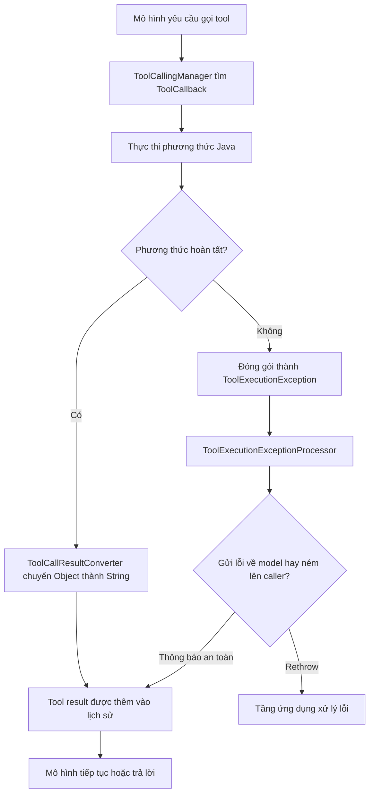

# Chọn bộ chuyển đổi kết quả và xử lý lỗi

Khi một công cụ được thực thi, Spring AI cần chuyển giá trị Java mà phương thức trả về thành chuỗi để đưa vào thông điệp kết quả của tool. Khi phương thức ném exception, framework cần quyết định gửi một thông báo lỗi về cho mô hình để mô hình phản hồi tiếp hay ném lỗi lên tầng ứng dụng. Hai việc này liên quan với nhau nhưng có mục tiêu khác nhau: **bộ chuyển đổi kết quả** định dạng kết quả thành công; **bộ xử lý exception** quyết định cách xử lý một lần thực thi thất bại.

Trong Spring AI 2.1.0, `ToolCallResultConverter` thực hiện việc chuyển đổi kết quả và `ToolExecutionExceptionProcessor` xử lý lỗi phát sinh khi gọi công cụ. Chọn đúng hai cơ chế này giúp mô hình nhận được dữ liệu có cấu trúc, thông báo lỗi có thể hành động và không nhận các chi tiết nội bộ nhạy cảm của hệ thống.

## Vị trí của chuyển đổi kết quả và xử lý lỗi trong vòng gọi công cụ

`ToolCallback` mang cả định nghĩa mà mô hình nhìn thấy lẫn logic thực thi. Khi mô hình yêu cầu gọi công cụ, Spring AI tìm callback tương ứng, truyền JSON arguments cho callback và nhận về một chuỗi. Nếu phương thức hoàn tất bình thường, chuỗi đó là kết quả của tool. Nếu phương thức ném lỗi, framework chuyển lỗi sang `ToolExecutionException` để `ToolExecutionExceptionProcessor` quyết định bước tiếp theo.



Điểm cần nhớ là converter không phải nơi bắt exception nghiệp vụ. Converter chỉ nhận giá trị trả về sau khi phương thức chạy thành công. Ngược lại, exception processor không nên dùng để định dạng DTO thành công. Tách hai trách nhiệm giúp test đơn giản và chính sách lỗi rõ ràng hơn.

## `ToolCallResultConverter` làm gì?

`ToolCallResultConverter` là functional interface với phương thức:

```java
@FunctionalInterface
public interface ToolCallResultConverter {
    String convert(Object result, Type returnType);
}
```

Spring AI gọi converter sau khi phương thức tool trả về. Kết quả cuối phải là `String`, vì tool result được đưa vào lịch sử hội thoại và gửi lại mô hình. Trong Spring AI 2.1.0, `DefaultToolCallResultConverter` sử dụng Jackson để serialize giá trị trả về thành JSON.

Hành vi mặc định có một số trường hợp đáng chú ý:

- DTO, record, map và collection có thể được serialize thành JSON theo cấu hình Jackson.
- Phương thức `void` trả chuỗi `Done`.
- `RenderedImage` được chuyển thành JSON có nội dung PNG mã hóa Base64.
- Kiểu trả về phải là dữ liệu có thể serialize; converter không tự biến `Optional`, `Future`, `CompletableFuture`, `Mono` hoặc `Flux` thành giá trị đã hoàn tất.

Với đa số công cụ nghiệp vụ, nên bắt đầu bằng converter mặc định và thiết kế DTO trả về gọn, ổn định. Chỉ viết converter riêng khi cần định dạng tương thích với một hợp đồng cụ thể, che bớt trường không cần thiết hoặc điều chỉnh cách biểu diễn dữ liệu trước khi gửi cho mô hình.

## Chọn hình dạng kết quả phù hợp với mô hình

Kết quả tool là dữ liệu đầu vào cho bước suy luận tiếp theo. Vì vậy, cấu trúc nên rõ nghĩa và đủ thông tin để mô hình trả lời chính xác.

Ví dụ DTO cho kết quả tra cứu sản phẩm:

```java
public record ProductSummary(
        String productId,
        String displayName,
        int availableQuantity,
        String currency,
        BigDecimal unitPrice) {
}

public record ProductLookupResult(
        String status,
        ProductSummary product,
        String message) {
}
```

Một kết quả thành công có thể được serialize thành:

```json
{
  "status": "FOUND",
  "product": {
    "productId": "SKU-2048",
    "displayName": "Bàn phím cơ",
    "availableQuantity": 12,
    "currency": "VND",
    "unitPrice": 1250000
  },
  "message": "Đã tìm thấy sản phẩm."
}
```

Mô hình có thể nhận biết `FOUND`, đọc số lượng, đơn vị tiền tệ và giá. Khi không tìm thấy sản phẩm, tool có thể trả kết quả nghiệp vụ bình thường với `status = NOT_FOUND`, `product = null` và thông báo đã chuẩn hóa. Đây là trường hợp không có dữ liệu phù hợp, không nhất thiết phải ném exception.

Khi thiết kế DTO, hãy lưu ý:

- Chỉ trả những trường cần thiết cho câu hỏi. Không trả JPA entity, quan hệ lazy, thông tin xác thực, dữ liệu nội bộ hoặc trường cá nhân không liên quan.
- Giữ tên trường và kiểu dữ liệu ổn định. Đừng trả số tiền dưới dạng chuỗi không có mã tiền tệ hoặc thời gian không có múi giờ khi ngữ cảnh cần phân biệt chúng.
- Phân biệt rõ `FOUND`, `NOT_FOUND`, `ACCEPTED`, `REJECTED` hoặc trạng thái nghiệp vụ tương ứng. Không để mô hình suy đoán ý nghĩa của `null` hay một chuỗi rỗng.
- Giới hạn số bản ghi, độ dài văn bản và kích thước payload. Nếu dữ liệu lớn, trả bản tóm tắt hoặc mã tham chiếu để truy vấn tiếp.
- Không dùng kết quả tool để chuyển bí mật hoặc token nội bộ cho mô hình. Dữ liệu không cần thiết không nên đi vào ngữ cảnh hội thoại.

## Khi nào nên viết converter riêng?

Một converter riêng có ích trong các tình huống như:

1. **Chuẩn hóa định dạng:** mọi tool trả cùng một cấu trúc JSON, chẳng hạn `status`, `data` và `message`.
2. **Giới hạn dữ liệu:** chỉ serialize một tập trường được cho phép thay vì toàn bộ object.
3. **Tương thích hệ thống cũ:** một model/provider hoặc dịch vụ trung gian yêu cầu chuỗi theo định dạng đã quy ước.
4. **Xử lý kiểu đặc biệt:** chuyển kiểu miền hoặc đối tượng đặc thù thành dạng JSON đơn giản mà mô hình có thể đọc.
5. **Kiểm soát null và kiểu trả về:** áp dụng biểu diễn nhất quán cho kết quả rỗng hoặc phương thức `void`.

Không nên dùng converter để sửa một DTO miền thiết kế sai, che lỗi truy vấn, gọi thêm API nghiệp vụ hoặc áp dụng quyền truy cập. Các việc đó thuộc service và tầng nghiệp vụ. Converter chỉ nên là bước chuyển đổi thuần, có kết quả xác định và dễ kiểm thử.

## Cấu hình converter trên `@Tool`

Với công cụ khai báo bằng annotation, `@Tool` có thuộc tính `resultConverter` để chọn lớp triển khai `ToolCallResultConverter`:

```java
@Tool(
        description = "Tra cứu sản phẩm theo mã SKU",
        resultConverter = ProductResultConverter.class)
public ProductLookupResult lookupProduct(String sku) {
    return productService.lookup(sku);
}
```

`ProductResultConverter` chịu trách nhiệm chuyển object trả về thành chuỗi. Đây là cách cấu hình gọn khi converter là một thành phần độc lập và có thể khởi tạo theo yêu cầu của ứng dụng. Nếu converter cần dùng `ObjectMapper` đã được Spring cấu hình, serializer tùy chỉnh hoặc dependency khác, cách tạo callback bằng builder giúp truyền instance converter tường minh.

## Cấu hình converter trên `MethodToolCallback`

Với callback được tạo bằng code, dùng `.toolCallResultConverter(...)` trên builder. Ví dụ dưới đây sử dụng `ObjectMapper` do Spring quản lý để giữ cấu hình Jackson thống nhất với ứng dụng:

```java
import com.fasterxml.jackson.core.JsonProcessingException;
import com.fasterxml.jackson.databind.ObjectMapper;
import org.springframework.ai.tool.ToolCallback;
import org.springframework.ai.tool.method.MethodToolCallback;
import org.springframework.ai.tool.support.ToolDefinitions;
import org.springframework.context.annotation.Bean;
import org.springframework.context.annotation.Configuration;
import org.springframework.util.ReflectionUtils;

import java.lang.reflect.Method;
import java.util.Objects;

@Configuration(proxyBeanMethods = false)
public class ProductToolConfiguration {

    @Bean
    ToolCallback lookupProductTool(
            ProductTools productTools,
            ObjectMapper objectMapper) {

        Method method = Objects.requireNonNull(
                ReflectionUtils.findMethod(ProductTools.class, "lookupProduct", String.class));

        return MethodToolCallback.builder()
                .toolDefinition(ToolDefinitions.builder(method)
                        .description("Tra cứu sản phẩm theo mã SKU và trả kết quả có cấu trúc.")
                        .build())
                .toolMethod(method)
                .toolObject(productTools)
                .toolCallResultConverter((result, returnType) -> {
                    if (returnType == void.class || returnType == Void.class) {
                        return "Done";
                    }
                    try {
                        return objectMapper.writeValueAsString(result);
                    }
                    catch (JsonProcessingException ex) {
                        throw new IllegalStateException(
                                "Không thể chuyển đổi kết quả của công cụ.", ex);
                    }
                })
                .build();
    }
}
```

`ProductTools` là bean chứa phương thức `lookupProduct`. Ví dụ minh họa cách truyền converter có dependency vào callback. Nếu callback cần xử lý `RenderedImage` hoặc một kiểu đặc biệt khác, converter tùy chỉnh phải tự hỗ trợ trường hợp đó; nếu không cần thay đổi định dạng, hãy giữ converter mặc định để tận dụng các xử lý có sẵn.

Tham số `returnType` cho biết kiểu khai báo của phương thức tool. Converter ở trên serialize object theo kiểu runtime; nếu cần giữ thông tin generic của kiểu trả về, hãy dùng `returnType` cùng `TypeFactory` của Jackson để tạo `JavaType` phù hợp. Điều này hữu ích với các kết quả generic hoặc collection có kiểu phần tử cần được xác định rõ.

Với `FunctionToolCallback`, builder cũng có điểm cấu hình `toolCallResultConverter(...)`. Như vậy, cách chuyển đổi kết quả có thể được chọn nhất quán dù tool được định nghĩa bằng method hay function.

## `returnDirect` không phải converter

Mặc định, kết quả tool được gửi lại mô hình để mô hình đọc và tạo câu trả lời cuối. Với `returnDirect = true`, kết quả tool bỏ qua lần gọi mô hình tiếp theo và được trả trực tiếp cho caller.

```java
@Tool(
        description = "Lấy nội dung cuối cùng đã được hệ thống phê duyệt để trả cho người dùng",
        returnDirect = true)
public ApprovedAnswer getApprovedAnswer(String requestId) {
    return answerService.getApprovedAnswer(requestId);
}
```

Chọn `returnDirect` khi kết quả tool đã là đầu ra cuối cùng, không cần mô hình diễn giải thêm. Ví dụ: lấy một đoạn văn bản đã được phê duyệt hoặc trả kết quả truy xuất mà ứng dụng muốn giữ nguyên. Nếu mô hình cần kết hợp kết quả với lịch sử hội thoại, giải thích, so sánh hoặc gọi thêm công cụ, hãy để `returnDirect = false`.

Hai thuộc tính này giải quyết hai vấn đề khác nhau:

| Cơ chế | Câu hỏi mà nó trả lời |
|---|---|
| `ToolCallResultConverter` | Giá trị Java được biểu diễn thành chuỗi nào trong tool result? |
| `returnDirect` | Sau khi tool chạy, có gửi kết quả về mô hình để tiếp tục hay trả thẳng cho caller? |

Nếu một phản hồi yêu cầu nhiều tool call trong cùng vòng, `returnDirect` chỉ được áp dụng khi tất cả tool được gọi đều có `returnDirect = true`. Nếu có ít nhất một tool không bật cờ này, kết quả được gửi về mô hình để tiếp tục vòng hội thoại.

## Phân biệt kết quả nghiệp vụ và exception

Không phải mọi tình huống không như mong đợi đều cần ném exception. Hãy phân biệt kết quả hợp lệ của nghiệp vụ với lỗi khiến thao tác không thể hoàn thành:

| Tình huống | Biểu diễn phù hợp | Lý do |
|---|---|---|
| Không tìm thấy sản phẩm theo mã | DTO có `status = NOT_FOUND` | Đây là kết quả tra cứu hợp lệ; mô hình có thể thông báo không tìm thấy |
| Đơn hàng đã giao nên không thể hủy | Kết quả nghiệp vụ `REJECTED` với mã lý do rõ ràng | Quy tắc nghiệp vụ đã được kiểm tra và có kết luận xác định |
| Đầu vào sai định dạng | Validation exception hoặc kết quả lỗi đã chuẩn hóa | Cần cho biết tham số nào cần sửa mà không lộ chi tiết nội bộ |
| Người dùng không có quyền | Access denied được chuyển lên tầng ứng dụng | Không để mô hình tự quyết định quyền hoặc thử một thao tác thay thế vượt quyền |
| Dịch vụ phụ thuộc tạm thời không hoạt động | Exception hoặc lỗi hạ tầng được xử lý theo retry/circuit breaker | Không được tuyên bố nghiệp vụ thành công khi chưa có xác nhận |
| Lỗi lập trình, lỗi cấu hình hoặc trạng thái không xác định | Ném exception lên caller và ghi nhận sự cố | Mô hình không thể sửa lỗi nội bộ bằng cách đoán một câu trả lời |

Nếu một thao tác bị từ chối theo quy tắc nghiệp vụ, DTO `REJECTED` thường hữu ích hơn exception kỹ thuật. Nếu thao tác thất bại vì hệ thống không thể xác định kết quả, hãy báo lỗi và bảo đảm caller biết trạng thái chưa hoàn tất. Không chuyển một lỗi kỹ thuật thành `SUCCESS` chỉ để mô hình có nội dung trả lời.

## `ToolExecutionExceptionProcessor` xử lý lỗi thế nào?

Khi phương thức tool ném exception, Spring AI đóng gói lỗi thành `ToolExecutionException` rồi chuyển cho `ToolExecutionExceptionProcessor`. Processor có hai lựa chọn:

- Trả về một chuỗi thông báo lỗi để Spring AI thêm vào lịch sử như kết quả tool. Mô hình có thể đọc thông báo, giải thích hoặc chọn bước tiếp theo nếu chính sách cho phép.
- Ném exception lên caller để tầng ứng dụng xử lý, ví dụ trả HTTP error, ghi nhận sự cố hoặc chuyển qua một cơ chế xử lý lỗi tập trung.

Spring AI 2.1.0 cấu hình `DefaultToolExecutionExceptionProcessor` mặc định như sau:

- Thông điệp của `RuntimeException` được gửi lại mô hình.
- Checked exception và `Error` được ném lại caller.
- Thuộc tính `spring.ai.tools.throw-exception-on-error` có mặc định `false`. Đặt `true` để ném tất cả lỗi tool lên caller thay vì gửi lỗi về mô hình.

Ví dụ cấu hình fail-fast:

```yaml
spring:
  ai:
    tools:
      throw-exception-on-error: true
```

Hoặc khai báo processor mặc định với chế độ luôn ném:

```java
@Bean
ToolExecutionExceptionProcessor toolExecutionExceptionProcessor() {
    return new DefaultToolExecutionExceptionProcessor(true);
}
```

Khi dùng cấu hình mặc định, cần nhớ rằng message của một `RuntimeException` có thể được đưa vào ngữ cảnh mô hình. Vì vậy, exception nghiệp vụ không nên chứa SQL, stack trace, tên bảng, token, API key, thông tin xác thực, đường dẫn nội bộ hoặc dữ liệu của người dùng khác.

## Viết processor tùy chỉnh theo phân loại lỗi

Một chính sách thực tế có thể cho phép mô hình nhận một số lỗi nghiệp vụ đã được làm sạch, nhưng chuyển lỗi phân quyền và lỗi hệ thống về caller. Ví dụ:

```java
import org.springframework.ai.tool.execution.ToolExecutionException;
import org.springframework.ai.tool.execution.ToolExecutionExceptionProcessor;
import org.springframework.context.annotation.Bean;
import org.springframework.context.annotation.Configuration;
import org.springframework.security.access.AccessDeniedException;
import org.springframework.security.oauth2.client.ClientAuthorizationException;

@Configuration(proxyBeanMethods = false)
public class ToolErrorConfiguration {

    @Bean
    ToolExecutionExceptionProcessor toolExecutionExceptionProcessor() {
        return exception -> {
            Throwable cause = exception.getCause() != null
                    ? exception.getCause()
                    : exception;

            if (cause instanceof ProductNotFoundException) {
                return """
                        {"error":{"code":"PRODUCT_NOT_FOUND",
                         "message":"Không tìm thấy sản phẩm theo mã đã cung cấp."}}
                        """;
            }

            if (cause instanceof AccessDeniedException
                    || cause instanceof ClientAuthorizationException) {
                throw exception;
            }

            // Lỗi chưa được phân loại phải được xử lý ở tầng ứng dụng.
            throw exception;
        };
    }
}
```

`ProductNotFoundException` là exception miền của ví dụ. Processor chỉ gửi một mã lỗi và thông báo đã chuẩn hóa về mô hình. Các lỗi phân quyền và lỗi chưa biết được ném lên caller. Spring AI có lưu ý riêng rằng processor mặc định tự động cấu hình sẽ ném lại `ClientAuthorizationException` để các luồng OAuth2 có thể xử lý; nếu thay processor mặc định, cần giữ hành vi này khi ứng dụng dùng OAuth2.

Không nên viết processor kiểu `catch (Exception) { return exception.getMessage(); }`. Cách đó có thể gửi lỗi database, lỗi mạng, thông tin xác thực hoặc thông báo nội bộ cho mô hình, đồng thời biến lỗi không thể phục hồi thành một vòng hội thoại tiếp tục. Hãy phân loại rõ lỗi nào an toàn để mô hình đọc và lỗi nào cần dừng ở tầng ứng dụng.

## Tự triển khai `ToolCallback` phải bọc lỗi đúng cách

Nếu tự triển khai `ToolCallback`, `ToolCallingManager` mong đợi lỗi thực thi được ném dưới dạng `ToolExecutionException`. Điều này giúp lỗi đi qua cùng cơ chế `ToolExecutionExceptionProcessor` như các callback do Spring AI cung cấp.

Ví dụ minh họa:

```java
public final class RemoteCatalogTool implements ToolCallback {

    @Override
    public String call(String toolInput) {
        try {
            CatalogResult result = remoteCatalogClient.search(toolInput);
            return objectMapper.writeValueAsString(result);
        }
        catch (Exception ex) {
            throw new ToolExecutionException(getToolDefinition(), ex);
        }
    }

    // getToolDefinition() và objectMapper được cung cấp theo cấu hình của callback.
}
```

Đoạn mã là khung minh họa; một implementation hoàn chỉnh cần cung cấp `ToolDefinition`, converter/serializer và cách truyền `ToolContext` nếu công cụ cần context. Không ném một exception tùy ý ra khỏi callback rồi kỳ vọng framework luôn phân loại giống callback mặc định.

## Xử lý lỗi mà không tạo vòng lặp nguy hiểm

Khi processor gửi lỗi về mô hình, mô hình có thể thử gọi công cụ khác hoặc gọi lại công cụ vừa thất bại. Điều đó hữu ích khi lỗi có thể sửa bằng tham số mới, nhưng nguy hiểm với thao tác ghi dữ liệu hoặc lỗi hạ tầng.

Hãy áp dụng các nguyên tắc sau:

1. **Chỉ trả lỗi có thể hành động.** Ví dụ: mã sản phẩm không tồn tại hoặc thiếu một trường bắt buộc. Thông báo cần ngắn gọn, ổn định và không chứa dữ liệu nội bộ.
2. **Không gửi lỗi phân quyền như một gợi ý để thử tiếp.** Dừng thao tác bị từ chối và để tầng ứng dụng xử lý quyền.
3. **Không để mô hình tự retry vô hạn.** Giới hạn số lần gọi tool; với lỗi mạng tạm thời, retry có backoff ở tầng service hoặc client có kiểm soát.
4. **Bảo vệ thao tác ghi bằng idempotency.** Timeout không chứng minh rằng giao dịch chưa được thực hiện. Trước khi retry, cần có mã chống trùng hoặc kiểm tra trạng thái nghiệp vụ.
5. **Giữ rõ trạng thái chưa xác định.** Nếu không biết giao dịch đã hoàn tất hay chưa, trả trạng thái `UNKNOWN`/`PENDING` theo hợp đồng nghiệp vụ và yêu cầu tra cứu trước khi gửi lại thao tác.
6. **Tách lỗi kỹ thuật khỏi kết quả nghiệp vụ.** Không biến lỗi database, lỗi parse hoặc lỗi lập trình thành một DTO thành công.

## Quan sát và ghi log

Spring AI phát Micrometer observation cho tool call với tên `spring.ai.tool`. Observation có thể ghi nhận tên công cụ, metadata định nghĩa, thời gian thực thi và tracing context khi có tracer. Nội dung đối số và kết quả có thể được đưa vào span attribute khi bật cấu hình tương ứng, nhưng mặc định bị tắt vì lý do nhạy cảm.

Trong môi trường phát triển, có thể bật log:

```yaml
logging:
  level:
    org.springframework.ai: DEBUG
```

Khi vận hành, nên ghi nhận:

- Tên tool và mã tương quan request.
- Thời gian thực thi, kết quả thành công/thất bại và loại lỗi đã phân loại.
- Việc converter hoàn tất hay lỗi serialize.
- Processor đã gửi thông báo lỗi về model hay ném lỗi lên caller.
- Số lần retry, trạng thái idempotency và kết quả cuối của nghiệp vụ.

Không ghi toàn bộ prompt, API key, token, dữ liệu cá nhân hoặc kết quả tool nhạy cảm nếu không có nhu cầu rõ ràng và chính sách lưu trữ phù hợp. Khi cần điều tra, ưu tiên correlation ID, mã lỗi và dấu vết đã làm sạch.

## Kiểm thử converter và exception processor

Nên kiểm thử hai cơ chế riêng biệt trước khi kiểm thử cả vòng tool calling.

| Nhóm kiểm thử | Ca cần xác minh |
|---|---|
| Converter với DTO | JSON có đủ trường cần thiết, đúng kiểu dữ liệu và không có trường nội bộ |
| Converter với null | Kết quả null có biểu diễn thống nhất theo hợp đồng |
| Converter với `void` | Kết quả phù hợp với quy ước `Done` nếu dùng converter mặc định hoặc converter tùy chỉnh có xử lý riêng |
| Converter với kiểu đặc biệt | `RenderedImage` hoặc kiểu đặc thù vẫn được xử lý nếu ứng dụng hỗ trợ |
| Serialization failure | Converter không trả JSON sai định dạng hoặc giả lập thành công; lỗi được chuyển lên tầng xử lý |
| Domain exception | Processor chỉ gửi mã lỗi/thông báo an toàn đã được cho phép |
| Access denied | Processor ném lỗi lên caller và không tiết lộ tài nguyên |
| Unexpected exception | Lỗi hệ thống được ném lên caller, không gửi stack trace về mô hình |
| `returnDirect` | Kết quả cuối được trả đúng tầng caller và không có model round-trip không cần thiết |
| Nhiều tool call | `returnDirect` chỉ có hiệu lực khi mọi tool trong vòng đều bật cờ |

Ví dụ kiểm thử converter tùy chỉnh:

```java
@Test
void convertsProductResultToJson() throws Exception {
    ProductLookupResult result = new ProductLookupResult(
            "FOUND",
            new ProductSummary("SKU-2048", "Bàn phím cơ", 12,
                    "VND", new BigDecimal("1250000")),
            "Đã tìm thấy sản phẩm.");

    String json = converter.convert(result, ProductLookupResult.class);

    JsonNode node = objectMapper.readTree(json);
    assertThat(node.path("status").asText()).isEqualTo("FOUND");
    assertThat(node.path("product").path("availableQuantity").asInt()).isEqualTo(12);
}
```

Ví dụ kiểm thử cho thấy test nên xác minh cấu trúc JSON và giá trị có ý nghĩa, thay vì chỉ kiểm tra chuỗi không rỗng. Với exception processor, hãy tạo `ToolExecutionException` có cause tương ứng và kiểm tra thông báo trả về hoặc exception được ném lại. Đồng thời cần có integration test với `ChatClient` để xác minh tool result thực sự được đưa vào vòng lặp và mô hình xử lý lỗi theo chính sách mong muốn.

## Quy trình chọn converter và chính sách lỗi

Có thể ra quyết định theo trình tự sau:

1. **Xác định kết quả tool là dữ liệu hay văn bản.** Nếu dữ liệu có cấu trúc, ưu tiên DTO/record và converter Jackson mặc định.
2. **Kiểm tra payload.** Nếu kết quả quá lớn hoặc có trường không cần thiết, thu hẹp DTO trước; chỉ viết converter riêng khi còn yêu cầu định dạng thực sự.
3. **Chọn đường trả kết quả.** Nếu mô hình cần đọc và diễn giải, giữ `returnDirect = false`; nếu kết quả đã là câu trả lời cuối, cân nhắc `returnDirect = true`.
4. **Phân loại lỗi.** Xác định lỗi nghiệp vụ nào có thể gửi về mô hình, lỗi phân quyền và lỗi hệ thống nào phải ném lên caller.
5. **Chọn processor.** Giữ mặc định khi thông điệp runtime exception đã an toàn; dùng `spring.ai.tools.throw-exception-on-error=true` hoặc processor tùy chỉnh khi cần fail-fast hay chính sách phân loại cụ thể.
6. **Kiểm thử và quan sát.** Kiểm tra JSON, lỗi serialize, quyền, retry, idempotency, `returnDirect` và trace tool call.

## Kết luận

`ToolCallResultConverter` quyết định giá trị Java được chuyển thành chuỗi nào để gửi lại mô hình; `ToolExecutionExceptionProcessor` quyết định lỗi tool được gửi thành thông báo hay ném lên caller. Spring AI 2.1.0 mặc định dùng Jackson cho kết quả và gửi thông điệp của `RuntimeException` về mô hình, trong khi checked exception và `Error` được ném lại. Hãy ưu tiên DTO nhỏ, cấu trúc ổn định, thông báo lỗi đã làm sạch, giữ lỗi phân quyền và lỗi hệ thống ở tầng ứng dụng, đồng thời dùng `returnDirect` khi kết quả đã là đầu ra cuối. Kiểm thử riêng converter, processor và toàn bộ vòng tool calling để bảo đảm kết quả chính xác và lỗi không làm lộ thông tin nội bộ.

## Tài liệu tham khảo

- [Spring AI 2.1.0 — Tool Calling](https://docs.spring.io/spring-ai/reference/api/tools.html) — `@Tool.resultConverter`, result conversion, `returnDirect`, exception handling và giới hạn tool call.
- [Spring AI 2.1.0 — Tool Specification Reference](https://docs.spring.io/spring-ai/reference/2.1/api/tools.html) — `ToolCallback`, `ToolCallResultConverter`, `ToolExecutionExceptionProcessor` và cách truyền kết quả.
- [Spring AI 2.1.x — MethodToolCallback API](https://docs.spring.io/spring-ai/docs/2.1.x/api/org/springframework/ai/tool/method/MethodToolCallback.html) — phương thức thực thi và callback builder.
- [Spring AI 2.1.x — ToolCallResultConverter API](https://docs.spring.io/spring-ai/docs/2.1.0-M1/api/org/springframework/ai/tool/execution/ToolCallResultConverter.html) — chữ ký `convert(Object, Type)`.
- [Spring AI 2.1.x — ToolExecutionExceptionProcessor API](https://docs.spring.io/spring-ai/docs/2.1.x/api/org/springframework/ai/tool/execution/ToolExecutionExceptionProcessor.html) — hợp đồng chuyển thông điệp lỗi hoặc ném exception lên caller.
