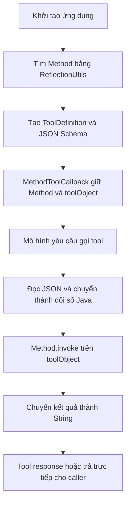

# MethodToolCallback

## Đánh giá reflection, proxy và khả năng biên dịch AOT

`MethodToolCallback` cho phép biến một method Java thành `ToolCallback` bằng cách cung cấp `Method`, `ToolDefinition` và đối tượng đích. Cách này hữu ích khi cần đăng ký công cụ bằng code, chọn method theo cấu hình hoặc tạo tool definition tại thời điểm khởi tạo ứng dụng. Đổi lại, ứng dụng cần hiểu method được tìm và gọi bằng reflection như thế nào, đối tượng đích có thể là Spring AOP proxy hay không, và GraalVM native image cần những thông tin gì để giữ lại method cùng proxy.

Trong module `SPRING_AI_TOOL_CALLING`, mô hình chỉ nhìn thấy tên tool, mô tả và JSON Schema. Phần reflection, gọi method, kiểm tra quyền và xử lý nghiệp vụ đều diễn ra trong ứng dụng. Bài này tập trung vào ba vấn đề kỹ thuật thường xuất hiện khi dùng `MethodToolCallback`: reflection, proxy và Ahead-of-Time (AOT) compilation.

### 1. `MethodToolCallback` làm gì?

Spring AI cung cấp ba cách phổ biến để định nghĩa tool:

| Cách định nghĩa | Cách hoạt động | Khi nên dùng |
| --- | --- | --- |
| `@Tool` | Đánh dấu method bằng annotation; Spring AI tạo callback và schema | Ứng dụng sở hữu method và muốn khai báo trực tiếp |
| `MethodToolCallback` | Cung cấp `Method`, đối tượng đích và định nghĩa tool bằng builder | Cần chọn method bằng code, tạo tool động từ một tập method đã biết hoặc tùy chỉnh metadata |
| `FunctionToolCallback` | Bọc `Function`, `Supplier`, `Consumer`, `BiFunction` hoặc method reference | Có sẵn function có kiểu dữ liệu rõ ràng và không cần chọn method bằng reflection |

Ba cách này đều tạo ra `ToolCallback` và tham gia cùng một cơ chế tool calling. `MethodToolCallback` là lựa chọn ở mức thấp hơn vì người viết tự xác định method nào được công khai và đối tượng nào sẽ thực thi method đó.

Một `MethodToolCallback` cần những thành phần chính:

- `toolMethod`: đối tượng `java.lang.reflect.Method` đại diện cho method cần gọi.
- `toolObject`: instance chứa method đó. Thành phần này bắt buộc với instance method và có thể bỏ qua với static method.
- `toolDefinition`: tên tool, mô tả và JSON Schema đầu vào mà mô hình nhìn thấy.
- `toolMetadata`: metadata điều khiển cách framework xử lý tool, chẳng hạn `returnDirect`.
- `toolCallResultConverter`: chuyển giá trị method trả về thành chuỗi để gửi cho mô hình; nếu không cấu hình, Spring AI dùng converter mặc định.

Ví dụ tối thiểu:

```java
Method method = ReflectionUtils.findMethod(
    WeatherTools.class, "getWeather", String.class);

ToolCallback callback = MethodToolCallback.builder()
    .toolDefinition(ToolDefinitions.builder(method)
        .description("Tra cứu thời tiết của một thành phố.")
        .build())
    .toolMethod(method)
    .toolObject(new WeatherTools())
    .build();
```

`toolObject` là instance mà `Method.invoke(...)` sẽ gọi. Với method instance, truyền đúng đối tượng có thể nhận method đã chọn. Với method static, không cần đối tượng đích.

### 2. Reflection diễn ra ở hai thời điểm

Reflection thường xuất hiện ở cả lúc tạo callback và lúc callback chạy.

**Lúc khởi tạo callback**, ứng dụng tìm method từ class và chữ ký tham số. `ReflectionUtils.findMethod(...)` là một cách tiện lợi để tìm method theo tên và kiểu tham số. Sau đó, `ToolDefinitions.builder(method)` có thể dùng thông tin method để tạo tool definition và JSON Schema.

**Lúc thực thi callback**, Spring AI chuyển JSON đầu vào thành các đối số Java, rồi gọi method thông qua đối tượng `Method`. Giá trị trả về được chuyển thành chuỗi bằng `ToolCallResultConverter` để đưa vào tool response.



Nên tìm method và tạo callback một lần trong quá trình cấu hình Spring, sau đó tái sử dụng callback như một bean. Không cần quét class hoặc tìm method lại cho từng yêu cầu hội thoại.

#### Chọn method bằng chữ ký đầy đủ

Không nên chỉ dựa vào tên method nếu class có overload. Ví dụ `findCustomer(String)` và `findCustomer(String, boolean)` có cùng tên nhưng khác schema, số đối số và hành vi. Hãy chỉ rõ kiểu tham số:

```java
Method method = ReflectionUtils.findMethod(
    CustomerQuery.class,
    "findCustomer",
    String.class);

if (method == null) {
    throw new IllegalStateException(
        "Không tìm thấy CustomerQuery.findCustomer(String)");
}
```

Việc kiểm tra `null` giúp ứng dụng lỗi sớm ở lúc khởi động thay vì đợi tới khi mô hình gọi tool. Nếu method có generic type, annotation tham số hoặc kiểu trả về phức tạp, hãy kiểm tra JSON Schema được tạo ra và xác nhận nó khớp với hợp đồng method.

#### Reflection và khả năng truy cập method

Java reflection có thể đại diện cho public, protected, package-private và private method. Spring AI cũng hỗ trợ các mức visibility này trong định nghĩa method tool. Tuy nhiên, khả năng reflection tìm được method không đồng nghĩa mọi method đều phù hợp để làm điểm vào nghiệp vụ.

Trong ứng dụng Spring, nên ưu tiên public method trên service interface hoặc service bean. Private method không thể được Spring AOP proxy chặn như một lời gọi từ bên ngoài; package-private method có thể gặp giới hạn theo package và kiểu proxy. Với Java module, việc mở quyền truy cập reflective vào package cũng có thể bị giới hạn bởi module boundary. Vì vậy, method public thể hiện hợp đồng nghiệp vụ thường dễ kiểm soát và kiểm thử hơn.

### 3. Tạo callback từ Spring bean

Khi method thuộc service do Spring quản lý, hãy inject bean đó làm `toolObject`. Điều này giúp callback gọi qua đúng instance Spring quản lý, bao gồm các interceptor mà ứng dụng đã cấu hình như transaction, security, retry hoặc metrics.

Ví dụ một service tra cứu tài khoản:

```java
public interface AccountQueryService {

    AccountView findAccount(
        @ToolParam(description = "Mã tài khoản cần tra cứu") String accountId);
}
```

```java
@Service
public class DefaultAccountQueryService implements AccountQueryService {

    private final AccountRepository accountRepository;

    public DefaultAccountQueryService(AccountRepository accountRepository) {
        this.accountRepository = accountRepository;
    }

    @Override
    @Transactional(readOnly = true)
    public AccountView findAccount(String accountId) {
        return accountRepository.findViewById(accountId)
            .orElseThrow(() -> new AccountNotFoundException(accountId));
    }
}
```

Tạo callback trong cấu hình Spring:

```java
@Configuration(proxyBeanMethods = false)
public class AccountToolConfiguration {

    @Bean
    ToolCallback accountLookup(AccountQueryService accountQueryService) {
        Method method = ReflectionUtils.findMethod(
            AccountQueryService.class,
            "findAccount",
            String.class);

        if (method == null) {
            throw new IllegalStateException(
                "Không tìm thấy AccountQueryService.findAccount(String)");
        }

        ToolDefinition definition = ToolDefinitions.builder(method)
            .name("lookup_account")
            .description("Tra cứu tài khoản theo mã tài khoản mà người dùng có quyền xem.")
            .build();

        return MethodToolCallback.builder()
            .toolDefinition(definition)
            .toolMethod(method)
            .toolObject(accountQueryService)
            .build();
    }
}
```

`accountQueryService` được inject theo interface. Nếu Spring tạo JDK dynamic proxy, callback vẫn có thể gọi method vì `Method` được lấy từ chính interface mà proxy triển khai. Lời gọi đi qua proxy để các interceptor như transaction hoặc security được áp dụng.

Đăng ký callback cho một request:

```java
String answer = chatClient.prompt()
    .user("Tra cứu tài khoản ACC-2048")
    .tools(accountLookup)
    .call()
    .content();
```

Trong ứng dụng thực tế, `AccountQueryService` phải kiểm tra quyền truy cập dựa trên danh tính đã xác thực. Việc mô hình chọn đúng tool và cung cấp mã tài khoản hợp lệ không thay thế bước phân quyền.

### 4. Reflection method và Spring AOP proxy phải khớp nhau

Spring AOP thường tạo một trong hai loại proxy:

- **JDK dynamic proxy:** proxy triển khai các interface của target object. Proxy có thể nhận lời gọi qua method được khai báo trên interface.
- **CGLIB class proxy:** proxy là subclass được sinh ra từ class target. Nó có thể nhận các lời gọi method có thể override của class đó.

Vấn đề xuất hiện khi `toolMethod` và `toolObject` không tương thích. Ví dụ, `toolObject` là JDK proxy của `AccountQueryService`, nhưng `toolMethod` lại được tìm trên `DefaultAccountQueryService`. JDK proxy không phải instance của class triển khai, vì vậy reflection không thể gọi method implementation đó trên proxy. Một lỗi dạng `IllegalArgumentException: object is not an instance of declaring class` có thể xuất hiện.

| `toolMethod` được tìm từ | `toolObject` | Kết quả |
| --- | --- | --- |
| Interface `AccountQueryService` | JDK proxy triển khai interface đó | Phù hợp; lời gọi đi qua `InvocationHandler` và Spring advice |
| Class `DefaultAccountQueryService` | CGLIB proxy là subclass của class đó | Có thể phù hợp nếu method có thể override và được proxy hỗ trợ |
| Class `DefaultAccountQueryService` | JDK proxy chỉ triển khai interface | Không tương thích; proxy không phải instance của class khai báo method |
| Class `DefaultAccountQueryService` | Target object thô, chưa qua proxy | Có thể gọi được nhưng các advice của Spring không chạy |

Quy tắc dễ áp dụng nhất là tìm method trên interface và truyền bean proxy được inject theo interface. Cách này tránh phụ thuộc việc Spring đang dùng JDK proxy hay CGLIB proxy.

#### Vì sao không nên lấy target object bên trong proxy?

Spring AOP thường thực hiện transaction, authorization, retry hoặc logging thông qua interceptor gắn với proxy. Nếu dùng tiện ích để lấy target object bên trong proxy rồi truyền target thô cho `MethodToolCallback`, lời gọi reflection sẽ đi thẳng vào target và có thể bỏ qua những interceptor đó.

Ví dụ, nếu `findAccount` cần `@Transactional`, việc callback gọi target thô có thể làm transaction không được mở theo cấu hình dự kiến. Nếu kiểm tra quyền được đặt trong aspect hoặc method interceptor, lời gọi trực tiếp cũng có thể bỏ qua lớp bảo vệ đó.

Không nên dùng `AopTestUtils` hoặc thao tác unwrapping target trong cấu hình production để chữa lỗi method không tương thích. Hãy chọn `Method` phù hợp với kiểu proxy và giữ nguyên bean do Spring quản lý. Việc truy cập target bên trong chỉ có thể phù hợp cho một số mục đích kiểm thử hoặc chẩn đoán được kiểm soát.

#### Giới hạn của CGLIB proxy

CGLIB tạo subclass, do đó cần override method để chèn advice. Các giới hạn quan trọng:

- Class `final` không thể được kế thừa để tạo proxy CGLIB.
- Method `final` không thể được override, nên advice không thể chặn method đó.
- Method `private` không thể được override.
- Method package-private có thể không được override nếu visibility hoặc ranh giới package không cho phép.

Việc Spring AI cho phép method tool có visibility private không có nghĩa Spring AOP có thể áp dụng transaction hoặc security advice lên private method đó. Hai cơ chế có mục tiêu khác nhau: reflection có thể gọi method, còn proxy chỉ áp dụng advice cho lời gọi mà proxy có thể intercept.

### 5. AOT và GraalVM Native Image thay đổi điều gì?

Trong ứng dụng JVM thông thường, class loading và reflection có thể diễn ra trong runtime. GraalVM Native Image phân tích ứng dụng theo mô hình closed-world khi build. Code không được xác định là có thể truy cập có thể bị loại bỏ; các thao tác reflection, serialization, resource loading và proxy động cần được khai báo để compiler giữ lại.

Spring AOT xử lý `ApplicationContext` ở build time và sinh thêm các tài nguyên phục vụ runtime, thường gồm:

- Java source được sinh từ cấu hình Spring.
- Bytecode cho một số proxy động.
- `RuntimeHints` cho reflection, serialization, resources và JDK proxies.
- Các file cấu hình native image dưới `META-INF/native-image`.

Vì vậy, một ứng dụng chạy tốt trên JVM chưa chắc đã chạy được trong native image. Nếu method chỉ được tìm bằng reflection hoặc proxy được tạo động nhưng không có hint tương ứng, lỗi có thể chỉ xuất hiện sau khi native image chạy.

### 6. Hints cho method tool

Spring AI cung cấp hỗ trợ AOT cho các method tool khi class chứa method là Spring bean, ví dụ một class có `@Component`. Nếu class chứa method không phải Spring bean, tài liệu Spring AI hướng dẫn đăng ký reflection bằng `@RegisterReflection`.

Ví dụ class chứa tool method không được quản lý như Spring bean:

```java
@RegisterReflection(
    memberCategories = MemberCategory.INVOKE_DECLARED_METHODS)
public class LegacyAccountTools {

    public AccountView findAccount(String accountId) {
        // Logic tra cứu minh họa.
        return ...;
    }
}
```

`INVOKE_DECLARED_METHODS` cho phép các declared method của class được gọi qua reflection. Chỉ nên đăng ký phạm vi cần thiết. Nếu ứng dụng tìm method theo cách động, hãy kiểm tra thêm nhu cầu introspection của cách tìm method và phiên bản Spring Framework đang dùng.

Với cấu hình phức tạp hơn, có thể dùng `RuntimeHintsRegistrar` để đăng ký chính xác method:

```java
public class AccountToolRuntimeHints implements RuntimeHintsRegistrar {

    @Override
    public void registerHints(RuntimeHints hints, ClassLoader classLoader) {
        Method method = ReflectionUtils.findMethod(
            AccountQueryService.class,
            "findAccount",
            String.class);

        if (method != null) {
            hints.reflection().registerMethod(method, ExecutableMode.INVOKE);
        }
    }
}
```

Đăng ký registrar gần cấu hình cần nó:

```java
@Configuration(proxyBeanMethods = false)
@ImportRuntimeHints(AccountToolRuntimeHints.class)
public class AccountToolConfiguration {
    // Các @Bean tạo ToolCallback nằm ở đây.
}
```

Với Spring Framework 7, các reflection hint cho một type cũng bao gồm thông tin introspection theo cơ chế hiện hành. Nếu dự án đang dùng Spring Framework 6.x, hãy kiểm tra API `MemberCategory` và `ExecutableMode` của đúng minor version vì một số API hint đã thay đổi giữa các phiên bản.

### 7. Hints cho proxy và kiểu dữ liệu kết quả

Reflection hint cho method không tự động thay thế mọi hint khác. Một tool method có thể cần thêm:

- **Proxy hint:** nếu ứng dụng tự tạo JDK proxy bằng `Proxy.newProxyInstance(...)` hoặc cơ chế tương tự, cần đăng ký tập interface được proxy triển khai. Spring AOT thường có thể suy ra proxy của Spring bean từ bean definition, nhưng proxy do ứng dụng tạo động ngoài mô hình đó có thể cần hint riêng.
- **Serialization/binding hint:** nếu kết quả tool là DTO được Jackson serialize nhưng AOT không suy ra được kiểu đó, đăng ký reflection cho DTO bằng `@RegisterReflectionForBinding`.
- **Resource hint:** nếu tool đọc file hoặc resource theo tên được tạo động, resource đó cần được khai báo để native image đóng gói.

Ví dụ đăng ký JDK proxy tự tạo:

```java
public class AccountProxyRuntimeHints implements RuntimeHintsRegistrar {

    @Override
    public void registerHints(RuntimeHints hints, ClassLoader classLoader) {
        hints.proxies().registerJdkProxy(AccountQueryService.class);
    }
}
```

Nếu proxy là Spring AOP proxy được tạo từ bean definition, hãy để Spring AOT xử lý trước; không thêm proxy hint thủ công nếu không có lý do cụ thể. Đăng ký dư thừa và không đúng tập interface có thể che giấu việc cấu hình bean hoặc proxy chưa rõ ràng.

Đăng ký reflection cho DTO được Jackson dùng:

```java
@Component
@RegisterReflectionForBinding(AccountView.class)
public class AccountResultConfiguration {
}
```

`@RegisterReflectionForBinding` đăng ký metadata cần thiết cho constructor, field, property và record component để framework có thể bind hoặc serialize kiểu dữ liệu đó. Nếu DTO chứa kiểu lồng nhau, các kiểu được tham chiếu cũng có thể được đăng ký theo cơ chế binding của Spring.

### 8. AOT và đăng ký tool động

`MethodToolCallback` cho phép chọn method bằng code, nhưng native image vẫn cần biết trước các class và method có thể được gọi. AOT phù hợp với một tập công cụ đã biết tại build time, kể cả khi ứng dụng quyết định tool nào được đưa vào từng request.

Ví dụ, ứng dụng có thể có 20 tool đã được biên dịch và đăng ký trong Spring context, sau đó chọn 3 tool theo vai trò người dùng. Tập method vẫn hữu hạn và có thể được AOT phân tích.

Ngược lại, nếu ứng dụng tải class plugin mới từ bên ngoài hoặc tìm method tùy ý trong classpath tại runtime, native image không thể tự bổ sung code đã bị loại khỏi executable. Reflection hint cũng không thể biến một class không được đóng gói vào native image thành class có thể tải. Khi cần mở rộng tool ở runtime, hãy cân nhắc:

- Đóng gói trước các implementation và method hợp lệ, rồi chỉ bật/tắt trong một allowlist.
- Dùng `FunctionToolCallback` hoặc `ToolCallback` triển khai tường minh nếu hợp đồng function có thể được xác định trước.
- Đưa phần mở rộng thực sự động sang dịch vụ hoặc MCP server bên ngoài và gọi qua giao thức mạng.

Không nên để mô hình chọn tên class hoặc method tùy ý rồi thực thi reflection trên classpath. Cách đó mở rộng bề mặt tấn công, làm khó AOT và khiến ứng dụng mất khả năng kiểm soát danh sách thao tác hợp lệ.

### 9. Kiểm thử reflection, proxy và AOT

Kiểm thử nên tách ba lớp vấn đề để xác định lỗi ở đúng tầng.

**Kiểm thử reflection và schema:**

- Xác minh method được tìm đúng theo tên và kiểu tham số.
- Kiểm tra callback từ chối cấu hình thiếu `toolObject` đối với instance method.
- Kiểm tra schema tạo ra có đúng kiểu, mô tả và trạng thái required/optional.
- Gọi callback trực tiếp bằng JSON hợp lệ để xác nhận method được gọi và kết quả được serialize.
- Kiểm tra method overload để tránh chọn nhầm chữ ký.

**Kiểm thử proxy và advice:**

- Tạo test với service triển khai interface và bật transaction/security advice.
- Truyền bean proxy được inject vào `toolObject`, sau đó gọi callback và xác minh advice được chạy.
- Kiểm tra cả cấu hình JDK proxy và class-based proxy nếu ứng dụng hỗ trợ cả hai.
- Xác minh `toolMethod` lấy từ interface tương thích với JDK proxy.
- Kiểm tra lời gọi không bị chuyển sang target thô làm bỏ qua transaction hoặc security.
- Kiểm tra final/private method không được dùng như điểm vào cần Spring AOP advice.

**Kiểm thử AOT/native:**

- Dùng `RuntimeHintsPredicates` để xác minh reflection hint cho method.
- Nếu tự tạo JDK proxy, xác minh proxy hint có đúng interface và đúng thứ tự interface.
- Xác minh DTO dùng trong tool result có binding/serialization hint nếu cần.
- Chạy AOT processing để kiểm tra Spring tạo được bean definition và proxy bytecode.
- Build native image bằng cấu hình GraalVM của dự án, sau đó chạy một request thật có gọi tool.
- Kiểm tra các đường lỗi, method overload, proxy interceptor và JSON serialization trong native executable.

Ví dụ test một reflection hint trong Spring Framework 7:

```java
@Test
void registersAccountMethodInvocationHint() {
    RuntimeHints hints = new RuntimeHints();
    new AccountToolRuntimeHints().registerHints(
        hints, getClass().getClassLoader());

    Method method = ReflectionUtils.findMethod(
        AccountQueryService.class,
        "findAccount",
        String.class);

    assertThat(RuntimeHintsPredicates.reflection()
        .onMethodInvocation(method))
        .accepts(hints);
}
```

Nếu dự án dùng Spring Framework 6.x, API predicate có thể dùng dạng `RuntimeHintsPredicates.reflection().onMethod(method).invoke()`; cần theo Javadoc của phiên bản đang dùng. Test hint xác nhận cấu hình metadata, nhưng không thay thế việc build và chạy native image.

### 10. Chọn cách triển khai phù hợp

| Trường hợp | Lựa chọn đề xuất | Lý do |
| --- | --- | --- |
| Method ổn định, do ứng dụng sở hữu | `@Tool` trên Spring bean | Khai báo đơn giản; Spring AI hỗ trợ schema và AOT cho tool method của bean |
| Cần chọn method theo cấu hình từ tập method đã biết | `MethodToolCallback` | Chủ động chọn `Method`, `ToolDefinition` và target object |
| Service có Spring AOP và JDK proxy | Dùng method lấy từ interface và bean proxy | Đảm bảo method có thể gọi trên proxy và advice vẫn hoạt động |
| Service dùng CGLIB proxy | Dùng method public có thể override trên class proxy | Tránh method final/private và class final |
| Tool là function hoặc method reference | `FunctionToolCallback` | Không cần tự tìm `Method` và chọn target object |
| Native image, method tool nằm trong Spring bean | Dùng bean được Spring quản lý và kiểm tra AOT output | Spring AI có hỗ trợ AOT cho tool method của bean |
| Native image, method/class không phải Spring bean | `@RegisterReflection` hoặc `RuntimeHintsRegistrar` | Đăng ký invocation hint cho method cần gọi |
| Native image, DTO kết quả được Jackson xử lý động | `@RegisterReflectionForBinding` khi cần | Bảo đảm metadata serialization/binding được giữ lại |
| Proxy JDK được tạo thủ công lúc runtime | Đăng ký `RuntimeHints.proxies()` | GraalVM cần biết tập interface của proxy |

### 11. Những lỗi thường gặp và cách xử lý

| Triệu chứng | Nguyên nhân thường gặp | Hướng kiểm tra |
| --- | --- | --- |
| `findMethod(...)` trả về `null` | Sai tên hoặc kiểu tham số, method không nằm trên class được tìm | Kiểm tra chữ ký và dùng interface/class đúng |
| `IllegalArgumentException: object is not an instance of declaring class` | `Method` được lấy từ implementation class nhưng `toolObject` là JDK proxy chỉ triển khai interface | Lấy `Method` từ interface proxy triển khai |
| Tool chạy nhưng transaction hoặc security không hoạt động | Callback giữ target object thô, không phải Spring proxy | Inject bean proxy từ ApplicationContext vào `toolObject` |
| Advice không chạy với CGLIB | Method final/private hoặc class final | Dùng public method có thể override hoặc chọn interface-based proxy |
| Native image báo thiếu reflection registration | Method chỉ được gọi qua reflection nhưng hint chưa được sinh | Đăng ký `@RegisterReflection` hoặc `RuntimeHintsRegistrar` |
| Native image báo thiếu proxy configuration | Proxy được tạo động nhưng AOT không biết interface set | Đăng ký JDK proxy hint hoặc để Spring AOT xử lý bean proxy |
| Lỗi serialize tool result trong native image | DTO không có binding hint cần thiết | Kiểm tra Jackson hints và `@RegisterReflectionForBinding` |
| Method chạy trên JVM nhưng không có trong native image | Class hoặc method không nằm trong tập có thể reach được khi build | Đưa implementation vào classpath/bean graph tại build time |

### 12. Checklist trước khi đưa `MethodToolCallback` lên production

- Chọn đúng method theo chữ ký đầy đủ và kiểm tra method tồn tại khi khởi động.
- Dùng `toolObject` là Spring bean proxy khi method cần transaction, security, retry hoặc metrics advice.
- Nếu dùng JDK proxy, tìm method trên interface mà proxy triển khai.
- Nếu dùng CGLIB, tránh class final và method final/private ở điểm cần advice.
- Giữ `ToolDefinition` và JSON Schema đồng bộ với method signature.
- Chỉ đăng ký các method được phép cho request; không cho mô hình chọn class hoặc method tùy ý.
- Kiểm tra DTO trả về có thể serialize và không chứa dữ liệu nhạy cảm không cần thiết.
- Với native image, xác minh reflection, serialization và proxy hints.
- Chạy test callback trên JVM, AOT processing và native integration test.
- Theo dõi lỗi tool, thời gian thực thi và request ID để có thể truy vết.

`MethodToolCallback` phù hợp khi ứng dụng cần điều khiển việc chọn method bằng code. Để nó hoạt động ổn định, `Method` phải tương thích với `toolObject`, `toolObject` phải giữ đúng Spring proxy nếu cần AOP advice, và native image phải có đủ hint cho các thao tác động. Khi method đã cố định, `@Tool` thường đơn giản hơn; khi logic đã có dạng function, `FunctionToolCallback` giúp giảm nhu cầu reflection thủ công.

### Tài liệu tham khảo

- [Spring AI 2.1 Reference — Tool Calling](https://docs.spring.io/spring-ai/reference/api/tools.html)
- [Spring AI 2.0 Reference — Tool Calling and MethodToolCallback](https://docs.spring.io/spring-ai/reference/2.0/api/tools.html)
- [Spring Framework 7.1 Reference — Ahead of Time Optimizations](https://docs.spring.io/spring-framework/reference/core/aot.html)
- [Spring Framework Reference — Proxying Mechanisms](https://docs.spring.io/spring-framework/reference/core/aop/proxying.html)
- [Spring Boot 4.2 Reference — GraalVM Native Images](https://docs.spring.io/spring-boot/reference/packaging/native-image/introducing-graalvm-native-images.html)
- [Spring Boot 4.2 Reference — Advanced Native Images Topics](https://docs.spring.io/spring-boot/reference/packaging/native-image/advanced-topics.html)

Các ví dụ API trong bài dựa trên tài liệu Spring AI 2.1 và Spring Framework 7.x. Hãy đối chiếu Spring AI, Spring Boot, Spring Framework và GraalVM theo dependency matrix của dự án trước khi chốt cấu hình native image; tên API hint có thể khác giữa Spring Framework 6.x và 7.x.
