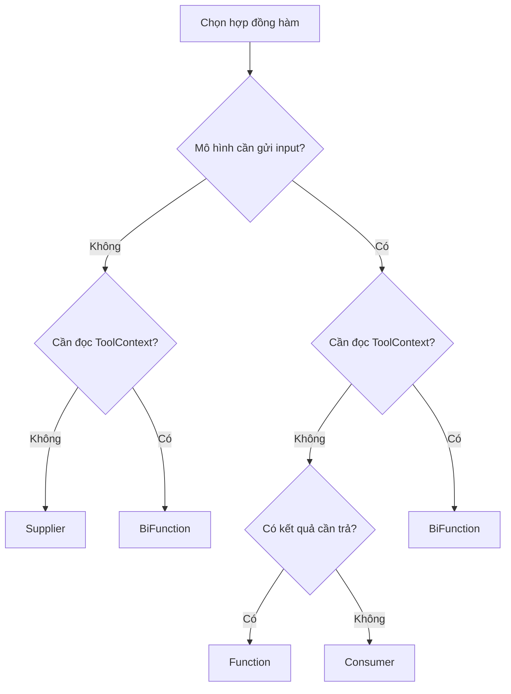

# Chọn Function, Supplier, Consumer hoặc BiFunction theo nhu cầu

`FunctionToolCallback` cho phép biến một đối tượng hàm Java thành công cụ mà mô hình có thể yêu cầu Spring AI thực thi. Thay vì viết một lớp adapter với phương thức riêng cho từng thao tác, ứng dụng có thể dùng trực tiếp method reference, lambda hoặc một implementation của functional interface chuẩn trong Java.

Spring AI hỗ trợ bốn dạng chính: `Function`, `Supplier`, `Consumer` và `BiFunction`. Điểm khác nhau nằm ở dữ liệu đầu vào, dữ liệu trả về và khả năng nhận `ToolContext`. Chọn đúng dạng giúp chữ ký Java thể hiện đúng hợp đồng của công cụ, đồng thời giúp Spring AI tạo schema đầu vào phù hợp cho mô hình.

Trong module `SPRING_AI_TOOL_CALLING`, mô hình chỉ gửi các đối số theo schema mà ứng dụng công bố. Ứng dụng vẫn sở hữu việc thực thi callback, kiểm tra dữ liệu, xác thực quyền và gọi dịch vụ nghiệp vụ. Các functional interface chỉ quyết định cách đóng gói hàm Java thành `ToolCallback`; chúng không tự cấp quyền cho mô hình.

## 1. Bốn functional interface trong FunctionToolCallback

Spring AI cung cấp các overload của `FunctionToolCallback.builder(...)` tương ứng với từng functional interface:

| Interface | Chữ ký Java | Đầu vào do mô hình cung cấp | Kết quả hàm |
|---|---|---|---|
| `Function<I, O>` | `O apply(I input)` | Một object kiểu `I` | Một object kiểu `O` |
| `Supplier<O>` | `O get()` | Không có đối số nghiệp vụ | Một object kiểu `O` |
| `Consumer<I>` | `void accept(I input)` | Một object kiểu `I` | Không có giá trị trả về (`Void`) |
| `BiFunction<I, ToolContext, O>` | `O apply(I input, ToolContext context)` | Một object kiểu `I`; context được Spring AI truyền riêng | Một object kiểu `O` |

Điểm cần chú ý là `BiFunction` của `FunctionToolCallback` có chữ ký cụ thể `BiFunction<I, ToolContext, O>`. Đối số thứ hai là `ToolContext` do Spring AI cung cấp trong lúc thực thi, không phải trường thứ hai trong JSON arguments mà mô hình tạo. Nếu cần nhiều dữ liệu nghiệp vụ từ mô hình, hãy gom chúng vào một DTO hoặc record kiểu `I`.



Có thể ghi nhớ nhanh:

- Có input và có output: chọn `Function`.
- Không có input nhưng có output: chọn `Supplier`.
- Có input, chỉ thực hiện hành động và không trả output: chọn `Consumer`.
- Có input, có output và cần ngữ cảnh server: chọn `BiFunction`.
- Không có input từ mô hình nhưng cần ngữ cảnh server: có thể dùng `BiFunction<Void, ToolContext, O>`.

## 2. Function: nhận dữ liệu từ mô hình và trả kết quả

`Function<I, O>` phù hợp với phần lớn công cụ tra cứu, tính toán hoặc biến đổi dữ liệu. Mô hình tạo một object đầu vào theo schema của `I`; hàm gọi dịch vụ nghiệp vụ và trả về object `O`. Spring AI chuyển kết quả thành chuỗi để gửi lại mô hình, trừ khi metadata của tool được cấu hình trả trực tiếp.

Ví dụ tra cứu trạng thái đơn hàng:

```java
public record OrderLookup(
        @ToolParam(description = "Mã đơn hàng cần tra cứu") String orderId) {
}

public record OrderStatusView(
        String orderId,
        String status,
        String carrier,
        String estimatedDelivery) {
}

Function<OrderLookup, OrderStatusView> getOrderStatus =
        request -> orderQueryService.findStatus(request.orderId());

ToolCallback orderStatusTool = FunctionToolCallback
        .builder("getOrderStatus", getOrderStatus)
        .description("Tra cứu trạng thái hiện tại của đơn hàng theo mã đơn hàng.")
        .inputType(OrderLookup.class)
        .build();
```

Mô hình có thể tạo arguments tương tự:

```json
{
  "orderId": "ORD-2048"
}
```

Spring AI chuyển JSON arguments thành `OrderLookup`, gọi `apply(request)` và chuyển `OrderStatusView` thành kết quả công cụ. Mô hình nhận kết quả rồi có thể diễn đạt cho người dùng hoặc gọi công cụ tiếp theo.

Chọn `Function` khi:

- Mô hình cần cung cấp tham số nghiệp vụ.
- Hàm trả về dữ liệu mà mô hình cần sử dụng tiếp.
- Công cụ là thao tác tra cứu, tìm kiếm, tính toán hoặc kiểm tra.
- Không cần nhận thêm `ToolContext` trong chính chữ ký hàm.

`Function` là lựa chọn mặc định tốt khi chưa có nhu cầu đặc biệt về ngữ cảnh hoặc tác động phụ. Nếu cần nhiều trường đầu vào, hãy mở rộng record/DTO thay vì tạo một hàm có nhiều đối số rời rạc.

## 3. Supplier: không nhận đối số từ mô hình

`Supplier<O>` phù hợp khi ứng dụng có thể tự xác định toàn bộ dữ liệu đầu vào. Phương thức `get()` không nhận tham số; mô hình chỉ quyết định có gọi công cụ hay không. Ví dụ, công cụ có thể trả thông tin phiên bản ứng dụng, số liệu sức khỏe hệ thống hoặc cấu hình công khai hiện tại.

```java
public record SystemHealthView(
        String status,
        int activeWorkers,
        String checkedAt) {
}

Supplier<SystemHealthView> systemHealthSupplier =
        systemHealthService::currentSnapshot;

ToolCallback systemHealthTool = FunctionToolCallback
        .builder("getSystemHealth", systemHealthSupplier)
        .description("Lấy trạng thái sức khỏe hiện tại của hệ thống; không cần tham số đầu vào.")
        .inputType(Void.class)
        .build();
```

Với `Supplier`, dùng `Void.class` làm kiểu đầu vào vì tool không nhận dữ liệu nghiệp vụ do mô hình cung cấp. Đây là cách khai báo được dùng trong ví dụ chính thức của Spring AI. Schema tạo ra không có trường đầu vào nghiệp vụ để mô hình điền.

Chọn `Supplier` khi:

- Công cụ không cần tham số từ câu hỏi.
- Dữ liệu được xác định hoàn toàn từ phía ứng dụng hoặc một dịch vụ dùng chung.
- Công cụ chỉ cần trả một snapshot, trạng thái hoặc giá trị hiện tại.

Không dùng `Supplier` cho dữ liệu phụ thuộc người dùng hiện tại nếu hàm không có cách nhận danh tính request. Một `Supplier` được đăng ký như singleton bean không nên đọc trạng thái request từ biến toàn cục hoặc field có thể bị ghi đè giữa các request. Nếu cần `userId`, `tenantId` hoặc thông tin request đáng tin cậy, hãy cân nhắc `BiFunction<Void, ToolContext, O>` hoặc một phương thức `@Tool` nhận `ToolContext`.

## 4. Consumer: nhận dữ liệu và thực hiện hành động không có kết quả trả về

`Consumer<I>` dùng cho thao tác nhận một command rồi thực hiện tác động phụ. Phương thức `accept(input)` trả `void`, vì vậy công cụ không tạo object kết quả cho mô hình sử dụng.

Ví dụ gửi yêu cầu thông báo cho khách hàng:

```java
public record CustomerNotification(
        @ToolParam(description = "Mã khách hàng nhận thông báo") String customerId,
        @ToolParam(description = "Nội dung thông báo cần gửi") String message) {
}

Consumer<CustomerNotification> sendNotification = notification ->
        notificationService.send(
                notification.customerId(),
                notification.message());

ToolCallback notificationTool = FunctionToolCallback
        .builder("sendCustomerNotification", sendNotification)
        .description("Gửi thông báo đến khách hàng được chỉ định. Đây là thao tác tạo tác động bên ngoài.")
        .inputType(CustomerNotification.class)
        .build();
```

Mô hình cung cấp một `CustomerNotification`; Spring AI gọi `accept(notification)`. Hàm hoàn tất mà không trả một `NotificationResult`.

Chọn `Consumer` khi:

- Mô hình cần cung cấp một command.
- Mục đích chính là thực hiện một hành động.
- Không cần trả dữ liệu nghiệp vụ để mô hình tiếp tục xử lý.

Ví dụ phù hợp gồm ghi nhận một sự kiện, phát lệnh đồng bộ hóa hoặc gửi một thông báo đã được ứng dụng cho phép. Với thao tác quan trọng như hoàn tiền, hủy đơn, xóa dữ liệu hoặc gửi thông tin ra bên ngoài, `Consumer` không tự tạo bước xác nhận và không tự bảo đảm tính lặp an toàn. Ứng dụng phải kiểm tra quyền, trạng thái nghiệp vụ, xác nhận cần thiết và idempotency trước khi thực hiện.

Nếu mô hình hoặc giao diện cần biết thao tác đã thành công, trả về mã giao dịch hoặc trạng thái, hãy dùng `Function<I, ActionResult>` thay vì `Consumer<I>`:

```java
public record RefundResult(
        String requestId,
        String status,
        String message) {
}

Function<RefundRequest, RefundResult> requestRefund =
        refundService::requestRefund;
```

Khi đó mô hình nhận được kết quả có cấu trúc để giải thích hoặc quyết định bước tiếp theo.

## 5. BiFunction: kết hợp input của mô hình với ToolContext

`BiFunction<I, ToolContext, O>` dùng khi hàm cần cả dữ liệu do mô hình cung cấp lẫn dữ liệu ngữ cảnh do ứng dụng truyền vào. Đối số `I` được chuyển đổi từ JSON arguments; `ToolContext` được Spring AI cung cấp riêng trong quá trình thực thi.

Đây là lựa chọn phù hợp khi cần áp dụng phạm vi dữ liệu theo người dùng hoặc tenant hiện tại. Ví dụ, mô hình gửi mã đơn hàng; ứng dụng truyền `userId` đã xác thực qua context; service chỉ trả trạng thái của đơn hàng mà người dùng đó được phép xem.

```java
public record OrderLookup(
        @ToolParam(description = "Mã đơn hàng cần tra cứu") String orderId) {
}

BiFunction<OrderLookup, ToolContext, OrderStatusView> getVisibleOrderStatus =
        (request, toolContext) -> {
            Object userIdValue = toolContext.getContext().get("userId");
            if (!(userIdValue instanceof String userId) || userId.isBlank()) {
                throw new AccessDeniedException("Thiếu danh tính người dùng đã xác thực.");
            }

            return orderQueryService.findStatusVisibleTo(
                    request.orderId(), userId);
        };

ToolCallback visibleOrderTool = FunctionToolCallback
        .builder("getMyOrderStatus", getVisibleOrderStatus)
        .description("Tra cứu trạng thái của đơn hàng thuộc phạm vi truy cập của người dùng hiện tại.")
        .inputType(OrderLookup.class)
        .build();
```

Ứng dụng truyền context trong request `ChatClient`:

```java
String answer = chatClient.prompt()
        .user("Kiểm tra trạng thái đơn hàng ORD-2048 của tôi.")
        .toolContext(Map.of("userId", authenticatedUser.id()))
        .tools(visibleOrderTool)
        .call()
        .content();
```

`userId` trong ví dụ phải đến từ principal hoặc session đã được xác thực ở phía server. Không lấy nó từ câu hỏi hoặc arguments mà mô hình tạo. `ToolContext` không được đưa vào schema gửi cho mô hình; nó chỉ được chuyển tới callback khi thực thi. Dịch vụ nghiệp vụ vẫn phải kiểm tra quyền trên tài nguyên cụ thể.

Nếu tool không cần đối số do mô hình cung cấp nhưng vẫn cần context, có thể dùng:

```java
BiFunction<Void, ToolContext, ProfileSummary> currentProfile =
        (ignored, context) -> {
            String userId = (String) context.getContext().get("userId");
            return profileService.getSummaryFor(userId);
        };

ToolCallback profileTool = FunctionToolCallback
        .builder("getMyProfileSummary", currentProfile)
        .description("Lấy bản tóm tắt hồ sơ của người dùng hiện tại; không cần tham số nghiệp vụ.")
        .inputType(Void.class)
        .build();
```

Chọn `BiFunction` khi:

- Hàm cần dữ liệu do mô hình cung cấp và ngữ cảnh tin cậy do ứng dụng cung cấp.
- Cần xác định user, tenant, request scope hoặc chính sách hiện tại khi thực thi.
- Muốn giữ các trường định danh/quyền hạn khỏi JSON schema của mô hình.

## 6. Không nhầm BiFunction với hai tham số do mô hình gửi

Trong Java, `BiFunction<A, B, R>` tổng quát có hai đầu vào. Nhưng overload của `FunctionToolCallback.builder(...)` được Spring AI cung cấp có kiểu cụ thể:

```java
BiFunction<I, ToolContext, O>
```

Nó có nghĩa là một đầu vào nghiệp vụ `I` và một `ToolContext`. Nó không tạo schema có hai trường nghiệp vụ độc lập để mô hình điền.

Nếu nghiệp vụ cần hai hay nhiều giá trị từ mô hình, hãy định nghĩa DTO/record:

```java
public record ShippingQuoteRequest(
        String orderId,
        String destinationCode,
        int weightGrams) {
}

Function<ShippingQuoteRequest, ShippingQuote> calculateShippingQuote =
        shippingService::calculateQuote;
```

Schema đầu vào khi đó mô tả `orderId`, `destinationCode` và `weightGrams` trong cùng một object. Nếu cần cả tenant hoặc user hiện tại, chuyển sang `BiFunction<ShippingQuoteRequest, ToolContext, ShippingQuote>`.

Không cố tạo `BiFunction<OrderId, Destination, Quote>` để mong Spring AI tự hiểu `Destination` là tham số thứ hai từ mô hình. Hãy gom hai trường đó vào một request type để schema và quá trình deserialize rõ ràng.

## 7. So sánh bằng một tình huống nghiệp vụ

Giả sử ứng dụng có bốn nhu cầu liên quan đến đơn hàng:

| Nhu cầu | Functional interface phù hợp | Lý do |
|---|---|---|
| Tra cứu trạng thái theo mã đơn hàng | `Function<OrderLookup, OrderStatusView>` | Mô hình cung cấp mã, hàm trả trạng thái |
| Lấy trạng thái sức khỏe hệ thống | `Supplier<SystemHealthView>` | Không cần dữ liệu đầu vào từ mô hình |
| Gửi một lệnh thông báo theo nội dung được duyệt | `Consumer<CustomerNotification>` | Có command, không cần kết quả trả về |
| Tra cứu đơn hàng theo mã trong phạm vi người dùng hiện tại | `BiFunction<OrderLookup, ToolContext, OrderStatusView>` | Kết hợp mã từ mô hình với user context từ server |

Hãy quyết định theo hợp đồng dữ liệu và kết quả trước khi chọn interface. Đừng chọn `Consumer` chỉ vì phương thức service hiện tại trả `void` nếu sản phẩm cần mô hình biết mã xác nhận. Đừng chọn `Supplier` nếu dữ liệu phụ thuộc vào người dùng nhưng không có cách truyền context. Đừng chọn `BiFunction` khi chỉ cần nhiều trường do mô hình gửi; record/DTO cùng `Function` thường rõ hơn.

## 8. Khai báo FunctionToolCallback và tạo schema

Một callback được tạo bằng builder cần ít nhất tên, function reference và kiểu đầu vào. `description` giúp mô hình biết khi nào nên gọi; `inputType` được dùng để tạo JSON Schema nếu không cung cấp schema thủ công.

```java
ToolCallback callback = FunctionToolCallback
        .builder("getOrderStatus",
                (OrderLookup request) -> orderService.findStatus(request.orderId()))
        .description("Tra cứu trạng thái hiện tại của đơn hàng theo mã đơn hàng.")
        .inputType(OrderLookup.class)
        .build();
```

Với `Function`, `Consumer` và `BiFunction`, `inputType` là kiểu `I` mà mô hình sẽ gửi. Với `Supplier`, kiểu đầu vào là `Void.class`. `ToolDefinition` được tạo từ tên, mô tả và schema đầu vào; mô hình chỉ nhìn thấy hợp đồng này, không nhìn thấy implementation Java.

Có thể cung cấp schema tường minh qua `.inputSchema(...)` nếu ứng dụng cần kiểm soát JSON Schema cụ thể. Khi dùng `inputType(...)`, các annotation như `@ToolParam` trên field/record component có thể mô tả trường và trạng thái bắt buộc/không bắt buộc. Sau khi build callback, nên kiểm tra `callback.getToolDefinition().inputSchema()` để xác nhận schema thực tế.

Các kiểu đầu vào và đầu ra cần có thể serialize/deserialize phù hợp. Trong tài liệu Spring AI 1.0.x, function-based tools được mô tả với `Void` hoặc POJO công khai có thể serialize; các kiểu primitive, `Optional`, collection, async và reactive được liệt kê là không hỗ trợ cho function-based specification. Một số kiểu trong danh sách đó được method-based tools hỗ trợ. Hãy đối chiếu giới hạn với đúng phiên bản Spring AI đang dùng trước khi chọn DTO hoặc kiểu trả về.

## 9. Đăng ký callback với ChatClient

Trong Spring AI 2.x, cách rõ ràng là tạo `ToolCallback` rồi truyền callback đó cho `ChatClient`. Ví dụ khai báo bean:

```java
@Configuration(proxyBeanMethods = false)
class OrderToolConfiguration {

    @Bean
    ToolCallback getOrderStatusTool(OrderQueryService orderQueryService) {
        Function<OrderLookup, OrderStatusView> function =
                request -> orderQueryService.findStatus(request.orderId());

        return FunctionToolCallback
                .builder("getOrderStatus", function)
                .description("Tra cứu trạng thái đơn hàng theo mã đơn hàng.")
                .inputType(OrderLookup.class)
                .build();
    }
}
```

Sau đó inject callback và đăng ký cho một yêu cầu:

```java
String answer = chatClient.prompt()
        .user("Đơn hàng ORD-2048 đang ở trạng thái nào?")
        .tools(getOrderStatusTool)
        .call()
        .content();
```

Hoặc dùng `.defaultTools(...)` khi công cụ thực sự cần có mặt trong mọi request được tạo từ client đó. Công cụ có tác động phụ hoặc yêu cầu quyền cao thường nên được thêm theo từng use case để giới hạn phạm vi.

Từ Spring AI 2.0, pattern đăng ký bean chỉ là `Function`, `Supplier`, `Consumer` hoặc `BiFunction` rồi phân giải bằng tên qua `toolNames(...)` đã bị loại bỏ. Hãy đăng ký `ToolCallback` rõ ràng. Pattern bean function động thuộc Spring AI 1.x; nếu duy trì ứng dụng cũ, kiểm tra hướng dẫn migration của phiên bản đang nâng cấp.

## 10. Kết quả trả về và vai trò của Void

`Function<I, O>`, `Supplier<O>` và `BiFunction<I, ToolContext, O>` có một kiểu kết quả `O`. Spring AI chuyển đổi kết quả này thành chuỗi để gửi lại mô hình, thường bằng `DefaultToolCallResultConverter` và Jackson.

`Consumer<I>` có kiểu kết quả `Void`, vì `accept(...)` không trả dữ liệu. Đây là khác biệt quan trọng khi thiết kế hội thoại:

- Nếu mô hình chỉ cần biết callback đã được gọi và không cần dữ liệu tiếp theo, `Consumer` có thể đủ.
- Nếu mô hình cần thông báo xác nhận, mã giao dịch, trạng thái hoặc lý do thất bại, hãy trả một record kết quả bằng `Function<I, O>` hoặc `BiFunction<I, ToolContext, O>`.
- Không nên giả định `Consumer` sẽ tạo một thông điệp xác nhận nghiệp vụ hữu ích. Hãy thiết kế kiểu kết quả tường minh nếu caller hoặc mô hình cần đọc nó.

Ví dụ:

```java
public record NotificationResult(
        String notificationId,
        String status) {
}

Function<CustomerNotification, NotificationResult> sendNotification =
        notificationService::sendAndReturnReceipt;
```

Kiểu trả về nên chỉ chứa dữ liệu cần cho bước tiếp theo. Không trả JPA entity, token, dữ liệu xác thực hoặc toàn bộ object nội bộ cho mô hình.

## 11. Những giới hạn và sai lầm thường gặp

| Sai lầm | Hậu quả | Cách xử lý |
|---|---|---|
| Dùng `Supplier` cho dữ liệu phụ thuộc user hiện tại | Hàm không có tham số để nhận context của request | Dùng `BiFunction<Void, ToolContext, O>` hoặc `@Tool` nhận `ToolContext` |
| Dùng `Consumer` nhưng mong mô hình biết mã giao dịch | Không có object kết quả để mô hình diễn giải | Dùng `Function<I, ActionResult>` |
| Dùng `BiFunction<A, B, O>` để nhận hai trường nghiệp vụ | Chữ ký Spring AI dành đối số thứ hai cho `ToolContext` | Gom A và B vào một request DTO |
| Đưa `userId` hoặc `tenantId` vào DTO do mô hình tạo | Có thể cho phép giả mạo phạm vi dữ liệu | Lấy từ principal và truyền qua `ToolContext` |
| Dùng primitive hoặc collection tùy tiện làm function input/output | Có thể không được function-based schema hỗ trợ trong phiên bản đang dùng | Dùng POJO/record hoặc chuyển sang method-based tool khi phù hợp |
| Không khai báo `inputType` hoặc mô tả schema nghèo nàn | Schema không rõ hoặc builder không tạo được callback | Khai báo input type, description và kiểm tra schema sau build |
| Đăng ký bare `Function` bean với `toolNames` trên Spring AI 2.x | Pattern resolver cũ đã bị loại bỏ | Đăng ký bean kiểu `ToolCallback` |
| Cho `Consumer` thực hiện hành động nhạy cảm mà không có kiểm soát | Có thể tạo tác động phụ ngoài ý muốn hoặc lặp giao dịch | Kiểm tra quyền, xác nhận, transaction và idempotency trong service |

## 12. Kiểm thử lựa chọn functional interface

Kiểm thử nên xác minh cả hành vi của hàm và hợp đồng callback:

1. **Function:** arguments được deserialize thành đúng DTO; `apply` nhận đúng dữ liệu; output được chuyển đổi thành kết quả mong đợi.
2. **Supplier:** tool không cần input; callback được build với `Void.class`; `get()` được gọi và trả đúng snapshot.
3. **Consumer:** DTO đầu vào đến đúng `accept`; tác động phụ chỉ xảy ra một lần; kết quả không được giả định là một DTO nghiệp vụ.
4. **BiFunction:** tham số đầu tiên đến từ JSON; tham số thứ hai là `ToolContext` từ ứng dụng; context không xuất hiện trong input schema.
5. **Schema:** tên trường, kiểu, description và required status đúng với record/DTO.
6. **Quyền truy cập:** context thiếu hoặc sai user/tenant bị từ chối; không tin định danh do mô hình gửi.
7. **Lỗi và retry:** exception được xử lý theo chính sách; thao tác ghi có idempotency và không tạo tác động trùng.
8. **Tích hợp ChatClient:** callback được đăng ký đúng request và vòng tool calling đưa kết quả về mô hình hoặc caller theo metadata.

Ví dụ kiểm thử đơn vị cho `BiFunction`:

```java
@Test
void usesTrustedUserFromToolContext() {
    OrderQueryService orderService = mock(OrderQueryService.class);
    OrderLookup request = new OrderLookup("ORD-2048");
    ToolContext context = new ToolContext(Map.of("userId", "user-42"));
    OrderStatusView expected = new OrderStatusView(
            "ORD-2048", "SHIPPED", "VNPost", "2026-11-28");

    when(orderService.findStatusVisibleTo("ORD-2048", "user-42"))
            .thenReturn(expected);

    BiFunction<OrderLookup, ToolContext, OrderStatusView> function =
            (input, toolContext) -> orderService.findStatusVisibleTo(
                    input.orderId(),
                    (String) toolContext.getContext().get("userId"));

    assertThat(function.apply(request, context)).isEqualTo(expected);
}
```

Đây là ví dụ kiểm tra logic hàm; kiểm thử tích hợp Spring AI cần build callback và xác minh `ToolDefinition` cùng luồng gọi thực tế. Không cần gọi model thật cho mọi unit test. Có thể dùng model giả lập để kiểm tra việc ánh xạ tool call và kết quả.

## 13. Checklist chọn đúng interface

- Mô hình có cần gửi một object đầu vào không?
- Ứng dụng có cần trả một object kết quả cho mô hình không?
- Có cần ngữ cảnh server như user, tenant hoặc request scope không?
- Nếu dùng `BiFunction`, đã hiểu đối số thứ hai là `ToolContext` chưa?
- Nếu dùng `Supplier`, dữ liệu có thực sự không phụ thuộc request không?
- Nếu dùng `Consumer`, caller có cần mã xác nhận hoặc trạng thái kết quả không?
- DTO/record có public, serializable và phù hợp với giới hạn function tool của phiên bản không?
- `inputType`, description và schema có được khai báo và kiểm tra không?
- Callback đã được đăng ký rõ ràng với `ChatClient` chưa?
- Service có kiểm tra quyền, xác nhận và tính lặp an toàn cho thao tác ghi không?

## 14. Tài liệu tham khảo

- [Spring AI 2.1 — Tool Calling Reference](https://docs.spring.io/spring-ai/reference/api/tools.html): cách khai báo `FunctionToolCallback`, đăng ký callback và tool calling loop.
- [Spring AI 1.0 — Functions as Tools](https://docs.spring.io/spring-ai/reference/1.0/api/tools.html): mô tả `Function`, `Supplier`, `Consumer`, `BiFunction`, `inputType` và giới hạn kiểu dữ liệu trong 1.0.x.
- [FunctionToolCallback API](https://docs.spring.io/spring-ai/docs/current/api/org/springframework/ai/tool/function/FunctionToolCallback.html): các overload `builder(...)` và kiểu generic tương ứng.
- [Spring AI 2.0 Upgrade Notes](https://docs.spring.io/spring-ai/reference/upgrade-notes.html): thay đổi từ function callback bean resolver cũ sang đăng ký `ToolCallback` tường minh.

Hãy chọn functional interface dựa trên hợp đồng đầu vào, đầu ra và ngữ cảnh cần có. `Function` là lựa chọn phổ biến cho input/output; `Supplier` dành cho thao tác không cần input; `Consumer` dành cho command không có kết quả; `BiFunction` kết hợp input của mô hình với `ToolContext` tin cậy. Khi các ranh giới này rõ ràng, `FunctionToolCallback` giúp tái sử dụng logic Java hiện có mà vẫn giữ quyền thực thi và bảo mật trong ứng dụng.
