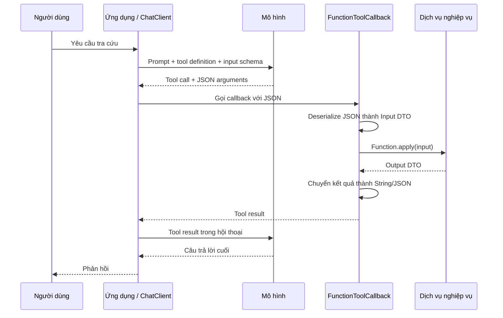

# Định nghĩa kiểu đầu vào và đầu ra tường minh

Khi dùng `FunctionToolCallback`, Spring AI biến một hàm Java thành tool mà mô hình có thể yêu cầu ứng dụng thực thi. Hàm đó cần có hợp đồng dữ liệu rõ ràng: kiểu đầu vào cho biết mô hình phải gửi những trường nào, còn kiểu đầu ra cho biết ứng dụng trả lại dữ liệu gì sau khi thực thi. Nếu dùng `Object`, raw `Function` hoặc một cấu trúc không ổn định, schema có thể mơ hồ và kết quả khó kiểm soát.

Một cách thiết kế phù hợp là dùng DTO hoặc Java `record` công khai cho đầu vào và đầu ra, khai báo rõ `Function<I, O>` hoặc method reference có kiểu cụ thể, rồi truyền `inputType` vào `FunctionToolCallback.builder(...)`. Spring AI dùng kiểu đầu vào để tạo JSON Schema và chuyển JSON từ model thành đối tượng Java. Kiểu trả về `O` được xác định từ function; kết quả sau đó được chuyển thành chuỗi để gửi lại mô hình, mặc định bằng Jackson.

## 1. Vị trí của FunctionToolCallback trong luồng tool calling

`FunctionToolCallback` là một implementation của `ToolCallback`. Nó đóng gói tên tool, mô tả, schema đầu vào và hàm thực thi. Mô hình chỉ nhìn thấy phần định nghĩa tool; ứng dụng giữ hàm Java và chịu trách nhiệm thực thi.



Trong luồng này có hai hợp đồng khác nhau:

- **Input contract:** schema JSON mô tả cho mô hình cách gọi tool. `inputType` giúp Spring AI sinh schema và chuyển JSON thành kiểu Java tương ứng.
- **Output contract:** kiểu trả về Java mô tả kết quả của hàm. `ToolCallResultConverter` chuyển kết quả thành `String` để đưa lại cho mô hình. Tool definition không công bố một output JSON Schema riêng giống schema đầu vào.

Điểm thứ hai rất quan trọng: khai báo `WeatherResponse` làm kiểu trả về giúp code ứng dụng an toàn kiểu và tạo kết quả có cấu trúc ổn định, nhưng mô hình nhận kết quả đã được serialize thành nội dung tool response, thường là JSON text.

## 2. Tạo kiểu đầu vào bằng DTO hoặc record

Không nên dùng một chuỗi JSON tự do hoặc `Map<String, Object>` làm hợp đồng đầu vào chính nếu cấu trúc đã biết trước. Hãy tạo một kiểu riêng với tên trường có ý nghĩa, kiểu dữ liệu cụ thể và mô tả cho mô hình.

Ví dụ tool tra cứu thời tiết nhận thành phố và đơn vị nhiệt độ:

```java
package com.example.weather.tool;

import org.springframework.ai.tool.annotation.ToolParam;

public record WeatherRequest(
        @ToolParam(description = "Tên thành phố hoặc địa điểm cần tra cứu")
        String location,

        @ToolParam(description = "Đơn vị nhiệt độ: CELSIUS hoặc FAHRENHEIT")
        TemperatureUnit unit) {
}
```

Enum giới hạn các giá trị hợp lệ:

```java
package com.example.weather.tool;

public enum TemperatureUnit {
    CELSIUS,
    FAHRENHEIT
}
```

`WeatherRequest` là kiểu đầu vào tường minh. Schema được sinh từ kiểu này sẽ có các thuộc tính `location` và `unit`; mô tả của `@ToolParam` giúp mô hình hiểu từng trường. Ứng dụng vẫn phải kiểm tra chuỗi rỗng, enum và quy tắc nghiệp vụ trước khi gọi dịch vụ.

Một DTO class truyền thống cũng dùng được khi cần constructor, setter hoặc tương thích với quy ước JavaBean:

```java
public class WeatherRequest {

    private String location;
    private TemperatureUnit unit;

    public WeatherRequest() {
    }

    public String getLocation() {
        return location;
    }

    public void setLocation(String location) {
        this.location = location;
    }

    public TemperatureUnit getUnit() {
        return unit;
    }

    public void setUnit(TemperatureUnit unit) {
        this.unit = unit;
    }
}
```

Record thường gọn và bất biến; DTO class phù hợp khi cần tương thích với cách deserialize hoặc quy ước của dự án. Dù chọn loại nào, kiểu phải có thể được Jackson và cơ chế chuyển đổi của phiên bản Spring AI đang dùng đọc được.

## 3. Tạo kiểu đầu ra có cấu trúc

Kiểu trả về nên biểu diễn đúng dữ liệu mà mô hình cần để trả lời người dùng. Không trả trực tiếp entity của JPA hoặc object nội bộ chứa trường không liên quan. Hãy tạo DTO dành cho kết quả tool:

```java
package com.example.weather.tool;

import java.time.Instant;

public record WeatherResponse(
        String location,
        double temperature,
        TemperatureUnit unit,
        String condition,
        Instant observedAt) {
}
```

Dịch vụ nghiệp vụ trả về kiểu này:

```java
package com.example.weather.service;

import com.example.weather.tool.WeatherRequest;
import com.example.weather.tool.WeatherResponse;
import org.springframework.stereotype.Service;

@Service
public class WeatherService {

    public WeatherResponse getWeather(WeatherRequest request) {
        // Kiểm tra đầu vào và gọi nhà cung cấp dữ liệu thời tiết.
        // Ví dụ dưới đây chỉ minh họa cấu trúc kết quả.
        double temperature = switch (request.unit()) {
            case CELSIUS -> 30.5;
            case FAHRENHEIT -> 86.9;
        };
        return new WeatherResponse(
                request.location(),
                temperature,
                request.unit(),
                "Partly cloudy",
                java.time.Instant.now());
    }
}
```

Đầu ra nên chứa những trường có ích cho tác vụ: giá trị, đơn vị, trạng thái và mốc thời gian nếu cần. Không đưa access token, thông tin kết nối, entity nội bộ hoặc dữ liệu cá nhân không cần thiết vào kết quả. Kết quả càng gọn và có tên trường rõ ràng thì mô hình càng dễ sử dụng đúng.

Với dữ liệu quan trọng, tránh dùng `Map<String, Object>` làm kết quả chung. Một DTO có trường cụ thể giúp compiler phát hiện thay đổi hợp đồng, giúp test kiểm tra được cấu trúc và giảm rủi ro vô tình làm lộ thuộc tính mới của entity.

## 4. Khai báo FunctionToolCallback với kiểu đầu vào tường minh

Giả sử `WeatherService` có phương thức `getWeather(WeatherRequest)` và trả về `WeatherResponse`. Có thể tạo callback bằng method reference:

```java
import com.example.weather.service.WeatherService;
import com.example.weather.tool.WeatherRequest;
import org.springframework.ai.tool.ToolCallback;
import org.springframework.ai.tool.function.FunctionToolCallback;
import org.springframework.context.annotation.Bean;
import org.springframework.context.annotation.Configuration;

@Configuration(proxyBeanMethods = false)
public class WeatherToolConfiguration {

    @Bean
    ToolCallback currentWeather(WeatherService weatherService) {
        return FunctionToolCallback
                .builder("currentWeather", weatherService::getWeather)
                .description("Tra cứu thời tiết hiện tại tại một địa điểm theo đơn vị nhiệt độ được yêu cầu")
                .inputType(WeatherRequest.class)
                .build();
    }
}
```

Ở đây:

- `"currentWeather"` là tên duy nhất của tool trong danh sách được cung cấp cho model.
- `weatherService::getWeather` là hàm thực thi. Chữ ký method cho compiler biết đầu vào là `WeatherRequest` và đầu ra là `WeatherResponse`.
- `.description(...)` giúp mô hình hiểu mục đích và thời điểm nên gọi tool.
- `.inputType(WeatherRequest.class)` chỉ rõ kiểu đầu vào dùng để tạo JSON Schema và deserialize JSON arguments.
- Kiểu đầu ra `WeatherResponse` được suy ra từ kiểu trả về của function; builder không cần một lời gọi `.outputType(...)` riêng.

`inputType` là phần bắt buộc của builder trong API `FunctionToolCallback`. Không nên bỏ nó và hy vọng Spring AI suy ra chính xác từ một biến `Function` đã bị mất generic type. Khi dùng lambda, hãy khai báo biến với kiểu generic cụ thể hoặc dùng method reference có chữ ký rõ ràng.

Ví dụ khai báo function có kiểu đầy đủ trước khi tạo callback:

```java
Function<WeatherRequest, WeatherResponse> weatherFunction = weatherService::getWeather;

ToolCallback callback = FunctionToolCallback
        .builder("currentWeather", weatherFunction)
        .description("Tra cứu thời tiết hiện tại tại một địa điểm")
        .inputType(WeatherRequest.class)
        .build();
```

Tránh raw type như `Function weatherFunction` hoặc `Function<Object, Object>`. Khi mất thông tin generic, compiler không còn kiểm tra được hợp đồng đầu vào và đầu ra, đồng thời việc serialize/deserialize có thể tạo dữ liệu không đúng cấu trúc mong muốn.

## 5. JSON Schema được sinh từ inputType

`inputType` không chỉ là gợi ý cho compiler. Spring AI dùng kiểu này để sinh JSON Schema trong `ToolDefinition`, sau đó gửi schema cùng tên và mô tả tool đến model.

Với `WeatherRequest`, schema khái niệm có thể tương tự:

```json
{
  "type": "object",
  "properties": {
    "location": {
      "type": "string",
      "description": "Tên thành phố hoặc địa điểm cần tra cứu"
    },
    "unit": {
      "type": "string",
      "enum": ["CELSIUS", "FAHRENHEIT"],
      "description": "Đơn vị nhiệt độ"
    }
  },
  "required": ["location", "unit"]
}
```

Đây là minh họa cấu trúc, không thay thế schema thực tế được sinh từ dependency và annotation đang sử dụng. Các trường required, description, enum, nested object và format cần được kiểm tra qua schema runtime hoặc contract test.

Khi cần mô tả trường, có thể dùng `@ToolParam`, các annotation Jackson như `@JsonClassDescription` / `@JsonPropertyDescription`, hoặc `@Schema` từ Swagger tùy loại dữ liệu và phiên bản. Nếu một trường tùy chọn, khai báo trạng thái optional rõ ràng theo cơ chế Spring AI hỗ trợ; đừng để schema yêu cầu model bịa ra một giá trị mà người dùng chưa cung cấp.

### Khi nào cần inputSchema tự viết?

Builder cũng hỗ trợ cung cấp JSON Schema trực tiếp bằng `.inputSchema(...)`. Cách này phù hợp khi schema cần ràng buộc đặc biệt hoặc cấu trúc không thể mô tả thuận tiện bằng DTO.

```java
ToolCallback callback = FunctionToolCallback
        .builder("lookupAsset", assetService::lookup)
        .description("Tra cứu một tài sản theo mã tài sản")
        .inputType(AssetLookupRequest.class)
        .inputSchema("""
                {
                  "type": "object",
                  "properties": {
                    "assetId": {
                      "type": "string",
                      "minLength": 1,
                      "description": "Mã tài sản do hệ thống cấp"
                    }
                  },
                  "required": ["assetId"],
                  "additionalProperties": false
                }
                """)
        .build();
```

Khi tự cung cấp schema, phải giữ nó đồng bộ với `AssetLookupRequest` mà function nhận. Schema nói `assetId` là chuỗi nhưng DTO lại yêu cầu một cấu trúc khác sẽ dẫn đến lỗi chuyển đổi hoặc hành vi không nhất quán. Schema hợp lệ cũng không thay thế validation runtime.

## 6. Kiểu đầu ra được chuyển thành tool result như thế nào?

Sau khi function chạy xong, Spring AI cần chuyển giá trị trả về thành `String` để gửi lại cho mô hình. `ToolCallResultConverter` đảm nhận bước này. Converter mặc định `DefaultToolCallResultConverter` sử dụng Jackson để serialize kết quả; vì vậy kiểu đầu ra cần có thể serialize được.

Ví dụ, `WeatherResponse` có thể trở thành JSON text như sau:

```json
{
  "location": "Da Nang",
  "temperature": 30.5,
  "unit": "CELSIUS",
  "condition": "Partly cloudy",
  "observedAt": "2026-11-27T04:00:00Z"
}
```

Mô hình nhận chuỗi kết quả này như nội dung phản hồi của tool, rồi dùng nó để tạo câu trả lời. Đây là serialization của kết quả thực thi; nó không có nghĩa framework tự tạo một output schema riêng để model phải tuân thủ khi đọc kết quả.

Nếu định dạng mặc định chưa phù hợp, có thể cung cấp `ToolCallResultConverter` riêng qua builder:

```java
ToolCallResultConverter resultConverter = (result, returnType) -> {
    if (result == null) {
        return "null";
    }
    return objectMapper.valueToTree(result).toString();
};

ToolCallback callback = FunctionToolCallback
        .builder("currentWeather", weatherService::getWeather)
        .description("Tra cứu thời tiết hiện tại tại một địa điểm")
        .inputType(WeatherRequest.class)
        .toolCallResultConverter(resultConverter)
        .build();
```

Trong ví dụ, `objectMapper` là bean `ObjectMapper` được inject từ Spring. Converter tùy chỉnh nên giữ output ổn định, có cấu trúc và không thêm thông tin nhạy cảm. Tham số `returnType` có thể được dùng nếu converter cần xử lý khác nhau theo kiểu kết quả.

Không trả `toString()` của một object Java làm hợp đồng cho mô hình. Chuỗi đó thường là chi tiết triển khai, có thể đổi theo phiên bản class và không bảo đảm JSON hợp lệ. Hãy dùng DTO có cấu trúc cùng converter rõ ràng.

## 7. Đầu ra thành công, lỗi nghiệp vụ và kết quả rỗng

Một kiểu kết quả tốt cần phân biệt được thành công, không tìm thấy dữ liệu và lỗi nghiệp vụ có thể xử lý. Không nên trả một object có nhiều trường null mà không giải thích ý nghĩa.

Ví dụ envelope kết quả:

```java
public record ToolResult<T>(
        boolean success,
        String code,
        String message,
        T data) {
}
```

Service có thể trả:

```java
public record AssetSummary(String assetId, String displayName, String status) {
}

public ToolResult<AssetSummary> lookupAsset(AssetLookupRequest request) {
    return assetRepository.findSummary(request.assetId())
            .<ToolResult<AssetSummary>>map(asset ->
                    new ToolResult<>(true, "FOUND", "Đã tìm thấy tài sản", asset))
            .orElseGet(() ->
                    new ToolResult<>(false, "NOT_FOUND", "Không tìm thấy tài sản", null));
}
```

Đây là một cách thiết kế, không phải quy tắc bắt buộc. Có thể dùng exception cho lỗi kỹ thuật hoặc lỗi không thể tiếp tục, và dùng DTO kết quả cho các trạng thái nghiệp vụ dự kiến. Dù chọn cách nào, cần tránh để mô hình hiểu một kết quả lỗi là giao dịch đã thành công.

Khi function ném exception, Spring AI xử lý thông qua cơ chế `ToolExecutionExceptionProcessor` theo cấu hình. Hãy quyết định lỗi nào có thể gửi lại mô hình dưới dạng thông báo có kiểm soát và lỗi nào cần được ném về ứng dụng để ghi nhận hoặc trả HTTP error. Không serialize stack trace, SQL, token hoặc dữ liệu nội bộ vào tool result.

## 8. Chọn kiểu phù hợp và các giới hạn cần kiểm tra

`FunctionToolCallback` hướng đến các kiểu dữ liệu tường minh, có thể serialize. Trong ví dụ cơ bản, `Function<WeatherRequest, WeatherResponse>` thể hiện rõ một đầu vào và một đầu ra. Tùy nhu cầu, Spring AI còn hỗ trợ function interface như `Supplier`, `Consumer` và `BiFunction`; cần kiểm tra chữ ký và cách cung cấp input/context theo API phiên bản đang dùng.

Một số nguyên tắc:

- **Ưu tiên public DTO hoặc record.** Các kiểu đầu vào và đầu ra cần truy cập được và serialize/deserialize được. Tránh class private hoặc class nội bộ không phù hợp với cơ chế Jackson/reflection của runtime.
- **Dùng kiểu miền thay cho `Object`.** Dùng `BigDecimal` cho số thập phân cần độ chính xác, enum cho tập lựa chọn cố định và DTO lồng nhau cho cấu trúc có ý nghĩa.
- **Tránh raw generic.** Khai báo `Function<InputDto, OutputDto>` và truyền `inputType(InputDto.class)` để giữ thông tin kiểu.
- **Không nhầm input schema với output serialization.** `inputType` tạo schema đầu vào; output được chuyển thành chuỗi bởi result converter.
- **Cẩn thận với collection và kiểu đặc biệt.** Tài liệu Spring AI 1.0.9 liệt kê primitive, `Optional`, collection, kiểu async và reactive là các kiểu không được hỗ trợ trực tiếp cho input/output của function tool; tài liệu khuyến nghị dùng method-based tool cho primitive và collection. Khả năng hỗ trợ có thể thay đổi theo release, vì vậy phải đối chiếu đúng phiên bản dependency. DTO wrapper thường là lựa chọn ổn định hơn khi cần một hợp đồng rõ ràng.
- **Không trả entity nội bộ.** Chọn trường cần thiết, lọc dữ liệu theo quyền và giới hạn kích thước kết quả trước khi serialize.

Nếu cần `ToolContext` để truyền tenant hoặc principal đã xác thực, có thể dùng dạng function nhận context mà API hỗ trợ, chẳng hạn `BiFunction<InputDto, ToolContext, OutputDto>`. Context này do ứng dụng tạo và không phải trường trong JSON schema cho model. Không nhận `tenantId`, `principalId` hoặc role từ input do model tự tạo để quyết định quyền.

## 9. Đăng ký callback và sử dụng trong ChatClient

Một callback có thể được khai báo thành Spring bean để tái sử dụng. Cách đăng ký vào `ChatClient` thay đổi tên method giữa các phiên bản: tài liệu Spring AI 2.x dùng `.tools(...)`; các bản 1.x có API `.toolCallbacks(...)` cho callback programmatic. Hãy dùng API khớp với dependency của dự án.

Ví dụ theo API `.tools(...)`:

```java
import org.springframework.ai.chat.client.ChatClient;
import org.springframework.ai.tool.ToolCallback;
import org.springframework.beans.factory.annotation.Qualifier;
import org.springframework.stereotype.Service;

@Service
public class WeatherAssistant {

    private final ChatClient chatClient;
    private final ToolCallback currentWeather;

    public WeatherAssistant(
            ChatClient.Builder chatClientBuilder,
            @Qualifier("currentWeather") ToolCallback currentWeather) {
        this.chatClient = chatClientBuilder.build();
        this.currentWeather = currentWeather;
    }

    public String ask(String question) {
        return chatClient.prompt()
                .user(question)
                .tools(currentWeather)
                .call()
                .content();
    }
}
```

Khi callback được gắn vào request, mô hình chỉ nhận tool đó trong request tương ứng. Các tool có quyền ghi hoặc tác động nhạy cảm nên được cấp theo từng request và theo quyền người dùng, tránh đưa vào danh sách mặc định rộng hơn nhu cầu.

## 10. Kiểm thử hợp đồng đầu vào và đầu ra

Kiểm thử `FunctionToolCallback` nên bao gồm ba lớp: kiểu dữ liệu, chuyển đổi JSON và hành vi nghiệp vụ. Một unit test gọi trực tiếp service chưa chứng minh schema gửi tới model đúng; một test schema cũng chưa chứng minh kết quả được serialize như mong đợi.

| Phạm vi | Điều cần kiểm tra |
| --- | --- |
| Input DTO | Tên trường, kiểu, enum, mô tả, required/optional và nested fields |
| `inputType` | Callback dùng đúng class đầu vào; JSON hợp lệ được deserialize đúng |
| Input không hợp lệ | Thiếu trường, sai kiểu, enum lạ, chuỗi rỗng và giá trị ngoài giới hạn bị xử lý rõ |
| Function | Hàm nhận đúng DTO và gọi đúng service với các giá trị đã kiểm tra |
| Output DTO | Chỉ có trường được phép công bố; không lộ entity hoặc dữ liệu nhạy cảm |
| Result converter | Kết quả được serialize thành JSON hợp lệ; xử lý null và lỗi theo hợp đồng |
| Tool context | Principal/tenant được truyền từ ứng dụng và kiểm tra quyền ở service |
| Provider | Schema thực tế tương thích với provider/model và chế độ tool calling đang dùng |

Ví dụ unit test cho service và kết quả DTO:

```java
@Test
void returnsTypedWeatherResponse() {
    WeatherRequest request = new WeatherRequest("Da Nang", TemperatureUnit.CELSIUS);

    WeatherResponse response = weatherService.getWeather(request);

    assertThat(response.location()).isEqualTo("Da Nang");
    assertThat(response.unit()).isEqualTo(TemperatureUnit.CELSIUS);
    assertThat(response.observedAt()).isNotNull();
}
```

Ví dụ kiểm tra JSON serialize bằng Jackson:

```java
@Test
void serializesOutputDtoAsStructuredJson() throws Exception {
    WeatherResponse response = new WeatherResponse(
            "Da Nang", 30.5, TemperatureUnit.CELSIUS,
            "Partly cloudy", Instant.parse("2026-11-27T04:00:00Z"));

    String json = objectMapper.writeValueAsString(response);

    JsonNode node = objectMapper.readTree(json);
    assertThat(node.path("location").asText()).isEqualTo("Da Nang");
    assertThat(node.path("unit").asText()).isEqualTo("CELSIUS");
}
```

Ở tầng tích hợp, có thể lấy `ToolDefinition` từ callback và xác nhận schema chứa đúng thuộc tính, enum và description. Có thể gọi `ToolCallback.call(...)` với JSON fixture để kiểm tra trọn đường đi deserialize → function → serialize mà không cần gọi model thật. Sau đó dùng contract test với provider/model thực tế để phát hiện khác biệt schema hoặc hỗ trợ function calling.

## 11. Quy trình triển khai một FunctionToolCallback

Khi đưa một function thành tool, thực hiện theo trình tự:

1. Xác định chính xác dữ liệu mô hình cần gửi và tạo `InputDto` công khai.
2. Xác định dữ liệu cần trả lại, tạo `OutputDto` riêng và chỉ đưa vào những trường được phép công bố.
3. Viết function có generic type cụ thể hoặc method reference có chữ ký `InputDto -> OutputDto`.
4. Tạo `FunctionToolCallback` với tên duy nhất, mô tả rõ và `.inputType(InputDto.class)`.
5. Chọn result converter mặc định hoặc converter riêng nếu có yêu cầu định dạng đặc biệt.
6. Đăng ký callback vào `ChatClient` theo API của phiên bản Spring AI đang dùng.
7. Kiểm tra quyền, validation và xử lý lỗi ở phía ứng dụng; không xem schema là ranh giới bảo mật.
8. Kiểm thử schema, deserialize, thực thi function và serialize kết quả độc lập.

`FunctionToolCallback<I, O>` giúp ràng buộc tool bằng kiểu Java rõ ràng. Kiểu đầu vào xác định schema và cách giải mã JSON; kiểu đầu ra xác định dữ liệu function trả về và được result converter chuyển thành nội dung cho mô hình. Khi hai hợp đồng này được thiết kế tường minh, tool dễ kiểm thử, dễ thay đổi và an toàn hơn khi tích hợp với dịch vụ nghiệp vụ.

## Tài liệu tham khảo

- [Spring AI 2.1 — Tool Calling](https://docs.spring.io/spring-ai/reference/api/tools.html)
- [Spring AI 1.0 — Tool Calling và FunctionToolCallback](https://docs.spring.io/spring-ai/reference/1.0/api/tools.html)
- [FunctionToolCallback.Builder API](https://docs.spring.io/spring-ai/docs/current/api/org/springframework/ai/tool/function/FunctionToolCallback.Builder.html)
- [ToolCallResultConverter API](https://docs.spring.io/spring-ai/docs/current/api/org/springframework/ai/tool/execution/ToolCallResultConverter.html)
