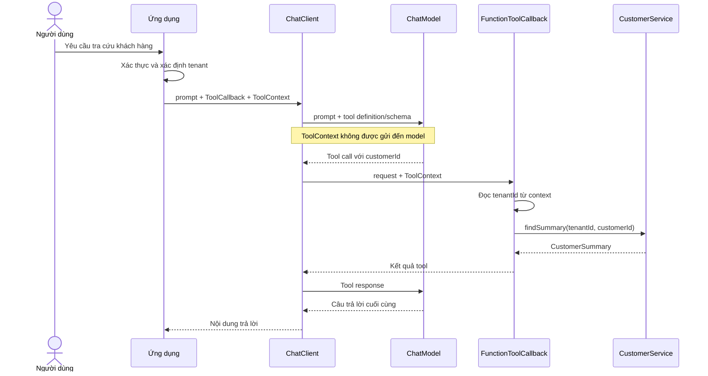

# Tiếp nhận ToolContext qua dạng hàm tương ứng

`FunctionToolCallback` cho phép biến một hàm Java thành công cụ mà mô hình có thể yêu cầu ứng dụng thực thi. Khi hàm chỉ cần dữ liệu do mô hình tạo ra, có thể dùng `Function<I, O>`. Khi hàm còn cần ngữ cảnh do ứng dụng cung cấp như tenant, người dùng đã xác thực hoặc request scope, hãy dùng dạng `BiFunction<I, ToolContext, O>`.

Điểm quan trọng là hai nguồn dữ liệu có vai trò khác nhau. `I` là dữ liệu đầu vào được mô hình tạo theo JSON Schema của công cụ. `ToolContext` là dữ liệu nội bộ được ứng dụng gắn vào yêu cầu chat và chuyển trực tiếp đến hàm khi callback được thực thi. Nội dung trong `ToolContext` không được gửi cho mô hình và không trở thành trường trong schema đầu vào.

## FunctionToolCallback và các dạng hàm

Spring AI cung cấp `FunctionToolCallback` để công bố các hàm, method reference hoặc lambda dưới dạng `ToolCallback`. Một số dạng hàm phổ biến:

| Dạng hàm | Chữ ký khái niệm | Khi nào dùng |
| --- | --- | --- |
| `Function<I, O>` | Nhận một input, trả về output | Công cụ chỉ cần dữ liệu mô hình gửi trong JSON. |
| `BiFunction<I, ToolContext, O>` | Nhận input và `ToolContext`, trả về output | Công cụ cần thêm ngữ cảnh nội bộ do ứng dụng truyền vào. |
| `Supplier<O>` | Không nhận input, trả về output | Công cụ không cần tham số từ mô hình. |
| `Consumer<I>` | Nhận input, không trả kết quả nghiệp vụ | Công cụ thực hiện thao tác mà kết quả trả về không cần dữ liệu. |

Để tiếp nhận `ToolContext`, chọn overload `FunctionToolCallback.builder(name, biFunction)`. Builder vẫn cần `.inputType(...)` để Spring AI biết kiểu dữ liệu đầu vào và sinh JSON Schema. `ToolContext` là tham số thứ hai của `BiFunction`, không phải một thuộc tính trong DTO đầu vào.

Các import thường dùng trong Spring AI 1.0.x:

```java
import org.springframework.ai.chat.model.ToolContext;
import org.springframework.ai.tool.ToolCallback;
import org.springframework.ai.tool.function.FunctionToolCallback;
```

Hãy đối chiếu package và API với dòng Spring AI mà dự án đang sử dụng khi nâng phiên bản.

## Phân biệt dữ liệu mô hình và dữ liệu ứng dụng

Giả sử công cụ cần tra cứu một khách hàng. Mô hình có thể xác định mã khách hàng từ câu hỏi, nhưng tenant mà người dùng đang làm việc phải do ứng dụng lấy từ phiên đăng nhập và truyền vào callback.

| Dữ liệu | Nguồn | Đi qua model? | Vị trí nhận trong hàm |
| --- | --- | --- | --- |
| `customerId` | JSON tool call do mô hình tạo | Có | Đối số `request` |
| `tenantId` | Ngữ cảnh xác thực của ứng dụng | Không | `toolContext.getContext()` |
| `requestId` | Middleware hoặc tầng ứng dụng | Không | `toolContext.getContext()` |
| `locale` hoặc `timeZone` đáng tin cậy | Cấu hình/ngữ cảnh request của ứng dụng | Không | `toolContext.getContext()` |

Không nên thêm `tenantId`, `userId` hoặc quyền truy cập vào DTO chỉ để mô hình gửi lại. Nếu mô hình được phép tự chọn những giá trị này, callback có thể bị yêu cầu truy cập dữ liệu ngoài phạm vi người dùng hiện tại.

## Khai báo DTO đầu vào và kiểu kết quả

Với function-based tool, input và output thường là POJO hoặc kiểu dữ liệu được Spring AI hỗ trợ chuyển đổi. Ví dụ dùng record để thể hiện yêu cầu tra cứu và kết quả:

```java
import org.springframework.ai.tool.annotation.ToolParam;

public record CustomerLookupRequest(
        @ToolParam(description = "Mã khách hàng cần tra cứu, ví dụ C-100")
        String customerId) {}

public record CustomerSummary(
        String customerId,
        String displayName,
        String membershipLevel) {}
```

`CustomerLookupRequest` mô tả dữ liệu mô hình được phép cung cấp. Spring AI dùng kiểu này cùng metadata như `@ToolParam` để tạo schema. `CustomerSummary` là dữ liệu kết quả từ service; callback sẽ chuyển kết quả thành nội dung để gửi lại mô hình.

Giữ DTO và kiểu kết quả đơn giản, có thể serialize và chỉ chứa những trường cần cho tác vụ. Tránh đưa entity persistence lớn hoặc thông tin nội bộ nhạy cảm vào kết quả công cụ.

## Tạo FunctionToolCallback nhận ToolContext

Ví dụ sau tạo công cụ tra cứu khách hàng theo tenant. Hàm nhận `CustomerLookupRequest` do mô hình tạo và `ToolContext` do ứng dụng truyền:

```java
import java.util.Map;
import java.util.function.BiFunction;

import org.springframework.ai.chat.model.ToolContext;
import org.springframework.ai.tool.ToolCallback;
import org.springframework.ai.tool.function.FunctionToolCallback;
import org.springframework.context.annotation.Bean;
import org.springframework.context.annotation.Configuration;

@Configuration(proxyBeanMethods = false)
class CustomerToolConfiguration {

    @Bean
    ToolCallback lookupCustomer(CustomerService customerService) {
        BiFunction<CustomerLookupRequest, ToolContext, CustomerSummary> function =
                (request, toolContext) -> {
                    if (request == null || request.customerId() == null
                            || request.customerId().isBlank()) {
                        throw new IllegalArgumentException("customerId không được để trống");
                    }

                    Map<String, Object> context = toolContext == null
                            ? Map.of()
                            : toolContext.getContext();

                    Object tenantValue = context.get("tenantId");
                    if (!(tenantValue instanceof String tenantId) || tenantId.isBlank()) {
                        throw new IllegalStateException("Thiếu tenantId trong ToolContext");
                    }

                    return customerService.findSummary(tenantId, request.customerId());
                };

        return FunctionToolCallback.builder("lookupCustomer", function)
                .description("Tra cứu thông tin khách hàng trong tenant hiện tại theo mã khách hàng")
                .inputType(CustomerLookupRequest.class)
                .build();
    }
}
```

Trong ví dụ:

1. `BiFunction<CustomerLookupRequest, ToolContext, CustomerSummary>` xác định hàm có hai đầu vào và trả về một kết quả.
2. `request.customerId()` đến từ JSON tool call do mô hình tạo.
3. `toolContext.getContext()` trả về map ngữ cảnh do ứng dụng gắn vào lượt chat.
4. `customerService.findSummary(...)` nhận tenant lấy từ ngữ cảnh và mã khách hàng từ request để thực hiện truy vấn có kiểm soát.
5. `.inputType(CustomerLookupRequest.class)` xác định kiểu đầu vào dùng để tạo schema. `ToolContext` không được đưa vào schema này.

Đoạn code có kiểm tra trường hợp `ToolContext` không được cung cấp để tránh `NullPointerException`. Với một công cụ bắt buộc phải có tenant, thiếu ngữ cảnh cần làm callback thất bại an toàn thay vì tự chọn tenant mặc định.

## Truyền ToolContext từ ChatClient

Sau khi tạo callback, ứng dụng cung cấp callback và map ngữ cảnh cho yêu cầu `ChatClient`. Giá trị trong map phải được lấy từ nguồn tin cậy ở phía máy chủ, chẳng hạn `SecurityContext`, principal đã xác thực hoặc tenant đã được phân giải từ phiên làm việc.

```java
import java.util.Map;

String answer = chatClient.prompt()
        .user("Tra cứu khách hàng có mã C-100 và cho tôi biết hạng thành viên.")
        .toolCallbacks(lookupCustomer)
        .toolContext(Map.of("tenantId", authenticatedTenantId))
        .call()
        .content();
```

`lookupCustomer` là bean `ToolCallback` được inject vào service gọi chat. `authenticatedTenantId` phải được xác định từ danh tính và quyền hiện tại ở phía ứng dụng; không lấy trực tiếp từ một trường do mô hình đề xuất. Có thể truyền thêm `userId`, `requestId` hoặc thông tin locale khi callback thực sự cần chúng.

Luồng dữ liệu có thể hình dung như sau:



Mô hình chỉ biết tên công cụ, mô tả và schema của `CustomerLookupRequest`. Khi mô hình trả về tool call, Spring AI điều phối callback và chuyển `ToolContext` đến hàm. Vì vậy, dữ liệu ngữ cảnh không cần xuất hiện trong prompt hoặc JSON arguments.

## Khi nào dùng Function thay cho BiFunction?

Nếu callback không cần ngữ cảnh nội bộ, dùng `Function<I, O>` đơn giản hơn:

```java
ToolCallback normalizeText = FunctionToolCallback
        .builder("normalizeText", (TextRequest request) ->
                request.text().trim().toLowerCase())
        .description("Chuẩn hóa chuỗi văn bản")
        .inputType(TextRequest.class)
        .build();
```

Nếu callback cần tenant, người dùng, request scope hoặc một giá trị nội bộ khác, dùng `BiFunction<I, ToolContext, O>`:

```java
BiFunction<CustomerLookupRequest, ToolContext, CustomerSummary> lookup =
        (request, context) -> customerService.findSummary(
                (String) context.getContext().get("tenantId"),
                request.customerId());
```

Nên chọn theo đúng dữ liệu mà hàm cần. Không cần dùng `BiFunction` chỉ để có thêm tham số nếu callback không sử dụng ngữ cảnh. Ngược lại, không nhét thông tin xác thực vào DTO chỉ để giữ callback ở dạng `Function`.

## ToolContext là ngữ cảnh thực thi, không phải kho bí mật

`ToolContext` giúp chuyển dữ liệu ngoài schema đến callback, nhưng không tự xác thực hoặc cấp quyền. Nó cũng không phải nơi phù hợp để truyền mọi dữ liệu của request.

- **Chỉ truyền dữ liệu cần thiết:** ví dụ tenant ID, user ID đã xác thực, correlation ID hoặc locale.
- **Tạo ngữ cảnh ở phía máy chủ:** lấy danh tính và tenant từ authentication/authorization layer; không tin giá trị do người dùng hoặc mô hình tự khai báo.
- **Kiểm tra quyền trong service:** callback phải gọi service có kiểm tra tenant và quyền truy cập trên tài nguyên cụ thể. Có `tenantId` không có nghĩa mọi truy vấn trong tenant đều được phép.
- **Không truyền secret không cần thiết:** tránh đưa access token, mật khẩu, API key hoặc credential vào map nếu service có thể dùng cơ chế bảo mật riêng.
- **Không sửa map ngữ cảnh:** `ToolContext.getContext()` cung cấp map không thể thay đổi; tạo dữ liệu mới ở tầng ứng dụng nếu cần bổ sung thông tin.
- **Giới hạn vòng đời:** tạo context đúng phạm vi request/conversation; không lưu thông tin người dùng của request trước để tái sử dụng cho request sau.
- **Không trả ngữ cảnh ra ngoài:** kết quả callback chỉ nên chứa thông tin cần thiết để mô hình hoàn thành câu trả lời.

Nếu ứng dụng cấu hình context mặc định và context theo từng request, Spring AI có thể hợp nhất hai map theo quy tắc của phiên bản đang dùng; giá trị runtime có thể ghi đè giá trị mặc định. Với khóa như `tenantId` hoặc `userId`, hãy kiểm soát rõ nguồn ghi đè và tránh cho dữ liệu không tin cậy thay thế giá trị đã xác thực.

## Xử lý lỗi trong hàm

Function callback là ranh giới đi vào logic ứng dụng. Hãy phân biệt các nhóm lỗi:

| Nhóm lỗi | Ví dụ | Cách xử lý |
| --- | --- | --- |
| Đầu vào mô hình không hợp lệ | Thiếu `customerId`, mã sai định dạng | Kiểm tra request trước khi gọi service; trả lỗi có thông tin hữu ích nhưng không lộ dữ liệu nội bộ. |
| Thiếu ngữ cảnh | Không có `tenantId` hoặc user principal | Từ chối thực thi; không suy đoán danh tính hay tenant mặc định. |
| Không đủ quyền | Người dùng không được xem khách hàng đó | Service từ chối truy cập theo chính sách phân quyền. |
| Không tìm thấy tài nguyên | Mã khách hàng không tồn tại trong tenant | Trả kết quả không tìm thấy theo hợp đồng nghiệp vụ. |
| Lỗi hạ tầng | Database timeout hoặc dịch vụ phụ thuộc không khả dụng | Áp dụng timeout, retry có giới hạn và thông điệp lỗi an toàn. |

Không bắt mọi exception rồi trả stack trace cho mô hình. Nếu cần chuyển lỗi thành kết quả tool có cấu trúc, hãy dùng một kiểu kết quả rõ ràng như `status`, `message` và `data`, đồng thời loại bỏ thông tin nhạy cảm. Với thao tác có tác động phụ, cần thêm kiểm soát xác nhận, idempotency và ghi nhận audit phù hợp.

## Kiểm thử FunctionToolCallback và ToolContext

Nên kiểm tra riêng hàm nghiệp vụ và lớp callback để dễ xác định lỗi.

### Unit test cho hàm hai tham số

Có thể tách `BiFunction` thành biến `lookupFunction` (cùng logic lambda trong bean ở trên) rồi gọi trực tiếp với DTO và `ToolContext` để xác nhận ngữ cảnh được sử dụng đúng:

```java
var context = new ToolContext(Map.of("tenantId", "tenant-a"));
var request = new CustomerLookupRequest("C-100");

CustomerSummary result = lookupFunction.apply(request, context);

assertThat(result.customerId()).isEqualTo("C-100");
verify(customerService).findSummary("tenant-a", "C-100");
```

Test này xác nhận hàm dùng tenant từ context khi gọi service. Có thể bổ sung ca thiếu tenant, request null, mã khách hàng rỗng và trường hợp service từ chối quyền.

### Kiểm thử callback chuyển đổi JSON

`FunctionToolCallback` cung cấp `call(toolInput, toolContext)`. Có thể dùng API này để kiểm tra JSON arguments được chuyển thành DTO và context đến hàm:

```java
String result = lookupCustomer.call(
        """{"customerId":"C-100"}""",
        new ToolContext(Map.of("tenantId", "tenant-a")));

assertThat(result).contains("C-100");
```

Đây là kiểm thử ở ranh giới callback, không cần gọi mô hình thật. Với integration test, có thể dùng model giả để phát ra tool call có kiểm soát và xác nhận context được truyền đến callback. Khi kiểm thử nhiều tenant, xác nhận một callback không thể dùng nhầm tenant của request khác.

Các trường hợp nên có trong bộ kiểm thử:

1. Context hợp lệ với tenant đúng.
2. Context không có hoặc thiếu khóa bắt buộc.
3. Context chứa giá trị sai kiểu hoặc rỗng.
4. Input JSON sai định dạng hoặc thiếu trường.
5. Service từ chối truy cập tài nguyên ngoài tenant.
6. Hai request đồng thời có context khác nhau, không rò rỉ dữ liệu giữa request.
7. Output không chứa token, credential hoặc dữ liệu không cần thiết.

## Lỗi thường gặp

| Hiện tượng | Nguyên nhân có thể | Cách kiểm tra |
| --- | --- | --- |
| Lambda không nhận được tham số thứ hai | Đang dùng overload `Function<I, O>` thay vì `BiFunction<I, ToolContext, O>` | Khai báo biến `BiFunction` tường minh và truyền vào builder. |
| `ToolContext` luôn thiếu dữ liệu | Chưa gọi `.toolContext(...)` hoặc map được tạo từ nguồn rỗng | Kiểm tra nơi tạo request và giá trị trước khi gọi `ChatClient`. |
| `tenantId` xuất hiện trong schema | Đưa tenant vào DTO đầu vào thay vì context | Chuyển tenant sang map `toolContext`; chỉ để DTO chứa trường mô hình được phép cung cấp. |
| Callback nhận context nhưng truy vấn sai tenant | Lấy tenant từ request hoặc ghi đè context bằng dữ liệu không tin cậy | Theo dõi nguồn tạo context và kiểm tra service nhận đúng tenant. |
| Không tạo được schema cho input | DTO không được hỗ trợ serialize hoặc `.inputType(...)` không đúng | Dùng POJO/record phù hợp, khai báo input type và kiểm tra giới hạn kiểu dữ liệu của phiên bản. |
| Output trả về quá nhiều dữ liệu | Trả entity hoặc object lớn không được lọc | Dùng DTO kết quả tối thiểu và kiểm soát trường được serialize. |

## Nguyên tắc ghi nhớ

- Dùng `Function<I, O>` khi công cụ chỉ cần input do mô hình tạo.
- Dùng `BiFunction<I, ToolContext, O>` khi công cụ cần thêm ngữ cảnh nội bộ.
- Khai báo `.inputType(I.class)` để tạo schema từ DTO đầu vào; `ToolContext` không nằm trong schema.
- Truyền context bằng `.toolContext(Map<String, Object>)` ở request `ChatClient` hoặc cấu hình tool calling tương ứng.
- Lấy tenant và user ID từ nguồn xác thực phía máy chủ; không để mô hình quyết định danh tính hoặc phạm vi truy cập.
- Kiểm tra context, input và quyền trước khi gọi service.
- Kiểm thử hàm, callback chuyển đổi JSON và luồng tích hợp riêng biệt.

Khi dùng đúng `BiFunction<I, ToolContext, O>`, ứng dụng có thể giữ schema đầu vào gọn cho mô hình trong khi vẫn cung cấp đủ dữ liệu tin cậy cho logic nghiệp vụ. Đây là cách phù hợp để xây dựng function-based tool có phân tách rõ giữa dữ liệu do AI đề xuất và ngữ cảnh thực thi do ứng dụng kiểm soát.

## Tài liệu tham khảo

- [Spring AI 1.0 Reference — Tool Calling](https://docs.spring.io/spring-ai/reference/1.0/api/tools.html)
- [Spring AI 1.0.x API — FunctionToolCallback](https://docs.spring.io/spring-ai/docs/1.0.x/api/org/springframework/ai/tool/function/FunctionToolCallback.html)
- [Spring AI 1.0.x API — ToolContext](https://docs.spring.io/spring-ai/docs/1.0.x/api/org/springframework/ai/chat/model/ToolContext.html)
