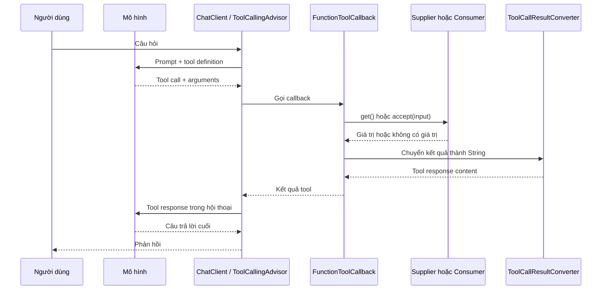

# Phân biệt hàm không có đầu vào và hàm không trả dữ liệu

Khi dùng `FunctionToolCallback`, Spring AI cho phép đưa các hàm Java vào danh sách công cụ theo đúng kiểu dữ liệu đầu vào và đầu ra của chúng. Hai trường hợp thường dễ nhầm là hàm **không có đầu vào** và hàm **không trả dữ liệu**. Trường hợp thứ nhất được biểu diễn tự nhiên bằng `Supplier<O>`; trường hợp thứ hai được biểu diễn bằng `Consumer<I>`. Chúng khác nhau ở hai đầu của hàm.

Một `Supplier<O>` không nhận tham số nhưng tạo ra một giá trị. Một `Consumer<I>` nhận dữ liệu đầu vào nhưng không trả về giá trị nghiệp vụ. Nếu cần cả đầu vào lẫn đầu ra, dùng `Function<I, O>`; nếu cần cả hai đầu đều vắng mặt, có thể dùng `Supplier<Void>` hoặc bọc một `Runnable` thành supplier. Trong mọi trường hợp, `FunctionToolCallback` vẫn phải tạo phản hồi dạng chuỗi theo hợp đồng `ToolCallback` để hoàn tất giao thức tool calling.

Bài học thuộc phần FunctionToolCallback của Spring AI Tool Calling, tập trung vào việc chọn đúng kiểu hàm, tạo schema đầu vào và hiểu kết quả được chuyển về mô hình như thế nào.

Sau bài học, bạn có thể:

- Phân biệt hàm không nhận tham số với hàm không trả giá trị.
- Chọn `Supplier`, `Consumer`, `Function` hoặc `BiFunction` phù hợp cho một tool.
- Tạo `FunctionToolCallback` cho tool lấy dữ liệu không cần arguments.
- Tạo `FunctionToolCallback` cho tool nhận dữ liệu để thực hiện thao tác nhưng không trả kết quả nghiệp vụ.
- Hiểu vai trò của `Void`, JSON Schema, `ToolContext` và `ToolCallResultConverter` trong các trường hợp này.

## 1. Hai khái niệm nằm ở hai đầu khác nhau

Hãy nhìn chữ ký hàm trước khi chọn functional interface:

| Kiểu hàm | Đầu vào | Đầu ra | Interface Java |
| --- | --- | --- | --- |
| Lấy trạng thái hệ thống hiện tại | Không có | Có dữ liệu trạng thái | `Supplier<Status>` |
| Gửi một thông báo | Có yêu cầu gửi | Không có giá trị trả về | `Consumer<NotificationRequest>` |
| Tra cứu đơn hàng theo mã | Có mã đơn | Có thông tin đơn hàng | `Function<OrderRequest, OrderInfo>` |
| Thực hiện thao tác dựa trên input và context | Có input và `ToolContext` | Có kết quả | `BiFunction<I, ToolContext, O>` |

`Supplier` và `Consumer` không phải hai cách viết thay thế cho cùng một việc:

- **Không có đầu vào** nói về việc hàm không cần mô hình cung cấp arguments. Hàm có thể tự đọc đồng hồ, cấu hình hoặc trạng thái hệ thống rồi trả dữ liệu.
- **Không có đầu ra** nói về việc hàm không tạo giá trị trả về trong Java. Hàm thường thực hiện một side effect như gửi thông báo, ghi audit hoặc làm mới cache.

Một hàm có thể đồng thời không có đầu vào và không có đầu ra. Khi đó chữ ký Java thường là `Runnable`; `FunctionToolCallback` không có overload `builder` trực tiếp cho `Runnable`, nên cần bọc nó vào một kiểu được hỗ trợ, chẳng hạn `Supplier<Void>`.

## 2. Hàm không có đầu vào: Supplier

`Supplier<T>` có một phương thức `get()` không nhận tham số và trả về một giá trị kiểu `T`. Dùng nó khi mô hình cần yêu cầu ứng dụng lấy một dữ liệu không cần arguments do mô hình tạo ra.

Ví dụ: người dùng hỏi trạng thái hệ thống hiện tại. Service có thể tự lấy thời điểm, phiên bản ứng dụng và trạng thái các thành phần phụ thuộc:

```java
public record SystemStatus(
        String application,
        String version,
        String health,
        Instant checkedAt) {
}

@Service
public class SystemStatusService {

    public SystemStatus currentStatus() {
        return new SystemStatus(
                "inventory-api",
                "2.4.1",
                "UP",
                Instant.now());
    }
}
```

Tạo callback từ method reference có kiểu `Supplier<SystemStatus>`:

```java
@Configuration(proxyBeanMethods = false)
public class SystemToolConfiguration {

    @Bean
    ToolCallback systemStatusTool(SystemStatusService statusService) {
        Supplier<SystemStatus> supplier = statusService::currentStatus;

        return FunctionToolCallback.builder("get_system_status", supplier)
                .description("Lấy trạng thái hiện tại của ứng dụng và thời điểm kiểm tra. "
                        + "Dùng khi người dùng hỏi hệ thống đang hoạt động hay không.")
                .build();
    }
}
```

Overload `FunctionToolCallback.builder(name, Supplier<O>)` tạo builder có kiểu đầu vào `Void` và đầu ra `O`. Mô hình không cần gửi mã ứng dụng, tên máy chủ hay tham số giả để gọi công cụ. Schema đầu vào tương ứng với trường hợp không có dữ liệu đầu vào.

Đưa callback vào request:

```java
String answer = chatClient.prompt()
        .user("Hệ thống inventory-api hiện có khỏe không?")
        .tools(systemStatusTool)
        .call()
        .content();
```

Mô hình yêu cầu gọi `get_system_status`; Spring AI thực thi supplier; kết quả `SystemStatus` được chuyển thành chuỗi và gửi lại cho mô hình. Mô hình có thể dùng dữ liệu đó để trả lời, ví dụ ứng dụng đang `UP` và được kiểm tra tại thời điểm cụ thể.

### Khi nào nên dùng Supplier?

- Đọc thời gian hiện tại hoặc ngày làm việc hiện tại theo cấu hình server.
- Lấy trạng thái sức khỏe của ứng dụng.
- Lấy thông tin cấu hình công khai của phiên làm việc.
- Lấy danh sách tác vụ đang chờ mà không cần arguments từ mô hình.

Không dùng `Supplier` chỉ vì muốn ẩn một tham số. Nếu kết quả phụ thuộc vào người dùng, tenant hoặc quyền truy cập, hãy lấy dữ liệu đó từ `ToolContext` hoặc security context phía server. Không yêu cầu mô hình tự cung cấp danh tính hay tenant.

## 3. Hàm có đầu vào nhưng không trả dữ liệu: Consumer

`Consumer<T>` có phương thức `accept(T value)`: nhận một giá trị đầu vào, thực hiện công việc và không trả về giá trị. Đây là kiểu phù hợp với thao tác có side effect nhưng không cần trả lại một đối tượng nghiệp vụ.

Ví dụ: ứng dụng nhận yêu cầu phát thông báo nội bộ:

```java
public record NotificationRequest(
        String recipient,
        String subject,
        String message) {
}

@Service
public class NotificationService {

    public void send(NotificationRequest request) {
        // Gửi thông báo qua hệ thống nội bộ.
        // Phần tích hợp nhà cung cấp được lược bỏ trong ví dụ.
    }
}
```

Tạo callback bằng `Consumer<NotificationRequest>`:

```java
@Configuration(proxyBeanMethods = false)
public class NotificationToolConfiguration {

    @Bean
    ToolCallback sendNotificationTool(NotificationService notificationService) {
        Consumer<NotificationRequest> consumer = notificationService::send;

        return FunctionToolCallback.builder("send_notification", consumer)
                .description("Gửi thông báo nội bộ đến người nhận được chỉ định. "
                        + "Chỉ dùng sau khi ứng dụng đã xác minh người gọi được phép gửi.")
                .inputType(NotificationRequest.class)
                .build();
    }
}
```

Overload `FunctionToolCallback.builder(name, Consumer<I>)` tạo builder có kiểu đầu vào `I` và kiểu đầu ra `Void`. Vì hàm cần `NotificationRequest`, builder phải biết kiểu đầu vào qua `.inputType(NotificationRequest.class)` để Spring AI tạo JSON Schema cho arguments.

Mô hình có thể yêu cầu gọi tool với arguments như sau:

```json
{
  "recipient": "ops-team",
  "subject": "Bảo trì hệ thống",
  "message": "Hệ thống sẽ bảo trì lúc 22:00."
}
```

Spring AI chuyển JSON thành `NotificationRequest`, gọi `consumer.accept(request)` và chờ thao tác kết thúc hoặc phát sinh lỗi. Java không nhận được một giá trị trả về từ `Consumer`.

### Không trả dữ liệu không có nghĩa là không có phản hồi tool

`ToolCallback.call(...)` có hợp đồng trả về `String`, vì giao thức hội thoại cần một tool response tương ứng với tool call. `FunctionToolCallback` dùng `ToolCallResultConverter` để chuyển giá trị hàm thành chuỗi. Với `Consumer`, giá trị Java có kiểu `Void` và thường là `null`; vì vậy không nên dựa vào nó để truyền một thông điệp nghiệp vụ có ý nghĩa cho mô hình.

Nếu mô hình cần biết thao tác đã hoàn tất, có hai cách tốt hơn:

1. Dùng `Function<I, O>` và trả một receipt có cấu trúc, ví dụ `NotificationReceipt` với trạng thái `SENT` và mã giao dịch.
2. Cung cấp `ToolCallResultConverter` riêng để chuyển kết quả `null` thành một thông điệp hoàn tất rõ ràng. Chỉ tạo thông điệp thành công sau khi hàm thực thi kết thúc mà không có lỗi.

Ví dụ nên dùng `Function` nếu cần kết quả có thể kiểm tra:

```java
public record NotificationReceipt(String status, String reference) {
}

Function<NotificationRequest, NotificationReceipt> sendAndConfirm = request -> {
    String reference = notificationService.sendAndReturnReference(request);
    return new NotificationReceipt("SENT", reference);
};

ToolCallback sendNotification = FunctionToolCallback
        .builder("send_notification", sendAndConfirm)
        .description("Gửi thông báo nội bộ và trả mã xác nhận")
        .inputType(NotificationRequest.class)
        .build();
```

Với cách này, mô hình nhận được kết quả xác nhận có cấu trúc thay vì một giá trị rỗng.

## 4. Hàm không có đầu vào và cũng không có đầu ra

Trong Java, `Runnable` có `run()` không nhận tham số và không trả dữ liệu. Đây là kiểu biểu diễn trực tiếp nhất cho một tác vụ không có input và output:

```java
Runnable refreshCache = cacheService::refresh;
```

`FunctionToolCallback` cung cấp overload cho `Supplier`, `Consumer`, `Function` và `BiFunction`, nhưng không có overload trực tiếp cho `Runnable`. Có thể bọc `Runnable` thành `Supplier<Void>`:

```java
Supplier<Void> refreshCacheToolFunction = () -> {
    refreshCache.run();
    return null;
};

ToolCallback refreshCacheTool = FunctionToolCallback
        .builder("refresh_cache", refreshCacheToolFunction)
        .description("Làm mới cache của ứng dụng khi được quản trị viên yêu cầu")
        .toolCallResultConverter((result, returnType) -> "Cache đã được làm mới thành công.")
        .build();
```

Converter chỉ được gọi khi hàm hoàn tất và kết quả được chuyển đổi. Nếu `cacheService.refresh()` ném exception, luồng xử lý lỗi của tool sẽ được kích hoạt; không nên trả thông báo thành công trong trường hợp đó.

Trong ứng dụng thật, hãy cân nhắc trả một `ActionReceipt` thay vì `Void` nếu mô hình cần biết mã tác vụ, thời điểm hoàn tất hoặc trạng thái. Một tác vụ chạy nền có thể chỉ xác nhận đã tiếp nhận yêu cầu; không được mô tả là đã hoàn tất khi công việc vẫn đang chạy.

## 5. So sánh chữ ký và cách tạo callback

Các overload chính của `FunctionToolCallback` thể hiện rõ sự khác biệt:

| Java functional interface | Kiểu callback | Cần `inputType`? | Khi nào dùng |
| --- | --- | --- | --- |
| `Supplier<O>` | `FunctionToolCallback<Void, O>` | Không cần khai báo kiểu request; đầu vào là `Void` | Không có arguments, có kết quả. |
| `Consumer<I>` | `FunctionToolCallback<I, Void>` | Có, để tạo schema cho `I` | Có arguments, không có giá trị trả về. |
| `Function<I, O>` | `FunctionToolCallback<I, O>` | Có, để tạo schema cho `I` | Có arguments và kết quả. |
| `BiFunction<I, ToolContext, O>` | `FunctionToolCallback<I, O>` | Có, để tạo schema cho `I` | Cần arguments cùng dữ liệu context từ server. |
| `Supplier<Void>` | `FunctionToolCallback<Void, Void>` | Đầu vào là `Void` | Không arguments và không kết quả nghiệp vụ. |

Đừng nhầm `Void` với `void`:

- `void` là từ khóa kiểu trả về của method Java.
- `Void` là lớp tham chiếu dùng làm tham số kiểu generic khi không có giá trị đầu vào hoặc đầu ra.
- `null` là giá trị runtime có thể được trả về từ một biểu thức kiểu `Void`; nó không phải một đối tượng dữ liệu để mô hình sử dụng.

## 6. Khi hàm không nhận arguments nhưng vẫn cần ToolContext

Không có đầu vào từ mô hình không có nghĩa công cụ không cần dữ liệu nào. Ví dụ, tool có thể cần biết tenant đang đăng nhập để lấy trạng thái tài khoản hiện tại. Dữ liệu này phải đến từ server, không phải arguments do mô hình tạo.

`Supplier<O>` không nhận `ToolContext`. Nếu cần context, dùng overload `BiFunction<I, ToolContext, O>` với `I` là `Void`:

```java
ToolCallback tenantStatusTool = FunctionToolCallback
        .<Void, TenantStatus>builder("get_current_tenant_status",
                (ignored, toolContext) -> {
                    String tenantId = (String) toolContext.getContext().get("tenantId");
                    return tenantStatusService.getStatus(tenantId);
                })
        .description("Lấy trạng thái tenant hiện tại từ ngữ cảnh phiên đã xác thực")
        .inputType(Void.class)
        .build();
```

Ứng dụng truyền context khi tạo request:

```java
String answer = chatClient.prompt()
        .user("Tenant hiện tại đang ở trạng thái nào?")
        .tools(tenantStatusTool)
        .toolContext(Map.of("tenantId", authenticatedTenantId))
        .call()
        .content();
```

`authenticatedTenantId` phải được lấy từ principal hoặc security context do server xác lập. `ToolContext` là kênh chuyển dữ liệu nội bộ đến callback; nó không tự xác thực người dùng và không thay thế kiểm tra quyền trong service.

Tương tự, nếu thao tác không có giá trị trả về nhưng cần context, có thể dùng `BiFunction<I, ToolContext, Void>` thay cho `Consumer<I>`. Điều này giúp method nhận được actor hoặc tenant đã xác thực mà không yêu cầu mô hình gửi các giá trị đó.

## 7. Schema đầu vào của Supplier và Consumer

Schema phản ánh phần input mà mô hình phải cung cấp:

- Với `Supplier<O>`, kiểu đầu vào là `Void`; mô hình không cần điền trường nghiệp vụ nào. Mô tả tool phải nói rõ dữ liệu nào sẽ được lấy tự động.
- Với `Consumer<I>`, schema được tạo từ `I`. Mô hình cần gửi đủ trường bắt buộc để thực hiện thao tác.
- Với `Function<I, O>`, schema cũng được tạo từ `I`; phần `O` mô tả kết quả Java được chuyển đổi sau khi thực thi, không phải schema arguments gửi vào.

Ví dụ `NotificationRequest` tạo schema tương tự:

```json
{
  "type": "object",
  "properties": {
    "recipient": { "type": "string" },
    "subject": { "type": "string" },
    "message": { "type": "string" }
  },
  "required": ["recipient", "subject", "message"]
}
```

Đối với tool không có input, không thêm các trường giả như `unused`, `empty` hoặc `requestId` chỉ để có JSON. Nếu cần một mã phiên hay tenant, truyền bằng `ToolContext`. Với tool có input, chỉ đưa những trường mô hình có thể và được phép quyết định vào schema.

## 8. Vòng đời thực thi và kết quả gửi lại mô hình

Supplier và Consumer khác nhau ở chữ ký hàm, nhưng sau khi được bọc thành `FunctionToolCallback`, chúng tham gia cùng một luồng tool calling:



`ToolCallback` có phương thức `call(String toolInput)` trả về `String`. Vì vậy, ngay cả khi hàm Java là `Consumer` và trả `Void`, Spring AI vẫn cần chuyển kết quả thực thi thành nội dung tool response. `ToolCallResultConverter` là nơi thực hiện việc chuyển đổi này; converter mặc định dùng Jackson để tuần tự hóa kết quả. Nếu cần nội dung rõ ràng, hãy trả một DTO hoặc cấu hình converter riêng.

Mặc định, tool result được gửi lại mô hình để mô hình có thể giải thích hoặc tiếp tục xử lý. Nếu đặt `ToolMetadata.returnDirect(true)`, kết quả có thể được trả thẳng cho caller thay vì quay lại mô hình. `returnDirect` chỉ phù hợp khi kết quả cuối đã có định dạng mà ứng dụng cần; nó không biến một `Consumer` thành hàm trả dữ liệu.

## 9. Lựa chọn an toàn cho Consumer có side effect

Consumer thường thực hiện hành động có tác động: gửi email, phát thông báo, ghi dữ liệu, xóa tệp hoặc kích hoạt quy trình. Mô hình có thể đề xuất tool call, nhưng ứng dụng phải quyết định hành động đó có được phép chạy hay không.

Với công cụ ghi dữ liệu hoặc gửi thông báo:

- Xác thực người dùng và kiểm tra quyền ở service nghiệp vụ.
- Không lấy actor, tenant, địa chỉ gửi hoặc quyền phê duyệt từ prompt nếu các giá trị đó phải được xác lập bởi server.
- Kiểm tra dữ liệu đầu vào, giới hạn độ dài và loại bỏ trường không được phép.
- Dùng idempotency key hoặc cơ chế chống gửi trùng khi retry.
- Ghi audit cho hành động đã thực thi.
- Yêu cầu xác nhận của người dùng trước hành động nhạy cảm hoặc khó đảo ngược.

Đặc biệt, không xem việc `Consumer.accept(...)` kết thúc bình thường là bằng chứng người nhận đã đọc thông báo hoặc hệ thống bên ngoài đã hoàn tất mọi bước. Chỉ trả trạng thái mà service có thể xác nhận, ví dụ `ACCEPTED`, `QUEUED` hoặc `SENT` theo đúng ý nghĩa của API tích hợp.

## 10. Kiểm thử hai trường hợp

Kiểm thử callback trực tiếp giúp tách biệt hành vi của hàm khỏi quyết định gọi tool của mô hình.

Với Supplier, xác minh không cần input và kết quả được trả đúng:

```java
@Test
void supplierToolReturnsCurrentStatus() {
    Supplier<SystemStatus> supplier = () ->
            new SystemStatus(
                    "inventory-api",
                    "2.4.1",
                    "UP",
                    Instant.parse("2026-11-27T10:00:00Z"));

    ToolCallback callback = FunctionToolCallback
            .builder("get_system_status", supplier)
            .description("Lấy trạng thái hệ thống")
            .build();

    String result = callback.call("{}");

    assertThat(result).contains("inventory-api");
    assertThat(result).contains("UP");
}
```

Với Consumer, xác minh input được chuyển đúng và side effect chỉ chạy một lần:

```java
@Test
void consumerToolExecutesWithRequest() {
    AtomicReference<NotificationRequest> received = new AtomicReference<>();
    Consumer<NotificationRequest> consumer = received::set;

    ToolCallback callback = FunctionToolCallback
            .builder("send_notification", consumer)
            .description("Gửi thông báo nội bộ")
            .inputType(NotificationRequest.class)
            .build();

    callback.call("""
            {
              "recipient": "ops-team",
              "subject": "Bảo trì",
              "message": "Bảo trì lúc 22:00"
            }
            """);

    assertThat(received.get()).isNotNull();
    assertThat(received.get().recipient()).isEqualTo("ops-team");
}
```

Các bài kiểm thử bổ sung nên bao gồm input thiếu, sai kiểu, service ném exception, quyền bị từ chối, retry trùng và nội dung kết quả sau khi converter chạy. Với Supplier, kiểm tra rằng tool không yêu cầu arguments giả. Với Consumer, kiểm tra callback chỉ báo thành công sau khi side effect hoàn tất theo hợp đồng service.

## 11. Quy tắc chọn nhanh

| Nhu cầu | Chọn |
| --- | --- |
| Không cần mô hình gửi tham số, cần trả dữ liệu hiện tại | `Supplier<O>` |
| Cần mô hình gửi dữ liệu, chỉ thực hiện side effect | `Consumer<I>` |
| Cần input và cần trả dữ liệu để mô hình dùng tiếp | `Function<I, O>` |
| Cần input cùng context server và trả dữ liệu | `BiFunction<I, ToolContext, O>` |
| Không input, không output | `Supplier<Void>` bọc tác vụ hoặc cân nhắc trả receipt |
| Không input nhưng cần context server | `BiFunction<Void, ToolContext, O>` |

Điểm mấu chốt: “không có đầu vào” mô tả dữ liệu đi vào hàm; “không trả dữ liệu” mô tả giá trị đi ra từ hàm. Chọn functional interface theo đúng hai chiều này, rồi quyết định nội dung tool response mà mô hình cần nhận sau khi callback chạy.

## Tài liệu tham khảo

- [Spring AI Reference — Tool Calling và FunctionToolCallback](https://docs.spring.io/spring-ai/reference/api/tools.html)
- [Spring AI API — FunctionToolCallback](https://docs.spring.io/spring-ai/docs/2.1.x/api/org/springframework/ai/tool/function/FunctionToolCallback.html)
- [Spring AI API — FunctionToolCallback.Builder](https://docs.spring.io/spring-ai/docs/2.1.x/api/org/springframework/ai/tool/function/FunctionToolCallback.Builder.html)
- [Java API — Supplier](https://docs.oracle.com/en/java/javase/21/docs/api/java.base/java/util/function/Supplier.html)
- [Java API — Consumer](https://docs.oracle.com/en/java/javase/21/docs/api/java.base/java/util/function/Consumer.html)

Các ví dụ theo API Spring AI 2.1.x. Khi dùng phiên bản khác, hãy đối chiếu overload `FunctionToolCallback.builder(...)` và kiểm tra cách `ToolCallResultConverter` xử lý kết quả `Void` trong phiên bản đó.
