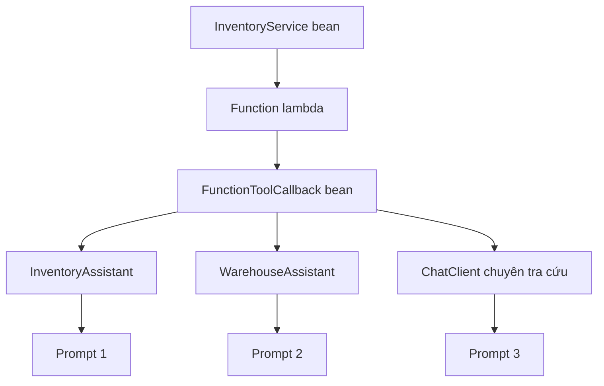

# Đóng gói thành ToolCallback bean và tái sử dụng

Sau khi tạo được một `FunctionToolCallback`, ứng dụng có thể đóng gói callback đó thành Spring bean để nhiều thành phần dùng lại. Cách làm này tách việc xây dựng hợp đồng công cụ khỏi nơi gọi hội thoại: cấu hình tạo callback một lần, Spring quản lý vòng đời và dependency, còn từng `ChatClient` hoặc từng prompt quyết định khi nào công cụ được cung cấp cho mô hình.

Điểm cần phân biệt là **đăng ký bean** và **đăng ký công cụ cho mô hình**. Khai báo `@Bean` giúp ứng dụng inject và tái sử dụng `ToolCallback`; nó không tự động khiến mọi hội thoại nhìn thấy công cụ. Ứng dụng phải đưa callback vào `ChatClient` bằng `defaultToolCallbacks(...)` hoặc vào một prompt cụ thể bằng `toolCallbacks(...)`.

Trong module `SPRING_AI_TOOL_CALLING`, callback là cầu nối từ tool call có cấu trúc tới service nghiệp vụ. Mô hình chọn công cụ và sinh đối số; callback chuyển đối số sang kiểu Java; service thực hiện tra cứu hoặc hành động sau khi áp dụng quy tắc nghiệp vụ và quyền truy cập.

Sau bài học, bạn có thể:

- Tạo một `FunctionToolCallback` trong phương thức `@Bean`.
- Inject service nghiệp vụ vào function và trả về DTO có cấu trúc.
- Tái sử dụng cùng callback ở nhiều assistant hoặc `ChatClient`.
- Chọn giữa đăng ký mặc định cho mọi prompt và đăng ký theo từng prompt.
- Thiết kế callback singleton an toàn khi nhiều request chạy đồng thời.
- Kiểm thử bean, đối số, kết quả và việc công cụ được cung cấp đúng phạm vi.

## 1. Vì sao đóng gói callback thành bean?

Nếu tạo callback trực tiếp trong mỗi phương thức xử lý hội thoại, mã ứng dụng có thể lặp lại tên công cụ, mô tả, schema và logic kết nối service. Khi cần đổi schema hoặc giới hạn kết quả, nhiều nơi có thể phải sửa đồng thời.

Đóng gói callback thành bean đem lại một điểm cấu hình rõ ràng:

- Spring tạo callback và inject dependency cần thiết.
- Các assistant có thể inject cùng callback thay vì tự dựng lại.
- Tên, mô tả, kiểu đầu vào và function thực thi được định nghĩa tập trung.
- Kiểm thử callback độc lập với luồng hội thoại dễ dàng hơn.
- Ứng dụng có thể quyết định từng `ChatClient` hoặc prompt nào được phép dùng công cụ.

Một callback được tái sử dụng nên có hành vi ổn định và không lưu trạng thái riêng của request. Những dữ liệu thay đổi theo người dùng, tenant hoặc phiên hội thoại phải được truyền trong ngữ cảnh của lần gọi và kiểm tra ở phía ứng dụng.

## 2. Xây dựng hợp đồng đầu vào và đầu ra

Ví dụ xuyên suốt là công cụ tra cứu tồn kho theo mã sản phẩm và kho. Mô hình cần cung cấp hai trường nghiệp vụ:

```java
public record InventoryLookupRequest(
    String sku,
    String warehouseCode
) {
    public InventoryLookupRequest {
        if (sku == null || sku.isBlank()) {
            throw new IllegalArgumentException("sku không được để trống");
        }
        if (warehouseCode == null || warehouseCode.isBlank()) {
            throw new IllegalArgumentException("warehouseCode không được để trống");
        }

        sku = sku.strip();
        warehouseCode = warehouseCode.strip();
    }
}
```

Kết quả nên là một DTO nhỏ chỉ chứa thông tin cần thiết để mô hình trả lời:

```java
public record InventoryLookupResult(
    String sku,
    String warehouseCode,
    int availableQuantity,
    boolean available
) {}
```

`InventoryService` là service nghiệp vụ của ứng dụng. Callback sẽ gọi service qua một hợp đồng như sau:

```java
public interface InventoryService {
    InventoryLookupResult lookup(String sku, String warehouseCode);
}
```

DTO đầu vào và đầu ra là hợp đồng dữ liệu của công cụ. Không dùng trực tiếp entity JPA hoặc trả cả đối tượng nội bộ của service nếu mô hình chỉ cần số lượng còn hàng. Kết quả gọn giúp giảm lượng dữ liệu gửi tới mô hình và tránh vô tình để lộ trường không liên quan.

## 3. Tạo `FunctionToolCallback` trong `@Bean`

Spring AI cung cấp `FunctionToolCallback` để đóng gói một hàm Java cùng định nghĩa công cụ. Với một `Function<I, O>`, tham số generic `I` là kiểu đầu vào và `O` là kiểu kết quả.

Ta tạo callback bằng `FunctionToolCallback.builder(...)`, cung cấp tên, mô tả và kiểu đầu vào:

```java
import java.util.function.Function;

import org.springframework.ai.tool.ToolCallback;
import org.springframework.ai.tool.function.FunctionToolCallback;
import org.springframework.context.annotation.Bean;
import org.springframework.context.annotation.Configuration;

@Configuration
public class InventoryToolConfiguration {

    @Bean
    ToolCallback inventoryLookupTool(InventoryService inventoryService) {
        Function<InventoryLookupRequest, InventoryLookupResult> function = request ->
            inventoryService.lookup(request.sku(), request.warehouseCode());

        return FunctionToolCallback.builder("lookup_inventory", function)
            .description("Tra cứu số lượng tồn kho của một mã sản phẩm tại một kho. "
                + "Chỉ đọc tồn kho, không thay đổi số lượng.")
            .inputType(InventoryLookupRequest.class)
            .build();
    }
}
```

Phương thức `@Bean` nhận `InventoryService` như một tham số. Spring giải quyết dependency và truyền service vào khi tạo bean. Function đóng vai trò adapter: nhận `InventoryLookupRequest`, gọi service và trả `InventoryLookupResult`.

Các thành phần có ý nghĩa riêng:

- `"lookup_inventory"` là tên công cụ mà mô hình sẽ yêu cầu.
- `.description(...)` giúp mô hình hiểu công cụ làm gì và giới hạn của nó.
- `.inputType(InventoryLookupRequest.class)` cho Spring AI biết kiểu Java dùng để chuyển đối số JSON.
- Function là mã được callback gọi khi ứng dụng thực thi tool call.
- `ToolCallback` là kiểu abstraction mà cấu hình `ChatClient` có thể nhận.

Spring AI có thể suy ra schema đầu vào từ `inputType` và metadata mà schema generator hỗ trợ. Nếu cần schema tùy chỉnh, có thể cung cấp input schema tường minh theo API builder của phiên bản đang dùng. Dù dùng cách nào, hãy kiểm tra schema thực tế để xác nhận tên trường, kiểu, required và mô tả khớp với hợp đồng Java.

## 4. Bean được tạo một lần và được tái sử dụng như thế nào?

Spring bean mặc định có scope singleton trong mỗi application context. Với ví dụ trên, Spring tạo callback `inventoryLookupTool` một lần, sau đó có thể inject cùng instance vào nhiều assistant hoặc cấu hình `ChatClient`.



Việc dùng chung callback không có nghĩa là dùng chung dữ liệu của người dùng. Mỗi lần gọi callback vẫn nhận một bộ arguments riêng và gọi service bằng dữ liệu của lần đó. Không lưu `sku`, `warehouseCode`, `userId` hoặc `tenantId` của request trước vào field mutable của lớp cấu hình hay callback.

Singleton phù hợp khi callback chỉ giữ các dependency an toàn để dùng đồng thời và function không giữ state theo request. Nếu service phụ thuộc vào transaction, security context hoặc request scope, hãy để Spring và service quản lý các dependency đó theo đúng cơ chế của ứng dụng; không tự cache đối tượng request vào callback dùng chung.

## 5. Đăng ký callback cho một `ChatClient` chuyên biệt

Nếu một `ChatClient` chỉ phục vụ nghiệp vụ tồn kho, có thể đăng ký callback làm công cụ mặc định của client bằng `defaultToolCallbacks(...)`:

```java
import org.springframework.ai.chat.client.ChatClient;
import org.springframework.beans.factory.annotation.Qualifier;
import org.springframework.context.annotation.Bean;

@Bean
ChatClient inventoryChatClient(
        ChatClient.Builder builder,
        @Qualifier("inventoryLookupTool") ToolCallback inventoryLookupTool) {

    return builder
        .defaultToolCallbacks(inventoryLookupTool)
        .build();
}
```

Mọi prompt được gửi qua `inventoryChatClient` sẽ có callback này trong tập công cụ mặc định, trừ khi cấu hình hoặc luồng gọi cụ thể thay đổi tập công cụ theo API tương ứng.

Ví dụ assistant sử dụng client chuyên biệt:

```java
@Service
public class InventoryAssistant {

    private final ChatClient chatClient;

    public InventoryAssistant(
            @Qualifier("inventoryChatClient") ChatClient chatClient) {
        this.chatClient = chatClient;
    }

    public String answer(String question) {
        return chatClient.prompt()
            .user(question)
            .call()
            .content();
    }
}
```

Ưu điểm của cách này là assistant không phải truyền lại callback trong mỗi prompt. Cách này phù hợp khi mọi tác vụ đi qua client đều có thể sử dụng cùng một công cụ. Vì callback trở thành công cụ mặc định, hãy cân nhắc phạm vi client và quyền của các caller trước khi chọn cách đăng ký này.

## 6. Đăng ký callback theo từng prompt

Nếu một `ChatClient` được dùng cho nhiều loại tác vụ, không phải prompt nào cũng cần công cụ tồn kho. Khi đó, inject callback bean rồi chỉ thêm nó vào prompt cần thiết bằng `.toolCallbacks(...)`:

```java
@Service
public class ProductSupportAssistant {

    private final ChatClient chatClient;
    private final ToolCallback inventoryLookupTool;

    public ProductSupportAssistant(
            ChatClient chatClient,
            @Qualifier("inventoryLookupTool") ToolCallback inventoryLookupTool) {
        this.chatClient = chatClient;
        this.inventoryLookupTool = inventoryLookupTool;
    }

    public String answerInventoryQuestion(String question) {
        return chatClient.prompt()
            .user(question)
            .toolCallbacks(inventoryLookupTool)
            .call()
            .content();
    }
}
```

Trong trường hợp này, callback bean vẫn được tái sử dụng, nhưng chỉ prompt có `.toolCallbacks(inventoryLookupTool)` mới nhận công cụ đó từ đoạn mã này. Đây là cách hữu ích để giới hạn tập công cụ theo mục đích của request.

| Cách đăng ký | Phạm vi công cụ | Phù hợp khi |
|---|---|---|
| `defaultToolCallbacks(...)` | Mặc định cho mọi prompt của `ChatClient` | Client chuyên biệt, mọi tác vụ đều cần công cụ |
| `toolCallbacks(...)` | Prompt hiện tại | Client dùng chung cho nhiều luồng, mỗi luồng có quyền/công cụ khác nhau |

Đừng đăng ký cùng một callback cả ở mặc định và một lần nữa trên prompt nếu không có lý do rõ ràng. Tránh để các callback có cùng tên trong cùng tập công cụ vì mô hình và bộ điều phối cần phân giải tên một cách duy nhất.

## 7. Tái sử dụng callback ở nhiều assistant

Một callback có thể được inject vào nhiều assistant nếu các assistant cần cùng một hành vi nghiệp vụ. Ví dụ, `InventoryAssistant` trả lời câu hỏi về tồn kho, còn `WarehouseAssistant` hỗ trợ nhân viên kho. Cả hai có thể dùng `inventoryLookupTool` mà không tạo hai bản function khác nhau.

```java
@Service
public class WarehouseAssistant {

    private final ChatClient chatClient;
    private final ToolCallback inventoryLookupTool;

    public WarehouseAssistant(
            ChatClient chatClient,
            @Qualifier("inventoryLookupTool") ToolCallback inventoryLookupTool) {
        this.chatClient = chatClient;
        this.inventoryLookupTool = inventoryLookupTool;
    }

    public String answer(String question) {
        return chatClient.prompt()
            .system("Hỗ trợ nhân viên kho tra cứu tồn kho. Không thay đổi dữ liệu.")
            .user(question)
            .toolCallbacks(inventoryLookupTool)
            .call()
            .content();
    }
}
```

Tái sử dụng callback giúp thống nhất tên, schema và hành vi thực thi. Tuy nhiên, việc cùng dùng một callback không tự động có nghĩa hai assistant có cùng quyền nghiệp vụ. Service cần nhận diện caller đã xác thực và kiểm tra quyền theo chức năng, tenant hoặc tài nguyên. Nếu hai nhóm người dùng có quyền khác nhau, hãy truyền context đáng tin cậy theo từng request hoặc dùng các callback/service có chính sách rõ ràng.

## 8. Khi có nhiều `ToolCallback` bean

Trong ứng dụng thực tế có thể có nhiều callback bean như `inventoryLookupTool`, `orderStatusTool` và `customerProfileTool`. Khi inject một callback theo kiểu `ToolCallback`, Spring có thể không biết bean nào cần chọn nếu có nhiều ứng viên.

Dùng `@Qualifier` để chỉ rõ bean:

```java
public InventoryAssistant(
        ChatClient chatClient,
        @Qualifier("inventoryLookupTool") ToolCallback inventoryLookupTool) {
    this.chatClient = chatClient;
    this.inventoryLookupTool = inventoryLookupTool;
}
```

Nếu một client thực sự cần một nhóm callback, có thể inject danh sách callback hoặc khai báo rõ từng callback trong cấu hình:

```java
@Bean
ChatClient operationsChatClient(
        ChatClient.Builder builder,
        @Qualifier("inventoryLookupTool") ToolCallback inventoryTool,
        @Qualifier("orderStatusTool") ToolCallback orderTool) {

    return builder
        .defaultToolCallbacks(inventoryTool, orderTool)
        .build();
}
```

Chỉ đưa vào tập công cụ những callback cần thiết cho client hoặc prompt đó. Một client được cung cấp quá nhiều công cụ có thể khiến mô hình khó lựa chọn và mở rộng phạm vi hành động mà ứng dụng phải bảo vệ.

## 9. Dữ liệu theo request và `ToolContext`

Một callback singleton có thể phục vụ nhiều request đồng thời. Vì vậy, không được tạo function bằng cách đóng (capture) dữ liệu thay đổi theo người dùng tại thời điểm khởi động ứng dụng.

Không nên viết kiểu sau:

```java
// Không dùng: tenantId bị cố định khi callback bean được tạo.
@Bean
ToolCallback inventoryTool(InventoryService service, CurrentUser currentUser) {
    String tenantId = currentUser.tenantId();
    Function<InventoryLookupRequest, InventoryLookupResult> function = request ->
        service.lookup(tenantId, request.sku(), request.warehouseCode());
    // build callback ...
}
```

Nếu nghiệp vụ cần tenant hoặc principal, dữ liệu đó phải gắn với lần gọi. Dùng cơ chế `ToolContext`/callback có hỗ trợ context của phiên bản Spring AI đang sử dụng hoặc một triển khai callback phù hợp để chuyển context từ ứng dụng tới hàm thực thi. Không đưa tenant, role, user ID hay quyền vào schema để mô hình tự khai báo.

Ví dụ ở phía `ChatClient`, ứng dụng có thể gắn context đáng tin cậy cho prompt:

```java
chatClient.prompt()
    .user(question)
    .toolContext(Map.of("tenantId", authenticatedTenantId))
    .toolCallbacks(inventoryLookupTool)
    .call()
    .content();
```

Đoạn gọi trên chỉ truyền context vào luồng tool calling. Callback function đơn giản có chữ ký `Function<I, O>` không tự nhận tham số `ToolContext`; nếu function cần đọc context, hãy dùng biến thể callback/context-aware được Spring AI phiên bản đó hỗ trợ hoặc viết adapter riêng. Không giả định rằng gọi `.toolContext(...)` sẽ tự động làm context xuất hiện trong mọi function.

Service vẫn phải kiểm tra quyền ở cấp tài nguyên. Biết `tenantId` không có nghĩa người dùng được đọc mọi mã sản phẩm hoặc kho. Không đưa access token, mật khẩu hay secret vào schema hoặc context nếu thao tác không thực sự cần.

## 10. Đảm bảo function và service an toàn khi dùng chung

Vì callback bean thường là singleton, function và dependency cần phù hợp với nhiều lần gọi đồng thời:

- Không lưu arguments của request vào field mutable.
- Không giữ `SecurityContext`, principal hoặc tenant của một request trong biến instance sau khi function kết thúc.
- Không dùng chung một `Map` mutable để ghi dữ liệu tạm giữa các lần gọi.
- Dùng service/repository được thiết kế cho truy cập đồng thời và để Spring quản lý transaction.
- Giới hạn số kết quả, thời gian chờ và kích thước payload trả về.
- Với thao tác ghi, áp dụng kiểm tra quyền, idempotency và xác nhận phù hợp trước khi tạo tác động phụ.

Function lambda trong ví dụ chỉ chuyển request sang service và không giữ state. Đây là kiểu adapter phù hợp để tái sử dụng. Nếu callback phải duy trì trạng thái dài hạn, hãy xác định rõ vòng đời, đồng bộ hóa và quyền sở hữu dữ liệu trước khi dùng chung bean.

## 11. Xử lý lỗi và định dạng kết quả

Khi callback thực thi, các lỗi có thể đến từ dữ liệu đầu vào, service nghiệp vụ hoặc hệ thống phụ trợ. Nên phân biệt:

| Loại lỗi | Cách xử lý |
|---|---|
| SKU hoặc mã kho không hợp lệ | Từ chối đầu vào trước khi truy vấn |
| Không tìm thấy sản phẩm/kho | Trả kết quả nghiệp vụ rõ ràng theo hợp đồng |
| Không đủ quyền | Dừng thao tác và không tiết lộ dữ liệu ngoài phạm vi |
| Service timeout | Đặt timeout; retry có giới hạn khi thao tác an toàn để lặp |
| Lỗi nội bộ | Ghi chi tiết kỹ thuật trong log có kiểm soát, trả lỗi an toàn |

Không bắt mọi exception rồi trả về `available: true` hoặc một kết quả mặc định có vẻ thành công. Nếu không tra cứu được, kết quả phải phản ánh lỗi để mô hình không khẳng định tồn kho đã được xác nhận.

Giữ output nhỏ và ổn định. `InventoryLookupResult` có thể chứa mã sản phẩm, mã kho, số lượng có thể bán và cờ còn hàng. Không trả thông tin nhà cung cấp, giá vốn, ghi chú nội bộ hoặc dữ liệu cá nhân nếu người dùng không cần và không có quyền xem.

## 12. Kiểm thử callback bean và khả năng tái sử dụng

Nên kiểm thử ở ba mức.

**Kiểm thử function/callback:** gọi callback bằng JSON mẫu, xác nhận JSON được chuyển thành `InventoryLookupRequest`, service nhận đúng SKU và mã kho, kết quả được serialize theo hợp đồng.

```java
@Test
void inventoryCallbackDelegatesToService() {
    String result = inventoryLookupTool.call("""
        {
          "sku": "KB-104",
          "warehouseCode": "HN-01"
        }
        """);

    verify(inventoryService).lookup("KB-104", "HN-01");
    assertThat(result).contains("KB-104");
}
```

Kiểu kết quả chuỗi cụ thể phụ thuộc result converter của phiên bản Spring AI đang dùng. Với JSON output, nên parse JSON và kiểm tra property thay vì phụ thuộc khoảng trắng hoặc thứ tự trường.

**Kiểm thử Spring context:** khởi tạo context, lấy bean theo tên `inventoryLookupTool` và xác nhận callback được tạo với dependency cần thiết. Nếu có nhiều bean cùng kiểu, xác nhận các `@Qualifier` phân giải đúng.

**Kiểm thử đăng ký với ChatClient:** dùng model giả hoặc phản hồi tool call cố định để xác nhận callback có mặt trong đúng client/prompt. Kiểm tra client chuyên biệt có callback mặc định; client dùng chung chỉ có callback khi prompt gọi `.toolCallbacks(...)`.

Ma trận kiểm thử nên có:

| Trường hợp | Kết quả mong đợi |
|---|---|
| Arguments hợp lệ | Service được gọi đúng một lần với đúng trường |
| Thiếu SKU hoặc mã kho | Request bị từ chối; service không được gọi |
| SKU không tồn tại | Kết quả không tìm thấy theo hợp đồng |
| Service phát sinh lỗi | Callback không trả kết quả thành công giả |
| Hai assistant dùng cùng callback | Mỗi request giữ đúng arguments riêng |
| Hai request chạy đồng thời | Không lẫn dữ liệu hoặc context giữa request |
| Prompt không đăng ký callback | Mô hình không được cung cấp công cụ từ callback đó |
| Prompt có đăng ký callback | Tool call được ánh xạ tới đúng callback |

## 13. Lỗi thường gặp khi đóng gói callback thành bean

| Triệu chứng | Nguyên nhân có thể | Cách xử lý |
|---|---|---|
| Không tìm thấy bean `ToolCallback` | Phương thức `@Bean` chưa được component scan hoặc cấu hình chưa được import | Đặt configuration trong vùng scan hoặc import cấu hình rõ ràng |
| `NoUniqueBeanDefinitionException` | Có nhiều callback cùng kiểu | Dùng `@Qualifier` hoặc inject tập callback có chủ đích |
| Bean tồn tại nhưng mô hình không gọi được | Callback chưa được đăng ký vào ChatClient/prompt | Thêm `defaultToolCallbacks(...)` hoặc `.toolCallbacks(...)` |
| Công cụ xuất hiện ở prompt không mong muốn | Đăng ký mặc định vào client dùng chung quá rộng | Dùng client chuyên biệt hoặc đăng ký theo từng prompt |
| Nhiều request dùng nhầm tenant | Function capture tenant lúc khởi tạo hoặc giữ state mutable | Truyền context theo request và kiểm tra quyền trong service |
| Schema không khớp arguments | `inputType` sai hoặc DTO thay đổi nhưng callback không cập nhật | Kiểm tra schema được sinh và kiểm thử hợp đồng |
| Callback trả dữ liệu quá lớn | Dùng entity hoặc kết quả không giới hạn | Trả DTO nhỏ, giới hạn số bản ghi và trường dữ liệu |

## 14. Ghi nhớ

- Tạo `FunctionToolCallback` trong `@Bean` giúp Spring quản lý và inject callback như một dependency có thể tái sử dụng.
- Function nhận kiểu đầu vào đã khai báo bằng `inputType`, gọi service nghiệp vụ và trả kết quả có cấu trúc.
- Bean được tạo và quản lý không đồng nghĩa công cụ tự động được gửi cho mô hình.
- `defaultToolCallbacks(...)` áp dụng callback mặc định cho `ChatClient`; `.toolCallbacks(...)` thêm callback vào một prompt cụ thể.
- Callback singleton phải stateless và an toàn khi nhiều request thực thi đồng thời. Không capture dữ liệu theo người dùng lúc khởi tạo bean.
- Dữ liệu tin cậy theo request phải được truyền qua context phù hợp; service vẫn chịu trách nhiệm xác thực và phân quyền.
- Kiểm thử riêng callback, Spring bean và phạm vi đăng ký của `ChatClient`.

Khi muốn tái sử dụng một công cụ, hãy đóng gói function thành `ToolCallback` bean, inject service bằng dependency injection và giữ function không lưu state request. Sau đó quyết định client hoặc prompt nào được cung cấp callback, rồi kiểm thử cả việc thực thi lẫn phạm vi công cụ được công bố cho mô hình.
