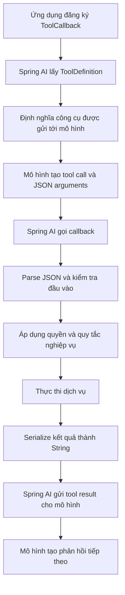

# Hợp đồng của ToolCallback và trách nhiệm khi tự triển khai

`ToolCallback` là điểm mở rộng cấp thấp của Spring AI để kết nối một định nghĩa công cụ với mã thực thi của ứng dụng. Khi dùng `@Tool` hoặc `MethodToolCallback`, framework giúp chuyển một phương thức Java thành callback. Khi tự triển khai `ToolCallback`, bạn chịu trách nhiệm trực tiếp hơn: công bố hợp đồng cho mô hình, nhận và phân tích JSON arguments, thực thi nghiệp vụ, sử dụng context nếu có, chuyển kết quả thành chuỗi và xử lý lỗi an toàn.

Tự triển khai callback phù hợp khi công cụ không chỉ là một lời gọi hàm đơn giản, chẳng hạn cần giao tiếp với một giao thức riêng, chuyển đổi dữ liệu đặc thù, định tuyến theo cấu hình hoặc kết hợp nhiều bước trong một adapter. Đây cũng là cách để tích hợp một hệ thống bên ngoài khi không có phương thức Java phù hợp để bọc bằng `MethodToolCallback`.

Tuy nhiên, `ToolCallback` không phải nơi để bỏ qua các quy tắc của ứng dụng. Callback vẫn phải kiểm tra dữ liệu, quyền truy cập, giới hạn tài nguyên, tính lặp an toàn và bảo vệ thông tin nhạy cảm. Mô hình chỉ đề xuất lời gọi theo định nghĩa công cụ; ứng dụng mới quyết định và thực thi hành động.

## Hợp đồng ToolCallback gồm những gì?

Ở mức API, một callback cung cấp định nghĩa công cụ và một điểm thực thi. Các phiên bản Spring AI hiện hành biểu diễn hợp đồng cơ bản qua `getToolDefinition()` và `call(String toolInput)`; API cũng có thể cung cấp overload nhận `ToolContext` để chuyển dữ liệu theo từng lần gọi. Hãy kiểm tra chữ ký thực tế của release line đang dùng trước khi triển khai.

| Thành phần | Trách nhiệm |
|---|---|
| `getToolDefinition()` | Trả về tên, mô tả và schema đầu vào mà mô hình nhìn thấy. |
| `getToolMetadata()` | Cung cấp metadata điều khiển cách framework xử lý công cụ, chẳng hạn `returnDirect`; phương thức có metadata mặc định trong API hiện hành. |
| `call(String toolInput)` | Nhận JSON arguments dưới dạng chuỗi, kiểm tra và thực thi chức năng của công cụ. |
| `call(String toolInput, ToolContext toolContext)` | Nhận thêm ngữ cảnh do ứng dụng cung cấp, tách biệt với JSON arguments do mô hình tạo. Trong API hiện hành, overload mặc định chỉ chuyển tiếp sang `call(String)`; callback cần context phải override overload này. |
| Giá trị trả về `String` | Biểu diễn kết quả thực thi để Spring AI gửi lại cho mô hình dưới dạng tool result. |

Một callback phải giữ cho định nghĩa và phần thực thi đồng bộ. Nếu schema nói có trường `customerId` nhưng code lại đọc `accountId`, lời gọi có thể thất bại khi chạy. Nếu schema cho phép một hành động mà code không hỗ trợ, mô hình có thể liên tục yêu cầu thao tác không thể thực hiện.

`getToolMetadata()` khác với `ToolDefinition`: metadata không phải schema gửi cho mô hình. Ví dụ, `ToolMetadata.builder().returnDirect(true).build()` yêu cầu framework trả kết quả công cụ trực tiếp cho caller thay vì gửi kết quả lại mô hình để tạo câu trả lời tiếp theo. Chỉ bật chế độ này khi kết quả công cụ đã là đầu ra cuối cùng. Nếu một lượt có nhiều tool call, `returnDirect` chỉ được áp dụng khi tất cả công cụ trong lượt đều đặt giá trị này.

## Vòng đời của một lời gọi công cụ



Callback không tự quyết định mô hình sẽ chọn nó hay không. Callback cũng không tự gửi yêu cầu chat tiếp theo. Thành phần điều phối của Spring AI quản lý chu trình gọi công cụ và tiếp tục hội thoại; callback chịu trách nhiệm cho một lần thực thi công cụ.

## ToolDefinition là hợp đồng công khai

`ToolDefinition` mô tả công cụ trước khi mô hình gọi. Tối thiểu, tên cần ổn định và phân biệt được, description cần nói rõ chức năng và điều kiện sử dụng, còn input schema phải mô tả đúng JSON arguments mà callback chấp nhận.

Ví dụ schema cho công cụ tra cứu khách hàng:

```json
{
  "type": "object",
  "properties": {
    "customerId": {
      "type": "string",
      "description": "Mã khách hàng do hệ thống cấp"
    }
  },
  "required": ["customerId"],
  "additionalProperties": false
}
```

Schema trên nói mô hình chỉ cần tạo `customerId`. Nó không chứa `userId`, `tenantId`, quyền truy cập hay token. Những thông tin này phải đến từ ứng dụng qua ngữ cảnh đáng tin cậy hoặc được xác định lại trong service.

Có thể xây dựng định nghĩa bằng builder:

```java
ToolDefinition definition = ToolDefinition.builder()
        .name("lookupCustomer")
        .description("Tra cứu thông tin cơ bản của khách hàng mà người dùng hiện tại có quyền xem.")
        .inputSchema("""
                {
                  "type": "object",
                  "properties": {
                    "customerId": {
                      "type": "string",
                      "description": "Mã khách hàng do hệ thống cấp"
                    }
                  },
                  "required": ["customerId"]
                }
                """)
        .build();
```

Đây là ví dụ theo API builder phổ biến; hãy kiểm tra package và chữ ký builder trong phiên bản Spring AI của dự án. Schema gửi tới provider có thể chỉ hỗ trợ một tập con JSON Schema. Các khóa như `additionalProperties`, `format`, `oneOf`, ràng buộc số lượng hoặc cấu trúc lồng nhau cần được kiểm tra theo provider mục tiêu.

### Quy tắc giữ schema và code đồng bộ

- Mỗi thuộc tính trong schema phải có cách ánh xạ rõ ràng sang DTO hoặc logic đọc arguments.
- Trường bắt buộc trong schema phải được kiểm tra lại khi thực thi.
- Trường optional cần có quy tắc xử lý khi bị thiếu và khi mang giá trị null.
- Kiểu dữ liệu, enum, đơn vị và định dạng ngày giờ phải khớp với cách ứng dụng chuyển đổi.
- Không quảng bá trường mà callback bỏ qua hoặc không hỗ trợ.
- Kiểm tra schema thực tế được gửi tới model provider sau khi nâng cấp Spring AI hoặc thay provider.

Schema giúp mô hình tạo dữ liệu đúng hình dạng. Nó không thay thế validation nghiệp vụ và không bảo đảm JSON do mô hình sinh luôn hợp lệ.

## Tự triển khai ToolCallback

Ví dụ dưới đây minh họa callback tra cứu khách hàng. Callback nhận JSON, chuyển thành DTO, lấy `userId` từ `ToolContext`, gọi service kiểm tra quyền rồi serialize kết quả thành JSON string.

```java
@Component
public class CustomerLookupTool implements ToolCallback {

    private final ObjectMapper objectMapper;
    private final CustomerQueryService customerQueryService;
    private final ToolDefinition toolDefinition;

    public CustomerLookupTool(
            ObjectMapper objectMapper,
            CustomerQueryService customerQueryService) {
        this.objectMapper = objectMapper;
        this.customerQueryService = customerQueryService;
        this.toolDefinition = ToolDefinition.builder()
                .name("lookupCustomer")
                .description("Tra cứu thông tin cơ bản của khách hàng mà người dùng hiện tại có quyền xem.")
                .inputSchema("""
                        {
                          "type": "object",
                          "properties": {
                            "customerId": { "type": "string" }
                          },
                          "required": ["customerId"]
                        }
                        """)
                .build();
    }

    @Override
    public ToolDefinition getToolDefinition() {
        return this.toolDefinition;
    }

    @Override
    public String call(String toolInput) {
        return execute(toolInput, Map.of());
    }

    @Override
    public String call(String toolInput, ToolContext toolContext) {
        Map<String, Object> context = toolContext == null
                ? Map.of()
                : toolContext.getContext();
        return execute(toolInput, context);
    }

    private String execute(String toolInput, Map<String, Object> context) {
        try {
            CustomerLookupInput input = objectMapper.readValue(
                    toolInput,
                    CustomerLookupInput.class
            );
            validate(input);

            String userId = requireString(context, "userId");
            CustomerSummary customer = customerQueryService
                    .findVisibleTo(input.customerId(), userId);

            return objectMapper.writeValueAsString(customer);
        }
        catch (Exception ex) {
            // Trong ứng dụng thật, ghi log kỹ thuật theo requestId và không log JSON nhạy cảm.
            throw new ToolExecutionException(
                    this.toolDefinition,
                    new IllegalStateException("Không thể thực thi công cụ tra cứu khách hàng")
            );
        }
    }

    private void validate(CustomerLookupInput input) {
        if (input == null || input.customerId() == null || input.customerId().isBlank()) {
            throw new IllegalArgumentException("Thiếu mã khách hàng");
        }
    }

    private String requireString(Map<String, Object> context, String key) {
        Object value = context.get(key);
        if (!(value instanceof String text) || text.isBlank()) {
            throw new IllegalStateException("Thiếu context hợp lệ: " + key);
        }
        return text;
    }
}
```

DTO đầu vào được khai báo riêng:

```java
public record CustomerLookupInput(String customerId) {
}
```

Ví dụ giả định release line Spring AI đang dùng có overload `call(String, ToolContext)`. Nếu phiên bản của dự án định nghĩa khác, hãy triển khai đúng interface thực tế và chuyển context qua cơ chế mà phiên bản đó hỗ trợ. Nếu callback không cần context, chỉ cần `call(String)` và không cần tạo overload giả định.

Điểm quan trọng: overload `call(String, ToolContext)` mặc định của interface hiện hành chỉ gọi lại `call(String)`; nó không tự đưa context vào logic của callback. Nếu công cụ cần `userId` hoặc `tenantId`, hãy override overload hai tham số như ví dụ. Nếu không override, dữ liệu context có thể bị bỏ qua dù request đã cung cấp context.

Trong code minh họa, `CustomerQueryService.findVisibleTo(...)` chịu trách nhiệm kiểm tra quyền truy cập khách hàng. Việc kiểm tra trong callback giúp xác định đầu vào, còn service nên tiếp tục bảo vệ quy tắc nghiệp vụ ở ranh giới dữ liệu.

Bean callback có thể được truyền trực tiếp vào `ChatClient`:

```java
String response = chatClient.prompt()
        .user("Tra cứu thông tin khách hàng CUS-100")
        .tools(customerLookupTool)
        .call()
        .content();
```

Trong cấu hình Spring AI hiện hành, các bean triển khai `ToolCallback` cũng được resolver mặc định phát hiện để tra cứu theo tên. Dù đăng ký trực tiếp hay qua bean resolver, hãy bảo đảm tên công cụ duy nhất trong tập công cụ được cung cấp cho một yêu cầu.

### Khi nào cần ToolMetadata?

Nếu kết quả công cụ phải là câu trả lời cuối cùng và không cần mô hình diễn giải thêm, callback có thể cung cấp metadata `returnDirect`:

```java
@Override
public ToolMetadata getToolMetadata() {
    return ToolMetadata.builder()
            .returnDirect(true)
            .build();
}
```

Đây là lựa chọn theo mục đích sản phẩm, không phải cách xử lý lỗi. Khi không override `getToolMetadata()`, callback dùng metadata mặc định của interface, thường giữ kết quả đi tiếp về mô hình.

## Trách nhiệm khi tự triển khai

Khi dùng callback tự viết, ứng dụng phải bảo đảm đầy đủ các trách nhiệm sau:

| Trách nhiệm | Việc callback cần làm |
|---|---|
| Công bố hợp đồng | Trả về tên, mô tả và schema ổn định qua `getToolDefinition()`. |
| Phân tích arguments | Parse JSON bằng converter đã cấu hình; từ chối JSON sai cú pháp hoặc sai cấu trúc. |
| Validation | Kiểm tra trường bắt buộc, độ dài, miền giá trị, enum, quan hệ giữa các trường và giới hạn collection. |
| Authentication context | Chỉ nhận danh tính từ nguồn ứng dụng đã xác thực, không tin giá trị do mô hình gửi. |
| Authorization | Kiểm tra quyền trên tài nguyên cụ thể theo user, tenant và trạng thái nghiệp vụ. |
| Thực thi | Gọi service hoặc adapter; không nhúng toàn bộ nghiệp vụ phức tạp vào đoạn parse JSON. |
| Chuyển kết quả | Trả `String` có cấu trúc và đủ thông tin cho mô hình, thường là JSON được serialize. |
| Xử lý lỗi | Phân loại lỗi, giữ log kỹ thuật an toàn và không lộ chi tiết nội bộ trong tool result. |
| Giới hạn tài nguyên | Áp dụng timeout, giới hạn số phần tử, kích thước đầu vào, rate limit và giới hạn đồng thời. |
| An toàn đồng thời | Không lưu dữ liệu theo request trong field mutable của callback dùng chung. |

Đây là các phần trách nhiệm thực sự chuyển sang người viết callback. `ToolCallback` cung cấp điểm tích hợp; nó không tự động làm cho phần thực thi tùy chỉnh an toàn.

## Phân tích và chuyển đổi JSON arguments

`toolInput` là chuỗi JSON. Hãy dùng một `ObjectMapper` hoặc converter được cấu hình bởi ứng dụng, được inject qua constructor. Không tạo `ObjectMapper` mới cho từng lần gọi và không dùng thao tác chuỗi thủ công để lấy giá trị JSON.

Với đầu vào đơn giản, có thể chuyển thành DTO hoặc record. Với cấu trúc lồng nhau, khai báo kiểu cụ thể như `List<FilterItem>` hoặc `SearchCriteria` để converter giữ được thông tin kiểu. Tránh `Map<String, Object>` nếu schema có cấu trúc rõ ràng.

Sau khi parse, cần kiểm tra:

- JSON có đúng cú pháp và root có đúng kiểu object không.
- Các trường bắt buộc có hiện diện và không rỗng không.
- Kiểu dữ liệu có đúng không; không tự ép chuỗi bất kỳ thành số hoặc ngày tháng.
- Có trường dư ngoài schema không; chính sách bỏ qua hay từ chối phải nhất quán.
- Giá trị có nằm trong miền nghiệp vụ và kích thước hợp lý không.
- Quan hệ giữa các trường có hợp lệ không, ví dụ `fromDate` không sau `toDate`.

Không giả định JSON Schema đã ngăn được mọi đầu vào xấu. Provider có thể sinh arguments thiếu, sai kiểu hoặc vượt giới hạn. Callback luôn phải coi arguments là dữ liệu chưa đáng tin cậy.

## ToolContext là dữ liệu do ứng dụng cung cấp

Nếu API có overload nhận `ToolContext`, callback có thể dùng nó để nhận dữ liệu theo request như `userId`, `tenantId`, correlation ID, locale hoặc một phạm vi đã được ứng dụng xác định.

Phân biệt hai nguồn dữ liệu:

| Dữ liệu | Nguồn | Có nên nằm trong JSON schema? |
|---|---|---|
| `customerId`, từ khóa, khoảng giá | Mô hình tạo theo yêu cầu người dùng | Có, nếu đó là đối số nghiệp vụ của công cụ. |
| `userId` đã xác thực | Ứng dụng hoặc security context | Không. |
| `tenantId` hiện tại | Ứng dụng xác định sau khi xác thực | Không. |
| `requestId` | Hệ thống tạo để theo dõi | Không. |
| API key hoặc token | Secret/configuration của ứng dụng | Không. |

Tạo context riêng cho từng yêu cầu. Không giữ `userId` hoặc `tenantId` trong field mutable của callback singleton, vì nhiều request có thể chạy đồng thời và làm rò context giữa người dùng. Kiểm tra kiểu và sự hiện diện của giá trị context trước khi sử dụng.

`ToolContext` chỉ chuyển dữ liệu; nó không tự cấp quyền. Service vẫn phải kiểm tra user có quyền xem hoặc thay đổi tài nguyên được chỉ định trong arguments hay không.

## Thiết kế kết quả trả về

`ToolCallback` trả về `String`. Chuỗi này được gửi lại cho mô hình như kết quả của công cụ. Nếu kết quả là dữ liệu có cấu trúc, thường nên serialize một DTO nhỏ thành JSON thay vì nối chuỗi thủ công.

Kết quả nên:

- Chỉ chứa trường cần cho câu trả lời tiếp theo.
- Dùng tên trường và giá trị dễ hiểu, nhất quán với schema và nghiệp vụ.
- Có thể chứa trạng thái, nguồn dữ liệu hoặc thời điểm cập nhật nếu điều đó giúp mô hình trả lời chính xác.
- Không chứa entity đầy đủ, dữ liệu cá nhân không cần thiết, token, secret, SQL hoặc stack trace.
- Có kích thước giới hạn để không làm phình context window và chi phí model.

Với kết quả lớn, hãy trả một phần dữ liệu có giới hạn, mã tham chiếu hoặc thông báo rằng cần thu hẹp truy vấn. Không trả toàn bộ bản ghi hoặc danh sách không giới hạn cho mô hình.

Nếu callback tự triển khai, bạn trực tiếp tạo `String` kết quả. `ToolCallResultConverter` là một điểm mở rộng hữu ích ở những cách khai báo method/function có đối tượng trả về cần chuyển đổi; nó không thay đổi hợp đồng `ToolCallback.call(...)` là trả về `String`.

## Xử lý lỗi và kết quả nghiệp vụ

Một callback có thể gặp nhiều loại lỗi:

1. JSON không hợp lệ hoặc không chuyển đổi được.
2. Thiếu tham số hoặc vi phạm validation.
3. Không tìm thấy tài nguyên.
4. Người dùng không có quyền truy cập.
5. Trạng thái nghiệp vụ không cho phép thao tác.
6. Dịch vụ phía sau timeout, mất kết nối hoặc giới hạn tốc độ.
7. Không serialize được kết quả.

Hãy phân biệt kết quả nghiệp vụ bình thường với lỗi thực thi. Ví dụ “không tìm thấy khách hàng” có thể là một kết quả có cấu trúc an toàn để mô hình giải thích. Lỗi database hoặc lỗi xác thực nội bộ không nên được chuyển thành câu “không tìm thấy” vì sẽ che khuất sự cố.

Spring AI và cấu hình ứng dụng có thể cung cấp cơ chế xử lý exception của tool. Hãy dùng chính sách xử lý phù hợp với phiên bản đang chạy: có lỗi được chuyển thành tool result đã làm sạch để mô hình phản hồi, có lỗi cần dừng yêu cầu và trả lỗi cho lớp gọi. Không nuốt mọi exception rồi trả chuỗi rỗng.

Với custom callback, hãy ném `ToolExecutionException` khi phần thực thi thất bại. `ToolExecutionExceptionProcessor` nhận exception này và quyết định chuyển một thông báo lỗi thành tool result cho mô hình hoặc ném lỗi về caller. Trong cấu hình mặc định hiện hành, message của runtime exception có thể được gửi lại cho mô hình; thuộc tính `spring.ai.tools.throw-exception-on-error=true` yêu cầu ném lỗi cho caller. Vì vậy, không bọc nguyên thông báo database hoặc exception nội bộ rồi để mặc định gửi đi. Hãy dùng thông báo đã làm sạch và/hoặc cấu hình processor riêng để kiểm soát nội dung lỗi.

Không trả `ex.getMessage()` một cách tùy tiện. Thông báo có thể chứa SQL, tên bảng, đường dẫn nội bộ, host, token hoặc dữ liệu người dùng. Ghi chi tiết kỹ thuật vào log đã che dữ liệu nhạy cảm; trả một thông báo ngắn, có mã lỗi hoặc trạng thái an toàn.

## An toàn cho thao tác ghi và khả năng lặp lại

Với công cụ chỉ đọc, rủi ro thường nằm ở quyền truy cập và dữ liệu trả về. Với công cụ ghi như tạo đơn, hủy đơn, thanh toán hoặc cập nhật hồ sơ, cần thêm các biện pháp:

- Xác nhận người dùng cho thao tác quan trọng theo chính sách sản phẩm.
- Kiểm tra trạng thái hiện tại trước khi chuyển trạng thái.
- Dùng idempotency key hoặc mã yêu cầu duy nhất để tránh thực thi trùng khi model/provider retry.
- Đặt timeout và chỉ retry khi thao tác có thể lặp an toàn.
- Ghi audit event với chủ thể, tài nguyên, kết quả và correlation ID.
- Giới hạn số lần gọi và kiểm tra quyền trên từng tài nguyên.

Mô hình có thể gọi lại cùng công cụ hoặc tạo nhiều tool call trong một lượt. Callback không nên giả định mỗi request chỉ được thực thi đúng một lần.

## Vòng đời, thread safety và cấu hình

Callback thường được đăng ký và tái sử dụng qua nhiều yêu cầu. Hãy thiết kế nó như một thành phần có thể được gọi đồng thời:

- Inject các dependency dùng chung an toàn như service, `ObjectMapper` đã cấu hình và client.
- Giữ `ToolDefinition` bất biến sau khi khởi tạo.
- Không ghi input, context, kết quả hoặc trạng thái hội thoại vào field mutable dùng chung.
- Tạo biến cục bộ cho từng lần gọi.
- Nếu client bên dưới không thread-safe, đồng bộ hoặc dùng cách tạo client phù hợp theo tài liệu của thư viện.
- Đặt timeout, connection pool, rate limit và giới hạn concurrency ở client hoặc service tương ứng.

Không đặt endpoint, API key hoặc tenant của người dùng vào description hay schema. Cấu hình môi trường và secret manager là nơi quản lý thông tin kết nối.

## Khi nào nên tự triển khai ToolCallback?

| Nhu cầu | Cách tiếp cận thường phù hợp |
|---|---|
| Một phương thức Java đơn giản với dependency Spring | `@Tool` hoặc `MethodToolCallback`. |
| Một `Function`/`Supplier` đã có sẵn | `FunctionToolCallback`. |
| Cần tự kiểm soát schema, parser, routing hoặc tích hợp giao thức riêng | Tự triển khai `ToolCallback`. |
| Cần tái sử dụng adapter bên ngoài với logic chuyển đổi đặc thù | Có thể dùng custom callback để bọc adapter đó. |

Không nên tự triển khai chỉ để đổi tên một phương thức hoặc viết lại một lời gọi service đơn giản. Mỗi custom callback làm tăng phần mã phải kiểm thử và duy trì: schema, parse, validation, context, kết quả và lỗi.

## Kiểm thử custom ToolCallback

Kiểm thử nên tập trung vào hợp đồng và ranh giới thực thi:

| Tình huống | Điều cần xác minh |
|---|---|
| Định nghĩa công cụ | Tên, description và schema ổn định, khớp code parse. |
| JSON hợp lệ | DTO được tạo đúng và service nhận đúng đối số. |
| JSON sai cú pháp | Callback từ chối với lỗi được kiểm soát. |
| Thiếu trường hoặc sai kiểu | Validation chặn trước khi gọi service. |
| Trường dư | Hành vi từ chối/bỏ qua đúng chính sách đã chọn. |
| Context hợp lệ | Danh tính và tenant được truyền đúng tới service. |
| Context thiếu hoặc sai kiểu | Callback từ chối an toàn. |
| Truy cập trái quyền | Service không trả dữ liệu của người dùng/tenant khác. |
| Kết quả lớn hoặc nhạy cảm | Dữ liệu được giới hạn và loại bỏ trường không cần thiết. |
| Lỗi dịch vụ ngoài | Timeout, retry và thông báo lỗi tuân theo chính sách. |
| Gọi đồng thời | Không có rò rỉ context hoặc trạng thái giữa hai request. |
| Thao tác ghi bị gọi lại | Idempotency ngăn thực thi trùng ngoài ý muốn. |

Ngoài unit test cho parser và logic callback, hãy có integration test đăng ký callback vào `ChatClient` hoặc `ToolCallingManager` theo API của phiên bản dự án. Kiểm tra schema thực tế được gửi tới provider và xác minh tool result được nối đúng với tool call. Dùng model giả lập cho test tái lập; dùng model thật trong một tập kiểm tra có kiểm soát để đánh giá việc lựa chọn công cụ.

## Bài tập thực hành

Tự xây dựng callback `lookupCustomer`:

1. Tạo `CustomerLookupInput` với trường `customerId`.
2. Tạo `ToolDefinition` với tên, description và schema chỉ chứa `customerId`.
3. Viết lớp `CustomerLookupTool implements ToolCallback` và inject `ObjectMapper` cùng `CustomerQueryService`.
4. Parse JSON thành DTO, kiểm tra mã khách hàng và từ chối dữ liệu sai.
5. Nhận `userId` từ `ToolContext` nếu API hỗ trợ; không lấy `userId` từ JSON arguments.
6. Gọi service có kiểm tra quyền, serialize kết quả thành JSON string.
7. Thử JSON sai, context thiếu, truy cập trái quyền, kết quả quá lớn và hai request đồng thời.
8. Đăng ký callback vào yêu cầu chat và xác minh toàn bộ vòng đời tool call.

Bạn hoàn thành khi có thể giải thích rõ callback công bố gì, nhận dữ liệu nào từ mô hình, nhận dữ liệu nào từ ứng dụng, thực thi ra sao, trả kết quả gì và xử lý lỗi như thế nào.

## Danh sách kiểm tra trước khi đưa callback vào sử dụng

- [ ] `getToolDefinition()` trả về tên, mô tả và schema khớp với phần thực thi.
- [ ] Schema chỉ công bố các đối số nghiệp vụ mô hình được phép tạo.
- [ ] JSON được parse bằng converter đã cấu hình và chuyển thành kiểu cụ thể.
- [ ] Đầu vào được validation lại ở runtime.
- [ ] `ToolContext` được nhận riêng và chỉ chứa dữ liệu do ứng dụng tin cậy cung cấp.
- [ ] Service kiểm tra quyền trên user, tenant và tài nguyên cụ thể.
- [ ] Kết quả được serialize thành chuỗi có cấu trúc, giới hạn kích thước và loại bỏ dữ liệu nhạy cảm.
- [ ] Lỗi được phân loại, không lộ stack trace hoặc thông tin nội bộ.
- [ ] Callback an toàn khi được gọi đồng thời và không giữ state theo request trong field dùng chung.
- [ ] Thao tác ghi có xác nhận, audit và idempotency khi cần.
- [ ] Có unit test, integration test và kiểm tra schema/provider.

Tự triển khai `ToolCallback` nghĩa là tự chịu trách nhiệm cho toàn bộ hợp đồng giữa mô hình và mã ứng dụng. Một callback đáng tin cậy công bố schema rõ ràng, kiểm tra mọi đối số, giữ context tin cậy ngoài dữ liệu mô hình, thực thi qua service có phân quyền và trả kết quả an toàn để mô hình tiếp tục hội thoại.
