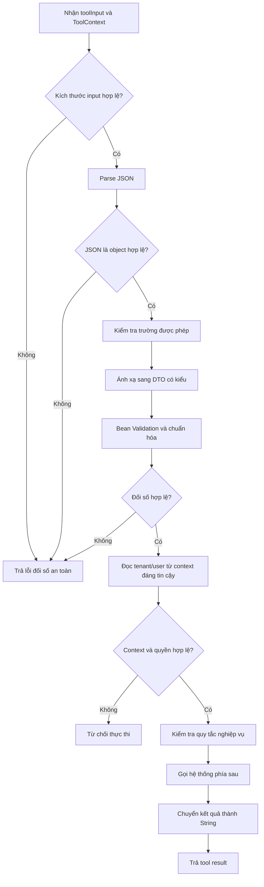

# Đọc và kiểm tra đối số trước khi gọi hệ thống phía sau

Một `ToolCallback` tùy chỉnh nhận đối số từ mô hình dưới dạng chuỗi JSON. Chuỗi này là dữ liệu đầu vào bên ngoài, dù mô hình đã được cung cấp JSON Schema để hướng dẫn cách tạo lời gọi. Schema mô tả hợp đồng mà mô hình nên tuân theo; nó không thay thế việc parse, xác thực và kiểm tra quyền ở phía ứng dụng.

Trước khi gọi API, service hoặc cơ sở dữ liệu, callback cần xác nhận JSON hợp lệ, đúng cấu trúc, đúng kiểu, thỏa các ràng buộc dữ liệu và phù hợp với ngữ cảnh người dùng đã được ứng dụng xác thực. Chỉ sau các bước đó, callback mới chuyển dữ liệu đã kiểm tra thành lời gọi nghiệp vụ. Cách làm này ngăn đối số sai định dạng, trường lạ, giá trị vượt giới hạn hoặc thông tin định danh do mô hình tự tạo đi thẳng vào hệ thống phía sau.

## `ToolCallback` nhận gì và chịu trách nhiệm gì?

Trong Spring AI 2.1.0, `ToolCallback` mô tả một công cụ bằng `ToolDefinition` và cung cấp logic thực thi qua `call(String)`. Interface còn có overload mặc định `call(String, ToolContext)` và metadata mặc định cho cách xử lý kết quả:

```java
public interface ToolCallback {
    ToolDefinition getToolDefinition();
    String call(String toolInput);
}
```

`ToolDefinition` chứa ba phần mà mô hình nhìn thấy: tên công cụ, mô tả và input schema. `toolInput` là chuỗi JSON arguments mà mô hình tạo ra. `ToolContext` là ngữ cảnh do ứng dụng chuyển tới khi thực thi, chẳng hạn tenant ID hoặc request metadata; nội dung này không được gửi vào prompt như một phần của tool schema.

Một callback tự triển khai cần đảm nhiệm các việc sau:

1. Công bố `ToolDefinition` với tên duy nhất, mô tả rõ ràng và schema đúng với hợp đồng đầu vào.
2. Parse `toolInput` thành DTO hoặc cấu trúc dữ liệu có kiểu.
3. Kiểm tra cấu trúc, trường được phép, kiểu dữ liệu và các ràng buộc.
4. Lấy danh tính hoặc tenant từ ngữ cảnh đáng tin cậy do ứng dụng cung cấp.
5. Gọi service nghiệp vụ với dữ liệu đã chuẩn hóa và đã qua kiểm tra.
6. Chuyển kết quả thành chuỗi để gửi lại mô hình.
7. Bọc lỗi thực thi bằng `ToolExecutionException` để Spring AI chuyển tới `ToolExecutionExceptionProcessor`.

`call(String, ToolContext)` có triển khai mặc định trong interface. Nếu công cụ cần context để giới hạn dữ liệu theo người dùng hoặc tenant, hãy override overload này. Nếu chỉ override `call(String)`, callback sẽ không tự sử dụng context được truyền ở thời điểm thực thi. Phần code mẫu bên dưới chỉ cài đặt các phương thức bắt buộc và override overload context vì công cụ cần tenant.

## JSON Schema là hướng dẫn cho mô hình, không phải ranh giới bảo mật

Ví dụ một công cụ tìm sản phẩm theo SKU:

```json
{
  "type": "object",
  "properties": {
    "sku": {
      "type": "string",
      "description": "Mã SKU của sản phẩm cần tra cứu"
    },
    "limit": {
      "type": "integer",
      "minimum": 1,
      "maximum": 20,
      "description": "Số kết quả tối đa, từ 1 đến 20"
    }
  },
  "required": ["sku"],
  "additionalProperties": false
}
```

Schema cho mô hình biết `sku` là bắt buộc, `limit` là tùy chọn và giới hạn của `limit`. `additionalProperties: false` diễn tả rằng callback không nhận trường ngoài hợp đồng. Tuy nhiên, không phải mọi provider đều hỗ trợ cùng một tập con JSON Schema hoặc strict mode giống nhau. Dù provider có xác thực schema ở phía model, callback vẫn phải kiểm tra lại vì:

- Một request có thể được tạo bởi client khác hoặc gọi trực tiếp vào callback trong test.
- Model/provider có thể trả dữ liệu sai kiểu, thiếu trường hoặc thêm trường lạ.
- Schema không kiểm tra được mọi quy tắc nghiệp vụ, ví dụ SKU có tồn tại trong tenant hiện tại hay sản phẩm còn được phép bán hay không.
- Schema không xác thực danh tính, vai trò hoặc quyền truy cập của người gọi.

Hãy xem JSON Schema là hợp đồng giúp model tạo lời gọi đúng hình dạng. Ứng dụng vẫn phải coi mọi đối số nhận được là dữ liệu chưa đáng tin cậy.

## Luồng kiểm tra trước khi gọi downstream

Một luồng an toàn nên thực hiện tuần tự các bước sau:



Không gọi service trước rồi mới xác thực đối số. Nếu đầu vào không hợp lệ, callback phải dừng trước khi tạo truy vấn, gọi HTTP client, ghi dữ liệu hoặc kích hoạt một side effect.

## Bước 1: Giới hạn kích thước và parse JSON

Đừng parse một chuỗi có kích thước không giới hạn. Tool input thường nhỏ; đặt giới hạn phù hợp với schema để tránh tiêu thụ bộ nhớ hoặc CPU bất thường. Sau đó parse thành `JsonNode` để kiểm tra root và tên trường trước khi ánh xạ vào DTO.

```java
private static final int MAX_INPUT_CHARS = 4_096;

private ProductSearchArguments parseArguments(String toolInput) {
    if (toolInput == null || toolInput.isBlank()
            || toolInput.length() > MAX_INPUT_CHARS) {
        throw invalidArguments("Đối số công cụ bị thiếu hoặc vượt giới hạn kích thước.");
    }

    final JsonNode root;
    try {
        root = objectMapper.readTree(toolInput);
    }
    catch (JsonProcessingException ex) {
        throw invalidArguments("Đối số phải là một đối tượng JSON hợp lệ.");
    }

    if (root == null || !root.isObject()) {
        throw invalidArguments("Đối số phải là một đối tượng JSON.");
    }

    return mapAndValidate(root);
}
```

Việc kiểm tra `root.isObject()` loại các payload như chuỗi JSON đơn, mảng hoặc số. Với công cụ nhận một object, các payload này không phù hợp dù chúng vẫn là JSON hợp lệ.

Nếu ứng dụng yêu cầu JSON nghiêm ngặt hơn, có thể cấu hình Jackson để phát hiện khóa trùng lặp và dữ liệu thừa sau root object. Giới hạn input nên được áp dụng trước parse; không đưa nguyên chuỗi JSON hoặc giá trị nhạy cảm vào exception message.

## Bước 2: Chỉ chấp nhận các trường thuộc hợp đồng

Jackson có thể được cấu hình để bỏ qua thuộc tính không biết trong quá trình ánh xạ. Với custom callback, nếu hợp đồng cần chặt chẽ, hãy kiểm tra tên trường tường minh:

```java
private static final Set<String> ALLOWED_FIELDS = Set.of("sku", "limit");

private void rejectUnknownFields(JsonNode root) {
    Iterator<String> names = root.fieldNames();
    while (names.hasNext()) {
        String name = names.next();
        if (!ALLOWED_FIELDS.contains(name)) {
            throw invalidArguments("Đối số chứa trường không được hỗ trợ: " + name);
        }
    }
}
```

Sau bước này, callback có thể từ chối các trường như `tenantId`, `isAdmin`, `sql`, `url` hoặc `callbackUrl` nếu chúng không thuộc hợp đồng. Không thêm một trường chỉ vì mô hình thường tự sinh ra nó. Nếu cần mở rộng schema, hãy cập nhật `ToolDefinition`, DTO, validation và test cùng nhau.

Kiểm tra trường lạ cũng tránh trường hợp một phiên bản model/provider gửi thêm metadata mà service phía sau vô tình dùng nhầm. Tuy vậy, danh sách trường được phép không thay thế kiểm tra giá trị của từng trường.

## Bước 3: Ánh xạ sang DTO và kiểm tra ràng buộc

DTO giúp callback làm việc với kiểu Java thay vì đọc thủ công các node JSON ở nhiều nơi. Ví dụ:

```java
public record ProductSearchArguments(
        @NotBlank
        @Pattern(regexp = "[A-Z0-9][A-Z0-9-]{2,31}")
        String sku,

        @Min(1)
        @Max(20)
        Integer limit) {
}
```

`limit` dùng `Integer` vì tham số này là tùy chọn; khi model không gửi trường đó, ứng dụng có thể áp dụng giá trị mặc định. Các constraint như `@NotBlank`, `@Pattern`, `@Min` và `@Max` kiểm tra hình dạng và miền giá trị. Cần có implementation Jakarta Bean Validation trên classpath và inject `jakarta.validation.Validator`.

```java
private ProductSearchArguments mapAndValidate(JsonNode root) {
    rejectUnknownFields(root);

    final ProductSearchArguments arguments;
    try {
        arguments = objectMapper.treeToValue(root, ProductSearchArguments.class);
    }
    catch (JsonProcessingException ex) {
        throw invalidArguments("Đối số không khớp với kiểu dữ liệu của công cụ.");
    }

    Set<ConstraintViolation<ProductSearchArguments>> violations =
            validator.validate(arguments);

    if (!violations.isEmpty()) {
        String details = violations.stream()
                .map(v -> v.getPropertyPath() + ": " + v.getMessage())
                .sorted()
                .collect(Collectors.joining("; "));
        throw invalidArguments("Đối số không hợp lệ: " + details);
    }

    return arguments;
}
```

Chỉ đưa tên trường và thông báo constraint do ứng dụng định nghĩa vào lỗi trả về; không đưa `getInvalidValue()` hoặc toàn bộ JSON vào thông điệp. Nếu thông báo validation chứa dữ liệu do người dùng nhập, hãy chuẩn hóa nó trước khi gửi lại model.

Validation ở DTO thường kiểm tra cú pháp và giới hạn cơ bản. Ví dụ, regex có thể xác nhận SKU chỉ chứa chữ in hoa, chữ số và dấu gạch ngang. Nó không thể xác nhận SKU có tồn tại, có thuộc tenant hiện tại hay đang ở trạng thái có thể tra cứu. Những kiểm tra đó thuộc service nghiệp vụ.

## Bước 4: Chuẩn hóa giá trị trước khi dùng

Sau khi xác thực, chuẩn hóa các giá trị theo hợp đồng. Ví dụ, nếu `limit` không được cung cấp, chọn giá trị mặc định đã định trước:

```java
private int effectiveLimit(ProductSearchArguments arguments) {
    return arguments.limit() == null ? 10 : arguments.limit();
}
```

Không âm thầm sửa các giá trị nguy hiểm thành giá trị khác. Với trường bắt buộc như SKU, chuỗi rỗng hoặc định dạng sai nên bị từ chối. Với tham số tùy chọn, giá trị mặc định phải được mô tả trong schema/description và nhất quán với hành vi service.

Nếu input có enum, hãy chuyển thành enum Java hoặc so sánh với allowlist. Nếu có ngày giờ, parse theo định dạng ISO đã công bố và xác định rõ timezone. Nếu có tiền, dùng kiểu số thập phân phù hợp và mã tiền tệ rõ ràng. Đừng dùng chuỗi tự do cho tham số có miền giá trị hữu hạn.

## Bước 5: Lấy danh tính và tenant từ `ToolContext`

Không yêu cầu mô hình gửi `tenantId`, `userId`, role hoặc authority trong JSON để ứng dụng quyết định quyền. Model có thể tự tạo các giá trị này. Hãy lấy chúng từ ngữ cảnh mà ứng dụng đã xây dựng sau khi xác thực người dùng.

`ToolContext` chứa một map bất biến và được chuyển tới callback khi tool được gọi. Ví dụ, ứng dụng lấy tenant từ principal đã xác thực rồi đưa vào context:

```java
String authenticatedTenantId = currentUser.requireTenantId();

String answer = chatClient.prompt()
        .user("Tìm sản phẩm SKU-2048 trong kho của tôi")
        .tools(productSearchTool)
        .toolContext(Map.of("tenantId", authenticatedTenantId))
        .call()
        .content();
```

Trong callback, kiểm tra context trước khi gọi service:

```java
private String requireTenantId(ToolContext toolContext) {
    if (toolContext == null) {
        throw new ToolExecutionException(
                definition,
                new IllegalStateException("Thiếu ngữ cảnh thực thi đã xác thực."));
    }

    Object value = toolContext.getContext().get("tenantId");
    if (!(value instanceof String tenantId) || tenantId.isBlank()) {
        throw new ToolExecutionException(
                definition,
                new IllegalStateException("Thiếu tenant trong ngữ cảnh thực thi."));
    }

    return tenantId;
}
```

Nếu công cụ không cần tenant, có thể lấy principal từ Spring Security hoặc một context khác do ứng dụng quản lý. Dù dùng cách nào, danh tính phải đến từ nguồn đã xác thực và service vẫn cần kiểm tra quyền truy cập trên tài nguyên cụ thể. `ToolContext` không tự xác thực người dùng và không thay thế authorization.

Khi chạy tool bất đồng bộ hoặc qua executor, không mặc định `SecurityContext` tự truyền sang thread khác. Hãy truyền context đáng tin cậy một cách tường minh hoặc dùng service principal có quyền tối thiểu. Không lấy lại tenant từ đối số JSON chỉ vì context không có sẵn.

## Bước 6: Gọi service nghiệp vụ sau khi mọi kiểm tra đã đạt

Service nên nhận các tham số đã có kiểu và tenant đã được xác thực. Nó tiếp tục kiểm tra quy tắc miền và truy vấn theo tenant:

```java
public interface CatalogService {

    ProductSearchResult searchVisibleToTenant(
            String tenantId,
            String sku,
            int limit);
}
```

Service phải áp dụng tenant filter trong truy vấn hoặc policy layer. Không nên truy vấn một sản phẩm toàn cục rồi chỉ lọc kết quả sau đó nếu việc truy cập đã cần được giới hạn từ đầu. Những quy tắc như sản phẩm tồn tại, tenant được phép xem, trạng thái sản phẩm và giới hạn kết quả thuộc service nghiệp vụ.

Đừng ghép chuỗi đối số trực tiếp thành SQL, câu lệnh shell, đường dẫn file hoặc URL tùy ý. Dùng repository query có tham số, API client có kiểu, enum/allowlist cho lựa chọn và allowlist host nếu công cụ thực sự phải truy cập URL. Nếu một tham số có thể ảnh hưởng tới tài nguyên hoặc side effect, cần xác thực quyền và trạng thái ngay trước khi thực thi.

## Ví dụ hoàn chỉnh: custom callback tra cứu sản phẩm

Ví dụ sau kết hợp JSON Schema, Jackson, Bean Validation, ToolContext và service. Các kiểu `ProductSearchResult` và `CatalogService` là DTO/interface nghiệp vụ của ứng dụng.

Trong ví dụ, `ProductSearchArguments` là record package-private đặt cùng package với `ProductSearchTool`; có thể chuyển record sang file riêng và khai báo `public` nếu cần dùng ở package khác.

```java
import com.fasterxml.jackson.core.JsonProcessingException;
import com.fasterxml.jackson.databind.JsonNode;
import com.fasterxml.jackson.databind.ObjectMapper;
import jakarta.validation.ConstraintViolation;
import jakarta.validation.Validator;
import jakarta.validation.constraints.Max;
import jakarta.validation.constraints.Min;
import jakarta.validation.constraints.NotBlank;
import jakarta.validation.constraints.Pattern;
import org.springframework.ai.chat.model.ToolContext;
import org.springframework.ai.tool.ToolCallback;
import org.springframework.ai.tool.definition.ToolDefinition;
import org.springframework.ai.tool.execution.ToolExecutionException;

import java.util.Iterator;
import java.util.Set;
import java.util.stream.Collectors;

record ProductSearchArguments(
        @NotBlank
        @Pattern(regexp = "[A-Z0-9][A-Z0-9-]{2,31}")
        String sku,
        @Min(1) @Max(20) Integer limit) {
}

public final class ProductSearchTool implements ToolCallback {

    private static final int MAX_INPUT_CHARS = 4_096;
    private static final Set<String> ALLOWED_FIELDS = Set.of("sku", "limit");

    private final ToolDefinition definition;
    private final ObjectMapper objectMapper;
    private final Validator validator;
    private final CatalogService catalogService;

    public ProductSearchTool(
            ObjectMapper objectMapper,
            Validator validator,
            CatalogService catalogService) {
        this.definition = ToolDefinition.builder()
                .name("searchProduct")
                .description("Tra cứu sản phẩm theo SKU trong phạm vi tenant hiện tại. Dùng khi cần thông tin sản phẩm từ catalog.")
                .inputSchema("""
                        {
                          "type": "object",
                          "properties": {
                            "sku": {
                              "type": "string",
                              "pattern": "^[A-Z0-9][A-Z0-9-]{2,31}$",
                              "description": "Mã SKU của sản phẩm cần tra cứu"
                            },
                            "limit": {
                              "type": "integer",
                              "minimum": 1,
                              "maximum": 20,
                              "description": "Số kết quả tối đa; mặc định 10 nếu bỏ qua"
                            }
                          },
                          "required": ["sku"],
                          "additionalProperties": false
                        }
                        """)
                .build();
        this.objectMapper = objectMapper;
        this.validator = validator;
        this.catalogService = catalogService;
    }

    @Override
    public ToolDefinition getToolDefinition() {
        return definition;
    }

    @Override
    public String call(String toolInput) {
        return call(toolInput, null);
    }

    @Override
    public String call(String toolInput, ToolContext toolContext) {
        ProductSearchArguments arguments = parseAndValidate(toolInput);
        String tenantId = requireTenantId(toolContext);
        int limit = arguments.limit() == null ? 10 : arguments.limit();

        try {
            ProductSearchResult result = catalogService.searchVisibleToTenant(
                    tenantId, arguments.sku(), limit);
            return objectMapper.writeValueAsString(result);
        }
        catch (JsonProcessingException ex) {
            throw new ToolExecutionException(definition,
                    new IllegalStateException("Không thể chuyển đổi kết quả tra cứu.", ex));
        }
        catch (RuntimeException ex) {
            throw new ToolExecutionException(definition, ex);
        }
    }

    private ProductSearchArguments parseAndValidate(String toolInput) {
        if (toolInput == null || toolInput.isBlank()
                || toolInput.length() > MAX_INPUT_CHARS) {
            throw invalidArguments("Đối số bị thiếu hoặc vượt giới hạn kích thước.");
        }

        final JsonNode root;
        try {
            root = objectMapper.readTree(toolInput);
        }
        catch (JsonProcessingException ex) {
            throw invalidArguments("Đối số phải là một đối tượng JSON hợp lệ.");
        }

        if (root == null || !root.isObject()) {
            throw invalidArguments("Đối số phải là một đối tượng JSON.");
        }

        Iterator<String> names = root.fieldNames();
        while (names.hasNext()) {
            String name = names.next();
            if (!ALLOWED_FIELDS.contains(name)) {
                throw invalidArguments("Trường đối số không được hỗ trợ: " + name);
            }
        }

        final ProductSearchArguments arguments;
        try {
            arguments = objectMapper.treeToValue(root, ProductSearchArguments.class);
        }
        catch (JsonProcessingException ex) {
            throw invalidArguments("Đối số không khớp với kiểu dữ liệu của công cụ.");
        }

        Set<ConstraintViolation<ProductSearchArguments>> violations =
                validator.validate(arguments);
        if (!violations.isEmpty()) {
            String details = violations.stream()
                    .map(v -> v.getPropertyPath() + ": " + v.getMessage())
                    .sorted()
                    .collect(Collectors.joining("; "));
            throw invalidArguments("Đối số không hợp lệ: " + details);
        }

        return arguments;
    }

    private String requireTenantId(ToolContext toolContext) {
        if (toolContext == null) {
            throw new ToolExecutionException(definition,
                    new IllegalStateException("Thiếu ngữ cảnh thực thi đã xác thực."));
        }

        Object value = toolContext.getContext().get("tenantId");
        if (!(value instanceof String tenantId) || tenantId.isBlank()) {
            throw new ToolExecutionException(definition,
                    new IllegalStateException("Thiếu tenant trong ngữ cảnh thực thi."));
        }
        return tenantId;
    }

    private ToolExecutionException invalidArguments(String safeMessage) {
        return new ToolExecutionException(definition,
                new IllegalArgumentException(safeMessage));
    }
}
```

Đăng ký callback thành bean và truyền cho `ChatClient`:

```java
import com.fasterxml.jackson.databind.ObjectMapper;
import jakarta.validation.Validator;
import org.springframework.ai.tool.ToolCallback;
import org.springframework.context.annotation.Bean;
import org.springframework.context.annotation.Configuration;

@Configuration(proxyBeanMethods = false)
class ProductToolConfiguration {

    @Bean
    ToolCallback productSearchTool(
            ObjectMapper objectMapper,
            Validator validator,
            CatalogService catalogService) {
        return new ProductSearchTool(objectMapper, validator, catalogService);
    }
}
```

Trong ứng dụng thật, `authenticatedTenantId` phải được lấy từ principal hoặc service xác thực. Không lấy giá trị này từ câu hỏi người dùng hay từ JSON arguments do model tạo. Nếu callback được gọi ở nơi không có tenant context, ví dụ một test hoặc job nền, hãy cung cấp context đáng tin cậy hoặc từ chối thực thi.

## Xử lý lỗi đầu vào và lỗi downstream

Hãy phân loại lỗi để ứng dụng có thể quyết định lỗi nào gửi lại mô hình và lỗi nào phải dừng ở tầng caller:

| Tình huống | Xử lý trong callback | Kết quả mong đợi |
|---|---|---|
| JSON sai cú pháp | Ném `ToolExecutionException` với cause có thông báo an toàn | Mô hình có thể sửa lời gọi nếu processor cho phép trả lỗi về model |
| Root không phải object hoặc có trường lạ | Từ chối trước khi gọi service | Không có truy vấn hoặc side effect |
| Sai kiểu, thiếu trường bắt buộc hoặc vượt giới hạn | Từ chối bằng thông báo theo tên trường | Mô hình có thể bổ sung/sửa đối số |
| Thiếu tenant/user context | Fail closed | Không gọi hệ thống phía sau |
| Không có quyền với tài nguyên | Giữ lỗi phân quyền để tầng ứng dụng xử lý theo chính sách | Không để mô hình tự suy đoán quyền hoặc thử vượt quyền |
| Không tìm thấy dữ liệu | Trả DTO `NOT_FOUND` nếu đây là kết quả nghiệp vụ bình thường | Mô hình thông báo không tìm thấy |
| Downstream timeout hoặc lỗi hạ tầng | Bọc lỗi theo hợp đồng tool và xử lý retry ở tầng service/client | Không tuyên bố thành công khi chưa có xác nhận |

Spring AI chuyển lỗi của custom `ToolCallback` qua `ToolExecutionExceptionProcessor`. Processor mặc định gửi message của `RuntimeException` về mô hình, còn checked exception và `Error` được ném lại caller. Vì vậy, thông điệp trong exception có thể trở thành nội dung hội thoại. Không đưa raw JSON, giá trị bí mật, SQL, stack trace, URL nội bộ hoặc dữ liệu cá nhân vào message.

Nếu ứng dụng cần lỗi phân quyền hoặc lỗi xác thực OAuth2 đi thẳng lên caller, custom exception processor cần nhận diện cause tương ứng trong `ToolExecutionException` và ném exception lên thay vì gửi thông báo cho mô hình. Khi thay processor mặc định, giữ hành vi rethrow `ClientAuthorizationException` nếu ứng dụng dùng OAuth2. Không viết processor kiểu luôn trả `exception.getMessage()` cho mọi lỗi.

## Bảo vệ lời gọi hệ thống phía sau

Sau khi parse và validate, vẫn cần áp dụng các biện pháp ở tầng nghiệp vụ và hạ tầng:

- **Phân quyền theo tài nguyên:** service kiểm tra người dùng/tenant có quyền truy cập đúng SKU, đơn hàng hoặc hồ sơ cụ thể.
- **Truy vấn có tham số:** dùng repository hoặc API có kiểu; không ghép input thành SQL, shell command hay biểu thức truy vấn tùy ý.
- **Allowlist:** dùng enum/allowlist cho trạng thái, loại thao tác, tên host hoặc các lựa chọn hữu hạn.
- **Timeout và giới hạn tải:** đặt timeout cho HTTP/database client, giới hạn số bản ghi, kích thước response và concurrency.
- **Idempotency:** với thao tác ghi, dùng idempotency key hoặc mã yêu cầu để retry không tạo giao dịch trùng.
- **Xác nhận hành động:** các thao tác khó hoàn tác cần quy trình xác nhận ở ứng dụng; việc mô hình tạo tool call không có nghĩa người dùng đã phê duyệt.
- **Không tin kết quả từ input:** callback chỉ dùng ID/giá trị đã kiểm tra và service xác nhận lại trạng thái hiện tại ngay trước khi thay đổi dữ liệu.

Nếu tool gọi API bên ngoài dựa trên URL do model cung cấp, phải kiểm tra scheme, hostname, port và địa chỉ đích theo allowlist để tránh SSRF. Nếu tool nhận tên file hoặc đường dẫn, chuẩn hóa path và bảo đảm kết quả vẫn nằm trong thư mục được phép. Nếu không cần các khả năng đó, tốt hơn nên thiết kế tool nhận một mã nghiệp vụ thay vì URL hoặc path tự do.

## Kiểm thử: chứng minh input sai không chạm downstream

Test quan trọng nhất của bài học này là xác minh callback từ chối dữ liệu sai trước khi gọi service. Có thể dùng Mockito để kiểm tra:

```java
@Test
void malformedJsonDoesNotCallCatalogService() {
    ToolContext context = new ToolContext(Map.of("tenantId", "tenant-a"));

    assertThatThrownBy(() -> tool.call("{not-json", context))
            .isInstanceOf(ToolExecutionException.class);

    verifyNoInteractions(catalogService);
}

@Test
void invalidSkuDoesNotCallCatalogService() {
    ToolContext context = new ToolContext(Map.of("tenantId", "tenant-a"));

    assertThatThrownBy(() -> tool.call(
            """{"sku":"***","limit":5}""", context))
            .isInstanceOf(ToolExecutionException.class);

    verifyNoInteractions(catalogService);
}

@Test
void missingTenantContextDoesNotCallCatalogService() {
    assertThatThrownBy(() -> tool.call(
            """{"sku":"SKU-2048","limit":5}""", null))
            .isInstanceOf(ToolExecutionException.class);

    verifyNoInteractions(catalogService);
}
```

Ngoài các test trên, nên có ca kiểm thử:

| Ca kiểm thử | Điều cần xác minh |
|---|---|
| JSON hợp lệ và đầy đủ | Service được gọi với đúng SKU, limit và tenant đã xác thực |
| Bỏ qua `limit` | Callback dùng mặc định đã công bố |
| Có trường ngoài allowlist | Callback từ chối và service không được gọi |
| `limit` bằng 0 hoặc vượt 20 | Bean Validation từ chối |
| SKU sai pattern | Bean Validation từ chối |
| Context thiếu tenant hoặc sai kiểu | Callback từ chối trước downstream |
| Tenant không được phép xem sản phẩm | Service từ chối; không trả dữ liệu của tenant khác |
| Downstream timeout | Lỗi được phân loại; không báo kết quả thành công |
| Kết quả không serialize được | Callback ném `ToolExecutionException` và không trả JSON giả |
| Input quá dài hoặc JSON lồng quá sâu | Callback từ chối theo giới hạn tài nguyên |

Nên test cả `ToolDefinition.inputSchema()` để bảo đảm tên trường, kiểu và `required` khớp DTO. Test schema không thay thế test runtime validation; hai kiểm tra bảo vệ hai phía khác nhau của hợp đồng.

## Quan sát mà không ghi lộ đối số

Spring AI phát Micrometer observation cho tool call dưới tên `spring.ai.tool`. Có thể theo dõi tên công cụ, thời gian thực thi và tracing context. Nội dung arguments/results có thể được thêm vào span attribute khi bật cấu hình, nhưng mặc định tắt vì lý do nhạy cảm.

Trong ứng dụng, nên ghi nhận mã tương quan, tên tool, trạng thái parse/validation, lý do từ chối đã chuẩn hóa, thời gian gọi downstream và loại lỗi. Không ghi toàn bộ `toolInput`, token, dữ liệu cá nhân hoặc giá trị bị từ chối. Nếu cần chẩn đoán, ghi tên trường sai và mã lỗi thay vì giá trị thật.

## Checklist trước khi phát hành custom ToolCallback

1. `ToolDefinition` có tên duy nhất, mô tả rõ và input schema phản ánh đúng DTO không?
2. Callback có giới hạn kích thước input và từ chối JSON sai cú pháp hoặc sai root type không?
3. Callback có từ chối trường ngoài allowlist và kiểu dữ liệu không hợp lệ không?
4. Các constraint cú pháp/miền giá trị có được kiểm tra bằng Bean Validation hoặc logic tương đương không?
5. Quy tắc nghiệp vụ và quyền truy cập có được kiểm tra ở service với tenant/user đã xác thực không?
6. Callback có fail closed khi thiếu `ToolContext` cần thiết không?
7. Không có service, repository hoặc HTTP client nào được gọi trước khi validation và authorization hoàn tất không?
8. Downstream có timeout, giới hạn kết quả và idempotency phù hợp không?
9. Exception message có an toàn để gửi lại mô hình, và lỗi phân quyền có được chuyển tới caller theo chính sách không?
10. Test có chứng minh input sai không gọi downstream và input đúng chỉ truy cập dữ liệu trong phạm vi được phép không?

## Kết luận

Custom `ToolCallback` nhận JSON arguments từ mô hình dưới dạng chuỗi và phải tự bảo vệ ranh giới thực thi. Hãy parse thành DTO, kiểm tra root object và trường được phép, áp dụng Bean Validation, chuẩn hóa giá trị, lấy tenant/user từ `ToolContext` đáng tin cậy rồi mới gọi service nghiệp vụ. JSON Schema giúp mô hình tạo lời gọi đúng hình dạng nhưng không thay thế runtime validation, authorization hoặc quy tắc miền. Kiểm thử cần chứng minh mọi đầu vào sai đều bị từ chối trước khi hệ thống phía sau được gọi.

## Tài liệu tham khảo

- [Spring AI 2.1.0 — Tool Specification Reference](https://docs.spring.io/spring-ai/reference/api/tools.html) — `ToolCallback`, `ToolDefinition`, JSON Schema, `ToolContext`, exception handling và observability.
- [Spring AI 2.1.0 — ToolCallback API](https://docs.spring.io/spring-ai/docs/2.1.x/api/org/springframework/ai/tool/ToolCallback.html) — chữ ký `call(String)` và overload nhận `ToolContext`.
- [Spring AI 2.1.0 — ToolContext API](https://docs.spring.io/spring-ai/docs/2.1.x/api/org/springframework/ai/chat/model/ToolContext.html) — context map bất biến được chuyển tới công cụ khi thực thi.
- [Spring AI 2.1.0 — ToolExecutionException API](https://docs.spring.io/spring-ai/docs/2.1.x/api/org/springframework/ai/tool/execution/ToolExecutionException.html) — constructor gắn `ToolDefinition` và nguyên nhân lỗi.
- [Jakarta Bean Validation](https://beanvalidation.org/3.0/) — constraint annotations và API `Validator` để kiểm tra DTO.
