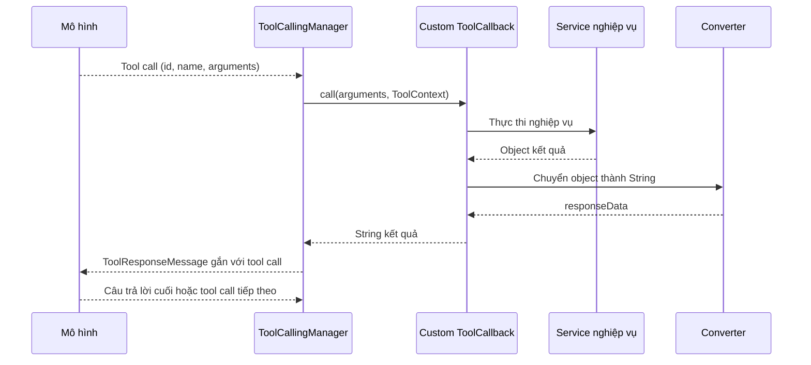

# Chuyển kết quả về biểu diễn phù hợp với giao thức

Một công cụ nghiệp vụ thường trả về object Java, nhưng giao diện `ToolCallback` của Spring AI yêu cầu phương thức thực thi trả về `String`. Chuỗi này là nội dung kết quả mà framework đưa vào phản hồi tool để gửi lại mô hình. Vì vậy, khi tự triển khai `ToolCallback`, ứng dụng phải chuyển kết quả nghiệp vụ thành một biểu diễn ổn định, có thể đọc và xử lý được trong giao thức hội thoại.

Biểu diễn thường phù hợp nhất là JSON có cấu trúc: mô hình có thể phân biệt trạng thái, dữ liệu và thông tin bổ sung mà không phải suy luận từ một câu văn dài. Với kết quả đơn giản, một chuỗi văn bản ngắn cũng có thể đủ. Điều quan trọng là nội dung trả về phải phản ánh đúng kết quả thực thi, không làm mất ngữ nghĩa, không để lộ dữ liệu nội bộ và không phá vỡ việc ghép phản hồi với đúng tool call.

Trong Spring AI Tool Calling, `ToolCallback` chịu trách nhiệm thực thi và trả nội dung kết quả. `ToolCallingManager` quản lý vòng đời tool call và tạo thông điệp phản hồi tương ứng. Bài học này tập trung vào ranh giới đó: chuyển object nghiệp vụ thành chuỗi kết quả theo hợp đồng của framework.

Sau bài học, bạn có thể:

- Giải thích vì sao `ToolCallback.call(...)` trả `String` dù service nghiệp vụ có thể trả object.
- Chọn JSON, văn bản hoặc một DTO rút gọn làm biểu diễn kết quả phù hợp.
- Dùng `ToolCallResultConverter` hoặc tự tuần tự hóa khi triển khai callback.
- Giữ đúng liên kết giữa tool call và tool response trong giao thức.
- Xử lý lỗi, dữ liệu lớn, dữ liệu nhạy cảm và phiên bản schema của kết quả.

## 1. Ranh giới giữa kết quả nghiệp vụ và tool response

Giả sử công cụ `lookup_inventory` gọi service và nhận một kết quả Java:

```java
public record InventoryLookupResult(
        String sku,
        String status,
        Integer availableQuantity,
        String warehouseCode,
        String checkedAt) {
}
```

Service trả object này vì ứng dụng cần kiểu dữ liệu rõ ràng để kiểm tra, lưu trữ và kiểm thử. Nhưng `ToolCallback` có hợp đồng:

```java
String call(String toolInput);
```

`ToolCallback` còn cung cấp `getToolDefinition()`, metadata mặc định qua `getToolMetadata()` và overload nhận thêm `ToolContext`. Hai phương thức metadata/context có implementation mặc định trong interface; custom callback thường chỉ cần cung cấp định nghĩa và logic `call(...)` phù hợp.

Kết quả nghiệp vụ cần được chuyển thành `String` trước khi Spring AI đưa vào lịch sử hội thoại. Chuỗi này có thể chứa JSON hoặc văn bản. Nó không phải toàn bộ HTTP response hay payload riêng của một nhà cung cấp mô hình.

Luồng cơ bản:



`ToolCallingManager` ghép kết quả với yêu cầu gọi ban đầu. Trong Spring AI, một `ToolResponseMessage.ToolResponse` có các trường `id`, `name` và `responseData`: `id` xác định tool call được trả lời, `name` là tên công cụ và `responseData` chứa chuỗi do callback trả về. Callback không cần tự tạo JSON theo giao thức của OpenAI, Anthropic hay nhà cung cấp khác; nó chỉ cần thực hiện đúng hợp đồng `ToolCallback`.

## 2. Vì sao kết quả cần có cấu trúc rõ ràng?

Giả sử service trả về số lượng hàng tồn. Hai cách biểu diễn sau có cùng ý nghĩa cơ bản nhưng khác nhau về khả năng xử lý:

```text
SKU KB-001 còn 12 sản phẩm tại kho HN-01.
```

```json
{
  "sku": "KB-001",
  "status": "AVAILABLE",
  "availableQuantity": 12,
  "warehouseCode": "HN-01"
}
```

Văn bản phù hợp khi kết quả ngắn, đơn giản và chỉ dùng để mô hình diễn đạt lại. JSON phù hợp hơn khi mô hình cần phân biệt nhiều trường, so sánh các giá trị, quyết định bước tiếp theo hoặc kết hợp nhiều kết quả.

Một kết quả tốt thường có các đặc điểm:

- **Có ngữ nghĩa rõ ràng:** tên trường phản ánh ý nghĩa nghiệp vụ, ví dụ `availableQuantity` thay vì `value`.
- **Có trạng thái rõ:** phân biệt `FOUND`, `NOT_FOUND`, `OUT_OF_STOCK` hoặc trạng thái tương ứng của domain.
- **Có kiểu dữ liệu ổn định:** số lượng là số nguyên, thời điểm có định dạng thống nhất, danh sách luôn là array.
- **Có kích thước giới hạn:** chỉ trả những bản ghi và trường cần thiết cho tác vụ.
- **Không chứa bí mật:** không đưa token, mật khẩu, thông tin xác thực, stack trace hoặc dữ liệu ngoài phạm vi người dùng.
- **Có thể xử lý khi không có dữ liệu:** thể hiện rõ trường hợp không tìm thấy thay vì tạo một giá trị giả.

Đừng đưa toàn bộ entity JPA hoặc object nội bộ vào tool response chỉ vì Jackson có thể tuần tự hóa nó. Entity có thể chứa quan hệ vòng, trường lazy, dữ liệu audit hoặc thuộc tính chỉ dành cho hệ thống. Hãy chuyển sang DTO kết quả được thiết kế riêng cho mô hình.

## 3. Dùng converter mặc định của Spring AI

Spring AI cung cấp `ToolCallResultConverter` để chuyển object trả về thành chuỗi. Interface này có phương thức:

```java
String convert(Object result, Type returnType);
```

Converter mặc định là `DefaultToolCallResultConverter`. Nó dùng Jackson để tuần tự hóa các kết quả Java có thể chuyển đổi thành JSON. Các công cụ dựa trên method và function có thể dùng converter mặc định hoặc cấu hình converter riêng qua builder/annotation tương ứng.

Khi tự triển khai `ToolCallback`, bạn có thể dùng converter mặc định ngay trong callback:

```java
public final class InventoryLookupTool implements ToolCallback {

    private final ToolDefinition definition;
    private final InventoryService inventoryService;
    private final ToolCallResultConverter resultConverter =
            new DefaultToolCallResultConverter();

    public InventoryLookupTool(InventoryService inventoryService) {
        this.inventoryService = inventoryService;
        this.definition = ToolDefinition.builder()
                .name("lookup_inventory")
                .description("Tra cứu số lượng hàng còn khả dụng theo mã SKU")
                .inputSchema("""
                        {
                          "type": "object",
                          "properties": {
                            "sku": {
                              "type": "string",
                              "description": "Mã SKU cần tra cứu"
                            }
                          },
                          "required": ["sku"],
                          "additionalProperties": false
                        }
                        """)
                .build();
    }

    @Override
    public ToolDefinition getToolDefinition() {
        return this.definition;
    }

    @Override
    public String call(String toolInput) {
        return call(toolInput, null);
    }

    @Override
    public String call(String toolInput, ToolContext toolContext) {
        try {
            ObjectMapper mapper = new ObjectMapper();
            InventoryLookupRequest request =
                    mapper.readValue(toolInput, InventoryLookupRequest.class);

            if (request.sku() == null || request.sku().isBlank()) {
                throw new IllegalArgumentException("sku là trường bắt buộc");
            }

            InventoryLookupResult result = inventoryService.lookup(request.sku().trim());
            return resultConverter.convert(result, InventoryLookupResult.class);
        }
        catch (Exception exception) {
            throw new ToolExecutionException(this.definition, exception);
        }
    }
}
```

Các kiểu dữ liệu đầu vào và kết quả trong ví dụ:

```java
public record InventoryLookupRequest(String sku) {
}

public record InventoryLookupResult(
        String sku,
        String status,
        Integer availableQuantity,
        String warehouseCode,
        String checkedAt) {
}
```

Trong ứng dụng thực tế, inject một `ObjectMapper` đã được Spring Boot cấu hình thay vì tạo mới trong mỗi lần gọi như đoạn minh họa rút gọn. Cấu hình mapper dùng cho input và output nên nhất quán với quy ước của ứng dụng, đặc biệt đối với ngày giờ, enum và kiểu số.

Callback trả về một chuỗi JSON. `ToolCallingManager` dùng chuỗi này làm nội dung tool response và ghép nó với `id` của tool call. Không cần tự thêm `tool_call_id` vào JSON kết quả vì đó là metadata của thông điệp giao thức.

## 4. Tự chuyển đổi kết quả thành JSON

Nếu callback cần kiểm soát việc tuần tự hóa, có thể dùng `ObjectMapper` trực tiếp:

```java
private String toJson(InventoryLookupResult result) {
    try {
        return objectMapper.writeValueAsString(result);
    }
    catch (JsonProcessingException exception) {
        throw new IllegalStateException("Không thể tuần tự hóa kết quả tồn kho", exception);
    }
}
```

Sau đó trong `call(...)`:

```java
InventoryLookupResult result = inventoryService.lookup(request.sku());
return toJson(result);
```

Cách này hữu ích khi ứng dụng muốn sử dụng chính `ObjectMapper` đã cấu hình module Java Time, naming strategy, custom serializer hoặc quy tắc xử lý null. Đừng serialize object tùy ý mà không kiểm tra cấu trúc: kết quả cần tương thích với model và giới hạn payload của nhà cung cấp.

Nếu muốn thay đổi cách biểu diễn mà vẫn giữ phần logic thực thi, tách converter thành thành phần riêng:

```java
@Component
public class InventoryResultConverter implements ToolCallResultConverter {

    private final ObjectMapper objectMapper;

    public InventoryResultConverter(ObjectMapper objectMapper) {
        this.objectMapper = objectMapper;
    }

    @Override
    public String convert(Object result, Type returnType) {
        try {
            return objectMapper.writeValueAsString(result);
        }
        catch (JsonProcessingException exception) {
            throw new IllegalStateException("Không thể tạo tool response", exception);
        }
    }
}
```

Converter không nên gọi service nghiệp vụ hoặc quyết định quyền truy cập. Nhiệm vụ của nó là biểu diễn kết quả đã được tạo và kiểm tra ở tầng thực thi.

## 5. Khi nào nên trả văn bản thay cho JSON?

Văn bản ngắn có thể phù hợp khi kết quả chỉ có một ý nghĩa, ví dụ:

```java
String result = "Đã làm mới cache thành công.";
```

Một converter có thể trả văn bản dựa trên DTO:

```java
ToolCallResultConverter converter = (result, returnType) -> {
    if (!(result instanceof InventoryLookupResult inventory)) {
        throw new IllegalArgumentException("Unexpected result type");
    }

    if ("NOT_FOUND".equals(inventory.status())) {
        return "Không tìm thấy SKU " + inventory.sku() + ".";
    }

    return "SKU " + inventory.sku() + " còn "
            + inventory.availableQuantity() + " sản phẩm tại kho "
            + inventory.warehouseCode() + ".";
};
```

Văn bản dễ đọc với mô hình, nhưng khó xử lý nếu hệ thống cần phân biệt trường dữ liệu một cách chính xác. Nếu kết quả sẽ được mô hình dùng làm input cho một bước tool khác, JSON thường đáng tin cậy hơn vì có cấu trúc và kiểu dữ liệu rõ ràng.

Không trộn nhiều định dạng không có quy tắc, ví dụ lúc thì JSON, lúc thì câu văn, lúc thì chuỗi rỗng. Nếu có nhiều loại kết quả, hãy thêm trường `status` hoặc `resultType` để mô hình nhận biết cấu trúc.

## 6. Phân biệt kết quả nghiệp vụ với lỗi thực thi

Một trường hợp nghiệp vụ như “không tìm thấy SKU” có thể là kết quả hợp lệ. Công cụ đã chạy thành công và trả trạng thái:

```json
{
  "sku": "KB-999",
  "status": "NOT_FOUND",
  "availableQuantity": null,
  "warehouseCode": null
}
```

Ngược lại, lỗi kết nối database, timeout hoặc lỗi tuần tự hóa là lỗi thực thi. Không nên biến chúng thành kết quả thành công chỉ để callback luôn trả JSON.

Với custom `ToolCallback`, Spring AI yêu cầu ném `ToolExecutionException` khi có lỗi trong `call(...)`. `ToolCallingManager` chuyển exception đến `ToolExecutionExceptionProcessor`. Processor có thể tạo thông báo lỗi an toàn gửi lại mô hình hoặc ném exception để caller xử lý.

Ví dụ cấu hình processor để lỗi tool được trả về ứng dụng:

```java
@Bean
ToolExecutionExceptionProcessor toolExecutionExceptionProcessor() {
    return new DefaultToolExecutionExceptionProcessor(true);
}
```

Nếu để processor gửi lỗi về mô hình, chỉ đưa thông tin đủ để mô hình phục hồi, chẳng hạn `INVALID_ARGUMENT` hoặc `SERVICE_TEMPORARILY_UNAVAILABLE`. Không gửi stack trace, SQL, hostname nội bộ, token hoặc thông tin xác thực. Với lỗi phân quyền, thường cần để server xử lý theo chính sách bảo mật và tránh tiết lộ tài nguyên tồn tại hay không.

## 7. Giữ đúng liên kết tool call và tool response

Một lượt của mô hình có thể yêu cầu nhiều công cụ. Mỗi yêu cầu có `id` riêng. Kết quả cần được ghép với đúng yêu cầu, nếu không lịch sử hội thoại sẽ không hợp lệ hoặc mô hình có thể diễn giải nhầm dữ liệu.

Trong Spring AI, `ToolCallingManager` thực hiện việc này. `ToolCallback` chỉ trả nội dung kết quả dạng `String`; manager tạo `ToolResponseMessage` với `id`, `name` và `responseData` tương ứng. Vì vậy:

- Không tự tạo `id` mới trong callback để thay thế ID do mô hình cấp.
- Không gộp kết quả của nhiều tool call thành một chuỗi duy nhất trong callback.
- Không giả định tool call chỉ xảy ra một lần hoặc theo thứ tự cố định.
- Khi callback chạy song song, mỗi lần gọi phải độc lập về dữ liệu và không dùng biến mutable dùng chung để giữ kết quả của request khác.
- Chỉ trả nội dung kết quả của chính lần gọi hiện tại.

Nếu tự viết tầng điều phối thay cho `ToolCallingManager`, bạn phải tự đảm bảo quan hệ giữa `tool_call_id`, tên tool và kết quả theo giao thức của nhà cung cấp. Khi dùng Spring AI tiêu chuẩn, hãy để framework quản lý phần này.

## 8. Kích thước và độ nhạy của kết quả

Tool response trở thành một phần của ngữ cảnh hội thoại và có thể được gửi đến nhà cung cấp mô hình. Một kết quả quá lớn vừa tốn token vừa khiến mô hình khó xác định thông tin quan trọng.

Thiết kế kết quả theo các nguyên tắc:

1. Chỉ trả các trường cần cho câu hỏi hoặc bước tiếp theo.
2. Giới hạn số bản ghi, độ dài chuỗi và kích thước mảng.
3. Với danh sách dài, trả một trang kết quả nhỏ cùng `hasMore` hoặc `nextPageToken` nếu cần phân trang.
4. Dùng mã tham chiếu thay vì nhúng tệp hoặc nội dung lớn; cung cấp tool khác để lấy phần cần thiết.
5. Loại bỏ trường cá nhân, bí mật, thông tin thanh toán và dữ liệu nội bộ không cần thiết.
6. Không ghi toàn bộ kết quả vào log mặc định; bật quan sát arguments/results chỉ khi đã đánh giá rủi ro dữ liệu.

Ví dụ kết quả phân trang:

```json
{
  "items": [
    { "sku": "KB-001", "availableQuantity": 12 },
    { "sku": "KB-002", "availableQuantity": 4 }
  ],
  "pageSize": 2,
  "hasMore": true,
  "nextPageToken": "page-2"
}
```

`nextPageToken` phải là mã tham chiếu do server tạo và được kiểm tra khi dùng lại. Không để mô hình tự tạo SQL offset hoặc điều kiện truy vấn tùy ý.

## 9. Khi nào dùng returnDirect?

Thông thường, kết quả tool được gửi lại mô hình để mô hình tiếp tục suy luận hoặc diễn đạt câu trả lời. Nếu tool result đã là nội dung cuối cùng mà ứng dụng cần, `ToolMetadata.returnDirect(true)` cho phép trả kết quả trực tiếp về caller, bỏ qua lượt gọi mô hình tiếp theo.

```java
private final ToolMetadata metadata = ToolMetadata.builder()
        .returnDirect(true)
        .build();

@Override
public ToolMetadata getToolMetadata() {
    return this.metadata;
}
```

`returnDirect` quyết định nơi kết quả được chuyển tiếp; nó không thay đổi cách callback tạo chuỗi kết quả. Callback vẫn cần trả nội dung phù hợp với hợp đồng `ToolCallback`. Chỉ bật khi chuỗi kết quả đã sẵn sàng cho ứng dụng hiển thị hoặc xử lý. Nếu mô hình cần tóm tắt, giải thích hoặc kết hợp kết quả với thông tin khác, hãy để tool response quay lại mô hình.

Khi một lượt có nhiều tool call, Spring AI chỉ áp dụng `returnDirect` nếu tất cả tool trong lượt đó đều bật chế độ này. Nếu không, các kết quả được gửi lại mô hình để tiếp tục vòng lặp.

## 10. Kiểm thử biểu diễn kết quả

Kiểm thử converter và callback độc lập với mô hình trước khi kiểm thử cả vòng tool calling.

| Kiểm thử | Điều cần xác minh |
| --- | --- |
| Kết quả thành công | Chuỗi JSON hợp lệ, đủ trường và đúng kiểu. |
| Không tìm thấy dữ liệu | Trả trạng thái nghiệp vụ như `NOT_FOUND`, không tạo lỗi hạ tầng giả. |
| Giá trị null | Null được biểu diễn nhất quán theo schema kết quả. |
| Kết quả rỗng | Có trạng thái rõ như `EMPTY` hoặc danh sách rỗng. |
| Kết quả lớn | Có giới hạn số bản ghi và kích thước payload. |
| Ký tự đặc biệt | JSON được escape đúng, không nối chuỗi thủ công gây lỗi. |
| Lỗi service | Ném `ToolExecutionException`, không trả thông báo thành công. |
| Lỗi converter | Được xử lý như lỗi thực thi, không gửi JSON bị cắt hoặc sai định dạng. |
| Nhiều tool call | Mỗi kết quả được gắn với đúng tool call ID bởi manager. |
| Dữ liệu nhạy cảm | Không xuất hiện trong kết quả hoặc log ngoài phạm vi cho phép. |

Ví dụ test converter JSON bằng Jackson:

```java
@Test
void serializesInventoryResultAsJson() throws Exception {
    ObjectMapper mapper = new ObjectMapper();
    InventoryLookupResult result = new InventoryLookupResult(
            "KB-001", "AVAILABLE", 12, "HN-01", "2026-11-27T10:00:00Z");

    String responseData = mapper.writeValueAsString(result);
    JsonNode json = mapper.readTree(responseData);

    assertThat(json.path("sku").asText()).isEqualTo("KB-001");
    assertThat(json.path("status").asText()).isEqualTo("AVAILABLE");
    assertThat(json.path("availableQuantity").asInt()).isEqualTo(12);
}
```

Trong kiểm thử tích hợp, dùng chat model giả để mô phỏng tool call và xác nhận mô hình nhận đúng `responseData`. Chỉ cần một số bài kiểm thử với provider thật để kiểm tra cách provider tiếp nhận tool response và giới hạn payload.

## 11. Quy trình chọn biểu diễn kết quả

Khi thiết kế custom callback, có thể thực hiện theo thứ tự:

1. Xác định thông tin mô hình cần để trả lời hoặc quyết định bước tiếp theo.
2. Tạo DTO kết quả riêng, tránh trả entity nội bộ.
3. Chọn JSON cho dữ liệu có cấu trúc hoặc văn bản ngắn cho kết quả đơn giản.
4. Chọn `DefaultToolCallResultConverter` nếu JSON mặc định đáp ứng yêu cầu; nếu không, viết converter có quy tắc rõ ràng.
5. Giới hạn payload và loại bỏ dữ liệu nhạy cảm.
6. Phân biệt trạng thái nghiệp vụ hợp lệ với lỗi thực thi.
7. Trả chuỗi qua `ToolCallback.call(...)`; để `ToolCallingManager` ghép kết quả với tool call tương ứng.
8. Kiểm thử cả nội dung chuỗi và luồng giao thức.

## Những điểm cần nhớ

- `ToolCallback.call(...)` trả `String`; đây là nội dung kết quả gửi lại mô hình.
- `ToolCallResultConverter` chuyển object Java thành chuỗi. Converter mặc định dùng Jackson để tạo JSON cho kết quả có thể tuần tự hóa.
- JSON phù hợp với kết quả có nhiều trường hoặc cần được mô hình xử lý tiếp; văn bản ngắn phù hợp với kết quả đơn giản.
- `ToolCallingManager` tạo tool response và giữ liên kết với ID/name của tool call. Callback không tự tạo ID giao thức.
- Với custom callback, ném `ToolExecutionException` khi thực thi thất bại và dùng `ToolExecutionExceptionProcessor` để quyết định lỗi được gửi lại mô hình hay trả về caller.
- Giới hạn kích thước, lọc dữ liệu nhạy cảm và kiểm thử biểu diễn kết quả trước khi đưa tool vào vận hành.

## Tài liệu tham khảo

- [Spring AI Reference — Tool Calling](https://docs.spring.io/spring-ai/reference/api/tools.html)
- [Spring AI Tool Specification Reference](https://docs.spring.io/spring-ai/reference/2.1-SNAPSHOT/tools/reference.html)
- [Spring AI API — ToolCallback](https://docs.spring.io/spring-ai/docs/2.1.x/api/org/springframework/ai/tool/ToolCallback.html)
- [Spring AI API — ToolCallResultConverter](https://docs.spring.io/spring-ai/docs/2.1.x/api/org/springframework/ai/tool/execution/ToolCallResultConverter.html)
- [Spring AI API — ToolResponseMessage.ToolResponse](https://docs.spring.io/spring-ai/docs/2.1.x/api/org/springframework/ai/chat/messages/ToolResponseMessage.ToolResponse.html)

Các ví dụ dựa trên API Spring AI 2.1.x. Tập trung vào hợp đồng `ToolCallback` và biểu diễn kết quả; khi triển khai, hãy đối chiếu tài liệu đúng phiên bản đang dùng và xác minh serializer, exception processor cùng provider đích.
