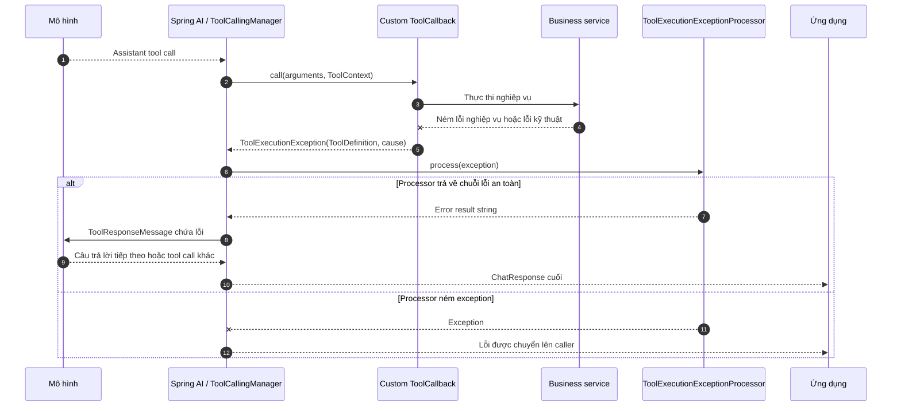

# Đóng gói lỗi bằng ToolExecutionException theo hợp đồng

Một công cụ có thể thất bại vì dữ liệu đầu vào không hợp lệ, người dùng không có quyền, trạng thái nghiệp vụ không cho phép hoặc dịch vụ phụ thuộc tạm thời không hoạt động. Khi xây dựng `ToolCallback` tùy chỉnh, ứng dụng cần chuyển những lỗi đó thành một dạng mà Spring AI có thể xử lý nhất quán. `ToolExecutionException` là lớp bao lỗi dành cho ranh giới thực thi công cụ; `ToolExecutionExceptionProcessor` quyết định lỗi được gửi lại mô hình dưới dạng chuỗi hay được ném tiếp để ứng dụng xử lý.

Hai lớp này giúp tạo hợp đồng lỗi ổn định giữa mã Java, vòng lặp tool calling và mô hình. Hợp đồng nên có mã lỗi, thông điệp an toàn và thông tin có thể thử lại hay không. Chi tiết nội bộ như stack trace, câu lệnh SQL, token hoặc thông tin kết nối chỉ nằm trong log phía server.

Trong module `SPRING_AI_TOOL_CALLING`, mô hình chỉ yêu cầu gọi công cụ. Ứng dụng vẫn thực thi callback và kiểm soát quyền, validation, transaction cùng tác động phụ. Việc đóng gói lỗi không trao quyền quyết định nghiệp vụ cho mô hình; nó chỉ giúp hệ thống trao đổi trạng thái thất bại rõ ràng.

## 1. Vòng đời của một lỗi tool calling

Với `ChatClient` và cơ chế điều phối mặc định, khi mô hình yêu cầu gọi một công cụ, `ToolCallingManager` tìm callback tương ứng và gọi `ToolCallback.call(...)`. Nếu callback ném `ToolExecutionException`, manager chuyển exception cho `ToolExecutionExceptionProcessor`.

Processor có hai lựa chọn:

- Trả về một chuỗi lỗi. Spring AI thêm chuỗi đó vào tool response gắn với tool call tương ứng và gửi lịch sử hội thoại trở lại mô hình. Mô hình có thể giải thích lỗi hoặc chọn bước tiếp theo.
- Ném exception. Lỗi đi ra khỏi vòng tool calling để application service, controller hoặc tầng xử lý lỗi của ứng dụng quyết định phản hồi cho caller.



Điểm quan trọng: processor không thực thi lại công cụ và cũng không tự retry. Nó chỉ quyết định cách biểu diễn lỗi sau khi callback đã thất bại.

## 2. Phân biệt ba thành phần

| Thành phần | Vai trò | Nội dung cần giữ |
|---|---|---|
| Exception nghiệp vụ/kỹ thuật | Mô tả nguyên nhân ở tầng Java | Loại lỗi, cause gốc và dữ liệu phục vụ log/điều tra |
| `ToolExecutionException` | Bao lỗi tại ranh giới tool callback | `ToolDefinition` của công cụ và `cause` |
| `ToolExecutionExceptionProcessor` | Quyết định lỗi đi về mô hình hay caller | Chuỗi an toàn hoặc exception được ném tiếp |

`ToolExecutionException` nằm trong package `org.springframework.ai.tool.execution`, kế thừa `RuntimeException` và có constructor:

```java
new ToolExecutionException(ToolDefinition toolDefinition, Throwable cause)
```

Nó cung cấp `getToolDefinition()` để xác định công cụ gây lỗi. Mã lỗi nghiệp vụ như `ORDER_NOT_FOUND` không phải field dựng sẵn của `ToolExecutionException`; ứng dụng cần giữ mã đó trong exception nguyên nhân hoặc một kiểu lỗi riêng. Đừng dùng tên class exception hay `getMessage()` làm hợp đồng công khai vì chúng có thể thay đổi theo implementation.

`ToolExecutionExceptionProcessor` là functional interface với phương thức:

```java
String process(ToolExecutionException exception);
```

Phương thức có thể trả chuỗi cho mô hình hoặc ném exception để caller xử lý. Đây là điểm mở rộng chính thức của Spring AI dành cho chính sách lỗi khi thực thi tool.

## 3. Thiết kế hợp đồng lỗi ổn định

Không nên gửi trực tiếp thông điệp exception tùy ý từ thư viện hoặc database cho mô hình. Hãy chuẩn hóa lỗi thành một hợp đồng nhỏ, ổn định và không chứa chi tiết nội bộ.

Ví dụ hợp đồng mà callback gửi lại cho processor và processor chuyển thành tool response:

```json
{
  "ok": false,
  "error": {
    "code": "PRODUCT_NOT_FOUND",
    "message": "Không tìm thấy sản phẩm trong phạm vi truy cập.",
    "retryable": false
  }
}
```

Các trường nên có:

- `ok`: cho biết thao tác thành công hay thất bại. Nếu hệ thống dùng một envelope riêng cho lỗi thì có thể không cần trường này, nhưng phải nhất quán.
- `code`: mã ổn định để ứng dụng, log, kiểm thử và mô hình nhận diện loại lỗi.
- `message`: thông điệp đã làm sạch, đủ để mô hình giải thích hoặc hỏi người dùng bổ sung thông tin.
- `retryable`: gợi ý lỗi có thể tạm thời hay không. Đây là thông tin cho chính sách điều phối, không phải lệnh retry tự động.
- `requestId` hoặc `correlationId` (nếu cần): mã tham chiếu không nhạy cảm để hỗ trợ tra cứu log.

Không đưa các trường sau vào kết quả công cụ:

- Stack trace, tên class nội bộ hoặc vị trí file.
- SQL, câu lệnh truy vấn, tên bảng, địa chỉ host và thông tin hạ tầng.
- Access token, API key, mật khẩu hoặc secret.
- Raw request chứa thông tin cá nhân, dữ liệu thanh toán hoặc dữ liệu của tenant khác.
- Thông điệp exception của thư viện bên thứ ba nếu chưa được kiểm tra và chuẩn hóa.

Mã lỗi nên phản ánh nhóm nghiệp vụ, không phụ thuộc vào thông điệp hiển thị. Có thể đổi câu chữ tiếng Việt hoặc tiếng Anh mà không đổi `code`. Ngược lại, nếu đổi ý nghĩa mã lỗi, cần xem đó là thay đổi hợp đồng và cập nhật kiểm thử.

## 4. Phân loại lỗi trước khi đóng gói

Một chính sách thực tế có thể phân loại như sau:

| Nhóm lỗi | Mã ví dụ | `retryable` | Cách phản hồi đề xuất |
|---|---|---:|---|
| Đầu vào sai định dạng hoặc thiếu dữ liệu | `INVALID_ARGUMENTS` | `false` | Nêu trường cần sửa hoặc yêu cầu mô hình hỏi lại |
| Không tìm thấy tài nguyên trong phạm vi truy cập | `RESOURCE_NOT_FOUND` | `false` | Thông điệp chung, không tiết lộ tài nguyên của người khác |
| Không được phép thực hiện | `ACCESS_DENIED` | `false` | Có thể trả thông báo an toàn hoặc chuyển exception lên caller tùy chính sách bảo mật |
| Trạng thái nghiệp vụ không hợp lệ | `INVALID_STATE` | `false` | Giải thích điều kiện nghiệp vụ chưa thỏa |
| Dịch vụ phụ thuộc tạm thời không khả dụng | `DEPENDENCY_UNAVAILABLE` | `true` | Thông báo có thể thử lại sau; áp dụng retry có giới hạn ở tầng ứng dụng |
| Hết thời gian chờ | `DEPENDENCY_TIMEOUT` | `true` hoặc chưa xác định | Kiểm tra trạng thái thao tác trước khi thử lại nếu có tác động phụ |
| Lỗi không dự kiến | `INTERNAL_ERROR` | `false` mặc định | Trả thông điệp chung; ghi cause đầy đủ ở server |

Không phải mọi lỗi `RuntimeException` đều là lỗi nghiệp vụ có thể gửi cho mô hình. Ví dụ `NullPointerException`, lỗi cấu hình hoặc lỗi lập trình không nên được biến thành thông điệp chứa nguyên văn exception. Hãy ánh xạ lỗi đã biết sang mã rõ ràng; lỗi không nhận diện dùng `INTERNAL_ERROR` và thông điệp chung.

Đối với quyền truy cập, cân nhắc nguy cơ dò tìm tài nguyên. Nếu việc phân biệt “không tồn tại” và “không thuộc quyền xem” làm lộ dữ liệu, có thể trả cùng một thông điệp như “Không tìm thấy tài nguyên trong phạm vi truy cập”.

## 5. Đóng gói lỗi trong custom ToolCallback

Khi tự triển khai `ToolCallback`, ứng dụng chịu trách nhiệm ném `ToolExecutionException` nếu `call()` thất bại. `DefaultToolCallingManager` bắt loại exception này để chuyển cho processor. Một exception khác bị ném trực tiếp từ custom callback có thể đi ra khỏi nhánh xử lý đó và làm hỏng lượt hội thoại.

Ví dụ sau minh họa callback tra cứu sản phẩm. Các kiểu `ProductLookup`, `ProductView`, `ProductService`, `ProductNotFoundException` và `InventoryUnavailableException` là kiểu của ứng dụng.

```java
import java.util.Map;

import com.fasterxml.jackson.core.JsonProcessingException;
import com.fasterxml.jackson.databind.ObjectMapper;
import org.slf4j.Logger;
import org.slf4j.LoggerFactory;
import org.springframework.ai.chat.model.ToolContext;
import org.springframework.ai.tool.ToolCallback;
import org.springframework.ai.tool.definition.ToolDefinition;
import org.springframework.ai.tool.execution.ToolExecutionException;
import org.springframework.ai.tool.metadata.ToolMetadata;
import org.springframework.security.access.AccessDeniedException;

public final class ProductLookupTool implements ToolCallback {

    private static final Logger log = LoggerFactory.getLogger(ProductLookupTool.class);

    private final ObjectMapper objectMapper;
    private final ProductService productService;

    private final ToolDefinition definition = ToolDefinition.builder()
            .name("lookupProduct")
            .description("Tra cứu thông tin sản phẩm theo mã trong phạm vi tenant hiện tại.")
            .inputSchema("""
                    {
                      "type": "object",
                      "properties": {
                        "sku": { "type": "string" }
                      },
                      "required": ["sku"],
                      "additionalProperties": false
                    }
                    """)
            .build();

    private final ToolMetadata metadata = ToolMetadata.builder().build();

    public ProductLookupTool(ObjectMapper objectMapper, ProductService productService) {
        this.objectMapper = objectMapper;
        this.productService = productService;
    }

    @Override
    public ToolDefinition getToolDefinition() {
        return definition;
    }

    @Override
    public ToolMetadata getToolMetadata() {
        return metadata;
    }

    @Override
    public String call(String toolInput) {
        return call(toolInput, new ToolContext(Map.of()));
    }

    @Override
    public String call(String toolInput, ToolContext toolContext) {
        ProductLookup request;
        try {
            request = objectMapper.readValue(toolInput, ProductLookup.class);
        }
        catch (JsonProcessingException ex) {
            throw toolFailure("INVALID_ARGUMENTS",
                    "Dữ liệu tra cứu không hợp lệ. Vui lòng kiểm tra mã sản phẩm.",
                    false, ex);
        }

        try {
            Object tenantValue = toolContext.getContext().get("tenantId");
            if (!(tenantValue instanceof String tenantId) || tenantId.isBlank()) {
                throw new AccessDeniedException("Missing trusted tenant context");
            }

            ProductView product = productService.findVisibleProduct(request.sku(), tenantId);
            return objectMapper.writeValueAsString(product);
        }
        catch (AccessDeniedException ex) {
            throw toolFailure("ACCESS_DENIED",
                    "Không thể tra cứu sản phẩm trong phạm vi hiện tại.", false, ex);
        }
        catch (ProductNotFoundException ex) {
            throw toolFailure("PRODUCT_NOT_FOUND",
                    "Không tìm thấy sản phẩm trong phạm vi truy cập.", false, ex);
        }
        catch (InventoryUnavailableException ex) {
            throw toolFailure("DEPENDENCY_UNAVAILABLE",
                    "Dịch vụ tồn kho tạm thời không khả dụng.", true, ex);
        }
        catch (JsonProcessingException ex) {
            log.error("Cannot serialize result for tool '{}'", definition.name(), ex);
            throw toolFailure("INTERNAL_ERROR",
                    "Không thể định dạng kết quả tra cứu.", false, ex);
        }
        catch (RuntimeException ex) {
            log.error("Unexpected failure while executing tool '{}'", definition.name(), ex);
            throw toolFailure("INTERNAL_ERROR",
                    "Không thể xử lý yêu cầu tra cứu lúc này.", false, ex);
        }
    }

    private ToolExecutionException toolFailure(
            String code, String safeMessage, boolean retryable, Throwable cause) {
        return new ToolExecutionException(
                definition,
                new ToolFailure(code, safeMessage, retryable, cause));
    }
}
```

Kiểu exception riêng giữ hợp đồng lỗi an toàn:

```java
public final class ToolFailure extends RuntimeException {

    private final String code;
    private final boolean retryable;

    public ToolFailure(
            String code, String safeMessage, boolean retryable, Throwable cause) {
        super(safeMessage, cause);
        this.code = code;
        this.retryable = retryable;
    }

    public String getCode() {
        return code;
    }

    public boolean isRetryable() {
        return retryable;
    }
}
```

Trong ví dụ, `ToolExecutionException` giữ `ToolDefinition` và `ToolFailure` làm cause. Processor có thể lấy cause để đọc mã lỗi cùng thông điệp an toàn. Cause gốc vẫn được giữ để ghi log hoặc phục vụ điều tra ở phía server.

Một vài nguyên tắc khi triển khai:

- Chỉ bắt những lỗi dự kiến và ánh xạ rõ ràng trước. Nhánh `RuntimeException` cuối cùng chỉ dùng để che thông tin của lỗi bất ngờ, không dùng để giả vờ lỗi đã được xử lý.
- Không bắt `Error` để biến lỗi nghiêm trọng của JVM thành phản hồi hội thoại.
- Không ghi raw `toolInput` nếu nó có thể chứa dữ liệu nhạy cảm.
- Nếu một tầng bên trong đã ném `ToolExecutionException`, hãy giữ nguyên exception đó thay vì bọc lặp thêm một lớp.
- `ToolContext` chứa dữ liệu tin cậy từ ứng dụng; không lấy `tenantId` hoặc `userId` từ JSON arguments của mô hình.

## 6. Viết ToolExecutionExceptionProcessor để trả lỗi an toàn cho mô hình

Nếu muốn mô hình có cơ hội giải thích lỗi hoặc hỏi người dùng bổ sung dữ liệu, processor có thể chuyển `ToolFailure` thành JSON theo hợp đồng.

```java
import com.fasterxml.jackson.core.JsonProcessingException;
import com.fasterxml.jackson.databind.ObjectMapper;
import org.slf4j.Logger;
import org.slf4j.LoggerFactory;
import org.springframework.ai.tool.execution.ToolExecutionException;
import org.springframework.ai.tool.execution.ToolExecutionExceptionProcessor;
import org.springframework.context.annotation.Bean;
import org.springframework.context.annotation.Configuration;

@Configuration(proxyBeanMethods = false)
public class ToolErrorConfiguration {

    private static final Logger log = LoggerFactory.getLogger(ToolErrorConfiguration.class);

    @Bean
    ToolExecutionExceptionProcessor toolExecutionExceptionProcessor(ObjectMapper objectMapper) {
        return exception -> {
            Throwable cause = exception.getCause();

            if (cause instanceof ToolFailure failure) {
                return toJson(objectMapper, new ToolError(
                        false,
                        failure.getCode(),
                        failure.getMessage(),
                        failure.isRetryable()));
            }

            log.error("Unexpected failure while executing tool '{}'",
                    exception.getToolDefinition().name(), exception);

            return toJson(objectMapper, new ToolError(
                    false,
                    "INTERNAL_ERROR",
                    "Không thể thực hiện thao tác lúc này.",
                    false));
        };
    }

    private String toJson(ObjectMapper objectMapper, ToolError error) {
        try {
            return objectMapper.writeValueAsString(error);
        }
        catch (JsonProcessingException ex) {
            log.error("Cannot serialize tool error contract", ex);
            return "{\"ok\":false,\"error\":{\"code\":\"INTERNAL_ERROR\","
                    + "\"message\":\"Không thể thực hiện thao tác lúc này.\","
                    + "\"retryable\":false}}";
        }
    }

    public record ToolError(
            boolean ok,
            String code,
            String message,
            boolean retryable) {
    }
}
```

Processor chỉ đưa thông điệp đã chọn lọc trở lại mô hình. Với lỗi không nhận diện, nó ghi đầy đủ exception ở server nhưng chỉ trả `INTERNAL_ERROR` cùng thông điệp chung. Không dùng `exception.getMessage()` hoặc `cause.getMessage()` làm phản hồi công khai một cách tự động.

Khi dùng Spring Boot starter, Spring AI tự cấu hình `DefaultToolExecutionExceptionProcessor`. Khai báo bean `ToolExecutionExceptionProcessor` riêng là cách thay thế chính sách mặc định. Hãy kiểm tra điều kiện auto-configuration của phiên bản đang dùng nếu ứng dụng có nhiều cấu hình hoặc nhiều `ApplicationContext`.

## 7. Chọn gửi lỗi về mô hình hay ném lỗi cho caller

`DefaultToolExecutionExceptionProcessor` hỗ trợ hai hướng xử lý. Có thể cấu hình bằng property:

```yaml
spring:
  ai:
    tools:
      throw-exception-on-error: false
```

| Giá trị | Hành vi |
|---|---|
| `false` (mặc định) | Runtime failure được chuyển thành chuỗi lỗi gửi lại mô hình; checked exception và `Error` vẫn được ném ra |
| `true` | Tool execution exception được ném lên caller để ứng dụng xử lý |

Hoặc cấu hình processor bằng Java:

```java
@Bean
ToolExecutionExceptionProcessor toolExecutionExceptionProcessor() {
    return new DefaultToolExecutionExceptionProcessor(true);
}
```

Với API builder hiện hành, có thể cấu hình allowlist các exception cần được mở cause và ném tiếp:

```java
@Bean
ToolExecutionExceptionProcessor toolExecutionExceptionProcessor() {
    return DefaultToolExecutionExceptionProcessor.builder()
            .alwaysThrow(false)
            .rethrowExceptions(List.of(ToolFailure.class))
            .build();
}
```

Allowlist phải khớp với loại exception thực sự được đặt làm cause trực tiếp trong `ToolExecutionException`. Ví dụ trên rethrow mọi `ToolFailure`, vì vậy chỉ dùng khi toàn bộ lỗi hợp đồng đều phải đi lên caller. Nếu chỉ muốn rethrow lỗi phân quyền, hãy giữ loại exception đó làm cause trực tiếp hoặc viết processor tùy chỉnh để phân nhánh theo mã lỗi; không thêm một allowlist rộng hơn chính sách dự định.

Chọn hướng xử lý theo yêu cầu sản phẩm:

- **Gửi lỗi về mô hình:** phù hợp với lỗi đầu vào có thể sửa, không tìm thấy tài nguyên trong phạm vi cho phép hoặc lỗi tạm thời có thông điệp an toàn. Mô hình có thể giải thích hoặc hỏi lại.
- **Ném lỗi lên caller:** phù hợp khi API cần trả HTTP status xác định, khi không muốn mô hình nhìn thấy lỗi phân quyền, hoặc khi ứng dụng phải dừng ngay luồng xử lý.
- **Chính sách tùy chỉnh:** phù hợp khi mỗi nhóm lỗi có hướng xử lý khác nhau, ví dụ lỗi nghiệp vụ trả về mô hình nhưng lỗi phân quyền và lỗi nội bộ phải đi lên caller.

`ToolExecutionExceptionProcessor` không phải `@ControllerAdvice` và không tự tạo HTTP response. Nếu processor ném lỗi, tầng web vẫn cần ánh xạ exception sang status code và response body theo hợp đồng API của ứng dụng.

## 8. Không phải mọi lỗi đều đi qua ToolExecutionExceptionProcessor

Trong luồng `DefaultToolCallingManager`, processor được gọi khi `ToolCallback.call(...)` ném `ToolExecutionException`. Vì vậy:

- Custom `ToolCallback` phải chủ động bọc lỗi thực thi bằng `ToolExecutionException`.
- Nếu custom callback ném thẳng `IllegalStateException`, `NullPointerException` hoặc một exception khác, manager không xem đó là `ToolExecutionException` để chuyển qua processor.
- Lỗi xảy ra trước khi callback được thực thi, chẳng hạn lỗi gọi model, lỗi cấu hình provider hoặc không tìm thấy callback, thuộc đường xử lý khác.
- Lỗi validation/deserialization phụ thuộc loại callback và phiên bản. Hãy kiểm thử đúng callback đang dùng thay vì giả định mọi lỗi parse đều được processor xử lý.

Với `@Tool`, `MethodToolCallback` và `FunctionToolCallback`, Spring AI quản lý việc gọi phương thức/hàm và đóng gói lỗi theo cơ chế của callback tích hợp. Với implementation `ToolCallback` tự viết, trách nhiệm này thuộc về mã của bạn. Đây là khác biệt quan trọng khi chuyển từ callback tích hợp sang callback tùy chỉnh.

## 9. Retryable không có nghĩa là mô hình được retry vô hạn

Trường `retryable` chỉ mô tả khả năng lỗi có tính tạm thời. `ToolExecutionExceptionProcessor` không thực hiện retry. Nếu chuỗi lỗi được gửi lại mô hình, mô hình có thể quyết định gọi công cụ lần nữa; hành vi đó không thay thế chính sách retry có giới hạn của ứng dụng.

Đối với lỗi tạm thời:

- Đặt timeout cho lời gọi dịch vụ phụ thuộc.
- Retry ở tầng service hoặc client có giới hạn số lần, backoff và jitter.
- Chỉ retry khi biết thao tác có thể lặp an toàn.
- Dùng idempotency key hoặc mã giao dịch do server tạo cho thao tác ghi.
- Nếu timeout khiến kết quả giao dịch chưa rõ, tra cứu trạng thái trước khi gửi lại lệnh.

Ví dụ, một công cụ yêu cầu hoàn tiền có thể đã gửi lệnh đến cổng thanh toán nhưng timeout trước khi nhận phản hồi. Trả `retryable=true` rồi để mô hình gọi lại ngay có thể tạo yêu cầu hoàn tiền trùng. Cần kiểm tra trạng thái theo mã giao dịch và bảo đảm idempotency ở business service.

## 10. Bảo mật thông điệp lỗi và log

Thông điệp trả về mô hình là dữ liệu nằm trong lịch sử hội thoại. Mô hình có thể trích dẫn, diễn giải hoặc lặp lại nội dung đó cho người dùng. Do vậy, chuỗi lỗi phải được xem như một phần của API có thể quan sát từ bên ngoài.

Nên thực hiện:

- Dùng mã lỗi ổn định và thông điệp ngắn, không nhạy cảm.
- Ghi stack trace và cause ở server với correlation ID phù hợp.
- Che thông tin người dùng, tenant, credential và raw arguments trong log.
- Không để `ToolFailure` giữ toàn bộ request nếu request có dữ liệu nhạy cảm.
- Giới hạn độ dài thông điệp và số trường trả lại mô hình.
- Phân biệt lỗi có thể khắc phục bằng cách hỏi lại với lỗi cần người vận hành xử lý.
- Không cho mô hình quyết định bỏ qua lỗi phân quyền hoặc tiếp tục thao tác bằng một danh tính khác.

Một thông điệp như `ACCESS_DENIED` không nên kèm vai trò, ACL, tên tenant nội bộ hoặc chi tiết vì sao một tài nguyên thuộc về người khác. Nếu cần hỗ trợ người dùng, hãy trả hướng dẫn chung như “Bạn không có quyền thực hiện thao tác này”.

## 11. Kiểm thử hợp đồng lỗi

Kiểm thử nên bao phủ callback, processor và vòng điều phối:

| Phạm vi | Ca kiểm thử | Kỳ vọng |
|---|---|---|
| Custom callback | Đầu vào JSON sai | Ném `ToolExecutionException` với đúng `ToolDefinition` và cause `INVALID_ARGUMENTS` |
| Custom callback | Không tìm thấy sản phẩm | Cause giữ mã `PRODUCT_NOT_FOUND`, không lộ dữ liệu ngoài phạm vi |
| Custom callback | Thiếu tenant context | Không gọi service; đóng gói lỗi quyền truy cập |
| Custom callback | Dependency timeout | Mã lỗi tạm thời và `retryable=true` |
| Custom callback | Lỗi bất ngờ | Log cause phía server; cause công khai là lỗi chung |
| Processor | Cause là `ToolFailure` | Trả JSON đúng schema lỗi |
| Processor | Cause không nhận diện | Không trả thông điệp gốc hoặc stack trace; trả `INTERNAL_ERROR` |
| Processor | `alwaysThrow=true` | Ném exception thay vì tạo chuỗi gửi mô hình |
| Processor | Cause thuộc allowlist | Mở cause và ném đúng loại exception đã cấu hình |
| Tích hợp | Callback ném `ToolExecutionException` | ToolCallingManager chuyển kết quả lỗi thành tool response khi processor trả chuỗi |
| Tích hợp | Processor ném exception | Lượt hội thoại dừng và lỗi đi lên caller |

Ví dụ kiểm tra callback giữ đúng tool definition và cause:

```java
@Test
void wrapsExpectedFailureWithToolDefinition() {
    ToolExecutionException exception = assertThrows(
            ToolExecutionException.class,
            () -> productLookupTool.call("{\"sku\":\"UNKNOWN\"}"));

    assertThat(exception.getToolDefinition().name()).isEqualTo("lookupProduct");
    assertThat(exception.getCause()).isInstanceOf(ToolFailure.class);

    ToolFailure failure = (ToolFailure) exception.getCause();
    assertThat(failure.getCode()).isEqualTo("PRODUCT_NOT_FOUND");
    assertThat(failure.isRetryable()).isFalse();
}
```

Ví dụ kiểm tra processor không làm lộ exception nội bộ:

```java
@Test
void hidesUnexpectedCauseFromModel() {
    ToolExecutionException exception = new ToolExecutionException(
            productLookupTool.getToolDefinition(),
            new IllegalStateException("jdbc://internal-host/password=secret"));

    String result = processor.process(exception);

    assertThat(result).contains("INTERNAL_ERROR");
    assertThat(result).doesNotContain("internal-host", "password=secret");
}
```

Ngoài unit test, cần một integration test với `ToolCallingManager` hoặc `ChatClient` và model giả lập. Xác minh assistant tool call được giữ trong lịch sử, tool response có đúng tool call ID, mô hình nhận được chuỗi lỗi khi processor trả về và caller nhận exception khi processor ném lỗi.

## 12. Những lỗi thiết kế thường gặp

| Thiết kế | Hậu quả | Cách điều chỉnh |
|---|---|---|
| Custom callback ném `RuntimeException` trực tiếp | Không đi qua nhánh xử lý `ToolExecutionException` của manager | Bọc lỗi thực thi bằng `ToolExecutionException` |
| Dùng `ToolExecutionException` như nơi lưu mọi field nghiệp vụ | Nhầm wrapper framework với hợp đồng lỗi của ứng dụng | Giữ code/message/retryable trong cause riêng như `ToolFailure` |
| Gửi `cause.getMessage()` nguyên văn cho mô hình | Có thể lộ SQL, host, token hoặc dữ liệu cá nhân | Dùng processor ánh xạ sang thông điệp an toàn |
| Mọi lỗi đều trả `INTERNAL_ERROR` | Mô hình không biết khi nào cần hỏi lại hoặc dừng | Phân loại lỗi dự kiến bằng mã ổn định |
| Mọi lỗi đều trả về mô hình | Có thể để mô hình nhìn thấy lỗi phân quyền hoặc lỗi nội bộ | Chọn lỗi nào trả về model, lỗi nào ném lên caller |
| Coi `retryable=true` là lệnh retry | Có thể tạo vòng lặp hoặc giao dịch trùng | Retry có giới hạn, timeout và idempotency ở service |
| Processor trả thông điệp lỗi nhưng không kiểm thử history | Tool response có thể không đúng định dạng hoặc sai tool call ID | Kiểm thử tích hợp với tool-calling loop |
| Bắt `Throwable` hoặc `Error` rồi biến thành lỗi nghiệp vụ | Che giấu lỗi nghiêm trọng của JVM | Chỉ bắt các exception dự kiến; để `Error` lan truyền |

## 13. Checklist trước khi đưa callback vào sử dụng

- Custom `ToolCallback` có triển khai cả `call(String)` và `call(String, ToolContext)` đúng hợp đồng.
- Mỗi lỗi thực thi dự kiến được ánh xạ sang mã lỗi ổn định và thông điệp an toàn.
- Callback ném `ToolExecutionException` với đúng `ToolDefinition` và giữ cause gốc.
- Processor có chính sách rõ ràng: trả chuỗi cho mô hình hay ném lên caller.
- Lỗi không nhận diện được che bằng thông điệp chung và được ghi log ở server.
- Allowlist exception khớp với cause thực tế, đặc biệt khi dùng wrapper lỗi riêng.
- `retryable` không kích hoạt retry vô hạn; thao tác ghi có idempotency.
- Không ghi raw arguments hoặc bí mật vào log.
- Có unit test cho callback, processor và integration test cho tool response.
- Đã kiểm tra lỗi xảy ra trước callback được xử lý ở tầng thích hợp.

## 14. Tài liệu tham khảo

- [Spring AI — Tool Calling, Exception Handling](https://docs.spring.io/spring-ai/reference/api/tools.html): vòng đời callback, `ToolExecutionExceptionProcessor`, hành vi mặc định và property `spring.ai.tools.throw-exception-on-error`.
- [ToolExecutionException API](https://docs.spring.io/spring-ai/docs/current/api/org/springframework/ai/tool/execution/ToolExecutionException.html): constructor nhận `ToolDefinition` và `Throwable`, cùng `getToolDefinition()`.
- [ToolExecutionExceptionProcessor API](https://docs.spring.io/spring-ai/docs/current/api/org/springframework/ai/tool/execution/ToolExecutionExceptionProcessor.html): chữ ký `process(ToolExecutionException)`.
- [DefaultToolExecutionExceptionProcessor API](https://docs.spring.io/spring-ai/docs/current/api/org/springframework/ai/tool/execution/DefaultToolExecutionExceptionProcessor.html): cấu hình `alwaysThrow` và xử lý exception được allowlist.

`ToolExecutionException` tạo ranh giới lỗi thống nhất cho callback; processor quyết định lỗi được đưa trở lại mô hình hay chuyển lên ứng dụng. Khi mã lỗi, thông điệp an toàn và chính sách retry được thiết kế rõ ràng, mô hình có thể phản hồi hữu ích trước lỗi nghiệp vụ mà hệ thống vẫn giữ quyền kiểm soát bảo mật, tính nhất quán và tác động của thao tác.
