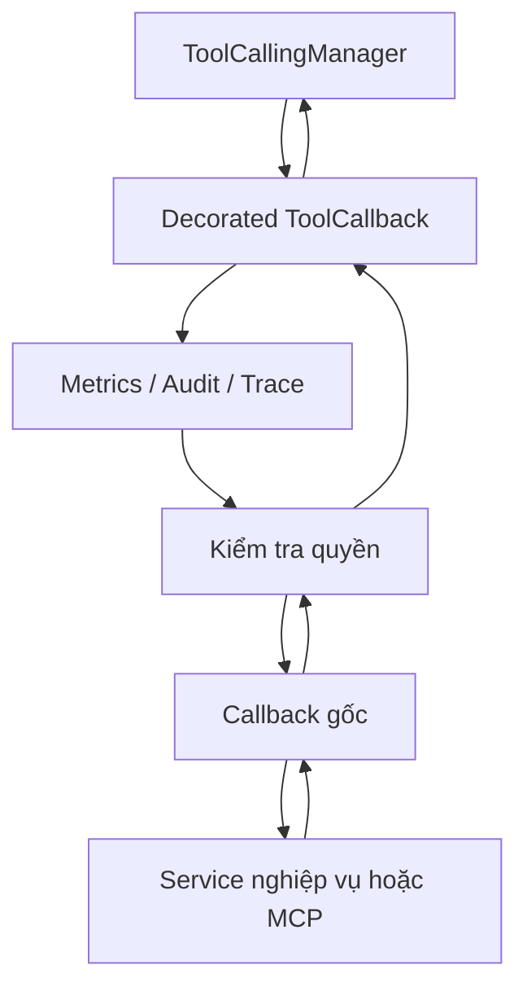
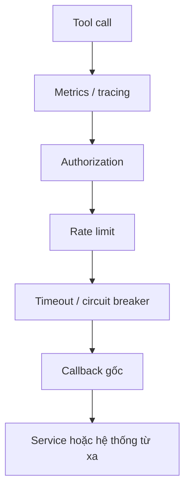

# Bọc callback bằng decorator để bổ sung kiểm soát và quan sát

Trong Spring AI, `ToolCallback` gom hai trách nhiệm vào một hợp đồng: cung cấp định nghĩa tool cho mô hình và thực thi tool khi ứng dụng nhận được yêu cầu gọi. Khi một tool đã được tạo bằng `MethodToolCallback`, `FunctionToolCallback` hoặc MCP, ta thường vẫn cần thêm kiểm tra quyền, đo thời gian thực thi, ghi nhận kết quả và giới hạn tần suất gọi.

Decorator cho phép bọc một `ToolCallback` hiện có để bổ sung các hành vi đó mà không phải viết lại phần xử lý nghiệp vụ. Decorator chuyển tiếp định nghĩa, metadata và lời gọi đến callback bên trong; phần kiểm soát và quan sát được đặt quanh lần thực thi. Cách làm này tạo một điểm mở rộng dùng chung cho nhiều loại tool, đồng thời giữ nguyên hợp đồng mà mô hình nhìn thấy.

## 1. ToolCallback có những điểm mở rộng nào?

Trong Spring AI, `ToolCallback` có các phương thức chính:

| Phương thức | Trách nhiệm |
| --- | --- |
| `getToolDefinition()` | Trả tên, mô tả và JSON Schema đầu vào mà mô hình nhìn thấy |
| `getToolMetadata()` | Trả metadata điều khiển cách xử lý tool, chẳng hạn `returnDirect` |
| `call(String toolInput)` | Thực thi tool với JSON arguments |
| `call(String toolInput, ToolContext toolContext)` | Thực thi tool với JSON arguments và ngữ cảnh do ứng dụng cung cấp |

`MethodToolCallback`, `FunctionToolCallback` và callback MCP đều triển khai cùng hợp đồng này. Vì vậy, một decorator nhận `ToolCallback` có thể bọc các implementation khác nhau mà không cần biết phần bên trong được tạo bằng annotation, function hay kết nối từ xa.

Hai chi tiết cần được giữ nguyên khi viết decorator:

1. **Chuyển tiếp metadata.** `getToolMetadata()` có thể mang `returnDirect`. Nếu decorator không chuyển tiếp phương thức này, metadata của callback gốc có thể bị thay bằng metadata mặc định và thay đổi luồng trả kết quả.
2. **Chuyển tiếp ToolContext.** Trong API Spring AI, overload `call(String, ToolContext)` có implementation mặc định có thể gọi lại `call(String)` nếu callback không ghi đè. Decorator cần tự ghi đè overload này và truyền nguyên `ToolContext` xuống callback bên trong; nếu không, principal, tenant hoặc correlation ID do ứng dụng cấp có thể bị mất.

## 2. Decorator khác với việc viết ToolCallback từ đầu

Khi viết `ToolCallback` mới hoàn toàn, lớp mới phải tự cung cấp `ToolDefinition`, metadata và logic thực thi. Cách này phù hợp khi xây dựng một tool có giao thức hoặc nguồn thực thi riêng.

Decorator dùng lại callback đã có. Nó không giải mã lại JSON, không tạo schema mới và không thay thế function nghiệp vụ. Nó chỉ bao quanh đường gọi để bổ sung hành vi như:

- Xác thực quyền theo tool name và `ToolContext`.
- Ghi nhận số lần gọi, thời gian chạy và kết quả thành công/thất bại.
- Ghi audit event với thông tin tối thiểu cần thiết.
- Giới hạn tần suất, áp dụng timeout hoặc circuit breaker cho dịch vụ từ xa.
- Chuẩn hóa cách xử lý lỗi trước khi chuyển lỗi về cơ chế điều phối của Spring AI.

Sơ đồ dưới đây thể hiện vị trí của decorator:



Mô hình chỉ nhận `ToolDefinition` của callback được đăng ký. Khi decorator chuyển tiếp `getToolDefinition()` và `getToolMetadata()`, tên tool, mô tả, schema và metadata được giữ nguyên.

## 3. Cài đặt decorator quan sát và kiểm soát quyền

Ví dụ sau bọc bất kỳ callback nào bằng một authorizer và một observer. Observer nhận tên tool, thời lượng và loại lỗi; nó không nhận raw input hoặc output để tránh vô tình ghi dữ liệu nhạy cảm.

```java
package com.example.ai.tooling;

import java.time.Duration;
import java.util.Objects;

import org.slf4j.Logger;
import org.slf4j.LoggerFactory;
import org.springframework.ai.chat.model.ToolContext;
import org.springframework.ai.tool.ToolCallback;
import org.springframework.ai.tool.definition.ToolDefinition;
import org.springframework.ai.tool.metadata.ToolMetadata;

public final class ObservedToolCallback implements ToolCallback {

    private static final Logger log =
            LoggerFactory.getLogger(ObservedToolCallback.class);

    private final ToolCallback delegate;
    private final ToolCallAuthorizer authorizer;
    private final ToolCallObserver observer;

    public ObservedToolCallback(
            ToolCallback delegate,
            ToolCallAuthorizer authorizer,
            ToolCallObserver observer) {
        this.delegate = Objects.requireNonNull(delegate);
        this.authorizer = Objects.requireNonNull(authorizer);
        this.observer = Objects.requireNonNull(observer);
    }

    @Override
    public ToolDefinition getToolDefinition() {
        return delegate.getToolDefinition();
    }

    @Override
    public ToolMetadata getToolMetadata() {
        return delegate.getToolMetadata();
    }

    @Override
    public String call(String toolInput) {
        return execute(toolInput, null);
    }

    @Override
    public String call(String toolInput, ToolContext toolContext) {
        return execute(toolInput, toolContext);
    }

    private String execute(String toolInput, ToolContext toolContext) {
        String toolName = getToolDefinition().name();
        long startedAt = System.nanoTime();

        try {
            authorizer.authorize(toolName, toolContext);

            String result = toolContext == null
                    ? delegate.call(toolInput)
                    : delegate.call(toolInput, toolContext);

            observeSuccess(toolName, elapsedSince(startedAt));
            return result;
        }
        catch (RuntimeException exception) {
            observeFailure(
                    toolName,
                    elapsedSince(startedAt),
                    exception.getClass().getSimpleName());
            throw exception;
        }
    }

    private Duration elapsedSince(long startedAt) {
        return Duration.ofNanos(System.nanoTime() - startedAt);
    }

    private void observeSuccess(String toolName, Duration duration) {
        try {
            observer.onSuccess(toolName, duration);
        }
        catch (RuntimeException observerFailure) {
            log.warn("Tool observer failed after successful execution: {}", toolName);
        }
    }

    private void observeFailure(
            String toolName, Duration duration, String errorType) {
        try {
            observer.onFailure(toolName, duration, errorType);
        }
        catch (RuntimeException observerFailure) {
            log.warn("Tool observer failed while recording execution failure: {}", toolName);
        }
    }

    public interface ToolCallAuthorizer {
        void authorize(String toolName, ToolContext toolContext);
    }

    public interface ToolCallObserver {
        void onSuccess(String toolName, Duration duration);

        void onFailure(String toolName, Duration duration, String errorType);
    }
}
```

Lớp trên thực hiện bốn việc quan trọng:

- Trả nguyên `ToolDefinition` và `ToolMetadata` từ callback gốc.
- Ghi đè cả hai overload `call(...)`, nhờ đó không làm mất `ToolContext`.
- Kiểm tra quyền trước khi gọi callback gốc.
- Đo thời lượng và ghi nhận trạng thái sau khi thực thi; nếu observer gặp lỗi runtime, decorator ghi cảnh báo và vẫn giữ nguyên kết quả nghiệp vụ.

Decorator chỉ bắt `RuntimeException` để ghi nhận rồi ném lại chính exception đó. Nó không biến lỗi thành chuỗi kết quả giả, không nuốt lỗi và không làm mất cơ chế xử lý lỗi mà ứng dụng đã cấu hình cho Spring AI. Với các lỗi nghiêm trọng như `Error`, lớp này không cố tiếp tục xử lý.

## 4. Viết authorizer dựa trên ngữ cảnh tin cậy

Mô hình có thể đề nghị gọi một tool và cung cấp JSON arguments, nhưng không được tự quyết định danh tính hoặc quyền của người dùng. Authorizer cần lấy thông tin principal, tenant hoặc scope từ `ToolContext` do ứng dụng thiết lập sau khi xác thực.

Ví dụ đơn giản cho phép một nhóm tool đọc đơn hàng:

```java
package com.example.ai.tooling;

import org.springframework.ai.chat.model.ToolContext;
import org.springframework.security.access.AccessDeniedException;
import org.springframework.stereotype.Component;

@Component
class OrderToolAuthorizer implements ObservedToolCallback.ToolCallAuthorizer {

    private final ToolPermissionService permissionService;

    OrderToolAuthorizer(ToolPermissionService permissionService) {
        this.permissionService = permissionService;
    }

    @Override
    public void authorize(String toolName, ToolContext toolContext) {
        if (toolContext == null || toolContext.getContext() == null) {
            throw new AccessDeniedException("Thiếu ngữ cảnh người dùng đã xác thực");
        }

        Object principal = toolContext.getContext().get("principalId");
        Object tenant = toolContext.getContext().get("tenantId");

        if (!(principal instanceof String principalId) || principalId.isBlank()
                || !(tenant instanceof String tenantId) || tenantId.isBlank()) {
            throw new AccessDeniedException("Ngữ cảnh người dùng không hợp lệ");
        }

        permissionService.assertCanInvoke(principalId, tenantId, toolName);
    }
}
```

`ToolPermissionService` là dịch vụ policy do ứng dụng định nghĩa; nó kiểm tra principal và tenant có được phép gọi tool name đó hay không. `principalId` và `tenantId` phải do lớp xác thực của ứng dụng cung cấp; không lấy các giá trị đó từ JSON arguments do mô hình tạo.

Kiểm tra tại decorator là một lớp bảo vệ ở ranh giới callback. Service nghiệp vụ vẫn phải kiểm tra quyền trên từng tài nguyên, ví dụ người dùng có quyền đọc đúng đơn hàng được yêu cầu hay không. Kiểm tra quyền ở hai tầng giúp tránh trường hợp tool được phép dùng nhưng lại truy cập nhầm bản ghi thuộc tenant khác.

## 5. Đo thời gian, metrics và audit mà không lộ dữ liệu

Observer có thể được nối với Micrometer, OpenTelemetry hoặc một hệ thống audit riêng. Nên ghi các trường có ích để chẩn đoán:

| Trường | Mục đích |
| --- | --- |
| Tool name | Phân biệt loại tool được gọi |
| Outcome | Đếm success, denied, failure hoặc timeout |
| Duration | Theo dõi độ trễ và phát hiện tool chậm |
| Correlation/trace ID | Nối lần gọi tool với request và trace lớn hơn |
| Error type | Phân nhóm lỗi mà không cần ghi nội dung đầu vào |
| Actor/tenant đã được xác thực | Audit quyền truy cập khi chính sách cho phép lưu |

Không ghi mặc định raw `toolInput`, kết quả đầy đủ, prompt, token, mật khẩu, access key hoặc dữ liệu cá nhân. Nếu cần audit một định danh nghiệp vụ, hãy chọn trường tối thiểu, che/mã hóa khi cần và áp dụng thời hạn lưu. Metrics label phải có cardinality thấp: dùng tên tool và outcome cố định; tránh đưa user ID, tenant ID, request ID hoặc giá trị tham số vào label.

Ví dụ observer dùng Micrometer:

```java
import java.time.Duration;

import io.micrometer.core.instrument.MeterRegistry;
import org.springframework.stereotype.Component;

@Component
class MicrometerToolCallObserver implements ObservedToolCallback.ToolCallObserver {

    private final MeterRegistry meterRegistry;

    MicrometerToolCallObserver(MeterRegistry meterRegistry) {
        this.meterRegistry = meterRegistry;
    }

    @Override
    public void onSuccess(String toolName, Duration duration) {
        record(toolName, duration, "success");
    }

    @Override
    public void onFailure(String toolName, Duration duration, String errorType) {
        record(toolName, duration, "failure");
    }

    private void record(String toolName, Duration duration, String outcome) {
        meterRegistry.counter(
                "spring.ai.tool.calls",
                "tool", toolName,
                "outcome", outcome).increment();

        meterRegistry.timer(
                "spring.ai.tool.duration",
                "tool", toolName,
                "outcome", outcome).record(duration);
    }
}
```

Trong ví dụ, `toolName` là tên tool được khai báo tĩnh khi đăng ký, không phải chuỗi tùy ý lấy từ người dùng. Nếu tên tool có thể chứa giá trị động, hãy chuẩn hóa hoặc ánh xạ về một tập nhãn cố định. Có thể bổ sung outcome `denied` riêng nếu authorizer phát ra một exception phân quyền riêng và observer phân loại exception đó.

Metrics và audit có mục đích khác nhau. Metrics phục vụ xu hướng và cảnh báo, không nên chứa danh tính chi tiết. Audit phục vụ truy vết hành động cụ thể, cần kiểm soát quyền đọc và chính sách lưu trữ chặt hơn. `ToolCallObserver` trong ví dụ được thiết kế cho telemetry không thiết yếu và fail-open. Nếu audit là yêu cầu bắt buộc của nghiệp vụ, hãy triển khai một audit gate riêng trước side effect hoặc dùng transactional outbox; không đặt audit bắt buộc vào observer đang nuốt lỗi. Chính sách fail-closed cần được quyết định trước khi hành động nghiệp vụ bắt đầu, vì ghi audit thất bại sau khi giao dịch đã hoàn tất không thể tự động đảo ngược side effect.

## 6. Ghép decorator với callback gốc trong Spring

Có thể tạo callback gốc từ `FunctionToolCallback`, sau đó bọc nó trước khi công bố thành bean. Chỉ đăng ký callback đã bọc cho tool đó, tránh để cả callback gốc và decorator cùng xuất hiện trong danh sách tool với cùng tên.

```java
import org.springframework.ai.tool.ToolCallback;
import org.springframework.ai.tool.function.FunctionToolCallback;
import org.springframework.context.annotation.Bean;
import org.springframework.context.annotation.Configuration;

@Configuration(proxyBeanMethods = false)
class OrderToolConfiguration {

    @Bean
    ToolCallback lookupOrderTool(
            OrderService orderService,
            OrderToolAuthorizer authorizer,
            MicrometerToolCallObserver observer) {

        ToolCallback delegate = FunctionToolCallback
                .builder("lookupOrder", orderService::lookup)
                .description("Tra cứu trạng thái đơn hàng mà người dùng hiện tại được phép xem")
                .inputType(OrderLookupRequest.class)
                .build();

        return new ObservedToolCallback(delegate, authorizer, observer);
    }
}
```

Sau đó đưa bean đã bọc vào request:

```java
import java.util.Map;

String answer = chatClient.prompt()
        .user(question)
        .tools(lookupOrderTool)
        .toolContext(Map.of(
                "principalId", authenticatedPrincipalId,
                "tenantId", authenticatedTenantId,
                "correlationId", correlationId))
        .call()
        .content();
```

Các kiểu `OrderLookupRequest`, `OrderService` và bean `ChatClient` thuộc ứng dụng. `authenticatedPrincipalId`, `authenticatedTenantId` và `correlationId` phải được lấy từ ngữ cảnh request đã xác thực. Nếu dùng API Spring AI 1.x, hãy đối chiếu method đăng ký callback với phiên bản đang khóa trong dự án; điểm không đổi là `ChatClient` nhận callback đã bọc.

Khi Spring tự động khám phá các bean `ToolCallback`, không nên xuất bản callback gốc và callback bọc cùng lúc nếu chúng có cùng tool name. Hai định nghĩa trùng tên có thể gây lỗi hoặc làm quá trình phân giải tool trở nên mơ hồ. Tạo delegate bên trong factory method như ví dụ trên giúp chỉ có một callback được công bố.

## 7. Xếp thứ tự nhiều decorator

Một callback có thể được bọc nhiều lớp. Thứ tự cần phản ánh trách nhiệm và tác động mong muốn:



- **Metrics/tracing ở ngoài** để ghi nhận cả yêu cầu bị từ chối, thời gian chờ và lỗi từ các lớp bên trong.
- **Authorization trước thực thi** để request không hợp lệ không chạm vào service.
- **Rate limit** trước khi gọi hệ thống từ xa để giới hạn tải theo principal hoặc tenant đã xác thực. Không dùng giá trị model tự khai báo làm khóa giới hạn.
- **Timeout/circuit breaker** gần dependency từ xa để cô lập lỗi mạng hoặc dịch vụ không khả dụng.
- **Callback gốc ở trong cùng** để thực thi nghiệp vụ.

Retry cần được cân nhắc riêng. Chỉ retry thao tác có tính idempotent hoặc đã có idempotency key. Nếu tool tạo đơn hàng, chuyển tiền hoặc gửi thông báo, retry mù có thể thực hiện cùng hành động nhiều lần. Circuit breaker và timeout cũng cần được cấu hình theo SLA của dịch vụ đích, không đặt một giá trị chung cho mọi tool.

Nếu chỉ cần metrics, tracing hoặc quan sát chuẩn của Spring AI, hãy kiểm tra instrumentation có sẵn trước khi tự viết decorator để tránh ghi nhận hai lần. Decorator tùy chỉnh hữu ích khi cần policy theo từng tool, redaction riêng, audit nghiệp vụ hoặc cách xử lý lỗi đặc thù.

## 8. Xử lý lỗi và bảo toàn ngữ nghĩa callback

Decorator nên phân biệt lỗi do policy, lỗi đầu vào và lỗi khi service thực thi. Cách phân loại này giúp telemetry có ý nghĩa và giữ nguyên cơ chế lỗi của Spring AI.

| Tình huống | Hành vi decorator nên thực hiện |
| --- | --- |
| Không đủ quyền | Không gọi delegate; ghi nhận outcome denied; ném lỗi phân quyền |
| JSON hoặc tham số không hợp lệ | Để callback gốc/validation xử lý; ghi nhận lỗi đầu vào; giữ exception |
| Service nghiệp vụ từ chối | Ghi nhận loại lỗi; ném lại exception hoặc kết quả nghiệp vụ theo hợp đồng gốc |
| Timeout hoặc lỗi kết nối | Ghi nhận lỗi hệ thống; áp dụng timeout/circuit breaker đã cấu hình |
| Observer/metrics lỗi | Với telemetry không thiết yếu, cô lập lỗi observer để không thay đổi kết quả tool |
| Audit bắt buộc lỗi | Áp dụng fail-open/fail-closed theo yêu cầu nghiệp vụ đã định nghĩa |

Không nên bắt mọi exception rồi trả chuỗi như `"Có lỗi xảy ra"` nếu ứng dụng đang dựa vào `ToolExecutionExceptionProcessor`. Việc biến exception thành kết quả thành công dạng text có thể khiến mô hình hiểu nhầm tool đã chạy và tiếp tục suy luận từ một kết quả không đáng tin cậy. Nếu cần ánh xạ lỗi thành thông báo an toàn cho mô hình, hãy cấu hình ở đúng tầng xử lý lỗi của ứng dụng/Spring AI và giữ nguyên mã lỗi nội bộ cho log, trace hoặc audit.

Decorator cũng không nên thay đổi `ToolDefinition` ngoài chủ đích. Đổi tool name hoặc schema khi chỉ muốn thêm metrics có thể làm model request không khớp với callback được phân giải lúc thực thi. Giữ nguyên `getToolDefinition()` là lựa chọn an toàn cho wrapper quan sát.

## 9. Kiểm thử decorator

Kiểm thử cần xác nhận cả phần bổ sung và hợp đồng được chuyển tiếp. Dùng callback giả lập để kiểm tra decorator độc lập với model và dịch vụ từ xa.

| Trường hợp | Điều cần xác minh |
| --- | --- |
| Định nghĩa tool | `getToolDefinition()` trả cùng definition từ delegate |
| Metadata | `getToolMetadata()` giữ nguyên `returnDirect` và metadata khác |
| Gọi không có context | `call(String)` chuyển input đúng một lần đến delegate |
| Gọi có context | `call(String, ToolContext)` chuyển đúng object context đến overload tương ứng |
| Thành công | Observer nhận tool name và duration; kết quả delegate được trả nguyên vẹn |
| Bị từ chối | Delegate không được gọi; observer ghi nhận thất bại/denied |
| Delegate ném lỗi | Observer ghi nhận error type; cùng exception được ném lại |
| Observer ném lỗi | Kết quả callback vẫn giữ nguyên với telemetry fail-open |
| Dữ liệu nhạy cảm | Input/output không xuất hiện trong log hoặc metrics label |
| Gọi đồng thời | Không có trạng thái của một invocation rò sang invocation khác |

Ví dụ unit test với Mockito:

```java
import java.time.Duration;
import java.util.Map;

import org.junit.jupiter.api.Test;
import org.springframework.ai.chat.model.ToolContext;

import static org.assertj.core.api.Assertions.assertThat;
import static org.mockito.ArgumentMatchers.any;
import static org.mockito.ArgumentMatchers.eq;
import static org.mockito.Mockito.verify;
import static org.mockito.Mockito.when;

@Test
void forwardsToolContextToDelegate() {
    ToolContext context = new ToolContext(Map.of("tenantId", "tenant-test"));
    when(delegate.getToolDefinition()).thenReturn(toolDefinition);
    when(delegate.getToolMetadata()).thenReturn(toolMetadata);
    when(delegate.call("{\"orderId\":\"ORD-1\"}", context))
            .thenReturn("{\"status\":\"SHIPPED\"}");

    ObservedToolCallback callback =
            new ObservedToolCallback(delegate, authorizer, observer);

    String result = callback.call("{\"orderId\":\"ORD-1\"}", context);

    assertThat(result).isEqualTo("{\"status\":\"SHIPPED\"}");
    verify(delegate).call("{\"orderId\":\"ORD-1\"}", context);
    verify(authorizer).authorize(toolDefinition.name(), context);
    verify(observer).onSuccess(eq(toolDefinition.name()), any(Duration.class));
}
```

Test này giả định `delegate`, `toolDefinition`, `toolMetadata`, `authorizer` và `observer` đã được khởi tạo bằng Mockito fixture phù hợp. Cần bổ sung test xác nhận metadata được chuyển tiếp và delegate không bị gọi khi authorizer từ chối.

## 10. Checklist trước khi dùng decorator trong production

- [ ] Decorator chuyển tiếp `ToolDefinition` và `ToolMetadata`.
- [ ] Cả hai overload `call(...)` đều được ghi đè; `ToolContext` được chuyển nguyên vẹn.
- [ ] Authorization chạy trước callback gốc và dựa trên context do ứng dụng cấp.
- [ ] Service nghiệp vụ vẫn kiểm tra quyền trên từng tài nguyên.
- [ ] Metrics có cardinality thấp và không chứa input, output hoặc danh tính động.
- [ ] Log và audit có redaction, retention và access policy rõ ràng.
- [ ] Observer không làm thay đổi kết quả khi telemetry không thiết yếu gặp lỗi.
- [ ] Lỗi từ delegate được ghi nhận và ném lại, không bị biến thành kết quả thành công giả.
- [ ] Retry chỉ áp dụng cho thao tác an toàn/idempotent.
- [ ] Chỉ callback đã bọc được đăng ký cho mỗi tool name.
- [ ] Có unit test cho context, metadata, authorization, lỗi và gọi đồng thời.

Decorator là một lớp bao quanh `ToolCallback`, giúp áp dụng cùng một chính sách kiểm soát và quan sát cho nhiều loại tool. Khi chuyển tiếp đúng definition, metadata và `ToolContext`, đồng thời giữ nguyên kết quả và lỗi của callback gốc, ứng dụng có thể bổ sung authorization, metrics, tracing và audit mà không làm thay đổi hợp đồng tool mà mô hình sử dụng.

## Tài liệu tham khảo

- [Spring AI — Tool Calling và ToolCallback](https://docs.spring.io/spring-ai/reference/api/tools.html)
- [Spring AI 1.0 — ToolCallback và Tool Definition](https://docs.spring.io/spring-ai/reference/1.0/api/tools.html)
- [ToolCallback API](https://docs.spring.io/spring-ai/docs/1.0.x/api/org/springframework/ai/tool/ToolCallback.html)
- [ToolMetadata API](https://docs.spring.io/spring-ai/docs/1.0.x/api/org/springframework/ai/tool/metadata/ToolMetadata.html)
