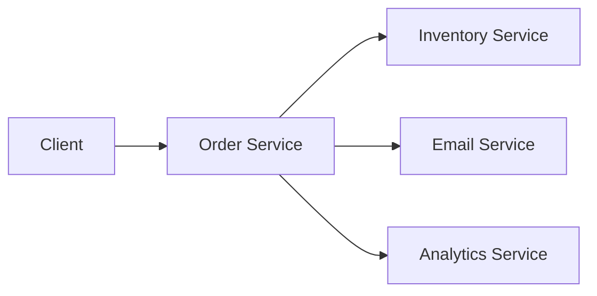
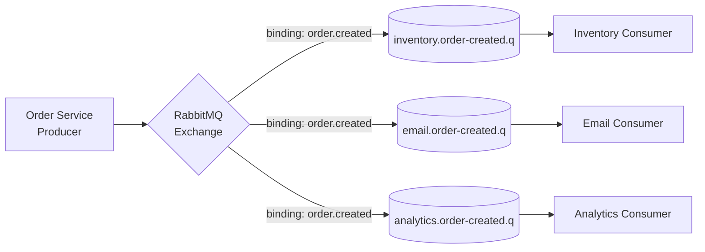
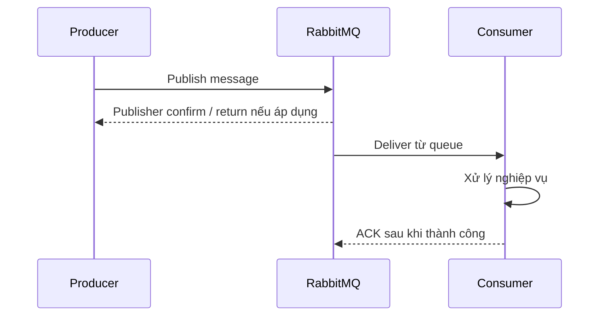
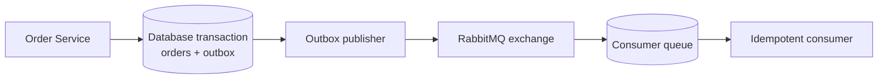

# Spring AMQP là gì và bài toán tích hợp ứng dụng bằng thông điệp

Khi một ứng dụng cần thông báo cho ứng dụng khác rằng “đơn hàng đã được tạo”, “thanh toán đã hoàn tất” hoặc “tệp đã tải lên”, cách quen thuộc là gọi HTTP trực tiếp. Cách đó phù hợp với nhiều tình huống, nhưng trở nên khó quản lý khi một hành động kích hoạt nhiều công việc, mỗi công việc có thời gian xử lý và mức độ sẵn sàng khác nhau. **Spring AMQP** giúp ứng dụng Java/Spring trao đổi thông điệp qua một message broker như RabbitMQ, từ đó tách việc phát sinh sự kiện khỏi việc xử lý sự kiện.

Bài này thuộc phần **Tổng quan** của module **SPRING_AMQP**. Sau khi học, bạn có thể:

- Giải thích Spring AMQP, RabbitMQ và giao thức AMQP giữ vai trò gì trong hệ thống.
- Mô tả đường đi của message qua `producer → exchange → binding → queue → consumer`.
- Chọn tích hợp đồng bộ hay bất đồng bộ theo nhu cầu nghiệp vụ.
- Tạo ví dụ tối thiểu với `RabbitTemplate`, `@RabbitListener`, exchange, queue và binding.
- Nhận diện các vấn đề tin cậy: mất message, xử lý lặp, lỗi tạm thời, dead-letter, giao dịch và khả năng quan sát.

## 1. Vì sao cần tích hợp ứng dụng bằng thông điệp?

Giả sử khách hàng đặt hàng trên một hệ thống thương mại điện tử. Khi đơn hàng được tạo, hệ thống cần gửi email, cập nhật kho, ghi dữ liệu phân tích và thông báo cho bộ phận vận hành.

### 1.1. Gọi trực tiếp: đơn giản nhưng tạo phụ thuộc thời gian chạy

Một cách triển khai ban đầu là `Order Service` gọi liên tiếp các dịch vụ khác qua HTTP:



Khi đó, luồng tạo đơn có thể gặp các vấn đề:

1. **Độ trễ cộng dồn:** phản hồi cho người dùng phải chờ các thao tác không thật sự cần thiết để xác nhận đơn.
2. **Phụ thuộc vào tính sẵn sàng:** dịch vụ email tạm ngừng có thể ảnh hưởng đến luồng đặt hàng nếu lỗi chưa được cô lập.
3. **Liên kết chặt:** Order Service phải biết địa chỉ, giao thức và cách gọi từng dịch vụ nhận thông tin.
4. **Khó xử lý đột biến:** khi lượng đơn tăng, các dịch vụ phía sau có thể quá tải ngay tại thời điểm nhận request.
5. **Khó quản lý retry:** gọi lại HTTP có thể gây thao tác trùng nếu lần gọi trước thực ra đã thành công.

Không phải mọi lời gọi HTTP đều có vấn đề. Chẳng hạn, khi đặt hàng cần kiểm tra ngay giá hoặc quyền truy cập, yêu cầu đồng bộ vẫn có thể là lựa chọn đúng. Vấn đề là phân biệt **điều kiện bắt buộc trước khi trả lời** với **công việc có thể hoàn thành sau**.

### 1.2. Phát sự kiện: bên tạo đơn và bên xử lý độc lập hơn

Order Service có thể lưu đơn hàng, sau đó phát sự kiện `order.created`. Các dịch vụ quan tâm tự nhận và xử lý thông điệp qua RabbitMQ:



Một dịch vụ nhận tin bị chậm không nhất thiết làm hỏng yêu cầu HTTP ban đầu. Message đã vào queue có thể chờ consumer sẵn sàng trở lại, trong giới hạn tài nguyên và chính sách của broker.

Tuy nhiên, **bất đồng bộ không đồng nghĩa với thành công tức thì**: người dùng có thể thấy đơn hàng đã tạo trong khi email hoặc cập nhật kho vẫn đang chờ xử lý. Thiết kế phải chấp nhận *eventual consistency*, xác định trạng thái nghiệp vụ rõ ràng và có cách phát hiện công việc thất bại.

### 1.3. So sánh hai cách tích hợp

| Tiêu chí | Gọi HTTP đồng bộ | Trao đổi qua message broker |
|---|---|---|
| Phản hồi | Bên gọi thường chờ kết quả | Bên phát thường chỉ chờ broker chấp nhận |
| Phụ thuộc lúc chạy | Bên nhận thường phải sẵn sàng ngay | Queue có thể giữ thông điệp trong lúc bên nhận gián đoạn |
| Mở rộng xử lý | Mở rộng API/endpoint và phối hợp tải | Tăng số consumer để chia tải trên một queue |
| Truyền một sự kiện cho nhiều bên | Bên gọi thường phải gọi nhiều nơi | Exchange có thể định tuyến đến nhiều queue |
| Kiểu nhất quán | Phù hợp với quyết định cần biết ngay | Thường sử dụng nhất quán cuối cùng |
| Chi phí vận hành | Quản lý timeout, circuit breaker, retry | Quản lý broker, queue, backlog, retry, DLQ, message trùng |

**Quy tắc chọn nhanh:** dùng đồng bộ khi cần kết quả ngay để hoàn tất quyết định; dùng message khi công việc có thể xử lý sau, cần tách nhịp độ xử lý hoặc nhiều thành phần cần phản ứng với cùng một sự kiện. Một hệ thống thực tế thường kết hợp cả hai.

## 2. Spring AMQP, AMQP và RabbitMQ khác nhau thế nào?

Ba tên này nói về ba tầng khác nhau:

- **AMQP (Advanced Message Queuing Protocol):** họ giao thức truyền thông điệp. Mô hình exchange/queue/binding trình bày trong bài thuộc **AMQP 0-9-1**, giao thức thường dùng với RabbitMQ. AMQP 1.0 là giao thức khác, không thể coi là tương đương về mô hình lệnh.
- **RabbitMQ:** phần mềm message broker nhận, định tuyến, lưu trữ tạm thời và phân phối message đến consumer dựa trên cấu hình. Broker chạy như một dịch vụ riêng.
- **Spring AMQP:** thư viện tích hợp messaging vào ứng dụng Spring. Module `spring-rabbit` cung cấp các thành phần làm việc với RabbitMQ; Spring Boot có starter `spring-boot-starter-amqp` để cấu hình nhanh.

| Thành phần | Chức năng |
|---|---|
| `ConnectionFactory` | Quản lý cấu hình kết nối của ứng dụng tới broker |
| `RabbitTemplate` | API gửi message, thường thông qua `convertAndSend(...)` |
| `AmqpAdmin` / `RabbitAdmin` | Khai báo queue, exchange và binding lên broker |
| `@RabbitListener` | Đánh dấu phương thức xử lý message nhận từ queue |
| Listener container | Nhận message, điều phối consumer, concurrency và acknowledgement |
| Message converter | Chuyển đổi payload Java ↔ nội dung message |

Spring AMQP **không thay thế RabbitMQ**. Ứng dụng dùng Spring AMQP vẫn cần một broker tương thích, kết nối mạng, quyền truy cập và chính sách vận hành phù hợp.

## 3. Message đi qua những thành phần nào?

Một đường đi thường gặp:

```text
Producer (RabbitTemplate)
    │ publish(message, exchange, routingKey)
    ▼
Exchange ── Binding (quy tắc định tuyến) ──► Queue
                                              │
                                              ▼
                                  Consumer (@RabbitListener)
                                              │
                                              ▼
                                     Xử lý và ACK/NACK
```

**Producer** tạo message, gồm *payload* và thông tin mô tả như header, content type, message ID hoặc correlation ID. Producer publish đến **exchange**; exchange quyết định queue đích dựa vào loại exchange, binding và routing key. **Queue** giữ các message đang chờ giao. **Consumer** nhận message từ queue và thực thi logic nghiệp vụ.

### 3.1. Exchange, routing key và binding

- **Exchange:** điểm nhận message từ producer để định tuyến.
- **Routing key:** chuỗi do producer gắn khi publish, ví dụ `order.created`.
- **Binding:** mối liên kết từ exchange đến queue, có thể kèm binding key hoặc điều kiện lọc.
- **Queue:** nơi message chờ được giao cho consumer; một queue có thể có nhiều consumer để chia nhau xử lý.

Các kiểu exchange phổ biến:

| Loại exchange | Cách định tuyến | Khi nào dùng |
|---|---|---|
| `direct` | Routing key trùng chính xác binding key | Chọn queue theo loại công việc hoặc trạng thái |
| `topic` | So khớp mẫu routing key phân đoạn bằng dấu chấm | Phát sự kiện theo nhóm như `order.*` |
| `fanout` | Gửi bản sao đến mọi queue được bind, bỏ qua routing key | Broadcast sự kiện cho nhiều hệ thống |
| `headers` | So khớp theo thuộc tính header được cấu hình | Định tuyến theo metadata đặc thù |

Với `topic exchange`, `*` khớp **đúng một** phân đoạn và `#` khớp **không hoặc nhiều** phân đoạn. Ví dụ, binding `order.*` khớp `order.created` nhưng không khớp `order.payment.completed`; binding `order.#` khớp cả hai.

**Điểm dễ nhầm:** ba consumer cùng đọc **một queue** sẽ cạnh tranh nhận từng message (competing consumers), không phải mỗi consumer đều nhận một bản sao. Muốn Email, Inventory và Analytics đều xử lý cùng sự kiện, hãy bind **ba queue riêng** vào exchange tương ứng.

### 3.2. Queue bền vững và message bền vững

Hai thiết lập dễ bị xem là một:

- **Durable queue:** định nghĩa queue được giữ qua quá trình khởi động lại broker, tùy điều kiện và cấu hình cụ thể.
- **Persistent message:** message được đánh dấu để broker lưu bền vững thay vì chỉ tồn tại trong bộ nhớ.

Cần xem xét **cả hai** cùng publisher confirms và chính sách broker để giảm nguy cơ mất dữ liệu khi xảy ra sự cố. Từ “durable” hoặc “persistent” riêng lẻ không tạo ra cam kết tuyệt đối rằng message không bao giờ mất. Với hệ thống quan trọng, còn phải đánh giá loại queue (ví dụ quorum queue), sao lưu, tính sẵn sàng của cụm và điểm broker thực sự xác nhận publish.

## 4. Thực hành tối thiểu với Spring Boot và RabbitMQ

Ví dụ dưới đây thực hiện một luồng nhỏ: REST endpoint phát thông điệp `order.created`; RabbitMQ định tuyến đến `notifications.order-created.q`; `@RabbitListener` nhận order ID và ghi log. Đây là minh họa tích hợp, chưa phải một luồng tạo đơn có lưu cơ sở dữ liệu.

### 4.1. Khởi động broker để học tại máy cá nhân

Ví dụ dùng Docker với RabbitMQ có trang quản trị:

```bash
docker run -d --rm --name rabbitmq-demo -p 5672:5672 -p 15672:15672 -e RABBITMQ_DEFAULT_USER=demo -e RABBITMQ_DEFAULT_PASS=demo-local-only rabbitmq:4-management
```

Port `5672` phục vụ AMQP; trang quản trị thường truy cập tại `http://localhost:15672` bằng tài khoản `demo` / `demo-local-only`. Thông tin đăng nhập này **chỉ dành cho môi trường thử nghiệm**. Trong hệ thống thật, sử dụng tài khoản giới hạn quyền, secrets và TLS.

Thêm dependencies vào ứng dụng Spring Boot đã được tạo:

```groovy
dependencies {
    implementation 'org.springframework.boot:spring-boot-starter-amqp'
    implementation 'org.springframework.boot:spring-boot-starter-web'
}
```

Cấu hình `application.yml` cho môi trường demo:

```yaml
spring:
  rabbitmq:
    host: localhost
    port: 5672
    username: demo
    password: demo-local-only
```

### 4.2. Khai báo exchange, queue và binding

Tạo lớp cấu hình Spring. Ví dụ dùng `TopicExchange`; queue durable và binding nhận chính xác routing key `order.created`:

```java
import org.springframework.amqp.core.Binding;
import org.springframework.amqp.core.BindingBuilder;
import org.springframework.amqp.core.Queue;
import org.springframework.amqp.core.QueueBuilder;
import org.springframework.amqp.core.TopicExchange;
import org.springframework.context.annotation.Bean;
import org.springframework.context.annotation.Configuration;

@Configuration
public class OrderMessagingConfig {
    public static final String EXCHANGE = "orders.events";
    public static final String QUEUE = "notifications.order-created.q";
    public static final String ROUTING_KEY = "order.created";

    @Bean
    TopicExchange ordersExchange() {
        return new TopicExchange(EXCHANGE, true, false);
    }

    @Bean
    Queue notificationQueue() {
        return QueueBuilder.durable(QUEUE).build();
    }

    @Bean
    Binding notificationBinding(Queue notificationQueue,
                                TopicExchange ordersExchange) {
        return BindingBuilder.bind(notificationQueue)
                .to(ordersExchange)
                .with(ROUTING_KEY);
    }
}
```

Trong ứng dụng Spring Boot có AMQP auto-configuration, các bean trên được RabbitAdmin dùng để khai báo hạ tầng messaging khi kết nối broker. Nếu hạ tầng đã tồn tại nhưng thuộc tính khai báo xung đột, broker có thể từ chối khai báo; cần quản lý thay đổi topology một cách có chủ đích.

### 4.3. Publish với RabbitTemplate

```java
import org.springframework.amqp.rabbit.core.RabbitTemplate;
import org.springframework.stereotype.Service;

@Service
public class OrderEventPublisher {
    private final RabbitTemplate rabbitTemplate;

    public OrderEventPublisher(RabbitTemplate rabbitTemplate) {
        this.rabbitTemplate = rabbitTemplate;
    }

    public void publishCreated(String orderId) {
        rabbitTemplate.convertAndSend(
                OrderMessagingConfig.EXCHANGE,
                OrderMessagingConfig.ROUTING_KEY,
                orderId
        );
    }
}
```

`RabbitTemplate` chịu trách nhiệm tương tác với RabbitMQ. Ở đây payload là `String` nên có thể dùng message converter mặc định; khi gửi object JSON, hai phía cần thống nhất định dạng, schema và cách chuyển đổi message. Lời gọi `convertAndSend` trả về bình thường **không tự chứng minh consumer đã xử lý xong**.

### 4.4. Consume với @RabbitListener

```java
import org.springframework.amqp.rabbit.annotation.RabbitListener;
import org.springframework.stereotype.Component;

@Component
public class OrderNotificationListener {
    @RabbitListener(queues = OrderMessagingConfig.QUEUE)
    public void onOrderCreated(String orderId) {
        System.out.println("Preparing notification for order " + orderId);
    }
}
```

Spring tạo listener container nhận message, gọi phương thức trên và quản lý acknowledgement theo cấu hình. Khi dùng cơ chế `AUTO` thông thường của listener container, message được ACK **sau khi handler hoàn tất thành công**. Điều này khác với khái niệm *broker auto-ack*: chế độ `AUTO` của Spring không có nghĩa là broker coi message đã nhận thành công ngay khi vừa giao.

Thêm REST endpoint để có thể thử bằng `curl`:

```java
import org.springframework.http.ResponseEntity;
import org.springframework.web.bind.annotation.PathVariable;
import org.springframework.web.bind.annotation.PostMapping;
import org.springframework.web.bind.annotation.RequestMapping;
import org.springframework.web.bind.annotation.RestController;

@RestController
@RequestMapping("/demo/orders")
public class DemoOrderController {
    private final OrderEventPublisher publisher;

    public DemoOrderController(OrderEventPublisher publisher) {
        this.publisher = publisher;
    }

    @PostMapping("/{orderId}/created")
    public ResponseEntity<Void> publish(@PathVariable String orderId) {
        publisher.publishCreated(orderId);
        return ResponseEntity.accepted().build();
    }
}
```

Đặt bốn lớp Java vào bốn file cùng package trong ứng dụng Spring Boot có class `@SpringBootApplication`, rồi khởi chạy ứng dụng. Gửi yêu cầu:

```bash
curl -X POST http://localhost:8080/demo/orders/order-123/created
```

Kết quả mong đợi: HTTP `202 Accepted` từ endpoint demo và log của listener có `Preparing notification for order order-123`. Trên RabbitMQ Management UI, có thể kiểm tra exchange `orders.events`, queue `notifications.order-created.q` và binding giữa chúng. HTTP 202 ở đây chỉ là phản hồi của API demo, **không phải bằng chứng message đã được xử lý cuối cùng**.

## 5. Độ tin cậy: “đã gửi” chưa chắc “đã xử lý”

Xử lý bất đồng bộ tin cậy cần phân biệt **ba chặng xác nhận**:

| Cơ chế | Bên xác nhận | Điều được xác nhận | Điều chưa được đảm bảo |
|---|---|---|---|
| Publisher confirm | Broker → producer | Broker đã xử lý việc publish theo cơ chế confirm của broker | Consumer đã hoàn tất nghiệp vụ |
| Publisher return (khi `mandatory` và không route được) | Broker → producer | Message không được định tuyến vào queue nào | Có consumer đang hoạt động hoặc đã xử lý |
| Consumer ACK | Consumer → broker | Consumer báo đã xử lý delivery đó theo logic của ứng dụng | Toàn bộ hệ thống được cập nhật chính xác một lần |

Trình tự đơn giản:



Một message có thể được broker nhận nhưng chưa tới queue phù hợp nếu exchange không tìm được binding; vì thế publisher confirm và publisher return phục vụ các câu hỏi khác nhau. Khi cần phát hiện publish thất bại, hãy cấu hình confirm, return và `mandatory` thích hợp, rồi xử lý callback hoặc kết quả xác nhận một cách có chủ đích.

### 5.1. Redelivery và xử lý lặp (idempotency)

Nếu consumer đã ghi dữ liệu thành công nhưng kết nối mất trước khi broker nhận được ACK, broker có thể giao lại cùng message. Vì vậy **at-least-once delivery** khi được cấu hình phù hợp có nghĩa là message *có thể được xử lý nhiều lần*.

Ví dụ: nếu sự kiện thanh toán thành công bị xử lý hai lần và consumer thực hiện “cộng doanh thu” hai lần, dữ liệu sẽ sai. Thiết kế an toàn hơn là gắn `eventId` ổn định cho sự kiện, kiểm tra hoặc lưu dấu xử lý trong cùng giao dịch cơ sở dữ liệu với thay đổi nghiệp vụ, và đặt ràng buộc duy nhất để tránh áp dụng lặp. Chỉ kiểm tra một biến trong bộ nhớ thường không đủ khi có nhiều instance hoặc ứng dụng khởi động lại.

### 5.2. Retry, lỗi vĩnh viễn và dead-letter

Consumer có thể thất bại vì mạng chập chờn hoặc dịch vụ phụ thuộc tạm ngừng; lúc này retry có giới hạn và backoff có ích. Ngược lại, message thiếu trường bắt buộc hoặc vi phạm schema có thể không bao giờ xử lý thành công nếu cứ thử lại.

Một chiến lược hợp lý:

1. **Lỗi tạm thời:** thử lại có giới hạn, tăng khoảng chờ, đồng thời giám sát số lần retry.
2. **Hết lượt thử hoặc lỗi không thể khôi phục:** đưa message sang **dead-letter exchange (DLX)** và **dead-letter queue (DLQ)** theo cấu hình broker.
3. **Điều tra và khôi phục:** ghi đủ nguyên nhân, message ID và thông tin truy vết; sửa lỗi trước khi phát lại có kiểm soát.

Nếu consumer liên tục NACK rồi requeue ngay lập tức, hệ thống có thể tạo vòng lặp nóng, tăng CPU và lưu lượng broker. Nếu NACK với `requeue=false` mà không có dead-letter policy phù hợp, message có thể bị loại bỏ thay vì đi vào DLQ. Retry và DLQ cần được thiết kế đồng bộ, không mặc định tự xuất hiện chỉ vì đã dùng `@RabbitListener`.

### 5.3. Giao dịch cơ sở dữ liệu và outbox

Giả sử Order Service thực hiện hai hành động: `INSERT order` vào database và publish `order.created` lên RabbitMQ. Nếu transaction database commit nhưng publish thất bại, hệ thống có đơn hàng mà không có sự kiện. Nếu publish thành công rồi database rollback, consumer lại nhận sự kiện của một đơn hàng không tồn tại.

**Transactional outbox** xử lý khoảng hở này bằng cách ghi đơn hàng và bản ghi sự kiện vào bảng *outbox* **trong cùng một transaction database**. Một tiến trình riêng đọc outbox và publish lên broker; sau khi được xác nhận theo quy trình đã chọn, nó đánh dấu bản ghi đã gửi. Việc publish lại vẫn có thể xảy ra, vì vậy consumer cần idempotency.



RabbitMQ có cơ chế transaction ở cấp channel, nhưng không nên mặc định rằng nó tạo ra **một transaction nguyên tử chung** với database của ứng dụng. Outbox thường là cách rõ ràng hơn để phối hợp thay đổi dữ liệu và phát sự kiện khi cần độ tin cậy cao.

## 6. Thiết kế message có ích cho người nhận

Trong ứng dụng thực tế, message nên chứa đủ thông tin để bên nhận hiểu ngữ nghĩa, mà không phụ thuộc vào tên lớp Java nội bộ của producer. Một ví dụ nội dung JSON:

```json
{
  "eventId": "evt-0187",
  "eventType": "order.created",
  "version": 1,
  "occurredAt": "2026-11-26T01:00:00Z",
  "orderId": "order-123",
  "customerId": "customer-45"
}
```

Ví dụ code ở mục 4 cố ý gửi chuỗi `orderId` để tập trung vào luồng truyền message. Khi phát triển lên JSON, cần thống nhất message converter, content type và quy ước version giữa producer và consumer.

Các nguyên tắc cần chú ý:

- **Sự kiện khác lệnh:** `order.created` mô tả sự thật đã xảy ra; `send.email` yêu cầu một bên thực hiện công việc. Tên message nên phản ánh đúng ý định.
- **Message có định danh ổn định:** `eventId` giúp loại trùng và điều tra.
- **Schema phát triển được:** thêm trường theo cách tương thích; kiểm tra phiên bản trước khi thay đổi ý nghĩa trường đã dùng.
- **Giữ dữ liệu nhạy cảm ở mức cần thiết:** hạn chế gửi dữ liệu cá nhân hoặc token vào payload; xem xét mã hóa và kiểm soát quyền truy cập.
- **Không mặc định có thứ tự toàn cục:** nhiều queue, nhiều consumer, retry và redelivery có thể làm thay đổi thứ tự quan sát. Nếu nghiệp vụ yêu cầu thứ tự, cần thiết kế theo khóa nghiệp vụ và chiến lược xử lý phù hợp.

## 7. Vận hành và quan sát hệ thống bất đồng bộ

Ưu điểm của queue là hấp thụ chênh lệch tốc độ giữa producer và consumer, nhưng queue không phải bộ đệm vô hạn. Nếu producer gửi 1.000 message/giây còn consumer chỉ xử lý 200 message/giây, backlog sẽ tăng và cuối cùng tác động đến bộ nhớ, đĩa, độ trễ và khả năng vận hành.

Các chỉ số nên theo dõi gồm:

| Nhóm | Chỉ số / tín hiệu | Gợi ý cách hiểu |
|---|---|---|
| Độ tồn đọng | Messages ready, queue depth, tuổi message | Consumer có theo kịp producer không? |
| Đang xử lý | Messages unacknowledged, thời gian xử lý | Có message bị giữ lâu hoặc consumer bị treo không? |
| Lưu lượng | Publish, deliver, ACK, redelivery rates | Mức tải và dấu hiệu xử lý lặp |
| Lỗi | Retry count, DLQ depth, NACK, lỗi deserialize | Có message thất bại dai dẳng cần xử lý không? |
| Kết nối | Connection/channel errors, publisher confirm latency | Broker và ứng dụng còn liên lạc ổn định không? |
| Truy vết | eventId, correlationId, traceId, business ID | Có lần theo được một sự kiện qua nhiều dịch vụ không? |

RabbitMQ Management UI hỗ trợ quan sát queue và luồng message. Trong Spring Boot, có thể kết hợp Actuator, Micrometer, log có cấu trúc và tracing để nhìn đồng thời sức khỏe ứng dụng và broker. Cần đặt cảnh báo theo backlog/tuổi message và DLQ, thay vì chỉ theo dõi process “còn chạy”.

Đối với môi trường production, cũng cần quản lý connection pool/channel, prefetch, concurrency, giới hạn queue, HA, phân quyền theo vhost, TLS và quy trình khôi phục sau sự cố. Tăng consumer khi xử lý chậm có thể cải thiện throughput, nhưng cũng có thể gây quá tải database hoặc API downstream.

## 8. Những hiểu lầm phổ biến

| Hiểu lầm | Cách hiểu đúng |
|---|---|
| “Gọi `convertAndSend` không lỗi nghĩa là hoàn thành nghiệp vụ.” | Chỉ biết lệnh gửi không ném lỗi tại chỗ; cần confirm và trạng thái consumer để biết các chặng tiếp theo. |
| “Có 3 listener trên cùng queue thì cả 3 đều nhận một bản sao.” | Consumer trên cùng queue cạnh tranh xử lý; muốn phát tới nhiều bên thì dùng queue riêng. |
| “Queue durable là không bao giờ mất message.” | Còn cần message persistence, xác nhận, loại queue và chiến lược vận hành broker. |
| “ACK đảm bảo xử lý đúng một lần.” | ACK có thể thất lạc sau khi nghiệp vụ đã commit; cần xử lý lặp an toàn. |
| “Bật retry sẽ tự có DLQ.” | Retry, dead-letter exchange/queue và cơ chế phát lại là các phần phải cấu hình, kiểm thử. |
| “Message queue luôn tốt hơn REST.” | Gọi đồng bộ phù hợp hơn khi cần kết quả ngay và cần phản hồi lỗi tức thời. |

## 9. Bài tập tự kiểm tra

1. Thay `TopicExchange` trong ví dụ bằng `FanoutExchange`, tạo hai queue riêng cho email và analytics. Kiểm tra một lần publish tạo một message cho **mỗi queue** như thế nào.
2. Tạo thêm consumer instance cùng đọc `notifications.order-created.q`. Gửi nhiều message và quan sát việc các instance chia tải; giải thích vì sao một message không được gửi đến tất cả instance.
3. Cố tình ném exception trong listener, quan sát trạng thái message và hiện tượng redelivery. Sau đó đề xuất retry có giới hạn và cấu hình DLQ để tránh requeue vô hạn.
4. Mô tả một kịch bản database commit thành công nhưng publish RabbitMQ thất bại. Vẽ cách dùng outbox và chỉ ra nơi cần chống xử lý trùng.
5. Giả sử queue có 50.000 message đang chờ, throughput producer lớn hơn consumer. Bạn sẽ quan sát chỉ số nào và kiểm tra nút thắt ở đâu trước khi tăng concurrency?

**Kết luận:** Spring AMQP là lớp tích hợp messaging cho Spring, giúp ứng dụng gửi qua `RabbitTemplate` và nhận qua `@RabbitListener`, trong khi RabbitMQ dùng exchange, binding và queue để định tuyến, lưu và phân phối message. Giá trị lớn nhất là tách các thành phần theo thời gian và tải xử lý; để có hệ thống bất đồng bộ đáng tin cậy, phải thiết kế thêm publisher confirm, consumer ACK, retry, DLQ, idempotency, outbox và khả năng quan sát.
