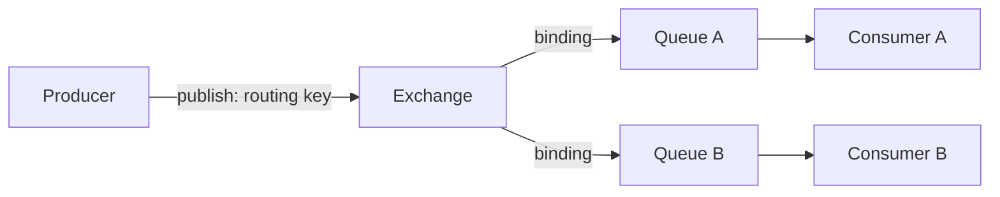
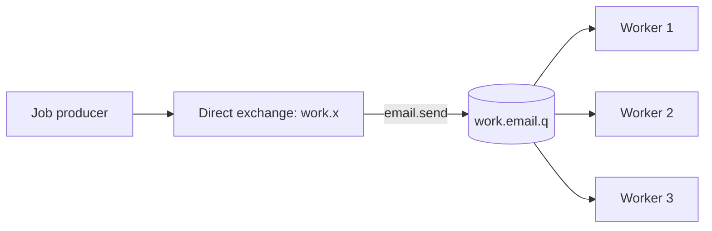
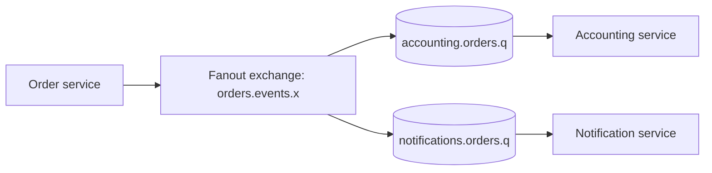
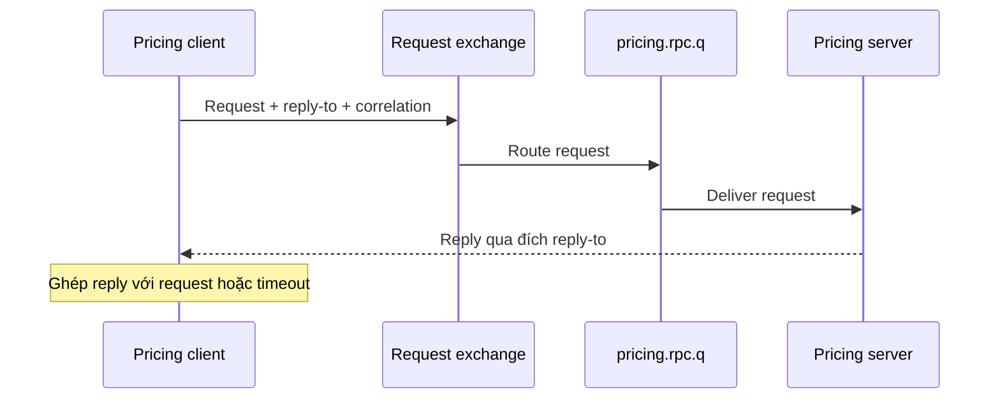

# Hàng đợi công việc, phát–đăng ký và yêu cầu–phản hồi

Trong hệ thống bất đồng bộ, cùng là “gửi một message qua RabbitMQ” nhưng cách tổ chức **exchange, queue, binding và consumer** quyết định điều gì sẽ xảy ra: một tác vụ được một worker xử lý, một sự kiện được nhiều hệ thống nhận, hay một lời gọi cần lấy kết quả trả về. Đây là ba kiểu giao tiếp thường gặp khi tích hợp RabbitMQ bằng **Spring AMQP** với `RabbitTemplate` và `@RabbitListener`.

Sau bài học, bạn có thể:

- Phân biệt **work queue**, **publish–subscribe** và **request–reply (RPC)** theo mục đích và số lượng bên nhận.
- Thiết kế exchange, queue và binding phù hợp với từng kiểu giao tiếp.
- Hiểu cách `RabbitTemplate` gửi message và `@RabbitListener` tiêu thụ message trong Spring AMQP.
- Nhận diện các giới hạn về xác nhận xử lý, giao lại message, timeout và khả năng chịu lỗi.

> Các ví dụ sử dụng Spring Boot và `spring-boot-starter-amqp`. Payload là `String` để tập trung vào cơ chế định tuyến; khi triển khai nghiệp vụ, nên dùng định dạng có schema rõ ràng (ví dụ JSON), kiểm soát phiên bản sự kiện và cấu hình message converter phù hợp.

## 1. Nền tảng chung: message đi qua đâu?

Với RabbitMQ, producer thông thường **publish vào exchange**, exchange dùng binding để định tuyến đến một hoặc nhiều queue, rồi broker phân phối message từ mỗi queue đến consumer.



| Thành phần | Vai trò |
| --- | --- |
| `RabbitTemplate` | API phía ứng dụng để publish và, khi cần, chờ reply. |
| **Exchange** | Nhận message và xác định những queue đích theo loại exchange và binding. |
| **Binding** | Liên kết exchange với queue; có thể chứa routing key hoặc pattern. |
| **Queue** | Giữ message cho đến khi được tiêu thụ hoặc bị loại bỏ theo chính sách. |
| `@RabbitListener` | Khai báo phương thức nhận message từ một queue qua listener container. |

Ví dụ dùng **direct exchange**: producer gửi với routing key `email.send`; binding có cùng key chuyển message vào `work.email.q`. Với **fanout exchange**, mọi queue được binding đều nhận một bản sao, không cần dựa vào routing key.

Ba mô hình khác nhau ở cách bố trí queue, chứ không phải ở chỗ phải dùng ba thư viện khác nhau:

| Tiêu chí | Hàng đợi công việc (work queue) | Phát–đăng ký (publish–subscribe) | Yêu cầu–phản hồi (request–reply) |
| --- | --- | --- | --- |
| Nhu cầu | Chia việc cho nhiều worker | Thông báo cùng sự kiện cho nhiều bên | Gửi yêu cầu và lấy kết quả |
| Topology điển hình | Một queue, nhiều consumer cạnh tranh | Một exchange, nhiều queue theo subscriber | Request queue và đường reply |
| Mỗi message đến ai? | Một consumer tại một thời điểm trong queue | Một lần đến mỗi queue được binding; trong từng queue các consumer vẫn cạnh tranh | Một request handler và một reply cho client tương ứng |
| Quan hệ thời gian | Producer không cần chờ worker | Publisher không cần chờ subscriber | Client thường chờ reply hoặc timeout |
| Ví dụ | Gửi email, tạo thumbnail | `OrderCreated` cho kế toán và thông báo | Hỏi kết quả định giá từ dịch vụ khác |

## 2. Work queue: chia công việc giữa các worker

### 2.1. Cơ chế

Khi nhiều instance `@RabbitListener` cùng lắng nghe **một queue**, RabbitMQ phân phối message giữa các consumer đó. Một message đã giao cho consumer A sẽ không đồng thời được giao cho B trong lần giao đó. Nếu A không xác nhận và kết nối bị ngắt, broker có thể giao lại cho B.



Ví dụ: dịch vụ đặt hàng đẩy công việc gửi email xác nhận; một nhóm worker xử lý từng email. Thêm worker giúp tăng khả năng xử lý, nhưng **không** biến mỗi công việc thành một thông báo gửi cho tất cả worker.

### 2.2. Khai báo topology

```java
import org.springframework.amqp.core.Binding;
import org.springframework.amqp.core.BindingBuilder;
import org.springframework.amqp.core.DirectExchange;
import org.springframework.amqp.core.Queue;
import org.springframework.amqp.core.QueueBuilder;
import org.springframework.beans.factory.annotation.Qualifier;
import org.springframework.context.annotation.Bean;
import org.springframework.context.annotation.Configuration;

@Configuration
class WorkQueueConfig {
    @Bean
    DirectExchange workExchange() {
        return new DirectExchange("work.x");
    }

    @Bean
    Queue emailWorkQueue() {
        return QueueBuilder.durable("work.email.q").build();
    }

    @Bean
    Binding emailWorkBinding(
            @Qualifier("emailWorkQueue") Queue queue,
            @Qualifier("workExchange") DirectExchange exchange) {
        return BindingBuilder.bind(queue).to(exchange).with("email.send");
    }
}
```

Trong một ứng dụng Spring Boot được cấu hình Spring AMQP thông thường, các bean `Queue`, `Exchange` và `Binding` có thể được `RabbitAdmin` khai báo với broker khi kết nối. `durable` giúp **định nghĩa queue** tồn tại qua broker restart; để bảo vệ message còn cần xét delivery mode, publisher confirms, loại queue và cấu hình broker.

### 2.3. Gửi việc và nhận việc

```java
import org.springframework.amqp.rabbit.core.RabbitTemplate;
import org.springframework.stereotype.Service;

@Service
class EmailJobPublisher {
    private final RabbitTemplate rabbitTemplate;

    EmailJobPublisher(RabbitTemplate rabbitTemplate) {
        this.rabbitTemplate = rabbitTemplate;
    }

    void enqueueEmail(String emailJobId) {
        rabbitTemplate.convertAndSend("work.x", "email.send", emailJobId);
    }
}
```

```java
import org.springframework.amqp.rabbit.annotation.RabbitListener;
import org.springframework.stereotype.Component;

@Component
class EmailWorker {
    @RabbitListener(queues = "work.email.q", concurrency = "2-5")
    public void sendEmail(String emailJobId) {
        // Tra cứu công việc, gửi email và ghi nhận kết quả.
        // Nếu có lỗi, ném exception để cơ chế xử lý lỗi tiếp nhận.
        System.out.println("Đã xử lý email job: " + emailJobId);
    }
}
```

`concurrency = "2-5"` minh họa một listener chạy từ 2 đến 5 consumer với **simple listener container**. Nhiều instance ứng dụng khác nhau cũng có thể cùng tiêu thụ queue này. Cần điều chỉnh concurrency, prefetch và giới hạn hệ thống đích thay vì mặc định càng nhiều consumer càng tốt.

**Điểm dễ nhầm:** chế độ xác nhận `AUTO` của Spring AMQP có nghĩa listener container **tự gửi ACK sau khi phương thức xử lý thành công**; không có nghĩa RabbitMQ bỏ qua cơ chế ACK. Nếu phương thức ném exception, hành vi reject/requeue/retry phụ thuộc cấu hình listener và error handler. Một công việc có thể bị xử lý lại, vì vậy thao tác như gửi email hoặc trừ tiền cần cơ chế chống thực thi trùng theo ID nghiệp vụ.

## 3. Publish–subscribe: mỗi bên đăng ký nhận sự kiện

### 3.1. Cơ chế

Khi một đơn hàng được tạo, các hệ thống kế toán, thông báo và phân tích có thể đều cần biết sự kiện `OrderCreated`. Nếu tất cả cùng tiêu thụ **một queue**, chúng sẽ chia nhau message và có bên không nhận được sự kiện. Mỗi nhóm subscriber cần **queue riêng**, cùng bind vào exchange phát sự kiện.



Một lần publish tạo ra một bản message ở **mỗi queue đang được bind**. Khi có nhiều instance Accounting cùng đọc `accounting.orders.q`, chúng tiếp tục cạnh tranh xử lý **bản message trong queue kế toán**; hệ thống Notifications vẫn nhận bản của mình.

### 3.2. Khai báo fanout exchange và queue riêng

```java
import org.springframework.amqp.core.Binding;
import org.springframework.amqp.core.BindingBuilder;
import org.springframework.amqp.core.FanoutExchange;
import org.springframework.amqp.core.Queue;
import org.springframework.amqp.core.QueueBuilder;
import org.springframework.beans.factory.annotation.Qualifier;
import org.springframework.context.annotation.Bean;
import org.springframework.context.annotation.Configuration;

@Configuration
class OrderEventsConfig {
    @Bean
    FanoutExchange orderEventsExchange() {
        return new FanoutExchange("orders.events.x");
    }

    @Bean
    Queue accountingEventsQueue() {
        return QueueBuilder.durable("accounting.orders.q").build();
    }

    @Bean
    Queue notificationEventsQueue() {
        return QueueBuilder.durable("notifications.orders.q").build();
    }

    @Bean
    Binding accountingBinding(
            @Qualifier("accountingEventsQueue") Queue queue,
            @Qualifier("orderEventsExchange") FanoutExchange exchange) {
        return BindingBuilder.bind(queue).to(exchange);
    }

    @Bean
    Binding notificationBinding(
            @Qualifier("notificationEventsQueue") Queue queue,
            @Qualifier("orderEventsExchange") FanoutExchange exchange) {
        return BindingBuilder.bind(queue).to(exchange);
    }
}
```

Publisher phát sự kiện một lần; fanout exchange **bỏ qua routing key** (tham số `""` bên dưới):

```java
rabbitTemplate.convertAndSend(
        "orders.events.x",
        "",
        "{\"type\":\"OrderCreated\",\"orderId\":\"O-17\"}");
```

Hai service có thể có những listener độc lập:

```java
@RabbitListener(queues = "accounting.orders.q")
public void recordOrder(String eventJson) {
    // Phân tích payload và cập nhật sổ kế toán.
}

@RabbitListener(queues = "notifications.orders.q")
public void notifyCustomer(String eventJson) {
    // Phân tích payload và gửi thông báo.
}
```

Trong thực tế, hai phương thức trên thường nằm ở **hai ứng dụng khác nhau**; mỗi service chỉ cần sở hữu cấu hình queue và listener của mình. Việc đặt chung ở đây giúp nhìn rõ sự khác biệt về topology.

### 3.3. Khi nào dùng topic exchange?

`FanoutExchange` phát cho **mọi queue được bind**, bất kể loại sự kiện. Nếu subscriber chỉ muốn một phần sự kiện, dùng `TopicExchange` và binding pattern:

| Routing key được publish | Binding pattern | Có khớp? |
| --- | --- | --- |
| `order.created` | `order.*` | Có |
| `order.cancelled` | `order.*` | Có |
| `payment.completed` | `order.*` | Không |
| `order.created.eu` | `order.#` | Có |

Trong topic binding, `*` khớp đúng **một từ**, còn `#` khớp **không hoặc nhiều từ** ngăn cách bằng dấu chấm. Dù là fanout hay topic, **mỗi subscriber cần queue riêng** nếu muốn nhận độc lập. RabbitMQ không lưu sự kiện cho một subscriber chưa có queue được bind tại thời điểm publish, trừ khi hệ thống có cơ chế lưu/định tuyến khác.

## 4. Request–reply: hỏi và đợi kết quả

### 4.1. Cơ chế

Đôi khi producer cần kết quả từ dịch vụ xử lý: ví dụ hỏi giá vận chuyển trước khi xác nhận đơn. Với **request–reply**, client publish một request và chờ server gửi reply tương ứng. Ở phía client, thao tác này có thể trông đồng bộ mặc dù cả hai chiều đều đi qua AMQP.



Hai thuộc tính AMQP có ý nghĩa quan trọng:

- `replyTo`: địa chỉ để server gửi phản hồi về.
- `correlationId`: mã giúp client ghép response với request gốc, nhất là khi có nhiều request đồng thời.

Khi sử dụng `RabbitTemplate.convertSendAndReceive(...)`, Spring AMQP quản lý cơ chế reply/correlation cần thiết cho lời gọi. Với RabbitMQ có hỗ trợ **Direct Reply-to**, template thường dùng `amq.rabbitmq.reply-to` để nhận phản hồi mà không phải tự tạo một reply queue riêng. Chi tiết tùy cấu hình và phiên bản; không nên tự hard-code pseudo-queue này vào topology ứng dụng.

### 4.2. Request queue và server trả kết quả

```java
import org.springframework.amqp.core.Binding;
import org.springframework.amqp.core.BindingBuilder;
import org.springframework.amqp.core.DirectExchange;
import org.springframework.amqp.core.Queue;
import org.springframework.amqp.core.QueueBuilder;
import org.springframework.beans.factory.annotation.Qualifier;
import org.springframework.context.annotation.Bean;
import org.springframework.context.annotation.Configuration;

@Configuration
class PricingRpcConfig {
    @Bean
    DirectExchange pricingRpcExchange() {
        return new DirectExchange("pricing.rpc.x");
    }

    @Bean
    Queue pricingRpcQueue() {
        return QueueBuilder.durable("pricing.rpc.q").build();
    }

    @Bean
    Binding pricingRpcBinding(
            @Qualifier("pricingRpcQueue") Queue queue,
            @Qualifier("pricingRpcExchange") DirectExchange exchange) {
        return BindingBuilder.bind(queue).to(exchange).with("pricing.calculate");
    }
}
```

```java
import org.springframework.amqp.rabbit.annotation.RabbitListener;
import org.springframework.stereotype.Component;

@Component
class PricingRpcHandler {
    @RabbitListener(queues = "pricing.rpc.q")
    public String calculate(String productCode) {
        // Demo: nghiệp vụ thực tế sẽ tra cứu và tính toán.
        return productCode + ":100000";
    }
}
```

Với một listener có kiểu trả về như trên, hạ tầng Spring AMQP gửi giá trị trả về đến địa chỉ reply của request. Trong ví dụ, request và response đều là `String`, phù hợp với bộ chuyển đổi message mặc định.

### 4.3. Client gửi request và nhận reply

```java
import org.springframework.amqp.rabbit.core.RabbitTemplate;
import org.springframework.stereotype.Service;

@Service
class PricingRpcClient {
    private final RabbitTemplate rabbitTemplate;

    PricingRpcClient(RabbitTemplate rabbitTemplate) {
        this.rabbitTemplate = rabbitTemplate;
    }

    String calculatePrice(String productCode) {
        Object reply = rabbitTemplate.convertSendAndReceive(
                "pricing.rpc.x", "pricing.calculate", productCode);

        if (!(reply instanceof String result)) {
            throw new IllegalStateException("Không nhận được reply hợp lệ");
        }
        return result;
    }
}
```

Có thể đặt thời hạn chờ reply trong cấu hình Spring Boot:

```yaml
spring:
  rabbitmq:
    template:
      reply-timeout: 3s
```

Khi quá hạn, `convertSendAndReceive(...)` có thể trả về `null`. **Timeout không chứng minh server chưa xử lý**: server có thể đã hoàn tất nghiệp vụ nhưng phản hồi đến quá muộn, hoặc reply bị mất. Vì vậy, retry RPC có nguy cơ kích hoạt nghiệp vụ hai lần; server cần idempotency hoặc cơ chế tra cứu trạng thái theo request ID cho tác vụ có tác dụng phụ.

Đừng dùng RPC chỉ vì muốn giữ phong cách gọi hàm đồng bộ. Nếu tác vụ chạy lâu hoặc client không cần kết quả tức thì, hãy gửi command vào work queue và thông báo tiến độ/kết quả qua event, callback hay kho trạng thái.

## 5. Độ tin cậy áp dụng cho cả ba mô hình

Lựa chọn topology chỉ trả lời **ai nhận message**. Nó chưa đảm bảo message không mất, không lặp hay được xử lý thành công. Khi xây dựng ứng dụng Spring AMQP đáng tin cậy, cần phân biệt các lớp sau:

| Vấn đề | Biện pháp và giới hạn |
| --- | --- |
| Broker khởi động lại | Queue/exchange bền vững và message persistent giúp bảo toàn dữ liệu theo khả năng của broker; cân nhắc loại queue, chính sách lưu trữ và replication. |
| Publisher muốn biết broker đã nhận | Bật **publisher confirms**. Confirm xác nhận việc publish ở phía broker, **không** xác nhận xử lý nghiệp vụ bởi consumer. |
| Message không được route vào queue | Kiểm tra binding; dùng `mandatory` + publisher returns hoặc alternate exchange theo nhu cầu. Confirm đơn thuần không có nghĩa message đã đến queue mong muốn. |
| Worker chết trước ACK | Broker có thể giao lại message chưa ACK. Xử lý theo **at-least-once**, lưu ID và làm nghiệp vụ idempotent. |
| Consumer xử lý lỗi liên tục | Thiết kế retry có giới hạn, backoff và dead-letter queue; tránh requeue vô hạn gây vòng lặp nóng. |
| Backlog tăng | Theo dõi số message ready/unacked, consumer count, throughput và thời gian chờ; điều chỉnh prefetch/concurrency dựa trên năng lực thực tế. |
| RPC chờ quá lâu | Đặt timeout; phân biệt lỗi timeout với kết quả nghiệp vụ thất bại; dự phòng reply đến muộn. |

Một cấu hình minh họa cho **simple listener container** khi đang thử nghiệm work queue:

```yaml
spring:
  rabbitmq:
    listener:
      simple:
        prefetch: 10
        acknowledge-mode: auto
```

`prefetch: 10` giới hạn số message chưa được ACK có thể được cấp trước cho consumer theo cách RabbitMQ áp dụng prefetch; nó ảnh hưởng đến phân phối tải, bộ nhớ và thời gian message nằm trong worker. Không có một con số tối ưu cho mọi tác vụ.

**Phân biệt ba loại “xác nhận”:** publisher confirm từ broker, consumer ACK với broker, và xác nhận nghiệp vụ thành công giữa các service. Chúng giải quyết những rủi ro khác nhau. Không mô hình nào trong ba mô hình ở bài này tự cung cấp ngữ nghĩa **exactly once** cho thao tác kinh doanh.

## 6. Tình huống chọn mô hình

Giả sử một hệ thống thương mại điện tử cần xử lý việc tạo đơn:

1. **Tạo PDF hóa đơn** mất vài giây và có thể tăng số worker: đưa command `invoice.generate` vào **work queue**; các worker cùng lắng nghe queue để chia tải.
2. **Đơn hàng đã tạo** cần thông báo cho kế toán, kho và marketing: publish `OrderCreated` qua **publish–subscribe**; mỗi hệ thống có queue riêng và tự quản lý lỗi của mình.
3. **Xác định mức phí ngay trên màn hình thanh toán** cần kết quả trong thời hạn ngắn: có thể dùng **request–reply** với timeout rõ ràng; nếu dịch vụ tính phí chậm hoặc không sẵn sàng, ứng dụng phải có cách phản hồi phù hợp cho người dùng.

Không có mâu thuẫn khi cùng một hệ thống dùng cả ba: **work queue** để phân phối công việc, **publish–subscribe** để phân phối sự kiện, **request–reply** cho những tương tác cần kết quả trực tiếp.

### Thực hành tự kiểm chứng

| Thử nghiệm | Cách làm | Điều cần quan sát |
| --- | --- | --- |
| Chia tải | Chạy hai instance `EmailWorker`, gửi 10 job vào một queue | Tổng số job xử lý là 10 lần nếu không có lỗi/giao lại; mỗi instance nhận một phần, không phải mỗi instance nhận đủ 10. |
| Phát sự kiện | Bind hai queue riêng vào fanout exchange, publish ba sự kiện | Mỗi queue có ba bản message nếu đã bind trước khi publish. |
| Consumer offline | Dừng subscriber sau khi queue durable của nó được tạo, rồi publish | Message có thể tích lại trong queue của subscriber; subscriber khác vẫn tiêu thụ bình thường. |
| RPC timeout | Cho handler xử lý lâu hơn `reply-timeout` | Client hết hạn chờ dù server vẫn có thể tiếp tục xử lý. |
| Xử lý lại | Làm worker lỗi trước ACK và quan sát chính sách retry/requeue | Có thể nhận lại cùng message; cần thiết kế idempotency và giới hạn retry. |

### Câu hỏi ôn tập

1. Vì sao hai hệ thống cùng đọc một queue không tương đương với publish–subscribe?
2. Nếu một fanout exchange không có queue nào được bind tại thời điểm publish, điều gì có thể xảy ra với message?
3. `@RabbitListener` xử lý thành công có đảm bảo producer nhận biết nghiệp vụ đã hoàn tất không?
4. Vì sao timeout khi `convertSendAndReceive(...)` không đủ để quyết định gửi lại request một cách an toàn?
5. Khi cần gửi sự kiện `order.created` chỉ cho các subscriber quan tâm tới đơn hàng, bạn sẽ dùng exchange/binding nào?

Nắm được **mối quan hệ giữa exchange, queue, binding và consumer** là nền tảng để chọn đúng mô hình giao tiếp. Các chủ đề tiếp theo như ACK, publisher confirms, retry, dead-letter, giao dịch và giám sát sẽ bổ sung lớp bảo vệ cần thiết để vận hành những mô hình này trong thực tế.
