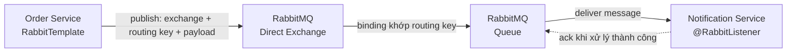

# Quan hệ giữa AMQP, RabbitMQ và Spring AMQP

## 1. Vì sao cần phân biệt ba khái niệm?

Giả sử một hệ thống thương mại điện tử có hai dịch vụ:

- **Order Service** tiếp nhận đơn hàng và lưu đơn vào cơ sở dữ liệu.
- **Notification Service** gửi email hoặc thông báo sau khi đơn hàng được tạo.

Nếu Order Service gọi trực tiếp Notification Service qua HTTP, thời gian phản hồi và khả năng hoạt động của luồng tạo đơn có thể bị ảnh hưởng khi dịch vụ gửi thông báo chậm hoặc tạm thời ngừng hoạt động. Với xử lý bất đồng bộ, Order Service **phát một message** mô tả sự kiện; một dịch vụ khác **nhận và xử lý message** khi có thể.

Trong giải pháp sử dụng Spring Boot và RabbitMQ, ba tên gọi thường xuất hiện cùng nhau:

- **AMQP** quy định cách các bên trao đổi message theo một giao thức.
- **RabbitMQ** là phần mềm message broker nhận, định tuyến, lưu hàng đợi và chuyển message.
- **Spring AMQP** là bộ thư viện giúp ứng dụng Java/Spring giao tiếp với RabbitMQ thuận tiện hơn.

Chúng bổ sung cho nhau nhưng không đồng nghĩa. Hiểu đúng ranh giới này giúp chọn API, thiết kế exchange/queue/binding và xử lý lỗi ở đúng tầng.

## 2. AMQP: giao thức trao đổi message

**AMQP** là viết tắt của *Advanced Message Queuing Protocol*. Đây là giao thức truyền thông cho các hệ thống nhắn tin, mô tả những thao tác và quy tắc để client và message broker phối hợp với nhau.

Khi học RabbitMQ với Spring AMQP, giao thức cần chú ý chủ yếu là **AMQP 0-9-1**. Mô hình này có những thành phần sau:

| Thành phần | Ý nghĩa |
| --- | --- |
| **Producer** | Ứng dụng gửi (publish) message. |
| **Exchange** | Điểm broker tiếp nhận message và quyết định các queue đích. |
| **Queue** | Hàng đợi chứa message sẵn sàng để consumer nhận. |
| **Binding** | Quy tắc nối exchange với queue; có thể sử dụng binding key. |
| **Routing key** | Chuỗi do producer gửi kèm để exchange dùng khi định tuyến, tùy loại exchange. |
| **Consumer** | Ứng dụng đăng ký nhận message từ queue. |
| **Acknowledgement (ack)** | Tín hiệu consumer xác nhận đã xử lý delivery để broker có thể loại delivery đó khỏi trạng thái chờ xác nhận. |

Một số loại exchange thông dụng:

- **Direct**: so khớp routing key với binding key theo giá trị chính xác.
- **Topic**: so khớp routing key dạng từ phân tách bởi dấu chấm, dùng mẫu như `orders.*` hoặc `orders.#`.
- **Fanout**: phân phối bản sao message tới mọi queue được binding với exchange; bỏ qua routing key khi định tuyến.
- **Headers**: định tuyến dựa trên các header thay vì routing key.

**Lưu ý về phiên bản:** AMQP 0-9-1 và **AMQP 1.0** là hai giao thức có mô hình và định dạng truyền khác nhau, không thể coi 1.0 chỉ là bản nâng cấp tương thích trực tiếp của 0-9-1. RabbitMQ có thể cung cấp nhiều giao thức tùy phiên bản và cấu hình; các ví dụ `RabbitTemplate` và `@RabbitListener` dưới đây sử dụng mô hình RabbitMQ/AMQP 0-9-1 thông dụng của Spring AMQP.

AMQP mô tả **cách giao tiếp**. Bản thân AMQP không phải là một tiến trình server và không tự tạo hàng đợi trên máy của bạn.

## 3. RabbitMQ: broker thực thi việc trao đổi message

**RabbitMQ** là phần mềm message broker. Ứng dụng producer thiết lập kết nối đến RabbitMQ để publish; RabbitMQ nhận message tại exchange, áp dụng binding để tìm queue phù hợp, rồi phân phối các message trong queue tới consumer.

Ví dụ với direct exchange:

```text
Exchange:   orders.events
Queue:      orders.created.q
Binding:    orders.events --[orders.created]--> orders.created.q

Producer publish:
  exchange   = orders.events
  routingKey = orders.created
  body       = order-123

RabbitMQ đưa message vào orders.created.q
Consumer nhận message từ orders.created.q
```

Luồng dữ liệu có thể hình dung như sau:



**Exchange và queue đều nằm phía broker**, trong khi producer và consumer thường là các ứng dụng riêng. Producer không cần biết địa chỉ tiến trình consumer; producer chỉ cần biết cách gửi message đến broker.

Nếu message không khớp bất kỳ binding nào, RabbitMQ có thể loại bỏ message đó hoặc trả lại cho publisher tùy cờ `mandatory` và cơ chế xử lý tương ứng. Việc publish không có lỗi ở phía client **không tự chứng minh** message đã đến một queue, càng không chứng minh nghiệp vụ đã xử lý thành công.

Một queue có thể có nhiều consumer cạnh tranh nhận công việc. Nếu cần *mỗi dịch vụ đều nhận một bản sao sự kiện*, các dịch vụ thường dùng **các queue riêng** cùng binding với exchange, thay vì cùng nghe trên một queue.

### RabbitMQ còn làm gì ngoài chuyển tiếp?

Trong giới hạn cấu hình và khả năng của broker, RabbitMQ hỗ trợ:

- Quản lý connection, channel, virtual host, quyền truy cập và topology (exchange/queue/binding).
- Queue bền vững, lưu trữ message, phân phối message và xác nhận consumer.
- Publisher confirms, xử lý message không định tuyến được, retry/requeue và dead-letter.
- Theo dõi queue depth, tốc độ publish/deliver/ack, consumer và tình trạng kết nối.

Các khả năng đó cần **được cấu hình và phối hợp với logic ứng dụng**. Chỉ cài RabbitMQ không tự động bảo đảm không mất message, không trùng message hoặc xử lý đúng một lần.

## 4. Spring AMQP: cầu nối giữa mã Java/Spring và RabbitMQ

**Spring AMQP** là hệ sinh thái thư viện của Spring để lập trình với AMQP. Khi tích hợp RabbitMQ, thành phần thường dùng là **Spring Rabbit**, xây dựng trên RabbitMQ Java client. Với ứng dụng Spring Boot, dependency `spring-boot-starter-amqp` cung cấp các thành phần cần thiết và hỗ trợ tự cấu hình.

Những API quan trọng:

| Nhu cầu trong ứng dụng | Spring AMQP/Spring Rabbit | Khái niệm RabbitMQ/AMQP liên quan |
| --- | --- | --- |
| Gửi message | `RabbitTemplate.convertAndSend(...)`, `send(...)` | Publish đến exchange bằng routing key |
| Nhận và xử lý message | `@RabbitListener`, listener container | Consumer nhận từ queue |
| Khai báo topology | `Queue`, `DirectExchange`, `TopicExchange`, `Binding`, `BindingBuilder` | Queue, exchange, binding tại broker |
| Quản lý kết nối | `CachingConnectionFactory` và các abstraction liên quan | TCP connection, AMQP channel |
| Chuyển đổi payload | `MessageConverter` | Message body, content type, header |
| Điều khiển tiêu thụ | Cấu hình listener container, acknowledge mode, prefetch | Delivery, consumer ack/nack |
| Xử lý sự cố | Retry interceptor, error handler, dead-letter topology | Redelivery, reject/nack, dead-letter |
| Quan sát phía ứng dụng | Logging, metrics/observation khi cấu hình | Publish, delivery, listener processing |

Spring AMQP không thay thế RabbitMQ: **`RabbitTemplate` không phải message broker**, và `@RabbitListener` không chứa message khi RabbitMQ ngừng hoạt động. Thư viện này giảm việc lập trình trực tiếp với connection/channel, chuyển đổi message, lắng nghe hàng đợi và xử lý vòng đời listener.

Một vài điểm phân biệt quan trọng:

1. `RabbitTemplate` là API phía **producer**; gọi `convertAndSend` để chuyển payload thành message và publish.
2. `@RabbitListener` đăng ký một **consumer từ queue**, không trực tiếp “nghe exchange”. Exchange định tuyến vào queue trước.
3. `Queue`, `Exchange` và `Binding` khai báo trong Java là **đối tượng mô tả topology**. Chúng cần được một cơ chế như `RabbitAdmin` thực sự khai báo trên RabbitMQ (Spring Boot thường hỗ trợ tự cấu hình), hoặc được tạo sẵn bằng cách khác.
4. Spring Boot đơn giản hóa cấu hình và quản lý bean; các quy tắc định tuyến và xác nhận message vẫn do giao thức và broker quyết định.

## 5. Ví dụ hoàn chỉnh: gửi và nhận sự kiện tạo đơn hàng

Ví dụ dưới đây sử dụng **Spring Boot + Spring AMQP + RabbitMQ** với payload đơn giản là mã đơn hàng kiểu `String`. Nó minh họa sự phân chia trách nhiệm giữa ứng dụng và broker, chưa nhằm cung cấp giải pháp nghiệp vụ production hoàn chỉnh.

### Bước 1 — Thêm dependency và kết nối RabbitMQ

Trong dự án Spring Boot sử dụng Maven:

```xml
<dependency>
    <groupId>org.springframework.boot</groupId>
    <artifactId>spring-boot-starter-amqp</artifactId>
</dependency>
```

Một cấu hình `application.yml` dùng cho RabbitMQ chạy tại máy phát triển:

```yaml
spring:
  rabbitmq:
    host: localhost
    port: 5672
    username: guest
    password: guest
```

Tài khoản `guest/guest` trong ví dụ chỉ phù hợp môi trường RabbitMQ local được cấu hình cho phép; môi trường thực tế phải sử dụng tài khoản, quyền truy cập và thông tin bí mật riêng. RabbitMQ cần đang chạy và có thể nhận kết nối từ ứng dụng.

### Bước 2 — Khai báo exchange, queue và binding

```java
package com.example.messaging;

import org.springframework.amqp.core.Binding;
import org.springframework.amqp.core.BindingBuilder;
import org.springframework.amqp.core.DirectExchange;
import org.springframework.amqp.core.Queue;
import org.springframework.amqp.core.QueueBuilder;
import org.springframework.context.annotation.Bean;
import org.springframework.context.annotation.Configuration;

@Configuration
public class OrderMessagingConfig {
    public static final String EXCHANGE = "orders.events";
    public static final String QUEUE = "orders.created.q";
    public static final String ROUTING_KEY = "orders.created";

    @Bean
    DirectExchange ordersExchange() {
        return new DirectExchange(EXCHANGE);
    }

    @Bean
    Queue ordersQueue() {
        return QueueBuilder.durable(QUEUE).build();
    }

    @Bean
    Binding ordersBinding(Queue ordersQueue,
                          DirectExchange ordersExchange) {
        return BindingBuilder.bind(ordersQueue)
                .to(ordersExchange)
                .with(ROUTING_KEY);
    }
}
```

`DirectExchange` được gắn tên `orders.events`; queue tên `orders.created.q` được khai báo durable. Binding bảo RabbitMQ: khi message đến exchange này với routing key `orders.created`, hãy định tuyến nó tới queue trên.

Với cấu hình Spring Boot thông thường có `RabbitAdmin`, các bean topology có thể được khai báo tự động tới broker lúc ứng dụng kết nối. Trong môi trường quản trị tập trung, topology cũng có thể được provision trước; ứng dụng vẫn cần sử dụng đúng tên và thuộc tính tương thích.

### Bước 3 — Producer publish message bằng RabbitTemplate

```java
package com.example.messaging;

import org.springframework.amqp.rabbit.core.RabbitTemplate;
import org.springframework.stereotype.Service;

@Service
public class OrderEventPublisher {
    private final RabbitTemplate rabbitTemplate;

    public OrderEventPublisher(RabbitTemplate rabbitTemplate) {
        this.rabbitTemplate = rabbitTemplate;
    }

    public void publishOrderCreated(String orderId) {
        rabbitTemplate.convertAndSend(
                OrderMessagingConfig.EXCHANGE,
                OrderMessagingConfig.ROUTING_KEY,
                orderId
        );
    }
}
```

Khi nghiệp vụ gọi `publishOrderCreated("order-123")`, `RabbitTemplate` dùng bộ chuyển đổi message đã cấu hình để gửi payload thông qua kết nối AMQP đến RabbitMQ. Ở đây dùng `String` để không cần cấu hình JSON converter. Với object nghiệp vụ, cần xác định rõ định dạng dữ liệu (ví dụ JSON), message converter và tương thích schema giữa producer và consumer.

### Bước 4 — Consumer nhận message bằng @RabbitListener

```java
package com.example.messaging;

import org.springframework.amqp.rabbit.annotation.RabbitListener;
import org.springframework.stereotype.Component;

@Component
public class OrderCreatedListener {

    @RabbitListener(queues = OrderMessagingConfig.QUEUE)
    public void handle(String orderId) {
        System.out.println("Received order-created event: " + orderId);
        // Thay bằng xử lý nghiệp vụ thực tế, có kiểm soát lỗi.
    }
}
```

Spring tạo listener container, quản lý consumer và chuyển payload đến phương thức `handle`. Ở chế độ acknowledge `AUTO` thường được cấu hình mặc định cho listener container, framework xác nhận delivery sau khi phương thức xử lý thành công; khi có lỗi, hành vi reject/requeue phụ thuộc cấu hình container và error handler. **AUTO là tự động xác nhận theo kết quả xử lý, không có nghĩa broker vừa giao message là đã xác nhận.**

### Bước 5 — Đi theo một message từ đầu đến cuối

| Thứ tự | Điều xảy ra | Thành phần chịu trách nhiệm chính |
| --- | --- | --- |
| 1 | Nghiệp vụ gọi `publishOrderCreated("order-123")`. | Mã ứng dụng producer |
| 2 | `RabbitTemplate` chuyển payload và publish tới exchange `orders.events` với routing key `orders.created`. | Spring AMQP / AMQP client |
| 3 | Exchange tìm binding khớp, đẩy message vào `orders.created.q`. | RabbitMQ |
| 4 | Broker giao message từ queue cho consumer đang hoạt động. | RabbitMQ / giao thức AMQP |
| 5 | Listener container gọi `handle("order-123")`. | Spring AMQP / mã consumer |
| 6 | Nếu xử lý thành công trong chế độ `AUTO`, container gửi ack. | Spring AMQP / AMQP client |

Nếu muốn quan sát, mở RabbitMQ Management UI khi plugin quản trị đã được bật (thường truy cập cổng `15672` ở môi trường local). Xem exchange, binding, queue, số message *ready*, *unacknowledged* và số consumer. Những giá trị này giúp phân biệt message đã vào queue, đang giao cho consumer hay đã được ack.

## 6. Trách nhiệm về độ tin cậy nằm ở tầng nào?

Một hệ thống xử lý bất đồng bộ đáng tin cậy cần phối hợp cả ba tầng. Không nên suy từ việc dùng `RabbitTemplate` hoặc queue durable rằng toàn bộ nghiệp vụ đã an toàn.

| Vấn đề | Vai trò của giao thức / RabbitMQ | Vai trò của Spring AMQP và ứng dụng |
| --- | --- | --- |
| **Định tuyến** | Exchange áp dụng binding; message có thể không được định tuyến nếu không có queue khớp. | Chọn exchange/routing key đúng; khai báo topology; theo dõi publisher returns khi cần. |
| **Message tồn tại qua lỗi broker** | Durable queue và cơ chế lưu message hỗ trợ phục hồi theo loại queue/cấu hình. | Chọn delivery mode, mức bền vững, cấu hình publisher confirms; kiểm tra yêu cầu dữ liệu. |
| **Xác nhận phía publisher** | Publisher confirms cho biết broker đã xác nhận việc nhận/xử lý publish theo cơ chế confirm. | Bật confirm, kiểm tra callback/kết quả, xử lý thất bại và thiết kế phát lại phù hợp. |
| **Xác nhận phía consumer** | Broker giữ trạng thái delivery chưa ack và có thể giao lại nếu consumer mất kết nối. | Chọn AUTO/MANUAL, ack đúng thời điểm, xử lý ngoại lệ và kiểm soát requeue. |
| **Xử lý thất bại** | Reject/nack, dead-letter exchange, TTL và các chính sách queue hỗ trợ xử lý lại hoặc tách message. | Đặt retry có giới hạn, phân biệt lỗi tạm thời/vĩnh viễn, thiết kế dead-letter queue để điều tra. |
| **Đúng dữ liệu nghiệp vụ** | Broker không thể thay thế transaction của cơ sở dữ liệu ứng dụng. | Thiết kế consumer idempotent; cân nhắc transactional outbox để đồng bộ việc lưu DB và phát event. |
| **Quan sát vận hành** | Broker cung cấp số liệu queue, connection, channel, publish/deliver/ack. | Theo dõi log, metrics, lỗi listener, độ trễ xử lý và cảnh báo backlog. |

Ba cặp khái niệm rất dễ bị nhầm:

**Publisher confirm khác consumer acknowledgement.** Confirm trả lời câu hỏi “broker đã xác nhận publish chưa?”; consumer ack trả lời “delivery này đã được consumer xác nhận xử lý chưa?”. Có confirm **không** đồng nghĩa event đã được xử lý nghiệp vụ.

**Publisher return khác publisher confirm.** Return liên quan message không được route tới queue khi publish với `mandatory`; confirm liên quan broker xác nhận publish. Tùy tình huống, publisher có thể nhận confirm thành công nhưng message không có queue đích. Trong Spring Boot, các tùy chọn như `spring.rabbitmq.publisher-confirm-type=correlated`, `spring.rabbitmq.publisher-returns=true` và `spring.rabbitmq.template.mandatory=true` liên quan đến việc quan sát các trường hợp này; ứng dụng còn phải xử lý callback/kết quả tương ứng.

**Retry khác dead-letter.** Retry nhằm thử lại khi lỗi có khả năng phục hồi; dead-letter đưa message sang luồng xử lý riêng khi bị reject/nack không requeue, hết TTL, vượt giới hạn hoặc một số điều kiện queue khác. Requeue liên tục không giới hạn có thể tạo vòng lặp lỗi và làm nghẽn hệ thống.

Giao nhận message trong thực tế thường cần chuẩn bị cho khả năng **at-least-once** (có thể nhận lại). Chẳng hạn consumer đã lưu kết quả vào DB nhưng mất kết nối trước khi ack: broker có thể giao lại message. Vì vậy, consumer nên có khóa nghiệp vụ hoặc cơ chế deduplication/idempotency để tránh ghi trùng hay gửi thông báo trùng. Sự kết hợp transaction DB và publish message cũng không tự động trở thành một giao dịch phân tán chỉ nhờ cấu hình transaction của Spring AMQP.

## 7. Các ngộ nhận cần tránh

| Ngộ nhận | Cách hiểu đúng |
| --- | --- |
| “AMQP là RabbitMQ.” | AMQP là giao thức; RabbitMQ là một broker triển khai giao tiếp qua AMQP và có thể hỗ trợ giao thức khác. |
| “Spring AMQP là một server queue.” | Spring AMQP là thư viện phía ứng dụng; message được broker quản lý. |
| “Gửi message đến tên queue qua mọi exchange đều được.” | Thông thường publish tới **exchange** cùng routing key; exchange quyết định queue đích theo binding. Default exchange là trường hợp đặc biệt định tuyến qua tên queue. |
| “`@RabbitListener` nghe trực tiếp exchange.” | Listener consume từ **queue**; exchange chỉ định tuyến vào queue. |
| “Nhiều listener trên cùng queue sẽ nhận mọi message.” | Các consumer trên cùng queue thường chia nhau message. Muốn mỗi bên nhận bản sao, dùng queue riêng phù hợp topology. |
| “`convertAndSend` trả về nghĩa là nghiệp vụ bên nhận thành công.” | Lệnh gửi chỉ là một giai đoạn; phải phân biệt kết quả publish, routing, delivery và xử lý nghiệp vụ. |
| “Queue durable nghĩa là mọi message chắc chắn không mất.” | Độ bền còn phụ thuộc thuộc tính message, loại queue, trạng thái broker, xác nhận publish và chính sách vận hành. |

## 8. Từ bản đồ khái niệm đến thiết kế thực tế

Khi thiết kế một luồng bất đồng bộ mới với Spring AMQP, có thể đi theo thứ tự:

1. **Xác định sự kiện và nơi phát sinh:** ví dụ `orders.created` chỉ được phát sau khi nghiệp vụ tạo đơn đạt trạng thái được xác nhận.
2. **Chọn topology RabbitMQ:** đặt tên exchange, quyết định direct/topic/fanout, tạo queue riêng cho từng nhóm xử lý cần độc lập và binding thích hợp.
3. **Cài đặt phía Spring:** dùng `RabbitTemplate` để gửi, `@RabbitListener` để nhận, thống nhất message schema và converter.
4. **Quyết định quy tắc giao nhận:** publisher confirm, xử lý unroutable, ack, retry, dead-letter, giới hạn concurrency/prefetch phù hợp.
5. **Kiểm tra lỗi và quan sát:** thử consumer tắt, message không có binding, lỗi xử lý và giao lại; theo dõi queue depth, unacked messages, throughput và log ứng dụng.

Ví dụ **đổi Notification Service thành hai dịch vụ Email Service và Analytics Service**: nếu cả hai phải nhận mỗi sự kiện tạo đơn, tạo **hai queue độc lập** binding tới exchange `orders.events` với cùng routing key `orders.created`. RabbitMQ sẽ phân phối một bản sao đến mỗi queue; mỗi ứng dụng dùng `@RabbitListener` trên queue riêng của mình. Đây là cách ghép AMQP (quy tắc routing), RabbitMQ (broker thực hiện routing) và Spring AMQP (API producer/consumer) thành một kiến trúc có thể mở rộng.

**Điểm cần nhớ:** AMQP định nghĩa cách trao đổi; RabbitMQ thực thi việc định tuyến và hàng đợi; Spring AMQP cung cấp các API như `RabbitTemplate` và `@RabbitListener` để mã Spring tham gia vào luồng trao đổi đó. Độ tin cậy cuối cùng phụ thuộc thiết kế message, topology, cấu hình giao nhận và xử lý lỗi của ứng dụng.

### Tài liệu chính thức để đọc tiếp

- [Spring AMQP Reference](https://docs.spring.io/spring-amqp/reference/)
- [RabbitMQ — AMQP 0-9-1 Model Explained](https://www.rabbitmq.com/tutorials/amqp-concepts)
- [RabbitMQ — Consumer Acknowledgements and Publisher Confirms](https://www.rabbitmq.com/docs/confirms)
