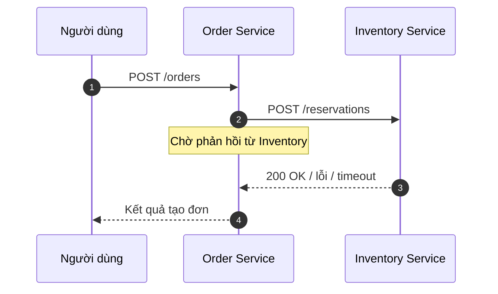
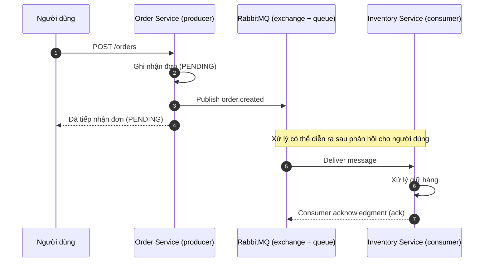

# Phân biệt gửi thông điệp với gọi HTTP đồng bộ

Trong hệ thống nhiều dịch vụ, một hành động của người dùng thường kéo theo nhiều công việc: tạo đơn hàng, giữ hàng trong kho, gửi email và cập nhật báo cáo. Các công việc ấy có thể được kích hoạt bằng **lời gọi HTTP đồng bộ** hoặc bằng cách **gửi thông điệp (message) qua RabbitMQ**. Hai cách đều giúp dịch vụ trao đổi dữ liệu, nhưng khác nhau ở thời điểm nhận kết quả, mức độ phụ thuộc giữa các bên và cách xử lý khi hệ thống gặp sự cố.

Bài học này đặt nền tảng cho việc tích hợp RabbitMQ bằng **Spring AMQP**: dùng `RabbitTemplate` để phát thông điệp, `@RabbitListener` để nhận và xử lý, và `exchange`–`queue`–`binding` để định tuyến. Các chủ đề như publisher confirm, retry, dead-letter, giao dịch và quan sát hệ thống được giới thiệu ở mức cần thiết để hiểu sự khác biệt về độ tin cậy; chúng cần được thiết kế cụ thể khi triển khai thực tế.

## 1. Mục tiêu học tập

Sau bài này, bạn có thể:

- Giải thích luồng **request–response** của HTTP đồng bộ và luồng **producer–broker–consumer** của RabbitMQ.
- Phân biệt phản hồi HTTP, xác nhận từ broker và xác nhận xử lý của consumer.
- Nhận diện các điểm phụ thuộc về thời gian, sự cố, độ trễ, dữ liệu và khả năng mở rộng của từng cách.
- Chọn HTTP, gửi message hoặc phối hợp cả hai dựa trên yêu cầu nghiệp vụ.
- Đọc một ví dụ Spring AMQP đơn giản và nhận ra những việc cần làm thêm để bảo đảm thông điệp được xử lý an toàn.

## 2. Cùng một nghiệp vụ, hai cách giao tiếp

Giả sử hệ thống bán hàng gồm `Order Service` (quản lý đơn), `Inventory Service` (kho hàng) và `Notification Service` (thông báo). Khi người dùng tạo đơn hàng, hệ thống cần ghi nhận đơn rồi yêu cầu kho giữ hàng.

### 2.1. Gọi HTTP đồng bộ: hỏi và chờ câu trả lời

`Order Service` gọi endpoint `POST /reservations` của `Inventory Service`. Trong luồng đồng bộ thông thường, mã xử lý ở phía gọi **chờ** phản hồi hoặc hết thời gian chờ rồi mới tiếp tục.



Đặc điểm đáng chú ý:

- Phía gọi có thể sử dụng **ngay kết quả** từ phía được gọi, chẳng hạn `reserved = true` hoặc `outOfStock`.
- `Inventory Service` phải có khả năng tiếp nhận yêu cầu trong khoảng thời gian chờ đã cấu hình. Nếu dịch vụ chậm hoặc mất kết nối, đường xử lý của `Order Service` cũng bị ảnh hưởng.
- HTTP `2xx` thể hiện kết quả mà endpoint **cam kết theo hợp đồng API**; nó không mặc nhiên chứng minh mọi tác vụ phía sau đã hoàn tất. Ví dụ, `202 Accepted` chỉ có thể mang nghĩa hệ thống đã nhận yêu cầu để xử lý sau.
- Phía gọi phải tính đến timeout, lỗi mạng, mã lỗi HTTP và khả năng một yêu cầu đã được xử lý dù phản hồi bị thất lạc. Vì vậy, retry HTTP cũng có thể tạo thao tác trùng nếu API không hỗ trợ idempotency.

HTTP đồng bộ phù hợp khi quyết định tiếp theo **phụ thuộc ngay** vào câu trả lời, ví dụ kiểm tra quyền truy cập hoặc lấy báo giá trước khi xác nhận đơn.

### 2.2. Gửi message: bàn giao công việc để xử lý sau

Thay vì gọi trực tiếp kho hàng, `Order Service` phát sự kiện `order.created` tới một **exchange** trên RabbitMQ. Exchange áp dụng các **binding** để định tuyến message đến một hoặc nhiều **queue**. `Inventory Service` nhận message từ queue qua một consumer, ví dụ phương thức có `@RabbitListener`.



Sơ đồ minh họa **luồng nghiệp vụ bất đồng bộ**, không có nghĩa lệnh publish không tốn thời gian. Việc mở kết nối, gửi dữ liệu và chờ **publisher confirm** (nếu bật và được ứng dụng chờ) vẫn có độ trễ riêng. Điểm khác biệt là producer **không cần chờ consumer hoàn tất nghiệp vụ** để tiếp tục.

Cần phân biệt ba thời điểm:

1. **Gọi `RabbitTemplate.convertAndSend(...)` kết thúc:** ứng dụng producer đã thực hiện thao tác gửi qua client; chỉ riêng việc hàm trả về **không chứng minh** message đã được broker lưu an toàn, được định tuyến hay được consumer xử lý.
2. **Publisher confirm:** khi được cấu hình, broker có thể xác nhận đã nhận/xử lý publication theo cơ chế confirm. Confirm thành công **không đồng nghĩa** message đã tới queue mong muốn hoặc nghiệp vụ đã hoàn tất; message không định tuyến được cần được phát hiện riêng, ví dụ dùng `mandatory` và publisher returns.
3. **Consumer acknowledgment (`ack`):** consumer/container xác nhận với broker việc giao nhận ở phía tiêu thụ theo cấu hình. Với chế độ `AUTO` của Spring AMQP listener container, thông thường container ack sau khi listener thực thi thành công. Ack **không tự động** bảo đảm tính đúng đắn của mọi hiệu ứng nghiệp vụ hay giao dịch ở hệ thống khác.

Ví dụ `Order Service` có thể báo trạng thái `PENDING` ngay sau khi chấp nhận đơn; một thời điểm sau, `Inventory Service` mới ghi nhận giữ hàng thành công hoặc thất bại. Nếu giao diện cần kết quả cuối cùng, hệ thống phải cung cấp cơ chế xem trạng thái, thông báo kết quả hoặc một quy trình điều phối tương ứng.

## 3. So sánh theo các tiêu chí thiết kế

| Tiêu chí | HTTP đồng bộ | Gửi message qua RabbitMQ |
|---|---|---|
| Mô hình | Caller gọi trực tiếp API và thường chờ kết quả | Producer gửi tới broker; consumer nhận và xử lý độc lập theo thời gian |
| Thông tin trả ngay | Status code/body theo hợp đồng API | Kết quả publish/confirm nếu được thiết lập; **không phải** kết quả xử lý của consumer |
| Phụ thuộc thời gian | Caller thường cần phía nhận hoạt động trong thời gian chờ | Consumer có thể tạm ngừng; queue có thể giữ message nếu được cấu hình phù hợp |
| Khi phía xử lý chậm | Tăng độ trễ, timeout và tải kết nối của caller | Message có thể tồn đọng trong queue; cần theo dõi backlog và năng lực consumer |
| Xử lý lỗi | Caller nhận lỗi/timeout và quyết định retry hoặc trả lỗi | Consumer có thể retry, nack/requeue hoặc chuyển vào dead-letter queue theo chính sách |
| Định tuyến | Gọi địa chỉ endpoint cụ thể | Exchange kết hợp routing key và binding để đưa tới queue |
| Mở rộng | Scale API và quản lý số request đồng thời | Scale consumer, điều chỉnh concurrency/prefetch; queue hỗ trợ hấp thụ đợt tải trong giới hạn tài nguyên |
| Thứ tự và trùng lặp | Phải xử lý retry HTTP và request trùng khi cần | Có khả năng phát lại/redelivery; thứ tự xử lý có thể thay đổi khi nhiều consumer hoặc retry |
| Quan sát | HTTP status, latency, timeout, tracing | Publish confirm/return, queue depth, tuổi message, consumer lag, retry, DLQ, tracing |
| Phù hợp | Cần phản hồi ngay để ra quyết định | Tác vụ chấp nhận hoàn tất sau, fan-out sự kiện, xử lý nền và tách nhịp tải |

**Không nên đồng nhất giao thức với cách tổ chức luồng.** HTTP vẫn có thể nhận yêu cầu rồi trả `202 Accepted` để xử lý bất đồng bộ; RabbitMQ cũng có thể triển khai request–reply/RPC khi cần đợi phản hồi. So sánh ở đây là giữa **gọi HTTP và chờ kết quả nghiệp vụ** với **gửi message để xử lý sau**, không phải tuyên bố rằng mọi HTTP đều đồng bộ hay mọi hệ thống nhắn tin đều không bao giờ chờ.

## 4. Ví dụ mã: cùng yêu cầu giữ hàng

### 4.1. HTTP: gọi API của Inventory Service

Ví dụ với `RestClient` của Spring Framework 6.1+:

```java
@Service
public class InventoryHttpClient {
    private final RestClient client;

    public InventoryHttpClient(RestClient.Builder builder) {
        this.client = builder
                .baseUrl("http://inventory-service")
                .build();
    }

    public void reserve(String orderId) {
        client.post()
                .uri("/reservations")
                .body(Map.of("orderId", orderId))
                .retrieve()
                .toBodilessEntity();
        // Chỉ chạy đến đây sau khi đã nhận/phân tích phản hồi.
    }
}
```

Ở đây, `reserve` chờ lời gọi HTTP hoàn tất. Phải cấu hình timeout phù hợp, phân loại lỗi, và xác định điều kiện retry. Ví dụ dùng địa chỉ dịch vụ minh họa; môi trường thực tế cần cấu hình endpoint và cơ chế service discovery/định tuyến phù hợp. Nếu kho trả `409 Conflict` khi hết hàng, `Order Service` có thể chuyển ngay kết quả đó thành quyết định nghiệp vụ.

### 4.2. RabbitMQ: định tuyến một sự kiện bằng Spring AMQP

Ví dụ sau dùng **direct exchange**. Message có routing key `order.created` được đưa tới queue `inventory.order-created` vì có binding tương ứng.

```java
@Configuration
public class OrderMessagingConfig {
    @Bean
    DirectExchange orderEventsExchange() {
        return new DirectExchange("orders.events", true, false);
    }

    @Bean
    Queue inventoryQueue() {
        return QueueBuilder.durable("inventory.order-created").build();
    }

    @Bean
    Binding inventoryBinding(Queue inventoryQueue,
                             DirectExchange orderEventsExchange) {
        return BindingBuilder.bind(inventoryQueue)
                .to(orderEventsExchange)
                .with("order.created");
    }
}
```

Producer gửi **chuỗi JSON** qua `RabbitTemplate`. Chọn chuỗi để ví dụ không phụ thuộc vào việc đã cấu hình JSON `MessageConverter` cho DTO Java hay chưa.

```java
@Service
public class OrderEventPublisher {
    private final RabbitTemplate rabbitTemplate;

    public OrderEventPublisher(RabbitTemplate rabbitTemplate) {
        this.rabbitTemplate = rabbitTemplate;
    }

    public void publishOrderCreated(String eventJson) {
        rabbitTemplate.convertAndSend(
                "orders.events", "order.created", eventJson);
    }
}
```

Payload minh họa (dữ liệu thật nên có định danh duy nhất của sự kiện):

```json
{
  "eventId": "b0c6e46b-3115-4f91-99fa-31ed238cc14e",
  "eventType": "order.created",
  "orderId": "ORD-1001",
  "occurredAt": "2026-11-26T01:00:00Z"
}
```

Consumer trong `Inventory Service` lắng nghe queue:

```java
@Component
public class InventoryOrderListener {
    @RabbitListener(queues = "inventory.order-created")
    public void onOrderCreated(String eventJson) {
        // 1. Parse và kiểm tra schema/eventId/orderId.
        // 2. Kiểm tra eventId đã xử lý hay chưa (idempotency).
        // 3. Thực hiện nghiệp vụ giữ hàng trong transaction phù hợp.
        // Khi xử lý thành công, container ở chế độ AUTO sẽ ack.
    }
}
```

Các đoạn mã diễn tả ranh giới giao tiếp, chưa triển khai nghiệp vụ kho và cơ chế bảo đảm độ tin cậy. Các bean exchange, queue và binding thường được ứng dụng Spring AMQP khai báo với broker khi khởi động; trong hệ thống thực tế cần thống nhất bên sở hữu hạ tầng và cấu hình quyền truy cập RabbitMQ. Nếu muốn nhiều dịch vụ cùng nhận `order.created`, **mỗi nhóm consumer cần bản sao sự kiện riêng** có thể dùng queue của riêng mình, cùng binding với exchange. Nhiều consumer dùng **chung một queue** thường chia nhau công việc thay vì mỗi consumer nhận một bản sao.

### 4.3. Vì sao hai hàm `reserve` và `publishOrderCreated` không tương đương?

```text
HTTP:
Order -> Inventory.reserve(...) -> Inventory xử lý -> HTTP response
                                  ^ Order đang chờ kết quả

Message:
Order -> RabbitTemplate -> exchange -> queue ... -> @RabbitListener
         ^ Order chỉ phát thông điệp       ^ nghiệp vụ xử lý sau
```

Nếu code phía Order vừa gửi event vừa tự coi là **đã giữ hàng thành công**, ứng dụng đang đưa ra khẳng định chưa có bằng chứng. Trạng thái hợp lý trước khi consumer xác nhận kết quả là `PENDING` hoặc tương đương. Để chuyển sang `RESERVED`, Inventory có thể phát thêm sự kiện kết quả, hoặc Order có thể truy vấn trạng thái theo thiết kế cụ thể.

## 5. Sự cố sẽ khác nhau như thế nào?

| Tình huống | HTTP đồng bộ | RabbitMQ / Spring AMQP |
|---|---|---|
| Inventory Service tạm ngừng | Caller thường gặp lỗi kết nối hoặc timeout | Message đã được broker chấp nhận và lưu trong queue phù hợp có thể chờ consumer khôi phục |
| Inventory xử lý quá chậm | Người gọi chờ lâu hoặc timeout | Backlog tăng; phía gửi có thể vẫn tiếp tục cho tới khi broker/giới hạn tài nguyên gây áp lực |
| Lỗi nghiệp vụ, ví dụ hết hàng | API có thể trả lỗi/giá trị nghiệp vụ ngay | Consumer cần ghi trạng thái thất bại và/hoặc phát kết quả cho dịch vụ liên quan |
| Consumer lỗi giữa chừng | Không áp dụng trực tiếp cho HTTP client | Message chưa ack có thể được giao lại; xử lý cần chịu được trùng lặp |
| Message không khớp binding | Không áp dụng | Message có thể không vào queue; dùng `mandatory`/returns và giám sát để phát hiện |
| Poison message liên tục gây exception | Caller có thể nhìn thấy lỗi từng request | Nếu cấu hình requeue thiếu kiểm soát có thể lặp vô hạn; cần giới hạn retry và dead-letter |

Các bảo đảm của hệ thống message phụ thuộc **cấu hình và quy trình xử lý**:

- **Queue durable** giúp định nghĩa queue tồn tại qua restart broker; message cũng cần cơ chế lưu bền phù hợp (ví dụ persistent delivery mode), xác nhận từ broker và kiến trúc broker đáp ứng yêu cầu sẵn sàng. `durable` một mình không bảo đảm không mất message.
- **Publisher confirms** giúp producer biết broker đã xác nhận publication. Nếu message không được định tuyến tới queue nào, cần xử lý **publisher returns** khi sử dụng `mandatory` hoặc một cơ chế giám sát tương đương.
- **Consumer ack** đánh dấu việc giao message phía consumer; với lỗi phát sinh, hành vi requeue/reject phụ thuộc cấu hình listener và cách ứng dụng xử lý exception. Không nên ack trước khi công việc quan trọng được ghi nhận bền vững.
- **Retry có giới hạn và dead-letter exchange/queue (DLX/DLQ)** giúp tách lỗi tạm thời khỏi message lỗi cố định. Nếu không giới hạn, message lỗi có thể tạo vòng xử lý lặp và chiếm tài nguyên.
- **Idempotency** giúp consumer xử lý an toàn khi một message được giao nhiều lần. Ví dụ dùng `eventId` làm khóa chống xử lý trùng và kiểm soát thay đổi trạng thái trong cùng giao dịch lưu dữ liệu.

### 5.1. Cạm bẫy: ghi database xong nhưng chưa gửi được message

Xét quy trình:

```text
1. Order Service COMMIT đơn hàng vào database.
2. Order Service publish order.created tới RabbitMQ.
```

Nếu tiến trình chết giữa bước 1 và 2, đơn đã tồn tại nhưng không có event để Inventory xử lý. Đảo ngược thứ tự cũng có rủi ro: event được gửi rồi giao dịch tạo đơn thất bại. **Gửi message qua broker không tự tạo một giao dịch nguyên tử chung với database.**

Một giải pháp thường dùng là **transactional outbox**: ghi đơn hàng và một bản ghi outbox trong **cùng giao dịch database**; một tiến trình riêng đọc outbox rồi publish, đánh dấu hoặc theo dõi bản ghi đã gửi. Publisher confirm và retry giúp chuyển thông điệp ra broker, còn consumer phải idempotent vì vẫn có khả năng gửi/giao lại. Đây là ví dụ cho thấy việc chọn message đòi hỏi thiết kế độ tin cậy, chứ không chỉ thay một HTTP call bằng `convertAndSend`.

## 6. Chọn cách nào cho từng nhu cầu?

| Nhu cầu nghiệp vụ | Phương án thường hợp lý | Lý do |
|---|---|---|
| Phải biết tài khoản có quyền thao tác trước khi trả kết quả | HTTP đồng bộ | Cần câu trả lời ngay để quyết định cho phép/từ chối |
| Phải báo chính xác còn hàng hay hết hàng khi xác nhận mua | HTTP đồng bộ hoặc quy trình đồng bộ phù hợp | Kết quả giữ hàng ảnh hưởng trực tiếp tới phản hồi người dùng |
| Gửi email xác nhận sau khi đơn đã được chấp nhận | Message | Gửi email chậm hoặc lỗi tạm thời không nên chặn thao tác chính |
| Cập nhật analytics sau sự kiện đặt hàng | Message | Có thể tiêu thụ sau và mở rộng độc lập |
| Nhiều dịch vụ cần biết một đơn mới được tạo | Event qua exchange tới các queue riêng | Tách publisher khỏi các subscriber, hỗ trợ fan-out theo binding |
| Một nghiệp vụ dài gồm nhiều bước, có thể thất bại ở giữa | Message kết hợp quản lý trạng thái / saga khi phù hợp | Cần theo dõi trạng thái và xử lý bù khi các bước hoàn tất không đồng thời |

Ví dụ một thiết kế **kết hợp** thường gặp:

1. Người dùng gọi HTTP `POST /orders` để bắt đầu tạo đơn.
2. `Order Service` lưu đơn ở trạng thái `PENDING` và lưu event vào outbox trong cùng transaction.
3. Bộ phát outbox publish `order.created` qua RabbitMQ; `Inventory Service` tiêu thụ và xử lý giữ hàng.
4. Inventory cập nhật hoặc thông báo kết quả; Order chuyển trạng thái sang `RESERVED` hay `REJECTED`.
5. Người dùng xem trạng thái qua HTTP `GET /orders/{id}` hoặc nhận thông báo khi kết quả sẵn sàng.

Vì thế, câu hỏi lựa chọn quan trọng là: **người dùng hoặc bước kế tiếp cần kết quả ngay bây giờ, hay có thể chấp nhận trạng thái đang xử lý và nhận kết quả sau?** Sau câu hỏi đó mới xét throughput, khả năng chịu sự cố, độ phức tạp vận hành và yêu cầu nhất quán.

## 7. Kiểm chứng bằng thực nghiệm

Khi có môi trường Spring Boot và RabbitMQ, có thể thực hành theo thứ tự sau:

1. **HTTP:** gọi API kho hàng khi Inventory đang hoạt động; sau đó dừng Inventory và quan sát timeout/lỗi tại caller.
2. **Message:** publish một `order.created` khi listener đang hoạt động; quan sát message được tiêu thụ và queue trở lại mức không tồn đọng.
3. **Consumer tạm ngừng:** dừng listener nhưng giữ RabbitMQ hoạt động, gửi thêm message; quan sát số message `ready` tăng trong queue rồi giảm khi khởi động listener trở lại.
4. **Lỗi consumer:** chủ động tạo một exception; quan sát message bị requeue, retry hoặc vào DLQ theo cấu hình thực tế. Không giả định mọi cấu hình đều hành xử giống nhau.
5. **Gửi trùng:** gửi lại cùng `eventId` và xác minh nghiệp vụ giữ hàng chỉ được áp dụng một lần khi đã triển khai idempotency.

Khi quan sát, tối thiểu nên lưu **`eventId`, `orderId`, correlation/trace ID**, trạng thái publish, độ dài queue (ready/unacked), số lần retry, lượng message trong DLQ và thời gian xử lý listener. Với HTTP, đối chiếu status code, tỉ lệ lỗi, timeout và độ trễ ở phía caller.

## 8. Kiểm tra nhanh

**Câu 1.** `RabbitTemplate.convertAndSend(...)` trả về không báo lỗi thì có thể khẳng định Inventory đã giữ hàng thành công không?

Không. Producer chỉ thực hiện bước gửi; xác nhận từ broker và kết quả xử lý nghiệp vụ là các tín hiệu khác nhau.

**Câu 2.** Tại sao listener nên idempotent ngay cả khi queue và message được cấu hình bền vững?

Vì consumer có thể xử lý thành công nhưng mất kết nối hoặc chết trước khi ack; broker có thể giao lại message. Cấu hình bền vững không loại trừ xử lý trùng.

**Câu 3.** Nếu `Order Service` phải trả ngay thông tin “còn hàng hay không” thì có nên chỉ phát `order.created` rồi coi giữ hàng thành công?

Không. Hệ thống cần một cách nhận kết quả đúng thời điểm, chẳng hạn gọi đồng bộ để giữ hàng hoặc chấp nhận mô hình `PENDING` và thông báo kết quả sau.

## 9. Ghi nhớ

- **HTTP đồng bộ:** ưu tiên khi caller cần phản hồi trực tiếp để quyết định bước tiếp theo; xử lý timeout, retry và idempotency vẫn rất quan trọng.
- **RabbitMQ + Spring AMQP:** producer gửi message bằng `RabbitTemplate`; exchange/binding định tuyến tới queue; `@RabbitListener` xử lý ở consumer. Thành công khi publish **khác** thành công của nghiệp vụ.
- **Bất đồng bộ có chi phí thiết kế:** cần quản lý trạng thái cuối cùng, duplicate, retry/DLQ, độ tin cậy khi publish và khả năng quan sát. Đổi lại, hệ thống có thể tách nhịp xử lý và giảm phụ thuộc thời gian giữa các dịch vụ.

