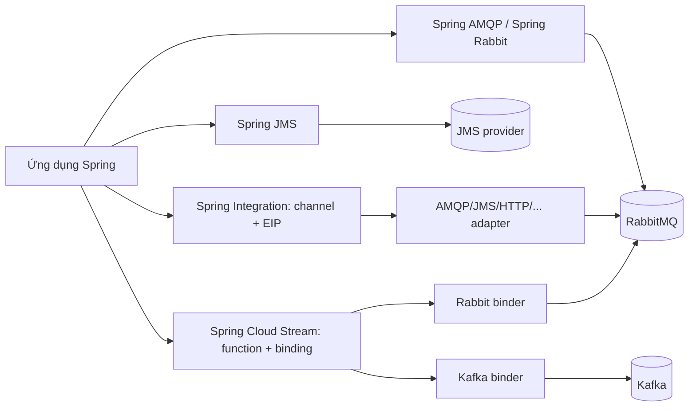

# Phân biệt Spring AMQP, Spring JMS, Spring Integration và Spring Cloud Stream

Trong ứng dụng Java/Spring, bốn tên gọi này đều xuất hiện khi triển khai giao tiếp bất đồng bộ. Tuy nhiên, chúng giải quyết **những bài toán ở các tầng khác nhau**. Chọn sai tầng trừu tượng có thể khiến ứng dụng khó kiểm soát định tuyến, xác nhận xử lý, retry hoặc phụ thuộc vào một message broker cụ thể.

Trong phạm vi học **Spring AMQP** với RabbitMQ, bài này giúp xác định khi nào nên thao tác trực tiếp với `RabbitTemplate`, `@RabbitListener`, exchange, queue và binding; khi nào nên cân nhắc Spring JMS, Spring Integration hoặc Spring Cloud Stream.

## 1. Nhìn nhanh: mỗi công nghệ giải quyết việc gì?

| Công nghệ | Vai trò chính | Khái niệm/API thường gặp | Hạ tầng liên quan |
| --- | --- | --- | --- |
| **Spring AMQP** (đặc biệt là Spring Rabbit) | Tích hợp ứng dụng Spring với cơ chế gửi, nhận và định tuyến message của RabbitMQ | `RabbitTemplate`, `@RabbitListener`, `Exchange`, `Queue`, `Binding`, listener container | RabbitMQ, thường dùng giao thức AMQP 0-9-1 |
| **Spring JMS** | Tích hợp ứng dụng Spring với **JMS API** (nay thuộc Jakarta Messaging) | `JmsTemplate`, `@JmsListener`, `Destination`, `Queue`, `Topic` của JMS | Nhà cung cấp JMS như ActiveMQ Classic hoặc Artemis |
| **Spring Integration** | Mô hình hóa luồng tích hợp bên trong hoặc giữa các hệ thống bằng *Enterprise Integration Patterns* | `MessageChannel`, `IntegrationFlow`, gateway, transformer, filter, router, aggregator, adapter | Có thể tích hợp RabbitMQ, JMS, HTTP, file, v.v. qua các adapter |
| **Spring Cloud Stream** | Viết ứng dụng hướng sự kiện qua mô hình hàm và *binder*, giảm mã gắn trực tiếp với broker | `Supplier`, `Function`, `Consumer`, binding, destination, consumer group, binder | Các binder được hỗ trợ, thường là RabbitMQ hoặc Kafka |

**Điểm mấu chốt:** Spring AMQP và Spring JMS là các cách truy cập hạ tầng nhắn tin; Spring Integration tổ chức **luồng xử lý và kết nối**; Spring Cloud Stream cung cấp **mô hình ứng dụng hướng sự kiện** trên các binder. Chúng có thể được **kết hợp**, không nhất thiết loại trừ nhau.



Sơ đồ thể hiện **những cách kết nối có thể dùng**, không có nghĩa mọi ứng dụng phải đưa cả bốn thư viện vào cùng một hệ thống.

## 2. Spring AMQP: làm việc trực tiếp với mô hình RabbitMQ

**Spring AMQP** cung cấp các lớp trừu tượng cho hệ nhắn tin AMQP; khi tích hợp RabbitMQ, ứng dụng thường dùng thư viện **Spring Rabbit**. Điểm mạnh là thể hiện rõ mô hình của RabbitMQ và có nhiều tùy chọn điều khiển ở cấp broker, kết nối và listener.

Luồng gửi message điển hình:

```text
Producer --(exchange + routing key)--> Exchange
                                      |  binding phù hợp
                                      v
                                     Queue --(delivery)--> Consumer
```

- **Exchange** nhận message do publisher gửi và quyết định các queue nhận được, dựa trên loại exchange và binding. Ví dụ: `direct`, `topic`, `fanout`, `headers`.
- **Queue** lưu message chờ consumer nhận; nhiều consumer cùng đọc một queue thường *cạnh tranh* xử lý các message trong queue đó.
- **Binding** nối queue với exchange, có thể kèm binding key hoặc điều kiện phù hợp.
- **Routing key** là thông tin publisher gửi kèm message; ý nghĩa phụ thuộc loại exchange. Với `topic`, các mẫu như `orders.*` hoặc `orders.#` hỗ trợ định tuyến theo chủ đề.
- **`RabbitTemplate`** gửi message, nhận đồng bộ khi cần và thao tác với RabbitMQ ở phía publisher; **`@RabbitListener`** khai báo consumer do listener container quản lý.

### Ví dụ: định tuyến sự kiện đơn hàng cho dịch vụ thanh toán

Giả sử hệ thống phát sự kiện `orders.created`. Dịch vụ thanh toán cần một queue bền vững để nhận sự kiện này:

```java
@Configuration
class OrderRabbitTopology {
    @Bean
    TopicExchange ordersExchange() {
        return new TopicExchange("orders.events", true, false);
    }

    @Bean
    Queue billingQueue() {
        return QueueBuilder.durable("billing.orders.created").build();
    }

    @Bean
    Binding billingBinding(Queue billingQueue, TopicExchange ordersExchange) {
        return BindingBuilder.bind(billingQueue)
                .to(ordersExchange)
                .with("orders.created");
    }
}
```

Publisher gửi một chuỗi JSON đến exchange cùng routing key:

```java
@Service
class OrderPublisher {
    private final RabbitTemplate rabbitTemplate;

    OrderPublisher(RabbitTemplate rabbitTemplate) {
        this.rabbitTemplate = rabbitTemplate;
    }

    void publishCreated(String orderJson) {
        rabbitTemplate.convertAndSend(
                "orders.events", "orders.created", orderJson);
    }
}
```

Consumer nhận message trên queue:

```java
@Component
class BillingConsumer {
    @RabbitListener(queues = "billing.orders.created")
    public void onCreated(String orderJson) {
        // Kiểm tra dữ liệu, ghi nhận nghiệp vụ và xử lý lỗi phù hợp.
        processOrder(orderJson);
    }

    private void processOrder(String orderJson) {
        // Triển khai nghiệp vụ thực tế tại đây.
    }
}
```

Ví dụ sử dụng `String` nhằm tập trung vào cơ chế routing. Trong sản phẩm thực tế, hãy thiết lập message converter (chẳng hạn JSON converter), kiểm tra schema và xử lý lỗi deserialize cho kiểu dữ liệu miền nghiệp vụ.

Khi cần định tuyến phức tạp, dead-letter exchange (DLX), TTL, publisher confirms, trả lại message không thể route, prefetch, cấu hình acknowledgement hoặc consumer concurrency, **Spring AMQP là lựa chọn tự nhiên nếu broker đang dùng là RabbitMQ**.

## 3. Spring JMS: lập trình theo hợp đồng JMS

**JMS** là API nhắn tin tiêu chuẩn trong hệ sinh thái Java; ở các phiên bản mới tên chính thức là **Jakarta Messaging**. Spring JMS giúp giảm mã quản lý connection, session và listener khi làm việc với một *JMS provider*.

Mô hình JMS thường gặp:

| Mô hình | Ý nghĩa | Đối chiếu với RabbitMQ |
| --- | --- | --- |
| JMS **Queue** | Nhiều consumer có thể cạnh tranh để nhận message từ một destination | Gần với nhiều consumer đọc cùng một RabbitMQ queue về mục đích, nhưng API và quy tắc ack khác nhau |
| JMS **Topic** | Phát message tới các subscription; cấu hình subscription ảnh hưởng khả năng nhận khi consumer offline | Gần với publish/subscribe, song **không phải** một RabbitMQ `TopicExchange` và không có binding/routing key theo cùng mô hình |

Mã sử dụng ở tầng JMS khá ngắn:

```java
@Service
class JmsOrderPublisher {
    private final JmsTemplate jmsTemplate;

    JmsOrderPublisher(JmsTemplate jmsTemplate) {
        this.jmsTemplate = jmsTemplate;
    }

    void publish(String orderJson) {
        jmsTemplate.convertAndSend("orders.queue", orderJson);
    }
}

@Component
class JmsOrderConsumer {
    @JmsListener(destination = "orders.queue")
    public void consume(String orderJson) {
        // Xử lý đơn hàng từ JMS provider.
    }
}
```

Đoạn mã giả định ứng dụng đã cấu hình một JMS `ConnectionFactory`, listener factory và provider phù hợp. Tên `orders.queue` là **JMS destination**, không mặc nhiên là queue đã khai báo bằng Spring AMQP trong RabbitMQ.

Chọn Spring JMS khi hệ thống đã vận hành ActiveMQ/Artemis hoặc cần tích hợp theo hợp đồng JMS. Dù cả hai đều có khái niệm queue và consumer, **không thể thay `RabbitTemplate` bằng `JmsTemplate` rồi mặc định có cùng ngữ nghĩa**. Sự hỗ trợ transaction, acknowledgement, redelivery và dead-letter cụ thể phụ thuộc JMS provider và cấu hình.

## 4. Spring Integration: tổ chức luồng xử lý bằng EIP

**Spring Integration** tập trung vào câu hỏi: *Một message đi qua các bước xử lý, biến đổi, lọc và kết nối hệ thống như thế nào?* Framework này triển khai nhiều mẫu **Enterprise Integration Patterns (EIP)**:

| Thành phần | Chức năng | Ví dụ trong xử lý đơn hàng |
| --- | --- | --- |
| `MessageChannel` | Chuyển message giữa các endpoint | Nhận sự kiện từ REST API rồi đưa vào luồng xử lý |
| Gateway | Cung cấp giao diện gọi vào luồng message | `orderGateway.submit(order)` |
| Filter | Giữ hoặc loại message theo điều kiện | Bỏ thông điệp không hợp lệ |
| Transformer | Biến đổi payload hoặc header | Chuyển định dạng đối tác sang DTO nội bộ |
| Router | Chọn một hay nhiều nhánh theo nội dung | Phân luồng đơn hàng quốc tế/nội địa |
| Splitter / Aggregator | Tách và gom nhiều message | Chia đơn hàng theo dòng sản phẩm, tổng hợp kết quả |
| Adapter | Giao tiếp với hệ ngoài | Nhận từ RabbitMQ, gửi sang JMS hoặc HTTP |

Một luồng minh họa:

```text
AMQP inbound adapter
    -> Channel
    -> Filter
    -> Transformer
    -> Router
    -> HTTP service / AMQP outbound adapter
```

Trong ví dụ đó, adapter AMQP có thể sử dụng hạ tầng của Spring AMQP. **Spring Integration không tự trở thành message broker**: message trên channel nội bộ không mặc nhiên được lưu bền vững, retry hay dead-letter như queue của RabbitMQ. Bảo đảm giao nhận phụ thuộc channel, adapter, transaction và kho lưu trữ được chọn.

Spring Integration phù hợp khi bài toán chính là **điều phối và tích hợp nhiều bước hoặc nhiều giao thức**. Nếu ứng dụng chỉ cần publish một event và lắng nghe một queue RabbitMQ, dùng trực tiếp Spring AMQP thường rõ ràng và ít lớp trừu tượng hơn.

## 5. Spring Cloud Stream: ứng dụng hướng sự kiện qua binder

**Spring Cloud Stream** tổ chức producer/consumer quanh các hàm Java và **binding**. Binder kết nối binding trong ứng dụng với broker cụ thể. Trong nhiều ứng dụng, mã nghiệp vụ làm việc với `Consumer<T>`, `Function<I, O>` hoặc `Supplier<T>` mà không gọi `RabbitTemplate` trực tiếp.

Ví dụ về consumer:

```java
@Configuration
class OrderStreamFunctions {
    @Bean
    Consumer<String> orderEvents() {
        return orderJson -> {
            // Xử lý sự kiện đơn hàng.
        };
    }
}
```

Khi ứng dụng có Rabbit binder thích hợp trên classpath, cấu hình binding có thể là:

```properties
spring.cloud.function.definition=orderEvents
spring.cloud.stream.bindings.orderEvents-in-0.destination=orders.events
spring.cloud.stream.bindings.orderEvents-in-0.group=billing
```

- `orderEvents-in-0` là tên input binding mặc định của hàm `orderEvents`.
- `destination` là đích logic được binder ánh xạ vào broker. Với Rabbit binder, destination thường được thể hiện bằng exchange và các queue do binder quản lý.
- `group=billing` tạo nhóm consumer chia sẻ việc xử lý trong cùng nhóm. Các nhóm khác nhau có thể nhận độc lập cùng một luồng sự kiện; chi tiết về queue/binding phụ thuộc Rabbit binder và cấu hình.

Đây là ví dụ **nhận sự kiện trên một destination**, chưa cấu hình lọc RabbitMQ routing key `orders.created`. Muốn ràng buộc routing key, DLQ, TTL hoặc chính sách nâng cao, cần tìm đúng thuộc tính **Rabbit binder** và kiểm tra topology thực tế. Abstraction của Spring Cloud Stream không khiến Kafka và RabbitMQ có cùng mọi hành vi.

Chọn Spring Cloud Stream khi nhóm phát triển muốn xây dựng các dịch vụ hướng sự kiện với giao diện hàm và tổ chức consumer group/binding nhất quán. Khi yêu cầu khai thác sâu tính năng đặc thù RabbitMQ, Spring AMQP trực tiếp thường biểu đạt ý định chính xác hơn.

## 6. Cùng một bài toán, chọn công cụ khác nhau như thế nào?

Giả sử hệ thống thương mại điện tử tạo đơn hàng và cần thông báo tới `billing`, `inventory` và `notification`.

| Nhu cầu thực tế | Công cụ nên cân nhắc | Vì sao |
| --- | --- | --- |
| Đã dùng RabbitMQ; ba dịch vụ nhận các routing key khác nhau; cần DLX, TTL, manual ack và publisher confirms | **Spring AMQP** | Kiểm soát exchange, queue, binding, delivery và các tính năng RabbitMQ trực tiếp |
| Tổ chức đã có Artemis và các ứng dụng Java dùng chuẩn JMS | **Spring JMS** | Tích hợp theo JMS API và tận dụng provider hiện hữu |
| Nhận dữ liệu từ RabbitMQ, kiểm tra, biến đổi, chia nhánh sang HTTP/JMS và gom kết quả | **Spring Integration**, kết hợp adapter thích hợp | Luồng tích hợp nhiều bước và nhiều giao thức là phần phức tạp chính |
| Nhiều dịch vụ nhận/phát domain event theo mô hình hàm; muốn quản lý destination, group thông qua binder | **Spring Cloud Stream** | Giảm mã kết nối broker ở lớp xử lý nghiệp vụ |
| Một dịch vụ vừa có flow xử lý phức tạp vừa cần gửi message RabbitMQ | **Spring Integration + Spring AMQP** | Integration tổ chức flow; AMQP đảm nhiệm giao tiếp RabbitMQ |

Hãy phân biệt **độ phức tạp của giao tiếp với broker** và **độ phức tạp của luồng nghiệp vụ**. Ví dụ, ba bước `validate -> enrich -> route` không nhất thiết cần một exchange riêng cho mỗi bước; chúng có thể là các endpoint của Spring Integration rồi mới publish ra RabbitMQ.

## 7. Những khác biệt ảnh hưởng đến độ tin cậy

Việc dùng framework nào không tự động đảm bảo message được xử lý đúng một lần. Cần phân biệt các điểm xác nhận, khôi phục và quan sát:

| Vấn đề | Spring AMQP / RabbitMQ | Spring JMS | Spring Integration | Spring Cloud Stream |
| --- | --- | --- | --- | --- |
| **Publisher xác nhận** | Publisher confirms/returns giúp xác định broker đã nhận publish hoặc message không route được, tùy cấu hình | Kết quả gửi và transaction theo JMS/provider; không đồng nhất với RabbitMQ publisher confirm | Phụ thuộc outbound adapter và hạ tầng đích | Phụ thuộc binder, cấu hình producer và broker |
| **Consumer acknowledgement** | Listener container quản lý `AUTO`/`MANUAL`/`NONE`; `AUTO` thường ack sau khi xử lý thành công | Theo chế độ ack/session/transaction của JMS và provider | Phụ thuộc inbound adapter, transaction, channel và endpoint | Do binder và cơ chế xử lý của broker chi phối |
| **Retry** | Retry ở listener/client, kết hợp requeue hoặc DLX; cần tránh lặp vô hạn | Redelivery/retry và chính sách broker/provider | Có thể retry theo từng endpoint hoặc qua advice | Cấu hình retry/error handling tại consumer/binder, phụ thuộc binder |
| **Dead-letter** | DLX/DLQ là cơ chế broker cụ thể, cần cấu hình exchange/queue/binding/policy | Cơ chế DLQ do provider cung cấp | Tự thiết kế error flow hoặc dùng adapter/broker | Có thể có hỗ trợ DLQ riêng của binder, không hoàn toàn giống nhau |
| **Transaction** | Channel transaction của RabbitMQ hoặc transaction trong listener container; không tự động gộp với DB | JMS session có thể tham gia transaction theo cấu hình | Có thể điều phối transaction tại boundary của flow | Theo binder/broker; không mặc định là transaction phân tán với DB |
| **Quan sát** | RabbitMQ Management UI, ready/unacked message, DLQ, publish/consume rate, metric và tracing | Console/metrics của JMS provider, listener metrics | Message history, endpoint/channel metrics, error channel | Metrics/health binder, trạng thái binding và metrics broker |

### Hiểu đúng ba lần xác nhận thường bị nhầm

1. **Publisher confirm** của RabbitMQ: broker xác nhận việc publish ở phía producer theo cơ chế được cấu hình. Đây **không** phải thông báo consumer đã xử lý xong nghiệp vụ.
2. **Consumer acknowledgement**: consumer/listener container phản hồi việc nhận và xử lý delivery ở phía queue. Với `@RabbitListener` trong `AUTO`, xử lý thành công thường dẫn đến ack; khi exception xảy ra, cách reject, requeue hay đưa đến DLQ tùy cấu hình.
3. **Xác nhận nghiệp vụ**: ví dụ đơn hàng đã được ghi vào database hoặc thanh toán đã được tạo. Broker ack **không thay thế** transaction hay idempotency ở cơ sở dữ liệu.

Nếu consumer lưu DB thành công nhưng tiến trình chết trước khi ack, message có thể được giao lại. Vì vậy, consumer nên có **idempotency** (ví dụ dùng `eventId` hoặc `orderId` làm khóa chống xử lý trùng) và logic nghiệp vụ có thể chạy lại an toàn. Nếu lưu DB và publish sự kiện tiếp theo cần tránh sai lệch giữa hai hệ thống, có thể cân nhắc **transactional outbox**; không giả định transaction RabbitMQ sẽ tự động bao phủ database.

### Retry, requeue và DLQ không đồng nghĩa

Lỗi tạm thời như timeout của dịch vụ ngoài có thể đáng thử lại với giới hạn số lần và khoảng nghỉ. Lỗi không thể khắc phục bằng retry như sai schema hoặc dữ liệu nghiệp vụ không hợp lệ cần được phân loại để tránh tạo vòng lặp requeue liên tục.

Với RabbitMQ, một chiến lược thường gặp là **retry có giới hạn -> reject không requeue -> dead-letter -> quan sát và xử lý lại có kiểm soát**. Cách kích hoạt DLX phụ thuộc cấu hình queue và policy; chỉ khai báo `@RabbitListener` **không tự tạo DLQ**. Trong Spring Cloud Stream, phải kiểm tra cơ chế retry/DLQ của binder đang dùng; trong JMS, kiểm tra cấu hình redelivery/DLQ của provider.

## 8. Quy tắc chọn thư viện và lộ trình thực hành

Sử dụng chuỗi câu hỏi sau để đưa ra quyết định:

1. **Broker hiện tại là gì?** Nếu đang dùng RabbitMQ và cần điều khiển routing hoặc ack, bắt đầu với Spring AMQP. Nếu đang dùng JMS provider và tổ chức quy định JMS API, bắt đầu với Spring JMS.
2. **Ứng dụng cần quy trình tích hợp nhiều bước không?** Nếu cần filter, transform, split/aggregate, nhiều adapter và luồng xử lý dễ quan sát, đánh giá Spring Integration.
3. **Muốn lập trình producer/consumer theo hàm và binder không?** Nếu có, cân nhắc Spring Cloud Stream, đồng thời đánh giá những tính năng riêng của RabbitMQ/Kafka mà ứng dụng đang phụ thuộc.
4. **Cần bảo đảm giao nhận mức nào?** Thiết kế idempotency, ack, retry, DLQ, transaction boundary và giám sát theo broker thực tế, thay vì suy ra từ tên framework.

Để thực hành đúng trọng tâm **Spring AMQP**, có thể làm theo trình tự:

1. Khởi chạy RabbitMQ và tạo `TopicExchange`, queue và binding; gửi `orders.created`, `orders.cancelled` để quan sát route nào khớp.
2. Dùng `RabbitTemplate.convertAndSend(...)` và `@RabbitListener`; mở RabbitMQ Management UI kiểm tra số message `ready`, `unacked` và consumer đang kết nối.
3. Thử listener ném exception; cấu hình chế độ acknowledgement/requeue, retry có giới hạn và DLX/DLQ; xác nhận message lỗi đi đến đúng queue.
4. Bật publisher confirms/returns theo cấu hình Spring Rabbit đang dùng; thử gửi với routing key không khớp để phân biệt khả năng broker nhận publish và khả năng message được route.
5. Giả lập consumer xử lý xong DB nhưng chưa ack để kiểm tra idempotency; đo lại tốc độ xử lý, độ sâu queue và DLQ sau khi khởi động lại.
6. Sau khi hiểu topology RabbitMQ, viết lại một consumer theo mô hình `Consumer<T>` của Spring Cloud Stream và quan sát binder đã tạo exchange/queue/binding nào. So sánh mã ứng dụng và mức kiểm soát broker của hai cách.

## 9. Các ngộ nhận nên tránh

- **“Spring Integration là message broker.”** Sai: nó là framework xây dựng luồng tích hợp; độ bền của message đến từ channel/store hoặc hạ tầng bên ngoài được cấu hình.
- **“JMS Topic và RabbitMQ TopicExchange là một.”** Sai: tên gọi gần giống, nhưng mô hình định tuyến, subscription và API khác nhau.
- **“Spring Cloud Stream đổi RabbitMQ sang Kafka chỉ bằng một dòng cấu hình trong mọi trường hợp.”** Sai: mô hình lập trình có thể giữ lại đáng kể, nhưng ordering, partition, retry, DLQ, routing và transactional semantics vẫn khác biệt.
- **“Có publisher confirm nghĩa là consumer đã ghi DB thành công.”** Sai: đây là hai ranh giới xác nhận khác nhau.
- **“Có retry và DLQ là đã bảo đảm exactly-once.”** Sai: giao lại message vẫn có thể xảy ra; nghiệp vụ cần xử lý trùng, theo dõi lỗi và thiết kế consistency rõ ràng.

**Kết luận:** Với mục tiêu làm chủ RabbitMQ qua exchange, queue, binding, `RabbitTemplate` và `@RabbitListener`, hãy học **Spring AMQP** trước. Mở rộng sang **Spring JMS** khi làm việc với JMS provider, **Spring Integration** khi phải điều phối flow đa bước/đa giao thức, và **Spring Cloud Stream** khi muốn phát triển dịch vụ hướng sự kiện qua binder và mô hình hàm. Công nghệ phù hợp nhất là công nghệ biểu đạt được mô hình xử lý, điều kiện giao nhận và khả năng vận hành thực tế của hệ thống.
