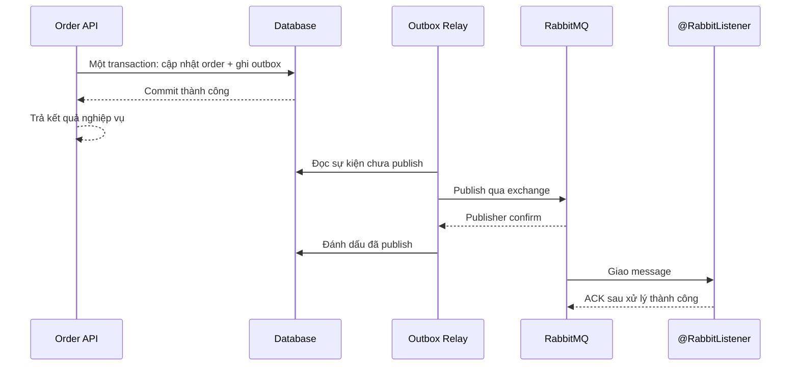

# Lợi ích, chi phí và trường hợp không nên thêm hệ thống hàng đợi

Trong hệ thống Java dùng **Spring AMQP và RabbitMQ**, hàng đợi (queue) thường xuất hiện khi một thao tác có thể được xử lý sau yêu cầu HTTP ban đầu: gửi email, tạo báo cáo, đồng bộ dữ liệu, phát thông báo hoặc gọi dịch vụ bên ngoài. `RabbitTemplate` giúp phía phát gửi message; exchange, binding và queue đưa message đến đúng nơi; `@RabbitListener` giúp phía nhận xử lý message.

Tuy nhiên, đưa RabbitMQ vào kiến trúc là một **quyết định đánh đổi**: ứng dụng nhận được khả năng xử lý bất đồng bộ và hấp thụ tải, đồng thời phải quản lý một hệ thống phân tán với độ trễ, lỗi giao nhận, message trùng lặp và chi phí vận hành. Bài học này giúp đánh giá **khi nào lợi ích đủ lớn để trả chi phí đó**.

## 1. Vì sao cần cân nhắc hàng đợi?

Giả sử API xác nhận đơn hàng thực hiện ba việc: lưu trạng thái đơn hàng, gửi email và thông báo cho hệ thống tích điểm. Khi chạy tuần tự qua HTTP, thời gian phản hồi và tỷ lệ thành công của API phụ thuộc vào cả hai dịch vụ bên ngoài. Email bị chậm có thể khiến khách hàng thấy yêu cầu thanh toán bị treo dù đơn hàng đã lưu thành công.

Một thiết kế bất đồng bộ có thể tách đường xử lý:

```mermaid
flowchart LR
    C[Khách hàng] --> A[Order API]
    A --> D[(Cơ sở dữ liệu đơn hàng)]
    A -. Sau commit / outbox .-> P[RabbitTemplate]
    P --> X{{Exchange: orders.events}}
    X -->|Binding 1| Q1[(Queue email)]
    X -->|Binding 2| Q2[(Queue loyalty)]
    Q1 --> L1[@RabbitListener: gửi email]
    Q2 --> L2[@RabbitListener: cộng điểm]
```

Sau khi **trạng thái đơn hàng được xác nhận và sự kiện được lưu an toàn**, API có thể trả kết quả mà không chờ email và tích điểm hoàn tất. Hai consumer hoạt động độc lập; nếu hệ thống email chậm, công việc email tồn đọng trong queue tương ứng. Để việc lưu đơn hàng và công bố sự kiện không bị tách rời khi có lỗi, hệ thống thực tế thường dùng **transactional outbox** hoặc một cơ chế tương đương, được giải thích ở phần sau.

Ở đây cần phân biệt:

- **Bất đồng bộ**: bên gọi không chờ bên xử lý công việc hoàn tất.
- **Queue**: nơi lưu các công việc/message đang chờ được consumer nhận và xác nhận xử lý.
- **Exchange và binding**: quy tắc định tuyến message đến một hoặc nhiều queue. Nhiều consumer cùng nghe **một queue** thường chia nhau công việc; hai dịch vụ cần nhận cùng một sự kiện nên dùng **hai queue riêng** được định tuyến từ exchange.
- **Độ tin cậy**: kết quả của nhiều biện pháp kết hợp, như lưu bền message, publisher confirm, consumer acknowledgment, retry có giới hạn, dead-letter và idempotency. Chỉ thêm queue không tự bảo đảm giao nhận chính xác một lần.

## 2. Lợi ích thực tế của hàng đợi

| Lợi ích | Hàng đợi giúp thế nào? | Điều kiện và giới hạn |
| --- | --- | --- |
| Giảm thời gian chờ của request | API giao công việc cho RabbitMQ rồi tiếp tục trả phản hồi | Chỉ phù hợp khi kết quả công việc phụ không cần có ngay; publish cũng có độ trễ và có thể thất bại |
| Hấp thụ đột biến tải | Message chờ trong queue khi tốc độ gửi tạm thời vượt khả năng xử lý | Tải trung bình lâu dài vẫn phải nhỏ hơn công suất xử lý; queue không tạo thêm năng lực tính toán |
| Tách mức độ sẵn sàng | Consumer có thể tạm dừng rồi xử lý tiếp sau khi hoạt động trở lại | Cần cấu hình lưu bền và xử lý lỗi phù hợp; broker cũng có thể mất kết nối hoặc quá tải |
| Mở rộng consumer độc lập | Tăng số consumer cho phần gửi email mà không phải tăng toàn bộ Order API | Phải giới hạn concurrency/prefetch theo CPU, DB, API bên ngoài và yêu cầu thứ tự |
| Định tuyến linh hoạt | Direct, topic hoặc fanout exchange phục vụ các kịch bản một-nhiều và phân loại message | Cần hiểu routing key, binding và trường hợp không có queue nhận message |
| Tách biệt vòng đời triển khai | Producer và consumer có thể phát triển, triển khai và phục hồi riêng | Hai bên phải quản lý hợp đồng dữ liệu, tương thích phiên bản và giám sát end-to-end |
| Xử lý lỗi có kiểm soát | Retry, dead-letter exchange (DLX), dead-letter queue (DLQ) cho phép điều tra và xử lý lại | Phải thiết kế giới hạn retry, theo dõi DLQ và quy trình replay; DLQ không tự sửa lỗi nghiệp vụ |

### 2.1. Hấp thụ tải đỉnh: lợi ích có điều kiện

Một chiến dịch bán hàng tạo ra **200 yêu cầu gửi email/giây** trong 10 phút, trong khi worker gửi được **120 email/giây**. Giả sử tốc độ ổn định và bỏ qua overhead:

```text
Message đến:       200 message/giây
Khả năng xử lý:    120 message/giây
Tồn đọng tăng:      80 message/giây
Sau 10 phút:       80 × 600 = 48.000 message
```

Sau cao điểm, nếu tải đến giảm còn **80 message/giây**, tốc độ giảm backlog là `120 - 80 = 40 message/giây`; hệ thống cần thêm khoảng `48.000 / 40 = 1.200 giây = 20 phút` để xử lý hết phần tồn đọng, nếu không có đỉnh tải khác. Queue giúp API **không phải chờ gửi email hoàn tất**, nhưng message trong queue vẫn có độ trễ. Thời gian dọn sạch backlog 20 phút không đồng nghĩa một email cụ thể phải chờ 20 phút.

Nếu lưu lượng đầu vào duy trì **150 message/giây** trong khi worker chỉ xử lý **120 message/giây**, backlog tiếp tục tăng. Khi đó phải tăng công suất, giảm lượng công việc, giới hạn tốc độ nhận hoặc thay đổi trải nghiệm sản phẩm. Queue chỉ trì hoãn biểu hiện của quá tải; dung lượng bộ nhớ/ổ đĩa broker cũng có giới hạn.

Khi đánh giá khả năng hấp thụ tải, hãy đo đồng thời **tốc độ publish**, **tốc độ ACK**, **số message ready/unacked**, **tuổi message cũ nhất**, **thời gian xử lý p95/p99** và **độ trễ nghiệp vụ từ lúc phát đến lúc hoàn tất**. Queue dài chưa chắc nghiêm trọng bằng một message quan trọng bị chờ quá hạn SLA.

### 2.2. Tách lỗi và mở rộng hệ thống

Khi dịch vụ gửi email ngừng hoạt động ngắn hạn, Order API vẫn có thể hoàn thành thao tác cốt lõi nếu cơ chế công bố sự kiện và broker còn khả dụng. Email sẽ được xử lý khi consumer hồi phục. Có thể tăng số instance consumer cho queue email, nhưng cần xét hạn mức SMTP/API, giới hạn kết nối cơ sở dữ liệu và tính idempotent.

Đổi lại, kết quả toàn hệ thống trở thành **nhất quán cuối cùng (eventual consistency)**: đơn hàng đã được xác nhận trước khi email đến hoặc điểm thưởng được cập nhật. Sản phẩm phải truyền đạt rõ trạng thái “đã tiếp nhận”, “đang xử lý” và “hoàn tất/thất bại” nếu người dùng cần theo dõi tiến trình.

## 3. Chi phí và độ phức tạp phát sinh

| Nhóm chi phí | Biểu hiện trong dự án Spring AMQP | Cách kiểm soát |
| --- | --- | --- |
| Hạ tầng và vận hành | RabbitMQ cluster, lưu trữ, mạng, nâng cấp, backup, tài khoản, TLS, cấu hình HA | Định nghĩa người trực vận hành, ngân sách, giới hạn tài nguyên và kế hoạch phục hồi |
| Luồng lỗi mới | Broker tạm mất kết nối, publish timeout, route sai, queue đầy, consumer crash | Xác nhận publish, xử lý returns, ACK, giới hạn retry và DLQ |
| Nhất quán dữ liệu | DB commit thành công nhưng message chưa được gửi; hoặc message đã gửi mà DB rollback | Transactional outbox, state machine nghiệp vụ, reconciliation |
| Xử lý trùng lặp | Consumer đã thực hiện tác dụng phụ nhưng chết trước ACK, message được gửi lại | Idempotency key, unique constraint, trạng thái đã xử lý |
| Trễ và thứ tự | Message chờ, xử lý song song, retry làm thay đổi thứ tự quan sát được | Đặt SLA, giới hạn concurrency khi cần, thiết kế không phụ thuộc thứ tự toàn cục |
| Hợp đồng message | Producer đổi schema làm consumer cũ đọc sai | Version schema, tương thích tiến/lùi, kiểm thử hợp đồng |
| Điều tra lỗi | Khó nối HTTP request với message, retry và tác dụng phụ | Correlation ID, trace ID, log có cấu trúc, dashboard và cảnh báo |
| Bảo mật và dữ liệu | Payload chứa PII, phân quyền vhost/queue, message nằm lâu trong DLQ | Giảm dữ liệu nhạy cảm, quản lý quyền, thời gian lưu và chính sách xóa |
| Công sức đội ngũ | Viết consumer, triển khai, quản lý cấu hình, trực sự cố và replay | Sở hữu rõ trách nhiệm, runbook, thử nghiệm kịch bản thất bại |

**Tổng chi phí sở hữu (TCO)** gồm cả thời gian phát triển và gánh nặng bảo trì lâu dài. Với một ứng dụng nhỏ chỉ gửi vài chục tác vụ ngắn mỗi ngày, chi phí vận hành broker có thể lớn hơn lợi ích của việc tách request.

### 3.1. Cần hiểu chính xác “đã gửi thành công”

Quy trình giao nhận có những mốc khác nhau:

1. **Producer tạo message.** `RabbitTemplate.convertAndSend(...)` gọi thao tác publish; bản thân lời gọi này không chứng minh consumer đã xử lý.
2. **Broker nhận publish.** Khi bật publisher confirms và xử lý callback, producer có tín hiệu broker xác nhận publish theo cơ chế RabbitMQ. Nếu message không được route đến queue, cần cấu hình `mandatory` và xử lý returned message hoặc một cơ chế bảo vệ phù hợp.
3. **Message được lưu/định tuyến.** Durable queue/exchange và persistent message (hoặc chính sách queue phù hợp như quorum queue) giúp tăng khả năng phục hồi; chi tiết bảo đảm còn phụ thuộc loại queue và cấu hình broker.
4. **Consumer nhận và làm việc.** Với listener container có `acknowledge-mode=AUTO`, Spring AMQP thông thường ACK khi phương thức listener hoàn thành thành công. Khi phương thức thất bại, container áp dụng chiến lược từ chối/requeue tương ứng.
5. **Tác dụng phụ hoàn tất.** ACK của RabbitMQ không phải giao dịch nguyên tử với database, SMTP hoặc API bên ngoài. Nếu consumer hoàn tất thao tác rồi crash trước ACK, message có thể được phát lại.

Điều này tạo ra mô hình thực tế **at-least-once** khi hệ thống cấu hình để không làm mất message và có cơ chế giao lại. Một message có thể được xử lý nhiều lần; để nghiệp vụ có hiệu ứng một lần, consumer phải thiết kế **idempotent**. Không nên mô tả queue là bảo đảm “exactly-once” cho cả quy trình nghiệp vụ.

### 3.2. Vấn đề transaction giữa database và RabbitMQ

Ví dụ API lưu trạng thái `CONFIRMED` vào PostgreSQL, sau đó publish sự kiện `OrderConfirmed`. Nếu tiến trình chết ngay sau DB commit nhưng trước khi publish, đơn hàng đã xác nhận nhưng consumer không nhận được sự kiện. Nếu publish trước commit và DB rollback, consumer có thể thấy sự kiện của một đơn hàng chưa thực sự được xác nhận.

**Transactional outbox** là giải pháp phổ biến:



Relay có thể publish lặp nếu bị lỗi sau khi broker nhận nhưng trước khi đánh dấu outbox đã gửi. Vì vậy outbox **giảm nguy cơ mất sự kiện tại ranh giới DB–broker** nhưng vẫn cần consumer idempotent. Transaction trong Spring hoặc RabbitMQ ở một phía không tự tạo giao dịch phân tán nguyên tử với một cơ sở dữ liệu bất kỳ.

### 3.3. Retry và dead-letter cần quy tắc rõ ràng

Một kết nối SMTP timeout có thể được retry; một email có địa chỉ sai cố định thường không tự thành công nếu thử lại mãi. Nên phân nhóm lỗi:

- **Lỗi tạm thời**: timeout, rate limit, dịch vụ bên ngoài 503; retry có giới hạn, khoảng nghỉ tăng dần và jitter nếu thích hợp.
- **Lỗi vĩnh viễn**: payload sai schema, vi phạm quy tắc nghiệp vụ, địa chỉ không hợp lệ; đưa vào DLQ hoặc quy trình xử lý có chủ đích.
- **Poison message**: message liên tục làm consumer thất bại; tránh vòng `requeue=true` vô hạn khiến CPU và mạng quá tải.

DLX/DLQ phải được cấu hình và giám sát; message nằm trong DLQ cần có người chịu trách nhiệm phân loại, sửa nguyên nhân và **replay an toàn**. Replay có thể tạo tác dụng phụ trùng lặp nếu dữ liệu cũ đã được xử lý một phần.

## 4. Khi nào không nên thêm hệ thống hàng đợi?

| Tình huống | Vì sao RabbitMQ thường chưa phù hợp? | Hướng đơn giản hơn để cân nhắc |
| --- | --- | --- |
| Client cần kết quả ngay để hoàn thành request | Queue bổ sung bước trung gian và trạng thái đang chờ; kết quả vẫn phải quay lại client | HTTP/gRPC đồng bộ với timeout và retry có giới hạn |
| Tác vụ nhỏ, nhanh, lưu lượng thấp và ổn định | Chi phí broker, vận hành và debug lớn hơn phần thời gian tiết kiệm | Gọi hàm trực tiếp hoặc tác vụ nền trong ứng dụng khi chấp nhận rủi ro mất tác vụ |
| Chỉ cần chạy tác vụ theo lịch với dữ liệu đã có trong DB | Không nhất thiết cần định tuyến message qua broker | Scheduler + bảng job có trạng thái, retry và khóa hợp lý |
| Nghiệp vụ đòi hỏi một transaction ACID tức thời qua nhiều bước | Message bất đồng bộ tạo khoảng thời gian kết quả chưa đồng bộ | Xử lý trong cùng database/transaction khi có thể; thiết kế lại ranh giới nghiệp vụ |
| Đội ngũ chưa thể giám sát broker, DLQ hay xử lý sự cố | Queue biến lỗi đơn giản thành lỗi chờ âm thầm hoặc lỗi giao nhận phân tán | Đơn giản hóa kiến trúc hoặc dùng hạ tầng được quản lý nếu đáp ứng nhu cầu |
| Cần replay luồng sự kiện lịch sử dài ngày hoặc nhiều subscriber tự chọn offset | Work queue RabbitMQ thường không tối ưu cho nhật ký sự kiện có thể phát lại tùy ý | Đánh giá nền tảng event log/streaming như Kafka theo yêu cầu lưu trữ và replay |
| Luồng phải bảo đảm thứ tự toàn cục trong khi xử lý song song | Nhiều consumer, retry hoặc redelivery khiến thứ tự xử lý thực tế khó kiểm soát | Xử lý tuần tự, phân vùng theo khóa hoặc đổi yêu cầu nghiệp vụ |
| Hạn chót thời gian thực rất chặt | Broker, backlog và lịch chạy consumer gây biến động độ trễ | Đường xử lý đồng bộ/real-time được đo và kiểm soát trực tiếp |

Các gợi ý trên là **tiêu chí đánh giá**, không phải cấm dùng RabbitMQ. Ví dụ, nếu API cần trả ngay mã đơn hàng nhưng email có thể đến sau, RabbitMQ phù hợp với phần email dù việc tạo đơn hàng vẫn đồng bộ.

### 4.1. Đừng dùng queue để che một nút thắt cố hữu

Giả sử database xử lý tối đa 100 cập nhật/giây nhưng tải đến 150 cập nhật/giây liên tục. Đưa 150 request vào RabbitMQ giúp request HTTP trả lời nhanh, nhưng sẽ sinh ra 50 công việc tồn đọng mỗi giây. Nếu không cải thiện database, điều tiết đầu vào hoặc giảm số ghi cần thiết, hàng đợi sẽ ngày càng dài, độ trễ nghiệp vụ tăng và cuối cùng chạm giới hạn tài nguyên.

Nguyên tắc đánh giá là **phân biệt đỉnh tải ngắn hạn với thiếu công suất kéo dài**. Queue đặc biệt có giá trị khi tải dồn thành đợt, consumer có thể xử lý bù trong khoảng yên tĩnh và người dùng chấp nhận độ trễ đó.

### 4.2. Không nên mặc định “bất đồng bộ” đồng nghĩa “cần broker”

Trong Spring, `@Async` hoặc `TaskExecutor` có thể chạy tác vụ ngoài luồng HTTP ngay trong một tiến trình. Cách này ít thành phần hơn, nhưng tác vụ nằm trong bộ nhớ tiến trình có thể mất khi ứng dụng chết và khó điều phối giữa nhiều instance. Nếu tác vụ cần sống sót qua restart, một **bảng job trong database** với trạng thái, số lần thử, lease và cơ chế claim an toàn có thể là bước trung gian hữu ích trước khi đầu tư broker độc lập.

Việc lựa chọn cần dựa trên yêu cầu độ bền, mức tải, định tuyến, số dịch vụ cùng tham gia và năng lực vận hành, thay vì chỉ dựa trên mong muốn “API nhanh hơn”.

## 5. So sánh các lựa chọn kiến trúc

| Tiêu chí | Gọi trực tiếp | `@Async` trong ứng dụng | Job lưu trong DB | Spring AMQP + RabbitMQ |
| --- | --- | --- | --- | --- |
| Độ phức tạp ban đầu | Thấp | Thấp | Trung bình | Trung bình đến cao |
| Có kết quả ngay trên request | Có | Không, nếu không chờ Future | Không | Không theo mô hình work queue thông thường |
| Tác vụ còn sau khi app restart | Không áp dụng cho request đã kết thúc | Thường không | Có, nếu thiết kế đúng | Có thể có với cấu hình broker/message phù hợp |
| Phối hợp nhiều instance | Qua gọi dịch vụ | Khó chia sẻ tác vụ | Cần cơ chế claim/locking | Consumer cạnh tranh trên cùng queue |
| Định tuyến một-nhiều | Tự cài đặt | Tự cài đặt | Tự cài đặt | Exchange và binding hỗ trợ tự nhiên |
| Retry và theo dõi công việc | Tự xây | Tự xây | Tự xây trên bảng job | Có cơ chế giao nhận; vẫn cần thiết kế retry/DLQ và giám sát |
| Hệ thống riêng cần vận hành | Không | Không | Dùng DB hiện có | Có broker/cluster hoặc dịch vụ managed |

Ví dụ lựa chọn:

- **Kiểm tra số dư trước khi chuyển tiền:** xử lý đồng bộ phần kiểm tra và giao dịch cốt lõi; không trả “chuyển thành công” chỉ vì đã publish message.
- **Gửi email xác nhận sau khi đơn hàng đã commit:** có thể bất đồng bộ; RabbitMQ đáng giá nếu lưu lượng, độ bền và nhu cầu mở rộng đủ lớn.
- **Tổng hợp báo cáo mỗi đêm cho một ứng dụng nội bộ nhỏ:** scheduler và bảng job có thể đủ.
- **Phát sự kiện đơn hàng đến dịch vụ email, tích điểm và phân tích:** exchange định tuyến đến từng queue độc lập là ưu thế rõ rệt của RabbitMQ.

## 6. Một ví dụ Spring AMQP tối thiểu để hình dung quyết định

Giả sử đội phát triển **đã quyết định** cần xử lý email bất đồng bộ vì lưu lượng tăng đột biến và dịch vụ email có giới hạn tốc độ. Có thể khai báo exchange, queue bền vững và binding:

```java
@Configuration
class NotificationAmqpConfig {
    static final String EXCHANGE = "orders.events";
    static final String EMAIL_QUEUE = "notifications.email.q";

    @Bean
    DirectExchange orderEvents() {
        return new DirectExchange(EXCHANGE, true, false);
    }

    @Bean
    Queue emailQueue() {
        return QueueBuilder.durable(EMAIL_QUEUE).build();
    }

    @Bean
    Binding emailBinding(Queue emailQueue, DirectExchange orderEvents) {
        return BindingBuilder.bind(emailQueue)
                .to(orderEvents)
                .with("order.confirmed");
    }
}
```

Producer dùng `RabbitTemplate` publish sau khi dữ liệu nghiệp vụ đã được commit và sự kiện đã được bảo vệ bằng cơ chế phù hợp (ví dụ outbox):

```java
@Service
class OrderEventPublisher {
    private final RabbitTemplate rabbitTemplate;

    OrderEventPublisher(RabbitTemplate rabbitTemplate) {
        this.rabbitTemplate = rabbitTemplate;
    }

    void publishOrderConfirmed(String orderId) {
        rabbitTemplate.convertAndSend(
                "orders.events", "order.confirmed", orderId);
    }
}
```

Consumer xử lý message độc lập với request tạo đơn hàng:

```java
@Component
class ConfirmationEmailListener {
    private final EmailService emailService;

    ConfirmationEmailListener(EmailService emailService) {
        this.emailService = emailService;
    }

    @RabbitListener(queues = "notifications.email.q")
    void onOrderConfirmed(String orderId) {
        // EmailService là thành phần nghiệp vụ của ứng dụng.
        // Cần chống gửi trùng theo orderId/eventId trước khi triển khai thực tế.
        emailService.sendConfirmation(orderId);
    }
}
```

Các đoạn mã minh họa cách định tuyến cơ bản; chúng **chưa phải cấu hình production**. Để vận hành tin cậy, cần bổ sung publisher confirms/returns, chính sách durable/persistent phù hợp, idempotency, giới hạn retry, DLX/DLQ, giám sát và cơ chế tránh khoảng trống giữa DB commit và publish. Khi consumer ném exception, kết quả requeue hay dead-letter còn phụ thuộc cấu hình listener container và queue; không nên giả định lỗi sẽ tự được gửi vào DLQ.

Mặt khác, nếu chỉ có 20 email/ngày và cho phép gửi lại bằng tay, ví dụ trên có thể là mức phức tạp không cần thiết. Quyết định kiến trúc phải xuất phát từ nhu cầu vận hành đã đo được.

## 7. Bộ câu hỏi quyết định trước khi thêm RabbitMQ

Trước khi tạo queue đầu tiên, đội ngũ nên trả lời bằng số liệu hoặc cam kết nghiệp vụ:

1. **Đầu ra có thể đến muộn bao lâu?** API chỉ cần xác nhận “đã nhận” hay người dùng cần kết quả hoàn tất ngay? Ngưỡng chấp nhận là 2 giây, 1 phút hay 1 giờ?
2. **Tải là bao nhiêu?** Lưu lượng trung bình/đỉnh (`message/s`), thời gian mỗi tác vụ, tốc độ tăng trưởng và khả năng xử lý của hệ thống phụ thuộc?
3. **Mất hoặc gửi trùng một message gây hậu quả gì?** Email trùng có thể gây phiền; thanh toán hoặc cộng điểm trùng có thể gây sai lệch tiền/tài sản. Khóa idempotency là gì?
4. **Thứ tự có quan trọng không?** `OrderCreated` có bắt buộc được xử lý trước `OrderCancelled` hay consumer nên tra cứu trạng thái mới nhất và xử lý theo version?
5. **Khi broker hoặc consumer ngừng hoạt động, hệ thống làm gì?** Có chấp nhận backlog không, cảnh báo sau bao lâu, ai xử lý DLQ và cách replay thế nào?
6. **Dữ liệu được tạo và publish có cần đồng nhất không?** Có outbox hoặc kế hoạch đối soát tránh mất sự kiện tại ranh giới transaction không?
7. **Ai vận hành và theo dõi SLA?** Có dashboard queue depth/age, tỷ lệ publish fail, tỷ lệ redelivery, DLQ, độ trễ end-to-end và dung lượng broker không?

Một quyết định mẫu có thể ghi lại như sau:

> **Nhu cầu:** Email xác nhận đơn hàng được phép đến trong 15 phút; đỉnh tải khoảng 200 message/giây trong 10 phút; SMTP xử lý 120 message/giây; mất email cần phát hiện và khắc phục, email trùng cần hạn chế. **Quyết định:** Tách email thành RabbitMQ queue; consumer giới hạn tốc độ; dùng outbox và idempotency; cảnh báo khi tuổi message vượt 8 phút hoặc DLQ có message; bổ sung năng lực xử lý nếu backlog không giảm sau đỉnh tải. SLO 15 phút cần được kiểm tra bằng đo độ trễ thực tế và có dự phòng cho lỗi, retry.

Nếu những câu hỏi trên chưa có câu trả lời, nên đo lưu lượng và xác định SLA trước. Một proof of concept nhỏ giúp kiểm tra throughput, thời gian dọn backlog và hành vi khi RabbitMQ/consumer bị ngắt kết nối.

## 8. Dấu hiệu triển khai thành công và dấu hiệu phải xem lại

**Thành công** không chỉ là API trả nhanh hơn. Cần chứng minh đồng thời:

- p95/p99 latency của request đạt mục tiêu, trong khi **thời gian hoàn tất nghiệp vụ** cũng nằm trong SLA.
- Backlog giảm sau cao điểm; tỷ lệ xử lý thành công ổn định; DLQ được quan sát và giải quyết.
- Thử nghiệm ngắt consumer/broker, lỗi network, redelivery và message trùng không gây mất dữ liệu nghiệp vụ hoặc tác dụng phụ ngoài kiểm soát.
- Nhóm vận hành có thể trả lời một message cụ thể đã được publish, route, nhận, retry và hoàn tất ở đâu qua correlation ID.

**Cần xem lại thiết kế** khi queue liên tục tăng, DLQ chứa nhiều message không ai xử lý, consumer retry vô hạn, người dùng vẫn phải chờ tác vụ bất đồng bộ, hoặc chi phí vận hành vượt xa lợi ích đo được. Khi đó hướng sửa có thể là nâng throughput, điều chỉnh SLA, đổi giới hạn tốc độ, đơn giản hóa luồng, hoặc loại bỏ queue ở phần không còn cần thiết.

## 9. Ghi nhớ

RabbitMQ qua Spring AMQP phù hợp khi hệ thống có **công việc được phép xử lý sau**, cần **hấp thụ đột biến tải**, **tách vòng đời consumer** hoặc **định tuyến sự kiện** đến nhiều thành phần. Những lợi ích ấy đi kèm độ phức tạp về giao nhận, nhất quán, retry, idempotency, quan sát và vận hành. Hãy đánh giá bằng **SLA, tải đo được, hậu quả mất/trùng message và khả năng vận hành**, rồi mới quyết định thêm hàng đợi.
