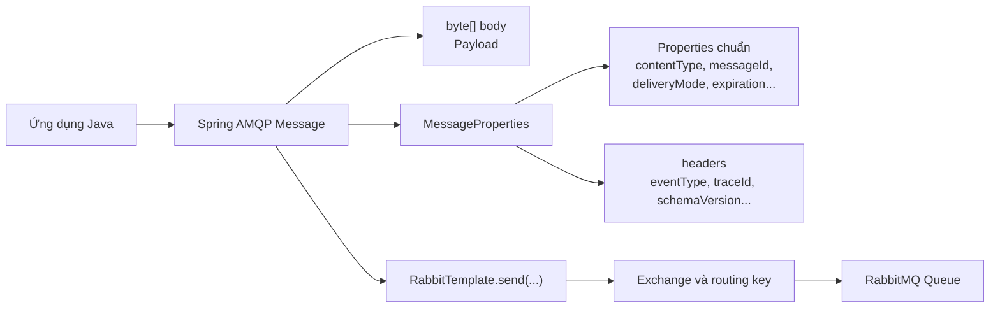
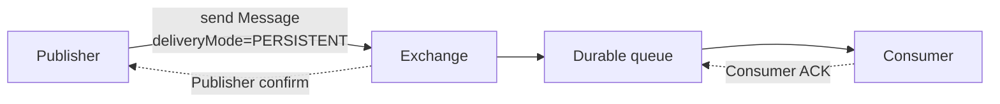

# MessageBuilder và MessagePropertiesBuilder trong Spring AMQP

Một sự kiện `order.created` gửi qua RabbitMQ thường gồm **nội dung nghiệp vụ** và **thông tin mô tả thông điệp**. Nội dung có thể là chuỗi, JSON hoặc một dãy byte; phần mô tả cho biết kiểu dữ liệu, mã nhận diện sự kiện, correlation ID, độ ưu tiên, thời hạn sống và các header do ứng dụng định nghĩa. Nếu chỉ chú ý payload mà bỏ qua metadata, hệ thống có thể đọc sai encoding, khó theo dõi lỗi hoặc xử lý trùng khi xảy ra retry.

Trong chương **Cấu trúc thông điệp**, Spring AMQP cung cấp hai công cụ thuận tiện:

- **`MessageBuilder`:** tạo một đối tượng `Message`, gồm **`byte[] body`** và **`MessageProperties`**.
- **`MessagePropertiesBuilder`:** tạo đối tượng `MessageProperties` độc lập, hữu ích khi chuẩn hóa metadata hoặc cần dùng lại cấu hình properties cho những message khác nhau.

Bài học hướng dẫn sử dụng các builder này khi publish bằng `RabbitTemplate`, nhận bằng `@RabbitListener`, kết hợp exchange/queue/binding và quan sát thông điệp. Metadata là một phần của thiết kế xử lý bất đồng bộ đáng tin cậy, bên cạnh publisher confirm, consumer acknowledgement, retry, dead-letter và giao dịch.

Sau bài học, bạn có thể tạo message có body và metadata nhất quán; biết thuộc tính nào ảnh hưởng broker, thuộc tính nào chỉ phục vụ ứng dụng; và kiểm chứng chúng ở phía consumer.

## 1. Message của Spring AMQP gồm những gì?

Đối tượng `org.springframework.amqp.core.Message` của Spring AMQP có hai thành phần chính:



Ví dụ một sự kiện được thiết kế như sau:

| Phần | Giá trị minh họa | Công dụng |
| --- | --- | --- |
| `body` | Dãy byte UTF-8 của `ORD-1001` | Dữ liệu nghiệp vụ |
| `contentType` | `text/plain` | Gợi ý kiểu dữ liệu cho consumer/converter |
| `contentEncoding` | `UTF-8` | Quy ước giải mã body |
| `messageId` | `evt-order-1001-created` | Mã nhận diện message/event để theo dõi, khử trùng lặp |
| `type` | `order.created` | Phân loại nội dung ở cấp ứng dụng |
| `headers["schemaVersion"]` | `1` | Giúp xử lý phiên bản hợp đồng dữ liệu |
| `deliveryMode` | `PERSISTENT` | Yêu cầu broker lưu message bền vững theo cơ chế áp dụng |
| `routingKey` khi publish | `order.created` | Lựa chọn binding để định tuyến tới queue |

**Cần phân biệt:** routing key dùng trong `RabbitTemplate.send(exchange, routingKey, message)` là **tham số publish**, không phải một header tùy ý mà broker tự đọc để route. Consumer có thể nhận được *received routing key* trong `MessageProperties` sau khi broker giao message.

### 1.1. Body là byte, không tự mang kiểu Java

Trên đường truyền AMQP 0-9-1, message body là dữ liệu byte. Spring có thể chuyển đối tượng Java thành byte qua `MessageConverter`, nhưng `MessageBuilder` trực tiếp làm việc với `byte[]`. Vì vậy:

- Chuỗi phải được mã hóa tường minh, ví dụ `StandardCharsets.UTF_8`.
- JSON cần được tạo bằng serializer thực sự thay vì ghép chuỗi tùy tiện trong ứng dụng thực tế.
- Consumer phải thống nhất cách giải mã body với publisher; `contentType` và `contentEncoding` chỉ là metadata, **không tự biến byte sai encoding thành đúng**.

## 2. MessageBuilder: tạo body và properties cùng một lần

`MessageBuilder` được dùng khi đã có `byte[]` của payload và muốn thiết lập metadata ngay trong cùng biểu thức.

### 2.1. Ví dụ cơ bản

```java
import java.nio.charset.StandardCharsets;

import org.springframework.amqp.core.Message;
import org.springframework.amqp.core.MessageBuilder;
import org.springframework.amqp.core.MessageDeliveryMode;
import org.springframework.amqp.core.MessageProperties;

public class OrderMessages {

    public static Message orderCreated(String orderId, String eventId) {
        byte[] body = orderId.getBytes(StandardCharsets.UTF_8);

        return MessageBuilder.withBody(body)
                .setContentType(MessageProperties.CONTENT_TYPE_TEXT_PLAIN)
                .setContentEncoding(StandardCharsets.UTF_8.name())
                .setMessageId(eventId)
                .setType("order.created")
                .setDeliveryMode(MessageDeliveryMode.PERSISTENT)
                .setHeader("schemaVersion", 1)
                .setHeader("producer", "order-service")
                .build();
    }
}
```

Các bước diễn ra:

1. `withBody(byte[])` nhận nội dung message.
2. Các phương thức `set...` đưa metadata vào `MessageProperties`.
3. `setHeader(name, value)` thêm header do ứng dụng định nghĩa.
4. `build()` trả về `Message` đã sẵn sàng cho `RabbitTemplate.send(...)`.

`build()` **không gửi message** và **không khai báo queue/exchange**. Nó chỉ tạo dữ liệu tại phía Java.

### 2.2. Vì sao dùng `withClonedBody`?

`byte[]` có thể thay đổi sau khi được tạo. Nếu code giữ một tham chiếu đến cùng mảng byte rồi thay đổi nó trong khi message đang được chuẩn bị/gửi, nội dung có thể không còn giống dự định.

`MessageBuilder` có biến thể **`withClonedBody(byte[])`** để tạo bản sao mảng khi xây message. Ví dụ:

```java
byte[] reusableBuffer = "ORD-1001"
        .getBytes(StandardCharsets.UTF_8);

Message safeMessage = MessageBuilder
        .withClonedBody(reusableBuffer)
        .setContentType(MessageProperties.CONTENT_TYPE_TEXT_PLAIN)
        .setContentEncoding("UTF-8")
        .build();

// Việc thay reusableBuffer về sau không thay body đã clone.
reusableBuffer[0] = (byte) 'X';
```

Cách clone có thêm chi phí cấp phát/copy bộ nhớ; chỉ cần thiết khi dữ liệu đầu vào có khả năng tiếp tục bị sửa. Trong ví dụ sử dụng `String.getBytes(...)` tạo mảng byte mới và không sửa tiếp, `withBody(...)` thường đã đủ rõ ràng.

Ngoài ra, API có các cách khởi tạo từ một `Message` đã có như `fromMessage(...)` và biến thể clone để xây message mới dựa trên message hiện hữu. Khi viết logic retry hoặc forward, cần hiểu rõ **chia sẻ tham chiếu với bản gốc hay clone** để tránh việc chỉnh sửa ngoài ý muốn; đừng dùng việc đổi metadata như một cách “làm mới” event ID mà phá vỡ khả năng khử trùng lặp.

### 2.3. Những trường hữu dụng trong builder

| Phương thức tiêu biểu | Thuộc tính được thiết lập | Vai trò |
| --- | --- | --- |
| `setContentType(...)` | `contentType` | Dữ liệu dạng text, JSON, binary, ... |
| `setContentEncoding(...)` | `contentEncoding` | Quy ước encoding, thường là UTF-8 cho text |
| `setMessageId(...)` | `messageId` | Định danh message do publisher gán |
| `setCorrelationId(...)` | `correlationId` | Liên kết request–reply, trace hoặc luồng nghiệp vụ |
| `setType(...)` | `type` | Nhận diện loại sự kiện |
| `setReplyTo(...)` | `replyTo` | Chỉ định nơi gửi phản hồi trong request–reply |
| `setDeliveryMode(...)` | `deliveryMode` | `PERSISTENT` hoặc `NON_PERSISTENT` |
| `setExpiration(...)` | `expiration` | TTL của message được biểu diễn bằng chuỗi mili giây |
| `setPriority(...)` | `priority` | Gợi ý độ ưu tiên khi queue hỗ trợ |
| `setHeader(k, v)` | `headers` | Metadata riêng của ứng dụng |

Không phải mọi metadata đều tác động đến broker. Chẳng hạn `messageId` và `schemaVersion` thường phục vụ nghiệp vụ, còn `expiration` và `deliveryMode` có ý nghĩa đối với chính sách lưu trữ/giao message.

## 3. MessagePropertiesBuilder: xây riêng metadata

Khi muốn tạo `MessageProperties` trước rồi mới kết hợp với payload, dùng `MessagePropertiesBuilder`.

```java
import java.nio.charset.StandardCharsets;

import org.springframework.amqp.core.Message;
import org.springframework.amqp.core.MessageDeliveryMode;
import org.springframework.amqp.core.MessageProperties;
import org.springframework.amqp.core.MessagePropertiesBuilder;

public class OrderMessageFactory {

    public static Message create(String orderId, String eventId) {
        MessageProperties properties = MessagePropertiesBuilder.newInstance()
                .setContentType(MessageProperties.CONTENT_TYPE_TEXT_PLAIN)
                .setContentEncoding("UTF-8")
                .setMessageId(eventId)
                .setType("order.created")
                .setDeliveryMode(MessageDeliveryMode.PERSISTENT)
                .setHeader("schemaVersion", 1)
                .setHeader("producer", "order-service")
                .build();

        byte[] body = orderId.getBytes(StandardCharsets.UTF_8);
        return new Message(body, properties);
    }
}
```

Kết quả mang cùng ý nghĩa với ví dụ `MessageBuilder` ở phần 2: một `Message` có body và properties. Khác biệt chủ yếu nằm ở **cách tổ chức code**.

| Tình huống | Builder thuận tiện |
| --- | --- |
| Có body và muốn tạo message hoàn chỉnh trong một chuỗi lệnh | `MessageBuilder` |
| Cần một hàm dựng metadata chuẩn từ thông tin domain | `MessagePropertiesBuilder` |
| Tạo thêm metadata cho message cũ | Dùng builder khởi tạo từ message/properties cũ, lưu ý clone |
| Dùng `RabbitTemplate.convertAndSend(...)` với đối tượng Java | Thường để converter tạo `Message`, tùy chỉnh bằng `MessagePostProcessor` khi cần |

Có thể thấy các API như `MessagePropertiesBuilder.fromProperties(...)` và `fromClonedProperties(...)`. Khi tạo lại metadata từ một đối tượng tồn tại, hãy chọn giữa **sử dụng lại** và **sao chép** theo ý định; đặc biệt tránh sửa cùng một `MessageProperties` đang được nhiều luồng dùng chung.

> **Chú ý về tính mutable:** `MessageProperties` và map `headers` là những đối tượng có thể sửa. Không nên tạo một instance chung rồi dùng nó như một singleton mutable cho hàng nghìn message đồng thời. Tạo properties riêng theo message, hoặc sao chép trước khi chỉnh sửa, sẽ làm mã dễ kiểm soát hơn.

## 4. Body, properties và headers: ai đọc giá trị nào?

Metadata thường được chia thành **các trường AMQP chuẩn** và **application headers**.

### 4.1. Các trường AMQP tiêu biểu

| Trường | Ý nghĩa thực tế | Lưu ý |
| --- | --- | --- |
| `contentType` | Kiểu body: `text/plain`, `application/json`, ... | Consumer/converter cần hiểu định dạng |
| `contentEncoding` | Cách mã hóa body | Cần khớp với byte thực tế |
| `deliveryMode` | Lựa chọn persistent hoặc non-persistent | Không tự bảo đảm “đúng một lần” hay không mất message |
| `messageId` | Định danh do publisher cấp | RabbitMQ không tự khử trùng lặp theo messageId |
| `correlationId` | Gắn các message thuộc cùng một luồng | Có ích với RPC và tracing |
| `replyTo` | Đích nhận response | Không tự tạo consumer response |
| `expiration` | TTL tính bằng mili giây dạng chuỗi | Hết hạn có thể dẫn tới drop hoặc dead-letter tùy queue |
| `priority` | Độ ưu tiên nếu queue hỗ trợ | Không có tác dụng như nhau trên mọi queue type |

### 4.2. Application headers

Header do ứng dụng đặt giúp các consumer hiểu schema và xử lý lỗi:

```java
Message message = MessageBuilder
        .withBody("ORD-1001".getBytes(StandardCharsets.UTF_8))
        .setContentType(MessageProperties.CONTENT_TYPE_TEXT_PLAIN)
        .setHeader("eventType", "order.created")
        .setHeader("schemaVersion", 2)
        .setHeader("tenant", "tenant-a")
        .build();
```

Một nguyên tắc thiết kế hữu ích là **đặt các giá trị metadata nhỏ, có kiểu ổn định**:

- Dùng `schemaVersion` để cho consumer biết cách đọc payload phiên bản mới.
- Dùng event ID/correlation ID để truy dấu và xử lý trùng.
- Tránh đưa token truy cập, mật khẩu hoặc dữ liệu nhạy cảm vào headers nếu không có cơ chế bảo vệ phù hợp.
- Tránh lưu object Java tùy ý vào headers; AMQP 0-9-1 chỉ hỗ trợ các kiểu giá trị field table tương thích. Đối tượng Java phức tạp nên được chuẩn hóa thành chuỗi/số/byte hoặc nằm trong body theo schema.

**Không nhầm message header với queue argument**: `x-queue-type`, `x-dead-letter-exchange` hoặc giới hạn queue được đặt khi khai báo **queue**; đặt header có tên tương tự trên một message không thay đổi queue type hay DLX của queue.

### 4.3. Các thuộc tính nhận về từ broker

Khi consumer nhận message, `MessageProperties` còn có thể mang thông tin **được bổ sung trong quá trình delivery**, ví dụ received exchange, received routing key, delivery tag và cờ redelivered. Đây là dữ liệu quan sát tại phía nhận.

Đừng cố “giả lập” thuộc tính delivery của broker bằng cách đặt header `receivedRoutingKey` trên publisher. Routing thực tế do exchange/binding và tham số publish quyết định. Trong listener, có thể đọc:

```java
MessageProperties props = receivedMessage.getMessageProperties();

String eventId = props.getMessageId();
String routingKey = props.getReceivedRoutingKey();
boolean redelivered = props.isRedelivered();
Object version = props.getHeaders().get("schemaVersion");
```

`redelivered=true` giúp nhận biết khả năng giao lại, nhưng không phải cơ chế đáng tin cậy duy nhất để xác định **sự kiện đã được nghiệp vụ xử lý hay chưa**. Cần có idempotency theo event ID hoặc khóa nghiệp vụ.

## 5. Ví dụ Spring AMQP hoàn chỉnh: publish và consume một message

Ta sử dụng một topic exchange `orders.events`, queue `orders.created` và binding key `order.created`.

### 5.1. Khai báo topology

```java
import org.springframework.amqp.core.Binding;
import org.springframework.amqp.core.BindingBuilder;
import org.springframework.amqp.core.Queue;
import org.springframework.amqp.core.QueueBuilder;
import org.springframework.amqp.core.TopicExchange;
import org.springframework.amqp.core.ExchangeBuilder;
import org.springframework.context.annotation.Bean;
import org.springframework.context.annotation.Configuration;

@Configuration
public class OrderTopology {

    public static final String EXCHANGE = "orders.events";
    public static final String QUEUE = "orders.created";
    public static final String ROUTING_KEY = "order.created";

    @Bean
    public TopicExchange orderExchange() {
        return ExchangeBuilder.topicExchange(EXCHANGE)
                .durable(true)
                .build();
    }

    @Bean
    public Queue orderQueue() {
        return QueueBuilder.durable(QUEUE).build();
    }

    @Bean
    public Binding orderBinding(Queue orderQueue, TopicExchange orderExchange) {
        return BindingBuilder.bind(orderQueue)
                .to(orderExchange)
                .with(ROUTING_KEY);
    }
}
```

Khi ứng dụng sử dụng cấu hình `RabbitAdmin` phù hợp, Spring có thể khai báo ba bean này ở broker. Exchange/queue/binding nằm trong **virtual host của connection**. Người dùng RabbitMQ phải có quyền tương ứng để khai báo và gửi/nhận.

### 5.2. Cấu hình kết nối

```yaml
# application.yml, minh họa cấu hình Spring Rabbit
spring:
  rabbitmq:
    host: ${RABBITMQ_HOST:localhost}
    port: ${RABBITMQ_PORT:5672}
    username: ${RABBITMQ_USERNAME}
    password: ${RABBITMQ_PASSWORD}
    virtual-host: ${RABBITMQ_VHOST:/orders}
```

Trong môi trường thật, quản lý credential bằng secret hoặc biến môi trường, tránh đưa mật khẩu thực vào repository.

### 5.3. Publisher dùng MessageBuilder và send

```java
import java.nio.charset.StandardCharsets;

import org.springframework.amqp.core.Message;
import org.springframework.amqp.core.MessageBuilder;
import org.springframework.amqp.core.MessageDeliveryMode;
import org.springframework.amqp.core.MessageProperties;
import org.springframework.amqp.rabbit.core.RabbitTemplate;
import org.springframework.stereotype.Service;

@Service
public class OrderPublisher {
    private final RabbitTemplate rabbitTemplate;

    public OrderPublisher(RabbitTemplate rabbitTemplate) {
        this.rabbitTemplate = rabbitTemplate;
    }

    // eventId phải ổn định qua các lần retry cùng một sự kiện.
    public void created(String orderId, String eventId) {
        Message message = MessageBuilder
                .withBody(orderId.getBytes(StandardCharsets.UTF_8))
                .setContentType(MessageProperties.CONTENT_TYPE_TEXT_PLAIN)
                .setContentEncoding("UTF-8")
                .setMessageId(eventId)
                .setType("order.created")
                .setDeliveryMode(MessageDeliveryMode.PERSISTENT)
                .setHeader("schemaVersion", 1)
                .build();

        rabbitTemplate.send(
                OrderTopology.EXCHANGE,
                OrderTopology.ROUTING_KEY,
                message);
    }
}
```

Ở đây, `send(...)` nhận **`Message` đã dựng xong**. Publisher quyết định exchange/routing key bằng các tham số của `send`. Việc thêm `setType("order.created")` vào properties không khiến RabbitMQ tự route theo trường `type` khi exchange là topic.

### 5.4. Consumer đọc body và properties

```java
import java.nio.charset.StandardCharsets;

import org.springframework.amqp.core.Message;
import org.springframework.amqp.core.MessageProperties;
import org.springframework.amqp.rabbit.annotation.RabbitListener;
import org.springframework.stereotype.Component;

@Component
public class OrderCreatedConsumer {

    @RabbitListener(queues = OrderTopology.QUEUE)
    public void onMessage(Message message) {
        byte[] body = message.getBody();
        MessageProperties props = message.getMessageProperties();

        String orderId = new String(body, StandardCharsets.UTF_8);
        String eventId = props.getMessageId();
        String routingKey = props.getReceivedRoutingKey();
        Object schemaVersion = props.getHeaders().get("schemaVersion");

        System.out.printf(
                "eventId=%s routingKey=%s version=%s orderId=%s%n",
                eventId, routingKey, schemaVersion, orderId);

        // Ứng dụng thực tế: kiểm tra idempotency và thực hiện nghiệp vụ
        // trước khi listener kết thúc thành công.
    }
}
```

Trong ví dụ mặc định, nếu listener container ở chế độ **AUTO** của Spring AMQP, nó phát consumer acknowledgement sau khi phương thức xử lý hoàn tất thành công. Đây không phải việc `MessageBuilder` thực hiện và không đồng nghĩa publisher đã nhận confirm.

Một event không được ACK đúng cách có thể bị giao lại. **`messageId` chỉ là định danh; RabbitMQ không tự loại bản trùng theo trường này**. Consumer cần lưu trạng thái xử lý event ID hoặc dùng ràng buộc dữ liệu để đạt idempotency.

## 6. Phân biệt send(...) với convertAndSend(...)

Hai cách publish phổ biến qua `RabbitTemplate`:

| API | Đầu vào | Ai tạo byte body và message properties? |
| --- | --- | --- |
| `send(exchange, routingKey, Message)` | Đối tượng `Message` | Ứng dụng tự dựng, có thể dùng `MessageBuilder` |
| `convertAndSend(exchange, routingKey, Object)` | Đối tượng Java | `MessageConverter` đang cấu hình chuyển object thành `Message` |
| `convertAndSend(..., MessagePostProcessor)` | Object cộng xử lý message sau chuyển đổi | Converter tạo message; post-processor chỉnh headers/properties trước khi gửi |

Ví dụ khi chỉ muốn bổ sung metadata cho payload là `String`:

```java
rabbitTemplate.convertAndSend(
        "orders.events",
        "order.created",
        "ORD-1001",
        message -> {
            message.getMessageProperties().setMessageId("evt-1001");
            message.getMessageProperties().setHeader("schemaVersion", 1);
            return message;
        });
```

`MessagePostProcessor` cho phép gắn metadata sau khi converter tạo body. Nó hữu ích khi không muốn tự gọi `getBytes(...)`, hoặc khi đã thiết lập JSON converter. Dù vậy, ứng dụng vẫn cần thống nhất **serializer, contentType, encoding và schema** với consumer.

Đừng truyền một đối tượng `Message` vào `convertAndSend(...)` với giả định Spring luôn giữ nguyên body/properties y như `send(...)`. Nếu đã có `Message` ở dạng wire-ready, gọi `send(...)` là lựa chọn rõ ràng hơn.

### 6.1. Thông điệp JSON

Khi ứng dụng gửi JSON, nội dung trong body có thể là:

```json
{
  "eventId": "evt-1001",
  "orderId": "ORD-1001",
  "amount": 150000,
  "currency": "VND"
}
```

Publisher có thể serialize đối tượng sự kiện bằng thư viện JSON của dự án rồi dùng:

```java
Message jsonMessage = MessageBuilder
        .withBody(jsonBytes) // byte[] do JSON serializer tạo ra
        .setContentType(MessageProperties.CONTENT_TYPE_JSON)
        .setContentEncoding("UTF-8")
        .setMessageId(eventId)
        .setType("order.created")
        .setHeader("schemaVersion", 1)
        .build();

rabbitTemplate.send("orders.events", "order.created", jsonMessage);
```

Đây là đoạn **minh họa một phần**: `jsonBytes` và `eventId` phải được khai báo bởi mã thực tế. Không nên gửi dữ liệu Java serialization chỉ vì cả publisher/consumer đều viết bằng Java; JSON hoặc định dạng có schema rõ ràng thường giúp giao tiếp liên dịch vụ và nâng cấp tương thích dễ hơn.

## 7. Metadata nào ảnh hưởng đến độ tin cậy?

Việc gắn metadata đúng giúp quan sát và điều phối nhưng không tự bảo đảm message được xử lý một lần.

### 7.1. Persistent không bằng exactly-once

`MessageDeliveryMode.PERSISTENT` yêu cầu lưu message theo ngữ nghĩa persistent của broker, nhưng để giảm rủi ro mất dữ liệu cần xem đồng thời **queue durable hoặc loại queue thích hợp**, tình trạng broker, publisher confirms, ACK và chính sách phục hồi.



Publisher confirm (broker xác nhận lần publish) và consumer ACK (consumer xác nhận một delivery đã xử lý) thuộc **hai hướng phản hồi khác nhau**. `MessageBuilder` không thay thế bất kỳ cơ chế nào.

### 7.2. messageId, correlationId và idempotency

| Mục tiêu | Thuộc tính thường dùng | Điều ứng dụng phải làm |
| --- | --- | --- |
| Nhận diện một sự kiện nghiệp vụ | `messageId` hoặc event ID trong payload | Giữ ID ổn định qua publisher retry; deduplicate tại consumer |
| Liên kết nhiều message trong một luồng | `correlationId` | Gắn và chuyển tiếp qua các bước xử lý; quan sát trace |
| Request–reply | `replyTo` và `correlationId` | Tạo nơi nhận reply, theo dõi timeout và khớp response |
| Kiểm soát schema | `type`, `schemaVersion` | Validate loại và phiên bản payload |

**Tình huống:** consumer đã ghi hóa đơn vào database nhưng mất connection trước khi gửi ACK. Broker có thể giao lại message. Nếu consumer kiểm tra `messageId` hoặc khóa nghiệp vụ đã xử lý trong cùng transaction DB phù hợp, nó có thể tránh lập hóa đơn lần hai.

Một ranh giới cần chú ý: transaction AMQP không tự tạo transaction nguyên tử với database. Với nghiệp vụ cần phát sự kiện sau khi commit DB, cân nhắc **transactional outbox** và consumer idempotent.

### 7.3. TTL và priority có giới hạn

`expiration` biểu diễn TTL của một message theo **chuỗi số mili giây** trong AMQP 0-9-1. Hết hạn có thể khiến message bị loại bỏ hoặc chuyển dead-letter exchange khi queue được cấu hình phù hợp. TTL không có nghĩa RabbitMQ sẽ thực thi nghiệp vụ đúng vào thời điểm đã đặt.

`priority` chỉ có ý nghĩa khi loại queue và cấu hình broker hỗ trợ ưu tiên; không thể đặt priority tùy ý rồi kỳ vọng mọi loại queue đổi thứ tự ngay.

Các header như `x-death` có thể được RabbitMQ bổ sung khi dead-letter. Không nên tự ý giả lập lịch sử broker bằng cách đặt header đó từ publisher nếu muốn quan sát retry/DLX một cách chính xác.

## 8. Thực hành: kiểm tra message và properties qua RabbitMQ

Sau khi khai báo topology `orders.events` → `orders.created` và chạy ứng dụng, thực hiện:

1. Gửi một message bằng `OrderPublisher.created("ORD-1001", "evt-1001")`.
2. Quan sát log của listener: `eventId=evt-1001`, `routingKey=order.created`, `version=1` và `orderId=ORD-1001`.
3. Kiểm tra RabbitMQ Management UI ở đúng virtual host. Khi consumer đang chạy liên tục, queue có thể lập tức về 0; muốn quan sát message chờ, tạm dừng consumer trong **môi trường thử nghiệm**.
4. Thay đổi header `schemaVersion` thành `2` trong một thử nghiệm có consumer hỗ trợ; xác minh code consumer nhận được giá trị mới.
5. Thử dùng routing key không khớp binding. Dù body và `type` vẫn là `order.created`, message sẽ không vào queue nếu broker không có tuyến phù hợp.

Một số lệnh CLI quan sát, chạy bằng tài khoản quản trị trên broker:

```bash
rabbitmqctl list_exchanges -p /orders name type
rabbitmqctl list_queues -p /orders name messages_ready messages_unacknowledged consumers
rabbitmqctl list_bindings -p /orders source_name destination_name routing_key
```

### 8.1. Những lỗi thường gặp

| Triệu chứng | Nguyên nhân có thể có | Hướng xử lý |
| --- | --- | --- |
| Consumer nhận chữ bị lỗi | Publisher/consumer không thống nhất UTF-8 | Kiểm tra bytes, `contentEncoding` và cách giải mã |
| Consumer báo lỗi convert JSON | `contentType`, converter hoặc schema không tương thích | Thống nhất message converter và cấu trúc payload |
| Header không xuất hiện | Publisher không gắn header, converter/post-processor thay đổi message hoặc đọc sai key | Log metadata ở publisher/consumer và kiểm tra tên key |
| `messageId` rỗng | Publisher không chủ động đặt ID | Gắn event ID khi tạo message; không mặc định broker tự tạo |
| Message không tới queue dù `type` đúng | Routing key/binding/exchange/vhost không khớp | Kiểm tra tham số `send(...)` và topology |
| Message bị xử lý trùng | Publisher retry hoặc broker redelivery | Xử lý idempotent dựa trên event ID; theo dõi ACK/retry |
| Message hết hạn không vào DLQ | Queue không có DLX phù hợp hoặc binding đến DLQ thiếu | Kiểm tra queue arguments, policy, DLX và DLQ |
| `priority` không làm đổi thứ tự | Queue type không hỗ trợ hoặc queue chưa cấu hình ưu tiên | Kiểm tra tài liệu và cấu hình RabbitMQ |
| Metadata bị thay đổi ngoài ý muốn | Chia sẻ mutable byte array hoặc `MessageProperties` giữa nhiều luồng | Tạo/clone message/properties theo vòng đời phù hợp |

## 9. Nguyên tắc thiết kế message cho hệ thống lớn

Khi nhiều service cùng trao đổi sự kiện, nên thống nhất **hợp đồng message**:

- **Payload:** định dạng (JSON, protobuf...), schema/version, trường bắt buộc và cách xử lý phiên bản cũ.
- **Message ID:** ổn định theo **sự kiện logic**, kể cả khi publisher phải retry. Không sinh ID mới cho mỗi lần gửi lại cùng sự kiện nếu consumer đang dùng ID đó để deduplicate.
- **Correlation ID:** theo luồng xử lý hoặc request, giúp liên kết log/traces giữa các service.
- **Content type và encoding:** phản ánh đúng bytes; tránh phụ thuộc charset mặc định của JVM.
- **Headers:** key có quy ước, giá trị đơn giản và nhỏ; không nhét dữ liệu nhạy cảm hay payload lớn vào headers.
- **Delivery properties:** chọn persistent, expiration, priority theo loại queue và yêu cầu vận hành thực tế.
- **Quan sát và lỗi:** publisher confirm/return, ACK/NACK, retry/DLX và event ID cần được kết hợp; không dùng metadata thay cho xác nhận giao nhận.

**Ghi nhớ:** `MessageBuilder` giúp tạo **message hoàn chỉnh** khi có body và metadata; `MessagePropertiesBuilder` giúp tạo **metadata độc lập** rồi kết hợp với body. Cả hai đều tạo dữ liệu ở phía Java. Routing vẫn phụ thuộc exchange và binding, còn độ tin cậy của xử lý bất đồng bộ đến từ publisher confirms, consumer acknowledgements, retry, dead-letter, giao dịch nghiệp vụ phù hợp và khả năng quan sát hệ thống.

### Tài liệu tham khảo

- [Spring AMQP Reference — Messages](https://docs.spring.io/spring-amqp/reference/amqp/message-converters.html)
- [Spring AMQP Reference — RabbitTemplate](https://docs.spring.io/spring-amqp/reference/amqp/template.html)
- [Spring AMQP Reference — Annotation-driven listeners](https://docs.spring.io/spring-amqp/reference/amqp/receiving-messages/async-annotation-driven.html)
- [Spring AMQP API — MessageBuilder](https://docs.spring.io/spring-amqp/api/org/springframework/amqp/core/MessageBuilder.html)
- [Spring AMQP API — MessagePropertiesBuilder](https://docs.spring.io/spring-amqp/api/org/springframework/amqp/core/MessagePropertiesBuilder.html)
- [RabbitMQ — AMQP 0-9-1 Model Explained](https://www.rabbitmq.com/tutorials/amqp-concepts)
- [RabbitMQ — Publisher Confirms and Consumer Acknowledgements](https://www.rabbitmq.com/docs/confirms)
- [RabbitMQ — Time-to-Live](https://www.rabbitmq.com/docs/ttl)

