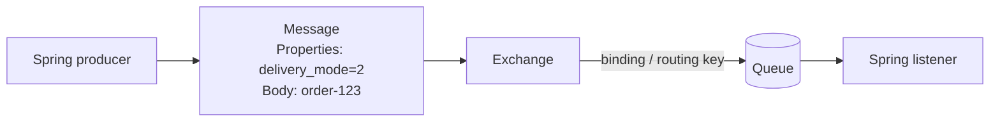
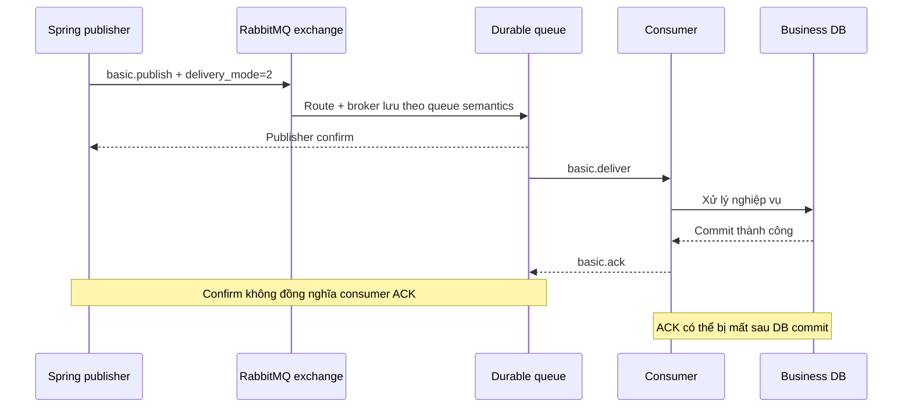
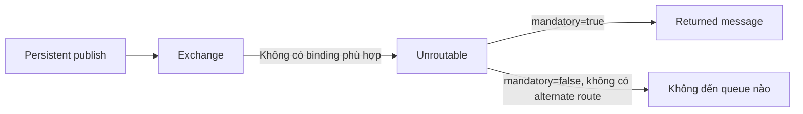
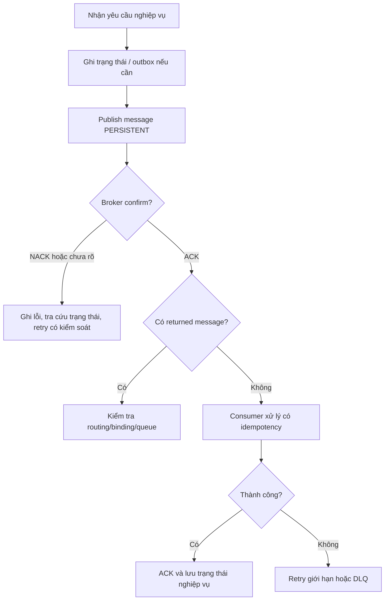

# Delivery mode và ý nghĩa thông điệp persistent

Một message được publish thành công tới RabbitMQ có chắc còn tồn tại sau khi broker khởi động lại? Câu trả lời phụ thuộc vào **delivery mode của message**, **độ bền của queue**, **cơ chế lưu trữ của loại queue**, và cách producer nhận xác nhận từ broker. Chỉ nhìn thấy chữ `persistent` trong message properties là chưa đủ để kết luận message không thể mất.

Bài học thuộc chương **Cấu trúc thông điệp** của module **SPRING_AMQP**. Chúng ta sẽ đi từ thuộc tính `delivery_mode` của AMQP 0-9-1 đến cách Spring AMQP biểu diễn thuộc tính này bằng `MessageDeliveryMode`; thực hành với `RabbitTemplate`, `@RabbitListener`, exchange, queue và binding; sau đó đặt nó trong bức tranh xác nhận giao nhận, retry, dead-letter, giao dịch và quan sát hệ thống để xây dựng xử lý bất đồng bộ đáng tin cậy.

Sau bài này, bạn có thể:

- Phân biệt `delivery_mode=1` (non-persistent) và `delivery_mode=2` (persistent) trên AMQP 0-9-1.
- Chỉ định và kiểm tra `MessageDeliveryMode` khi gửi message bằng `RabbitTemplate`.
- Giải thích vì sao một **persistent message** được gửi vào **non-durable queue** vẫn có thể mất sau broker restart.
- Hiểu quan hệ giữa delivery mode, durable queue, publisher confirms và consumer ACK.
- Xác định các tình huống persistent message vẫn có nguy cơ mất hoặc được xử lý trùng.
- Chọn cấu hình và kiểm chứng với workload thực tế thay vì suy luận từ một thuộc tính.

> **Phạm vi:** Nội dung nói về RabbitMQ qua **AMQP 0-9-1** với Spring AMQP. Queue type như classic, quorum và RabbitMQ streams có cách lưu trữ khác nhau; không suy diễn toàn bộ ngữ nghĩa của `delivery_mode` từ classic queue sang mọi loại queue. Ví dụ sử dụng `spring-boot-starter-amqp` và payload `String` cho dễ quan sát.

## 1. Delivery mode nằm ở đâu trong message?

Một message AMQP có **body** và tập **properties/headers**. Body chứa dữ liệu nghiệp vụ; properties truyền các thông tin như content type, message ID, correlation ID, expiration, priority và **delivery mode**.



| Thành phần | Ví dụ | Vai trò |
| --- | --- | --- |
| Body | `{"orderId":"O-123"}` | Nội dung sự kiện/công việc. |
| `contentType` | `application/json` | Gợi ý định dạng payload để bên nhận chuyển đổi. |
| `messageId` | `6d1f…` | Định danh message cho truy vết hoặc chống trùng nếu ứng dụng sử dụng. |
| `correlationId` | `req-42` | Ghép message vào luồng nghiệp vụ/request tương ứng. |
| `deliveryMode` | `PERSISTENT` | Yêu cầu broker xử lý độ bền message theo semantics của queue. |
| Routing key | `order.created` | Tham số publish để exchange định tuyến; không phải thuộc tính delivery mode. |

Ở mức AMQP 0-9-1, delivery mode là thuộc tính của **basic content properties**:

| AMQP `delivery_mode` | Spring AMQP `MessageDeliveryMode` | Ý nghĩa |
| --- | --- | --- |
| `1` | `NON_PERSISTENT` | Message không yêu cầu bảo đảm độ bền qua restart theo cơ chế persistent messaging. |
| `2` | `PERSISTENT` | Message được đánh dấu để broker lưu bền vững khi loại queue và cấu hình hỗ trợ. |
| Không thiết lập | Phụ thuộc cách client/converter khởi tạo message | Không được tự giả định luôn là persistent; cần xem hành vi thực tế. |

**Delivery mode được đặt trên từng message khi publish**, không phải thuộc tính chung của exchange, queue hay `@RabbitListener`. Hai message đi vào cùng queue có thể được publish với các delivery mode khác nhau nếu loại queue hỗ trợ.

## 2. Persistent có nghĩa gì và không có nghĩa gì?

Đối với **classic queue**, có thể hiểu:

- **Persistent message** là message được đánh dấu `delivery_mode=2` để RabbitMQ lưu theo cơ chế persistent storage nếu nó được định tuyến vào durable queue.
- **Non-persistent message** không có cùng bảo đảm tồn tại qua broker restart. Broker vẫn có thể ghi dữ liệu transient xuống đĩa do cơ chế quản lý tài nguyên; `NON_PERSISTENT` không đồng nghĩa với “không bao giờ đụng tới disk”.
- **Durable queue** có định nghĩa được duy trì sau broker restart, nhưng thuộc tính `durable=true` không tự chuyển mọi transient message trong queue thành persistent.

### 2.1. Ma trận queue durability × message delivery mode

| Queue | Message | Kỳ vọng khi broker restart |
| --- | --- | --- |
| **Non-durable** | `NON_PERSISTENT` | Queue biến mất; message không còn khả dụng. |
| **Non-durable** | `PERSISTENT` | Queue vẫn biến mất; persistent flag không cứu được message khỏi việc queue bị xóa. |
| **Durable** | `NON_PERSISTENT` | Định nghĩa queue có thể tồn tại, nhưng không nên kỳ vọng message transient sống qua restart. |
| **Durable** | `PERSISTENT` | Là tổ hợp cơ bản để message được phục hồi sau restart **theo bảo đảm của queue/broker**, không phải cam kết tuyệt đối trong mọi loại lỗi. |

Ma trận là mô hình nền tảng cho classic queue. Với **quorum queue**, broker sử dụng cơ chế lưu trữ/replication riêng và không nên dùng `delivery_mode=1` như cách chắc chắn né ghi đĩa. Với **stream**, mục tiêu là log lưu trữ có retention và replay; delivery mode của classic queue không mô tả đầy đủ semantics của stream.

### 2.2. Độ bền của exchange và binding cũng có liên quan

Để publisher gửi message tới đúng queue **sau** khi hệ thống phục hồi:

1. Exchange được khai báo với các thuộc tính durability phù hợp.
2. Queue đích tồn tại sau restart hoặc được tái khai báo đúng trước khi producer bắt đầu publish.
3. Binding nối exchange tới queue vẫn hợp lệ hoặc được khai báo lại đúng.
4. Message được route tới queue và đáp ứng yêu cầu lưu trữ theo queue type.

Việc dùng `RabbitTemplate.convertAndSend("orders.x", "order.created", body)` không tự tạo ra exchange, queue và binding. Spring AMQP có thể dùng `RabbitAdmin` để khai báo tài nguyên từ các bean tương ứng, nhưng quá trình này phụ thuộc kết nối, quyền và cấu hình.

### 2.3. Persistent không có nghĩa “không bao giờ mất”

Một số tình huống quan trọng:

- **Publisher không nhận xác nhận rõ ràng:** ứng dụng có thể gửi rồi mất kết nối trước khi biết broker đã chấp nhận và lưu message.
- **Exchange định tuyến không thành công:** message persistent vẫn có thể không đến queue nào nếu routing key/binding sai và không có tuyến dự phòng.
- **Node lưu queue hoặc ổ đĩa hỏng:** một classic queue chỉ nằm trên một node không tự có replica ở node khác; persistent flag không khôi phục phần dữ liệu đã mất.
- **TTL, max-length, dead-letter hoặc admin xóa queue:** message persistent vẫn có thể hết hạn, bị loại bỏ, chuyển sang nơi khác hoặc mất khi queue bị xóa.
- **Consumer nhận nhưng chưa hoàn tất xử lý:** message còn phải đi qua ACK/NACK/requeue; persistence không quyết định tính đúng đắn của side effect.

**Tóm lại, persistent là một điều kiện thuộc lớp lưu trữ message**, không phải bảo đảm end-to-end rằng “không mất, không trùng và chỉ xử lý một lần”.

## 3. Đặt delivery mode bằng Spring AMQP

Trong Spring AMQP, `MessageDeliveryMode` là enum thuộc `org.springframework.amqp.core`:

```java
import org.springframework.amqp.core.MessageDeliveryMode;

MessageDeliveryMode persistent = MessageDeliveryMode.PERSISTENT;
MessageDeliveryMode transientMode = MessageDeliveryMode.NON_PERSISTENT;
```

Ứng dụng Spring AMQP thường tạo message persistent theo mặc định khi dùng `RabbitTemplate` và converter mặc định; tuy nhiên **không dựa vào mặc định của mọi converter/thư viện và mọi cấu hình**. Khi độ bền là một phần hợp đồng giao tiếp, hãy thiết lập rõ delivery mode, và kiểm tra kết quả trên broker/test.

### 3.1. `convertAndSend` với `MessagePostProcessor`

Phổ biến nhất là gửi object và chỉnh properties trước khi publish:

```java
import org.springframework.amqp.core.MessageDeliveryMode;
import org.springframework.amqp.rabbit.core.RabbitTemplate;
import org.springframework.stereotype.Service;

@Service
public class OrderEventPublisher {
    private final RabbitTemplate rabbitTemplate;

    public OrderEventPublisher(RabbitTemplate rabbitTemplate) {
        this.rabbitTemplate = rabbitTemplate;
    }

    public void publishCreated(String orderId) {
        rabbitTemplate.convertAndSend(
                "orders.events.x",
                "order.created",
                orderId,
                message -> {
                    message.getMessageProperties()
                            .setDeliveryMode(MessageDeliveryMode.PERSISTENT);
                    message.getMessageProperties().setMessageId(orderId);
                    return message;
                });
    }
}
```

`MessagePostProcessor` nhận `org.springframework.amqp.core.Message` đã được converter tạo ra và cho phép chỉnh thuộc tính trước khi đưa tới RabbitMQ client. Đoạn code dùng ID nghiệp vụ làm `messageId` chỉ để minh họa; hệ thống thật cần phân biệt ID của **event/message** với ID của **đối tượng nghiệp vụ** nếu một đơn có nhiều event.

Nếu business event chỉ mang tính tạm, có thể gửi non-persistent:

```java
rabbitTemplate.convertAndSend(
        "telemetry.x", "ui.heartbeat", "online",
        message -> {
            message.getMessageProperties()
                    .setDeliveryMode(MessageDeliveryMode.NON_PERSISTENT);
            return message;
        });
```

**Chú ý:** Non-persistent không đồng nghĩa bảo đảm “nhanh hơn” với mọi queue/workload. Trên quorum queue, broker có thể vẫn ghi dữ liệu theo cơ chế của nó; chỉ benchmark mới cho biết lợi ích thực tế.

### 3.2. Xây dựng `Message` trực tiếp rồi `send`

Nếu cần kiểm soát body, content type và delivery mode:

```java
import java.nio.charset.StandardCharsets;
import org.springframework.amqp.core.Message;
import org.springframework.amqp.core.MessageDeliveryMode;
import org.springframework.amqp.core.MessageProperties;
import org.springframework.amqp.rabbit.core.RabbitTemplate;

public void sendRaw(RabbitTemplate template) {
    MessageProperties properties = new MessageProperties();
    properties.setContentType(MessageProperties.CONTENT_TYPE_TEXT_PLAIN);
    properties.setContentEncoding("UTF-8");
    properties.setDeliveryMode(MessageDeliveryMode.PERSISTENT);
    properties.setMessageId("event-001");

    Message message = new Message(
            "order-created:O-123".getBytes(StandardCharsets.UTF_8),
            properties);

    template.send("orders.events.x", "order.created", message);
}
```

Lưu ý tên `Message` ở đây là **Spring AMQP Message**, không phải `org.springframework.messaging.Message`. Hai abstraction có mục đích khác nhau; tránh import nhầm.

### 3.3. Khai báo một exchange, queue và binding phù hợp

```java
import org.springframework.amqp.core.Binding;
import org.springframework.amqp.core.BindingBuilder;
import org.springframework.amqp.core.DirectExchange;
import org.springframework.amqp.core.Queue;
import org.springframework.amqp.core.QueueBuilder;
import org.springframework.beans.factory.annotation.Qualifier;
import org.springframework.context.annotation.Bean;
import org.springframework.context.annotation.Configuration;

@Configuration
class OrderMessageTopology {
    @Bean
    DirectExchange ordersExchange() {
        return new DirectExchange("orders.events.x", true, false);
    }

    @Bean
    Queue ordersQueue() {
        return QueueBuilder.durable("orders.audit.q")
                .withArgument("x-queue-type", "classic")
                .build();
    }

    @Bean
    Binding ordersBinding(
            @Qualifier("ordersQueue") Queue queue,
            @Qualifier("ordersExchange") DirectExchange exchange) {
        return BindingBuilder.bind(queue)
                .to(exchange)
                .with("order.created");
    }
}
```

`new DirectExchange("orders.events.x", true, false)` minh họa exchange durable, không auto-delete. `orders.audit.q` là một **durable classic queue**. Khi cấu hình này được khai báo thành công và producer gửi message `PERSISTENT`, ta có nền tảng cơ bản để kỳ vọng message được lưu qua broker restart, với những giới hạn đã nêu.

> Nếu queue đã tồn tại nhưng là quorum queue hoặc có arguments khác, sửa code thành `classic` có thể gây `PRECONDITION_FAILED`. Thử nghiệm với tên queue mới, không đổi queue type trên một queue đang có backlog.

## 4. Consumer nhìn thấy delivery mode thế nào?

Một consumer Spring AMQP nhận message từ queue bằng `@RabbitListener`. Listener không quyết định cách message đã được ghi trước đó: delivery mode là quyết định ở phía **producer khi publish**, kết hợp với cách **broker lưu message**.

Ví dụ nhận raw AMQP message:

```java
import java.nio.charset.StandardCharsets;
import org.springframework.amqp.core.Message;
import org.springframework.amqp.core.MessageDeliveryMode;
import org.springframework.amqp.rabbit.annotation.RabbitListener;
import org.springframework.stereotype.Component;

@Component
class OrderAuditListener {
    @RabbitListener(queues = "orders.audit.q")
    public void onMessage(Message message) {
        var props = message.getMessageProperties();
        MessageDeliveryMode received = props.getReceivedDeliveryMode();
        String body = new String(
                message.getBody(), StandardCharsets.UTF_8);

        System.out.printf(
                "id=%s, receivedDeliveryMode=%s, body=%s%n",
                props.getMessageId(), received, body);

        // Sau bước kiểm tra idempotency, xử lý và ghi nhận nghiệp vụ.
    }
}
```

Spring AMQP phân biệt thuộc tính **outgoing** `getDeliveryMode()` và thuộc tính **received** `getReceivedDeliveryMode()`. Khi cần kiểm tra delivery mode của message đã nhận, hãy dùng `getReceivedDeliveryMode()`. Đừng suy luận từ giá trị mặc định trên một `MessageProperties` mới khởi tạo ở phía gửi.

**Đừng đặt lại delivery mode ở listener rồi nghĩ message trong queue được nâng cấp độ bền.** Khi consumer đã nhận message, storage và delivery của broker đã diễn ra. Nếu consumer muốn phát tiếp một message mới (ví dụ kết quả xử lý hoặc message chuyển sang một queue khác), nó phải quyết định delivery mode của **lần publish mới**.

### 4.1. `@RabbitListener` chỉ nhận payload

Nếu listener chỉ cần payload:

```java
@RabbitListener(queues = "orders.audit.q")
public void onOrder(String orderId) {
    // Xử lý nội dung, container sẽ ACK theo acknowledge mode.
}
```

Việc nhận được `String` không có nghĩa message thiếu properties; converter đã trích body để truyền vào method. Khi cần kiểm tra metadata delivery mode, chuyển sang nhận `Message` hoặc dùng API/header binding phù hợp của Spring AMQP.

## 5. Ba lớp xác nhận thường bị nhầm với persistence

Để bảo đảm delivery đáng tin cậy, phải phân biệt:

| Cơ chế | Ai gửi và ai nhận? | Giúp trả lời câu hỏi nào? | Không đảm bảo điều gì? |
| --- | --- | --- | --- |
| **Persistent delivery mode** | Producer gắn property, broker xử lý khi lưu. | Message có được yêu cầu lưu bền vững không? | Broker đã nhận hay xử lý xong chưa. |
| **Publisher confirm** | Broker phản hồi cho publisher. | Broker đã xử lý publish tới mức xác nhận theo queue type chưa? | Consumer đã hoàn tất nghiệp vụ chưa. |
| **Publisher return** | Broker trả message không route được nếu `mandatory` và điều kiện phù hợp. | Message có bị unroutable không? | Mọi subscriber đã nhận và xử lý chưa. |
| **Consumer ACK** | Consumer/container xác nhận với broker. | Delivery này đã được consumer xác nhận, để broker có thể loại bỏ theo semantics của queue chưa? | Side effect ngoài broker đã exactly-once chưa. |
| **Business acknowledgement** | Hệ thống nghiệp vụ ghi trạng thái/thông báo. | Công việc đã hoàn thành theo hợp đồng nghiệp vụ chưa? | Thay thế được các xác nhận ở tầng AMQP. |



### 5.1. Tại sao publisher confirms quan trọng?

Nếu producer chỉ gọi:

```java
rabbitTemplate.convertAndSend(
        "orders.events.x", "order.created", "O-123");
```

thì việc method hoàn thành không đồng nghĩa broker đã lưu message bền vững. Có thể xảy ra lỗi kết nối giữa thời điểm publish được gửi và thời điểm broker chấp nhận. Producer cần xác định rõ cách phát hiện thất bại và xử lý tình huống kết quả chưa biết.

Spring Boot thường hỗ trợ:

```yaml
spring:
  rabbitmq:
    publisher-confirm-type: correlated
    publisher-returns: true
    template:
      mandatory: true
```

- `publisher-confirm-type: correlated` bật cơ chế publisher confirms có liên kết tới publish/correlation data.
- `publisher-returns: true` bật cơ chế nhận returned message từ broker.
- `mandatory: true` yêu cầu broker trả message không được route khi không có queue phù hợp, thay vì âm thầm bỏ qua theo cơ chế mặc định.

Ứng dụng còn cần **đăng ký xử lý kết quả confirm/return** hoặc chờ future của `CorrelationData` để quyết định phản ứng. Chỉ khai báo property chưa tự tạo retry, persistence ở phía producer hay xử lý lỗi nghiệp vụ.

Ví dụ một nơi cấu hình callback tập trung:

```java
import jakarta.annotation.PostConstruct;
import org.springframework.amqp.rabbit.core.RabbitTemplate;
import org.springframework.stereotype.Component;

@Component
class PublishFeedback {
    private final RabbitTemplate rabbitTemplate;

    PublishFeedback(RabbitTemplate rabbitTemplate) {
        this.rabbitTemplate = rabbitTemplate;
    }

    @PostConstruct
    void register() {
        rabbitTemplate.setConfirmCallback((correlationData, ack, cause) -> {
            if (!ack) {
                System.err.println("Broker NACK: " + cause);
                // Ghi sự kiện lỗi, retry có kiểm soát hoặc cảnh báo.
            }
        });

        rabbitTemplate.setReturnsCallback(returned -> {
            System.err.println(
                    "Unroutable message: " + returned.getReplyText());
            // Xác minh exchange/routing key/binding.
        });
    }
}
```

Một `RabbitTemplate` chỉ có thể có callback confirm/return đăng ký theo cơ chế tương ứng; không để nhiều component độc lập lần lượt thay callback của nhau. Trong hệ thống thật nên quản lý correlation ID, metrics, retry policy và trạng thái publisher ở một nơi rõ ràng. `jakarta.annotation.PostConstruct` là namespace tương ứng với các dòng Spring Boot hiện đại; phiên bản legacy cần dùng package phù hợp.

**Persistent + publisher confirm** tăng độ tin cậy giữa producer và broker: với message durable được route vào queue hỗ trợ, confirm phản ánh mức broker đã tiếp nhận/lưu theo cơ chế của nó. Nó vẫn không thay thế replication, backup hay xử lý lỗi consumer.

### 5.2. Chuyện gì xảy ra khi publish không có queue nhận?

Giả sử message có `delivery_mode=2` nhưng producer dùng routing key `order.cretaed` (gõ nhầm) trong khi binding là `order.created`.



Persistent flag **không tự sửa lỗi routing**. Cần validate exchange, binding, routing key và cấu hình `mandatory`/returns hoặc alternate exchange theo nhu cầu. Một broker có thể confirm publish được chấp nhận dù nó không định tuyến đến queue bạn mong muốn; đừng dùng confirm như bằng chứng duy nhất của delivery đến subscriber.

### 5.3. ACK và xử lý trùng message

Ví dụ consumer:

1. Nhận message persistent có `messageId=E-1001`.
2. Cập nhật database thành công.
3. Process chết **trước khi ACK tới broker**.
4. Broker còn giữ delivery chưa được ACK, nên có thể giao lại message.
5. Consumer khác nhận lại `E-1001` và có nguy cơ cập nhật lần nữa.

Persistent **không cung cấp exactly-once processing**. Để giảm tác động của redelivery, consumer cần idempotency theo event/job ID, unique constraint, trạng thái nghiệp vụ và transaction trong database khi phù hợp.

### 5.4. Giao dịch RabbitMQ và database

Spring AMQP có cơ chế transaction cho RabbitMQ channel và có thể phối hợp với Spring transaction management tùy cấu hình, nhưng **không mặc định có distributed transaction nguyên tử** giữa broker và database. Nếu cần lưu dữ liệu đơn hàng và publish một sự kiện liên quan một cách nhất quán, hãy đánh giá **transactional outbox**, idempotent consumer hoặc cơ chế đảm bảo nhất quán khác; persistent flag không giải quyết bài toán dual-write.

## 6. Queue type có thể thay đổi ý nghĩa thực tiễn

Không phải queue type nào cũng diễn giải delivery mode theo cùng cách.

| Queue type | Đặc trưng liên quan durability | Điều nên lưu ý |
| --- | --- | --- |
| **Classic queue** | Queue có dữ liệu trên một node; với durable queue, persistent message được lưu theo cơ chế bền vững của broker. | Có thể mất tính khả dụng hoặc dữ liệu khi node/đĩa chứa queue hỏng. |
| **Quorum queue** | Queue replicated bằng quorum và cơ chế ghi log/persistence riêng. | Không dùng flag `NON_PERSISTENT` để suy ra không ghi disk; kiểm tra quorum, số replica và publisher confirms. |
| **Stream** | Dữ liệu được lưu dạng log với retention và offset/replay. | Retention, replication và offset quan trọng hơn cách hiểu đơn giản của classic `delivery_mode`. |

Với hệ thống yêu cầu chịu được lỗi node ở mức queue, chỉ tăng `durable=true` hoặc `delivery_mode=2` không biến classic queue thành replicated queue. Cần lựa chọn queue type phù hợp; nếu chuyển từ classic sang quorum, phải lập kế hoạch **tạo queue mới và migration backlog**. Không đổi `x-queue-type` trên queue đang tồn tại rồi mong dữ liệu tự chuyển.

### 6.1. Một message persistent có thể vẫn bị dead-letter

Delivery mode không miễn trừ message khỏi TTL, giới hạn độ dài queue hay cơ chế reject:

```java
@Bean
Queue limitedAuditQueue() {
    return QueueBuilder.durable("orders.audit.limited.q")
            .withArgument("x-queue-type", "classic")
            .ttl(300_000)
            .deadLetterExchange("orders.dlx")
            .build();
}
```

Nếu message không được xử lý trong TTL của queue, broker có thể dead-letter nó (nếu có DLX hợp lệ) hoặc loại bỏ. **Persistent không đồng nghĩa lưu vô thời hạn**. Trong production, TTL và DLX nên ưu tiên broker policy khi cần thay đổi linh hoạt, thay vì luôn ghi cứng `x-*` trong `QueueBuilder`.

Đoạn code này là một **ví dụ cấu hình thay thế**; không khai báo cùng tên `orders.audit.q` với nhiều thuộc tính khác nhau trong cùng hệ thống để tránh xung đột.

## 7. Khi nào chọn persistent và non-persistent?

Lựa chọn delivery mode nên xuất phát từ **mức độ chấp nhận mất dữ liệu** và cách hệ thống khôi phục công việc, thay vì chọn chỉ để giảm latency.

| Nghiệp vụ | Lựa chọn ban đầu | Lý do và điều kiện |
| --- | --- | --- |
| Lệnh xử lý đơn hàng | `PERSISTENT` vào durable queue; cân nhắc quorum | Không muốn mất command khi broker restart; cần confirm, idempotency và HA phù hợp. |
| Công việc xuất hóa đơn | `PERSISTENT` vào durable queue | Side effect quan trọng; cần retry giới hạn, DLQ và trạng thái nghiệp vụ. |
| Gửi email giao dịch | Thường `PERSISTENT` | Cần khôi phục backlog, nhưng vẫn phải tránh gửi trùng. |
| Telemetry heartbeat có thể gửi lại | Có thể `NON_PERSISTENT` nếu queue type và kiến trúc phù hợp | Mất vài heartbeat có thể chấp nhận; mục tiêu là tín hiệu hiện tại. |
| Trạng thái UI ngắn hạn, có nguồn sự thật khác | Có thể `NON_PERSISTENT` | Dữ liệu có thể tái tạo; cần TTL hoặc cơ chế thay thế khi mất. |
| Sự kiện audit cần giữ lâu để replay | Không chỉ phụ thuộc delivery mode; xem stream/event store | Cần retention, offset, schema và chiến lược phục hồi lịch sử. |

Với dữ liệu nghiệp vụ quan trọng, chọn `PERSISTENT` thường là **bước khởi đầu**, sau đó đánh giá queue type, replication, xác nhận publish, xử lý trùng và backup. Với telemetry có thể mất, chọn `NON_PERSISTENT` cũng không đồng nghĩa không cần cảnh báo: backlog có thể đầy, consumer chết hoặc broker flow control vẫn ảnh hưởng hệ thống.

### 7.1. Không đánh đồng persistent với throughput thấp

Ghi message bền vững có thể tác động đến disk I/O và thời gian broker xác nhận publish. Tuy nhiên, hiệu năng thực tế còn phụ thuộc batching, kích thước message, network, cấu hình queue, publisher confirms, consumer throughput và tài nguyên broker.

**Cách đo hợp lý:** chạy hai workload có cùng payload size, tốc độ publish và consumer count; thay riêng delivery mode trên **loại queue có semantics so sánh được**; quan sát throughput, p95 latency, disk I/O, memory alarms và số message ready/unacked. Không suy kết quả cho quorum/stream chỉ từ benchmark classic queue.

## 8. Thiết kế một luồng publish an toàn hơn

Một luồng publish đáng tin cậy cần trả lời ba câu hỏi:

1. **Trước publish:** Bản ghi nguồn của message ở đâu? Nếu publisher chết trước khi gửi, có cách nào phát lại không?
2. **Khi publish:** Message được đánh dấu persistent chưa? Exchange/binding/queue có đúng không? Broker đã confirm chưa? Message có bị return không?
3. **Sau publish:** Nếu consumer lỗi, timeout hoặc xử lý trùng, làm sao phát hiện và khôi phục mà không tạo side effect hai lần?



Sơ đồ là luồng **khái niệm**, không phải thứ tự callback tuyệt đối trong mọi tình huống bất đồng bộ. Với publisher confirms/returns, code phải xử lý tương quan giữa kết quả return và confirm cho từng publish. Một confirm ACK của broker không đồng nghĩa listener đã nhận. Nhánh “chưa rõ” cũng phải tính đến khả năng broker **đã** nhận message trước khi kết nối mất; retry có thể tạo message trùng.

### 8.1. Đặt message ID và correlation ID để truy vết

```java
rabbitTemplate.convertAndSend(
        "orders.events.x", "order.created", "O-123",
        message -> {
            var props = message.getMessageProperties();
            props.setDeliveryMode(MessageDeliveryMode.PERSISTENT);
            props.setMessageId("order-created-O-123-v1");
            props.setCorrelationId("checkout-request-42");
            return message;
        });
```

Các giá trị ID chỉ là ví dụ. Đối với nghiệp vụ thật, ID cần duy nhất theo **event/job occurrence**, không dùng một ID chung cho mọi sự kiện của cùng một đối tượng. RabbitMQ không tự khử trùng lặp message chỉ vì `messageId` giống nhau; idempotency cần được triển khai trong ứng dụng và/hoặc kho lưu trạng thái.

### 8.2. Tính thời gian lưu message theo nhu cầu

Persistent không biến queue thành nơi lưu trữ vô hạn. Message có thể tồn tại lâu hơn nhu cầu xử lý, gây backlog lớn và tốn tài nguyên.

Ví dụ:

- Sự kiện “đơn hàng đã tạo” để cập nhật sổ kế toán: có thể cần giữ đến khi xử lý được và có cơ chế phục hồi khi quá hạn.
- Lệnh gửi OTP chỉ có giá trị vài phút: dù publish persistent, vẫn cần TTL ngắn hợp lý; gửi OTP đã hết hiệu lực sau nhiều giờ không có ích.
- Audit log cần giữ nhiều tháng: cân nhắc event store hoặc stream, không mặc định dùng một work queue để lưu lịch sử đã xử lý.

TTL, max-length, DLX và policy phải phù hợp với **giá trị nghiệp vụ** của message. Cần đặc biệt chú ý khi thay TTL/overflow trên queue có backlog: persistent message vẫn có thể hết hạn hoặc bị loại theo chính sách mới.

## 9. Thực hành: so sánh persistent và non-persistent

Các bài dưới đây cần **RabbitMQ test riêng**, ví dụ vhost độc lập và hai queue chỉ dành cho thực hành. Không thử restart/xóa queue đang giữ dữ liệu nghiệp vụ.

### 9.1. Chuẩn bị topology

Tạo hai queue classic có tên riêng: `lab.delivery.durable.q` (durable) và `lab.delivery.temporary.q` (non-durable), đồng thời tạo một direct exchange durable để gửi thử nghiệm:

```java
import org.springframework.amqp.core.Binding;
import org.springframework.amqp.core.BindingBuilder;
import org.springframework.amqp.core.DirectExchange;
import org.springframework.amqp.core.Queue;
import org.springframework.amqp.core.QueueBuilder;
import org.springframework.beans.factory.annotation.Qualifier;
import org.springframework.context.annotation.Bean;
import org.springframework.context.annotation.Configuration;

@Configuration
public class DeliveryModeLabConfig {
    @Bean
    DirectExchange deliveryLabExchange() {
        return new DirectExchange("lab.delivery.x", true, false);
    }

    @Bean
    Queue durableLabQueue() {
        return QueueBuilder.durable("lab.delivery.durable.q")
                .withArgument("x-queue-type", "classic")
                .build();
    }

    @Bean
    Queue temporaryLabQueue() {
        return QueueBuilder.nonDurable("lab.delivery.temporary.q")
                .withArgument("x-queue-type", "classic")
                .build();
    }

    @Bean
    Binding durableLabBinding(
            @Qualifier("durableLabQueue") Queue queue,
            @Qualifier("deliveryLabExchange") DirectExchange exchange) {
        return BindingBuilder.bind(queue)
                .to(exchange).with("durable");
    }

    @Bean
    Binding temporaryLabBinding(
            @Qualifier("temporaryLabQueue") Queue queue,
            @Qualifier("deliveryLabExchange") DirectExchange exchange) {
        return BindingBuilder.bind(queue)
                .to(exchange).with("temporary");
    }
}
```

**Lưu ý thiết kế lab:** nếu đang có listener tự động tiêu thụ hai queue, hãy dừng chúng trước khi thử restart broker. Nếu consumer đã ACK message, queue trống sau restart là kết quả bình thường, không phản ánh message persistent hay transient.

### 9.2. Publisher gửi các message có delivery mode rõ ràng

```java
import org.springframework.amqp.core.MessageDeliveryMode;
import org.springframework.amqp.rabbit.core.RabbitTemplate;
import org.springframework.stereotype.Service;

@Service
public class DeliveryModeLabPublisher {
    private final RabbitTemplate template;

    public DeliveryModeLabPublisher(RabbitTemplate template) {
        this.template = template;
    }

    public void send(String routingKey, String text,
                     MessageDeliveryMode mode) {
        template.convertAndSend(
                "lab.delivery.x", routingKey, text,
                message -> {
                    message.getMessageProperties().setDeliveryMode(mode);
                    return message;
                });
    }
}
```

Gọi `send(...)` để tạo bốn trường hợp:

| Trường hợp | Routing key | Mode | Ý định |
| --- | --- | --- | --- |
| A | `durable` | `PERSISTENT` | Persistent trong durable queue. |
| B | `durable` | `NON_PERSISTENT` | Transient trong durable queue. |
| C | `temporary` | `PERSISTENT` | Persistent trong non-durable queue. |
| D | `temporary` | `NON_PERSISTENT` | Transient trong non-durable queue. |

Trước khi thử restart, dùng RabbitMQ Management UI xác nhận cả hai queue đã tồn tại, mỗi queue có **hai message ready** và không có consumer đang nhận message. Nếu chưa đạt, kiểm tra routing key, bindings và callback confirm/return trước.

### 9.3. Khởi động lại broker test có kiểm soát

Với môi trường test (không dùng production), thực hiện **broker restart bình thường** sau khi các publish đã được xác nhận đầy đủ:

1. Ghi lại số message ready/unacked và tên queue.
2. Chờ publisher confirms cho các message đã gửi, để tránh nhầm trường hợp message chưa tới broker.
3. Dừng hoặc restart RabbitMQ theo cách được hỗ trợ bởi môi trường test.
4. Sau khi broker sẵn sàng, xem lại queue và message.

Kỳ vọng với classic queue:

| Trường hợp | Sau broker restart bình thường |
| --- | --- |
| A — durable + persistent | Message **được kỳ vọng** còn trong queue nếu broker đã xác nhận và storage hoạt động đúng. |
| B — durable + non-persistent | Queue còn, nhưng message transient không được đảm bảo sống sót; trong test điển hình sẽ không còn. |
| C — non-durable + persistent | Queue non-durable biến mất; message không còn trong queue sau restart. |
| D — non-durable + non-persistent | Queue và message biến mất. |

**Lưu ý tự khai báo lại queue:** Nếu ứng dụng Spring Boot còn chạy, `RabbitAdmin` có thể tự tạo lại `lab.delivery.temporary.q` sau khi broker kết nối lại. Khi đó bạn có thể thấy queue đã xuất hiện nhưng **trống**, chứ không phải queue tồn tại xuyên restart. Phân biệt việc broker **phục hồi queue** với việc **ứng dụng tạo lại queue**.

Kết quả test restart bình thường không chứng minh hệ thống chịu được **mất hoàn toàn node/volume** hoặc partition. Đó là kịch bản khác, liên quan replication/quorum và vận hành broker.

### 9.4. Thử redelivery mà không restart broker

Đưa một persistent message vào durable queue; để consumer nhận mà chưa ACK rồi đóng connection của consumer trước khi xử lý hoàn tất. Quan sát message được giao lại cho consumer khác hoặc cho lần kết nối sau, tùy cấu hình requeue/recovery.

Trường hợp này kiểm chứng **consumer acknowledgment và redelivery**, không phải bản thân delivery mode. Một message transient cũng có thể được redeliver khi broker vẫn đang chạy; **redelivery và persistence là hai khía cạnh độc lập**.

### 9.5. Thử lỗi routing

Publish một message `PERSISTENT` với routing key `missing-binding` vào `lab.delivery.x`, bật `mandatory` + publisher returns. Kiểm tra returned message và confirm tương ứng. Từ đó chứng minh việc đặt delivery mode 2 không giúp message tự tìm đúng queue khi cấu hình binding sai.

## 10. Các lỗi hiểu nhầm thường gặp

| Phát biểu hoặc triệu chứng | Giải thích chính xác hơn |
| --- | --- |
| “Queue durable rồi thì mọi message đều persistent.” | Durability của queue và delivery mode của message là hai thuộc tính độc lập, nhất là với classic queue. |
| “Message persistent thì gửi vào queue nào cũng sống qua restart.” | Non-durable queue biến mất qua restart; không thể kỳ vọng message còn nếu queue biến mất. |
| “Set `delivery_mode=2` là đã có exactly-once.” | Persistent chỉ nói về lưu trữ; ACK thất lạc và retry vẫn có thể khiến xử lý trùng. |
| “`convertAndSend` trả về là broker đã ghi đĩa.” | Cần publisher confirms và xem semantics của queue/broker. |
| “Publisher confirm ACK chứng minh listener xử lý thành công.” | Confirm từ broker không phải consumer ACK hay xác nhận nghiệp vụ. |
| “Message persistent không bao giờ hết hạn.” | TTL, max-length và chính sách dead-letter vẫn áp dụng. |
| “Trong Spring listener, `getDeliveryMode()` luôn là mode lúc publish.” | Khi nhận message, thường cần xem `getReceivedDeliveryMode()`. |
| “Non-persistent chắc chắn không dùng disk.” | Broker có thể ghi transient message ra disk vì quản lý tài nguyên; không có bảo đảm durability mới là khác biệt. |
| “Dùng RabbitMQ cluster là classic queue đã replicated.” | Classic queue không tự replicate dữ liệu sang các node khác; đánh giá quorum queue cho HA. |
| “Retry publish nếu không nhận confirm thì không thể bị trùng.” | Broker có thể đã chấp nhận publish rồi nhưng confirm bị mất; retry cần idempotency. |

## 11. Checklist thiết kế và vận hành

Trước khi đưa một message flow quan trọng vào production, xác minh:

1. **Payload contract:** message ID, schema/content type, version và correlation ID được định nghĩa rõ; có cơ chế đọc payload cũ.
2. **Delivery mode:** publisher chủ động dùng `PERSISTENT` cho nghiệp vụ cần độ bền; không phụ thuộc mơ hồ vào converter mặc định.
3. **Broker topology:** exchange, queue, binding, routing key, queue type và durability được khai báo nhất quán; các thuộc tính đã tồn tại được xử lý theo migration có kiểm soát.
4. **Publisher feedback:** bật publisher confirms phù hợp; nhận biết NACK, returned message, kết quả chưa rõ và quyết định retry.
5. **Consumer behavior:** ACK đúng thời điểm; xử lý lỗi, idempotency, retry, DLQ và timeout được kiểm thử.
6. **Message retention:** TTL, max-length, overflow và DLX phản ánh nhu cầu nghiệp vụ; tránh loại message ngoài dự kiến.
7. **HA và phục hồi:** xác định rõ nguy cơ mất node, disk, cluster partition; chọn classic/quorum/stream theo mức chịu lỗi và ngân sách tài nguyên.
8. **Quan sát:** dashboard theo dõi publish/confirm/return, message ready/unacked, consumer count, redelivery, DLQ, độ trễ xử lý và alarms bộ nhớ/đĩa.
9. **Thử nghiệm failure:** kiểm tra broker restart, consumer chết trước ACK, publisher mất confirm, routing sai và replay/retry có kiểm soát.

### Câu hỏi ôn tập

1. Trên AMQP 0-9-1, `delivery_mode=1` và `delivery_mode=2` khác nhau thế nào?
2. Vì sao durable queue + transient message không tương đương với durable queue + persistent message?
3. Persistent message gửi vào non-durable queue có đủ để giữ dữ liệu qua restart không?
4. Trong Spring AMQP, cần dùng API nào để đặt delivery mode khi gọi `convertAndSend(...)`?
5. Trên consumer, vì sao nên kiểm tra `getReceivedDeliveryMode()`?
6. Publisher confirms khác consumer ACK ở đâu và mỗi cơ chế kiểm soát rủi ro nào?
7. Vì sao persistent message vẫn có thể bị xóa bởi TTL hoặc max-length?
8. Nếu database đã commit nhưng consumer chết trước ACK, xử lý lại cần tính đến điều gì?
9. Vì sao một broker cluster không đồng nghĩa classic queue có bản sao trên nhiều node?
10. Trong kịch bản gửi vào exchange mà không có binding phù hợp, delivery mode có giúp khôi phục message được không?

## 12. Tài liệu tham khảo

- [Spring AMQP — Sending Messages](https://docs.spring.io/spring-amqp/reference/amqp/sending-messages.html): `RabbitTemplate`, `Message`, `MessageProperties` và `MessagePostProcessor`.
- [Spring AMQP — RabbitTemplate Publisher Confirms and Returns](https://docs.spring.io/spring-amqp/reference/amqp/template.html#template-confirms): xác nhận publish, callback và trả message không được route.
- [RabbitMQ — Reliability Guide](https://www.rabbitmq.com/docs/reliability): durability, publisher confirms, consumer ACK và khôi phục khi có lỗi.
- [RabbitMQ — Consumer Acknowledgements and Publisher Confirms](https://www.rabbitmq.com/docs/confirms): xác nhận ở hai chiều của luồng message.
- [RabbitMQ — Queues](https://www.rabbitmq.com/docs/queues): queue durability, queue type và vòng đời queue.
- [RabbitMQ — Classic Queues](https://www.rabbitmq.com/docs/classic-queues): lưu trữ/khả năng sẵn sàng của classic queue.
- [RabbitMQ — Quorum Queues](https://www.rabbitmq.com/docs/quorum-queues): replicated queues và semantics lưu trữ.
- [RabbitMQ — Time-to-Live and Expiration](https://www.rabbitmq.com/docs/ttl): message TTL và queue expiration.
- [RabbitMQ — Dead Letter Exchanges](https://www.rabbitmq.com/docs/dlx): định tuyến message bị dead-letter.

**Điểm ghi nhớ:** `MessageDeliveryMode.PERSISTENT` yêu cầu broker đối xử với message như dữ liệu cần lưu bền vững theo semantics của queue. Với classic queue, cần **durable queue và persistent message** làm nền tảng; để tin cậy hơn còn cần **publisher confirms, kiểm tra routing, consumer ACK, idempotency, retry, dead-letter, HA và giám sát**. Persistent flag không tự cung cấp bảo đảm exactly-once hoặc miễn nhiễm mọi hình thức mất dữ liệu.
