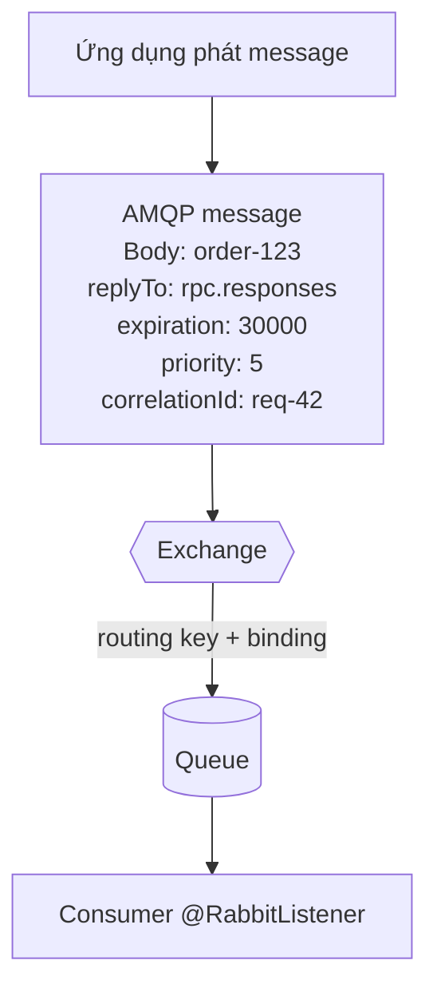
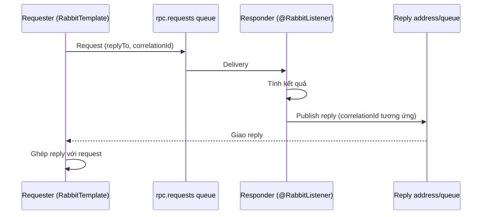
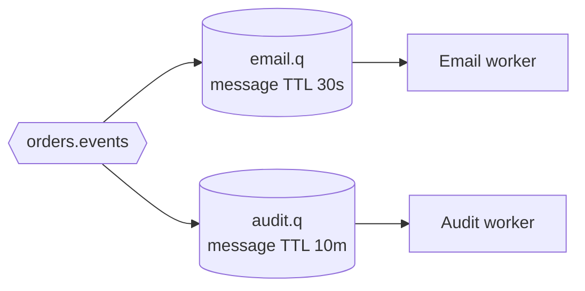
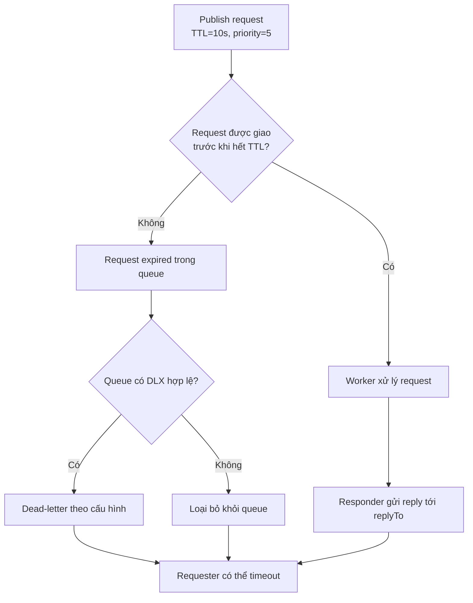

# replyTo, expiration và priority

Trong Spring AMQP, một message không chỉ gồm phần **body**. Thuộc tính của message còn có thể quy định nơi gửi phản hồi, thời gian được phép chờ trong queue và độ ưu tiên khi broker chọn message tiếp theo. Ba thuộc tính thường gặp là **`replyTo`**, **`expiration`** và **`priority`**.

Bài học thuộc chương **Cấu trúc thông điệp** của mô-đun **SPRING_AMQP**. Chúng ta sử dụng **`RabbitTemplate`**, **`@RabbitListener`**, exchange, queue và binding của RabbitMQ để hiểu cách ba thuộc tính hoạt động trong xử lý bất đồng bộ; đồng thời xem xét ACK, retry, dead-letter, giao dịch và quan sát hệ thống để tránh mất, trùng hoặc xử lý message quá hạn.

Sau bài học, bạn có thể:

1. Giải thích vì sao `replyTo` là **địa chỉ phản hồi**, không phải địa chỉ chuyển tiếp request.
2. Cấu hình request/reply bằng `RabbitTemplate.convertSendAndReceive(...)` và `@RabbitListener`, phân biệt `replyTo`, `correlationId` và timeout.
3. Dùng `MessageProperties.setExpiration(...)` để đặt **TTL theo message** và phân biệt với `x-message-ttl`, `x-expires`.
4. Dùng `MessageProperties.setPriority(...)` cùng queue hỗ trợ priority để tăng ưu tiên dispatch khi có backlog.
5. Hiểu tương tác của ba trường với routing, prefetch, DLQ, publisher confirm, idempotency và giới hạn của RabbitMQ theo queue type/phiên bản.

> Phạm vi API: **Spring AMQP qua RabbitMQ AMQP 0.9.1**, tức `spring-rabbit`. AMQP 1.0 có các trường và mô hình sender/receiver riêng; không coi ví dụ dưới đây là API dùng chung cho mọi client AMQP.

## 1. Ba trường nằm ở đâu trong cấu trúc message?

Một message Spring AMQP thường có hai thành phần:

- **`body`**: các byte payload, ví dụ chuỗi `"order-123"` hoặc JSON chứa sự kiện.
- **`MessageProperties`**: metadata như `contentType`, `messageId`, `correlationId`, `replyTo`, `expiration`, `priority`, `deliveryMode` và các header mở rộng.



**Lưu ý:** exchange dùng routing key và binding để quyết định **queue nào nhận message**. Ba thuộc tính đang học **không thay thế routing key hoặc binding**.

| Thuộc tính | Kiểu trên wire protocol AMQP 0.9.1 | Ví dụ | Ý nghĩa chính |
| --- | --- | --- | --- |
| `replyTo` | Short string (địa chỉ phản hồi) | `"rpc.responses.client-a"` | Người xử lý request biết gửi **reply** đến đâu |
| `expiration` | Short string chứa **số mili giây** | `"30000"` | Message được giữ tối đa bao lâu trong queue trước khi hết hạn |
| `priority` | Số nguyên không dấu 8 bit, 0–255 | `5` | Broker xếp ưu tiên message khi queue type hỗ trợ |
| `correlationId` (liên quan) | Short string | `"req-42"` | Ghép reply với request tương ứng |
| `messageId` (liên quan) | Short string | `"event-123"` | Định danh message/event để theo dõi, chống xử lý trùng |

`replyTo` và `correlationId` thường đi cùng trong request/reply, nhưng làm hai việc khác nhau. `expiration` và `priority` thường đi cùng trong xử lý job có hạn chót/độ quan trọng, nhưng cũng là hai cơ chế độc lập.

### 1.1. Đặt thuộc tính bằng Spring AMQP

`RabbitTemplate.convertAndSend` có biến thể nhận `MessagePostProcessor`, cho phép điều chỉnh `MessageProperties` **sau khi converter tạo message và trước khi gửi**:

```java
import org.springframework.amqp.rabbit.core.RabbitTemplate;
import org.springframework.stereotype.Service;

@Service
class ExamplePublisher {

    private final RabbitTemplate rabbitTemplate;

    ExamplePublisher(RabbitTemplate rabbitTemplate) {
        this.rabbitTemplate = rabbitTemplate;
    }

    void publish(String orderId) {
        rabbitTemplate.convertAndSend(
                "orders.events",             // exchange
                "order.confirmed",           // routing key
                orderId,                     // body sau khi convert
                message -> {
                    var props = message.getMessageProperties();
                    props.setMessageId("evt-" + orderId);
                    props.setCorrelationId("trace-" + orderId);
                    props.setExpiration("30000");  // 30 giây trong queue
                    props.setPriority(5);
                    // Không đặt replyTo nếu đây là event one-way.
                    return message;
                });
    }
}
```

Trong ví dụ này, `replyTo` được cố ý để trống vì `order.confirmed` là **sự kiện một chiều**, không yêu cầu response qua RabbitMQ. Cấu hình `expiration` và `priority` chỉ có hiệu lực thực tế phù hợp nếu queue đích và broker hỗ trợ.

## 2. `replyTo`: địa chỉ gửi phản hồi của request

### 2.1. Mô hình request/reply

Trong một tác vụ RPC qua RabbitMQ, requester gửi message vào request queue. Responder nhận và xử lý, sau đó gửi message phản hồi về địa chỉ có trong `replyTo` của request.



`replyTo` không tạo sẵn một reply queue chỉ nhờ sự hiện diện trong properties. Requester phải sử dụng **một cơ chế nhận reply có thật**, như Direct Reply-To của RabbitMQ hoặc một queue riêng có consumer đang nghe.

### 2.2. `replyTo` khác `correlationId` và routing key

| Trường | Câu hỏi trả lời | Ví dụ |
| --- | --- | --- |
| Routing key khi gửi request | Request sẽ được exchange đưa đến đâu? | `rpc.calculate` |
| `replyTo` | Kết quả được gửi về địa chỉ nào? | `rpc.replies.client-a` |
| `correlationId` | Reply này thuộc request nào? | `req-2026-001` |
| `messageId` | Message cụ thể được định danh ra sao? | `msg-calculate-001` |

Giả sử client phát ba request cùng một lúc. Tất cả có thể dùng **cùng reply queue**, nhưng mỗi reply cần được ghép đúng request bằng `correlationId` (hoặc cơ chế correlation tương ứng do template quản lý). Nếu responder không bảo toàn correlation, client có thể timeout hoặc không xác định được kết quả của request.

### 2.3. Mẫu đơn giản: `convertSendAndReceive` + trả giá trị từ `@RabbitListener`

Trong Spring AMQP, `RabbitTemplate` đã hỗ trợ sẵn request/reply. Để chạy ví dụ, queue `rpc.calculate` cần tồn tại (do `RabbitAdmin` hoặc provisioning tạo trước).

```java
import org.springframework.amqp.rabbit.core.RabbitTemplate;
import org.springframework.stereotype.Service;

@Service
class CalculationRpcClient {

    private final RabbitTemplate rabbitTemplate;

    CalculationRpcClient(RabbitTemplate rabbitTemplate) {
        this.rabbitTemplate = rabbitTemplate;
    }

    String calculate(String input) {
        Object result = rabbitTemplate.convertSendAndReceive(
                "",                 // default exchange
                "rpc.calculate",    // request queue
                input);

        if (result == null) {
            throw new IllegalStateException("RPC reply timeout");
        }
        return (String) result;
    }
}
```

Responder:

```java
import org.springframework.amqp.rabbit.annotation.RabbitListener;
import org.springframework.stereotype.Component;

@Component
class CalculationRpcServer {

    @RabbitListener(queues = "rpc.calculate")
    public String calculate(String request) {
        // Minh họa: business logic thực tế có thể truy cập DB/API.
        return "result-for-" + request;
    }
}
```

Khi phương thức `@RabbitListener` trả về một giá trị, hạ tầng listener có thể tự tạo reply message và gửi đến `replyTo` của request. Ở phía client, `RabbitTemplate` quản lý reply destination và correlation theo cơ chế đã cấu hình. Với converter mặc định, chuỗi request/reply đơn giản hoạt động trực tiếp; đối với DTO/JSON cần hai phía có converter tương thích.

**Không cần tự gọi `setReplyTo(...)` trong ví dụ `convertSendAndReceive` trên**: template tự thiết lập địa chỉ reply và ghép kết quả trong kịch bản tiêu chuẩn.

### 2.4. Timeout của RPC khác TTL của message

Theo tài liệu Spring AMQP, `convertSendAndReceive(...)` **mặc định chờ tối đa khoảng 5 giây** rồi trả về `null` nếu không thấy reply. Có thể cấu hình:

```java
@Bean
RabbitTemplate rpcRabbitTemplate(
        org.springframework.amqp.rabbit.connection.ConnectionFactory factory) {

    RabbitTemplate template = new RabbitTemplate(factory);
    template.setReplyTimeout(3_000L); // 3 giây
    return template;
}
```

Nếu Spring Boot đã auto-configure `RabbitTemplate`, thông thường nên chỉnh trên bean có sẵn hoặc dùng property phù hợp phiên bản, tránh vô tình tạo hai template khác nhau.

**`replyTimeout`** là **thời gian phía client đợi response**. Nó **không tự hủy** request trong queue, không dừng consumer đang làm việc và không xóa tác dụng phụ sau khi client bỏ chờ.

**`expiration`** ở message là TTL do RabbitMQ xét khi message còn nằm trong queue. Ví dụ request `expiration="30000"` nhưng client `replyTimeout=3000ms`: sau 3 giây client timeout, trong khi request có thể còn chờ hoặc đã được worker xử lý. Do vậy, retry RPC mà không có idempotency dễ thực thi nghiệp vụ hai lần.

### 2.5. RabbitMQ Direct Reply-To

RabbitMQ hỗ trợ pseudo-queue **`amq.rabbitmq.reply-to`** để reply đi trực tiếp qua broker đến channel/connection của requester. Khi RabbitMQ hỗ trợ, `RabbitTemplate` thường **ưu tiên sử dụng Direct Reply-To** trong thiết lập RPC mặc định thay vì tạo một reply queue riêng cho từng request.

Đặc điểm:

- Không cần tạo một queue vật lý có tên `amq.rabbitmq.reply-to`.
- Không có bộ đệm lưu bền cho reply; mô hình là **at-most-once đối với reply**.
- Nếu requester mất kết nối hoặc không nhận kịp, reply có thể bị mất.
- `DirectReplyToMessageListenerContainer` giúp template quản lý nhận reply và correlation.
- Việc reply đã được broker chấp nhận publish không bảo đảm requester đã nhận được response.
- Direct Reply-To tiện cho RPC tương đối ngắn và kết quả có thể được yêu cầu lại khi timeout.

**Nếu mất reply là không thể chấp nhận**, hãy đánh giá reply queue thật có chính sách durability và recovery tương ứng; cần quản lý correlation/consumer và bảo đảm chính kết quả nghiệp vụ không bị lặp.

### 2.6. Cấu hình reply queue cố định

Khi không dùng Direct Reply-To, requester có thể có một queue reply riêng, ví dụ `rpc.replies.client-a`. Trong cấu hình này:

1. Queue reply phải tồn tại và có quyền consume phù hợp.
2. Client có listener/container chuyên nhận reply, được nối với `RabbitTemplate`.
3. Mỗi instance template/client cần **reply queue riêng** nếu không có cơ chế phân phối/correlation phù hợp: nhiều instance tiêu thụ cạnh tranh cùng một reply queue có thể lấy nhầm reply của nhau.
4. Reply cần mang `correlationId` tương ứng request; trong cơ chế `RabbitTemplate`, Spring quản lý correlation theo cấu hình.
5. Khi có TTL hoặc DLQ cho reply, cần xác định cách xử lý kết quả đến muộn.

Đừng chỉ đặt `setReplyAddress("rpc.replies.client-a")` rồi mong `RabbitTemplate` tự nhận reply: khi dùng địa chỉ cố định phải cấu hình **reply listener container** đúng theo tài liệu.

### 2.7. `@SendTo` là fallback khi request thiếu `replyTo`

Một listener có thể khai báo đích reply mặc định:

```java
import org.springframework.amqp.rabbit.annotation.RabbitListener;
import org.springframework.messaging.handler.annotation.SendTo;
import org.springframework.stereotype.Component;

@Component
class DefaultReplyServer {

    @RabbitListener(queues = "rpc.calculate")
    @SendTo("rpc.default-replies")
    public String calculate(String request) {
        return "result-for-" + request;
    }
}
```

`@SendTo("rpc.default-replies")` ở đây dùng default exchange và routing key là tên queue. **`@SendTo` chỉ được dùng khi inbound message không có `replyTo`/`replyToAddress`**; nếu requester đã chỉ định `replyTo` thì địa chỉ đó được ưu tiên. Bài lab cần bảo đảm queue `rpc.default-replies` tồn tại trước khi chạy.

Mô hình `@SendTo` rất hữu ích khi có một địa chỉ phản hồi mặc định, nhưng không thay thế yêu cầu correlation khi nhiều RPC chạy đồng thời.

## 3. `expiration`: thời hạn chờ tối đa của message trong queue

### 3.1. `expiration` là TTL tương đối, không phải timestamp

Trong AMQP 0.9.1, field `expiration` là **chuỗi số nguyên biểu diễn TTL tính bằng mili giây**:

| Giá trị | Nghĩa | Hợp lệ? |
| --- | --- | --- |
| `"5000"` | 5 giây | Có |
| `"60000"` | 1 phút | Có |
| `"0"` | 0 ms: chỉ giao ngay nếu có điều kiện phù hợp, nếu không sẽ hết hạn | Có, nhưng phải hiểu semantics |
| `"2026-11-26T12:00:00Z"` | Thời điểm tuyệt đối ISO 8601 | **Không** phải giá trị `expiration` hợp lệ của RabbitMQ |
| `"5s"` | Chuỗi có đơn vị thời gian | **Không** phải định dạng TTL hợp lệ |

RabbitMQ diễn giải `expiration="30000"` là message chỉ được lưu tối đa **30.000 ms trong một queue** trước khi broker loại bỏ/đưa sang dead-letter theo cấu hình. Đây không phải deadline của tác vụ sau khi đã vào trạng thái đang xử lý.

### 3.2. Gửi message có TTL riêng

```java
import org.springframework.amqp.rabbit.core.RabbitTemplate;
import org.springframework.stereotype.Service;

@Service
class ExpiringNotificationPublisher {

    private final RabbitTemplate template;

    ExpiringNotificationPublisher(RabbitTemplate template) {
        this.template = template;
    }

    void sendOneTimeCode(String userId) {
        template.convertAndSend(
                "notifications.events",
                "otp.created",
                userId,
                message -> {
                    var props = message.getMessageProperties();
                    props.setMessageId("otp-" + java.util.UUID.randomUUID());
                    props.setExpiration("30000"); // chờ tối đa 30 s
                    return message;
                });
    }
}
```

Nếu không có consumer sẵn sàng trong 30 giây, message đủ điều kiện hết hạn trong queue. Nếu đã được giao cho consumer, `expiration` **không phải bộ hẹn giờ tự ngắt phương thức Java**. Với OTP, consumer vẫn nên kiểm tra `expiresAt` trong payload hoặc truy vấn trạng thái hợp lệ trước khi gửi/áp dụng tác dụng phụ.

### 3.3. Phân biệt ba cơ chế TTL

| Cơ chế | Nơi khai báo | Ví dụ | Tác động |
| --- | --- | --- | --- |
| **Per-message TTL** | Message property `expiration` | `"30000"` | Giới hạn tuổi của **message đó** trong queue |
| **Per-queue message TTL** | Queue argument `x-message-ttl` hoặc RabbitMQ policy `message-ttl` | `60000` (số) | Giới hạn tuổi của **các message trong queue** |
| **Queue TTL** | Queue argument `x-expires` hoặc policy `expires` | `600000` | Xóa **bản thân queue** sau thời gian không sử dụng đủ điều kiện |

`x-message-ttl` và `x-expires` là hai thứ hoàn toàn khác. Queue `x-expires` không có nghĩa message bên trong tự hết hạn sau số ms đó trong khi queue vẫn được sử dụng.

### 3.4. Khai báo queue TTL trong Spring AMQP

```java
import org.springframework.amqp.core.Queue;
import org.springframework.amqp.core.QueueBuilder;
import org.springframework.context.annotation.Bean;
import org.springframework.context.annotation.Configuration;

@Configuration(proxyBeanMethods = false)
class NotificationQueues {

    @Bean
    Queue expiringJobs() {
        return QueueBuilder.durable("notifications.otp.q")
                .ttl(60_000)        // x-message-ttl: 60 giây
                .build();
    }
}
```

Ở đây `QueueBuilder.ttl(int)` thiết lập `x-message-ttl` (TTL của message), **không phải `x-expires`**. Để queue tự hết hạn khi không sử dụng, cần argument/feature riêng. Ở production, nếu đội vận hành sở hữu topology, queue nên được provision bằng IaC/policy; không tùy tiện đổi arguments của queue đang tồn tại.

Khi **cùng lúc** có `expiration="30000"` trên message và queue `x-message-ttl=60000`, RabbitMQ sử dụng TTL **ngắn hơn**, tức 30 giây. Nếu message có TTL 120 giây nhưng queue chỉ cho phép 60 giây, giới hạn thực tế là 60 giây.

### 3.5. TTL tính tại queue; fan-out đến nhiều queue có thể hết hạn khác nhau

Một event có thể đi qua topic exchange đến nhiều queue:



Hai queue nhận các bản message độc lập. Cùng một event có thể hết hạn trong `email.q` nhưng vẫn tồn tại trong `audit.q`. Hết hạn ở queue này **không xóa bản sao** ở queue khác. Đây là lý do không nên dùng một field TTL rồi suy ra toàn hệ thống đã “hủy event”.

### 3.6. Hết hạn, dead-letter và số liệu queue

Với RabbitMQ, khi message hết hạn:

- Broker **không giao** message đã hết hạn cho consumer thông qua delivery thông thường.
- Nếu queue có **dead-letter exchange** được cấu hình đúng, expired message có thể được dead-letter; nếu không có đích DLX thích hợp thì message có thể bị loại bỏ.
- Việc **thu hồi vật lý/cập nhật thống kê** có thể trễ so với mốc TTL, nhất là per-message TTL. Message hết hạn có thể còn được đếm trong queue cho tới khi đến vị trí broker xử lý expire.
- Trên classic queue, message priority thấp nằm sau message ưu tiên cao có thể khiến việc nhận diện/loại bỏ TTL bị trễ theo cách RabbitMQ quản lý head của queue.
- Một message bị reject/requeue có thể giữ thời điểm hết hạn theo quy tắc của broker, không mặc định được “cộng lại toàn bộ TTL” sau mỗi lần retry.

Với **per-message TTL**, RabbitMQ thường dead-letter khi message đến đầu queue (quorum/classic có quy tắc riêng và có thêm cơ chế khi policy thay đổi). Với quorum queue hiện đại có cơ chế quét TTL theo các mức ưu tiên. Vì thế **TTL là ranh giới cho khả năng delivery, không phải cam kết thống kê message biến mất ngay tức khắc**.

### 3.7. TTL không phải retry delay

Một cấu hình dễ nhầm là gắn `expiration="5000"` trên message chính và mong RabbitMQ sẽ **chờ 5 giây rồi gửi message**. Thực tế, nếu consumer đang sẵn sàng thì message có thể được giao ngay; TTL chỉ giới hạn thời gian tối đa còn chờ.

Để tạo **delayed retry**, thường cần một retry queue không có consumer, có TTL và DLX quay về queue xử lý hoặc cơ chế delayed-message được broker hỗ trợ. Cần tránh chu trình retry vô hạn và xác định chính xác mỗi lượt retry thay đổi expiration/headers như thế nào.

Đừng dùng TTL để thay thế **deadline nghiệp vụ**. Khi một message đã vào consumer, kiểm tra thêm `expiresAt`/trạng thái hiện hành trước khi thực hiện thao tác không thể hoàn tác.

## 4. `priority`: mức ưu tiên giao message từ queue

`priority` là một thuộc tính **của message**, quy định mức ưu tiên của message đó khi RabbitMQ chọn delivery tiếp theo **nếu queue hỗ trợ message priority**. Số lớn hơn thường là ưu tiên cao hơn.

### 4.1. Với classic queue, phải khai báo `x-max-priority`

Ở classic queue, nếu producer đặt `MessageProperties.priority=5` nhưng queue không có `x-max-priority`, RabbitMQ sẽ **không tự biến queue thành priority queue**.

Ví dụ cấu hình một classic priority queue:

```java
import org.springframework.amqp.core.Queue;
import org.springframework.amqp.core.QueueBuilder;
import org.springframework.context.annotation.Bean;
import org.springframework.context.annotation.Configuration;

@Configuration(proxyBeanMethods = false)
class PriorityQueueConfig {

    static final String JOBS_QUEUE = "jobs.priority.v1";

    @Bean
    Queue priorityJobs() {
        return QueueBuilder.durable(JOBS_QUEUE)
                .withArgument("x-queue-type", "classic")
                .maxPriority(5)
                .build();
    }
}
```

`maxPriority(5)` đặt `x-max-priority=5`. Đây là **argument khi khai báo queue**; không nên cố đổi trên queue đã tồn tại chỉ bằng cách sửa bean rồi restart, vì RabbitMQ có thể trả `PRECONDITION_FAILED` khi properties không tương đương.

RabbitMQ khuyến nghị chọn **ít mức ưu tiên** (ví dụ 2–4 mức hữu ích) vì classic priority queue có thêm chi phí CPU và bộ nhớ. Queue không có priority property trên message xem như mức **0** trong classic queue; priority cao hơn mức tối đa của queue được xử lý ở mức trần.

### 4.2. Gửi message với `priority`

```java
import org.springframework.amqp.rabbit.core.RabbitTemplate;
import org.springframework.stereotype.Service;

@Service
class PriorityJobPublisher {

    private final RabbitTemplate template;

    PriorityJobPublisher(RabbitTemplate template) {
        this.template = template;
    }

    void send(String jobId, int priority) {
        if (priority < 0 || priority > 5) {
            throw new IllegalArgumentException("priority must be 0..5");
        }

        template.convertAndSend(
                "",                       // default exchange
                PriorityQueueConfig.JOBS_QUEUE,
                jobId,
                message -> {
                    message.getMessageProperties().setPriority(priority);
                    return message;
                });
    }
}
```

Có thể thử:

```java
publisher.send("daily-report", 1);
publisher.send("fraud-check", 5);
publisher.send("weekly-summary", 2);
```

Nếu **cả ba đang chờ trong queue**, priority queue có thể đưa `fraud-check` trước `weekly-summary` rồi `daily-report`. Nếu `daily-report` đã được giao đến consumer trước khi `fraud-check` được publish, priority mới **không thu hồi** message đã giao.

### 4.3. Classic và quorum queue khác nhau theo phiên bản RabbitMQ

| Queue type / phiên bản RabbitMQ | Message priority |
| --- | --- |
| **Classic** | Cần `x-max-priority` khi khai báo queue; mặc định message không có priority được xem là 0 |
| **Quorum trước RabbitMQ 4.0** | Không có cơ chế message priority như classic priority queue |
| **Quorum RabbitMQ 4.0–4.2** | Ánh xạ thành hai nhóm ưu tiên normal/high, chia lượt khoảng 2:1 |
| **Quorum từ RabbitMQ 4.3** | **32 mức strict priority từ 0 đến 31**, không cần `x-max-priority` |
| **RabbitMQ stream** | Mô hình lưu và đọc khác; không áp dụng trực tiếp giả định priority queue AMQP 0.9.1 |

Ở quorum 4.3+, `x-max-priority` **không phải công tắc bật priority** và không cần đặt. Message không có priority mặc định được xem như mức **4**; priority ngoài vùng 0–31 được clamp về giới hạn. Consumer prefetch, redelivery và xử lý song song vẫn ảnh hưởng thứ tự quan sát được.

Cần **đọc version RabbitMQ và loại queue thật** trong môi trường trước khi chọn số priority hoặc thiết kế SLA. Một ví dụ viết cho classic không nên tự động copy sang quorum.

### 4.4. Message priority khác consumer priority

| Message priority | Consumer priority |
| --- | --- |
| **Message nào** được lấy ra từ queue trước? | **Consumer nào** được giao message khi sẵn sàng? |
| Producer đặt `MessageProperties.priority` | Consumer đăng ký argument `x-priority`, Spring có `@RabbitListener(priority = "...")` |
| Classic cần `x-max-priority` | Không cần `x-max-priority` |
| Có thể giúp job khẩn vượt job thường còn trong backlog | Có thể ưu tiên primary worker, fallback nhận khi primary bị blocked |
| Không bảo đảm thời điểm **hoàn tất** | Không bảo đảm chỉ một consumer được chạy |

Hai cơ chế này độc lập. Nếu yêu cầu “job VIP chỉ chạy trên worker VIP”, chỉ đặt mức priority **không đủ**; cần tách queue/routing hoặc cơ chế kiểm soát tương ứng.

### 4.5. Prefetch và ACK làm thay đổi điều bạn quan sát

Giả sử consumer có `prefetch=20`:

1. Broker đã gửi 20 message thường đến consumer, chưa ACK.
2. Một message khẩn `priority=5` mới đến queue.
3. Broker không thể “thu hồi” các delivery đã gửi.
4. Message khẩn phải chờ consumer còn chỗ nhận và broker dispatch tiếp từ queue.
5. Nhiều consumer xử lý song song còn có thể **hoàn tất** message thường trước message khẩn.

Vì vậy, khi kiểm thử priority, hãy **dừng consumer trước, gửi một backlog có đủ mức ưu tiên, sau đó chạy consumer prefetch thấp**. Ưu tiên là quy tắc dispatch, không phải bảo đảm hoàn tất toàn cục.

## 5. Dùng đồng thời `replyTo`, `expiration` và `priority`

Ba property có thể tồn tại trên **cùng một request message**:

```text
Exchange:       "" (default exchange)
Routing key:    "rpc.priority-requests"
Body:           "recalculate:order-123"

messageId:      "req-msg-123"
correlationId:  "req-123"
replyTo:        "rpc.replies.client-a"
expiration:     "10000"      (request TTL 10 giây)
priority:       5            (mức ưu tiên của request)
```

**Diễn giải đúng:**

- Exchange đưa request vào queue `rpc.priority-requests` theo routing key.
- Queue có hỗ trợ message priority thì **cân nhắc `priority=5` khi dispatch** từ phần backlog còn ready.
- Nếu request còn chờ quá thời hạn hiệu lực, `expiration="10000"` khiến nó hết hạn trong queue (theo cơ chế TTL).
- Khi worker nhận và xử lý, `replyTo` chỉ ra nơi gửi reply; `correlationId` giúp client xác định đó là reply cho request `req-123`.
- `expiration` của **request** không tự áp TTL cho **reply** và không buộc client đợi đúng 10 giây.
- Một request đã giao cho worker trước khi hết TTL vẫn có thể hoàn tất muộn hơn 10 giây. Client cần timeout, status và idempotency thích hợp.

### 5.1. Khi dùng `convertSendAndReceive`, đừng ghi đè `replyTo` tùy tiện

Có thể đặt `expiration` và `priority` cho request RPC bằng `MessagePostProcessor`, để `RabbitTemplate` quản lý phần phản hồi:

```java
@Service
class PriorityRpcClient {

    private final RabbitTemplate template;

    PriorityRpcClient(RabbitTemplate template) {
        this.template = template;
    }

    String request(String orderId) {
        Object reply = template.convertSendAndReceive(
                "", "rpc.priority-requests", orderId,
                message -> {
                    var props = message.getMessageProperties();
                    props.setExpiration("10000");
                    props.setPriority(5);
                    // Không setReplyTo ở đây.
                    return message;
                });

        if (reply == null) {
            throw new IllegalStateException("No RPC response before timeout");
        }
        return (String) reply;
    }
}
```

Để `priority` có ý nghĩa với **classic queue**, `rpc.priority-requests` phải được khai báo với `x-max-priority`. Với quorum, semantics phụ thuộc phiên bản RabbitMQ như mục 4.3.

Nếu muốn xây một luồng RPC thủ công và **tự đặt `replyTo`**, cần tự lo việc consume reply, correlation, timeout và phản hồi đến muộn. Đó là một bài toán lớn hơn việc thêm một property.

### 5.2. Giả sử request hết hạn trước khi worker nhận



`TIME` là **một khả năng**, không nhất thiết xảy ra: nếu reply quay về trước `replyTimeout`, requester nhận kết quả bình thường. TTL làm request không được giao sau khi hết hạn chờ trong queue; timeout là quyết định **phía requester**.

## 6. Thiết kế tin cậy khi có ba thuộc tính

### 6.1. Publisher confirms và returns

`RabbitTemplate.convertAndSend` trả về sau thao tác gọi publish không có nghĩa message đã được consumer xử lý. Với message quan trọng:

- Bật publisher confirms và xử lý callback `CorrelationData`/confirm tương ứng.
- Bật publisher returns cùng `mandatory` khi cần phát hiện message không có route.
- Ghi `messageId`/`correlationId` để truy vết.
- Không nhầm **publisher confirm correlation data** với **message `correlationId`** dùng ghép request/reply: chúng phục vụ hai tầng xác nhận khác nhau.

Khi request được broker nhận nhưng timeout ở client, **không tự suy ra request chưa chạy**.

### 6.2. ACK, retry, DLQ

Với `@RabbitListener`, chế độ ACK của container và error handler ảnh hưởng việc message bị requeue hay đưa sang dead-letter. Việc đặt `priority=5` hoặc `expiration="10000"` **không tự cấu hình ACK/retry**.

- Lỗi tạm thời: retry có giới hạn, backoff và kiểm soát số lần thử.
- Lỗi vĩnh viễn: reject không requeue, định tuyến DLQ nếu topology có DLX phù hợp.
- Poison message: tránh vòng retry không giới hạn làm nghẽn queue.
- Redelivery: có thể làm thay đổi thứ tự; với quorum queue mới, message return có quy tắc xử lý priority riêng.
- Idempotency: cùng một `eventId`/`requestId` không được gây tác dụng phụ trùng khi requester retry hoặc broker giao lại.

**TTL không được dùng làm “giải pháp không cần DLQ”**. Một message đã hết hạn có thể mang thông tin cần điều tra, nhất là khi SLA bị vi phạm.

### 6.3. Transaction và outbox

Nếu một giao dịch database commit rồi ứng dụng chết trước lúc publish, event có thể bị mất bất kể có `priority` hay `expiration`. Khi event được tạo từ thay đổi DB quan trọng, cân nhắc **transactional outbox** hoặc một cơ chế đảm bảo nhất quán phù hợp; receiver cũng cần idempotency.

Với RPC mang tác vụ thay đổi trạng thái, client timeout không được đồng nghĩa rollback giao dịch của worker. Tách **trạng thái công việc** và **kết quả trả về** để xử lý retry an toàn.

### 6.4. Deadline nghiệp vụ khác TTL

Một quy tắc hữu ích với tác vụ có hạn chót:

```json
{
  "eventId": "evt-123",
  "orderId": "ord-123",
  "createdAt": "2026-11-26T08:00:00Z",
  "expiresAt": "2026-11-26T08:00:30Z",
  "priorityClass": "urgent"
}
```

Trong payload có `expiresAt` để consumer kiểm tra **ngay trước khi áp dụng tác dụng phụ**; trong AMQP properties có `expiration="30000"` để broker giới hạn **thời gian chờ queue**. Cần tính phù hợp khi delay từ publish đến queue và khi thông điệp bị replay/retry. Không tự giả định `expiration` của request được giữ nguyên sau mọi hình thức republish.

Còn `priorityClass` là **quy tắc nghiệp vụ**: producer ánh xạ nó sang `MessageProperties.priority` theo queue type/version; không buộc mọi consumer tin mọi giá trị ưu tiên được client ngoài gửi vào.

## 7. Những lỗi cấu hình phổ biến

| Dấu hiệu | Nguyên nhân có thể | Cách xử lý |
| --- | --- | --- |
| RPC trả `null` dù worker log đã xử lý | Reply đến trễ hơn timeout, sai `replyTo`/reply listener, correlation không khớp | Kiểm tra `replyTimeout`, reply destination, correlation và log hai phía |
| Reply mất khi requester ngắt kết nối | Direct Reply-To không có buffer, at-most-once | Xử lý retry có idempotency hoặc dùng reply queue thật khi cần durability |
| Có `@SendTo` nhưng reply đi đến nơi khác | Request có `replyTo` ưu tiên cao hơn `@SendTo` | Kiểm tra properties request và queue reply thực tế |
| Request đã hết TTL nhưng vẫn thấy trong queue stats | Per-message TTL có thể chưa được thu hồi vật lý | Quan sát queue age và hoạt động DLX, không kết luận sẽ được giao |
| `expiration="30s"` không hoạt động | RabbitMQ cần chuỗi số nguyên ms, không phải ký hiệu đơn vị | Dùng `"30000"` |
| Đã đặt `expiration` nhưng worker xử lý lâu | TTL áp dụng thời gian chờ queue, không ngắt xử lý in-flight | Thêm kiểm tra deadline ở nghiệp vụ |
| `priority=5` nhưng FIFO vẫn gần như nguyên vẹn | Classic queue thiếu `x-max-priority` hoặc queue không có backlog | Kiểm tra queue arguments/type và thử khi tồn backlog |
| `x-max-priority` đổi gây `PRECONDITION_FAILED` | Queue đã tồn tại với argument khác | Tạo queue version mới, cutover routing; không xóa queue đang có backlog tùy tiện |
| Priority thấp chờ mãi | Mức ưu tiên cao luôn đến, strict priority hoặc thiếu năng lực | Tách queue/SLA, giới hạn dòng cao, cấp worker riêng |
| Retry cùng request tạo hai bản ghi | Client timeout/retry sau khi worker đã commit | Dùng idempotency key và đối soát trạng thái |
| DLQ trống dù message hết TTL | Không có DLX/route đúng, hoặc expired message chưa đến điểm dead-letter | Kiểm tra policy, binding, đặc tính TTL theo queue type |
| Message đã publish nhưng không có reply | Publisher confirm không phải ACK của consumer hay xác nhận reply | Quan sát từ request queue đến listener, sau đó reply path riêng |

## 8. Thực hành theo từng thuộc tính

**Chuẩn bị:** RabbitMQ ở local/test và ứng dụng Spring Boot có `spring-rabbit`, `RabbitTemplate` và `@RabbitListener`. Provision các queue trong lab bằng `RabbitAdmin`/`Declarables` hoặc công cụ quản trị. Đặt tên riêng cho lab, không đổi arguments của queue production đang có dữ liệu.

### Bài A — Quan sát `replyTo` và `correlationId`

1. Tạo queue `rpc.calculate` và listener trả về một chuỗi.
2. Gọi `RabbitTemplate.convertSendAndReceive("", "rpc.calculate", "123")`.
3. Quan sát trong debugger/log props request: `replyTo` và `correlationId` theo cơ chế template.
4. Tăng độ trễ xử lý server qua `replyTimeout`; xem client nhận `null` hay exception do code ứng dụng tự ném.
5. Dừng client trước khi server trả reply; kiểm tra hành vi Direct Reply-To.
6. Thử `@SendTo` ở listener với request không có replyTo, rồi với request có replyTo để so sánh precedence.

**Tiêu chí hoàn thành:** phân biệt được request routing, reply destination và correlation; giải thích vì sao timeout không hủy nghiệp vụ đã được worker nhận.

### Bài B — Quan sát `expiration`

1. Tạo queue `lab.expiration.q` và tạm dừng consumer.
2. Publish message có `setExpiration("5000")`.
3. Sau hơn 5 giây, khởi động consumer và kiểm tra message không được giao như message còn hiệu lực.
4. Bật DLX/DLQ theo topology phù hợp, làm lại và quan sát message hết hạn đi vào DLQ (lưu ý việc thu hồi vật lý có thể trễ).
5. Tạo thêm queue với `x-message-ttl=3000` và gửi message có `expiration="5000"` để xác minh giới hạn ngắn hơn có hiệu lực.
6. Kiểm tra `x-expires` riêng và giải thích vì sao nó liên quan vòng đời **queue**, không phải thời hạn của từng message.

**Tiêu chí hoàn thành:** không nhầm TTL với timeout, delay hoặc queue expiry.

### Bài C — Quan sát `priority`

1. Tạo classic queue `lab.priority.q` với `x-max-priority=5`.
2. Chưa chạy consumer; publish các job có priority 1, 5, 2.
3. Khởi động một consumer prefetch thấp, quan sát thứ tự nhận từ backlog.
4. Lặp lại với classic queue **không** có `x-max-priority`.
5. Cho consumer chạy trước khi gửi để thấy ưu tiên không đảo ngược delivery đã xảy ra.
6. Nếu môi trường có quorum 4.2 và 4.3+, đối chiếu semantics hai bucket so với 32 mức strict.

**Tiêu chí hoàn thành:** biết queue nào hỗ trợ priority và chỉ ra vì sao priority không bảo đảm thứ tự hoàn tất.

### Bài D — Kết hợp cả ba thuộc tính

1. Tạo request priority queue và reply mechanism theo cấu hình lab.
2. Gửi 10 request thường và một request khẩn với `priority=5`, cùng `expiration="10000"`.
3. Gắn `correlationId`/requestId để đối soát response khi nhiều request đồng thời.
4. Cố ý gây timeout phía requester; retry cùng requestId và kiểm tra logic idempotent.
5. Đo thời gian ở queue, thời gian xử lý worker, RPC timeout, số DLQ và số lần redelivery.
6. Viết kết luận: trường nào ảnh hưởng routing reply, thời hạn queue, ưu tiên dispatch và việc nào phải được giải quyết ở tầng nghiệp vụ.

## 9. Checklist khi đưa vào production

- **`replyTo`:** Có thật sự cần RPC qua broker? Reply có thể mất khi Direct Reply-To? Timeout có làm requester gửi lại? Correlation và idempotency đã đúng chưa?
- **`expiration`:** TTL đặt ở message hay queue, đơn vị có đúng mili giây? Có deadline trong payload để kiểm tra sau khi đã nhận? DLX/DLQ và replay đã được kiểm thử?
- **`priority`:** Queue type/phiên bản RabbitMQ nào đang chạy? Classic có `x-max-priority` chưa? Prefetch/concurrency có làm ưu tiên giảm hiệu lực? Có nguy cơ starvation?
- **Vận hành:** Publisher confirms/returns, queue depth/age, reply timeout rate, DLQ, retry, correlationId/messageId và độ trễ end-to-end đã được theo dõi?
- **Triển khai:** Đội ứng dụng và đội vận hành thống nhất queue/exchange/binding, arguments/policy, quyền truy cập và kế hoạch migration chưa?

## 10. Ghi nhớ

**`replyTo` quyết định nơi gửi phản hồi** khi thiết kế request/reply; `correlationId` giúp ghép phản hồi với request. **`expiration` quyết định TTL message trong queue**, được biểu diễn bằng chuỗi số mili giây, không phải deadline của toàn bộ xử lý. **`priority` ảnh hưởng thứ tự message được dispatch từ queue khi queue type và phiên bản RabbitMQ hỗ trợ**, không thể thu hồi những message đã gửi cho consumer.

Ba trường này bổ sung ý nghĩa cho **body** nhưng không thay exchange, routing key, binding, ACK, publisher confirms, retry, dead-letter hay idempotency. Muốn hệ thống Spring AMQP xử lý bất đồng bộ đáng tin cậy, phải thiết kế cả **message properties, contract nghiệp vụ và vận hành broker**.

### Tài liệu tham khảo

- [Spring AMQP — Request/Reply Messaging](https://docs.spring.io/spring-amqp/reference/amqp/request-reply.html): `RabbitTemplate.sendAndReceive`, `convertSendAndReceive`, correlation, reply timeout và reply queue.
- [Spring AMQP — Reply Management](https://docs.spring.io/spring-amqp/reference/amqp/receiving-messages/async-annotation-driven/reply.html): `@RabbitListener` trả giá trị, `@SendTo` và độ ưu tiên của `replyTo`.
- [Spring AMQP — MessageProperties API](https://docs.spring.io/spring-amqp/docs/3.1.x/api/org/springframework/amqp/core/MessageProperties.html): `setReplyTo`, `setExpiration`, `setPriority`.
- [Spring AMQP — Sending Messages](https://docs.spring.io/spring-amqp/reference/amqp/sending-messages.html): `RabbitTemplate` và `MessagePostProcessor`.
- [RabbitMQ — Direct Reply-To](https://www.rabbitmq.com/docs/direct-reply-to): pseudo-queue, at-most-once và rủi ro mất reply.
- [RabbitMQ — Time-to-Live and Expiration](https://www.rabbitmq.com/docs/ttl): per-message/per-queue TTL, thời điểm hết hạn và dead-letter.
- [RabbitMQ — Priority Support in Queues](https://www.rabbitmq.com/docs/priority): classic/quorum priority, `x-max-priority`, prefetch và tác động đến thứ tự.
- [RabbitMQ — Dead Letter Exchanges](https://www.rabbitmq.com/docs/dlx): expired/rejected messages, DLX và lý do dead-letter.
