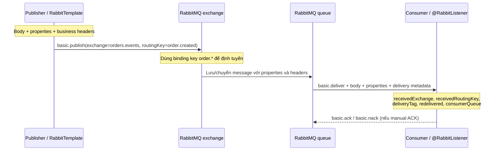
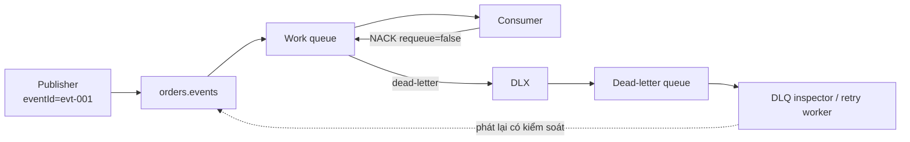

# Header nghiệp vụ, metadata định tuyến và thông tin nhận từ broker

Trong Spring AMQP, một message không chỉ có **body**. Nó còn có các thuộc tính tiêu chuẩn của AMQP, các **header nghiệp vụ** do publisher bổ sung và những thông tin chỉ xuất hiện **khi broker giao message cho consumer**. Ba nhóm dữ liệu này thường cùng được nhìn thấy qua `MessageProperties` của Spring, nên rất dễ nhầm lẫn về **ai tạo ra chúng, dùng để làm gì và có thể tin tưởng đến mức nào**.

Ví dụ: dịch vụ đơn hàng gửi sự kiện `order.created`. Payload mô tả đơn hàng; header `eventId` giúp consumer xử lý idempotent; `correlationId` hỗ trợ đối chiếu request hoặc trace; cặp **exchange + routing key** xác định cách RabbitMQ định tuyến; còn `deliveryTag` và `redelivered` chỉ có ý nghĩa sau khi broker giao message. Nếu bỏ tất cả vào một nhóm gọi chung là “message header”, bạn có thể chọn sai routing key, xác nhận nhầm delivery hoặc dùng nhầm metadata không ổn định làm khóa nghiệp vụ.

Bài học thuộc chương **Cấu trúc thông điệp** của module **SPRING_AMQP**. Chúng ta sẽ theo dõi một message đi từ `RabbitTemplate` qua exchange, queue và binding đến `@RabbitListener`; minh họa bằng code Java và các tình huống xác nhận giao nhận, retry, dead-letter, transaction và quan sát một luồng xử lý bất đồng bộ đáng tin cậy.

## 1. Nhìn một message theo ba lớp thông tin

| Lớp dữ liệu | Ví dụ | Do ai cung cấp? | Mục đích chính |
|---|---|---|---|
| **Nội dung và thuộc tính do publisher đặt** | Body JSON, `contentType`, `messageId`, `correlationId`, `type`, custom headers `eventId`, `tenantId`, `traceId` | Ứng dụng publisher và message converter | Mô tả dữ liệu, định danh nghiệp vụ, tương quan và cách giải mã |
| **Metadata dùng để publish/định tuyến** | Exchange `orders.events`, routing key `order.created`, binding key `order.*`, tính chất exchange | Publisher chọn đích publish; broker tra cứu bindings hiện có | Quyết định queue nào được nhận bản sao message |
| **Thông tin của lần giao nhận** | `receivedExchange`, `receivedRoutingKey`, `deliveryTag`, `redelivered`, `consumerTag`, `consumerQueue` | Broker cung cấp một phần trong `basic.deliver`; Spring listener container bổ sung một phần | Quan sát delivery, xác nhận ACK/NACK và chẩn đoán xử lý |

Không phải mọi giá trị trong bảng đều là một **AMQP header**. Cụ thể, `exchange` và `routingKey` của lần publish là **tham số `basic.publish`**, không nằm trong `BasicProperties.headers`. Tương tự, `deliveryTag` thuộc **delivery trên channel nhận**, không phải thuộc tính do publisher gửi trong message ban đầu.



Sơ đồ cho thấy **thời điểm xuất hiện** của dữ liệu: publisher biết exchange và routing key mình đã chọn nhưng **chưa có** consumer delivery tag; consumer có thể đọc header nghiệp vụ **và** nhận thêm metadata của lần delivery hiện tại.

## 2. Body, AMQP basic properties và custom headers

Một message được truyền trong giao thức AMQP 0-9-1 có **body** dưới dạng byte và một tập **basic properties**. Spring AMQP biểu diễn chúng bằng:

- `org.springframework.amqp.core.Message`: giữ `byte[] body` và `MessageProperties`.
- `org.springframework.amqp.core.MessageProperties`: tập các property tiêu chuẩn, bảng custom headers cùng metadata mà Spring thu được khi nhận message.
- `org.springframework.amqp.core.MessageDeliveryMode`: giá trị delivery mode, ví dụ `PERSISTENT` khi cần yêu cầu broker lưu bền vững phù hợp.

### 2.1. Các property tiêu chuẩn không phải custom header

| Property | Ý nghĩa | Lưu ý |
|---|---|---|
| `contentType` | Mô tả loại nội dung, thường `application/json` hoặc `text/plain`. | Chỉ là metadata; khai báo JSON không tự biến dữ liệu sai định dạng thành JSON hợp lệ. |
| `contentEncoding` | Cách mã hóa bytes thành văn bản, ví dụ `UTF-8`. | Consumer phải giải mã nhất quán. |
| `messageId` | Mã định danh message do publisher chủ động đặt. | RabbitMQ không tự đảm bảo tính duy nhất; cần chọn chiến lược ID ổn định. |
| `correlationId` | Liên kết request–response hoặc nhiều bước của một workflow. | Không đồng nghĩa ID duy nhất của message hay delivery tag. |
| `replyTo` | Địa chỉ reply trong mẫu RPC/request–reply. | Đặt giá trị này không tự tạo một quy trình RPC hoàn chỉnh. |
| `type` | Kiểu sự kiện, có thể chứa tên/version như `order.created.v1`. | Consumer cần hợp đồng schema và xử lý thay đổi version. |
| `timestamp` | Thời điểm do publisher đặt vào property. | Không tự chứng minh thời điểm broker đã nhận hay lưu message. |
| `deliveryMode` | Thường chọn `PERSISTENT` hoặc `NON_PERSISTENT`. | Persistence chỉ là một phần của yêu cầu độ bền, phụ thuộc queue type và broker. |
| `expiration`, `priority` | TTL theo message và mức ưu tiên nếu topology hỗ trợ. | Broker áp dụng theo cấu hình cụ thể; không nên suy ra mọi queue type có cùng hành vi. |

Spring cung cấp các phương thức setter tương ứng, ví dụ `setMessageId(...)`, `setCorrelationId(...)`, `setContentType(...)` và `setDeliveryMode(...)`. Những property này có tên riêng trong cấu trúc AMQP, **không cần** nhân đôi vào `headers` để broker hoặc converter hiểu. Bạn có thể giữ một bản custom header có chủ đích để giao tiếp với hệ thống cũ, nhưng nên định nghĩa rõ nguồn giá trị chuẩn.

### 2.2. Header nghiệp vụ do ứng dụng thiết kế

Custom headers được đặt trong bảng `headers` của AMQP basic properties. Trong Spring, dùng:

```java
MessageProperties properties = message.getMessageProperties();
properties.setHeader("eventId", "evt-2026-001");
properties.setHeader("tenantId", "tenant-a");
properties.setHeader("traceId", "trace-8f1");
```

Một số trường hợp sử dụng phù hợp:

| Header | Tác dụng đề xuất | Rủi ro nếu dùng sai |
|---|---|---|
| `eventId` | Khóa chống xử lý trùng cho **một sự kiện nghiệp vụ** qua nhiều lần giao nhận. | Nếu producer thay ID mỗi lần retry, consumer không thể khử trùng lặp hiệu quả. |
| `tenantId` | Bối cảnh phân vùng/tenant, dùng sau khi được kiểm tra quyền. | Không được tin header do client tự khai báo là bằng chứng xác thực hay phân quyền. |
| `traceId` | Liên kết log/trace nhiều dịch vụ, đồng bộ với tracing instrumentation. | Tránh tạo mỗi lần retry một trace rời rạc nếu cần nối cùng hành trình. |
| `schemaVersion` | Giúp consumer lựa chọn cách đọc body theo version. | Header không thay thế kiểm tra schema và chiến lược tương thích dữ liệu. |
| `originService` | Xác định nguồn phát để quan sát và phân tích lỗi. | Đây là nhãn do ứng dụng khai báo, không phải định danh đã được broker chứng thực. |

Nên đặt **payload** cho dữ liệu nghiệp vụ chính như `orderId`, danh sách mặt hàng, tổng tiền và trạng thái; custom header dùng cho **ngữ cảnh xử lý hoặc truyền tải** mà nhiều thành phần cần đọc. Quyết định này không tuyệt đối: `eventId` có thể nằm trong cả envelope payload và header nếu hợp đồng hệ thống quy định, nhưng phải đồng nhất để không sinh hai nguồn sự thật.

Custom headers là **bảng giá trị có kiểu** theo AMQP (chuỗi, số, boolean, bytes, bảng lồng nhau... tùy codec). Khi dùng Spring AMQP, không gửi tùy tiện một đối tượng Java phức tạp làm header nếu chưa có cách tuần tự hóa được client hỗ trợ. Tránh header quá lớn hoặc chứa secret, token, dữ liệu cá nhân nhạy cảm; chúng đi theo từng message và tăng chi phí mạng, lưu trữ, logging.

## 3. Metadata định tuyến: exchange và routing key không phải header nghiệp vụ

Khi dùng `RabbitTemplate`:

```java
rabbitTemplate.convertAndSend(
        "orders.events",   // exchange
        "order.created",   // routing key
        messageBody);
```

Spring chuyển lời gọi thành một lần publish tới **exchange** có tên `orders.events` cùng **routing key** `order.created`. Broker áp dụng binding tùy loại exchange:

| Exchange type | Định tuyến dựa trên | Ví dụ |
|---|---|---|
| `direct` | Routing key khớp **chính xác** với binding key. | `order.created` → binding `order.created` |
| `topic` | Pattern các từ phân tách bằng dấu chấm: `*` khớp một từ, `#` khớp không hoặc nhiều từ. | `order.created` → binding `order.*` |
| `fanout` | Gửi tới các queue có binding phù hợp, bỏ qua routing key khi quyết định đích. | Broadcast tới nhiều queue |
| `headers` | Đối chiếu **custom message headers** với bảng arguments trong binding. | Binding yêu cầu header `region=apac` |

Với `direct` hoặc `topic`, thêm:

```java
message.getMessageProperties().setHeader("routingKey", "order.created");
```

**không khiến broker thay đổi routing key**. Đây chỉ là custom header tên `routingKey`, không phải tham số `basic.publish`. Ngược lại, với **headers exchange**, broker có thể dùng custom headers để định tuyến nhưng đó là **một loại exchange khác**, với binding arguments (ví dụ `x-match`) được cấu hình riêng.

### 3.1. Cùng message, nhiều queue nhận

Một publish vào exchange có thể được định tuyến đến **nhiều queue** tùy bindings. Các queue sẽ có bản sao delivery độc lập; delivery tag của consumer A không liên quan delivery tag của consumer B. Publisher confirm của lần publish cũng **khác** với consumer acknowledgement ở các queue ấy.

Khi không có binding phù hợp, message có thể bị loại bỏ hoặc trả về publisher nếu bật `mandatory` và publisher returns, hoặc đi đến alternate exchange nếu có cấu hình. **Publisher confirm ACK không đồng nghĩa có consumer đã nhận.** Để xử lý trường hợp không định tuyến được, theo dõi `ReturnsCallback` và cấu hình publish phù hợp.

### 3.2. Routing key ở lần nhận có thể khác lần phát ban đầu

Nếu message qua dead-letter exchange (DLX), có thể broker publish lại message bằng routing key mới theo cấu hình `x-dead-letter-routing-key`. Do vậy `receivedRoutingKey` của **lần nhận sau** phản ánh routing key mà broker dùng ở delivery hiện tại; không nên giả định nó luôn là routing key producer gửi ban đầu. Khi cần điều tra đường đi qua DLX, kết hợp metadata nhận với thông tin dead-letter như `x-death` và log publisher.

## 4. Ví dụ Spring AMQP: khai báo topology để quan sát message

Giả sử broker có topic exchange `orders.events` và queue `orders.audit.q`. Binding `order.*` làm cho queue nhận `order.created` hoặc `order.cancelled`, còn routing key `payment.captured` sẽ không khớp.

```java
package com.example.messaging;

import org.springframework.amqp.core.Binding;
import org.springframework.amqp.core.BindingBuilder;
import org.springframework.amqp.core.Queue;
import org.springframework.amqp.core.TopicExchange;
import org.springframework.context.annotation.Bean;
import org.springframework.context.annotation.Configuration;

@Configuration(proxyBeanMethods = false)
public class MessageTopology {
    public static final String EXCHANGE = "orders.events";
    public static final String QUEUE = "orders.audit.q";
    public static final String BINDING_KEY = "order.*";

    @Bean
    TopicExchange ordersExchange() {
        return new TopicExchange(EXCHANGE, true, false);
    }

    @Bean
    Queue ordersAuditQueue() {
        return new Queue(QUEUE, true);
    }

    @Bean
    Binding ordersAuditBinding(Queue ordersAuditQueue,
                               TopicExchange ordersExchange) {
        return BindingBuilder.bind(ordersAuditQueue)
                .to(ordersExchange)
                .with(BINDING_KEY);
    }
}
```

Spring Boot với starter RabbitMQ thích hợp và `RabbitAdmin` được auto-configure thường sẽ khai báo các bean này khi kết nối được thiết lập. Phần minh họa dùng **topic exchange** và queue durable; khi đã có exchange/queue cùng tên nhưng thuộc tính khác trên broker, RabbitMQ có thể trả `PRECONDITION_FAILED`. Để thử nghiệm, tạo tên tài nguyên riêng hoặc bảo đảm cấu hình khai báo nhất quán.

## 5. Publisher: đặt header và property có chủ đích

Ví dụ publisher phát **byte[] chứa JSON UTF-8**; dùng `MessagePostProcessor` để bổ sung property/header sau khi converter tạo `Message`, trước khi gửi đi.

```java
package com.example.messaging;

import org.springframework.amqp.core.MessageDeliveryMode;
import org.springframework.amqp.core.MessageProperties;
import org.springframework.amqp.rabbit.core.RabbitTemplate;
import org.springframework.stereotype.Component;

@Component
public class OrderEventPublisher {
    private final RabbitTemplate rabbitTemplate;

    public OrderEventPublisher(RabbitTemplate rabbitTemplate) {
        this.rabbitTemplate = rabbitTemplate;
    }

    // jsonUtf8 phải được JSON serializer tạo ra, đã kiểm tra schema/encoding.
    public void publishCreated(String eventId, String tenantId,
                               String traceId, byte[] jsonUtf8) {
        rabbitTemplate.convertAndSend(
                MessageTopology.EXCHANGE,
                "order.created",                 // Routing metadata
                jsonUtf8,
                message -> {
                    MessageProperties properties = message.getMessageProperties();
                    properties.setMessageId(eventId);         // Basic property
                    properties.setCorrelationId(traceId);    // Basic property
                    properties.setType("order.created.v1");  // Basic property
                    properties.setContentType(MessageProperties.CONTENT_TYPE_JSON);
                    properties.setContentEncoding("UTF-8");
                    properties.setDeliveryMode(MessageDeliveryMode.PERSISTENT);

                    properties.setHeader("eventId", eventId);     // Custom header
                    properties.setHeader("tenantId", tenantId);   // Custom header
                    properties.setHeader("traceId", traceId);     // Custom header
                    properties.setHeader("schemaVersion", 1);     // Custom header
                    return message;
                });
    }
}
```

**Điểm cần quan sát:**

1. `"order.created"` là **tham số routing key của `convertAndSend`**. Nó không cần và không nên được “thay thế” bằng custom header.
2. `setMessageId(eventId)`, `setCorrelationId(traceId)` và `setType(...)` thiết lập **standard AMQP properties**. `setHeader(...)` mới tạo các **custom headers**.
3. `setContentType(application/json)` mô tả payload. Đoạn code nhận `jsonUtf8` do một JSON serializer đáng tin cậy tạo ra (ví dụ Jackson), **không tự xây JSON bằng nối chuỗi**. Bên gọi chịu trách nhiệm kiểm tra schema và bảo đảm dữ liệu thực sự là JSON mã hóa UTF-8.
4. `PERSISTENT` không tự bảo đảm lưu bền vững end-to-end. Cần phối hợp queue durable/phù hợp queue type, publisher confirm và xử lý lỗi.
5. `messageId` / `eventId` có tính duy nhất **do ứng dụng tự quản lý**; broker không tự kiểm tra hoặc khử trùng lặp theo hai giá trị này.

Một biến thể là dùng `JacksonJsonMessageConverter` (nếu đã cấu hình cho template và listener) để tuần tự hóa một DTO hoặc envelope sự kiện. Khi ấy converter quản lý body/content type; `MessagePostProcessor` vẫn là nơi thích hợp để gắn các business headers. **Chọn một quy ước ổn định** về header names, types và cách quản lý schema.

## 6. Consumer: những thông tin xuất hiện khi nhận delivery

Khi RabbitMQ giao message, giao thức `basic.deliver` cung cấp các trường như consumer tag, delivery tag, cờ redelivered, exchange và routing key; các basic properties, header table và body được truyền cùng delivery. Spring listener container nhận các giá trị này rồi trình bày chúng thông qua `MessageProperties`. Một số trường trong `MessageProperties` (ví dụ tên queue mà listener đăng ký) là thông tin **do Spring container bổ sung**, không phải trường `basic.deliver` mà publisher có thể gửi tùy ý.

| Trường đọc trong Spring | Nguồn chủ yếu | Ý nghĩa tại lần nhận |
|---|---|---|
| `getReceivedExchange()` | Exchange trong thông tin delivery do broker gửi | Exchange mà message được giao từ đó ở **lượt delivery hiện tại** |
| `getReceivedRoutingKey()` | Routing key trong thông tin delivery do broker gửi | Routing key broker ghi nhận đối với delivery này |
| `getDeliveryTag()` | Broker cấp trên **channel nhận** | Số dùng khi consumer chủ động ACK/NACK một delivery trên đúng channel |
| `isRedelivered()` | Cờ redelivered từ broker | Broker đánh dấu delivery có thể đã được giao trước; không chứng minh nghiệp vụ đã xử lý hay chưa |
| `getConsumerTag()` | Consumer tag nhận khi đăng ký consumer | Xác định đăng ký consumer đang nhận message |
| `getConsumerQueue()` | Spring listener container gắn từ queue đã subscribe | Queue mà listener đã tiêu thụ message |
| `getHeaders()` | Custom headers từ properties; có thể được broker bổ sung/sửa trong một số luồng | Ngữ cảnh nghiệp vụ, tracing, dead-letter... tùy trường |
| `getMessageId()` / `getCorrelationId()` | Publisher đặt trong basic properties, được broker chuyển tiếp | Định danh/đối chiếu do **ứng dụng quy ước**, không phải broker delivery ID |

**Phân biệt nguồn gốc:** `getReceivedExchange()` và `getReceivedRoutingKey()` phản ánh thông tin **đã nhận từ broker**. `getConsumerQueue()` do listener container biết vì chính container đã chọn queue để tiêu thụ. `getMessageId()` là property **publisher đã phát**; nó không tự thay đổi chỉ vì message được redeliver. Các trường nhận có thể không được gán nếu `Message` do bạn tự tạo để test thay vì đi qua broker và listener thực.

### 6.1. Đọc message đầy đủ trong @RabbitListener

```java
package com.example.messaging;

import java.nio.charset.StandardCharsets;
import org.springframework.amqp.core.Message;
import org.springframework.amqp.core.MessageProperties;
import org.springframework.amqp.rabbit.annotation.RabbitListener;
import org.springframework.stereotype.Component;

@Component
public class OrderAuditConsumer {

    @RabbitListener(queues = MessageTopology.QUEUE)
    public void onMessage(Message message) {
        MessageProperties properties = message.getMessageProperties();
        String body = new String(message.getBody(), StandardCharsets.UTF_8);

        // Publisher đặt: property tiêu chuẩn và custom header.
        String messageId = properties.getMessageId();
        String correlationId = properties.getCorrelationId();
        Object eventId = properties.getHeaders().get("eventId");
        Object tenantId = properties.getHeaders().get("tenantId");

        // Broker / Spring listener cung cấp cho delivery hiện tại.
        String receivedExchange = properties.getReceivedExchange();
        String receivedRoutingKey = properties.getReceivedRoutingKey();
        String consumerQueue = properties.getConsumerQueue();
        String consumerTag = properties.getConsumerTag();
        long deliveryTag = properties.getDeliveryTag();
        boolean redelivered = properties.isRedelivered();

        System.out.printf(
                "messageId=%s correlationId=%s eventId=%s tenant=%s%n" +
                "exchange=%s routingKey=%s queue=%s consumerTag=%s%n" +
                "deliveryTag=%d redelivered=%s body=%s%n",
                messageId, correlationId, eventId, tenantId,
                receivedExchange, receivedRoutingKey, consumerQueue, consumerTag,
                deliveryTag, redelivered, body);
    }
}
```

Đoạn code dùng `Message` để người học nhìn thấy cả body và properties, tránh việc message converter hoặc mapping DTO che đi nguồn gốc từng trường. Trong ứng dụng thật, cần **kiểm tra giá trị và kiểu header** trước khi dùng cho xử lý nghiệp vụ; ví dụ một header `eventId` do publisher khác gửi có thể thiếu hoặc có kiểu khác `String`. Nếu consumer nhận JSON, hãy dùng thư viện JSON và validate schema thay vì dựa vào việc `contentType=application/json`.

Ví dụ dùng chế độ ACK mặc định của listener container: Spring thường ACK khi listener kết thúc thành công, còn exception dẫn đến quy trình xử lý lỗi của container theo cấu hình. **Không coi việc in log là bằng chứng nghiệp vụ đã commit**. Nếu nghiệp vụ có cơ sở dữ liệu, hãy xử lý idempotent và commit trước khi để listener hoàn tất/ACK.

### 6.2. Delivery tag chỉ có hiệu lực trên channel nhận

`deliveryTag` không phải số định danh message toàn hệ thống. Broker cấp tag theo **channel**; cùng giá trị tag có thể xuất hiện ở hai channel khác nhau. Khi dùng manual acknowledgement:

```java
// Minh họa trong listener có Channel channel tương ứng:
long tag = message.getMessageProperties().getDeliveryTag();
channel.basicAck(tag, false);
// Hoặc: channel.basicNack(tag, false, true); // yêu cầu requeue
```

Phải ACK/NACK bằng **channel đã nhận delivery**, không chuyển delivery tag sang một publisher channel, channel khác hoặc lưu tag vào DB để ACK sau khi tiến trình khởi động lại. Nếu ACK nhầm tag/channel, broker có thể đóng channel vì delivery tag không hợp lệ. Lệnh `basicAck(tag, false)` chỉ xác nhận **một delivery**; với `multiple=true` có thể xác nhận nhiều delivery trên channel đến tag đó.

Trong Spring AMQP, có thể dùng `@RabbitListener(ackMode = "MANUAL")` cùng tham số `com.rabbitmq.client.Channel` khi thực sự cần tự ACK/NACK. Bài đang tập trung vào message metadata; những yêu cầu về retry, transaction, redelivery và ACK cần được cấu hình nhất quán trong listener container.

### 6.3. Cờ redelivered không phải bộ đếm retry

`isRedelivered() == true` cho biết broker đánh dấu message **có thể đã được gửi tới một consumer trước đó**, ví dụ consumer mất kết nối khi còn delivery unacked hoặc message bị NACK với `requeue=true`. Nó không cho biết lần trước đã **commit DB** hay chưa, cũng không phải số lần retry. `false` không phải cam kết message chưa từng xuất hiện ở nơi khác; publisher có thể đã gửi một bản sao với cùng eventId.

Nếu cần chống xử lý trùng, hãy dựa vào **ID nghiệp vụ ổn định** và cơ chế idempotency, ví dụ bảng `processed_events(event_id UNIQUE)` cùng transaction cập nhật dữ liệu. `deliveryTag` và `redelivered` hữu ích cho vận hành, nhưng không đủ làm khóa chống trùng hoặc chứng minh exactly-once.

## 7. Thông tin do broker bổ sung: dead-letter và thay đổi ngữ cảnh

Khi queue có cấu hình dead-letter, RabbitMQ có thể **dead-letter** message vì bị từ chối với `requeue=false`, hết TTL, vượt độ dài queue hoặc các điều kiện liên quan queue type. Message được gửi tới dead-letter exchange và có thể được định tuyến sang một queue khác.

RabbitMQ ghi nhận lịch sử dead-letter bằng header như:

- `x-death`: danh sách thông tin **dead-letter**, thường kèm queue, exchange, reason, count và thông tin thời gian liên quan. Các lần dead-letter có cùng queue/reason có thể được tổng hợp theo cơ chế của RabbitMQ.
- `x-first-death-queue`, `x-first-death-reason`, `x-first-death-exchange`: ngữ cảnh dead-letter lần đầu.
- `x-last-death-queue`, `x-last-death-reason`, `x-last-death-exchange`: ngữ cảnh dead-letter gần nhất (tùy phiên bản RabbitMQ).

Không xem `x-death` là số lần consumer **thử xử lý**: requeue thông thường hoặc retry bên trong ứng dụng **không nhất thiết** tạo một lần dead-letter. Trong RabbitMQ hiện đại, broker còn có thể loại bỏ nội dung `x-death` giả mạo từ publisher khi tiếp nhận publish; không nên tự viết/giả lập các header thuộc quyền quản lý của broker.



Sơ đồ minh họa một message bị từ chối, broker chuyển qua DLX rồi đến DLQ. Khi message được trả về luồng chính để thử lại, **người vận hành phải quyết định có giữ nguyên `eventId` hay không**. Với cùng một sự kiện nghiệp vụ được thử lại, giữ ID ổn định thường là lựa chọn đúng cho idempotency; nếu thực sự tạo sự kiện mới, cần ID mới và phân biệt quan hệ với sự kiện ban đầu.

Consumer có thể kiểm tra `x-death` mà không giả định kiểu nội bộ:

```java
MessageProperties properties = message.getMessageProperties();
Object deathHistory = properties.getHeaders().get("x-death");
if (deathHistory != null) {
    System.out.println("Dead-letter history: " + deathHistory);
}
```

Đối với hệ thống retry đáng tin cậy, cần chính sách giới hạn lượt thử và DLQ rõ ràng, tránh vòng lặp redelivery vô hạn. Các giá trị `receivedExchange`/`receivedRoutingKey` trên message ở DLQ có thể chỉ **đường định tuyến hiện tại đến DLQ**, trong khi `x-death` giúp điều tra lịch sử trước đó. Đừng dùng `receivedRoutingKey` làm nguồn duy nhất để suy ra publisher ban đầu trong một chu trình có DLX.

## 8. Nhìn từ publisher: returns và confirms không phải delivery metadata

Publisher có các tín hiệu phản hồi riêng:

| Tín hiệu | Đi từ đâu đến đâu? | Chứng minh điều gì? |
|---|---|---|
| Publisher confirm ACK/NACK | Broker → publisher | Trạng thái broker xử lý lần publish, **không chứng minh consumer đã nhận hoặc xử lý** |
| Publisher return | Broker → publisher khi publish `mandatory` không định tuyến được | Message bị trả về vì không tới queue phù hợp; return cung cấp reply code/text, exchange và routing key |
| Consumer acknowledgement | Consumer → broker | Consumer đã ACK/NACK một **delivery cụ thể** trên channel nhận |

Trong Spring AMQP, thông tin return được đưa vào `ReturnedMessage` qua `RabbitTemplate.ReturnsCallback`; có thể xem `getExchange()`, `getRoutingKey()`, `getReplyCode()` và `getReplyText()`. Đây là **metadata của lần publish bị trả về**, không phải `getReceivedRoutingKey()` trên một message đã đến listener.

Ví dụ độc lập về returns (cần cấu hình `publisher-returns` và `mandatory` phù hợp):

```java
rabbitTemplate.setMandatory(true);
rabbitTemplate.setReturnsCallback(returned -> {
    System.err.printf(
            "Unroutable exchange=%s routingKey=%s code=%d reason=%s%n",
            returned.getExchange(),
            returned.getRoutingKey(),
            returned.getReplyCode(),
            returned.getReplyText());
});
```

Một publisher có thể nhận **confirm ACK** ngay cả khi message **không có queue nhận**, vì broker vẫn xác nhận đã xử lý lần publish. Khi cần bảo đảm không bỏ sót message do sai topology, phải dùng kết hợp confirms và returns theo cấu hình. Callback gửi/return/confirm là các luồng độc lập với thông tin `deliveryTag`/`redelivered` của consumer.

## 9. Đọc header qua @Header và MessageProperties

Spring có thể ánh xạ header/property vào tham số của listener thông qua annotation `@Header`; đây là cách tiện khi chỉ cần vài trường. Ví dụ:

```java
import org.springframework.amqp.core.Message;
import org.springframework.amqp.rabbit.annotation.RabbitListener;
import org.springframework.amqp.support.AmqpHeaders;
import org.springframework.messaging.handler.annotation.Header;

@RabbitListener(queues = "orders.audit.q")
public void inspect(
        Message message,
        @Header(name = "eventId", required = false) String eventId,
        @Header(AmqpHeaders.RECEIVED_ROUTING_KEY) String routingKey) {
    System.out.println("eventId=" + eventId + ", routingKey=" + routingKey);
}
```

Đây là một **mẫu thay thế** cho listener ở phần 6: không đăng ký cùng lúc hai listener xử lý cùng queue nếu mục tiêu chỉ là minh họa log từng message, vì chúng sẽ trở thành competing consumers. Nếu thiếu custom header và tham số đánh dấu `required=true`, việc binding có thể báo lỗi; lựa chọn `required=false` chỉ tránh lỗi khi không có header, **không thay cho validation nghiệp vụ**.

Với consumer xử lý DTO, có thể dùng `@Payload` cùng message converter và `@Headers` để lấy map header. Tuy nhiên, khi cần chẩn đoán chính xác sự khác nhau giữa **custom headers**, **standard properties** và **received metadata**, trực tiếp xem `Message.getMessageProperties()` sẽ dễ hiểu hơn. Nếu dùng Jackson JSON converter, phải bảo đảm publisher và consumer thống nhất kiểu payload, content type, version và deserialization policy.

## 10. Thiết kế contract metadata đáng tin cậy

Trong môi trường có nhiều producer và consumer, cách đặt header/property nhất quán cần được mô tả như một phần của **event contract**. Không nên để mỗi service tự đoán ý nghĩa của `messageId`, `correlationId` hay `traceId`.

### 10.1. Phân biệt ID của sự kiện, correlation và delivery

| Định danh | Ví dụ | Ổn định qua retry/redelivery? | Có thể làm khóa idempotency? |
|---|---|---|---|
| `eventId` (business header/payload) | `evt-001` | **Nên giữ nguyên** cho cùng sự kiện nghiệp vụ | **Có**, nếu được producer bảo đảm và consumer xác thực/ghi nhận giao dịch |
| `messageId` (standard property) | `evt-001` hoặc một UUID khác theo contract | Do publisher quyết định; chỉ ổn định nếu publisher chủ động giữ | **Có điều kiện**, phải thống nhất chính sách ID và retry |
| `correlationId` (standard property) | `workflow-7` | Thường xuyên suốt một workflow/request | Thường **không**: nhiều sự kiện khác nhau có thể cùng correlation ID |
| `traceId` (custom header/tracing context) | `trace-8f1` | Có thể giữ/lan truyền theo trace | **Không**: nhiều span/message cùng trace |
| `deliveryTag` (delivery metadata) | `17` trên channel nhận | **Không**, phụ thuộc channel và lần giao | **Không**; dùng để ACK/NACK |
| `consumerTag` | `amq.ctag-...` | Không ổn định qua restart/recovery | **Không**; dùng quan sát consumer |

Trong ví dụ publisher, `correlationId` và `traceId` được đặt cùng một chuỗi để minh họa việc truyền thông tin tương quan; **đây không phải quy tắc bắt buộc**. Với tracing thật, trace/span context nên được propagation instrumentation quản lý nhất quán, và `correlationId` có thể là ID của workflow, đơn hàng hay request tùy contract.

### 10.2. Chia trách nhiệm theo nguồn dữ liệu

Một hợp đồng gọn, dễ vận hành có thể quy định:

1. **Body:** dữ liệu nghiệp vụ với schema/version rõ ràng; producer chịu trách nhiệm tuần tự hóa.
2. **Header nghiệp vụ:** `eventId`, `tenantId`, `traceId`, `schemaVersion`; producer cấp và consumer validate.
3. **Standard properties:** `contentType`, `contentEncoding`, `messageId`, `correlationId`, `deliveryMode`; dùng đúng ngữ nghĩa AMQP.
4. **Publish metadata:** exchange + routing key do publisher lựa chọn; routing của broker dựa trên topology và exchange type.
5. **Delivery metadata:** `received*`, `deliveryTag`, `redelivered`, `consumer*`; chỉ dùng theo phạm vi delivery và vòng đời consumer.
6. **Broker-managed history:** `x-death` và các thuộc tính dead-letter; dùng để điều tra, không coi là nguồn sự thật về trạng thái hoàn tất nghiệp vụ.

Đặc biệt, đừng sao chép nguyên `MessageProperties` **của message đã nhận** để phát một sự kiện mới mà không chọn lọc. Việc làm này có thể mang theo những header dành riêng cho broker, trạng thái retry hoặc metadata chỉ có ý nghĩa ở consumer cũ. Khi republish, tạo message mới với **business context cần giữ** và tạo lại publish metadata có chủ đích.

### 10.3. Trust boundary và bảo mật

Header như `tenantId`, `originService`, `userId` do producer tự khai báo không tự được RabbitMQ xác thực theo danh tính nghiệp vụ. Với hệ thống nhiều tenant, cần kiểm soát người được phép publish vào exchange/vhost và validate tenant từ ngữ cảnh tin cậy. **Không ra quyết định phân quyền chỉ dựa vào custom header từ nguồn không đáng tin.**

Không ghi đầy đủ payload/header nhạy cảm vào log trên production. Dùng event ID, correlation ID, tên exchange/routing key và queue làm khóa đối chiếu; loại bỏ hoặc che thông tin cá nhân, access token và nội dung nhạy cảm. Kích thước header lớn cũng tiêu thụ băng thông và bộ nhớ cho mỗi message.

## 11. Các lỗi thường gặp

| Triệu chứng | Nguyên nhân có thể | Cách khắc phục |
|---|---|---|
| Đặt header `routingKey=order.created` nhưng queue không nhận | Đang dùng direct/topic exchange; custom header không thay tham số routing key của `basic.publish` | Truyền routing key đúng vào `RabbitTemplate.convertAndSend(exchange, routingKey, ...)`; kiểm tra binding. |
| Consumer thấy `getReceivedRoutingKey()` khác mong đợi | Message đi qua DLX hoặc bị republish với routing key khác | Kiểm tra DLX, `x-death`, cấu hình `x-dead-letter-routing-key` và log ở publisher. |
| `messageId` null ở consumer | Publisher/converter không đặt property này | Thiết lập ID trong contract, bổ sung validation và chính sách cho producer không tuân thủ. |
| `getHeader("eventId")` null hoặc sai kiểu | Producer không gửi, viết sai tên hoặc gửi kiểu AMQP khác | Dùng tên chuẩn, validate kiểu/giá trị, tránh ép kiểu mù quáng. |
| `redelivered=true` nhưng không biết message đã ghi DB chưa | Redelivery flag chỉ mô tả việc broker có thể giao trước đó | Tra cứu `eventId` trong bảng idempotency/transaction, không lấy flag làm bằng chứng xử lý thành công. |
| `deliveryTag` trùng giữa hai consumer | Delivery tag có phạm vi channel | Chỉ ACK/NACK bằng channel nhận; không dùng tag làm ID toàn hệ thống. |
| Header `x-death` không tăng sau mỗi lần retry | Lần retry diễn ra trong ứng dụng hoặc requeue thường, chưa có dead-letter | Phân biệt local retry/requeue với dead-letter; dùng retry policy và telemetry riêng. |
| Consumer nhận payload nhưng JSON converter lỗi | Sai `contentType`, sai charset, DTO/schema không tương thích hoặc dữ liệu JSON không hợp lệ | Đồng bộ converter, content type, encoding và schema; không chỉ chỉnh metadata để che lỗi dữ liệu. |
| Publisher confirm ACK nhưng không ai consume | Message có thể không định tuyến vào queue hoặc queue chưa có consumer | Kiểm tra bindings, `mandatory`/returns, queue ready, consumer và xử lý ACK. |
| Log chứa token, dữ liệu riêng tư từ header | Log toàn bộ properties/header map trong production | Dùng allowlist trường có thể log, ẩn dữ liệu nhạy cảm và giới hạn kích thước. |

## 12. Bài thực hành từng bước

**Bài 1 — tìm đúng nguồn metadata.** Chạy topology và publisher ở phần 4–5, rồi khởi động consumer ở phần 6. Gửi một message `order.created` với `eventId=evt-001`, `tenantId=tenant-a`. Ghi nhận `getMessageId()`, `getCorrelationId()`, `getHeaders()`, `getReceivedExchange()`, `getReceivedRoutingKey()` và `getDeliveryTag()`. Phân loại từng giá trị thuộc **publisher property**, **business header** hay **delivery metadata**.

**Bài 2 — chứng minh routing key không phải custom header.** Giữ nguyên custom header `eventId` và thêm header tự đặt tên `routingKey=order.created`. Ở lời gọi publish, đổi routing key thật thành `payment.captured`. Với binding topic `order.*` của ví dụ, queue `orders.audit.q` **không** nhận message này. Khôi phục routing key thật thành `order.created` và xác minh delivery hoạt động.

**Bài 3 — quan sát nhiều queue.** Tạo thêm queue `orders.analytics.q` và binding `order.*` vào cùng topic exchange. Gửi một message `order.created` và kiểm tra hai queue có thể nhận bản sao. So sánh `eventId`/`messageId` có thể giống nhau giữa hai bản sao, trong khi `deliveryTag` và `consumerTag` thuộc các delivery/channel riêng.

**Bài 4 — redelivery và idempotency.** Tạo một listener dùng manual acknowledgement trong môi trường thử nghiệm. Cho nó giả lập lưu `eventId`, sau đó ngắt trước `basicAck` để broker giao lại khi connection đóng. Xác minh `redelivered` có thể đổi và `deliveryTag` không phải khóa chống trùng; dùng unique key trên `eventId` để tránh ghi nghiệp vụ lần thứ hai.

**Bài 5 — dead-letter.** Cấu hình work queue có dead-letter exchange và DLQ. Từ chối message với `requeue=false`, quan sát `x-death` trong message đến DLQ. Kiểm tra `receivedExchange`/`receivedRoutingKey` của delivery trong DLQ và đối chiếu với exchange/routing key lúc publisher phát. Lưu ý topology DLX cần tồn tại cùng virtual host và có binding phù hợp.

**Bài 6 — publisher returns.** Bật `mandatory` và `publisher-returns`, gửi message bằng routing key không khớp binding nào, quan sát `ReturnsCallback`. Giải thích vì sao return không phải consumer ACK và vì sao confirm ACK có thể vẫn xuất hiện.

## 13. Tự kiểm tra

1. **Exchange và routing key của lần publish có nằm trong custom headers không?** Không. Chúng là tham số publish của AMQP, do broker dùng kết hợp với bindings.
2. **`setHeader("routingKey", "...")` có đổi routing key khi dùng topic exchange không?** Không. Phải truyền routing key thật vào lệnh publish.
3. **`messageId` và `deliveryTag` có tương đương không?** Không. `messageId` là property publisher đặt; `deliveryTag` do broker cấp trên một channel nhận.
4. **`getConsumerQueue()` có phải property do publisher đặt không?** Không. Spring listener container biết queue đã đăng ký và đưa thông tin này vào message nhận.
5. **`isRedelivered()==true` có chứng minh DB đã xử lý message lần trước không?** Không. Đây là gợi ý giao lại từ broker, không biểu diễn transaction nghiệp vụ.
6. **Mỗi lần local retry có làm tăng `x-death` không?** Không. `x-death` ghi lịch sử dead-letter, không phải bộ đếm mọi lần chạy lại mã xử lý.
7. **Có thể dùng custom header `tenantId` để tự xác thực một tenant không?** Không. Header do publisher có thể cung cấp và cần được kiểm tra bằng cơ chế bảo mật/authorization thực sự.
8. **Publisher confirm ACK có bảo đảm consumer đã nhận/xử lý không?** Không. Confirm ở phía publish, ACK ở phía consumer và việc định tuyến là những phần trách nhiệm riêng.
9. **Muốn xử lý trùng an toàn nên dựa vào trường nào?** Một ID nghiệp vụ ổn định như `eventId` cùng transaction/idempotency store, sau khi đã validate dữ liệu từ nguồn phát.

**Ghi nhớ:** Hãy luôn trả lời ba câu hỏi khi đọc một message: **publisher đã đặt gì** (body, standard properties, business headers), **broker đã định tuyến bằng gì** (exchange, routing key, binding) và **consumer đã nhận thêm gì** (received metadata, delivery tag, redelivery, dead-letter history). Phân biệt rõ ba lớp này giúp định tuyến đúng, xử lý lỗi an toàn và theo dõi chính xác từng chặng của luồng Spring AMQP.

### Tài liệu tham khảo

- Spring AMQP — [Message Converters and Message Properties](https://docs.spring.io/spring-amqp/reference/amqp/message-properties-converters.html).
- Spring AMQP — [AmqpTemplate and RabbitTemplate](https://docs.spring.io/spring-amqp/reference/amqp/template.html).
- RabbitMQ — [Exchanges](https://www.rabbitmq.com/docs/exchanges).
- RabbitMQ — [Publisher Confirms](https://www.rabbitmq.com/docs/confirms).
- RabbitMQ — [Dead Letter Exchanges](https://www.rabbitmq.com/docs/dlx).
