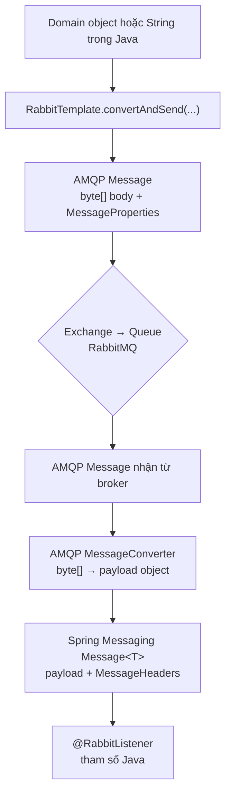
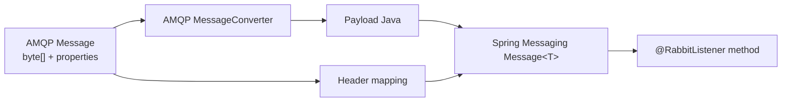

# Phân biệt Spring AMQP Message với Spring Messaging Message<?>

## 1. Mục tiêu và vị trí của hai kiểu Message

Trong module **SPRING_AMQP**, ứng dụng dùng `RabbitTemplate` để gửi thông điệp đến RabbitMQ, `@RabbitListener` để nhận thông điệp từ queue, và exchange/binding để định tuyến. Khi đọc tài liệu hoặc viết Java, bạn sẽ gặp **hai lớp cùng tên `Message`**:

- `org.springframework.amqp.core.Message`: biểu diễn **thông điệp AMQP** với body là `byte[]` và metadata ở `MessageProperties`.
- `org.springframework.messaging.Message<T>`: biểu diễn **thông điệp ở tầng ứng dụng Spring Messaging** với payload kiểu `T` và các header trong `MessageHeaders`.

Hai lớp này thuộc hai package khác nhau, phục vụ hai mục đích khác nhau và **không hoán đổi trực tiếp** cho nhau. Nhầm lẫn chúng dễ dẫn đến lỗi import, lỗi kiểu dữ liệu, giả định sai về message converter hoặc đọc nhầm metadata của broker.

Sau bài học, bạn có thể:

1. Nhận diện đúng hai lớp `Message` qua package, phương thức và dữ liệu mà chúng chứa.
2. Phân biệt **AMQP body**, **AMQP message properties**, **AMQP application headers**, **Spring Messaging payload** và **Spring Messaging headers**.
3. Sử dụng `RabbitTemplate.send(...)`, `convertAndSend(...)` và `@RabbitListener` với đúng kiểu Message.
4. Hiểu hai giai đoạn chuyển đổi dữ liệu trong listener và vai trò của `MessageConverter`.
5. Biết lấy routing key, correlation ID, delivery tag và các thông tin phục vụ xác nhận giao nhận, retry hoặc quan sát hệ thống ở đúng tầng.

> Bài tập trung vào cấu trúc dữ liệu và chuyển đổi thông điệp. Publisher confirms, consumer acknowledgements, retry, dead-letter và giao dịch có dùng những metadata liên quan, nhưng được thiết kế ở những bước riêng. Không nên suy ra bảo đảm giao nhận chỉ từ kiểu lớp `Message`.

## 2. Nhìn toàn cảnh: một message đi qua những tầng nào?

RabbitMQ nhận và giao thông điệp theo AMQP 0-9-1. Phía Java, Spring AMQP biểu diễn thông điệp ở mức giao thức; Spring Messaging đưa ra một abstraction thống nhất cho việc xử lý payload và headers.



Đây là đường đi điển hình của **listener dạng method được đánh dấu `@RabbitListener`**. Ngoài ra, code còn có thể dùng trực tiếp thông điệp AMQP thô, bỏ qua việc chuyển body thành object ở handler:

```text
RabbitTemplate.send(exchange, routingKey, org.springframework.amqp.core.Message)
                                      │
                                      ▼
                                  RabbitMQ
                                      │
                                      ▼
@RabbitListener(org.springframework.amqp.core.Message rawMessage)
                                      │
                         tự đọc byte[] và MessageProperties
```

**Lưu ý:** Không phải mọi luồng đều nhất thiết tạo cùng một chuỗi object như sơ đồ. Các listener adapter có đường chuyển đổi riêng; code thao tác trực tiếp `Channel` hoặc dùng API thấp hơn có thể nhận dữ liệu theo cách khác.

## 3. So sánh nhanh hai lớp

| Tiêu chí | Spring AMQP `Message` | Spring Messaging `Message<T>` |
|---|---|---|
| Package | `org.springframework.amqp.core.Message` | `org.springframework.messaging.Message` |
| Kiểu Java | Class cụ thể | Interface generic |
| Nội dung | `byte[] body` | `T payload`: `String`, `byte[]`, DTO, v.v. |
| Metadata | `MessageProperties` | `MessageHeaders` |
| Truy cập body/payload | `getBody()` | `getPayload()` |
| Truy cập metadata | `getMessageProperties()` | `getHeaders()` |
| Mục đích | Gần với cấu trúc thông điệp đi qua RabbitMQ | API messaging ở tầng ứng dụng, dùng được ở nhiều integration của Spring |
| Khi publish | Thích hợp với `RabbitTemplate.send(...)` | Có thể xây bằng `MessageBuilder`; cần adapter/converter thích hợp nếu gửi qua RabbitTemplate |
| Khi consume | Thích hợp để lấy raw bytes và AMQP properties | Thích hợp trong `@RabbitListener` để làm việc với payload đã chuyển đổi và header đã được ánh xạ |
| Đặc điểm mutability | `MessageProperties` có các setter; body là `byte[]` | `MessageHeaders` không cho sửa trực tiếp qua giao diện map; thường xây message mới bằng `MessageBuilder` |
| Thông tin delivery riêng của RabbitMQ | Có thể có `deliveryTag`, `receivedExchange`, `receivedRoutingKey`, `redelivered` ở phía nhận | Chỉ xuất hiện khi listener/header mapper ánh xạ thành headers và phụ thuộc ngữ cảnh |

Vì tên lớp bị trùng, khi một file Java cần dùng **cả hai**, nên viết **fully qualified name** cho ít nhất một kiểu hoặc tách chúng thành các lớp khác nhau:

```java
// Chỉ import Spring AMQP Message:
import org.springframework.amqp.core.Message;

// Khi cần Spring Messaging Message, ghi tên đầy đủ:
org.springframework.messaging.Message<String> typedMessage;
```

Java **không hỗ trợ alias import** kiểu `import ... as ...`. Hai lệnh `import org.springframework.amqp.core.Message;` và `import org.springframework.messaging.Message;` trong cùng file gây trùng tên đơn giản `Message`.

## 4. Spring AMQP Message: byte[] và MessageProperties

### 4.1. Cấu tạo

`org.springframework.amqp.core.Message` có hai thành phần quan trọng:

```text
AMQP Message
  ├── body: byte[]
  │     └── bytes thực tế được truyền
  └── messageProperties: MessageProperties
        ├── contentType / contentEncoding
        ├── messageId / correlationId / timestamp
        ├── deliveryMode / priority / expiration
        ├── headers: Map<String, Object>
        └── các thông tin nhận từ broker (nếu là message inbound)
              ├── receivedExchange / receivedRoutingKey
              ├── deliveryTag
              └── redelivered
```

**Body luôn là bytes ở kiểu AMQP `Message`.** Nếu đó là JSON, UTF-8 text hay một định dạng nhị phân, code đọc `getBody()` vẫn nhận `byte[]`. `contentType` và `contentEncoding` giúp bên nhận diễn giải bytes, nhưng bản thân `Message` không tự chuyển bytes thành DTO.

### 4.2. Tạo message thô

```java
import java.nio.charset.StandardCharsets;
import java.util.UUID;
import org.springframework.amqp.core.Message;
import org.springframework.amqp.core.MessageProperties;
import org.springframework.amqp.core.MessageDeliveryMode;

MessageProperties properties = new MessageProperties();
properties.setContentType(MessageProperties.CONTENT_TYPE_JSON);
properties.setContentEncoding(StandardCharsets.UTF_8.name());
properties.setMessageId(UUID.randomUUID().toString());
properties.setCorrelationId("request-42");
properties.setDeliveryMode(MessageDeliveryMode.PERSISTENT);
properties.setHeader("eventType", "order.created");

byte[] body = "{\"orderId\":\"42\"}"
        .getBytes(StandardCharsets.UTF_8);

Message raw = new Message(body, properties);
```

Ví dụ trên tạo message có body là chuỗi JSON được mã hóa thành bytes. `setContentType(...JSON)` **chỉ gán metadata**; nó không kiểm tra JSON hợp lệ, không tự serialize một Java object và không có nghĩa broker hiểu cấu trúc `orderId`.

Trong thực tế, nếu body được tạo từ một DTO Java, nên dùng JSON converter có cấu hình rõ ràng thay vì tự nối chuỗi.

### 4.3. Các trường MessageProperties cần phân biệt

| Thuộc tính | Vai trò | Lưu ý |
|---|---|---|
| `contentType` | Diễn giải media type, ví dụ `application/json` hoặc `text/plain` | Không đồng nghĩa payload đã được deserialize. |
| `contentEncoding` | Chỉ ra encoding, thường `UTF-8` cho text | Không có encoding chính xác dễ gây lỗi ký tự. |
| `headers` | Application headers dạng key-value | Header tùy ý khác với các basic properties chuẩn của AMQP. |
| `messageId` | ID do publisher/ứng dụng có thể gán | RabbitMQ không tự bảo đảm idempotency chỉ vì có ID. |
| `correlationId` | Liên kết request/response hoặc trace nghiệp vụ | Cần quy ước rõ và không tự sinh đủ mọi trường hợp. |
| `deliveryMode` | Ví dụ `PERSISTENT` khi publish | Chỉ là một phần của thiết kế durability, không tự bảo đảm broker đã lưu an toàn. |
| `expiration` | TTL trên từng message | Thường là chuỗi biểu diễn mili giây trong AMQP properties. |
| `receivedExchange` | Exchange broker báo đã nhận ở phía consumer | Là metadata phía nhận; không thay thế tên exchange trong lệnh publish. |
| `receivedRoutingKey` | Routing key nhận được ở phía consumer | Có thể khác binding key của queue, vì binding là điều kiện lọc. |
| `deliveryTag` | Số định danh delivery trên channel consumer | Cần đi cùng đúng channel nếu manual acknowledgement. |
| `redelivered` | Cờ delivery được broker đánh dấu là giao lại | Không phải cơ chế đếm chính xác số lần retry nghiệp vụ. |

**Nhận xét quan trọng:** `headers` của `MessageProperties` **không phải toàn bộ** `MessageProperties`. `contentType`, `deliveryMode` và `correlationId` là các thuộc tính AMQP riêng; chúng có thể được ánh xạ sang headers trong Spring Messaging khi nhận, nhưng không đồng nghĩa chúng vốn nằm trong map `getHeaders()` của `MessageProperties`.

### 4.4. `RabbitTemplate.send(...)` làm việc với AMQP Message

```java
import org.springframework.amqp.core.Message;
import org.springframework.amqp.core.MessageProperties;
import org.springframework.amqp.rabbit.core.RabbitTemplate;
import java.nio.charset.StandardCharsets;

public class RawPublisher {
    private final RabbitTemplate rabbitTemplate;

    public RawPublisher(RabbitTemplate rabbitTemplate) {
        this.rabbitTemplate = rabbitTemplate;
    }

    public void publish() {
        MessageProperties props = new MessageProperties();
        props.setContentType(MessageProperties.CONTENT_TYPE_TEXT_PLAIN);
        props.setContentEncoding(StandardCharsets.UTF_8.name());
        props.setHeader("eventType", "invoice.created");

        Message message = new Message(
                "invoiceId=42".getBytes(StandardCharsets.UTF_8),
                props
        );

        rabbitTemplate.send(
                "demo.events", "invoice.created", message);
    }
}
```

`send(exchange, routingKey, message)` nhận **`org.springframework.amqp.core.Message`**. Ứng dụng chịu trách nhiệm body bytes và properties đã dựng. Exchange `demo.events` phải tồn tại và có binding phù hợp, nếu không message có thể không vào queue nào.

## 5. Spring Messaging Message<T>: payload và MessageHeaders

`org.springframework.messaging.Message<T>` là abstraction của Spring Messaging. Nó phù hợp khi handler muốn xử lý **nội dung Java đã được chuyển đổi**, thay vì bytes AMQP ban đầu:

```java
import org.springframework.messaging.Message;
import org.springframework.messaging.support.MessageBuilder;

Message<String> message = MessageBuilder
        .withPayload("invoiceId=42")
        .setHeader("eventType", "invoice.created")
        .build();

String payload = message.getPayload();
String eventType = (String) message.getHeaders().get("eventType");
```

Ở đây:

- Payload là `String`, không bắt buộc là `byte[]`.
- `getHeaders()` trả về `MessageHeaders`, cung cấp cả các header do ứng dụng đặt và header framework cung cấp tùy ngữ cảnh.
- `MessageBuilder` tạo một message mang payload và headers; **chưa hề publish** vào RabbitMQ.

### 5.1. Generic T không tự làm dữ liệu biến thành DTO

`Message<OrderCreated>` trong code diễn tả kỳ vọng kiểu Java của payload. Để một payload từ RabbitMQ thực sự trở thành `OrderCreated`, tầng nhận phải có converter phù hợp và cần xác định đúng loại dữ liệu.

```java
public record OrderCreated(String orderId, long createdAtEpochMillis) {
}

// Kiểu mong muốn trong một listener sau khi cấu hình conversion:
org.springframework.messaging.Message<OrderCreated>
```

Chỉ đổi chữ ký từ `Message<String>` sang `Message<OrderCreated>` **không tự đảm bảo** body JSON được deserialize. Nếu container vẫn dùng một converter chỉ hỗ trợ String/bytes thì listener có thể nhận không đúng kiểu mong đợi và thất bại khi invoke.

### 5.2. MessageHeaders và việc sửa headers

`MessageHeaders` được thiết kế như một tập header không cho sửa trực tiếp qua API map. Đừng viết:

```java
// Sai: không sửa headers trực tiếp theo cách này.
message.getHeaders().put("eventType", "changed");
```

Thay vào đó, tạo **message mới**:

```java
import org.springframework.messaging.Message;
import org.springframework.messaging.support.MessageBuilder;

Message<String> updated = MessageBuilder
        .fromMessage(message)
        .setHeader("eventType", "changed")
        .build();
```

Mẫu này thay giá trị trong message mới mà không phụ thuộc việc biến đổi bản gốc. Cũng cần tránh cho các payload mutable (ví dụ byte array, mutable DTO) bị thay đổi ngoài ý muốn sau khi message đã được dựng.

## 6. Chuyển đổi giữa bytes, object và Message<T>

### 6.1. Khi publisher gọi `convertAndSend(...)`

`RabbitTemplate.convertAndSend(...)` nhận một **Object** và nhờ Spring AMQP `MessageConverter` tạo ra `org.springframework.amqp.core.Message` trước khi gửi.

```text
String / DTO / Object
       │
       ▼
RabbitTemplate.convertAndSend(...)
       │
       ▼
org.springframework.amqp.support.converter.MessageConverter
       │  toMessage(Object, MessageProperties)
       ▼
AMQP Message (byte[] body + MessageProperties)
       │
       ▼
RabbitMQ exchange → queue
```

Ví dụ:

```java
rabbitTemplate.convertAndSend(
        "demo.events",
        "invoice.created",
        "invoiceId=42"
);
```

Mặc định với những cấu hình quen thuộc, `SimpleMessageConverter` biết xử lý `String` và `byte[]`; với một số đối tượng Java `Serializable`, nó có thể dùng Java serialization theo cấu hình/phiên bản. **Không dùng Java native deserialization cho dữ liệu không tin cậy**. Với DTO giao tiếp giữa các service, định dạng JSON có schema/hợp đồng rõ ràng thường dễ quản lý hơn.

Nếu muốn thay đổi nội dung hoặc header trên **AMQP Message sau conversion**, sử dụng `MessagePostProcessor`:

```java
rabbitTemplate.convertAndSend(
        "demo.events",
        "invoice.created",
        "invoiceId=42",
        amqpMessage -> {
            amqpMessage.getMessageProperties()
                    .setHeader("eventType", "invoice.created");
            return amqpMessage;
        }
);
```

Biến `amqpMessage` ở callback này là **Spring AMQP `Message`**, dù đối tượng đầu vào `convertAndSend` là `String`.

### 6.2. Khi listener dùng Spring Messaging Message<T>

Một method được đánh dấu `@RabbitListener` có thể nhận `org.springframework.messaging.Message<T>`. Trong đường xử lý điển hình, listener adapter:

1. Nhận AMQP `Message` có body `byte[]` và `MessageProperties` từ broker.
2. Dùng **AMQP `MessageConverter`** để chuyển body thành payload Java theo cấu hình.
3. Đóng gói payload cùng những header đã ánh xạ trong một **Spring Messaging `Message<?>`** để gọi phương thức handler.
4. Có thể dùng thêm cơ chế chuyển đổi tham số method (`GenericMessageConverter` hoặc converter đã được tùy chỉnh) để khớp kiểu tham số được khai báo.



Đây là lý do bạn có thể thấy cùng message ở **hai dạng** trong các tầng của ứng dụng. Khi làm việc với `@RabbitListener` nhận `Message<T>`, cần biết converter nào đang xử lý body, kiểu payload thực tế là gì và header nào được ánh xạ.

### 6.3. Không nhầm hai giao diện converter

| API | Namespace | Chức năng |
|---|---|---|
| `org.springframework.amqp.support.converter.MessageConverter` | Spring AMQP | Đổi Object ↔ **AMQP Message** (bytes + properties). |
| `org.springframework.messaging.converter.MessageConverter` | Spring Messaging | Chuyển payload/kiểu của **Spring Messaging Message** khi phù hợp với framework, method hoặc kênh messaging. |
| `org.springframework.amqp.support.converter.MessagingMessageConverter` | Bridge trong Spring AMQP | Có thể chuyển giữa **AMQP Message** và **Spring Messaging Message<?>**, sử dụng payload converter/header mapping phù hợp. |

Ba thành phần có tên gần giống nhau nhưng **không thể tự động thay thế bằng một import khác**. Khi cấu hình JSON converter cho `RabbitTemplate` hoặc listener container, hãy kiểm tra chính xác API `MessageConverter` mà bean/factory method cần.

### 6.4. JSON converter và hợp đồng dữ liệu

Với JSON, ứng dụng thường cấu hình một converter thích hợp với **phiên bản Spring AMQP đang dùng** (tên class và API có thể khác giữa các major version). Sau đó:

- Publisher chuyển `OrderCreated` thành bytes JSON và đặt media type phù hợp.
- Listener chuyển bytes JSON thành DTO dựa trên class mục tiêu, type metadata và cấu hình converter.
- Header `__TypeId__` hoặc metadata kiểu tương tự có thể được một số Jackson converter sử dụng; nó là chi tiết của converter, **không phải luật của RabbitMQ**.

Không nên coi một header kiểu dữ liệu do bên ngoài gửi là bằng chứng an toàn để deserialize bất kỳ class Java nào. Hãy giới hạn các kiểu được phép, kiểm soát schema, validate payload và áp dụng chính sách tin cậy của converter.

## 7. Sử dụng cả hai kiểu Message trong @RabbitListener

### 7.1. Nhận AMQP Message để đọc raw body và delivery metadata

```java
import java.nio.charset.StandardCharsets;
import org.springframework.amqp.core.Message;
import org.springframework.amqp.core.MessageProperties;
import org.springframework.amqp.rabbit.annotation.RabbitListener;
import org.springframework.stereotype.Component;

@Component
public class RawInvoiceListener {

    @RabbitListener(queues = "demo.invoice.raw")
    public void receive(Message message) {
        String text = new String(
                message.getBody(), StandardCharsets.UTF_8);

        MessageProperties properties = message.getMessageProperties();

        System.out.println("rawBody=" + text);
        System.out.println("contentType=" + properties.getContentType());
        System.out.println("routingKey=" + properties.getReceivedRoutingKey());
        System.out.println("messageId=" + properties.getMessageId());
        System.out.println("deliveryTag=" + properties.getDeliveryTag());
        System.out.println("eventType=" + properties.getHeaders().get("eventType"));
    }
}
```

Trong ví dụ này, handler nhận **thông điệp AMQP thô**. `getReceivedRoutingKey()` và `getDeliveryTag()` là những thông tin do broker/adapter cung cấp **khi message được nhận**, không phải trường mà publisher tự ý đặt để chọn queue.

Đừng lấy `deliveryTag` làm ID nghiệp vụ hoặc ID toàn cục: delivery tag thuộc **channel consumer** và có phạm vi tương ứng. Nếu cấu hình manual acknowledgement, phải xác nhận trên **đúng channel** mang delivery tag đó.

### 7.2. Nhận Spring Messaging Message<String> để xử lý payload

```java
import org.springframework.amqp.rabbit.annotation.RabbitListener;
import org.springframework.messaging.Message;
import org.springframework.stereotype.Component;

@Component
public class TypedInvoiceListener {

    @RabbitListener(queues = "demo.invoice.typed")
    public void receive(Message<String> message) {
        String payload = message.getPayload();
        Object eventType = message.getHeaders().get("eventType");

        System.out.println("typedPayload=" + payload);
        System.out.println("eventType=" + eventType);
    }
}
```

Nếu publisher gửi một `String` với converter mặc định xử lý `text/plain`, payload thường được chuyển thành `String` phù hợp với chữ ký trên. Nhưng nếu publisher gửi bytes chứa JSON và listener chưa có JSON converter, chữ ký `Message<MyDto>` **không tự khiến framework hiểu cấu trúc JSON**.

### 7.3. Nhận trực tiếp @Payload và @Header

Bạn không cần lúc nào cũng đưa cả `Message<?>` vào method. `@RabbitListener` còn hỗ trợ biểu diễn rõ các phần cần thiết:

```java
import org.springframework.amqp.rabbit.annotation.RabbitListener;
import org.springframework.messaging.handler.annotation.Header;
import org.springframework.messaging.handler.annotation.Payload;
import org.springframework.stereotype.Component;

@Component
public class InvoicePayloadListener {

    @RabbitListener(queues = "demo.invoice.payload")
    public void receive(
            @Payload String payload,
            @Header("eventType") String eventType) {
        System.out.printf(
                "event=%s payload=%s%n", eventType, payload);
    }
}
```

`@Header("eventType")` yêu cầu header có sẵn và chuyển được sang `String`. Nếu producer không gắn header hoặc header có kiểu không phù hợp, việc gọi handler có thể thất bại. Với header tùy chọn, có thể dùng `@Header(value = "eventType", required = false)` và xử lý giá trị rỗng/`null`.

### 7.4. Khi cần Channel để manual ack

Một handler có thể khai báo thêm RabbitMQ Java Client `Channel` để thao tác xác nhận theo cấu hình manual acknowledgement:

```java
import com.rabbitmq.client.Channel;
import java.io.IOException;
import org.springframework.amqp.core.Message;
import org.springframework.amqp.rabbit.annotation.RabbitListener;
import org.springframework.stereotype.Component;

@Component
public class ManualAckInvoiceListener {

    @RabbitListener(
        queues = "demo.invoice.manual",
        containerFactory = "manualAckContainerFactory")
    public void receive(Message message, Channel channel)
            throws IOException {

        long tag = message.getMessageProperties().getDeliveryTag();

        // Chỉ ack sau khi xử lý nghiệp vụ thành công.
        process(message.getBody());
        channel.basicAck(tag, false);
    }

    private void process(byte[] body) {
        // Logic xử lý và kiểm tra dữ liệu.
    }
}
```

Đoạn trên **giả định** bạn đã tạo bean listener container factory có tên `manualAckContainerFactory` và đặt `AcknowledgeMode.MANUAL`. Nếu chưa cấu hình container factory đó, ví dụ sẽ không hoạt động. Trong chế độ `AUTO` của Spring AMQP, container thông thường ack sau khi handler hoàn tất; đừng tự gửi `basicAck` nếu container đang quản lý ack theo chế độ khác.

Đây cũng là lý do kiểu **AMQP `Message`** thường được chọn khi cần toàn bộ metadata của broker. Với Spring Messaging `Message<T>`, một số thông tin có thể được ánh xạ sang `MessageHeaders`, nhưng code không nên đoán rằng tất cả trường AMQP đều tồn tại dưới tên header giống hệt.

## 8. Ví dụ Spring Boot: hai đường nhận cùng kiểu nội dung

Ví dụ tối thiểu sau tạo **hai queue riêng**:

- Queue `demo.invoice.raw` được lắng nghe bằng `org.springframework.amqp.core.Message`.
- Queue `demo.invoice.typed` được lắng nghe bằng `org.springframework.messaging.Message<String>`.

Hai queue độc lập giúp so sánh cách đọc body và headers; nếu nhiều listener cùng đọc **một queue**, chúng cạnh tranh nhận message chứ không tự nhận hai bản sao.

### 8.1. Dependency và cấu hình kết nối

Dự án Spring Boot có dependency `spring-boot-starter-amqp`. Với Gradle Groovy DSL:

```groovy
dependencies {
    implementation 'org.springframework.boot:spring-boot-starter-amqp'
}
```

Với Maven:

```xml
<dependency>
    <groupId>org.springframework.boot</groupId>
    <artifactId>spring-boot-starter-amqp</artifactId>
</dependency>
```

Sử dụng dependency management của Spring Boot để chọn version tương thích. Cấu hình `application.yml` cho RabbitMQ local:

```yaml
spring:
  rabbitmq:
    host: localhost
    port: 5672
    username: guest
    password: guest
```

`guest/guest` chỉ dùng thử nghiệm local; môi trường thật cần credentials và bảo vệ secret riêng.

Nếu dùng Docker và chưa có broker, có thể khởi chạy một instance RabbitMQ có plugin quản trị:

```bash
docker run -d --name rabbitmq-message-types \
  -p 5672:5672 -p 15672:15672 \
  rabbitmq:4-management
```

### 8.2. Khai báo topology

File `MessageStructureApplication.java`:

```java
package com.example.messagetypes;

import org.springframework.amqp.core.Queue;
import org.springframework.amqp.core.QueueBuilder;
import org.springframework.boot.SpringApplication;
import org.springframework.boot.autoconfigure.SpringBootApplication;
import org.springframework.context.annotation.Bean;

@SpringBootApplication
public class MessageStructureApplication {

    public static final String RAW_QUEUE = "demo.invoice.raw";
    public static final String TYPED_QUEUE = "demo.invoice.typed";

    public static void main(String[] args) {
        SpringApplication.run(MessageStructureApplication.class, args);
    }

    @Bean
    Queue rawQueue() {
        return QueueBuilder.durable(RAW_QUEUE).build();
    }

    @Bean
    Queue typedQueue() {
        return QueueBuilder.durable(TYPED_QUEUE).build();
    }
}
```

Spring AMQP `RabbitAdmin` được auto-configure trong những ứng dụng Spring Boot thông thường sẽ khai báo các queue này khi kết nối RabbitMQ được tạo, nếu không có cấu hình tắt cơ chế đó. Các queue được gắn với **default exchange** `""` bằng tên queue.

### 8.3. Publisher gửi một thông điệp raw và một thông điệp converted

File `DemoPublisher.java`:

```java
package com.example.messagetypes;

import java.nio.charset.StandardCharsets;
import java.util.UUID;
import org.springframework.amqp.core.Message;
import org.springframework.amqp.core.MessageProperties;
import org.springframework.amqp.rabbit.core.RabbitTemplate;
import org.springframework.stereotype.Service;

@Service
public class DemoPublisher {

    private final RabbitTemplate rabbitTemplate;

    public DemoPublisher(RabbitTemplate rabbitTemplate) {
        this.rabbitTemplate = rabbitTemplate;
    }

    public void sendBoth() {
        MessageProperties props = new MessageProperties();
        props.setContentType(MessageProperties.CONTENT_TYPE_TEXT_PLAIN);
        props.setContentEncoding(StandardCharsets.UTF_8.name());
        props.setMessageId(UUID.randomUUID().toString());
        props.setHeader("eventType", "invoice.created");

        Message raw = new Message(
                "invoiceId=42".getBytes(StandardCharsets.UTF_8), props);

        rabbitTemplate.send(
                "", MessageStructureApplication.RAW_QUEUE, raw);

        rabbitTemplate.convertAndSend(
                "",
                MessageStructureApplication.TYPED_QUEUE,
                "invoiceId=42",
                amqpMessage -> {
                    amqpMessage.getMessageProperties().setHeader(
                            "eventType", "invoice.created");
                    return amqpMessage;
                });
    }
}
```

**Khác biệt quan trọng:** Lời gọi `send(...)` nhận `raw` là AMQP `Message` có body bytes do ta tự chuẩn bị. Lời gọi `convertAndSend(...)` nhận một `String` và dùng AMQP converter để tạo `Message` trước khi publish; `MessagePostProcessor` sau đó bổ sung header lên AMQP `Message`.

### 8.4. Hai listener để quan sát khác biệt

File `MessageTypeListeners.java`:

```java
package com.example.messagetypes;

import java.nio.charset.StandardCharsets;
import org.springframework.amqp.rabbit.annotation.RabbitListener;
import org.springframework.stereotype.Component;

@Component
public class MessageTypeListeners {

    @RabbitListener(queues = MessageStructureApplication.RAW_QUEUE)
    public void receiveRaw(
            org.springframework.amqp.core.Message message) {

        String decoded = new String(
                message.getBody(), StandardCharsets.UTF_8);
        var properties = message.getMessageProperties();

        System.out.printf(
                "RAW: body=%s, messageId=%s, routingKey=%s, eventType=%s%n",
                decoded,
                properties.getMessageId(),
                properties.getReceivedRoutingKey(),
                properties.getHeaders().get("eventType"));
    }

    @RabbitListener(queues = MessageStructureApplication.TYPED_QUEUE)
    public void receiveTyped(
            org.springframework.messaging.Message<String> message) {

        System.out.printf(
                "TYPED: payload=%s, eventType=%s%n",
                message.getPayload(),
                message.getHeaders().get("eventType"));
    }
}
```

Đặt `DemoPublisher` và `MessageTypeListeners` dưới cùng package gốc của ứng dụng để Spring quét được. Để kích hoạt ví dụ một lần khi khởi động, thêm bean `ApplicationRunner` vào class `MessageStructureApplication`:

```java
@Bean
org.springframework.boot.ApplicationRunner sendDemo(DemoPublisher publisher) {
    return args -> publisher.sendBoth();
}
```

Chèn method này **bên trong class `MessageStructureApplication`** (không đặt bên ngoài class), rồi khởi động ứng dụng. Kết quả dự kiến, thứ tự có thể thay đổi:

```text
RAW: body=invoiceId=42, messageId=..., routingKey=demo.invoice.raw, eventType=invoice.created
TYPED: payload=invoiceId=42, eventType=invoice.created
```

Log của listener raw cho thấy mã định danh publisher tự tạo và routing key do broker báo ở phía nhận. Listener typed nhận payload `String` và header đã ánh xạ; trong ứng dụng nhiều consumer hoặc nhiều message tồn đọng, thứ tự log không phải bảo đảm nghiệp vụ.

## 9. Những lỗi hay gặp khi trộn hai kiểu Message

| Tình huống | Nguyên nhân | Cách xử lý |
|---|---|---|
| Java báo ambiguous hoặc duplicate import `Message` | Import cả `org.springframework.amqp.core.Message` và `org.springframework.messaging.Message` | Giữ một import và viết fully qualified name cho kiểu còn lại. |
| Gọi `getPayload()` trên AMQP `Message` | AMQP `Message` chỉ có `getBody()` | Sử dụng `getBody()`, hoặc chuyển sang Spring Messaging `Message<T>` khi cần payload. |
| Gọi `getBody()` trên Spring Messaging `Message<String>` | Giao diện Spring Messaging chỉ có `getPayload()` | Dùng `getPayload()`. |
| Coi `getHeaders()` như mọi AMQP basic property | AMQP có các properties riêng; adapter quyết định ánh xạ | Dùng `getMessageProperties()` trên raw message hoặc đọc header mapping đúng tên. |
| Cho `Message<OrderCreated>` nhưng payload vẫn là bytes/chuỗi | Chưa cấu hình converter phù hợp | Cấu hình JSON converter và kiểm tra type mapping theo phiên bản Spring AMQP. |
| Gọi `RabbitTemplate.send(..., springMessagingMessage)` | `send` cần **AMQP `Message`** | Dùng `convertAndSend` với payload phù hợp hoặc converter/adapter thích hợp cho Spring Messaging Message. |
| Đọc JSON body bằng `new String(...)` rồi ép thành DTO | Chuỗi JSON không phải DTO Java | Deserialize qua JSON converter và validate hợp đồng dữ liệu. |
| Sửa `message.getHeaders().put(...)` | Spring Messaging headers không cho sửa trực tiếp | Tạo message mới bằng `MessageBuilder`. |
| Dùng `deliveryTag` làm ID nghiệp vụ | Tag chỉ có phạm vi một channel consumer | Sử dụng `messageId`/business key cho idempotency; dùng tag với đúng channel khi ack. |
| Coi `redelivered=true` nghĩa là đã retry đúng N lần | Đây không phải bộ đếm retry chính xác | Dùng trạng thái retry/DLQ headers/metrics và thiết kế idempotent. |
| Tin rằng `contentType=application/json` đã bảo đảm payload hợp lệ | Content type là metadata | Validate JSON/schema và không tin tưởng type headers tùy ý. |
| Cho hai listener cùng đọc một queue và mong cả hai nhận message | Consumer trên cùng queue thường cạnh tranh nhận message | Tạo hai queue có binding phù hợp nếu muốn mỗi nhánh xử lý một bản sao. |

## 10. Bài thực hành suy luận

### Bài 1. Xác định kiểu từ method

Với mỗi đoạn code sau, cho biết đang xử lý kiểu Message nào:

```java
// A
message.getBody();
message.getMessageProperties().getReceivedRoutingKey();

// B
message.getPayload();
message.getHeaders().get("eventType");
```

**Đáp án:** A là **Spring AMQP `Message`**; B là **Spring Messaging `Message<T>`**.

### Bài 2. Có phải generic T đủ để deserialize JSON?

Publisher gửi body bytes chứa `{"orderId":"42"}` và content type `application/json`. Listener khai báo:

```java
public void onMessage(
        org.springframework.messaging.Message<OrderCreated> message) {
    // ...
}
```

**Câu hỏi:** Chỉ bằng cách thay generic thành `OrderCreated` là đủ chưa?

**Đáp án:** **Chưa.** Cần một converter hiểu JSON và có cách chọn kiểu mục tiêu phù hợp với chữ ký listener / type mapping; cũng cần đối chiếu với phiên bản Spring AMQP và cấu hình listener container.

### Bài 3. Hai cách publish khác nhau gì?

```java
rabbitTemplate.send("", "orders.queue", amqpMessage);
rabbitTemplate.convertAndSend("", "orders.queue", orderCreated);
```

**Đáp án:** `send` nhận AMQP `Message` đã có bytes và properties; `convertAndSend` nhận object Java và yêu cầu AMQP converter chuyển thành AMQP `Message` trước khi gửi. Cả hai đều có thể đi qua default exchange `""` nếu routing key trùng tên queue.

### Bài 4. Header eventType đặt ở đâu?

Publisher dùng:

```java
message.getMessageProperties().setHeader("eventType", "order.created");
```

Consumer raw đọc `message.getMessageProperties().getHeaders().get("eventType")`, còn consumer typed đọc `message.getHeaders().get("eventType")`.

**Đáp án:** Hai cách đọc có thể cùng trả về `order.created` **nếu header mapping được cấu hình để mang header này qua adapter**. Đừng suy luận mọi AMQP property sẽ tự xuất hiện trong `MessageHeaders` dưới đúng tên Java gốc.

### Bài 5. Cần manual ack thì chọn kiểu nào?

**Đáp án:** Có thể chọn **raw AMQP `Message`** để lấy `getMessageProperties().getDeliveryTag()` và khai báo thêm `Channel` trong handler khi container cấu hình `AcknowledgeMode.MANUAL`. Spring Messaging headers cũng có thể ánh xạ delivery tag theo adapter, nhưng với ví dụ học về manual ack, raw AMQP Message giúp thấy rõ delivery metadata và channel scope.

## 11. Checklist lựa chọn trong dự án thực tế

| Nhu cầu | Lựa chọn thường phù hợp |
|---|---|
| Muốn thao tác chính xác body bytes, content type và AMQP properties | `org.springframework.amqp.core.Message` |
| Muốn xử lý DTO/String và headers ở tầng nghiệp vụ | `org.springframework.messaging.Message<T>` hoặc `@Payload T` |
| Muốn tự dựng bytes và properties khi publish | `RabbitTemplate.send(..., AMQP Message)` |
| Muốn publisher đưa DTO vào converter | `RabbitTemplate.convertAndSend(..., DTO)` |
| Muốn thêm AMQP headers sau conversion | `MessagePostProcessor` trong `convertAndSend` |
| Muốn giao tiếp nhiều service bằng JSON | Chọn JSON converter/schema/hợp đồng dữ liệu cụ thể |
| Muốn xử lý delivery tag, redelivery và manual ack | Xem raw AMQP properties, `Channel` và cấu hình ack của listener |
| Muốn sửa Spring Messaging headers | `MessageBuilder.fromMessage(...).setHeader(...).build()` |

Trước khi đưa vào production, cần xác định rõ nơi đặt **messageId**, **correlationId**, **contentType**, version của schema và các headers theo dõi trace. Đảm bảo không log toàn bộ payload/headers nhạy cảm, validate dữ liệu không tin cậy và theo dõi kết quả giao nhận bằng confirms, acknowledgements, retry/DLX phù hợp.

## Ghi nhớ

- **Spring AMQP `Message` = `byte[] body` + `MessageProperties`**; kiểu này gần giao thức RabbitMQ và được `RabbitTemplate.send(...)` sử dụng.
- **Spring Messaging `Message<T>` = `T payload` + `MessageHeaders`**; kiểu này phù hợp xử lý tầng ứng dụng trong `@RabbitListener`.
- `RabbitTemplate.convertAndSend(...)` dùng **AMQP MessageConverter** để tạo AMQP `Message` từ object; annotated listener có đường chuyển đổi và header mapping để cung cấp payload và Spring Messaging headers.
- Generic `Message<T>` **không tự bảo đảm deserialize**; converter, content type, schema và cách xác định type phải được cấu hình đúng.
- AMQP properties, application headers và Spring Messaging headers là những khái niệm liên quan nhưng **không đồng nhất**. Phải đọc đúng API để không nhầm routing key, delivery tag hoặc correlation ID.
- Hiểu rõ cấu trúc thông điệp là cơ sở để xây xử lý bất đồng bộ đáng tin cậy với RabbitTemplate, `@RabbitListener`, định tuyến exchange/queue/binding, xác nhận giao nhận, retry, dead-letter, giao dịch và quan sát hệ thống.
