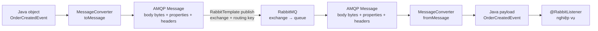
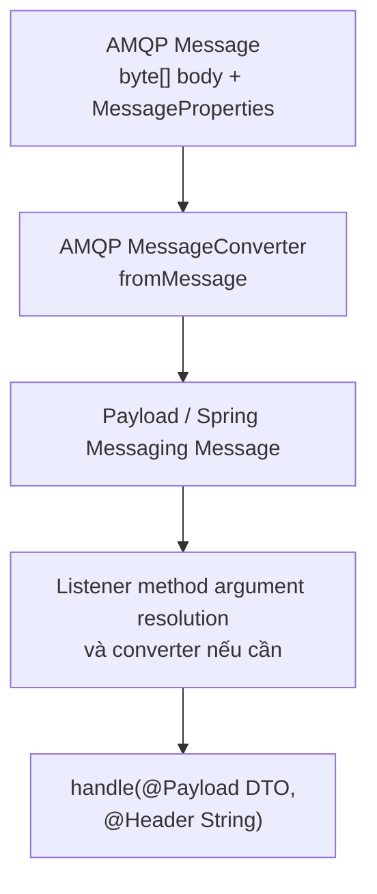
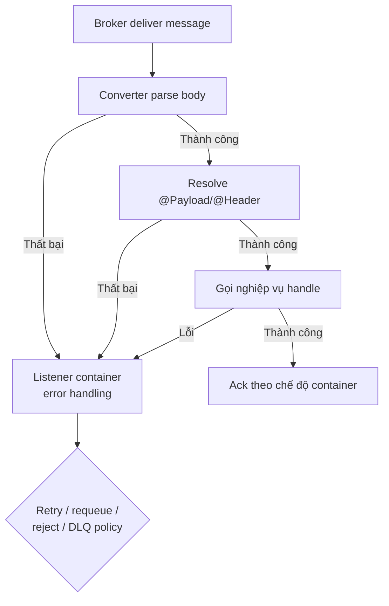

# MessageConverter và ranh giới chuyển đổi payload

## 1. Vì sao cần hiểu ranh giới chuyển đổi?

Trong một ứng dụng Spring AMQP, producer thường muốn gửi một đối tượng Java như `OrderCreatedEvent`, còn consumer muốn nhận lại một đối tượng Java cùng cấu trúc. Tuy nhiên, RabbitMQ không truyền trực tiếp đối tượng đang nằm trong bộ nhớ JVM. Broker nhận và lưu **message có phần thân là dãy byte** cùng các thuộc tính, header và thông tin định tuyến.

Giả sử Order Service viết:

```java
rabbitTemplate.convertAndSend("orders.events", "orders.created", event);
```

và Notification Service viết:

```java
@RabbitListener(queues = "notifications.order-created.q")
public void handle(OrderCreatedEvent event) {
    // Xử lý nghiệp vụ.
}
```

Vì sao hai ứng dụng có thể làm việc với `OrderCreatedEvent` trong khi RabbitMQ chỉ vận chuyển message? Câu trả lời là **`MessageConverter`**: thành phần chuyển giữa **payload của chương trình** và **AMQP message** ở ranh giới giao tiếp.

Đây là bài đầu của chương **Chuyển đổi dữ liệu** trong module **SPRING_AMQP**. Chủ đề gắn trực tiếp với `RabbitTemplate`, `@RabbitListener`, exchange, queue và binding. Hiểu conversion giúp hệ thống trao đổi dữ liệu đúng và là nền tảng để xử lý lỗi, retry, dead-letter, bảo mật, giao dịch và quan sát luồng message đáng tin cậy.

Sau bài này, bạn sẽ:

1. Phân biệt **payload Java**, **AMQP body**, **message properties**, **headers** và **routing metadata**.
2. Hiểu `MessageConverter.toMessage(...)` và `fromMessage(...)`, sự khác biệt giữa `send` và `convertAndSend`.
3. Phân biệt bước chuyển đổi của AMQP listener với bước ánh xạ tham số phương thức `@RabbitListener`.
4. Cấu hình JSON converter thống nhất ở producer và consumer.
5. Nhận ra lỗi sai `contentType`, JSON không hợp lệ, khác schema, type header không đáng tin và converter lệch nhau.
6. Thiết kế xử lý conversion failure để không tạo retry vô hạn và không mất message ngoài ý muốn.

## 2. Một message có những phần nào?

Một **AMQP 0-9-1 message** có body và các thuộc tính/hệ thống header. Khi publish, RabbitMQ còn cần exchange cùng routing key để quyết định queue nào nhận message. Các khái niệm này có vai trò khác nhau:

| Thành phần | Ví dụ | Vai trò |
| --- | --- | --- |
| **Payload ở producer** | `new OrderCreatedEvent("evt-1", "order-101", 1)` | Đối tượng Java trước khi chuyển thành message |
| **Body** | `{"eventId":"evt-1","orderId":"order-101","schemaVersion":1}` dưới dạng UTF-8 bytes | Dữ liệu được vận chuyển và lưu ở broker |
| **Content type** | `application/json` hoặc `text/plain` | Gợi ý cách diễn giải body khi nhận |
| **Content encoding** | `UTF-8`, nếu được đặt | Thông tin bảng mã ký tự khi cần chuyển byte ↔ text |
| **Headers** | `event-name=orders.created`, `schema-version=1` | Metadata ứng dụng; có thể phục vụ điều hướng xử lý hay chọn converter |
| **Message properties** | `messageId`, `correlationId`, `deliveryMode` | Metadata hỗ trợ truy vết, liên hệ message và đặc tính giao nhận |
| **Exchange + routing key** | `orders.events` + `orders.created` | Tham số publish dùng để định tuyến tại RabbitMQ, độc lập với cách serialize body |

**`MessageConverter` tập trung vào body và các metadata liên quan đến chuyển đổi.** Nó không quyết định exchange, binding, consumer ack hay liệu broker đã ghi message bền vững chưa.



RabbitMQ thường không cần hiểu cấu trúc trường `orderId` trong JSON để định tuyến. Exchange áp dụng binding bằng routing key hoặc header tùy kiểu exchange. Việc deserialize JSON là trách nhiệm phía ứng dụng.

## 3. Phân biệt các loại Message trong Spring

Tên “Message” xuất hiện trong nhiều package Java, dễ gây nhầm lẫn:

| Loại | Namespace | Mục đích |
| --- | --- | --- |
| **AMQP Message** | `org.springframework.amqp.core.Message` | Chứa `byte[] body` và `MessageProperties`; biểu diễn message trong Spring AMQP |
| **AMQP MessageProperties** | `org.springframework.amqp.core.MessageProperties` | Lưu `contentType`, `headers`, `messageId`, `correlationId` và metadata AMQP |
| **Spring Messaging Message** | `org.springframework.messaging.Message<T>` | Message trừu tượng với payload kiểu `T` và headers; dùng ở tầng xử lý method/annotation |
| **MessageConverter của Spring AMQP** | `org.springframework.amqp.support.converter.MessageConverter` | Chuyển object ↔ `org.springframework.amqp.core.Message` |
| **MessageConverter của Spring Messaging** | `org.springframework.messaging.converter.MessageConverter` | Chuyển payload của Spring Messaging message; là một cơ chế khác |

Hai interface cuối **không cùng namespace, không cùng hợp đồng API**. Khi muốn cấu hình `RabbitTemplate`, hãy import đúng **Spring AMQP MessageConverter**.

Giao diện AMQP converter có hai thao tác cốt lõi ở mức ý tưởng:

```java
// org.springframework.amqp.support.converter.MessageConverter
Message toMessage(Object object, MessageProperties properties);

Object fromMessage(Message message);
```

Một số implementation còn hỗ trợ các khả năng chuyển đổi nâng cao hoặc xử lý type có ngữ cảnh. Vì vậy, converter không chỉ là gọi `toString()` rồi lưu body; nó có thể xét kiểu payload, content type và header để đưa ra dạng dữ liệu thích hợp.

## 4. Producer: từ payload Java đến AMQP message

### 4.1. `send(...)` và `convertAndSend(...)` khác nhau

`RabbitTemplate` cung cấp hai nhóm API thường gặp:

```java
// Gửi một AMQP Message đã được tạo sẵn.
rabbitTemplate.send(
    "orders.events",
    "orders.created",
    amqpMessage
);

// Đưa Java object cho MessageConverter chuyển thành AMQP Message.
rabbitTemplate.convertAndSend(
    "orders.events",
    "orders.created",
    orderCreatedEvent
);
```

- **`send`:** caller chuẩn bị `org.springframework.amqp.core.Message`, bao gồm body và properties. Không yêu cầu template serialize object ở bước này.
- **`convertAndSend`:** template dùng converter được cấu hình để chuyển object thành `Message`, sau đó publish.
- **`convertAndSend(..., MessagePostProcessor)`:** cho phép sửa AMQP message sau khi conversion và trước khi gửi, ví dụ gắn `messageId` hoặc header nghiệp vụ.

Ví dụ gửi body bytes thủ công:

```java
byte[] body = "hello".getBytes(StandardCharsets.UTF_8);

MessageProperties props = new MessageProperties();
props.setContentType(MessageProperties.CONTENT_TYPE_TEXT_PLAIN);
props.setContentEncoding(StandardCharsets.UTF_8.name());

Message message = new Message(body, props);
rabbitTemplate.send("demo.exchange", "demo.hello", message);
```

Ở đây **caller tự chịu trách nhiệm** tạo body và khai báo metadata đúng. Nếu đặt content type là `application/json` nhưng body thực tế là chuỗi `hello` không phải JSON, consumer JSON có thể báo lỗi khi giải mã.

### 4.2. MessagePostProcessor không thay thế MessageConverter

Ví dụ với JSON converter đã được cấu hình, producer có thể gắn metadata:

```java
rabbitTemplate.convertAndSend(
    "orders.events",
    "orders.created",
    event,
    message -> {
        MessageProperties props = message.getMessageProperties();
        props.setMessageId(event.eventId());
        props.setCorrelationId(event.orderId());
        props.setHeader("event-name", "orders.created");
        props.setHeader("schema-version", event.schemaVersion());
        return message;
    }
);
```

Hãy phân biệt:

1. **Converter** tạo body và thông tin conversion như `contentType=application/json`.
2. **MessagePostProcessor** bổ sung/sửa properties hoặc headers của message đã chuyển đổi.
3. **RabbitTemplate** publish đến exchange bằng routing key đã cho.

Cả `messageId` lẫn `correlationId` đều không tự bảo đảm xử lý đúng một lần. Muốn tránh xử lý trùng, consumer phải có quy tắc idempotency theo ID nghiệp vụ.

## 5. SimpleMessageConverter: hành vi mặc định cần biết

Trong cấu hình Spring AMQP quen thuộc, `SimpleMessageConverter` được dùng khi không cung cấp một converter riêng phù hợp. Nó có thể xử lý các kiểu phổ biến, nhưng **không phải JSON converter cho DTO nghiệp vụ**.

| Dữ liệu phía producer | Hành vi thường gặp khi `SimpleMessageConverter` gửi | Nhận lại có thể là |
| --- | --- | --- |
| `String` | Encode thành bytes và đặt content type kiểu text | `String` khi content type/bảng mã tương ứng |
| `byte[]` | Sử dụng bytes làm body; metadata kiểu nhị phân | `byte[]` |
| Java `Serializable` | Có thể dùng Java native serialization cùng content type tương ứng | Object khi deserialization được phép và an toàn |
| DTO không `Serializable`, không String/bytes | Không có đường chuyển tự động phù hợp | Có thể phát sinh `MessageConversionException` |

**Khuyến cáo:** không nên dùng Java native serialization làm hợp đồng giao tiếp giữa các dịch vụ. Nó tạo coupling theo class Java, dễ lỗi khác phiên bản và có rủi ro bảo mật khi deserialize dữ liệu không đáng tin. Trong các cấu hình/framework mới, deserialization kiểu này có thể bị hạn chế hoặc yêu cầu cấu hình rõ ràng.

Khi nhận, `SimpleMessageConverter` xét metadata như `contentType`:

- Message dạng text có thể được giải mã thành `String` theo content encoding hoặc charset mặc định.
- Message dạng Java serialization có thể bị deserialize nếu môi trường cho phép.
- Body dạng khác thường được trả dưới dạng `byte[]`.

**Nếu producer gửi JSON bytes nhưng consumer chỉ dùng `SimpleMessageConverter`, consumer không tự nhiên nhận được `OrderCreatedEvent`.** Trong tình huống đó, có thể chỉ có `byte[]`/`String` hoặc lỗi chuyển đổi tham số. Hãy cấu hình JSON converter và thống nhất hai phía.

## 6. JSON converter: hợp đồng dữ liệu giữa các dịch vụ

Với event nghiệp vụ, JSON là lựa chọn dễ quan sát và tương thích nhiều ngôn ngữ. Spring AMQP có các implementation dựa trên Jackson.

**Lưu ý về phiên bản thư viện:**

- Với dòng Spring AMQP **3.x / Jackson 2**, tên class thường dùng là `Jackson2JsonMessageConverter`.
- Với dòng Spring AMQP **4.x / Jackson 3**, sử dụng API JSON converter tương ứng như `JacksonJsonMessageConverter`.
- Mẫu bên dưới thể hiện phiên bản **Spring AMQP 3.x**, để tập trung vào cơ chế. Khi project dùng Spring Boot/Spring AMQP phiên bản khác, cần chọn đúng dependency/import theo tài liệu phiên bản đó. Đừng thêm đồng thời hai JSON converter rồi mong framework tự lựa chọn đúng.

### 6.1. Tạo DTO có schema rõ ràng

Ví dụ sự kiện một đơn hàng được tạo. Dùng `record` (Java 17+) với các kiểu dữ liệu JSON đơn giản:

```java
package com.example.conversion;

public record OrderCreatedEvent(
        String eventId,
        String orderId,
        int schemaVersion,
        long occurredAtEpochMillis
) {}
```

Mẫu body JSON tương ứng:

```json
{
  "eventId": "evt-001",
  "orderId": "order-101",
  "schemaVersion": 1,
  "occurredAtEpochMillis": 1764000000000
}
```

Lưu ý **JSON là hợp đồng dữ liệu**, không phải hình ảnh bộ nhớ của record Java. Consumer viết bằng ngôn ngữ khác vẫn có thể hiểu JSON nếu tuân hợp đồng trường, định dạng và ý nghĩa.

**Vì sao thêm `schemaVersion`?** Khi schema thay đổi, consumer biết payload thuộc phiên bản nào và có thể xử lý chuyển tiếp hoặc báo lỗi có chủ đích. Cần xác định chính sách trường thiếu, trường lạ, kiểu số, enum và thời gian thay vì phụ thuộc toàn bộ vào mặc định của JSON mapper.

### 6.2. Khai báo JSON MessageConverter

Ví dụ trong Spring AMQP 3.x:

```java
package com.example.conversion;

import org.springframework.amqp.support.converter.Jackson2JsonMessageConverter;
import org.springframework.amqp.support.converter.MessageConverter;
import org.springframework.context.annotation.Bean;
import org.springframework.context.annotation.Configuration;

@Configuration
public class JsonConversionConfig {

    @Bean
    public MessageConverter jsonMessageConverter() {
        return new Jackson2JsonMessageConverter();
    }
}
```

Với Spring AMQP 4.x, hãy kiểm tra `JacksonJsonMessageConverter` và API Jackson 3 trong tài liệu chính thức của phiên bản đang dùng; cơ chế **object → JSON bytes → object** vẫn tương tự.

Trong ứng dụng Spring Boot với AMQP auto-configuration thông thường, một bean `org.springframework.amqp.support.converter.MessageConverter` được Boot phát hiện và có thể được áp dụng cho `RabbitTemplate` cùng listener factory mặc định của Boot. Nếu tự tạo `RabbitTemplate` hoặc listener container factory, cần gắn converter **tường minh** để không vô tình dùng `SimpleMessageConverter` ở một phía.

Cần thận trọng nếu ứng dụng dùng nhiều loại payload với schema khác nhau hoặc legacy binary messages trên cùng queue: một converter JSON duy nhất có thể không phù hợp với mọi message. Khi đó chọn topology rõ ràng, converter có khả năng phân nhánh theo content type, hoặc thiết kế luồng migration.

## 7. Ví dụ Spring Boot hoàn chỉnh: gửi và nhận OrderCreatedEvent

### 7.1. Điều kiện chạy

- Java 17+ và Spring Boot tương thích.
- RabbitMQ local ở `localhost:5672`; có thể chạy bằng Docker.
- Maven/Gradle với Spring AMQP starter.
- Ví dụ sử dụng **Spring AMQP 3.x/Jackson 2** cho phần cấu hình converter.

Chạy broker local (nếu chưa có RabbitMQ):

```bash
docker run -d --name rabbitmq-conversion-demo \
  -p 5672:5672 -p 15672:15672 rabbitmq:4-management
```

Thêm dependency Maven trong project Spring Boot:

```xml
<dependency>
    <groupId>org.springframework.boot</groupId>
    <artifactId>spring-boot-starter-amqp</artifactId>
</dependency>
```

Tạo `src/main/resources/application.yml`:

```yaml
spring:
  application:
    name: spring-amqp-conversion-demo
  rabbitmq:
    host: localhost
    port: 5672
    username: guest
    password: guest
    listener:
      simple:
        acknowledge-mode: auto
```

`guest/guest` chỉ phù hợp môi trường local có cấu hình mặc định cho phép. Khi deploy, sử dụng tài khoản và secret riêng với quyền phù hợp.

### 7.2. Cấu trúc dự án minh họa

```text
src/main/java/com/example/conversion/
    ConversionApplication.java
    OrderCreatedEvent.java
    JsonConversionConfig.java
    MessagingConfig.java
    OrderEventPublisher.java
    OrderEventListener.java
```

Tất cả class dùng package `com.example.conversion`.

### 7.3. Khai báo topology

Tạo `MessagingConfig.java`:

```java
package com.example.conversion;

import org.springframework.amqp.core.Binding;
import org.springframework.amqp.core.BindingBuilder;
import org.springframework.amqp.core.DirectExchange;
import org.springframework.amqp.core.Queue;
import org.springframework.amqp.core.QueueBuilder;
import org.springframework.context.annotation.Bean;
import org.springframework.context.annotation.Configuration;

@Configuration
public class MessagingConfig {

    public static final String EXCHANGE = "orders.events";
    public static final String ROUTING_KEY = "orders.created";
    public static final String QUEUE = "notifications.order-created.q";

    @Bean
    DirectExchange orderEventsExchange() {
        return new DirectExchange(EXCHANGE);
    }

    @Bean
    Queue orderCreatedQueue() {
        return QueueBuilder.durable(QUEUE).build();
    }

    @Bean
    Binding orderCreatedBinding(
            Queue orderCreatedQueue,
            DirectExchange orderEventsExchange) {
        return BindingBuilder.bind(orderCreatedQueue)
                .to(orderEventsExchange)
                .with(ROUTING_KEY);
    }
}
```

Exchange và binding vẫn xử lý routing key như mọi bài Spring AMQP khác. **JSON converter không tham gia xác định queue đích.** Spring Boot thường có `RabbitAdmin` hỗ trợ khai báo các bean topology khi kết nối broker; hoặc topology có thể được provision trước trong môi trường vận hành.

### 7.4. Publisher gửi DTO theo JSON

Tạo `OrderEventPublisher.java`:

```java
package com.example.conversion;

import org.springframework.amqp.core.MessageProperties;
import org.springframework.amqp.rabbit.core.RabbitTemplate;
import org.springframework.stereotype.Service;

@Service
public class OrderEventPublisher {

    private final RabbitTemplate rabbitTemplate;

    public OrderEventPublisher(RabbitTemplate rabbitTemplate) {
        this.rabbitTemplate = rabbitTemplate;
    }

    public void publish(OrderCreatedEvent event) {
        rabbitTemplate.convertAndSend(
                MessagingConfig.EXCHANGE,
                MessagingConfig.ROUTING_KEY,
                event,
                message -> {
                    MessageProperties properties =
                            message.getMessageProperties();
                    properties.setMessageId(event.eventId());
                    properties.setCorrelationId(event.orderId());
                    properties.setHeader("event-name", "orders.created");
                    properties.setHeader("schema-version", event.schemaVersion());
                    return message;
                }
        );
    }
}
```

Điều xảy ra:

1. `RabbitTemplate` gọi JSON `MessageConverter` để serialize `OrderCreatedEvent`.
2. Converter tạo AMQP body bytes và thiết lập thông tin conversion, thường gồm `contentType=application/json`.
3. `MessagePostProcessor` gắn các metadata phục vụ quan sát và lựa chọn luồng xử lý.
4. RabbitMQ nhận message tại exchange `orders.events` và định tuyến theo `orders.created`.
5. Message nằm trong queue `notifications.order-created.q` cho listener.

Không đặt `setContentType("text/plain")` sau khi chuyển JSON trừ khi đó thật sự là định dạng wire. Metadata sai có thể khiến consumer từ chối body hợp lệ.

### 7.5. Consumer nhận DTO và header

Tạo `OrderEventListener.java`:

```java
package com.example.conversion;

import org.springframework.amqp.rabbit.annotation.RabbitListener;
import org.springframework.messaging.handler.annotation.Header;
import org.springframework.messaging.handler.annotation.Payload;
import org.springframework.stereotype.Component;

@Component
public class OrderEventListener {

    @RabbitListener(queues = MessagingConfig.QUEUE)
    public void handle(
            @Payload OrderCreatedEvent event,
            @Header(name = "event-name", required = false) String eventName) {

        System.out.printf(
                "[CONSUMER] type=%s eventId=%s orderId=%s version=%d%n",
                eventName,
                event.eventId(),
                event.orderId(),
                event.schemaVersion()
        );
    }
}
```

`@Payload` chỉ rõ tham số nhận dữ liệu nghiệp vụ. `@Header` lấy metadata khác với body JSON; nó không làm thay đổi payload. Trong ví dụ, Spring AMQP đọc message, JSON converter deserialize body thành DTO, rồi infrastructure listener gọi phương thức tương ứng.

Nên validate `schemaVersion` và các trường bắt buộc trước khi ghi DB/gửi email. Nếu payload chuyển thành DTO thành công nhưng thiếu nội dung nghiệp vụ, **conversion success không đồng nghĩa validation success**.

### 7.6. Khởi động và phát một message

Tạo `ConversionApplication.java`:

```java
package com.example.conversion;

import java.util.UUID;

import org.springframework.boot.ApplicationRunner;
import org.springframework.boot.SpringApplication;
import org.springframework.boot.autoconfigure.SpringBootApplication;
import org.springframework.context.annotation.Bean;

@SpringBootApplication
public class ConversionApplication {

    public static void main(String[] args) {
        SpringApplication.run(ConversionApplication.class, args);
    }

    @Bean
    ApplicationRunner publishOnce(OrderEventPublisher publisher) {
        return args -> publisher.publish(new OrderCreatedEvent(
                UUID.randomUUID().toString(),
                "order-101",
                1,
                System.currentTimeMillis()
        ));
    }
}
```

Với `OrderCreatedEvent.java` ở mục 6.1 và `JsonConversionConfig.java` ở mục 6.2, các lớp trên tạo thành một ví dụ hoàn chỉnh về đường chuyển DTO → JSON body → DTO. Chạy ứng dụng:

```bash
./mvnw spring-boot:run
```

Trên Windows PowerShell:

```powershell
.\mvnw.cmd spring-boot:run
```

Log kỳ vọng tương tự:

```text
[CONSUMER] type=orders.created eventId=... orderId=order-101 version=1
```

Mỗi lần khởi động `ApplicationRunner` sẽ phát một event mới với ID mới. Nếu message đến trước khi listener sẵn sàng, nó có thể chờ trong queue; không nên suy rằng publish và consume luôn xảy ra đồng bộ trong cùng thread.

Mở Management UI tại `http://localhost:15672` để kiểm tra queue, số consumer, Ready/Unacked, rates và thông tin message. Nếu consumer xử lý rất nhanh, số Ready có thể bằng 0 dù message đã đi qua queue. Không dùng riêng số Ready để kết luận conversion có xảy ra hay không.

## 8. @RabbitListener có thể chuyển đổi qua hai tầng

Khi sử dụng `@RabbitListener` kiểu method, có thể có **hai bước**:



### Tầng 1 — AMQP MessageConverter

Listener container nhận `org.springframework.amqp.core.Message`, sau đó áp converter AMQP để diễn giải body. Với JSON converter, tầng này có thể biến body JSON thành DTO hoặc cấu trúc trung gian dựa trên metadata và ngữ cảnh kiểu đích.

### Tầng 2 — Phân giải tham số phương thức

Spring xử lý annotation `@Payload`, `@Header` và ánh xạ payload sang tham số method. Trong các cấu hình nhất định, **Spring Messaging method argument conversion** có thể tham gia bước này.

Điều đó giải thích vì sao:

- Converter phía `RabbitTemplate` và converter ở **listener factory** cần tương thích nhau.
- Việc đặt một bean `org.springframework.messaging.converter.MessageConverter` không có nghĩa bạn đã đổi converter của `RabbitTemplate`.
- Method có tham số kiểu cụ thể như `OrderCreatedEvent` có thể giúp JSON converter biết kiểu đích; khi listener có nhiều tham số payload, interface/generic không rõ hoặc nhiều overload, suy luận kiểu có thể kém rõ ràng.

### Type inference và type headers

Jackson converter có thể sử dụng metadata kiểu do producer gửi (chẳng hạn các header type của Spring AMQP) hoặc **kiểu tham số được suy ra từ phương thức listener**. Quy tắc ưu tiên phụ thuộc converter, cấu hình type mapper và sự phù hợp của kiểu đích. Không coi mọi header kiểu do bên ngoài gửi là đáng tin.

Ví dụ, nếu producer gửi type header mang tên package/class Java nội bộ của mình, consumer thuộc dịch vụ khác có thể **không có class tương ứng**. Một cách thiết kế tốt hơn là xây hợp đồng JSON ổn định, xác định type đích ở consumer hoặc dùng ánh xạ logical type ID (`order-created-v1`) được kiểm soát.

**Không nhầm class-name header với business event name.** Header `event-name=orders.created` là một loại metadata do ứng dụng quyết định, không đồng nghĩa Jackson tự hiểu nó là class cần deserialize.

## 9. Các ranh giới conversion dễ sai

### 9.1. Wire format là hợp đồng, Java class là implementation

Hai dịch vụ có thể dùng tên class khác nhau nhưng cùng hiểu JSON:

```json
{
  "eventId": "evt-002",
  "orderId": "order-202",
  "schemaVersion": 1,
  "occurredAtEpochMillis": 1764000000000
}
```

Consumer Kotlin, Java, Python hoặc Go không cần biết producer có class `OrderCreatedEvent`. Vì vậy hợp đồng nên mô tả **tên trường, kiểu JSON, ý nghĩa, giá trị bắt buộc, quy tắc versioning**, thay vì chỉ chia sẻ Java serialized object.

### 9.2. Content type là metadata để chọn cách đọc body

| Body thực tế | Content type khai báo | Hệ quả |
| --- | --- | --- |
| JSON object hợp lệ | `application/json` | JSON converter có cơ sở diễn giải dữ liệu |
| Chuỗi text | `text/plain` | Text converter có thể trả `String` |
| Bytes nhị phân | `application/octet-stream` | Bên nhận cần codec riêng hoặc xử lý `byte[]` |
| Text không phải JSON | `application/json` | JSON converter có thể báo parse/conversion error |
| JSON bytes | Không khai báo content type đúng | Hành vi tùy converter; có thể trả bytes hoặc lỗi |

Đừng tự ép `contentType` giả để “qua được” một listener. Cần sửa producer serialization và consumer converter cho thống nhất.

### 9.3. Khác schema không luôn hiện thành conversion error

Ví dụ producer thêm `paymentMethod` hoặc đổi `orderId` từ chuỗi thành object. JSON có thể vẫn parse được, nhưng:

- Consumer cũ có thể bỏ qua trường mới, tùy cấu hình ObjectMapper.
- Consumer có thể lỗi vì kiểu không tương thích.
- Consumer có thể nhận `null` hoặc giá trị mặc định rồi gây lỗi nghiệp vụ sau đó.
- Một enum mới có thể làm mapping thất bại.

Cần chiến lược **forward/backward compatibility**, version trường, kiểm thử contract và xác minh dữ liệu bắt buộc. Không dựa vào mặc định Jackson của mọi phiên bản.

### 9.4. Encoding và payload lớn

- Với text/JSON, nên thống nhất UTF-8 và content type tương ứng.
- Với binary/Avro/Protobuf, phải sử dụng codec có schema và metadata phù hợp; JSON converter không tự hiểu bytes định dạng khác.
- Tránh gửi object graph hoặc file lớn trực tiếp trong message nếu không cần. Có thể lưu payload lớn vào object storage và gửi ID/URI có quyền truy cập kiểm soát.
- Hạn chế log toàn bộ body khi có dữ liệu cá nhân, token hoặc thông tin thanh toán; dùng event ID, schema version và size để truy vết.

## 10. Lỗi conversion xảy ra trước hay trong @RabbitListener?

Đây là khác biệt quan trọng khi thiết kế retry và dead-letter:



**Conversion error** xảy ra khi không thể biến body/properties thành giá trị phù hợp. Khi lỗi tại bước này, **phương thức `handle(...)` có thể chưa được gọi lần nào**. Vì vậy đặt `try/catch` trong listener method sẽ không bắt được mọi lỗi deserialize.

Ví dụ:

- Producer gửi body `not-json` nhưng content type `application/json`; JSON parse thất bại.
- JSON hợp lệ nhưng `orderId` là một object trong khi DTO mong `String`.
- Header type tham chiếu class không tồn tại hoặc không được tin cậy.
- Consumer yêu cầu class không thể khởi tạo theo cấu hình converter.

**Business error** xảy ra sau khi payload được chuyển hợp lệ: DB timeout, HTTP 503, validation nghiệp vụ thất bại. Hai nhóm lỗi cần **chính sách xử lý khác nhau**:

| Lỗi | Có thể phục hồi bằng retry nguyên message? | Cách xử lý thường hợp lý |
| --- | --- | --- |
| JSON sai cú pháp | Thường không | Reject/quarantine/DLQ, điều tra producer/schema |
| Không tương thích schema | Thường không cho tới khi sửa contract/code | Cô lập message, triển khai consumer tương thích hoặc migration |
| Header type không đáng tin | Không nên retry vô hạn | Từ chối an toàn, cảnh báo bảo mật và hợp đồng |
| DB mất kết nối tạm thời | Có thể | Retry có giới hạn, backoff, circuit breaker nếu cần |
| API ngoài trả 429/503 | Có thể | Retry có backoff, giới hạn số lần và DLQ khi hết lượt |
| Nghiệp vụ nhận event trùng | Không cần thực hiện lại side effect | Idempotency/deduplication và ack theo kết quả nghiệp vụ |

Spring AMQP listener container có error handler và cơ chế xử lý lỗi chuyển đổi nghiêm trọng; hành vi reject/requeue cụ thể phụ thuộc phiên bản, `defaultRequeueRejected`, retry advice và exception được ném. Đừng khẳng định rằng **mọi conversion error đều tự đi DLQ**. DLQ chỉ nhận được message khi reject/nack/expiration phù hợp và broker đã có DLX cùng binding hoạt động.

### Poison message và vòng lặp retry

Một message JSON hỏng sẽ **không tự sửa** khi được giao lại. Nếu cấu hình requeue không giới hạn, cùng message có thể tạo vòng lặp lỗi, chiếm tài nguyên consumer và làm nghẽn queue.

Thiết kế tốt là:

1. Phân loại lỗi conversion là lỗi cấu trúc không thể xử lý hoặc lỗi do cấu hình tạm thời.
2. Retry có giới hạn khi có cơ sở tin rằng retry sẽ thành công.
3. Chuyển message không hợp lệ sang **DLQ/quarantine** để phân tích cùng `messageId`, `correlationId`, version và nguyên nhân.
4. Cảnh báo khi tỷ lệ conversion error tăng sau rollout schema.
5. Khi replay sau khi sửa converter, vẫn dùng khóa idempotency để tránh side effect trùng.

## 11. Bảo mật khi chuyển đổi dữ liệu

Message body và headers có thể được tạo bởi ứng dụng khác hoặc đi qua nhiều hệ thống. Không nên mặc định chúng đáng tin tuyệt đối.

### 11.1. Hạn chế Java native serialization

Không dùng native `Serializable` làm wire format giữa các dịch vụ chỉ để tránh cấu hình JSON. Deserialization của class không đáng tin có rủi ro thực thi hành vi ngoài dự kiến và bị phụ thuộc phiên bản Java/classpath.

Nếu phải tương tác với dữ liệu legacy, giới hạn class được deserialize, quyền kết nối broker, kiểm tra nguồn message và xây kế hoạch chuyển sang wire format có schema.

### 11.2. Không tin type header tùy ý

Các JSON converter/type mapper có thể sử dụng type header. Nếu consumer tự tải class theo giá trị mà producer bên ngoài chỉ định, nó có nguy cơ bị ép xử lý kiểu không mong muốn.

Biện pháp phù hợp:

- Dùng DTO đích tường minh trong listener khi có thể.
- Nếu dùng mapping theo type ID, chọn logical ID đã được đăng ký/whitelist.
- Hạn chế trusted packages hoặc cấu hình type mapper theo danh sách class cho phép.
- Không đặt `trustedPackages("*")` tùy tiện trong môi trường xử lý message không đáng tin.
- Kết hợp validation nghiệp vụ và giới hạn kích thước payload.

### 11.3. Bảo vệ nội dung nhạy cảm

Đừng in toàn bộ JSON của khách hàng, mã truy cập hoặc thông tin thanh toán vào console khi parse lỗi. Log đủ để điều tra bằng `eventId`, `messageId`, routing key, queue, content type, schema version, exception type và trace ID, đồng thời tuân thủ chính sách dữ liệu.

## 12. Quan sát và kiểm chứng bằng thí nghiệm

### Thí nghiệm A — SimpleMessageConverter với String

Chỉ cấu hình AMQP starter mặc định, gửi:

```java
rabbitTemplate.convertAndSend(
    "demo.events",
    "demo.hello",
    "Xin chào Spring AMQP"
);
```

Nhận bằng `@RabbitListener(queues = "demo.hello.q")` với tham số `String`. Kiểm tra message body và content type từ RabbitMQ Management UI. **Điều cần thấy:** `String` có thể chuyển thành bytes dạng text và trở lại String mà không cần JSON DTO.

### Thí nghiệm B — JSON object → DTO

Dùng JSON converter và ví dụ `OrderCreatedEvent` của mục 7. Trong Management UI, quan sát `content_type` tương ứng JSON, headers, body và số message đến/được ack.

Nếu listener xử lý nhanh, queue có thể trống ngay. Đừng dùng riêng queue depth để suy luận message có hay không.

### Thí nghiệm C — Cố tình gửi sai content type hoặc body

Trên **queue riêng của lab** (tránh làm nghẽn queue nghiệp vụ), gửi body không phải JSON nhưng đánh dấu JSON:

```java
MessageProperties properties = new MessageProperties();
properties.setContentType(MessageProperties.CONTENT_TYPE_JSON);

Message invalid = new Message(
    "not-json".getBytes(StandardCharsets.UTF_8),
    properties
);

rabbitTemplate.send(
    "lab.events",
    "lab.invalid-json",
    invalid
);
```

Consumer JSON sẽ không thể parse dữ liệu hợp lệ trong tình huống này. Quan sát stack trace, error handler và kết quả reject/requeue/DLQ. **Không bật requeue vô hạn** cho poison message của lab.

### Thí nghiệm D — Schema version thay đổi

Producer gửi JSON với trường mới hoặc đổi kiểu `orderId`. Consumer dùng DTO phiên bản cũ; kiểm tra:

- Conversion có thất bại không?
- Field mới được giữ, bỏ qua hay bị báo lỗi?
- Có field bắt buộc nào nhận `null`/giá trị mặc định không?
- Có thể triển khai consumer tương thích hai version trước khi đổi producer không?

Kết luận: **parse JSON thành công chưa chắc message hợp lệ về mặt nghiệp vụ**, và conversion failure chưa chắc xuất hiện ở đúng thời điểm dự đoán nếu ObjectMapper có cấu hình khác.

## 13. Những lỗi cấu hình thường gặp

| Hiện tượng | Nguyên nhân khả dĩ | Hướng kiểm tra |
| --- | --- | --- |
| Listener mong DTO nhưng nhận `byte[]` hoặc lỗi convert | Producer dùng JSON, consumer còn `SimpleMessageConverter` | Kiểm tra bean MessageConverter, content type, listener container factory |
| `NoSuchMessageConverter` hoặc ambiguous bean | Import sai interface hoặc có nhiều converter bean không rõ lựa chọn | Kiểm tra package `org.springframework.amqp.support.converter` và cấu hình Boot |
| JSON parse error | Body không phải JSON, dữ liệu bị hỏng, sai encoding | Xem content type, raw bytes, codec tại producer |
| Type/class mapping error | Type headers chứa package/class khác hoặc không trusted | Định nghĩa DTO đích, logical ID và trusted mapping |
| Listener method không được gọi | Conversion hoặc parameter binding thất bại trước khi gọi | Xem exception ở listener container, error handler và DLQ |
| Thêm trường JSON làm consumer cũ lỗi | ObjectMapper không chấp nhận unknown field hoặc schema không tương thích | Kiểm tra contract và cấu hình xử lý field lạ |
| Consumer chạy nhưng dữ liệu sai hoặc null | Schema lệch hoặc validation thiếu | Thêm schemaVersion, kiểm tra field bắt buộc và validation |
| Producer log gửi nhưng queue không có message | Routing key/binding sai hoặc broker không chấp nhận publish | Kiểm tra publisher confirms/returns và topology; conversion không đảm bảo routing |
| Message lỗi được nhận lặp vô hạn | Requeue/retry không giới hạn | Phân loại conversion failure, dùng retry có giới hạn, DLQ/quarantine |
| Hai dịch vụ dùng tên class khác nhau nên JSON không đọc được | Phụ thuộc type header class Java thay vì JSON contract | Dùng schema ổn định và type mapping tường minh |

## 14. Checklist thiết kế contract chuyển đổi

Trước khi đưa một loại event mới vào production, trả lời các câu hỏi sau:

1. **Body là gì?** JSON, String, Avro, Protobuf hay binary? Encoding được quy định rõ chưa?
2. **Content type có đúng không?** Có producer nào đang gửi bytes nhưng khai báo một định dạng khác không?
3. **Converter được đặt ở đâu?** `RabbitTemplate` và listener container factory có dùng cấu hình tương thích không?
4. **DTO/schema có phiên bản không?** Field bắt buộc, optional, enum, null, thời gian và numeric type được xác định thế nào?
5. **Type header đáng tin không?** Có whitelist/target type tường minh hay nguy cơ deserialize class tùy ý không?
6. **Conversion error được xử lý ở tầng nào?** Error handler của listener có phân biệt poison message và lỗi tạm thời không?
7. **DLQ có thực sự hoạt động không?** DLX, binding, retention, alert và quy trình xử lý lại đã kiểm thử chưa?
8. **Độ tin cậy ngoài conversion ra sao?** Publisher confirms/returns, ack, idempotency và outbox có phù hợp nghiệp vụ không?
9. **Quan sát dữ liệu thế nào?** Log event ID, schema version, queue, content type và lỗi mà không lộ payload nhạy cảm?
10. **Đã kiểm thử contract liên phiên bản chưa?** Consumer cũ nhận event mới và consumer mới nhận event cũ được không?

## 15. Kết luận

`MessageConverter` là ranh giới giữa **đối tượng Java** và **AMQP message mang body bytes cùng metadata**:

```text
Producer Java object
   → Spring AMQP MessageConverter.toMessage(...)
   → AMQP body + properties + headers
   → RabbitTemplate publish(exchange, routingKey)
   → RabbitMQ exchange → binding → queue
   → Spring AMQP MessageConverter.fromMessage(...)
   → @RabbitListener parameter resolution
   → DTO trong phương thức nghiệp vụ
```

**`SimpleMessageConverter`** phù hợp cho text/bytes cơ bản; với DTO liên dịch vụ, **JSON converter và schema thống nhất** thường dễ bảo trì hơn Java native serialization. Phải cấu hình đúng hai phía, nhất quán content type/encoding, giới hạn trusted types và xử lý lỗi conversion có chủ đích.

Chuyển đổi thành công **không chứng minh publish đã được broker xác nhận hoặc nghiệp vụ đã xử lý thành công**. Để xây hệ thống bất đồng bộ đáng tin cậy, vẫn cần exchange/queue/binding đúng, publisher confirms/returns, consumer acknowledgement, retry/dead-letter, transaction/outbox, idempotency và giám sát end-to-end.

### Tài liệu chính thức

- [Spring AMQP Reference — Message Converters](https://docs.spring.io/spring-amqp/reference/amqp/message-converters.html)
- [Spring AMQP — Sending Messages](https://docs.spring.io/spring-amqp/reference/amqp/sending-messages.html)
- [Spring AMQP — Annotation-driven Listener Endpoints](https://docs.spring.io/spring-amqp/reference/amqp/receiving-messages/async-annotation-driven.html)
- [Spring AMQP — Error Handling](https://docs.spring.io/spring-amqp/reference/amqp/exception-handling.html)
- [RabbitMQ — Consumer Acknowledgements and Publisher Confirms](https://www.rabbitmq.com/docs/confirms)
