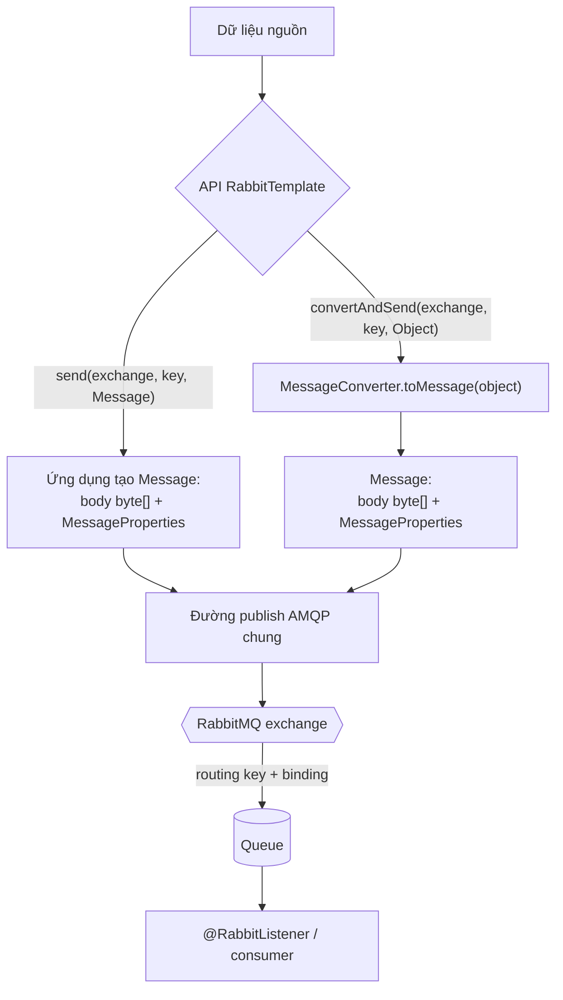

# send() với Message so với convertAndSend() với đối tượng

Trong **Spring AMQP**, cùng một sự kiện `orders.created` có thể được gửi vào RabbitMQ bằng hai cách phổ biến: tạo sẵn `org.springframework.amqp.core.Message` rồi gọi **`RabbitTemplate.send()`**, hoặc đưa một đối tượng Java vào **`RabbitTemplate.convertAndSend()`** để framework chuyển đổi. Hai cách sử dụng chung mô hình exchange, routing key, queue và binding, nhưng **khác nhau ở chỗ ai chịu trách nhiệm biến dữ liệu thành byte và thiết lập metadata**.

Bài học thuộc chương **Chuyển đổi dữ liệu** của module **SPRING_AMQP**. Ta sẽ so sánh hai API, viết ví dụ producer/consumer có thể thực hành, tìm hiểu `MessageConverter`, `MessageProperties`, `MessagePostProcessor` và những lỗi tương thích dữ liệu thường gặp. Khi xây hệ thống bất đồng bộ đáng tin cậy, cần hiểu rõ bước chuyển đổi trước khi áp dụng publisher confirms, acknowledgements, retry, dead-letter, transaction và giám sát.

## 1. Hai cách gửi giống và khác nhau ở đâu?



| Tiêu chí | `send(..., Message)` | `convertAndSend(..., Object)` |
| --- | --- | --- |
| Đầu vào | `org.springframework.amqp.core.Message` đã có **body byte[]** và `MessageProperties` | Đối tượng Java như `String`, `byte[]` hoặc DTO |
| Ai chuyển đổi payload thành byte? | **Ứng dụng** hoặc một thành phần trước đó | **`MessageConverter`** đã cấu hình trên `RabbitTemplate` |
| Metadata `contentType`, encoding, headers | Ứng dụng chủ động gán vào `MessageProperties` | Converter tạo metadata; có thể bổ sung/sửa qua `MessagePostProcessor` |
| Mức kiểm soát | Rõ byte gửi đi và AMQP properties | Ít boilerplate hơn khi gửi nhiều loại đối tượng |
| Điểm dễ sai | Chọn sai charset, content type hoặc tự tạo JSON không hợp lệ | Converter không hỗ trợ object, dùng sai converter, metadata/type mapping không tương thích |
| Khi nên dùng | Tích hợp protocol cụ thể, dữ liệu đã serialize, cần kiểm soát body/header chính xác | Gửi DTO, event thường ngày, muốn thống nhất quy tắc JSON/schema |

**Điểm mấu chốt:** `convertAndSend()` **không phải một cơ chế publish khác**. Sau khi chuyển đổi thành `Message`, nó cũng gửi qua exchange và routing key như `send()`. Không API nào tự bảo đảm broker đã route vào queue hoặc consumer đã xử lý thành công.

## 2. Chuẩn bị ứng dụng và topology thực hành

Ví dụ dùng Spring Boot với `spring-boot-starter-amqp` (phiên bản do Spring Boot parent/BOM quản lý):

```xml
<!-- pom.xml -->
<dependency>
    <groupId>org.springframework.boot</groupId>
    <artifactId>spring-boot-starter-amqp</artifactId>
</dependency>
```

Giả sử RabbitMQ local đang chạy trên `localhost:5672`, tài khoản `app_local` có quyền trên vhost `orders_local`. `application-local.yml`:

```yaml
spring:
  rabbitmq:
    host: localhost
    port: 5672
    username: app_local
    password: local-demo-only
    virtual-host: orders_local
```

Tài khoản và mật khẩu trên **chỉ để minh họa cho môi trường thử nghiệm đã được chuẩn bị**, không phải credential production. Khi triển khai thật, dùng secrets và cấu hình riêng theo môi trường; kiểm chứng đúng host, vhost, TLS và quyền của account.

Ta dùng một `DirectExchange`, một queue và một binding để cả hai lệnh publish có cùng đường định tuyến:

```java
import org.springframework.amqp.core.Binding;
import org.springframework.amqp.core.BindingBuilder;
import org.springframework.amqp.core.DirectExchange;
import org.springframework.amqp.core.Queue;
import org.springframework.amqp.core.QueueBuilder;
import org.springframework.context.annotation.Bean;
import org.springframework.context.annotation.Configuration;

@Configuration
public class OrderMessageTopology {
    public static final String EXCHANGE = "orders.events.demo";
    public static final String ROUTING_KEY = "orders.created";
    public static final String QUEUE = "orders.created.demo";

    @Bean
    DirectExchange orderExchange() {
        return new DirectExchange(EXCHANGE, true, false);
    }

    @Bean
    Queue orderQueue() {
        return QueueBuilder.durable(QUEUE).build();
    }

    @Bean
    Binding orderBinding(Queue orderQueue, DirectExchange orderExchange) {
        return BindingBuilder.bind(orderQueue)
                .to(orderExchange)
                .with(ROUTING_KEY);
    }
}
```

Khi `RabbitAdmin` được Spring Boot cấu hình và chạy với quyền phù hợp, các bean topology có thể được khai báo lên RabbitMQ. **Tạo bean Java không chứng minh broker đã khai báo thành công**; hãy kiểm tra exchange, queue và binding thực tế bằng RabbitMQ Management. Để tránh tranh nhau consume trong lúc quan sát message thô, chỉ bật một consumer demo tại một thời điểm.

## 3. send(): ứng dụng tạo Message hoàn chỉnh

Chữ ký phổ biến của `RabbitTemplate`:

```java
void send(String exchange, String routingKey, Message message);
```

`Message` của Spring AMQP chứa **body dạng `byte[]`** và một đối tượng **`MessageProperties`**. Nó **khác** `org.springframework.messaging.Message<T>` trong Spring Messaging; cần import đúng package.

### 3.1. Ví dụ gửi JSON đã được serialize

```java
import java.nio.charset.StandardCharsets;
import org.springframework.amqp.core.Message;
import org.springframework.amqp.core.MessageDeliveryMode;
import org.springframework.amqp.core.MessageProperties;
import org.springframework.amqp.rabbit.core.RabbitTemplate;
import org.springframework.stereotype.Service;

@Service
public class RawOrderEventPublisher {
    private final RabbitTemplate rabbitTemplate;

    public RawOrderEventPublisher(RabbitTemplate rabbitTemplate) {
        this.rabbitTemplate = rabbitTemplate;
    }

    public void sendRawJson(String eventJson, String eventId) {
        // eventJson phải là JSON hợp lệ do serializer an toàn tạo ra.
        byte[] body = eventJson.getBytes(StandardCharsets.UTF_8);

        MessageProperties properties = new MessageProperties();
        properties.setContentType(MessageProperties.CONTENT_TYPE_JSON);
        properties.setContentEncoding(StandardCharsets.UTF_8.name());
        properties.setDeliveryMode(MessageDeliveryMode.PERSISTENT);
        properties.setMessageId(eventId);
        properties.setHeader("eventType", "orders.created");
        properties.setHeader("schemaVersion", 1);

        Message message = new Message(body, properties);
        rabbitTemplate.send(
                OrderMessageTopology.EXCHANGE,
                OrderMessageTopology.ROUTING_KEY,
                message);
    }
}
```

Ví dụ payload đầu vào cho phương thức:

```json
{
  "eventId": "7635cdb3-a59c-47e0-a243-7134d5e8e1ca",
  "type": "orders.created",
  "orderId": "ORD-1001",
  "schemaVersion": 1
}
```

Với `send()`, ứng dụng **đã quyết định** nội dung từng byte trước khi gọi `RabbitTemplate`. Lệnh publish không tự động kiểm tra JSON có hợp lệ không, cũng không gọi `MessageConverter.toMessage()` để biến một DTO thành JSON. Tuy vậy, các thành phần được cấu hình khác, như **before-publish post-processors**, vẫn có thể tác động lên message trên đường gửi; không mặc định rằng body luôn bất biến trong mọi cấu hình RabbitTemplate.

### 3.2. Hiểu từng MessageProperties

| Thuộc tính | Chức năng | Lưu ý |
| --- | --- | --- |
| `contentType=application/json` | Báo cho consumer định dạng payload là JSON | **Metadata**, không tự biến byte sai thành JSON đúng |
| `contentEncoding=UTF-8` | Diễn tả cách mã hóa chuỗi thành byte | Producer/consumer phải thống nhất charset |
| `deliveryMode=PERSISTENT` | Yêu cầu message được lưu bền vững theo cơ chế broker | Không thay thế durable queue, publisher confirms hoặc HA |
| `messageId` | Nhận diện message | RabbitMQ không mặc định khử trùng lặp theo ID |
| Header `eventType` | Phân loại sự kiện cho consumer | Không thay thế routing key của exchange |
| Header `schemaVersion` | Hỗ trợ diễn giải payload theo phiên bản | Cần quy ước version rõ giữa các dịch vụ |

Các AMQP properties như `correlationId`, `replyTo`, `expiration`, `priority` có mục đích khác; thiết lập khi có yêu cầu nghiệp vụ/broker tương ứng. Ví dụ, `priority` không tự hoạt động nếu queue không hỗ trợ hoặc chưa được cấu hình priority.

**Đừng tự nối chuỗi JSON từ dữ liệu không tin cậy**, như tên khách hàng có dấu nháy kép. Dùng JSON serializer để escape đúng và đảm bảo schema. `send()` phù hợp khi một serializer hoặc tầng tích hợp phía trước đã tạo sẵn `byte[]`.

## 4. convertAndSend(): để MessageConverter xử lý đối tượng

Các overload thường dùng:

```java
void convertAndSend(String exchange, String routingKey, Object object);

void convertAndSend(
        String exchange, String routingKey,
        Object object, MessagePostProcessor messagePostProcessor);
```

Khi gọi `convertAndSend(..., object)`, `RabbitTemplate` chuyển đối tượng sang `Message` qua **`MessageConverter.toMessage()`**. Nó chuyển đổi nội dung **trước khi publish**, không phải broker tự chạy Java code để serialize object.

### 4.1. Định nghĩa kiểu sự kiện

Ví dụ Java 17+, đặt thành một file Java riêng của ứng dụng demo:

```java
public record OrderCreatedEvent(
        String eventId,
        String type,
        String orderId,
        int schemaVersion
) {}
```

Record này **không tự động được SimpleMessageConverter serialize thành JSON**. Để `convertAndSend` nhận DTO và tạo JSON, cần cài đặt một converter phù hợp.

### 4.2. Cấu hình JSON MessageConverter

Ví dụ dưới dùng **Spring AMQP 3.x với Jackson 2**:

```java
import org.springframework.amqp.support.converter.Jackson2JsonMessageConverter;
import org.springframework.amqp.support.converter.MessageConverter;
import org.springframework.context.annotation.Bean;
import org.springframework.context.annotation.Configuration;

@Configuration
public class RabbitJsonConfiguration {

    @Bean
    MessageConverter rabbitMessageConverter() {
        return new Jackson2JsonMessageConverter();
    }
}
```

Đảm bảo dự án có dependency Jackson tương ứng do Spring Boot quản lý. Ở những dòng Spring AMQP mới hơn có chuyển sang **Jackson 3**, tên converter/API có thể khác (chẳng hạn `JacksonJsonMessageConverter`). Hãy dùng class theo **phiên bản Spring Boot/Spring AMQP hiện tại**, không nâng riêng `spring-rabbit`, `spring-amqp` và `amqp-client` chỉ để sao chép ví dụ.

Spring Boot có cơ chế tự áp dụng bean `MessageConverter` thích hợp cho `RabbitTemplate` và listener factory mặc định khi auto-configuration phù hợp; nếu ứng dụng có custom `RabbitTemplate` hoặc custom listener container factory, hãy **kiểm tra rõ converter ở cả bên gửi và bên nhận**. Không suy luận hai phía luôn sử dụng cùng converter chỉ vì tồn tại một bean tên `rabbitMessageConverter`.

### 4.3. Gửi DTO ngắn gọn

```java
import org.springframework.amqp.rabbit.core.RabbitTemplate;
import org.springframework.stereotype.Service;

@Service
public class ConvertedOrderEventPublisher {
    private final RabbitTemplate rabbitTemplate;

    public ConvertedOrderEventPublisher(RabbitTemplate rabbitTemplate) {
        this.rabbitTemplate = rabbitTemplate;
    }

    public void publish(OrderCreatedEvent event) {
        rabbitTemplate.convertAndSend(
                OrderMessageTopology.EXCHANGE,
                OrderMessageTopology.ROUTING_KEY,
                event);
    }
}
```

Trong ví dụ này, converter JSON tạo message từ record, thường kèm `contentType=application/json` và metadata giúp bên nhận chọn cách deserialize. Tên header, thông tin type và quy tắc suy luận đích phụ thuộc converter/phiên bản; đừng coi tên class Java của producer là giao thức trao đổi ổn định giữa các microservice.

**So sánh cốt lõi:** Với `send()`, bạn truyền `Message` đã chuẩn bị. Với `convertAndSend()`, bạn truyền **`OrderCreatedEvent`** và converter quyết định bytes + thuộc tính message.

## 5. Bổ sung headers bằng MessagePostProcessor

Đôi khi muốn giữ lợi ích của JSON converter nhưng cần gắn `messageId`, `correlationId` hoặc headers nghiệp vụ. `MessagePostProcessor` cho phép sửa **message sau khi convert** và trước khi publish:

```java
import org.springframework.amqp.rabbit.core.RabbitTemplate;
import org.springframework.stereotype.Service;

@Service
public class OrderPublisherWithHeaders {
    private final RabbitTemplate rabbitTemplate;

    public OrderPublisherWithHeaders(RabbitTemplate rabbitTemplate) {
        this.rabbitTemplate = rabbitTemplate;
    }

    public void publish(OrderCreatedEvent event) {
        rabbitTemplate.convertAndSend(
                OrderMessageTopology.EXCHANGE,
                OrderMessageTopology.ROUTING_KEY,
                event,
                message -> {
                    var props = message.getMessageProperties();
                    props.setMessageId(event.eventId());
                    props.setHeader("eventType", event.type());
                    props.setHeader("schemaVersion", event.schemaVersion());
                    return message;
                });
    }
}
```

Mỗi lần publish chỉ nên tạo **một `eventId` ổn định cho cùng sự kiện nghiệp vụ**. Khi retry một publish chưa biết đã thành công hay chưa, việc phát sinh ID mới ở mỗi lần thử khiến consumer khó phát hiện bản sao. Nếu muốn kiểm soát đúng bytes, metadata protocol hoặc chuyển đổi thành nhiều loại body đặc biệt, `send()` thường rõ ràng hơn.

### Trường hợp nào dùng từng cách?

| Nhu cầu | Gợi ý |
| --- | --- |
| Có sẵn JSON `byte[]`, Avro/Protobuf hoặc payload do SDK khác tạo | `send(Message)` kèm `contentType` và metadata được quy ước |
| Có DTO Java và muốn serializer thống nhất | `convertAndSend(Object)` với JSON/binary converter đã cấu hình |
| Gửi DTO nhưng cần thêm `messageId`, `schemaVersion`, tracing headers | `convertAndSend(..., MessagePostProcessor)` |
| Cần tích hợp một hệ thống cũ phụ thuộc chính xác AMQP headers/body | `send(Message)` cho phép kiểm soát trực tiếp |
| Gửi một chuỗi thông báo đơn giản | Có thể dùng `convertAndSend(String)` với converter mặc định và kiểm tra content type/charset |

## 6. Consumer nhận dữ liệu thế nào?

**Consumer phải biết định dạng thực tế được gửi**, không chỉ biết queue nào nhận message. `@RabbitListener` có thể lấy message thô hoặc yêu cầu Spring chuyển payload sang kiểu Java cụ thể, tùy signature và converter của listener.

### 6.1. Nhận Message thô để kiểm tra byte và headers

```java
import java.nio.charset.StandardCharsets;
import org.springframework.amqp.core.Message;
import org.springframework.amqp.rabbit.annotation.RabbitListener;
import org.springframework.context.annotation.Profile;
import org.springframework.stereotype.Component;

@Component
@Profile("raw-demo")
public class RawOrderEventListener {

    @RabbitListener(queues = OrderMessageTopology.QUEUE)
    public void consume(Message message) {
        var props = message.getMessageProperties();
        String body = new String(message.getBody(), StandardCharsets.UTF_8);

        System.out.println("contentType=" + props.getContentType());
        System.out.println("messageId=" + props.getMessageId());
        System.out.println("schemaVersion=" + props.getHeaders().get("schemaVersion"));
        System.out.println("body=" + body);
        // Production: parse JSON bằng schema/serializer phù hợp; tránh log payload nhạy cảm.
    }
}
```

Đây là ví dụ có chủ ý sử dụng **UTF-8** vì producer ở mục 3 khai báo và sử dụng UTF-8. Trong hệ thống có nhiều nguồn gửi, hãy xác minh `contentEncoding` và thỏa thuận giao thức trước khi giải mã bytes. **`@RabbitListener(Message)` thô không tự hiểu body là OrderCreatedEvent**.

### 6.2. Nhận DTO đã được JSON converter giải mã

Khi consumer có converter JSON tương thích và biết kiểu đích:

```java
import org.springframework.amqp.rabbit.annotation.RabbitListener;
import org.springframework.context.annotation.Profile;
import org.springframework.stereotype.Component;

@Component
@Profile("dto-demo")
public class ConvertedOrderEventListener {

    @RabbitListener(queues = OrderMessageTopology.QUEUE)
    public void consume(OrderCreatedEvent event) {
        System.out.println("Order created: " + event.orderId());
        // Kiểm tra schemaVersion và eventId trước khi xử lý nghiệp vụ.
    }
}
```

Trong ví dụ học tập, chỉ bật **một trong hai profile `raw-demo` hoặc `dto-demo`**, vì cả hai listener cùng đọc `orders.created.demo` sẽ là **competing consumers**, không phải cùng nhận mỗi message. Với nhiều nhóm nghiệp vụ cần nhận sự kiện độc lập, tạo nhiều queue riêng và binding chúng đến exchange thích hợp.

Khi producer và consumer là **hai microservice** không dùng cùng package/class, tránh phụ thuộc tuyệt đối vào header type chứa fully qualified class name của producer. Nên sử dụng **event name + schema version**, DTO hợp đồng hoặc type mapping được quản lý; cần kiểm thử tương thích khi thay đổi payload. Một số converter có thể suy luận kiểu từ method `@RabbitListener`, nhưng hành vi chi tiết phụ thuộc version và cách khai báo listener.

## 7. MessageConverter mặc định và những nhầm lẫn phổ biến

Spring AMQP có `SimpleMessageConverter` dùng trong nhiều cấu hình mặc định nếu chưa khai báo converter khác. Nó phù hợp cho một số kiểu dữ liệu cơ bản, **không phải JSON serializer tổng quát**.

| Input cho `convertAndSend` với SimpleMessageConverter | Cách chuyển đổi điển hình | Điều cần chú ý |
| --- | --- | --- |
| `String` | Mã hóa thành `byte[]`, thường với `text/plain` | Charset/content encoding cần nhất quán |
| `byte[]` | Gửi dữ liệu nhị phân, thường `application/octet-stream` | Consumer phải tự biết định dạng thực của bytes |
| Đối tượng `Serializable` | Có thể dùng Java native serialization, với content type phù hợp | Khó tương thích liên ngôn ngữ và **rủi ro bảo mật khi deserialize** |
| DTO không `Serializable` | Không được converter mặc định hỗ trợ như JSON | Có thể ném lỗi chuyển đổi trước khi publish |

**Không khuyến nghị dùng Java native serialization cho message trao đổi giữa các dịch vụ**, đặc biệt khi payload có nguồn không tin cậy. Deserialization của kiểu Java có thể dẫn đến các rủi ro nghiêm trọng nếu thiếu kiểm soát. Với JSON, cấu hình converter rõ ràng, giới hạn các kiểu deserialize được phép và áp dụng validation/schema tại consumer.

### Những khác biệt dễ bị che khuất

1. **`contentType` không thực hiện serialize:** gửi byte không phải JSON nhưng đặt `application/json` vẫn là dữ liệu sai.
2. **Đổi converter làm đổi message trên wire:** cùng DTO nhưng Jackson, Protobuf hoặc native Java serialization tạo body và headers khác nhau. Consumer phải triển khai đúng phiên bản schema/converter.
3. **Type headers không phải hệ thống xác thực:** không cho phép từ metadata bên ngoài chỉ định tùy ý các lớp Java có thể instantiate. Cấu hình type mapping/trusted packages an toàn.
4. **Charset không đồng nhất gây lỗi dữ liệu:** chuỗi có dấu tiếng Việt có thể bị hỏng nếu producer encode UTF-8 nhưng consumer đọc theo charset khác.
5. **`MessagePostProcessor` có thể sửa headers/body:** dùng để bổ sung metadata có chủ đích, tránh ghi đè `contentType` trái với payload đã được converter tạo.

## 8. So sánh đường đi khi publish và nhận

Ví dụ cả hai producer cùng gửi thông tin đơn hàng:

```text
Cách A — send():
  JSON serializer -> UTF-8 bytes -> Message(body, properties)
  -> RabbitTemplate.send("orders.events.demo", "orders.created", message)

Cách B — convertAndSend():
  OrderCreatedEvent DTO -> MessageConverter.toMessage(...)
  -> RabbitTemplate.convertAndSend("orders.events.demo", "orders.created", event)

Cả hai:
  DirectExchange -> Binding("orders.created") -> Queue("orders.created.demo")
  -> @RabbitListener -> xử lý nghiệp vụ -> acknowledgement
```

Một số hành vi **không phụ thuộc** chọn `send()` hay `convertAndSend()`:

- **Routing** do exchange, routing key và binding quyết định; converter không chọn queue đích thay broker.
- **Message delivery** vẫn chịu ảnh hưởng durable queue, delivery mode, loại queue, publisher confirms và trạng thái broker.
- **Ack/requeue** của consumer liên quan listener container và cơ chế RabbitMQ, không được quyết định bởi hàm publish ban đầu.
- **Dead-letter/retry** cần được cấu hình và kiểm tra riêng; một message không deserialize được thường gây lỗi trước hoặc khi gọi listener, phải xem error handler/recoverer thực tế.

Một lỗi rất hay gặp là producer publish thành công nhưng consumer không parse được payload. Đây là **lỗi hợp đồng dữ liệu** hoặc chuyển đổi, không mặc định là lỗi exchange/binding. Ngược lại, consumer không nhận thấy message nào dù JSON đúng có thể do routing key, binding, vhost hoặc quyền, hoàn toàn độc lập với converter.

## 9. Độ tin cậy: serialization thành công chưa phải delivery thành công

`convertAndSend()` hoàn tất chuyển đổi rồi gọi publish; `send()` đã nhận bytes sẵn. Trong cả hai trường hợp, việc hàm trả về bình thường **không bảo đảm** consumer đã nhận/commit. Phải tách ba mốc:

1. **Conversion:** object được chuyển thành `Message` (hoặc ứng dụng chuẩn bị bytes). Lỗi JSON/schema ở đây có thể khiến không publish được.
2. **Publisher/broker:** message được publish và broker có thể xác nhận qua **publisher confirms**; thông tin **returns** hữu ích khi message không route được và producer bật `mandatory` cùng cơ chế xử lý.
3. **Consumer/DB:** listener chuyển đổi và xử lý nghiệp vụ, rồi ack/nack theo cơ chế đã cấu hình. Consumer ack **không đồng nghĩa** transaction DB và publish tiếp theo là một giao dịch phân tán.

Trong một ứng dụng Spring Boot sử dụng Spring Rabbit, các thuộc tính minh họa để bật cơ chế publisher confirmation/return là:

```yaml
spring:
  rabbitmq:
    publisher-confirm-type: correlated
    publisher-returns: true
    template:
      mandatory: true
```

Cấu hình trên **chưa tự hiển thị kết quả**; producer cần dùng callback, `CorrelationData` hoặc API phù hợp của phiên bản Spring AMQP để thực sự kiểm tra confirms và returns. **Publisher confirm không cho biết một nhóm consumer đã ghi dữ liệu xuống DB**. Cần thêm idempotency theo `eventId` và cơ chế quan sát retry, DLQ.

### Lỗi chuyển đổi tại consumer là một ca xử lý riêng

Message raw JSON có thể hợp lệ ở dạng bytes nhưng không tương thích với `OrderCreatedEvent` hiện tại, hoặc chứa dữ liệu không tin cậy. Một số lỗi xảy ra **trước khi method `@RabbitListener` được gọi**, chẳng hạn converter không thể tạo DTO. Vì vậy, `try/catch` bên trong listener **không bắt được tất cả lỗi deserialize**.

Với lỗi không thể sửa bằng retry, nên cấu hình error handler/recoverer để reject không requeue và đưa vào DLQ (nếu đã khai báo DLX/binding). Với lỗi tạm thời, dùng retry có giới hạn và backoff. Tránh mặc định requeue dữ liệu sai schema vô hạn. Trên quorum queue còn phải kiểm tra delivery limit và cách broker/phiên bản Spring AMQP settle lỗi.

Nếu consumer xử lý thành công nhưng chết trước ack, RabbitMQ có thể giao lại message; **`messageId` không tự ngăn xử lý trùng**. Thiết kế database uniqueness, idempotent handler hoặc transactional outbox theo nhu cầu nhất quán giữa ghi DB và phát event.

## 10. Các lỗi thường gặp và hướng chẩn đoán

| Hiện tượng | Nguyên nhân cần tìm | Cách kiểm tra |
| --- | --- | --- |
| `convertAndSend(dto)` ném lỗi trước publish | Converter mặc định không hỗ trợ DTO | Kiểm tra `RabbitTemplate.getMessageConverter()`, cấu hình bean, loại đối tượng |
| JSON đã gửi nhưng listener nhận chuỗi/byte thay vì DTO | Converter consumer khác hoặc method signature không khớp | Đối chiếu `contentType`, class listener, converter và type mapping |
| Listener ném `MessageConversionException` | Body sai định dạng, schema không phù hợp, type metadata thiếu/sai | Kiểm tra message raw tại môi trường test, schemaVersion, converter; sửa lỗi và DLQ |
| Tiếng Việt bị lỗi dấu | UTF-8 của producer khác charset đọc ở consumer | Kiểm tra byte, `contentEncoding` và serializer |
| `send()` dùng JSON nhưng consumer không deserialize | Chưa cấu hình JSON converter trên consumer; metadata không đúng | Kiểm tra content type và listener factory converter |
| DTO dùng Java serialization rồi service khác đọc không được | Khác runtime/class hoặc giới hạn deserialization | Chuyển sang JSON/format liên ngôn ngữ có schema |
| Không nhận message dù payload đúng | Exchange, routing key, binding/vhost sai; listener không chạy | Kiểm tra RabbitMQ Management UI, broker logs và consumers |
| Producer trả về bình thường nhưng message không vào queue | Message unroutable, không cấu hình returns/mandatory | Bật publisher returns, kiểm tra routing và binding |
| Message lỗi cứ quay lại | Consumer error handler requeue/retry không giới hạn | Cấu hình retry có giới hạn, phân loại lỗi, DLX/DLQ |
| Cùng sự kiện tạo nhiều tác dụng phụ | At-least-once delivery và retry tạo bản sao | Xử lý idempotent bằng `eventId`/khóa nghiệp vụ |

Lưu ý khi logging: chỉ log `eventId`, `schemaVersion`, content type, kích thước body và loại lỗi khi cần. Tránh in toàn bộ payload chứa dữ liệu khách hàng hoặc secret vào log ứng dụng/DLQ dashboard.

## 11. Thực hành kiểm chứng cả hai API

Hãy thực hiện trong virtual host và queue **local/test**. Không dùng queue nghiệp vụ production.

1. **Chuẩn bị topology:** khởi chạy broker, xác nhận exchange `orders.events.demo`, queue `orders.created.demo`, binding key `orders.created`.
2. **Gửi bằng `send()`:** tạo JSON UTF-8 hợp lệ, gán `contentType=application/json`, `messageId`, `schemaVersion`, gọi `RawOrderEventPublisher.sendRawJson(...)`.
3. **Đọc raw:** bật profile `raw-demo`, kiểm tra raw body và headers ở consumer. Đối chiếu byte string với JSON đã gửi.
4. **Gửi bằng `convertAndSend()`:** cấu hình JSON converter phù hợp, tạo `OrderCreatedEvent`, gọi `ConvertedOrderEventPublisher.publish(event)`.
5. **Đọc DTO:** dừng raw consumer, bật profile `dto-demo`, kiểm tra consumer đọc đúng `orderId`, `eventId`, `schemaVersion`.
6. **Thử post-processor:** gọi `OrderPublisherWithHeaders.publish(event)`, kiểm tra `messageId`, `eventType` và metadata schema sau conversion.
7. **Thử dữ liệu lỗi:** gửi JSON sai schema có kiểm soát, quan sát converter error và cơ chế retry/DLQ. Tránh làm thí nghiệm với vòng lặp requeue vô hạn.
8. **Thử routing key sai:** gửi tới exchange đúng nhưng key không khớp; so sánh kết quả với lỗi converter để hiểu sự khác biệt giữa *conversion failure* và *unroutable publish*.

Để kiểm tra byte/properties khi **không có listener khác đang tiêu thụ**, có thể dùng API polling của `RabbitTemplate` trong môi trường test:

```java
import org.springframework.amqp.core.Message;

Message received = rabbitTemplate.receive(OrderMessageTopology.QUEUE, 5000);
if (received != null) {
    System.out.println(received.getMessageProperties().getContentType());
    System.out.println(received.getMessageProperties().getHeaders());
    // received.getBody() là bytes được broker chuyển tới queue.
}
```

`receive(...)` **lấy message ra khỏi queue** theo cơ chế receive của template; đây là thao tác tiêu thụ, không phải truy vấn đọc mà không tác động. Đừng vừa chạy polling vừa chạy `@RabbitListener` trên cùng queue khi muốn so sánh kết quả xác định: chúng sẽ tranh nhau nhận các message.

### Checklist trước khi đưa lên môi trường thật

- [ ] Xác định đúng vai trò của `send(Message)` và `convertAndSend(Object)` trong producer.
- [ ] Producer và consumer thống nhất content type, encoding và hợp đồng schema của message.
- [ ] Có converter rõ ràng nếu cần trao đổi DTO/JSON; đã kiểm tra mapping giữa các dịch vụ khác package hoặc khác phiên bản.
- [ ] Không dùng native Java deserialization cho payload không tin cậy; cấu hình trusted types/packages và validation.
- [ ] Gắn `eventId`, `schemaVersion` và tracing/correlation metadata khi cần; không gửi secret trong header.
- [ ] Kiểm tra routing, publisher confirms/returns, consumer ack, retry và DLQ độc lập với việc serialize.
- [ ] Có idempotency và chính sách xử lý message không deserialize được mà không tạo vòng lặp vô hạn.

## 12. Ghi nhớ và câu hỏi tự kiểm tra

**`send()`** phù hợp khi payload đã được biến thành **`Message` với body bytes và properties rõ ràng**. **`convertAndSend()`** phù hợp khi producer có **đối tượng Java** và muốn sử dụng **`MessageConverter`** để serialize nhất quán. `MessagePostProcessor` là cầu nối khi vừa muốn converter xử lý DTO vừa cần tùy chỉnh AMQP metadata.

Tự kiểm tra:

- Nếu dùng `send()` với `Message` chứa `byte[]` JSON, RabbitMQ có tự validate JSON không? Vì sao?
- Nếu chỉ gọi `convertAndSend(new OrderCreatedEvent(...))` với `SimpleMessageConverter`, chuyện gì có thể xảy ra?
- Tại sao gắn header `contentType=application/json` không đủ để biến một body tùy ý thành JSON?
- `MessagePostProcessor` chạy trước hay sau bước chuyển đổi đối tượng thành `Message`?
- Khi publisher confirm thành công, đã có thể kết luận `@RabbitListener` ghi DB thành công chưa?
- Vì sao một lỗi deserialize tại consumer cần được xử lý bằng error handler/DLQ thay vì chỉ bắt exception trong method listener?

**Kết luận:** Hãy chọn API dựa trên nơi bạn muốn kiểm soát serialization. Trong hệ thống Spring AMQP dùng RabbitMQ, cả hai cách publish đều phải đi kèm thiết kế exchange/queue/binding, xác nhận publish, xử lý lỗi chuyển đổi, acknowledgement, retry/dead-letter, idempotency và quan sát để bảo đảm luồng bất đồng bộ dễ kiểm chứng và vận hành.
