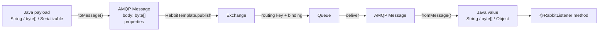
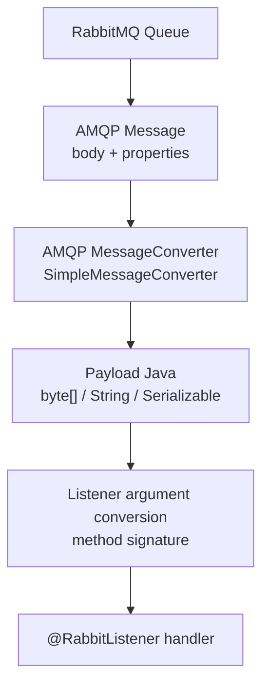
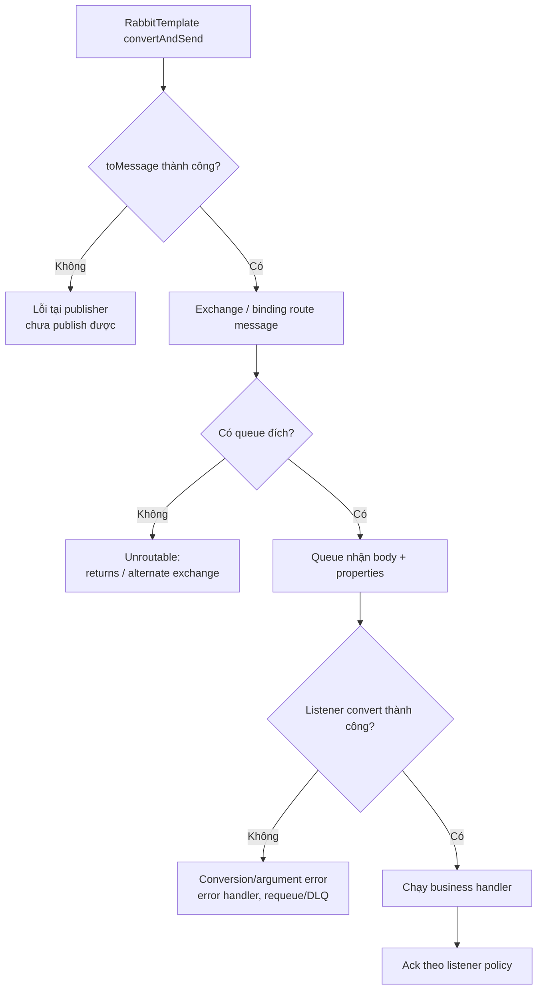

# SimpleMessageConverter cho byte[], String và đối tượng được hỗ trợ

## 1. Vì sao chuyển đổi message quan trọng?

Trong hệ thống **Spring AMQP** kết nối RabbitMQ, message truyền qua AMQP 0-9-1 có phần **body là dãy byte**, kèm các **properties/headers** mô tả nội dung và phục vụ giao thức. Tuy nhiên, code ứng dụng thường muốn gửi một chuỗi, một mảng byte hoặc một Java object thay vì phải tự mã hóa từng message.

Lớp `org.springframework.amqp.support.converter.SimpleMessageConverter` cung cấp quy tắc chuyển đổi đơn giản giữa Java payload và AMQP `Message`. Đây là message converter phổ biến theo cấu hình mặc định của `RabbitTemplate`; khi làm việc với `@RabbitListener`, cần hiểu cả converter ở phía AMQP và bước ánh xạ payload thành tham số phương thức.

Bài thuộc chương **Chuyển đổi dữ liệu** của module **SPRING_AMQP**, sử dụng `RabbitTemplate`, `@RabbitListener`, exchange, queue và binding. Hiểu conversion là tiền đề quan trọng khi chẩn đoán message không đọc được, thiết kế retry/dead-letter, xác nhận giao nhận và theo dõi hệ thống bất đồng bộ đáng tin cậy.

Sau bài này, bạn sẽ:

1. Xác định cách `SimpleMessageConverter` xử lý `byte[]`, `String` và Java object triển khai `Serializable`.
2. Phân biệt `toMessage()` và `fromMessage()`, vai trò của `contentType`, `contentEncoding` và body.
3. Giải thích vì sao không phải mọi POJO đều được converter mặc định chấp nhận.
4. Sử dụng `RabbitTemplate.convertAndSend()`, `receiveAndConvert()` và listener để nhận message phù hợp.
5. Phát hiện lỗi type mismatch, sai charset, thiếu class, deserialize nguy hiểm và không tương thích đa ngôn ngữ.
6. Biết khi nào nên chuyển sang định dạng dữ liệu tương tác tốt hơn như JSON.

## 2. Message conversion nằm ở vị trí nào?

Ở phía publisher, Spring dùng `MessageConverter.toMessage` để tạo một `Message` chứa body byte và metadata trước khi gửi tới RabbitMQ. Ở phía consumer, `MessageConverter.fromMessage` đọc message nhận được và quyết định trả về Java object nào.



Đây là hai bước **độc lập với định tuyến**:

- Exchange, queue và binding chỉ quyết định message được chuyển tới đâu.
- Converter quyết định body và metadata được biểu diễn bằng Java type nào.
- Consumer ACK/NACK quyết định delivery đã được xác nhận hay cần xử lý lại.
- Publisher confirm xác nhận hoạt động publish ở broker theo AMQP; nó không chứng minh consumer giải mã hoặc xử lý business payload thành công.

**Điểm mấu chốt:** RabbitMQ không tự biết một body byte có nghĩa là `String`, JSON hay Java object. Client cần một quy ước về định dạng dữ liệu và headers để mã hóa/giải mã thống nhất.

## 3. SimpleMessageConverter hỗ trợ những kiểu gì?

### 3.1. Chiều gửi: Java object → AMQP Message

`SimpleMessageConverter` nhận một giá trị Java và tạo body byte theo loại giá trị đó:

| Payload khi gửi | Cách tạo body | `contentType` thường được đặt | Ghi chú |
| --- | --- | --- | --- |
| `byte[]` | Giữ nguyên các byte | `application/octet-stream` | Không diễn giải các byte thành văn bản |
| `String` | Mã hóa chuỗi thành byte theo charset cấu hình | `text/plain` | Có thể đặt `contentEncoding` mô tả charset |
| `Serializable` khác hai loại trên | Java native serialization thành byte | `application/x-java-serialized-object` | Chỉ phù hợp với phía nhận có class/runtime và quy tắc bảo mật tương thích |
| Object không thuộc các loại trên | Không có cách mã hóa mặc định | Không có message hợp lệ | Converter báo lỗi; cần chọn converter khác hoặc tự chuyển thành kiểu được hỗ trợ |

Một số loại đơn giản như `Integer`, `Long`, `ArrayList` hoặc object domain **có thể là `Serializable`**. Khi gửi bằng `SimpleMessageConverter`, chúng sẽ đi vào **nhánh Java serialization**, chứ không mặc nhiên được biến thành chuỗi số hay JSON.

Ví dụ cần phân biệt:

```java
rabbitTemplate.convertAndSend(EXCHANGE, KEY, 123);
// Integer implements Serializable -> Java serialized object

rabbitTemplate.convertAndSend(EXCHANGE, KEY, "123");
// String -> body là byte của văn bản "123"

rabbitTemplate.convertAndSend(EXCHANGE, KEY, "123".getBytes(StandardCharsets.UTF_8));
// byte[] -> body là ba byte, metadata dạng binary
```

Ba đoạn trên có thể có cùng ý nghĩa đối với con người nhưng **không cùng wire representation**. Consumer phụ thuộc metadata có thể nhận `Integer`, `String` hoặc `byte[]`.

### 3.2. Chiều nhận: AMQP Message → Java value

Thông tin quyết định chủ yếu là `contentType` của message:

| Metadata message nhận được | Hành vi điển hình của `SimpleMessageConverter.fromMessage` | Kiểu kết quả |
| --- | --- | --- |
| `text/plain` và các content type văn bản được converter nhận biết | Giải mã body thành chuỗi bằng charset phù hợp | `String` |
| `application/x-java-serialized-object` | Java deserialization, chịu các giới hạn/bảo vệ deserialize của phiên bản | Java object được khôi phục |
| `application/octet-stream` | Trả body byte nguyên vẹn | `byte[]` |
| `application/json` nhưng vẫn dùng SimpleMessageConverter | Không tự parse JSON thành POJO | Thường là `byte[]` |
| Metadata thiếu, không được nhận biết hoặc không khớp nhánh | Giữ body dạng byte | Thường là `byte[]` |

**Không có việc RabbitMQ tự chuyển `application/json` thành Java object chỉ vì nội dung trông giống JSON.** Nếu producer dùng JSON, cần converter/decoder tương ứng ở consumer; ví dụ Jackson-based converter nếu hệ thống dùng JSON với Spring AMQP.

Cũng không được chỉ dựa vào tên queue hoặc routing key để suy kiểu Java nhận được. Một queue có thể chứa message đến từ nhiều producer với cách mã hóa khác nhau.

### 3.3. Message body khác gì các properties?

Một `org.springframework.amqp.core.Message` có:

- `byte[] body`: dữ liệu thực sự vận chuyển.
- `MessageProperties`: content type, content encoding, headers, correlation/message ID, delivery mode và các property AMQP khác.

Ví dụ:

```text
Message
  body           = [79, 114, 100, 101, 114, 45, 49, 50, 51]  # Order-123
  contentType    = text/plain
  contentEncoding= UTF-8
  messageId      = 2a2e...  # nếu producer đặt
  headers        = {eventType: "orders.created"}  # nếu producer đặt
```

`MessageProperties` giúp bên nhận biết cách hiểu body, nhưng converter mặc định **không tự tạo messageId/correlationId hay một business schema**. Những thông tin đó phải được ứng dụng đặt khi cần.

## 4. Trường hợp 1: `byte[]` giữ nguyên dữ liệu nhị phân

`byte[]` phù hợp khi ứng dụng đã có dữ liệu binary từ nguồn khác: ảnh thu nhỏ, tài liệu, payload protobuf, dữ liệu nén hoặc bytes của một định dạng mà component downstream tự giải mã.

### 4.1. Tạo và chuyển đổi trực tiếp không cần broker

```java
import java.util.Arrays;
import org.springframework.amqp.core.Message;
import org.springframework.amqp.core.MessageProperties;
import org.springframework.amqp.support.converter.SimpleMessageConverter;

public class BytesConverterExample {
    public static void main(String[] args) {
        SimpleMessageConverter converter = new SimpleMessageConverter();

        byte[] payload = new byte[] {1, 2, 3, 4};
        Message message =
                converter.toMessage(payload, new MessageProperties());

        System.out.println(message.getMessageProperties().getContentType());
        // application/octet-stream

        Object restored = converter.fromMessage(message);
        byte[] received = (byte[]) restored;

        System.out.println(Arrays.equals(payload, received)); // true
    }
}
```

Không nên áp đặt `new String(bytes, UTF_8)` lên một payload nhị phân ngẫu nhiên: những byte không biểu diễn văn bản hợp lệ có thể thành ký tự thay thế và làm mất dữ liệu.

### 4.2. Dùng RabbitTemplate để gửi raw bytes

```java
import java.nio.charset.StandardCharsets;
import org.springframework.amqp.rabbit.core.RabbitTemplate;
import org.springframework.stereotype.Service;

@Service
public class RawPayloadPublisher {
    private final RabbitTemplate rabbitTemplate;

    public RawPayloadPublisher(RabbitTemplate rabbitTemplate) {
        this.rabbitTemplate = rabbitTemplate;
    }

    public void sendBinary(byte[] payload) {
        rabbitTemplate.convertAndSend(
                "files.events", "files.thumbnail", payload);
    }

    public void sendUtf8AsRawBytes(String value) {
        rabbitTemplate.convertAndSend(
                "files.events",
                "files.thumbnail",
                value.getBytes(StandardCharsets.UTF_8));
    }
}
```

Ở method thứ hai, dù `value` ban đầu là `String`, converter **nhận `byte[]`** và ghi metadata kiểu binary. Consumer dùng SimpleMessageConverter sẽ không tự hiểu đây là text. Nếu muốn gửi văn bản, hãy truyền trực tiếp `String` hoặc quy định rõ định dạng payload và metadata.

### 4.3. Kiểm tra bytes tại listener

```java
import org.springframework.amqp.core.Message;
import org.springframework.amqp.rabbit.annotation.RabbitListener;
import org.springframework.stereotype.Component;

@Component
public class BinaryMessageListener {
    @RabbitListener(queues = "files.thumbnail.q")
    public void onBinary(Message message) {
        byte[] bytes = message.getBody();
        // Gọi bộ giải mã của ứng dụng và kiểm tra kích thước/định dạng.
        System.out.println("Received bytes: " + bytes.length);
    }
}
```

Nhận `Message` trực tiếp có ích khi cần lấy bytes **không phụ thuộc quyết định convert** hoặc cần kiểm tra headers. Listener cần giới hạn kích thước payload và kiểm tra định dạng để không gây áp lực bộ nhớ hay xử lý dữ liệu độc hại.

## 5. Trường hợp 2: `String` và charset

### 5.1. Chuỗi được mã hóa ra sao?

`SimpleMessageConverter` biến `String` thành dãy byte theo charset mặc định cấu hình của converter (thường là **UTF-8**) và đặt metadata chỉ ra nội dung văn bản, thường `text/plain` cùng `contentEncoding` thích hợp.

```java
import org.springframework.amqp.core.Message;
import org.springframework.amqp.core.MessageProperties;
import org.springframework.amqp.support.converter.SimpleMessageConverter;

public class StringConverterExample {
    public static void main(String[] args) {
        SimpleMessageConverter converter = new SimpleMessageConverter();

        String text = "Đơn hàng đã tạo: 123";
        Message message =
                converter.toMessage(text, new MessageProperties());

        System.out.println(message.getMessageProperties().getContentType());
        // text/plain

        Object result = converter.fromMessage(message);
        System.out.println(result.equals(text)); // true
    }
}
```

**Vấn đề charset:** chuỗi Unicode như `"Đơn hàng đã tạo"` có thể bị lỗi nếu producer ghi bytes bằng UTF-8 nhưng consumer giải mã theo charset khác. Đối với message bên ngoài Spring AMQP, xác nhận content type và content encoding **khớp với bytes thực tế**, nhất là khi giao tiếp giữa Java, Node.js, Python và Go.

### 5.2. Dùng SimpleMessageConverter với message text từ producer khác

Giả sử một producer ngoài Java gửi message:

```text
body (UTF-8 bytes): "Xin chào"
contentType: text/plain
contentEncoding: UTF-8
```

SimpleMessageConverter có cơ sở để trả về `String`.

Nếu cùng bytes nhưng metadata là `application/octet-stream` hoặc một content type không được nhánh text nhận biết, converter trả về `byte[]`. **Body nhìn giống văn bản không làm converter tự suy đoán charset.**

Tùy phiên bản Spring AMQP, cách đọc thông tin charset từ tham số `charset` trong `contentType` hoặc `contentEncoding` có thể khác; để tương tác ổn định, quy định encoding rõ và kiểm tra trên client version thực tế.

### 5.3. Listener nhận String

```java
import org.springframework.amqp.rabbit.annotation.RabbitListener;
import org.springframework.stereotype.Component;

@Component
public class PlainTextListener {
    @RabbitListener(queues = "notifications.text.q")
    public void receiveText(String text) {
        System.out.println("Text: " + text);
    }
}
```

Nếu incoming message được producer Spring gửi đúng kiểu `String` với `SimpleMessageConverter` phù hợp, listener sẽ nhận văn bản. Nếu producer gửi body JSON nhưng content type binary, listener và tầng chuyển đổi tham số có thể không nhận giá trị đúng như mong đợi; không nên dựa vào suy đoán rằng listener luôn chấp nhận mọi `byte[]` như String.

## 6. Trường hợp 3: đối tượng `Serializable` và Java serialization

Đối với payload không phải `byte[]` hay `String`, `SimpleMessageConverter` chỉ có thể gửi mặc định khi object triển khai `java.io.Serializable`. Converter sử dụng **Java native serialization** và đánh dấu content type `application/x-java-serialized-object`.

### 6.1. Ví dụ đối tượng đơn hàng

```java
package example.events;

import java.io.Serial;
import java.io.Serializable;

public class OrderCreatedEvent implements Serializable {
    @Serial
    private static final long serialVersionUID = 1L;

    private final String orderId;
    private final long createdAtEpochMillis;

    public OrderCreatedEvent(String orderId, long createdAtEpochMillis) {
        this.orderId = orderId;
        this.createdAtEpochMillis = createdAtEpochMillis;
    }

    public String getOrderId() {
        return orderId;
    }

    public long getCreatedAtEpochMillis() {
        return createdAtEpochMillis;
    }
}
```

Chuyển đổi trực tiếp:

```java
import example.events.OrderCreatedEvent;
import org.springframework.amqp.core.Message;
import org.springframework.amqp.core.MessageProperties;
import org.springframework.amqp.support.converter.SimpleMessageConverter;

public class SerializableConverterExample {
    public static void main(String[] args) {
        SimpleMessageConverter converter = new SimpleMessageConverter();

        OrderCreatedEvent event =
                new OrderCreatedEvent("order-123", System.currentTimeMillis());

        Message message =
                converter.toMessage(event, new MessageProperties());

        System.out.println(message.getMessageProperties().getContentType());
        // application/x-java-serialized-object

        Object restored = converter.fromMessage(message);
        OrderCreatedEvent copy = (OrderCreatedEvent) restored;
        System.out.println(copy.getOrderId());
    }
}
```

Đoạn code này minh họa **cơ chế kỹ thuật** trong môi trường Java kiểm soát được dữ liệu. Nó **không phải khuyến nghị** dùng Java native serialization để trao đổi giữa các microservice hoặc với hệ thống không tin cậy.

### 6.2. Điểm cần hiểu về Java serialization

- Toàn bộ object graph cần có khả năng serialization; một field chứa object không serializable có thể khiến quá trình thất bại (trừ khi được đánh dấu hoặc xử lý phù hợp).
- Consumer phải có class tương thích và cách nạp class phù hợp; thiếu class hoặc khác cấu trúc object có thể gây lỗi `ClassNotFoundException`, `InvalidClassException` hoặc lỗi deserialize khác.
- `serialVersionUID` hỗ trợ kiểm soát tương thích class serialization, **không phải phiên bản schema nghiệp vụ hoàn chỉnh**.
- Payload Java-serialized **không phải JSON**, không đọc được tự nhiên bởi ứng dụng Python/Node.js, và định dạng phụ thuộc hệ sinh thái Java.
- Java deserialization dữ liệu không tin cậy có nguy cơ bảo mật, bao gồm thực thi gadget chain từ các class có trên classpath. Nên tránh sử dụng với message từ nguồn không tin cậy; áp dụng các biện pháp hạn chế deserialize và cập nhật thư viện khi buộc phải dùng.

### 6.3. Allowed-list và kiểm soát nguồn dữ liệu

Các phiên bản Spring AMQP cung cấp cơ chế hạn chế class được phép deserialize cho các converter Java serialization, chẳng hạn cấu hình **allowed-list patterns** tùy API/version. Ví dụ về ý tưởng:

```text
Chỉ deserialize class phù hợp với miền dữ liệu đã kiểm soát
  example.events.*
Không cho phép nguồn công khai gửi Java-serialized payload không xác thực
Kiểm tra giới hạn kích thước message, quyền publish và dependency classpath
```

Không dựa vào việc có allowed-list để khẳng định deserialization an toàn hoàn toàn: tính an toàn còn phụ thuộc danh sách class được phép, lớp thư viện phụ thuộc, quyền producer, xác thực và độ mới của runtime.

**Khuyến nghị khi triển khai mới:** dùng JSON với converter có hỗ trợ schema/type mapping an toàn, hoặc định dạng dữ liệu có contract như Avro/Protobuf nếu yêu cầu phù hợp; không sử dụng Java serialization chỉ để khỏi phải cấu hình converter.

### 6.4. POJO không implements Serializable

Một class Java thông thường:

```java
public final class OrderDraft {
    private final String orderId;

    public OrderDraft(String orderId) {
        this.orderId = orderId;
    }

    public String getOrderId() {
        return orderId;
    }
}
```

Nếu class này không triển khai `Serializable` và không thuộc `String`/`byte[]`, lời gọi sau không có nhánh chuyển đổi mặc định:

```java
rabbitTemplate.convertAndSend(
        "orders.events", "orders.created", new OrderDraft("order-123"));
```

Converter sẽ báo lỗi chuyển đổi kiểu payload (loại exception/thông điệp cụ thể phụ thuộc phiên bản). **Không thêm `implements Serializable` một cách máy móc** nếu mục tiêu là liên thông microservice: nên chọn định dạng message được thiết kế rõ ràng, ví dụ JSON.

## 7. Sử dụng trong Spring Boot với RabbitTemplate và @RabbitListener

### 7.1. Dependency và kết nối

Ví dụ Maven dùng Spring Boot:

```xml
<!-- Spring Boot BOM quản lý các phiên bản tương thích -->
<dependency>
    <groupId>org.springframework.boot</groupId>
    <artifactId>spring-boot-starter-amqp</artifactId>
</dependency>
```

Ví dụ `application.yml`:

```yaml
spring:
  rabbitmq:
    host: ${RABBITMQ_HOST:localhost}
    port: ${RABBITMQ_PORT:5672}
    username: ${RABBITMQ_USERNAME:guest}
    password: ${RABBITMQ_PASSWORD:guest}
    virtual-host: ${RABBITMQ_VHOST:/}
    listener:
      simple:
        acknowledge-mode: auto
        prefetch: 20
```

Trong cấu hình thông dụng, `RabbitTemplate` dùng `SimpleMessageConverter` mặc định. Nếu ứng dụng đã đăng ký một bean `MessageConverter` khác hoặc cấu hình factory/template riêng, converter thực tế có thể khác. **Đừng dựa vào giả định mặc định khi debug message production; xác minh bean và listener container đang dùng.**

Tài khoản `guest` RabbitMQ mặc định thường hạn chế kết nối từ localhost. Trong môi trường triển khai, tạo user/vhost và cấp quyền phù hợp.

### 7.2. Khai báo một topology đơn giản

```java
package example.messaging;

import org.springframework.amqp.core.Binding;
import org.springframework.amqp.core.BindingBuilder;
import org.springframework.amqp.core.Queue;
import org.springframework.amqp.core.QueueBuilder;
import org.springframework.amqp.core.TopicExchange;
import org.springframework.context.annotation.Bean;
import org.springframework.context.annotation.Configuration;

@Configuration
public class OrdersTopology {
    public static final String EXCHANGE = "orders.events";
    public static final String QUEUE = "billing.orders";
    public static final String KEY = "orders.created";

    @Bean
    TopicExchange orderEventsExchange() {
        return new TopicExchange(EXCHANGE, true, false);
    }

    @Bean
    Queue billingOrdersQueue() {
        return QueueBuilder.durable(QUEUE).build();
    }

    @Bean
    Binding billingOrdersBinding(
            TopicExchange orderEventsExchange,
            Queue billingOrdersQueue) {
        return BindingBuilder.bind(billingOrdersQueue)
                .to(orderEventsExchange)
                .with(KEY);
    }
}
```

Khi `RabbitAdmin` được cấu hình phù hợp và broker cho phép khai báo, Spring có thể tạo exchange, queue, binding từ các bean đó. Các khai báo giúp định tuyến nhưng **không thay đổi cách SimpleMessageConverter mã hóa body**.

### 7.3. RabbitTemplate: `send` khác `convertAndSend`

Hai nhóm API có mục đích khác nhau:

| API | Dữ liệu đầu vào | Converter có tham gia? |
| --- | --- | --- |
| `send(exchange, routingKey, Message)` | Đã có AMQP `Message` (body bytes + properties) | Không cần chuyển Object thành Message thêm lần nữa |
| `convertAndSend(exchange, routingKey, Object)` | Java object (String, byte[], Serializable...) | Có, template gọi `MessageConverter.toMessage()` |
| `receive(queue)` | Lấy AMQP Message từ queue | Trả raw `Message` |
| `receiveAndConvert(queue)` | Lấy message rồi convert | Có, gọi `MessageConverter.fromMessage()` |
| `@RabbitListener` | Container nhận AMQP message | Có tầng chuyển đổi AMQP và tầng ánh xạ tham số tùy listener setup |

Một ví dụ gửi hai loại payload:

```java
package example.messaging;

import java.nio.charset.StandardCharsets;
import org.springframework.amqp.core.Message;
import org.springframework.amqp.core.MessageProperties;
import org.springframework.amqp.rabbit.core.RabbitTemplate;
import org.springframework.stereotype.Service;

@Service
public class OrdersPublisher {
    private final RabbitTemplate template;

    public OrdersPublisher(RabbitTemplate template) {
        this.template = template;
    }

    public void sendText(String eventId) {
        template.convertAndSend(
                OrdersTopology.EXCHANGE, OrdersTopology.KEY, eventId);
    }

    public void sendRawBytes(byte[] bytes) {
        template.convertAndSend(
                OrdersTopology.EXCHANGE, OrdersTopology.KEY, bytes);
    }

    public void sendPreparedText(String eventId) {
        MessageProperties properties = new MessageProperties();
        properties.setContentType(MessageProperties.CONTENT_TYPE_TEXT_PLAIN);
        properties.setContentEncoding("UTF-8");
        Message message = new Message(
                eventId.getBytes(StandardCharsets.UTF_8), properties);

        template.send(OrdersTopology.EXCHANGE, OrdersTopology.KEY, message);
    }
}
```

`sendPreparedText()` tự tạo body và properties rồi gọi `send`, nên **SimpleMessageConverter không tham gia chiều gửi** trong đoạn này. Nhưng consumer dùng `SimpleMessageConverter` vẫn có thể chuyển `Message` về `String` vì metadata được đặt phù hợp.

### 7.4. Listener nhận payload theo kiểu

```java
package example.messaging;

import org.springframework.amqp.core.Message;
import org.springframework.amqp.rabbit.annotation.RabbitListener;
import org.springframework.stereotype.Component;

@Component
public class BillingListeners {
    // Ví dụ: queue có hợp đồng nhận riêng message text.
    @RabbitListener(queues = "billing.text.orders")
    public void onText(String eventId) {
        System.out.println("Received text event: " + eventId);
    }

    // Ví dụ: queue có hợp đồng nhận dữ liệu binary.
    @RabbitListener(queues = "billing.binary.orders")
    public void onBinary(Message message) {
        byte[] bytes = message.getBody();
        System.out.println("Binary payload bytes: " + bytes.length);
    }
}
```

Đây là **hai queue ví dụ khác** để làm rõ contract theo kiểu payload; chúng cần được khai báo/bind riêng trước khi chạy. Không tự động dùng đoạn listener này với `billing.orders` ở mục 7.2 nếu chưa khớp tên queue.

Nếu bạn cần dùng duy nhất queue `billing.orders` với nhiều format, listener nên nhận `Message` hoặc một event envelope có định dạng thống nhất, đọc metadata để phân loại và chuyển đổi có kiểm soát. Tránh dùng một handler `String` cho một queue đang chứa xen kẽ Java serialized object và raw binary.

## 8. Conversion ở @RabbitListener có thể có hai tầng

Cần phân biệt:

1. **AMQP message conversion**: chuyển `org.springframework.amqp.core.Message` (body + properties) thành Java payload. `SimpleMessageConverter` tham gia tại đây nếu được cấu hình.
2. **Method-argument conversion**: listener infrastructure ánh xạ payload sang kiểu tham số `@RabbitListener`, có thể sử dụng converter/handler khác. Đây là cơ chế của Spring Messaging và listener adapter.



Ví dụ, converter cấp AMQP có thể trả `byte[]` khi `contentType=application/json`. Việc listener nhận một DTO đã được chuyển đổi hay báo lỗi **phụ thuộc cấu hình listener converter thực tế**, không thể quy mọi hành vi cho `SimpleMessageConverter`.

Nếu cần nhận POJO JSON, hãy cấu hình JSON converter phù hợp và kiểm thử end-to-end với producer thật. Tên class/converter có thể khác giữa các phiên bản Spring AMQP, ví dụ những biến thể Jackson-based converter; không trộn ví dụ API từ hai major version khi chưa kiểm tra release đang chạy.

## 9. Nội dung JSON sẽ ra sao với SimpleMessageConverter?

Một producer khác gửi:

```text
contentType: application/json
body (UTF-8):
{"eventId":"evt-12","orderId":"ord-45","type":"orders.created"}
```

Nếu `SimpleMessageConverter.fromMessage` nhận message này, nhánh JSON-to-POJO **không có sẵn**. Trong trường hợp điển hình, nó trả về **`byte[]`**. Chỉ thay `contentType` thành `text/plain` có thể giúp đọc thành chuỗi, nhưng **vẫn chưa chuyển JSON thành Java DTO**.

### 9.1. Chuyển đổi chủ động bằng Jackson ở ứng dụng

Một cách minh họa khi đã quyết định nhận raw bytes là dùng bộ đọc JSON sau khi xác minh `contentType`:

```java
import com.fasterxml.jackson.databind.ObjectMapper;
import org.springframework.amqp.core.Message;

public class JsonBodyDecoder {
    private final ObjectMapper mapper = new ObjectMapper();

    public OrderCreatedPayload decode(Message message) throws Exception {
        String contentType =
                message.getMessageProperties().getContentType();

        if (contentType == null ||
                !contentType.toLowerCase().startsWith("application/json")) {
            throw new IllegalArgumentException("Expected JSON contentType");
        }

        return mapper.readValue(
                message.getBody(), OrderCreatedPayload.class);
    }

    public static class OrderCreatedPayload {
        public String eventId;
        public String orderId;
        public String type;
    }
}
```

Đoạn ví dụ này cần dependency Jackson thích hợp và được thiết kế làm **bộ giải mã riêng**; việc có Jackson trong classpath không làm `SimpleMessageConverter` tự parse JSON.

Trong ứng dụng Spring thường nên đăng ký **JSON message converter** tương ứng cho `RabbitTemplate` và listener container, thay vì viết decoder thủ công cho mỗi method. Khi hai phía thống nhất JSON contract, code trở nên dễ bảo trì và tương tác với producer khác ngôn ngữ hơn.

### 9.2. Khi nào chọn converter nào?

| Nhu cầu | Cách tiếp cận |
| --- | --- |
| Chuyển văn bản thuần, ID hoặc command nhỏ dạng String | `SimpleMessageConverter` với `String` |
| Chuyển payload opaque đã mã hóa sẵn | `SimpleMessageConverter` với `byte[]`, cộng với contract binary rõ ràng |
| Debug Java serialized object trong môi trường nội bộ kiểm soát | `Serializable` + SimpleMessageConverter, nhưng cân nhắc rủi ro bảo mật và tương thích |
| Trao đổi POJO giữa các Java service hoặc nhiều ngôn ngữ | JSON converter hoặc một codec schema-based |
| Message có schema tiến hóa và replay lâu dài | Contract có version và tương thích tiến hóa rõ ràng; không dựa vào Java native serialization |

## 10. Lỗi thường gặp và chẩn đoán

| Hiện tượng | Nguyên nhân có thể | Cách xử lý |
| --- | --- | --- |
| `convertAndSend` ném lỗi với POJO | Object không phải String/byte[]/Serializable; converter không biết mã hóa | Dùng JSON converter hoặc mã hóa rõ ràng; kiểm tra converter của template |
| Listener mong String nhưng thấy `byte[]` | Content type không được nhận là text; producer gửi raw bytes | Kiểm tra `contentType`/`contentEncoding`, contract producer và listener |
| Chuỗi tiếng Việt bị lỗi ký tự | Producer/consumer dùng charset khác nhau | Chuẩn hóa UTF-8, kiểm tra encoding headers và bytes thực |
| Java object không deserialize được | Thiếu class, `serialVersionUID`/class version không tương thích, policy chặn class | Tránh native serialization liên service; xem exception và contract version |
| `application/json` nhưng nhận byte[] | SimpleMessageConverter không parse JSON | Dùng JSON converter hoặc decoder tương ứng |
| Một queue lúc nhận String lúc nhận Serializable | Producer trộn định dạng | Chuẩn hóa event format, contentType và schema; tránh handler typed đơn nhất |
| Lỗi converter xuất hiện trước method listener | Thất bại ở AMQP conversion/argument resolution | Xem listener error handler, converter config, reject/requeue/DLQ; log metadata |
| Retry cùng message mãi không qua được converter | Payload/type/headers bị lỗi cố định | Sửa producer/schema, đưa lỗi không thể phục hồi vào quy trình xử lý phù hợp |
| Consumer nhận object Java từ nguồn không tin cậy | Deserialize dữ liệu không kiểm soát | Chặn hoặc giới hạn Java deserialization; ưu tiên định dạng dữ liệu an toàn hơn |
| Publish confirm ACK nhưng consumer không xử lý | Confirm chỉ xác nhận publish, không bảo đảm conversion/handler | Theo dõi consumer, conversion errors, ack/nack và DLQ |

### 10.1. Phân biệt conversion failure với routing failure



Lỗi ở `toMessage()` xảy ra **trước khi publish**. Lỗi ở `fromMessage()` hoặc listener argument conversion xảy ra **sau khi broker đã route và giao message cho consumer**. Hai tình huống cần cơ chế xử lý khác nhau.

Không nên suy luận rằng message không đến listener vì binding sai nếu broker ghi nhận delivery nhưng converter ném exception trước khi gọi method listener.

### 10.2. Conversion failure liên quan đến ack, retry và dead-letter

Trong Spring AMQP, lỗi conversion hoặc argument binding có thể được phát hiện trước khi phương thức `@RabbitListener` được gọi. Listener error handler/container quyết định reject/requeue theo cấu hình và loại exception. Một số exception conversion được các error handler mặc định coi là lỗi không thể khôi phục, nhưng **chi tiết khác theo phiên bản và cấu hình**; đừng dựa vào một cơ chế tự động duy nhất mà bỏ qua kiểm thử.

Khi muốn xử lý lỗi nhất quán:

1. Phân biệt lỗi tạm thời (database, network) với lỗi định dạng cố định.
2. Không retry vô hạn message sai content type hoặc thiếu class.
3. Quy định reject không requeue/DLX hoặc lưu quarantine message khi lỗi không sửa được ngay.
4. Nếu dùng DLQ, kiểm tra DLX, routing key, queue đích và giới hạn retention.
5. Log `messageId`, `contentType`, `contentEncoding`, routing key và error code; tránh log toàn payload nhạy cảm.
6. Giữ event ID ổn định để chống tác dụng phụ trùng khi message được gửi/nhận lại.

## 11. Bảo mật và khả năng liên thông

### 11.1. Vì sao Java deserialization có rủi ro?

Java native serialization có thể xây lại một object graph dựa trên bytes. Quá trình đó có thể kích hoạt logic từ class có trong classpath và dẫn đến rủi ro nếu dữ liệu do attacker kiểm soát. Vì vậy, **không deserialize object Java tùy ý từ queue có producer không tin cậy**, kể cả khi application chỉ nghĩ rằng nó “nhận một DTO”.

Nên áp dụng:

- Producer được xác thực, phân quyền write theo exchange/routing phù hợp.
- Từ chối định dạng Java serialization trong hệ thống tương tác với nguồn không tin cậy.
- Nếu có trường hợp legacy buộc phải nhận, giới hạn class được phép và kiểm tra cấu hình allowed-list của phiên bản Spring AMQP đang dùng.
- Giới hạn body size, giám sát converter exceptions và cập nhật runtime/dependency.
- Với dữ liệu nghiệp vụ mới, ưu tiên JSON/Avro/Protobuf cùng schema validation và chính sách version rõ ràng.

### 11.2. Định dạng message nên là một contract

Thay vì chỉ thống nhất rằng “producer gửi Object”, nên ghi rõ:

```yaml
eventType: orders.created
schemaVersion: 1
contentType: application/json
contentEncoding: UTF-8
bodySchema:
  eventId: string
  orderId: string
  occurredAt: ISO-8601 string
```

Đây là **minh họa hợp đồng dữ liệu**, không phải cấu hình tự động của SimpleMessageConverter. Nếu chọn JSON, dùng converter/codec JSON thực sự và kiểm thử compatibility khi thêm/bỏ field.

Hệ thống nhiều consumer cũng cần xử lý version khác nhau của event contract; chuyển sang Java serialization để “tiết kiệm mapping” có thể khiến nâng cấp producer/consumer khó hơn nhiều.

## 12. Kiểm thử conversion mà không cần RabbitMQ

Có thể viết bài kiểm tra đơn giản chỉ gọi converter. Mục tiêu là chứng minh **giá trị payload sau convert** và metadata, không kiểm thử route hay broker.

```java
import static org.junit.jupiter.api.Assertions.*;

import java.nio.charset.StandardCharsets;
import org.junit.jupiter.api.Test;
import org.springframework.amqp.core.Message;
import org.springframework.amqp.core.MessageProperties;
import org.springframework.amqp.support.converter.SimpleMessageConverter;

class SimpleMessageConverterTest {
    private final SimpleMessageConverter converter =
            new SimpleMessageConverter();

    @Test
    void stringRoundTrip() {
        String original = "Đơn hàng 42";
        Message message =
                converter.toMessage(original, new MessageProperties());

        assertEquals("text/plain",
                message.getMessageProperties().getContentType());
        assertEquals(original, converter.fromMessage(message));
    }

    @Test
    void bytesRoundTrip() {
        byte[] original = new byte[] {1, 2, 3};
        Message message =
                converter.toMessage(original, new MessageProperties());

        assertEquals("application/octet-stream",
                message.getMessageProperties().getContentType());
        assertArrayEquals(original, (byte[]) converter.fromMessage(message));
    }

    @Test
    void jsonContentTypeIsNotParsedAutomatically() {
        MessageProperties properties = new MessageProperties();
        properties.setContentType("application/json");
        byte[] raw = "{\"orderId\":\"42\"}"
                .getBytes(StandardCharsets.UTF_8);

        Message message = new Message(raw, properties);
        assertInstanceOf(byte[].class, converter.fromMessage(message));
    }
}
```

Lưu ý khi tạo code thực tế: ví dụ `jsonContentTypeIsNotParsedAutomatically` dùng chuỗi JSON Java đúng cách sau khi viết escape ký tự double-quote (xem đoạn code). Test này không cần broker và thích hợp để chứng minh SimpleMessageConverter **không parse JSON**.

### 12.1. Integration test với RabbitMQ local/test

Sau khi unit test xác minh converter, dùng broker thử nghiệm để kiểm tra đầy đủ đường đi:

1. Khai báo exchange `orders.events`, queue `billing.orders` và binding `orders.created`.
2. Gửi `String` từ `RabbitTemplate.convertAndSend`; kiểm tra metadata và payload nhận tại listener.
3. Gửi `byte[]` với dữ liệu không phải UTF-8; listener nhận raw `Message` và xác minh body không biến đổi.
4. Gửi Java `Serializable` trong môi trường an toàn, với đúng class ở consumer; kiểm tra giới hạn tương thích và xử lý deserialization.
5. Gửi JSON bytes với `application/json` nhưng giữ SimpleMessageConverter; xác minh receiver cấp AMQP nhận `byte[]` thay vì DTO.
6. Thay converter phù hợp rồi kiểm thử lại JSON; không chỉ đổi `contentType`.
7. Tạo một message có content type sai ở môi trường lab; theo dõi listener error handler, nack/requeue, DLQ và log.
8. Quan sát publisher confirm riêng biệt với kết quả xử lý của listener.

Không thử Java deserialization với payload không tin cậy hoặc cố tình phát message lỗi vào queue production.

## 13. Những lưu ý thực tế khi dùng RabbitTemplate

### 13.1. `MessagePostProcessor` không thay converter

`RabbitTemplate` có overload cho phép can thiệp `Message` sau khi convert, ví dụ để đặt message ID hoặc headers:

```java
rabbitTemplate.convertAndSend(
        OrdersTopology.EXCHANGE,
        OrdersTopology.KEY,
        "order-123",
        message -> {
            message.getMessageProperties().setMessageId("evt-123");
            message.getMessageProperties()
                    .setHeader("eventType", "orders.created");
            return message;
        });
```

`MessagePostProcessor` có thể điều chỉnh metadata hoặc body trước publish, nhưng không tự thay thế trách nhiệm của một converter chuyên dụng. Đặt header JSON cho body Java-serialized là **sai contract** dù broker vẫn nhận bytes.

### 13.2. Converter nào được sử dụng thực sự?

Có thể cấu hình converter cho template được xây dựng thủ công:

```java
import org.springframework.amqp.rabbit.connection.ConnectionFactory;
import org.springframework.amqp.rabbit.core.RabbitTemplate;
import org.springframework.amqp.support.converter.SimpleMessageConverter;

public RabbitTemplate createTemplate(ConnectionFactory connectionFactory) {
    RabbitTemplate template = new RabbitTemplate(connectionFactory);
    template.setMessageConverter(new SimpleMessageConverter());
    return template;
}
```

Đoạn này minh họa API, không bắt buộc tạo thêm `RabbitTemplate` bean nếu Spring Boot đã auto-configure. Với `@RabbitListener`, cần kiểm tra converter được cài vào listener container/factory và converter của tầng xử lý tham số; **đặt converter cho một template không tự chứng minh mọi listener đều dùng converter đó**.

### 13.3. Định dạng message không phải bảo đảm giao nhận

Ngay cả khi String/binary/Serializable được chuyển đổi thành công:

- Broker có thể không route message đến queue đích; cần binding đúng và publisher returns/alternate exchange khi cần.
- Publish có thể có kết quả không xác định khi connection mất; publisher confirms, outbox và retry có kiểm soát giúp giải quyết.
- Listener có thể nhận message lại sau khi chưa ack kịp; xử lý idempotent.
- Message có thể không được đọc vì converter không tương thích, dù broker và queue vẫn hoạt động.
- Retry và DLX phải phân biệt lỗi dữ liệu không thể sửa với lỗi hạ tầng tạm thời; nếu không sẽ xuất hiện poison message loop.

## 14. Checklist và câu hỏi tự đánh giá

### Checklist khi triển khai

- [ ] Mọi queue có hợp đồng rõ về `contentType`, charset, kiểu payload và version schema.
- [ ] Publisher biết đang gọi `send` hay `convertAndSend` và converter nào thực tế được dùng.
- [ ] Dùng `String` cho văn bản; dùng `byte[]` khi thực sự là bytes opaque; không dùng Java serialization cho message giữa dịch vụ nếu không có lý do được kiểm soát.
- [ ] Không kỳ vọng `SimpleMessageConverter` tự parse JSON hoặc xử lý POJO không `Serializable`.
- [ ] Listener có chiến lược xử lý payload sai định dạng trước khi method nghiệp vụ được gọi.
- [ ] Log đúng metadata và không log payload nhạy cảm.
- [ ] Có publisher confirm/return, ACK/NACK và DLQ phù hợp với yêu cầu tin cậy.
- [ ] Kiểm tra consumer idempotent với message được gửi/nhận lại.
- [ ] Tương tác nhiều ngôn ngữ dùng định dạng chuẩn có schema/version.
- [ ] Đã chạy unit test converter và integration test với broker, producer và consumer thực tế.

### Câu hỏi tự đánh giá

1. Vì sao `convertAndSend(..., "123")`, `convertAndSend(..., 123)` và `convertAndSend(..., new byte[] {49,50,51})` có thể tạo ba định dạng khác nhau?
2. `SimpleMessageConverter` sẽ làm gì với `application/json` chứa JSON hợp lệ? Vì sao?
3. Điều gì xảy ra khi một POJO không triển khai `Serializable` được gửi qua converter mặc định?
4. `serialVersionUID` giải quyết vấn đề nào và **không** giải quyết vấn đề nào khi nhiều service cùng đọc Java-serialized event?
5. Tại sao không thể dùng `new String(bytes)` tùy tiện để giải mã một message `application/octet-stream`?
6. Nếu listener nhận `Message` raw, ứng dụng còn phải dựa vào thành phần nào để xác minh format của body?
7. Một producer gửi UTF-8 nhưng consumer đọc theo charset khác. Triệu chứng và cách chẩn đoán là gì?
8. Converter thất bại trước khi listener method được gọi: có nên retry vô hạn message đó không? Thiết kế DLQ/error handler thế nào?
9. Vì sao publisher confirm ACK không có nghĩa consumer đã deserialize thành công?
10. Khi nào nên chọn JSON converter thay vì Java native serialization mặc dù cả producer và consumer đều dùng Java?

**Ghi nhớ:** `SimpleMessageConverter` có ba nhánh gửi chính: **`byte[]` giữ nguyên bytes, `String` được mã hóa thành văn bản, `Serializable` dùng Java native serialization**. Phía nhận, `contentType` và charset quyết định cách giải mã; JSON không tự trở thành DTO. Với hệ thống Spring AMQP đáng tin cậy, hãy thống nhất contract dữ liệu, chọn converter phù hợp, bảo vệ quá trình deserialization và kết hợp định tuyến, publisher confirms, ACK/NACK, retry/dead-letter cùng quan sát hệ thống.
