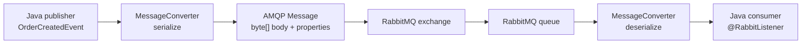
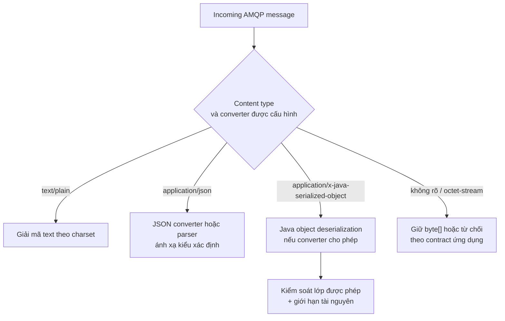
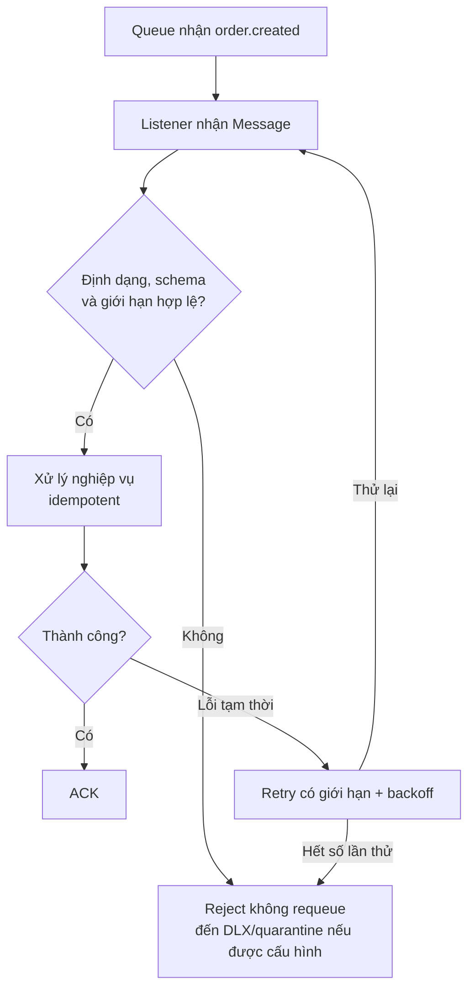

# Rủi ro Java serialization và giới hạn đối tượng được phép giải tuần tự trong Spring AMQP

Khi dùng **RabbitMQ với Spring AMQP**, một ứng dụng có thể gửi object qua `RabbitTemplate` và nhận object bằng `@RabbitListener`. Tuy nhiên, object Java không thể đi nguyên dạng qua mạng: publisher phải **chuyển object thành byte** (*serialization*), còn consumer phải **đọc byte và dựng lại dữ liệu** (*deserialization*).

Nếu sử dụng **Java native serialization** với các đối tượng `Serializable`, thao tác giải tuần tự có thể dựng một đồ thị đối tượng phức tạp và kích hoạt hành vi không mong muốn. Khi consumer nhận dữ liệu từ nguồn không hoàn toàn tin cậy, đó là một ranh giới an toàn cần được kiểm soát chặt chẽ. Spring AMQP có những cơ chế giới hạn lớp được phép giải tuần tự; dù vậy, với hợp đồng message giữa các service, lựa chọn đơn giản và dễ kiểm soát hơn thường là **JSON hoặc một định dạng có schema rõ ràng**, được ánh xạ vào kiểu dữ liệu xác định.

Bài học thuộc chương **Chuyển đổi dữ liệu**. Bạn sẽ hiểu đường đi của payload, rủi ro Java deserialization, ý nghĩa của allowlist, cách chọn converter, cách xử lý message không hợp lệ và ảnh hưởng đến retry, dead-letter, xác nhận giao nhận và quan sát hệ thống.

Sau khi học, bạn có thể:

- Giải thích vì sao `Serializable` và Java object deserialization tiềm ẩn rủi ro.
- Nhận biết tình huống Spring AMQP có thể giải tuần tự Java object.
- Thiết lập nguyên tắc **chỉ cho phép các kiểu dữ liệu đã được kiểm soát**, hiểu giới hạn của allowlist.
- Tạo và nhận message JSON theo kiểu cụ thể, tránh tự động dựng lớp tùy ý từ metadata do sender cung cấp.
- Thiết kế xử lý **poison message** và kiểm chứng trước khi đưa vào production.

## 1. Serialization nằm ở đâu trong đường đi của RabbitMQ?

RabbitMQ AMQP 0-9-1 định tuyến message dựa trên **exchange, routing key và binding**. Broker thường coi body là dữ liệu byte, không cần tạo object Java để định tuyến. Chính **publisher và consumer** quyết định cách biểu diễn và đọc nội dung.



Một message Spring AMQP có hai phần quan trọng:

| Thành phần | Ví dụ | Ý nghĩa |
| --- | --- | --- |
| `body` | Byte của JSON hoặc Java serialized object | Nội dung thực tế được gửi |
| `contentType` | `application/json`, `text/plain`, `application/x-java-serialized-object` | Gợi ý converter dùng cách đọc body nào |
| `contentEncoding` | `UTF-8` | Quy ước encoding cho dữ liệu text |
| `type`, `messageId`, `correlationId` | `order.created`, `evt-1001` | Phân loại, truy dấu, liên kết message |
| `headers` | `schemaVersion=1` | Metadata bổ sung do ứng dụng cung cấp |

**`contentType` chỉ là metadata**, không phải một cơ chế xác thực đáng tin cậy. Một publisher lỗi hoặc bị chiếm quyền có thể gửi body không đúng kiểu đã khai báo. Consumer phải kiểm tra payload trong một ranh giới tin cậy phù hợp.

### 1.1. Ba cách gửi thường gặp

| Cách gửi | Cách chuyển đổi | Điểm cần kiểm soát |
| --- | --- | --- |
| `RabbitTemplate.send(exchange, key, Message)` | Ứng dụng đã tự tạo body byte và `MessageProperties` | Kiểu payload và giới hạn parse ở consumer |
| `RabbitTemplate.convertAndSend(exchange, key, Object)` | `MessageConverter` tạo `Message` từ object | Converter có thể dùng Java serialization, JSON hoặc cách khác |
| `@RabbitListener` nhận object Java | Listener adapter/converter chuyển message vào tham số phương thức | Không được để dữ liệu không tin cậy tạo arbitrary object graph |

Vì thế, thay đổi converter là **thay đổi hợp đồng dữ liệu** giữa publisher và consumer. Hai phía phải thống nhất định dạng, schema và kiểu dữ liệu được nhận.

## 2. Java native serialization khác JSON như thế nào?

**Java native serialization** dùng các API như `ObjectOutputStream` và `ObjectInputStream` để lưu/đọc đồ thị object Java. Một class thường triển khai `java.io.Serializable` để tham gia cơ chế này.

Ví dụ mô tả class có thể được gửi theo cách Java native serialization:

```java
import java.io.Serializable;

public class LegacyOrderEvent implements Serializable {
    private static final long serialVersionUID = 1L;

    private String orderId;
    private String eventType;

    public String getOrderId() { return orderId; }
    public String getEventType() { return eventType; }
}
```

Việc có `serialVersionUID` hỗ trợ một phần tương thích serialization giữa các phiên bản class, **không làm byte stream an toàn**, không thay thế kiểm tra dữ liệu và không giải quyết việc consumer đang chạy classpath khác.

### 2.1. Vấn đề không chỉ là “đọc sai dữ liệu”

Khi giải tuần tự Java object, runtime có thể phải tạo nhiều object, xử lý các hook/phương thức đặc biệt của serialization và tham chiếu bên trong đồ thị. Nếu classpath tồn tại chuỗi lớp hoặc hành vi nguy hiểm (*gadget chain*), dữ liệu được chế tạo có thể lợi dụng quá trình đó.

Các nhóm rủi ro cần nhận biết:

| Rủi ro | Cơ chế hoặc hậu quả |
| --- | --- |
| **Thực thi hành vi ngoài ý muốn** | Đồ thị object được dựng từ dữ liệu không đáng tin có thể kích hoạt hook/gadget trong thư viện có mặt trên classpath; tùy môi trường, hậu quả có thể nghiêm trọng đến thực thi mã |
| **Từ chối dịch vụ (DoS)** | Dữ liệu sâu, tham chiếu nhiều hoặc payload quá lớn làm tốn CPU, RAM hoặc thời gian parse |
| **Phụ thuộc classpath** | Consumer phải có các class Java tương thích; thay phiên bản thư viện/class có thể làm deserialization thất bại |
| **Rò rỉ cấu trúc nội bộ** | Byte Java serialization thể hiện chi tiết kiểu/class, làm hợp đồng message gắn chặt vào cấu trúc implementation |
| **Tương thích kém giữa ngôn ngữ** | Consumer viết Go, Python, Node.js... khó xử lý định dạng object serialization của Java |
| **Lỗi nghiệp vụ do dữ liệu giả mạo** | Dù deserialization thành công, trường object vẫn cần được validate và kiểm tra quyền |

Các lớp của Java hoặc thư viện thứ ba không nhất thiết “độc hại”. Vấn đề là **một chuỗi class hợp lệ có thể bị lạm dụng trong ngữ cảnh dữ liệu đầu vào không đáng tin**, và điểm yếu phụ thuộc chính xác phiên bản/runtime/library.

### 2.2. Vì sao broker nội bộ vẫn có rủi ro?

Không nên giả định mọi message trong RabbitMQ đều đáng tin chỉ vì broker nằm trong mạng nội bộ:

- Một producer khác có thể gửi nhầm định dạng.
- Credential RabbitMQ có thể bị lộ hoặc quyền publish được cấp quá rộng.
- Message tồn trong retry queue/DLQ có thể được đưa trở lại sau một lần triển khai mới.
- Thành phần tích hợp bên thứ ba có thể gửi dữ liệu không cùng mức tin cậy.
- Khi phát lại message cũ, schema và classpath của consumer có thể đã thay đổi.

**Giới hạn quyền RabbitMQ theo vhost/exchange, TLS và xác thực là những lớp bảo vệ cần có**, nhưng chúng không thay thế việc kiểm soát deserialization tại consumer.

## 3. Spring AMQP có thể kích hoạt Java deserialization khi nào?

Trong hệ sinh thái Spring Rabbit, `SimpleMessageConverter` thường được dùng cho các dạng dữ liệu đơn giản. Nó có thể xử lý:

- `String`: gửi dạng byte theo encoding và `contentType` của text.
- `byte[]`: gửi body như dãy byte.
- `Serializable`: sử dụng Java object serialization khi convert object hỗ trợ kiểu đó.

Khi một message được gắn `contentType` dạng **`application/x-java-serialized-object`**, converter có khả năng giải tuần tự Java object có thể chọn đường giải tuần tự tương ứng. `SerializerMessageConverter` cũng là một converter cần được kiểm tra khi ứng dụng dùng Java serialization/serializer cấu hình riêng.



**Không có nghĩa rằng RabbitMQ tự thực thi Java object.** Điểm nguy hiểm nằm ở client Java khi converter hoặc code chủ động mở luồng giải tuần tự. Nếu bạn gọi trực tiếp `new ObjectInputStream(...).readObject()`, việc đó cũng phải được kiểm soát, dù không đi qua converter của Spring.

Một số converter có cơ chế bảo vệ phiên bản cụ thể như **danh sách mẫu class được phép giải tuần tự** (*allowed list patterns*). Cách đặt property hoặc API chính xác cần đối chiếu tài liệu Spring AMQP **đúng phiên bản** mà dự án sử dụng.

## 4. Giới hạn class được phép giải tuần tự: allowlist

Allowlist trả lời câu hỏi: **class nào được phép xuất hiện trong dữ liệu Java serialized khi consumer dựng lại object?** Đây là lựa chọn an toàn hơn việc mặc định tin mọi class chỉ vì nó có trên classpath.

### 4.1. Cho phép tối thiểu theo hợp đồng

Ví dụ một hệ thống cũ buộc phải nhận `LegacyOrderEvent`. Nguyên tắc cấu hình:

```text
Đối tượng nghiệp vụ hợp lệ:
  com.example.orders.contract.LegacyOrderEvent

Class phụ trợ thực sự cần trong đồ thị:
  từng class cụ thể đã được kiểm tra theo dạng dữ liệu thực tế

Không chấp nhận:
  class bất kỳ ngoài hợp đồng
  wildcard toàn classpath
  class chỉ được chỉ định bởi header do publisher tự gắn
```

Trong Spring AMQP, khi dùng converter có hỗ trợ deserialization allowlist, hãy cấu hình **`allowedListPatterns`** theo class được phép và thử nghiệm cả trường hợp đúng/sai. Một số phiên bản cung cấp API theo dạng `setAllowedListPatterns(...)` hoặc `addAllowedListPatterns(...)`; xem JavaDoc của converter tương ứng thay vì giả định một API giống nhau ở mọi phiên bản.

Những quy tắc quan trọng:

1. **Bắt đầu từ tập class nhỏ nhất** mà message thực sự cần.
2. Ưu tiên tên class/nhóm package hợp đồng hẹp, tránh pattern tổng quát như `*` hoặc mọi package nội bộ.
3. Tính đến các class lồng nhau trong đồ thị serialized object; một object hợp lệ có thể chứa collection hoặc kiểu chuẩn khác.
4. Kiểm thử message từ các producer hợp lệ và **cố tình thử class không được phép**.
5. Khi thay đổi DTO hoặc thư viện, đánh giá lại allowlist trong cùng quy trình review hợp đồng dữ liệu.

### 4.2. Không bật “trust all” để chữa lỗi production

Các phiên bản Spring AMQP hỗ trợ Java deserialization có thể cung cấp cơ chế bỏ qua giới hạn lớp, ví dụ biến môi trường `SPRING_AMQP_DESERIALIZATION_TRUST_ALL` hoặc system property `spring.amqp.deserialization.trust.all`.

**Không bật giá trị trust-all cho production** chỉ vì consumer gặp exception khi đọc message mới. Làm vậy mở rộng vùng tin cậy ra toàn bộ class có trên classpath, và có thể che giấu việc hai bên chưa thống nhất định dạng hoặc schema.

Thay vào đó:

- Xác minh publisher có đang gửi đúng contract không.
- Kiểm tra `contentType`, body và converter được cấu hình trên consumer.
- Xác minh class thực sự cần nằm trong tập cho phép; xem có serialized object lồng nhau không.
- Nếu dữ liệu cũ không còn tương thích, tạo bước migration hoặc adapter có kiểm soát.
- Ưu tiên bỏ Java native serialization nếu đang thiết kế hợp đồng mới.

### 4.3. Allowlist là một lớp bảo vệ, không phải giấy phép an toàn tuyệt đối

Ngay cả khi một class nằm trong allowlist, object giải tuần tự **vẫn cần được validate**. Một class được phép có thể có dữ liệu vô lý, dung lượng quá lớn, hoặc hành vi nguy hiểm trong quá trình dựng object nếu code của nó không an toàn.

Các biện pháp bổ sung gồm giới hạn kích thước message, số phần tử, độ sâu đồ thị, số tham chiếu, timeout và tài nguyên CPU/RAM. Với Java serialization, JDK cung cấp **serialization filter (`ObjectInputFilter`)** để kiểm soát kiểu và giới hạn đồ thị theo ngữ cảnh; phải kiểm chứng cơ chế filter thực sự áp dụng cho đường deserialization đang dùng.

**Không cần có gadget chain mới có DoS.** Một payload chứa cấu trúc được phép nhưng quá lớn cũng có thể làm ứng dụng chậm hoặc hết bộ nhớ.

## 5. Khác biệt giữa allowlist Java serialization và trusted packages của JSON

Hai khái niệm này dễ bị nhầm vì đều liên quan đến tên class.

| Cơ chế | Được áp dụng khi nào? | Chặn điều gì? |
| --- | --- | --- |
| **Java deserialization allowlist** | Khi converter đọc Java serialized byte stream | Class ngoài tập cho phép trong đồ thị object Java |
| **Trusted packages của JSON type mapper** | Khi JSON converter dùng type metadata để chọn Java class | Package/class không được tin cậy để ánh xạ từ metadata |
| **Deserialize JSON vào DTO cố định** | Code cung cấp class đích tường minh, ví dụ `OrderCreatedEvent.class` | Không cho message tự chọn class Java tùy ý; vẫn phải validate dữ liệu |
| **Schema validation** | Sau hoặc trong khi parse payload | Trường thiếu, sai kiểu, sai ràng buộc nghiệp vụ |

Một converter JSON như `Jackson2JsonMessageConverter` (ở các phiên bản Spring AMQP sử dụng tên này) có khả năng dùng type header và bộ ánh xạ kiểu. Những phiên bản khác có thể dùng class converter mới hơn. Vì thế cần phân biệt:

- **JSON parser** đọc nội dung JSON thành object Java theo contract.
- **Type mapping** có thể sử dụng thông tin kiểu từ sender nếu cấu hình cho phép.
- **Java native serialization** đọc byte stream theo cơ chế Java Object Serialization, là một định dạng khác hoàn toàn.

Chỉ thiết lập trusted packages của JSON converter **không thay thế** allowlist khi ở một chỗ khác của ứng dụng vẫn có `ObjectInputStream` hoặc converter Java serialization.

### 5.1. Hạn chế type metadata do sender điều khiển

Với các sự kiện nghiệp vụ, nên dùng lớp DTO tường minh và có phạm vi:

```java
public record OrderCreatedEvent(
        String eventId,
        String orderId,
        int schemaVersion
) {}
```

Consumer đọc payload bằng **`OrderCreatedEvent.class`**. Khi đó sender không được quyền quyết định tùy ý class Java chỉ bằng một header như `__TypeId__`. Với Jackson, không nên bật default typing/polymorphic deserialization rộng cho dữ liệu không đáng tin, nhất là khi type identifier được nhận từ message.

Đây là nguyên tắc tổng quát: **kiểu dữ liệu được chấp nhận là quyết định của consumer và hợp đồng đã được duyệt**, chứ không phải một yêu cầu tự do từ payload.

## 6. Ví dụ an toàn hơn: gửi và nhận JSON với DTO rõ ràng

Ví dụ sử dụng định dạng JSON và đọc vào DTO cố định. Để tránh phụ thuộc API converter thay đổi giữa các thế hệ Spring AMQP, ta chủ động dùng `ObjectMapper` cho JSON và truyền `Message` đã có byte body qua `RabbitTemplate.send(...)`.

Giả định project có Spring AMQP và Jackson, đã cấu hình `RabbitTemplate`, `@RabbitListener`, connection đến broker và đúng quyền trên vhost. Mã dưới đây minh họa theo Java 17+.

### 6.1. Định nghĩa contract

```java
public record OrderCreatedEvent(
        String eventId,
        String orderId,
        int schemaVersion
) {}
```

Trong hệ thống thực tế, nên bổ sung các trường nghiệp vụ cần thiết và validation. Event ID phải giữ **ổn định khi gửi lại cùng một sự kiện**, phục vụ idempotency ở consumer.

### 6.2. Khai báo exchange, queue và binding

```java
import org.springframework.amqp.core.Binding;
import org.springframework.amqp.core.BindingBuilder;
import org.springframework.amqp.core.Queue;
import org.springframework.amqp.core.QueueBuilder;
import org.springframework.amqp.core.TopicExchange;
import org.springframework.context.annotation.Bean;
import org.springframework.context.annotation.Configuration;

@Configuration
public class OrderMessagingConfig {
    public static final String EXCHANGE = "orders.events";
    public static final String QUEUE = "orders.created";
    public static final String KEY = "order.created";

    @Bean
    public TopicExchange eventsExchange() {
        return new TopicExchange(EXCHANGE, true, false);
    }

    @Bean
    public Queue eventsQueue() {
        return QueueBuilder.durable(QUEUE).build();
    }

    @Bean
    public Binding eventsBinding(
            Queue eventsQueue,
            TopicExchange eventsExchange) {
        return BindingBuilder.bind(eventsQueue)
                .to(eventsExchange)
                .with(KEY);
    }
}
```

`RabbitAdmin` có thể khai báo các bean topology này khi được cấu hình phù hợp. Queue/exchange/binding chỉ tồn tại trong **virtual host của connection**. Đảm bảo producer và consumer kết nối cùng vhost và user có quyền cần thiết.

### 6.3. Publisher: chuyển DTO thành JSON byte và gửi Message

```java
import com.fasterxml.jackson.core.JsonProcessingException;
import com.fasterxml.jackson.databind.ObjectMapper;
import java.nio.charset.StandardCharsets;
import org.springframework.amqp.core.Message;
import org.springframework.amqp.core.MessageBuilder;
import org.springframework.amqp.core.MessageDeliveryMode;
import org.springframework.amqp.core.MessageProperties;
import org.springframework.amqp.rabbit.core.RabbitTemplate;
import org.springframework.stereotype.Service;

@Service
public class OrderEventPublisher {
    private final RabbitTemplate rabbitTemplate;
    private final ObjectMapper objectMapper;

    public OrderEventPublisher(
            RabbitTemplate rabbitTemplate,
            ObjectMapper objectMapper) {
        this.rabbitTemplate = rabbitTemplate;
        this.objectMapper = objectMapper;
    }

    public void publishCreated(OrderCreatedEvent event)
            throws JsonProcessingException {
        byte[] json = objectMapper.writeValueAsBytes(event);

        Message message = MessageBuilder.withBody(json)
                .setContentType(MessageProperties.CONTENT_TYPE_JSON)
                .setContentEncoding(StandardCharsets.UTF_8.name())
                .setType("order.created")
                .setMessageId(event.eventId())
                .setDeliveryMode(MessageDeliveryMode.PERSISTENT)
                .setHeader("schemaVersion", event.schemaVersion())
                .build();

        rabbitTemplate.send(
                OrderMessagingConfig.EXCHANGE,
                OrderMessagingConfig.KEY,
                message);
    }
}
```

Ở đây, body là JSON do `ObjectMapper` tạo ra, không phải dữ liệu từ `ObjectOutputStream`. `contentType=application/json` mô tả đúng định dạng, còn `messageId` và `schemaVersion` hỗ trợ kiểm tra hợp đồng.

**Gọi `send(...)` trả về không có nghĩa broker đã giữ message bền vững hoặc consumer đã hoàn tất.** Nếu cần xác nhận, publisher phải xử lý publisher confirm/return theo cấu hình Spring AMQP phù hợp.

### 6.4. Consumer: từ chối sai định dạng, parse đúng kiểu

```java
import com.fasterxml.jackson.databind.ObjectMapper;
import java.io.IOException;
import org.springframework.amqp.core.Message;
import org.springframework.amqp.core.MessageProperties;
import org.springframework.amqp.rabbit.annotation.RabbitListener;
import org.springframework.stereotype.Component;

@Component
public class OrderCreatedConsumer {
    private final ObjectMapper objectMapper;

    public OrderCreatedConsumer(ObjectMapper objectMapper) {
        this.objectMapper = objectMapper;
    }

    @RabbitListener(queues = OrderMessagingConfig.QUEUE)
    public void onMessage(Message incoming) throws IOException {
        MessageProperties props = incoming.getMessageProperties();

        if (!MessageProperties.CONTENT_TYPE_JSON
                .equals(props.getContentType())) {
            throw new IllegalArgumentException(
                    "Unsupported content type: " + props.getContentType());
        }

        OrderCreatedEvent event = objectMapper.readValue(
                incoming.getBody(), OrderCreatedEvent.class);

        if (event.eventId() == null || event.eventId().isBlank()
                || event.orderId() == null || event.orderId().isBlank()
                || event.schemaVersion() != 1) {
            throw new IllegalArgumentException("Invalid event contract");
        }

        // Trong ứng dụng thật, ghi nhận event ID/idempotency cùng
        // giao dịch dữ liệu nghiệp vụ trước khi hoàn tất listener.
        System.out.println("Handle order: " + event.orderId());
    }
}
```

Điểm cốt lõi: consumer **không giải tuần tự một Java object tùy ý**. Nó đọc JSON vào `OrderCreatedEvent.class` rồi kiểm tra ràng buộc. Đối với payload quá lớn, cần bổ sung **giới hạn kích thước trước khi parse** và cấu hình giới hạn parser phù hợp.

Để sử dụng `@RabbitListener` với tham số DTO trực tiếp, có thể cấu hình JSON `MessageConverter` được kiểm soát. Khi đó cần xác định rõ converter cho listener container, type mapper và quy tắc trusted packages theo phiên bản Spring AMQP. Ví dụ ở đây dùng `Message` để mô tả tường minh ranh giới deserialization.

### 6.5. Cấu hình kết nối RabbitMQ

```yaml
# application.yml
spring:
  rabbitmq:
    host: ${RABBITMQ_HOST:localhost}
    port: ${RABBITMQ_PORT:5672}
    virtual-host: ${RABBITMQ_VHOST:/orders}
    username: ${RABBITMQ_USERNAME}
    password: ${RABBITMQ_PASSWORD}
    listener:
      simple:
        acknowledge-mode: auto
```

Cấu hình này giả định vhost `/orders` đã tồn tại. Trong chế độ `AUTO` của Spring listener container, ACK được phát sau khi listener xử lý thành công theo chính sách container. Nó không phải `autoAck=true` của giao thức AMQP.

Khi listener ném lỗi vì JSON sai hoặc schema không hỗ trợ, hành vi retry, requeue hay chuyển DLX **phụ thuộc cấu hình xử lý lỗi**, không được quyết định chỉ bởi `ObjectMapper`. Trong hệ thống cần tin cậy, phải có chính sách rõ ràng cho dữ liệu **không thể sửa bằng cách retry**.

## 7. Nếu phải duy trì Java serialization cũ thì làm gì?

Không phải mọi hệ thống có thể đổi định dạng ngay. Nếu có producer/consumer legacy đang sử dụng Java serialization, hãy thiết kế một giai đoạn thu hẹp bề mặt rủi ro.

### 7.1. Cố định đường nhận dữ liệu legacy

Thay vì để mọi listener đọc mọi loại message:

1. Dùng **queue/vhost riêng** cho message legacy khi phù hợp, hạn chế publisher có quyền gửi.
2. Tách listener legacy khỏi service xử lý dữ liệu mới; giảm các thư viện không cần thiết trên classpath của thành phần giải tuần tự.
3. Chỉ chấp nhận `contentType` mong đợi; kiểm tra kích thước và nguồn dữ liệu trước khi gọi converter.
4. Áp dụng **allowlist class** ở converter có cơ chế Java deserialization; không bật trust-all.
5. Kiểm tra object sau giải tuần tự, bao gồm trường bắt buộc, độ dài và giá trị nghiệp vụ.
6. Đặt giới hạn retry và chuyển message không hợp lệ sang DLQ/quarantine để xem xét.
7. Lập lộ trình cho publisher gửi JSON/schema mới, consumer hỗ trợ hai phiên bản trong thời gian chuyển đổi có kiểm soát rồi tắt legacy.

### 7.2. Không kiểm tra an toàn bằng cách deserialize thử

Đừng lấy một message chưa tin cậy, gọi `ObjectInputStream.readObject()` rồi mới xem class có nằm trong allowlist hay không. **Lúc kiểm tra object sau khi tạo, hành vi nguy hiểm có thể đã xảy ra.**

Việc giới hạn class phải được áp dụng **trong quá trình deserialization** ở converter/serialization filter. Kiểm tra object sau đó là một lớp bổ sung, không thay thế cơ chế lọc trước khi dựng đồ thị.

### 7.3. Giới hạn tài nguyên

Đặt hạn mức kích thước/độ sâu/số tham chiếu ở lớp thích hợp, giới hạn kích thước message trước khi parse và kiểm soát thời gian xử lý. Chẳng hạn một cấu trúc hợp lệ nhưng chứa hàng triệu phần tử vẫn có thể gây DoS.

Lưu ý cấu hình `ObjectInputFilter` của JVM và danh sách lớp cho phép trong Spring có thể là **hai cơ chế khác nhau**; cần xác minh chúng phối hợp đúng trong phiên bản runtime, thư viện và đường convert đang chạy. Không có một danh sách chuỗi mẫu có thể thay thế việc thử nghiệm với dữ liệu thực.

## 8. Xử lý poison message, retry và dead-letter

**Poison message** là message liên tục gây lỗi xử lý do định dạng, schema hoặc dữ liệu không hợp lệ. Retry vô hạn thường không chữa được trường hợp này.



| Loại lỗi | Ví dụ | Hướng xử lý thích hợp |
| --- | --- | --- |
| **Lỗi contract** | Gửi Java serialized bytes vào queue chỉ nhận JSON; schema version lạ | Từ chối, ghi nhận, cách ly/DLQ; không retry nóng |
| **Lỗi validation** | Thiếu `orderId`, payload vượt giới hạn | Từ chối theo chính sách; không log payload nhạy cảm |
| **Lỗi tạm thời** | Database hoặc dịch vụ ngoài gián đoạn | Retry có giới hạn và backoff; quản lý ACK/requeue |
| **Lỗi lập trình** | Null pointer hoặc xử lý enum chưa đầy đủ | Điều tra, sửa code; tránh vòng lặp không giới hạn |
| **Trùng message** | Publisher gửi lại, consumer bị redelivery | Idempotency theo event ID/khóa nghiệp vụ |

Để một message thực sự đến DLQ, queue chính phải có **dead-letter exchange và binding phù hợp** (hoặc cơ chế quarantine được triển khai rõ). Chỉ `throw exception` từ listener **không tự bảo đảm** message đã được gửi vào DLQ; default error handler, retry interceptor và policy requeue quyết định phản hồi cuối cùng.

Đối với conversion exception, lỗi có thể xảy ra **trước khi method `@RabbitListener` được gọi**, nhất là khi listener nhận DTO thay vì `Message`. Hãy cấu hình error handler của container và observability để thu thập lỗi ở đúng lớp, thay vì chỉ đặt `try/catch` trong method listener rồi nghĩ rằng đã bao phủ mọi lỗi deserialize.

**Không xử lý message không tin cậy bằng cách thêm class vào allowlist mỗi khi thấy exception.** Hãy xác minh nguồn gốc, contract và nhu cầu trước khi nới quyền.

## 9. Thực hành kiểm chứng ranh giới deserialization

Dưới đây là các thử nghiệm có thể thực hiện trong môi trường RabbitMQ riêng dành cho học tập. Mỗi thử nghiệm nên quan sát **publish, routing, conversion, consumer ACK và DLQ** như các bước khác nhau.

### 9.1. Các tình huống cần thử

| Tình huống | Input / thao tác | Kỳ vọng |
| --- | --- | --- |
| **JSON hợp lệ** | Gửi `OrderCreatedEvent` version 1 với `contentType=application/json` | Listener parse vào DTO cố định, validate và xử lý |
| **Content type không hợp lệ** | Body JSON nhưng `contentType=application/x-java-serialized-object` | Consumer JSON-only từ chối trước khi gọi Java deserialization |
| **Malformed JSON** | Body thiếu dấu đóng JSON | Parser báo lỗi; policy dành cho message lỗi phát huy tác dụng |
| **Schema lạ** | `schemaVersion=999` | Consumer từ chối hợp đồng không hỗ trợ |
| **Thiếu trường bắt buộc** | `orderId` rỗng | Validation thất bại |
| **Java serialized class được phép** | Message legacy hợp lệ với allowlist hẹp | Chỉ được parse bởi listener legacy đã kiểm soát |
| **Java serialized class không được phép** | Một class ngoài allowlist được gửi tới listener legacy | Deserialization bị chặn trong converter |
| **Message lớn / cấu trúc sâu** | Payload vượt hạn mức | Bị từ chối hoặc cách ly theo giới hạn cấu hình, không làm cạn bộ nhớ |
| **Redelivery** | Consumer lỗi sau side effect nhưng trước ACK | Idempotency ngăn thực hiện nghiệp vụ hai lần |

### 9.2. Quan sát RabbitMQ

Chọn đúng virtual host, ví dụ `/orders`, rồi kiểm tra topology và backlog:

```bash
rabbitmqctl list_exchanges -p /orders name type
rabbitmqctl list_queues -p /orders name messages_ready messages_unacknowledged consumers
rabbitmqctl list_bindings -p /orders source_name destination_name routing_key
```

Trong Management UI, theo dõi queue depth, unacked message, redelivery và DLQ. Lưu ý các chỉ số broker **không cho biết mọi lý do ứng dụng từ chối deserialize**; cần log và metrics phía consumer để nhìn thấy conversion/validation errors. Không log toàn bộ byte stream Java serialized hoặc body chứa dữ liệu cá nhân vào hệ thống log chỉ để debug.

### 9.3. Một số lỗi thường gặp

| Triệu chứng | Khả năng nguyên nhân | Cách kiểm tra |
| --- | --- | --- |
| `InvalidClassException` khi nhận legacy payload | Class bị chặn, class version không tương thích hoặc serialVersionUID không khớp | Đọc stack trace có kiểm soát, class allowlist và phiên bản producer/consumer |
| `ClassNotFoundException` | Consumer không có class mà byte stream tham chiếu | Kiểm tra hợp đồng và classpath; tránh tự tải class từ dữ liệu ngoài |
| JSON parse error dù body đọc được | Schema hoặc content type không thống nhất | Kiểm tra payload, type mapping, encoding và converter |
| Listener không được gọi | Exception xảy ra ở converter trước khi dispatch vào method | Kiểm tra listener container error handler và converter |
| Message bị xử lý lặp | Listener retry/requeue hoặc publisher gửi lại | Event ID, ACK, policy retry và DLQ |
| Không thấy message trong DLQ | DLX chưa khai báo, binding sai hoặc lỗi đang được requeue | Kiểm tra queue arguments/policies, error handling và routing |
| Tăng tiêu thụ CPU/RAM khi nhận payload | Payload quá lớn, parse sâu hoặc nhiều object | Giới hạn kích thước/độ sâu, metrics, cấu hình consumer |

## 10. Checklist khi thiết kế chuyển đổi dữ liệu

- [ ] Chọn định dạng trao đổi rõ ràng: JSON hoặc serialization có schema được kiểm soát cho hợp đồng mới.
- [ ] Xác định converter thực sự được dùng bởi `RabbitTemplate` và listener container.
- [ ] Không mặc định cho phép Java native deserialization từ mọi queue và mọi publisher.
- [ ] Nếu phải giữ legacy serialization, đặt **allowlist class hẹp** tại điểm deserialize và không bật trust-all.
- [ ] Phân biệt Java deserialization allowlist với JSON trusted packages/type mapper.
- [ ] Ưu tiên DTO cụ thể; không cho sender tự quyết định arbitrary Java class thông qua header.
- [ ] Giới hạn kích thước body, độ sâu/số phần tử và tài nguyên parse phù hợp.
- [ ] Validate schema và các trường nghiệp vụ sau khi đọc body.
- [ ] Có chính sách retry/quarantine/DLQ cho message không thể giải mã; tránh requeue vô hạn.
- [ ] Sử dụng event ID ổn định, idempotency, publisher confirms và consumer acknowledgements theo nhu cầu độ tin cậy.
- [ ] Kiểm tra quyền vhost/exchange, nguồn message và cách logging dữ liệu nhạy cảm.
- [ ] Thử với dữ liệu sai, class không được phép, payload lớn, redelivery và cả định dạng cũ trong giai đoạn migration.

**Ghi nhớ:** Rủi ro của Java serialization không đến từ exchange hay queue, mà ở bước **consumer biến byte không đáng tin thành đồ thị object Java**. Spring AMQP cho phép đặt ranh giới thông qua converter và allowlist, nhưng danh sách class được phép chỉ là một lớp phòng vệ. Với hệ thống mới, hãy dùng định dạng có schema, parse vào DTO xác định, validate dữ liệu và phối hợp retry/DLQ, ACK, idempotency, transaction nghiệp vụ cùng khả năng quan sát để xây xử lý bất đồng bộ đáng tin cậy.

### Tài liệu tham khảo

- [Spring AMQP Reference — Message Converters](https://docs.spring.io/spring-amqp/reference/amqp/message-converters.html)
- [Spring AMQP Reference — RabbitTemplate](https://docs.spring.io/spring-amqp/reference/amqp/template.html)
- [Spring AMQP Reference — Listener Exception Handling](https://docs.spring.io/spring-amqp/reference/amqp/exception-handling.html)
- [Spring AMQP Reference — Message Converters API](https://docs.spring.io/spring-amqp/api/org/springframework/amqp/support/converter/package-summary.html)
- [Oracle — Serialization Filtering](https://docs.oracle.com/en/java/javase/17/core/serialization-filtering1.html)
- [RabbitMQ — Consumer Acknowledgements and Publisher Confirms](https://www.rabbitmq.com/docs/confirms)
- [RabbitMQ — Dead Letter Exchanges](https://www.rabbitmq.com/docs/dlx)

