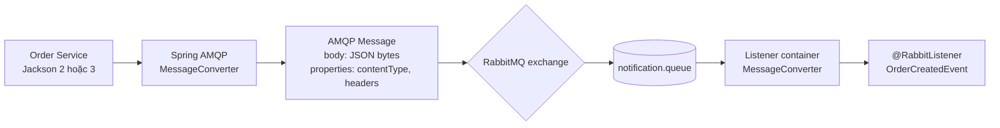
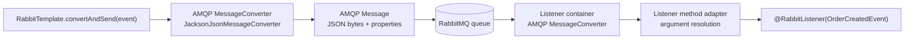
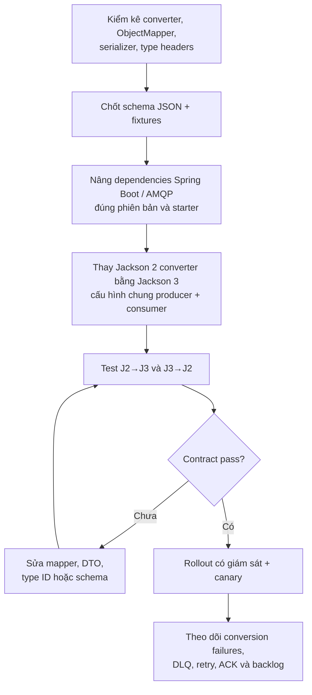
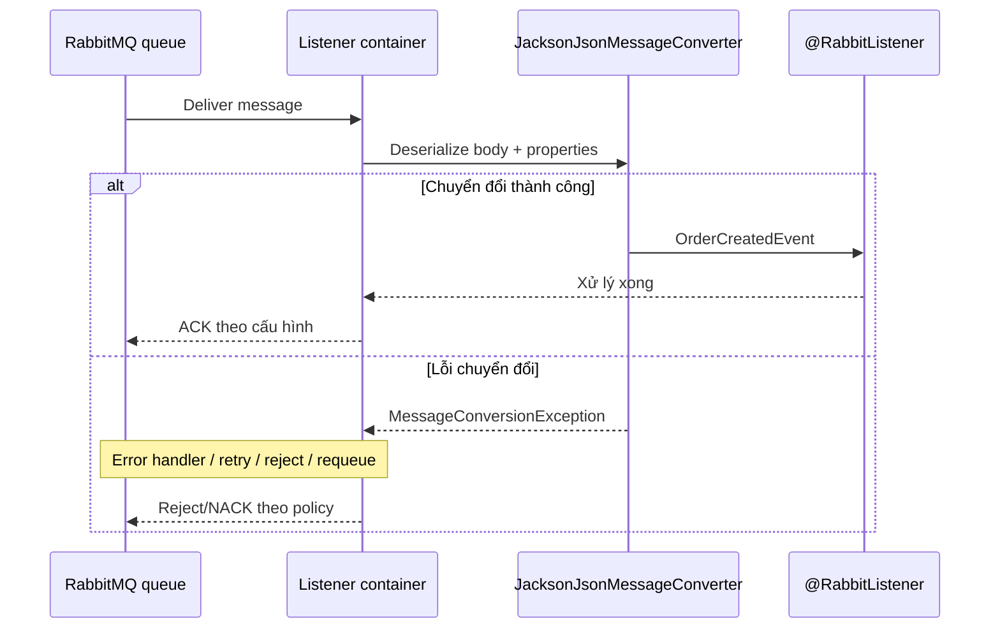

# Chuyển đổi Jackson 2 sang Jackson 3 khi nâng cấp Spring AMQP

Trong một hệ thống RabbitMQ, hai ứng dụng có thể cùng gửi và nhận JSON nhưng sử dụng các phiên bản thư viện Java khác nhau. Vì vậy, khi nâng cấp Spring AMQP từ nhánh 3.x lên 4.x và chuyển từ **Jackson 2** sang **Jackson 3**, mục tiêu không chỉ là đổi tên lớp converter để chương trình biên dịch. Ta còn phải giữ ổn định **hợp đồng dữ liệu trên message**, bao gồm JSON body, `contentType`, type headers và cách listener chọn kiểu Java cần deserialize.

Bài thuộc chương **Chuyển đổi dữ liệu** của module **SPRING_AMQP**. Bạn sẽ học cách thay `Jackson2JsonMessageConverter` bằng `JacksonJsonMessageConverter`, cấu hình producer dùng `RabbitTemplate` và consumer dùng `@RabbitListener`, xử lý khác biệt Jackson 3, rồi kiểm chứng việc trao đổi message khi triển khai các phiên bản ứng dụng song song. Các bước cuối cũng liên hệ đến publisher confirms, retry, dead-letter, transaction, idempotency và khả năng quan sát.

**Kết quả cần đạt sau bài học:**

1. Xác định đúng thay đổi giữa Spring AMQP 3.x, 4.x và các phiên bản Spring Boot liên quan.
2. Nhận diện các API Jackson 2 phải thay thế, cùng ngoại lệ về package của Jackson annotations.
3. Cấu hình `JacksonJsonMessageConverter` cho cả `RabbitTemplate` và listener.
4. Hiểu sự khác biệt giữa chuyển đổi AMQP message và chuyển đổi tham số phương thức `@RabbitListener`.
5. Xử lý type headers và kiểm thử tương thích JSON khi producer/consumer nâng cấp khác thời điểm.
6. Đưa ra quy trình rollout và rollback giúp hạn chế lỗi deserialize gây retry vô hạn hoặc mất message.

## 1. Tại sao nâng cấp JSON converter phải được xem là thay đổi giao thức dữ liệu?

Giả sử Order Service đang dùng Spring Boot 3 và Spring AMQP 3 để gửi một sự kiện:

```json
{
  "eventId": "evt-104",
  "orderId": "order-42",
  "schemaVersion": 1
}
```

Notification Service đọc sự kiện đó để gửi thông báo. Khi Order Service được nâng cấp lên Spring Boot 4 và Jackson 3, body có thể vẫn giống hệt. Tuy nhiên, phần **message properties** và quy tắc deserialize có thể thay đổi:



RabbitMQ không hiểu Java record, `ObjectMapper` hoặc `JsonMapper`. Broker định tuyến và lưu message gồm **bytes + metadata**. Vì vậy:

- **API compatibility**: mã Java có import, constructor và kiểu mapper phù hợp với Jackson 3 hay không?
- **Wire compatibility**: JSON và header mà producer phát ra còn được consumer cũ/mới hiểu hay không?
- **Semantic compatibility**: consumer có diễn giải các giá trị, ngày giờ, số, enum, null và phiên bản schema giống trước không?
- **Operational compatibility**: nếu chuyển đổi thất bại, message có được đưa đến DLQ và có thể điều tra/phát lại không?

Một lần nâng cấp thành công cần xác minh đủ bốn mặt này. Việc producer gọi `convertAndSend(...)` không ném exception chưa chứng minh consumer đã deserialize thành công.

## 2. Nắm rõ phiên bản trước khi sửa dependency

Hệ sinh thái Spring chuyển Jackson 3 thành lựa chọn mặc định trong thế hệ Spring Framework 7 / Spring Boot 4; Spring AMQP 4 cung cấp các converter mới sử dụng Jackson 3. Spring AMQP 4.0 đánh dấu các converter Jackson 2 cũ là **deprecated for removal**.

| Môi trường | Tình trạng cần chú ý |
|---|---|
| Spring Boot 3.x + Spring AMQP 3.x | Thường dùng `Jackson2JsonMessageConverter`, Jackson 2 và `com.fasterxml.jackson.databind.ObjectMapper` |
| Spring Boot 4.0/4.1 + Spring AMQP 4.x | Hỗ trợ Jackson 3, dùng `JacksonJsonMessageConverter`; `spring-boot-starter-amqp` vẫn chỉ RabbitMQ AMQP 0-9-1 trong các phiên bản Boot này |
| Spring Boot 4.2 + Spring AMQP tương thích | Starter RabbitMQ AMQP 0-9-1 đổi thành **`spring-boot-starter-rabbitmq`**; `spring-boot-starter-amqp` nay dành cho **AMQP 1.0 generic**, không phải thay thế tương đương |
| Giai đoạn chuyển tiếp | Có thể tồn tại phụ thuộc Jackson 2 và 3 cùng lúc trong một số tổ hợp phiên bản, nhưng phải kiểm tra đúng module và tình trạng deprecation |

**Chú ý tới Spring Boot 4.2:** nếu bạn chỉ giữ dependency `spring-boot-starter-amqp` từ dự án cũ rồi nâng version lên Boot 4.2, bạn có thể đang nhận cơ chế AMQP 1.0 khác với mô hình `RabbitTemplate`/`@RabbitListener` qua RabbitMQ AMQP 0-9-1. Việc đổi converter Jackson và việc đổi **starter/protocol** là hai quyết định độc lập. Bài này sử dụng **RabbitMQ AMQP 0-9-1**.

Khi dùng Spring Boot BOM, hãy để Boot quản lý các version được hỗ trợ cùng nhau; tránh ép riêng một Spring AMQP 4.x hoặc Jackson 3 vào ứng dụng Boot 3 mà chưa kiểm tra ma trận tương thích.

### 2.1. Cấu hình dependency đúng cho bài thực hành

Với **Spring Boot 4.2.x** và RabbitMQ AMQP 0-9-1:

```groovy
dependencies {
    implementation 'org.springframework.boot:spring-boot-starter-rabbitmq'
    implementation 'org.springframework.boot:spring-boot-starter-json'
}
```

`spring-boot-starter-json` giúp bảo đảm tích hợp Jackson 3 và `JsonMapper` của Boot có mặt cho ví dụ bên dưới. Nếu đã có một web starter kéo theo phần này, hãy kiểm tra dependency tree để tránh khai báo không cần thiết.

Với **Spring Boot 4.0/4.1**, thay dòng starter RabbitMQ ở trên bằng:

```groovy
implementation 'org.springframework.boot:spring-boot-starter-amqp'
```

Đối với **Spring Boot 3.x**, cũng sử dụng `spring-boot-starter-amqp`, nhưng ví dụ converter Jackson 3 dưới đây dành cho **Spring AMQP 4.x** sau khi đã hoàn tất nâng cấp tương ứng.

> Trong một project thật, chọn **một** cấu hình starter theo phiên bản Spring Boot đang sử dụng. Hai đoạn Gradle trên là các phương án thay thế, không phải hai dependency cần thêm cùng lúc.

### 2.2. Những gì giữ nguyên

Các thành phần AMQP 0-9-1 sau không thay đổi ý nghĩa chỉ vì JSON chuyển từ Jackson 2 sang Jackson 3:

- `RabbitTemplate` vẫn publish tới exchange với routing key.
- `DirectExchange`, queue và binding vẫn quyết định đường đi của message.
- `@RabbitListener` vẫn xử lý delivery từ queue được chỉ định.
- Publisher confirms, returns, ACK/NACK, DLX và retry vẫn là các cơ chế giao nhận của Spring AMQP/RabbitMQ.
- RabbitMQ vẫn không deserialize JSON thành POJO thay ứng dụng.

Đổi Jackson ảnh hưởng **lớp chuyển đổi payload**, không thay đổi luật routing của broker.

## 3. Bảng chuyển đổi Jackson 2 sang Jackson 3

### 3.1. Các lớp Spring AMQP

| Trước đây (Jackson 2) | Sau khi chuyển sang Jackson 3 | Vai trò |
|---|---|---|
| `Jackson2JsonMessageConverter` | `JacksonJsonMessageConverter` | Chuyển POJO ↔ JSON message |
| `AbstractJackson2MessageConverter` | `AbstractJacksonMessageConverter` | Lớp cơ sở của converter |
| `Jackson2JavaTypeMapper` | `JacksonJavaTypeMapper` | Mapping thông tin kiểu Java sang AMQP headers |
| `DefaultJackson2JavaTypeMapper` | `DefaultJacksonJavaTypeMapper` | Triển khai mapping kiểu thông dụng |
| `Jackson2XmlMessageConverter` | `JacksonXmlMessageConverter` | Converter XML, nếu ứng dụng có sử dụng |

Các lớp ở cột mới thuộc package `org.springframework.amqp.support.converter`. Những tên API cũ đã bị đánh dấu deprecation trong Spring AMQP 4.0 và có thể bị loại bỏ ở thế hệ tiếp theo; tránh dựa vào chúng trong mã mới.

Ví dụ đổi import:

```java
// Trước nâng cấp:
import org.springframework.amqp.support.converter.Jackson2JsonMessageConverter;

// Sau nâng cấp:
import org.springframework.amqp.support.converter.JacksonJsonMessageConverter;
```

### 3.2. Jackson core/databind thay namespace

Jackson 3 thay nhiều group ID và package từ `com.fasterxml.jackson` sang `tools.jackson`:

| Jackson 2 | Jackson 3 |
|---|---|
| `com.fasterxml.jackson.databind.ObjectMapper` | Thường dùng `tools.jackson.databind.json.JsonMapper` |
| `com.fasterxml.jackson.databind.JsonNode` | `tools.jackson.databind.JsonNode` |
| `com.fasterxml.jackson.databind.module.SimpleModule` | `tools.jackson.databind.module.SimpleModule` |
| `com.fasterxml.jackson.core.JsonParser` | `tools.jackson.core.JsonParser` |
| `com.fasterxml.jackson.core.JsonGenerator` | `tools.jackson.core.JsonGenerator` |

**Ngoại lệ quan trọng:** Jackson annotations vẫn thuộc namespace `com.fasterxml.jackson.annotation` trong Jackson 3. Không thay toàn bộ import annotations bằng một package `tools.jackson.annotation` tự tưởng tượng.

Ví dụ:

```java
import com.fasterxml.jackson.annotation.JsonProperty;

// Annotation này vẫn nằm trong com.fasterxml.jackson.annotation.
public record OrderCreatedEvent(
        @JsonProperty("eventId") String eventId,
        @JsonProperty("orderId") String orderId,
        @JsonProperty("schemaVersion") int schemaVersion
) {}
```

Ngoài đổi package, Jackson 3 cũng có thay đổi API và giá trị mặc định. Với serializer/deserializer tùy biến, không chỉ sửa tên import: kiểm tra signature các phương thức, `JsonMapper` builder, module đăng ký và hành vi đọc/ghi JSON theo phiên bản thư viện thật.

### 3.3. JsonMapper của Spring Boot 4

Trong Spring Boot 4, Jackson 3 là JSON mapper mặc định; Boot cấu hình một bean kiểu **`tools.jackson.databind.json.JsonMapper`** khi dependency thích hợp có mặt.

Ví dụ inject nó:

```java
import org.springframework.stereotype.Component;
import tools.jackson.databind.json.JsonMapper;

@Component
public class JsonCodecProbe {
    public JsonCodecProbe(JsonMapper mapper) {
        // Mapper này thuộc Jackson 3, không phải ObjectMapper của Jackson 2.
    }
}
```

Nếu trước đó mã tự tạo `com.fasterxml.jackson.databind.ObjectMapper`, việc để dependency Jackson 2 song song có thể khiến cả hai loại mapper tồn tại. **Hai lớp có package khác nhau và không hoán đổi được cho nhau**. Constructor `JacksonJsonMessageConverter(JsonMapper)` yêu cầu mapper Jackson 3; không truyền `ObjectMapper` của Jackson 2 vào đó.

Spring Boot cung cấp thuộc tính chuyển tiếp:

```yaml
spring:
  jackson:
    use-jackson2-defaults: true
```

Thuộc tính này giúp cấu hình `JsonMapper` Jackson 3 với các giá trị mặc định gần hành vi Jackson 2 của Boot 3.x hơn. Nó **không biến Jackson 3 thành Jackson 2**, không đổi API converter và không bảo đảm JSON bytes giống hệt ở mọi cấu hình. Cần có bài kiểm thử đối chiếu cụ thể.

## 4. Hai tầng chuyển đổi của @RabbitListener

Trước khi sửa cấu hình, cần phân biệt **hai loại MessageConverter** trong Spring:

| Tầng | Interface/package | Nhiệm vụ |
|---|---|---|
| AMQP message conversion | `org.springframework.amqp.support.converter.MessageConverter` | `byte[]` + `MessageProperties` ↔ POJO hoặc loại payload khác |
| Messaging method argument conversion | `org.springframework.messaging.converter.MessageConverter` | Biến payload của Spring Messaging thành tham số phương thức listener nếu cần |

Với `RabbitTemplate.convertAndSend(...)`, converter AMQP tạo message body và properties trước khi publish.

Với `@RabbitListener`, listener container sử dụng converter AMQP để đọc message; cơ chế adapter sau đó giải quyết tham số phương thức. Trong các trường hợp thông thường, khai báo đúng **bean `JacksonJsonMessageConverter` cho Spring AMQP** là đủ để xử lý payload JSON thành tham số record/POJO cụ thể.



**Lỗi hay gặp:** tạo bean `org.springframework.messaging.converter.MappingJackson2MessageConverter` rồi tin rằng nó tự thay `Jackson2JsonMessageConverter` của RabbitMQ. Các converter thuộc hai abstraction khác nhau; trước hết hãy kiểm tra chính xác package của bean mà mình đang cấu hình.

## 5. Ví dụ tối thiểu: chuyển sang JacksonJsonMessageConverter

Phần này hướng tới **Spring Boot 4.2.x + RabbitMQ AMQP 0-9-1 + Spring AMQP tương ứng**. Nếu dùng Boot 4.0/4.1, thay starter theo mục 2 nhưng giữ ý tưởng cấu hình converter.

### 5.1. Chạy RabbitMQ để thử

Nếu máy có Docker, có thể chạy một broker học tập:

```bash
docker run -d --rm --name rabbitmq-jackson-migration -p 5672:5672 -p 15672:15672 -e RABBITMQ_DEFAULT_USER=demo -e RABBITMQ_DEFAULT_PASS=demo-local-only rabbitmq:4-management
```

Giao diện quản trị mặc định là `http://localhost:15672`; cổng AMQP là `5672`. Dùng `demo` / `demo-local-only` trong môi trường cá nhân; môi trường thật phải dùng secret, TLS và quyền truy cập giới hạn.

Cấu hình `application.yml`:

```yaml
spring:
  rabbitmq:
    host: localhost
    port: 5672
    username: demo
    password: demo-local-only
    publisher-confirm-type: correlated
    publisher-returns: true
    template:
      mandatory: true
```

Ba thuộc tính confirms/returns/mandatory được chuẩn bị để mở rộng kiểm chứng publish. Chúng **không** khiến HTTP/CLI tự đợi consumer hoàn tất và cũng chưa tự động làm ứng dụng xử lý callback xác nhận.

### 5.2. Định nghĩa dữ liệu sự kiện ổn định

Tạo file `OrderCreatedEvent.java` trong package `com.example.messaging`:

```java
package com.example.messaging;

import com.fasterxml.jackson.annotation.JsonProperty;

public record OrderCreatedEvent(
        @JsonProperty("eventId") String eventId,
        @JsonProperty("orderId") String orderId,
        @JsonProperty("schemaVersion") int schemaVersion
) {}
```

Một record có ba trường đơn giản giúp tập trung kiểm tra tương thích converter. Trong nghiệp vụ thật, nên bổ sung thời điểm phát sinh và thông tin cần thiết theo một **schema có version**, nhưng cần quyết định rõ định dạng ngày/giờ và tính tương thích trước khi thay đổi.

### 5.3. Đăng ký converter Jackson 3

Tạo `JsonMessagingConfiguration.java`:

```java
package com.example.messaging;

import org.springframework.amqp.support.converter.JacksonJsonMessageConverter;
import org.springframework.context.annotation.Bean;
import org.springframework.context.annotation.Configuration;
import tools.jackson.databind.json.JsonMapper;

@Configuration
public class JsonMessagingConfiguration {
    @Bean
    JacksonJsonMessageConverter jacksonJsonMessageConverter(JsonMapper mapper) {
        return new JacksonJsonMessageConverter(
                mapper,
                "com.example.messaging"
        );
    }
}
```

Điểm chính của ví dụ:

1. `JsonMapper` do Boot cung cấp, nên có thể chia sẻ quy tắc JSON đã cấu hình thay vì tạo một mapper tùy ý.
2. `JacksonJsonMessageConverter` là converter **Jackson 3** của Spring AMQP.
3. Chuỗi `"com.example.messaging"` là phạm vi package đáng tin cậy cho việc đọc type headers; không mặc định mở toàn bộ package chỉ để “chạy cho được”.

Với auto-configuration RabbitMQ của Spring Boot trong tình huống đơn giản, một bean AMQP `MessageConverter` được gắn với `RabbitTemplate` và factory của `@RabbitListener` mặc định. Nếu ứng dụng đã tự tạo template/factory hoặc có nhiều converter, cần kiểm tra bean thực tế được sử dụng và chỉ định đúng converter ở cả hai phía.

**Vấn đề bảo mật:** một số constructor mặc định của Jackson JSON converter có thể tin cậy mọi package khi xử lý thông tin type trong message. Đừng dùng chính sách tin cậy quá rộng cho message đến từ nguồn không kiểm soát; ưu tiên DTO/schema xác định trước, class mapping rõ ràng và giới hạn trusted packages.

### 5.4. Khai báo exchange, queue và binding

Tạo `OrderRoutes.java`:

```java
package com.example.messaging;

import org.springframework.amqp.core.Binding;
import org.springframework.amqp.core.BindingBuilder;
import org.springframework.amqp.core.DirectExchange;
import org.springframework.amqp.core.Queue;
import org.springframework.amqp.core.QueueBuilder;
import org.springframework.context.annotation.Bean;
import org.springframework.context.annotation.Configuration;

@Configuration
public class OrderRoutes {
    public static final String EXCHANGE = "orders.events";
    public static final String QUEUE = "orders.created.json.q";
    public static final String ROUTING_KEY = "order.created";

    @Bean
    DirectExchange ordersExchange() {
        return new DirectExchange(EXCHANGE, true, false);
    }

    @Bean
    Queue ordersJsonQueue() {
        return QueueBuilder.durable(QUEUE).build();
    }

    @Bean
    Binding orderCreatedBinding(
            Queue ordersJsonQueue,
            DirectExchange ordersExchange) {
        return BindingBuilder.bind(ordersJsonQueue)
                .to(ordersExchange)
                .with(ROUTING_KEY);
    }
}
```

Exchange, queue và binding được khai báo như trước khi chuyển Jackson. RabbitMQ định tuyến bằng routing key `order.created`, **không đọc trường `schemaVersion` trong JSON** và không dựa vào class Java của payload để quyết định queue.

### 5.5. Producer và consumer

Tạo `OrderPublisher.java`:

```java
package com.example.messaging;

import org.springframework.amqp.rabbit.core.RabbitTemplate;
import org.springframework.stereotype.Service;

@Service
public class OrderPublisher {
    private final RabbitTemplate rabbitTemplate;

    public OrderPublisher(RabbitTemplate rabbitTemplate) {
        this.rabbitTemplate = rabbitTemplate;
    }

    public void publish(OrderCreatedEvent event) {
        rabbitTemplate.convertAndSend(
                OrderRoutes.EXCHANGE,
                OrderRoutes.ROUTING_KEY,
                event
        );
    }
}
```

Tạo `OrderConsumer.java`:

```java
package com.example.messaging;

import org.springframework.amqp.rabbit.annotation.RabbitListener;
import org.springframework.stereotype.Component;

@Component
public class OrderConsumer {
    @RabbitListener(queues = OrderRoutes.QUEUE)
    public void onOrderCreated(OrderCreatedEvent event) {
        System.out.printf(
                "eventId=%s orderId=%s version=%d%n",
                event.eventId(),
                event.orderId(),
                event.schemaVersion()
        );
    }
}
```

Consumer nhận tham số cụ thể `OrderCreatedEvent`; Spring AMQP có thể suy luận kiểu từ tham số method-level `@RabbitListener` và chuyển JSON sang record đó. Việc suy luận có điều kiện: với nhiều tham số payload, kiểu abstract/interface, multi-method listener hoặc type headers riêng, cần kiểm tra cơ chế chọn kiểu như mục 6.

Để phát một sự kiện khi khởi động ứng dụng demo, tạo `DemoApplication.java`:

```java
package com.example.messaging;

import org.springframework.boot.CommandLineRunner;
import org.springframework.boot.SpringApplication;
import org.springframework.boot.autoconfigure.SpringBootApplication;
import org.springframework.context.annotation.Bean;

@SpringBootApplication
public class DemoApplication {
    public static void main(String[] args) {
        SpringApplication.run(DemoApplication.class, args);
    }

    @Bean
    CommandLineRunner publishExample(OrderPublisher publisher) {
        return args -> publisher.publish(
                new OrderCreatedEvent("evt-104", "order-42", 1)
        );
    }
}
```

Đặt các file trong cùng package `com.example.messaging` (hoặc package con thích hợp), chạy RabbitMQ rồi chạy ứng dụng Spring Boot.

Kết quả mong đợi:

```text
eventId=evt-104 orderId=order-42 version=1
```

Nếu listener chưa sẵn sàng, queue bền vững có thể giữ message để listener nhận sau khi khởi động, miễn là publish đã được broker tiếp nhận và topology/điều kiện lưu giữ phù hợp. Không coi log của producer là bằng chứng delivery đã hoàn tất.

### 5.6. Quan sát JSON thật trên đường truyền

Converter Jackson 3 tạo JSON bytes tương tự:

```json
{"eventId":"evt-104","orderId":"order-42","schemaVersion":1}
```

AMQP message còn có properties và header. Hãy xem ít nhất:

| Thuộc tính | Kỳ vọng / cách kiểm tra |
|---|---|
| Body | UTF-8 JSON có các tên trường và giá trị đã thỏa thuận |
| `contentType` | Thường là `application/json` |
| `contentEncoding` hoặc charset | Hiểu thống nhất cách giải mã UTF-8; có thể do converter/content type quyết định |
| `__TypeId__` | Có thể mang thông tin kiểu do converter tạo; **không phải định danh event nghiệp vụ** |
| Exchange/routing key | Đúng `orders.events` / `order.created` |
| `eventId` trong payload | Định danh nghiệp vụ để theo dõi và idempotency |
| Publisher confirm | Chỉ có ý nghĩa khi ứng dụng thực sự theo dõi kết quả confirm |

Từ giao diện quản trị RabbitMQ có thể xem queue và message properties. Khi consumer nhận nhanh, message có thể đã bị ACK trước khi bạn kịp xem; muốn kiểm tra message raw, dùng một queue thử nghiệm và tạm dừng consumer theo cách có kiểm soát.

## 6. Type headers: phần dễ vỡ khi nâng cấp phân tán

Một vấn đề đặc trưng của Spring AMQP Jackson converter là **type mapping**.

Khi gửi một object Java, converter có thể ghi header như `__TypeId__` để mô tả kiểu payload. Ví dụ producer cũ gửi:

```text
contentType: application/json
__TypeId__: com.legacy.order.events.OrderCreated
body: {"eventId":"evt-104","orderId":"order-42","schemaVersion":1}
```

Nếu consumer mới chỉ có lớp `com.example.messaging.OrderCreatedEvent`, việc phụ thuộc trực tiếp vào header tên lớp cũ có thể khiến quá trình chuyển đổi thất bại dù JSON hoàn toàn hợp lệ.

### 6.1. Suy luận từ tham số @RabbitListener

Với method-level `@RabbitListener` có một tham số payload kiểu **concrete**, converter có thể sử dụng kiểu suy luận từ phương thức. Trong nhiều trường hợp, kiểu suy luận được ưu tiên hơn thông tin Java class ở header.

```java
@RabbitListener(queues = OrderRoutes.QUEUE)
public void handle(OrderCreatedEvent event) {
    // Kiểu cụ thể được suy luận từ method argument.
}
```

Tuy nhiên, không nên suy diễn rằng mọi method đều được suy luận thành công. Cơ chế có điều kiện đối với số lượng tham số, annotation, kiểu `Object`, interface/abstract, collection và các adapter listener. Khi thay đổi từ cách đọc theo type header sang kiểu suy luận, hãy chạy lại test với chính các thông điệp cũ.

### 6.2. Dùng type ID ổn định thay cho tên class nội bộ

Một phương án giảm coupling giữa dịch vụ là ánh xạ ID ổn định sang kiểu Java:

```java
package com.example.messaging;

import java.util.Map;
import org.springframework.amqp.support.converter.DefaultClassMapper;
import org.springframework.amqp.support.converter.JacksonJsonMessageConverter;
import org.springframework.context.annotation.Bean;
import org.springframework.context.annotation.Configuration;

@Configuration
public class StableTypeMappingConfiguration {
    @Bean
    DefaultClassMapper eventClassMapper() {
        DefaultClassMapper mapper = new DefaultClassMapper();
        mapper.setIdClassMapping(Map.of(
                "order.created.v1", OrderCreatedEvent.class
        ));
        mapper.setTrustedPackages("com.example.messaging");
        return mapper;
    }

    // Dùng bean này THAY cho bean converter đơn giản ở mục 5.3.
    // Không đồng thời tạo hai bean converter AMQP mà không chỉ định rõ.
    @Bean
    JacksonJsonMessageConverter jacksonJsonMessageConverter(
            DefaultClassMapper eventClassMapper) {
        JacksonJsonMessageConverter converter =
                new JacksonJsonMessageConverter(
                        "com.example.messaging"
                );
        converter.setClassMapper(eventClassMapper);
        return converter;
    }
}
```

Trong ví dụ, định danh `order.created.v1` có thể giữ nguyên dù tên package/record nội bộ thay đổi. Để áp dụng được cho các dịch vụ khác, producer và consumer **phải cùng thống nhất mapping**. Lớp `DefaultClassMapper` và `JacksonJavaTypeMapper` cung cấp các khả năng khác nhau; chọn một chiến lược mapping có chủ đích thay vì trộn nhiều chiến lược chưa kiểm chứng.

**Cần chú ý:** đoạn cấu hình này dùng constructor không inject `JsonMapper` từ Boot để tập trung vào `ClassMapper`. Nếu ứng dụng có quy tắc Jackson custom, nên truyền cùng `JsonMapper` đã cấu hình và trusted packages vào constructor trước khi gọi `setClassMapper(...)`, ví dụ `new JacksonJsonMessageConverter(jsonMapper, "com.example.messaging")`. Tránh vô tình đổi cả mapper defaults khi chỉ muốn đổi type ID.

### 6.3. Trusted packages không phải bộ lọc tất cả dữ liệu xấu

Giới hạn trusted packages giúp giảm nguy cơ converter tạo các kiểu ngoài phạm vi mong đợi dựa trên type headers. Nhưng còn phải:

- Kiểm tra schema, định dạng và kích thước payload.
- Giới hạn danh sách event types ở mức nghiệp vụ, không tin tưởng tùy ý vào header do producer ngoài hệ thống gửi.
- Không bật default typing đa hình rộng của Jackson theo dữ liệu từ nguồn không đáng tin cậy.
- Không sử dụng Java native serialization để né chuyển đổi JSON.
- Theo dõi conversion failures và đưa message sai định dạng vào tuyến điều tra.

Khi dùng cùng kiểu message giữa nhiều ngôn ngữ hoặc nhiều phiên bản Java, nên ưu tiên **eventType/schemaVersion ở tầng hợp đồng**, còn tên Java class chỉ là chi tiết triển khai của consumer.

## 7. Khác biệt mặc định cần thử khi chuyển Jackson 2 → 3

Hai converter có thể tạo JSON giống nhau cho record đơn giản, nhưng ứng dụng thực tế thường có các kiểu dữ liệu phức tạp hơn.

| Khu vực | Rủi ro khi nâng cấp | Cách kiểm chứng |
|---|---|---|
| Ngày/giờ | ISO-8601 vs timestamp số, timezone, precision | Golden samples cho `Instant`, `LocalDateTime`, offset |
| Unknown fields | Consumer cũ/mới có thể chấp nhận hoặc từ chối trường mới khác nhau | Message có trường tương lai như `sourceSystem` |
| Null và default | Field không có, `null` và giá trị mặc định của primitive/record có ý nghĩa khác | Test thiếu/null/empty string |
| Enum | Đổi tên enum hoặc nhận giá trị chưa biết | Test giá trị mới từ producer |
| Number | Số nguyên lớn, precision decimal, coercion string → number | Test biên `long`, `BigDecimal` và dữ liệu không hợp lệ |
| Polymorphic payload | Header type hoặc discriminator không hợp lệ | Test abstract/interface và bảo mật mapping |
| Property naming | `snake_case` vs `camelCase` hoặc serializer tùy biến | So sánh JSON bytes theo contract |
| Collection/generics | Payload bị rơi về `Map`/`List` thay vì DTO | Test method target và nested type |
| Custom serializer | API Jackson 3 có signature khác hoặc module chưa được đăng ký | Biên dịch lại và chạy serialization fixtures |
| Content type | Consumer nhận `byte[]` thay vì POJO nếu metadata không phù hợp | Kiểm tra `contentType` / encoding |

Không nên coi bảng này là danh sách các hành vi **chắc chắn đã thay đổi** ở mọi project. Nó là danh sách rủi ro cần đo bằng test vì kết quả phụ thuộc cấu hình mapper, annotation, schema và dữ liệu thực tế.

### 7.1. Đọc thông điệp thiếu contentType

Jackson converter dùng `contentType` để xác định message có phù hợp để chuyển JSON hay không. Tài liệu Spring AMQP mô tả việc có thể giả định JSON khi `contentType` thiếu hoặc là `application/octet-stream` theo mặc định của converter, và có thuộc tính `assumeSupportedContentType` để thay đổi hành vi này.

**Đừng dựa vào fallback khi có quyền kiểm soát producer.** Hãy publish `contentType=application/json` và thống nhất encoding. Nếu hệ thống có producer ngoại bộ gửi raw bytes, cần thêm test thực tế với các message thiếu/sai contentType.

### 7.2. Record/POJO và inferred type

Với các record hoặc POJO cụ thể, method-level listener thường giúp framework suy luận kiểu. Với interface, lớp abstract hoặc collection phức tạp, hãy dùng chiến lược mapping phù hợp hoặc DTO bao bọc đơn giản. Tránh phụ thuộc vào tên class cũ trong header chỉ vì converter Jackson 2 trước đây tình cờ xử lý được.

### 7.3. ObjectMapper tùy biến và module đăng ký

Nếu trước đây code có:

```java
// Jackson 2: ví dụ dạng mã cũ
com.fasterxml.jackson.databind.ObjectMapper oldMapper =
        new com.fasterxml.jackson.databind.ObjectMapper();
```

thì chuyển sang Jackson 3 nên ưu tiên dùng `JsonMapper` do Spring Boot cấu hình hoặc builder Jackson 3 theo hợp đồng mới. Không bắt buộc tạo một `ObjectMapper` mới bằng tay cho từng converter; việc đó dễ làm lệch date/time module, naming policy và serializer.

Khi sử dụng custom Jackson serializers/deserializers, hãy đối chiếu API Jackson 3 thay vì sửa import hàng loạt. Trong Spring Boot 4, `@JacksonComponent` và các loại Jackson 3 như `ValueSerializer`/`ValueDeserializer` có API khác so với các kiểu quen thuộc ở Jackson 2.

## 8. Kiểm thử contract trước khi triển khai xen kẽ

Việc nâng cấp hai dịch vụ không nhất thiết diễn ra cùng lúc. Một chu kỳ release có thể tạo ra bốn tổ hợp:

| Producer | Consumer | Kiểm thử bắt buộc |
|---|---|---|
| Jackson 2 | Jackson 2 | Baseline đang chạy |
| Jackson 2 | Jackson 3 | Consumer mới đọc được message cũ |
| Jackson 3 | Jackson 2 | Consumer cũ đọc được message mới |
| Jackson 3 | Jackson 3 | Kết quả sau khi toàn bộ hệ thống nâng cấp |

**Luôn kiểm tra cả hai chiều** nếu không thể triển khai đồng thời. Producer mới vẫn có thể phát JSON hợp lệ nhưng vô tình thêm header type ID mà consumer cũ không hiểu; consumer mới vẫn có thể thất bại với message cũ còn nằm lâu trong queue.

### 8.1. Golden JSON fixtures

Lưu một bộ message mẫu đại diện, gồm cả **raw body** và **message properties**:

```text
fixtures/
  order-created-v1-body.json
  order-created-v1-properties.json
  order-created-v1-with-unknown-field.json
  order-created-v1-with-null.json
  order-created-v1-with-old-type-id.json
```

Ví dụ fixture body:

```json
{
  "eventId": "evt-104",
  "orderId": "order-42",
  "schemaVersion": 1,
  "sourceSystem": "legacy-order-service"
}
```

Một consumer hỗ trợ mở rộng schema cần xác định liệu có bỏ qua `sourceSystem` chưa biết hay từ chối, và phải giữ hành vi đó rõ ràng qua hai phiên bản mapper.

### 8.2. Test trực tiếp converter trong Java

Khi muốn test message **không có type header**, có thể dùng `DefaultClassMapper` để chỉ định kiểu đích và kiểm tra JSON fixture một cách tách biệt với RabbitMQ:

```java
import java.nio.charset.StandardCharsets;
import org.junit.jupiter.api.Test;
import org.springframework.amqp.core.Message;
import org.springframework.amqp.core.MessageProperties;
import org.springframework.amqp.support.converter.DefaultClassMapper;
import org.springframework.amqp.support.converter.JacksonJsonMessageConverter;
import tools.jackson.databind.json.JsonMapper;

import static org.junit.jupiter.api.Assertions.assertEquals;

class JsonConversionContractTest {

    @Test
    void readsLegacyJsonWithoutJavaTypeHeader() {
        JsonMapper mapper = new JsonMapper();
        JacksonJsonMessageConverter converter =
                new JacksonJsonMessageConverter(
                        mapper, "com.example.messaging"
                );

        DefaultClassMapper classMapper = new DefaultClassMapper();
        classMapper.setDefaultType(OrderCreatedEvent.class);
        classMapper.setTrustedPackages("com.example.messaging");
        converter.setClassMapper(classMapper);

        String json = """
                {"eventId":"evt-104","orderId":"order-42","schemaVersion":1}
                """;

        MessageProperties properties = new MessageProperties();
        properties.setContentType(MessageProperties.CONTENT_TYPE_JSON);

        Message message = new Message(
                json.getBytes(StandardCharsets.UTF_8),
                properties
        );

        OrderCreatedEvent actual =
                (OrderCreatedEvent) converter.fromMessage(message);

        assertEquals("evt-104", actual.eventId());
        assertEquals("order-42", actual.orderId());
        assertEquals(1, actual.schemaVersion());
    }
}
```

Đặt test và record `OrderCreatedEvent` trong cùng package hoặc import tương ứng. Nếu dự án dùng Boot test starter, thêm JUnit 5 theo cơ chế quản lý dependency của phiên bản Boot đó.

**Giới hạn của test này:** nó chỉ kiểm tra một JSON fixture và một cách mapping cụ thể. Không thay thế kiểm thử hai chiều với producer/consumer thật, type headers thực tế, charset, thời gian, số, metadata và hành vi của listener container khi lỗi.

### 8.3. Test tích hợp với RabbitMQ

Một test tích hợp có giá trị phải xác minh:

1. `RabbitTemplate` thật sự dùng converter Jackson 3 đã định nghĩa.
2. Exchange/queue/binding tồn tại; routing key đưa message đến queue mong đợi.
3. `@RabbitListener` nhận đúng DTO và xử lý thành công.
4. Khi gửi message cũ, consumer mới vẫn đọc được hoặc tạo lỗi rõ ràng theo contract.
5. Khi JSON sai/schema không hợp lệ, hệ thống không rơi vào vòng lặp retry vô hạn.
6. Publisher confirms, returns và consumer ACK có ý nghĩa riêng, được quan sát đúng.

Với dữ liệu quan trọng, nên kiểm tra cả **queue đã chứa message cũ trước thời điểm deploy**. Chỉ thử message mới ngay sau khi nâng cấp có thể bỏ sót lỗi từ backlog lịch sử.

## 9. Lập kế hoạch nâng cấp từng bước

Một trình tự giảm rủi ro:



### Bước 1 — Kiểm kê

Tìm các dấu hiệu trong dự án (sử dụng công cụ tìm kiếm code sẵn có):

```text
Jackson2JsonMessageConverter
AbstractJackson2MessageConverter
Jackson2JavaTypeMapper
DefaultJackson2JavaTypeMapper
com.fasterxml.jackson.databind
ObjectMapper
JsonSerializer / JsonDeserializer
__TypeId__
MessageConverter
RabbitTemplate
RabbitListenerContainerFactory
```

Cần phân loại đâu là converter AMQP, đâu là converter HTTP/REST hay Spring Messaging. Không thay hàng loạt tên lớp trong một module mà không kiểm tra tác động ở các module khác.

### Bước 2 — Chốt hợp đồng dữ liệu

Với mỗi event quan trọng, xác định:

- Tên event và version schema.
- Trường bắt buộc, trường tùy chọn và quy tắc thêm trường mới.
- Cách biểu diễn date/time, decimal, enum, null.
- `contentType` và encoding.
- Quy ước type header nếu dùng, ưu tiên định danh ổn định so với Java FQCN.
- Hành vi đối với message không biết version hoặc không thể parse.

### Bước 3 — Nâng dependency và sửa converter

Sử dụng dependency starter phù hợp với Spring Boot version. Thay converter Jackson 2 bằng converter Jackson 3. Inject `JsonMapper` được cấu hình, tái đăng ký serializer/module cần thiết và giới hạn trusted packages.

Nếu phải dùng tạm Jackson 2 khi nâng Spring Boot 4.0/4.1, Spring Boot có module chuyển tiếp `spring-boot-jackson2` cùng cấu hình `spring.jackson2.*`. Đây là **giải pháp tạm thời, đã deprecate** và phải kiểm tra trạng thái hỗ trợ của đúng Boot release đang sử dụng; không nên xem là hướng đi dài hạn.

### Bước 4 — Kiểm thử hai chiều và xử lý backlog

Chạy unit/contract tests cùng test tích hợp RabbitMQ. Nếu hàng đợi vẫn còn message được tạo bằng Jackson 2, consumer mới phải xử lý được chúng hoặc hệ thống cần kế hoạch drain/migrate/replay có kiểm soát.

### Bước 5 — Rollout có khả năng quay lui

Nếu vẫn cần rollback consumer về phiên bản cũ, đảm bảo producer mới không phát ra schema/header mà consumer cũ không hiểu. Có thể tạm giữ payload ở schema v1 cho đến khi toàn bộ consumer được nâng cấp; không nâng schema và nâng mapper trong cùng một đợt nếu điều đó làm khó phân biệt nguyên nhân lỗi.

Một số thay đổi như đổi kiểu queue, sửa chính sách TTL hoặc thay topology không liên quan trực tiếp đến Jackson. Tránh gom quá nhiều thay đổi độc lập vào cùng đợt migration.

## 10. Khi chuyển đổi JSON thất bại, message sẽ đi đâu?

Conversion error có thể xảy ra **trước khi handler được gọi**. Ví dụ listener mong `OrderCreatedEvent` nhưng body không phải JSON hợp lệ, `__TypeId__` không ánh xạ được, hoặc field required không thể deserialize.



Không mặc định rằng message lỗi sẽ tự vào DLQ. Hành vi thực tế phụ thuộc listener container, error handler, retry configuration, `defaultRequeueRejected`, dead-letter exchange và queue policy.

### 10.1. Phân loại lỗi để tránh retry vô hạn

| Loại lỗi | Ví dụ | Hướng xử lý |
|---|---|---|
| JSON không hợp lệ | Body bị cắt, cú pháp sai | Đưa vào luồng điều tra; retry cùng bytes thường không sửa được |
| Type header cũ không nhận diện | `__TypeId__` chứa FQCN đã xóa | Sửa class mapping hoặc deploy converter tương thích |
| Schema chưa hỗ trợ | `schemaVersion=3` nhưng consumer chỉ hiểu v1 | DLQ/quarantine và nâng consumer hoặc chuyển đổi schema |
| Lỗi business tạm thời | Database timeout sau deserialize | Retry có giới hạn và backoff |
| Lỗi business vĩnh viễn | Trường dữ liệu vi phạm quy tắc nghiệp vụ | Reject và đưa DLQ theo chính sách |
| Mất kết nối/ACK sau khi ghi DB | Handler có thể đã hoàn tất | Idempotency để chống xử lý lặp |

Nếu NACK rồi requeue liên tục một message không thể deserialize, consumer có thể tạo vòng lặp nóng, tốn CPU và làm chậm các message hợp lệ. Nên có **quy tắc lỗi không thể phục hồi** cùng DLX/DLQ và cảnh báo.

### 10.2. Publisher confirms không kiểm chứng JSON ở consumer

Một producer có thể nhận publisher confirm thành công khi message đã được broker tiếp nhận theo cơ chế confirm, nhưng consumer sau đó vẫn thất bại vì sai JSON/schema. Publisher returns cũng chỉ phản ánh khả năng định tuyến khi bật mandatory/return phù hợp. ACK của consumer diễn ra sau khi listener xử lý delivery theo cơ chế container.

Cần quan sát từng chặng riêng: publish → routing → conversion → nghiệp vụ → ACK.

### 10.3. Outbox và idempotency không mất tác dụng sau migration

Nếu producer commit database rồi publish sự kiện, có khoảng hở khi publish thất bại dù JSON converter hoàn hảo. Transactional outbox giúp ghi thay đổi nghiệp vụ và event record trong cùng transaction database, sau đó phát message có theo dõi confirm.

Nếu consumer đã ghi database nhưng mất ACK, broker có thể redeliver message. Cần dùng `eventId` ổn định, unique constraint và transaction phù hợp để tránh áp dụng lặp. Nâng Jackson 3 không tự mang lại exactly-once.

## 11. Quan sát hệ thống trong quá trình chuyển đổi

Nên đặt chỉ số trước và sau khi nâng cấp:

| Chỉ số | Dấu hiệu cần xem |
|---|---|
| Conversion exceptions / deserialization failures | Tăng sau deploy có thể do mapper/type headers/schema |
| DLQ depth và tỷ lệ dead-letter | Message lỗi tích lại hoặc bị loại bỏ |
| Retry/redelivery rate | Vòng lặp xử lý thất bại hoặc mất ACK |
| Consumer count và container restart | Listener có bị dừng/khởi động lại vì lỗi không |
| Queue ready/unacknowledged và tuổi message | Backlog tăng khi consumer mới không xử lý kịp |
| Publish confirm latency/returns | Tách lỗi producer/routing khỏi conversion |
| Event type/schema version | Loại sự kiện nào gây lỗi nhiều nhất |
| Trace ID / eventId / correlation ID | Nối log producer → queue → consumer |

Trong log, không nên ghi toàn bộ payload chứa dữ liệu nhạy cảm. Ưu tiên `eventId`, `schemaVersion`, class/type ID, tên queue, routing key và loại exception; chỉ lưu raw payload trong nơi điều tra được kiểm soát quyền khi cần.

**Gợi ý phân tích sự cố:** khi backlog tăng ngay sau deploy, đừng vội tăng consumer concurrency. Kiểm tra conversion exception và header/type mapping trước; tăng concurrency cho message sai cấu trúc có thể chỉ làm retry nhanh hơn.

## 12. Những nhầm lẫn thường gặp

| Nhầm lẫn | Giải thích đúng |
|---|---|
| “Đổi `Jackson2JsonMessageConverter` thành `JacksonJsonMessageConverter` là xong.” | Cần kiểm tra mapper, dependencies, schema, type headers, listeners và backlog cũ |
| “Spring Boot 4.2 vẫn dùng `spring-boot-starter-amqp` cho RabbitTemplate như trước.” | Boot 4.2 đổi RabbitMQ AMQP 0-9-1 sang `spring-boot-starter-rabbitmq` |
| “Mọi package `com.fasterxml.jackson.*` đều đổi thành `tools.jackson.*`.” | Jackson annotations vẫn nằm trong `com.fasterxml.jackson.annotation` |
| “Jackson 2 ObjectMapper truyền được vào Jackson 3 converter.” | Mapper Jackson 2 và `JsonMapper` Jackson 3 là API/kiểu khác nhau |
| “Cứ có bean Jackson 3 là listener tự động nhận JSON.” | Kiểm tra bean AMQP converter có gắn vào listener factory/template thực tế hay không |
| “RabbitMQ đọc JSON và biết version schema.” | Broker định tuyến theo exchange/binding/routing key, không diễn giải POJO |
| “`__TypeId__` là event ID.” | Đây là metadata kiểu Java/ánh xạ của converter, không phải `eventId` nghiệp vụ |
| “Có publisher confirm thì consumer đã parse JSON thành công.” | Confirm xảy ra ở phía broker, trước conversion/handler |
| “JSON không parse được thì broker tự đưa vào DLQ.” | Cần error handler và DLX/DLQ phù hợp |
| “Chuyển Jackson 3 sẽ ngăn message trùng.” | Redelivery và publish retry vẫn có thể tạo bản trùng; cần idempotency |

## 13. Bài tập thực hành

### Bài 1 — Lập bản đồ dependency

Một project dùng Spring Boot 3.5, `spring-boot-starter-amqp`, `Jackson2JsonMessageConverter` và Jackson 2 `ObjectMapper`. Hãy liệt kê những thay đổi để chuyển sang Spring Boot 4.2 theo **RabbitMQ AMQP 0-9-1**, gồm starter, converter, mapper và JSON test. Giải thích vì sao chỉ tăng version của dependency cũ có thể làm thay đổi protocol integration.

### Bài 2 — Hai phiên bản cùng chạy

Producer cũ phát body JSON hợp lệ nhưng `__TypeId__=com.old.events.OrderCreated`; consumer mới chỉ có `com.example.messaging.OrderCreatedEvent`. Đề xuất ít nhất hai chiến lược tương thích (suy luận kiểu từ listener, class mapping ổn định, hoặc điều chỉnh headers) và nêu cách kiểm thử.

### Bài 3 — Jackson annotations

Cho Java record sử dụng `@JsonProperty`, `@JsonCreator`, `@JsonFormat`. Hãy xác định package của các annotation khi chuyển sang Jackson 3. Vì sao đổi chúng thành `tools.jackson.annotation.*` có thể gây lỗi biên dịch?

### Bài 4 — Phân biệt converter

Một developer khai báo bean `org.springframework.messaging.converter.MessageConverter` và kỳ vọng `RabbitTemplate.convertAndSend(event)` phát JSON. Hãy giải thích sai lầm và viết cấu hình dùng `org.springframework.amqp.support.converter.JacksonJsonMessageConverter`.

### Bài 5 — Contract compatibility

Chuẩn bị fixture gồm event hợp lệ, event có trường mới, event thiếu trường, event có null và event với `schemaVersion` chưa biết. Kiểm thử cả Jackson 2 → Jackson 3 và Jackson 3 → Jackson 2. Ghi lại kết quả khác biệt về JSON body, type headers và listener behavior.

### Bài 6 — Lỗi trước handler

Cho consumer với `@RabbitListener(OrderCreatedEvent)` nhận một message có body `{"eventId":`. Handler có được gọi không? Cấu hình nào quyết định reject/requeue? Hãy thiết kế DLQ cho conversion failure và cách khôi phục sau khi sửa producer.

### Bài 7 — Nâng cấp mà vẫn rollback được

Giả sử có ba consumer instance, nâng cấp lần lượt từng instance. Trong thời gian xen kẽ, producer phải giữ những quy tắc schema/header nào? Đề xuất các metrics và điều kiện rollback khi conversion exceptions tăng.

### Bài 8 — Độ tin cậy cuối chuỗi

Producer mới dùng Jackson 3 phát một event rồi mất kết nối trước khi nhận confirm. Consumer đọc event và ghi DB thành công nhưng mất ACK. Hãy chỉ rõ hai nơi có thể tạo message hoặc tác dụng phụ trùng, thiết kế `eventId` + outbox + bảng processed-events và phân biệt cơ chế đó với JSON converter.

## 14. Tài liệu đối chiếu phiên bản

Khi thực hành nâng cấp, cần kiểm tra release notes của phiên bản cụ thể. Các nguồn chính thức dưới đây giúp tránh nhầm tên API giữa nhiều thế hệ:

- [Spring AMQP 4.0 — Message Converters](https://docs.spring.io/spring-amqp/reference/4.0/amqp/message-converters.html): converter Jackson 3 và type mapping.
- [Spring AMQP 4.0 — What's New](https://docs.spring.io/spring-amqp/reference/4.0/whats-new.html): thay đổi Jackson, retry và các khác biệt lớn trong AMQP 4.
- [JacksonJsonMessageConverter API — Spring AMQP 4.0](https://docs.spring.io/spring-amqp/docs/4.0.0/api/org/springframework/amqp/support/converter/JacksonJsonMessageConverter.html): constructor nhận `JsonMapper` và trusted packages.
- [Spring Boot 4.0 Migration Guide](https://github.com/spring-projects/spring-boot/wiki/Spring-Boot-4.0-Migration-Guide): Jackson 3, package annotations và lựa chọn tương thích tạm thời.
- [Spring Boot 4.2 Release Notes](https://github.com/spring-projects/spring-boot/wiki/Spring-Boot-4.2-Release-Notes): đổi starter RabbitMQ AMQP 0-9-1.
- [Spring Boot — AMQP](https://docs.spring.io/spring-boot/reference/messaging/amqp.html): phân biệt AMQP 0-9-1 và AMQP 1.0 trong Spring Boot mới.
- [Spring Boot — JSON](https://docs.spring.io/spring-boot/reference/features/json.html): `JsonMapper`, custom serializers/deserializers và cấu hình Jackson 3.

## 15. Ghi nhớ cốt lõi

- Trong Spring AMQP 4, converter JSON cho Jackson 3 là **`JacksonJsonMessageConverter`**, thay cho **`Jackson2JsonMessageConverter`** của thế hệ Jackson 2.
- Jackson 3 chuyển nhiều API sang **`tools.jackson.*`**, nhưng annotations vẫn thuộc **`com.fasterxml.jackson.annotation.*`**.
- Với **Spring Boot 4.2**, chọn **`spring-boot-starter-rabbitmq`** nếu tiếp tục dùng RabbitMQ AMQP 0-9-1 và `RabbitTemplate`/`@RabbitListener`.
- Khai báo một **AMQP MessageConverter** đúng loại và xác nhận nó được sử dụng ở cả producer lẫn consumer; `JsonMapper` được cấu hình chung giúp giảm khác biệt mặc định.
- Đảm bảo **JSON body, content type, schema version và type headers** vẫn tương thích khi hai phiên bản cùng chạy. Không phụ thuộc mù quáng vào tên class Java nằm trong `__TypeId__`.
- Một lần nâng cấp dữ liệu đáng tin cậy phải kiểm thử cả bốn hướng producer/consumer, backlog cũ, lỗi chuyển đổi, retry/DLQ và khả năng quay lui.
- Jackson là một phần của đường xử lý. **Publisher confirms, consumer ACK, outbox và idempotency** vẫn là các cơ chế độc lập cần thiết để hệ thống bất đồng bộ hoạt động bền vững.

Khi chuyển Jackson 2 sang Jackson 3 theo hướng **bảo toàn hợp đồng JSON và xác minh cả đường gửi lẫn đường nhận**, bạn có thể nâng cấp Spring AMQP mà vẫn giữ được khả năng giao tiếp giữa các dịch vụ và kiểm soát được message lỗi trong quá trình triển khai.
