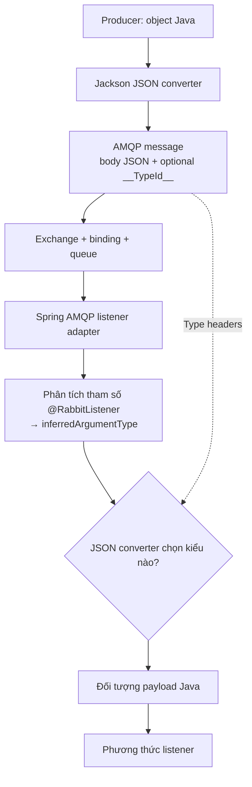

# Kiểu suy luận từ tham số listener so với kiểu do producer cung cấp

Khi một producer gửi JSON qua RabbitMQ, **body JSON không mang theo tên lớp Java**. Producer có thể bổ sung type headers như `__TypeId__` để gợi ý lớp dùng khi giải mã. Tuy nhiên, phía consumer Spring AMQP còn biết **kiểu tham số của phương thức `@RabbitListener`** và có thể ưu tiên kiểu đó. Do vậy, cùng một message với cùng các headers có thể được chuyển thành những đối tượng Java khác nhau tùy cấu hình listener và message converter.

Bài thuộc chương **Chuyển đổi dữ liệu** của **SPRING_AMQP**. Ta sẽ tìm hiểu cách suy luận kiểu từ tham số listener, cách producer gắn type metadata và cách các chế độ `INFERRED` / `TYPE_ID` của Jackson JSON converter phối hợp với nhau. Kiến thức này hữu ích khi dùng `RabbitTemplate`, `@RabbitListener`, exchange/queue/binding trong hệ thống nhiều service: lựa chọn sai kiểu có thể khiến message không được xử lý, retry liên tục hoặc bị đưa vào dead-letter queue.

Sau bài học, bạn sẽ có thể:

- Phân biệt **payload JSON**, **type header do producer gửi** và **inferred type do listener tự suy ra**.
- Giải thích hành vi mặc định của `TypePrecedence.INFERRED` đối với tham số cụ thể, abstract/interface và các trường hợp thiếu thông tin kiểu.
- Chủ động chuyển sang `TypePrecedence.TYPE_ID` khi hợp đồng giao tiếp cần bảo toàn kiểu động hoặc đa hình.
- Cấu hình `Jackson2JsonMessageConverter` và `DefaultJackson2JavaTypeMapper` trong ứng dụng Spring AMQP thuộc thế hệ 3.x.
- Dùng type aliases ổn định để tránh ràng buộc các service bởi tên package Java.
- Phân tích lỗi chuyển đổi, giới hạn bảo mật của type headers, và thiết kế integration test để kiểm chứng việc chuyển đổi.

> **Lưu ý phiên bản:** Ví dụ API bên dưới dùng `Jackson2JsonMessageConverter` với Jackson 2 trong dòng Spring AMQP **3.x / Spring Boot 3.x**. Khi dùng Spring AMQP 4.x và dòng Jackson mới, hãy đối chiếu converter/type mapper tương ứng và migration guide trước khi áp dụng nguyên tên class. Các nguyên tắc suy luận kiểu và hợp đồng dữ liệu vẫn là nền tảng quan trọng, nhưng API chi tiết có thể đổi theo phiên bản.

## 1. Ba nguồn thông tin kiểu cần phân biệt

Giả sử producer gửi event:

```json
{
  "orderId": "O-204",
  "amount": 125000
}
```

Message có thể mang các properties và headers:

```text
contentType: application/json
headers:
  __TypeId__: com.producer.events.OrderCreated
body:
  {"orderId":"O-204","amount":125000}
```

Trong lúc nhận, consumer có listener:

```java
@RabbitListener(queues = "orders.created.q")
public void handle(ReceivedOrderCreated event) {
    // ReceivedOrderCreated là kiểu DTO thuộc ứng dụng consumer.
}
```

Tại đây có **ba nguồn dữ kiện**:

| Nguồn | Được tạo ở đâu? | Ý nghĩa |
| --- | --- | --- |
| **JSON body** | Producer serialize dữ liệu. | Chứa các field và giá trị, không bắt buộc chứa tên lớp Java. |
| **Type metadata** (`__TypeId__`, v.v.) | Producer/converter hoặc hệ thống upstream gắn vào AMQP headers. | Gợi ý kiểu được dùng ở phía gửi hoặc một type alias theo hợp đồng. |
| **Inferred argument type** | Adapter của `@RabbitListener` phía nhận phân tích chữ ký phương thức. | Kiểu Java mà phương thức listener dự kiến nhận. |

`__TypeId__` là quy ước header của **Spring AMQP JSON type mapper**, **không phải** thuộc tính bắt buộc của giao thức AMQP 0-9-1. Một producer viết bằng Python, Node.js hoặc thư viện khác có thể gửi JSON mà không gắn header này, hoặc dùng hợp đồng metadata hoàn toàn khác.



Đây là **quá trình chuyển đổi payload**. Nó khác routing (exchange, binding, routing key) và không quyết định message có persistent, được ACK hay được retry. Tuy nhiên, lỗi chuyển đổi có thể xuất hiện **trước khi method listener được gọi**, nên ảnh hưởng trực tiếp đến quá trình ACK/reject và dead-letter.

## 2. Mặc định `INFERRED`: ưu tiên kiểu từ tham số listener

Với `Jackson2JsonMessageConverter` được sử dụng cùng listener adapter hỗ trợ suy luận kiểu, chế độ thường dùng mặc định là `TypePrecedence.INFERRED`.

Ví dụ hai service độc lập:

**Producer** có record:

```java
package com.producer.events;

import java.math.BigDecimal;

public record OrderCreated(
        String orderId,
        BigDecimal amount) {}
```

Producer gửi object qua `RabbitTemplate` với JSON converter:

```java
var event = new OrderCreated(
        "O-204", new BigDecimal("125000"));

rabbitTemplate.convertAndSend(
        "orders.events.x", "order.created", event);
```

Với type mapper mặc định, JSON converter có thể gắn `__TypeId__` chứa **tên lớp ở producer**, chẳng hạn `com.producer.events.OrderCreated`. Phía consumer không bắt buộc phải đưa chính lớp này lên classpath nếu nó có DTO riêng và adapter cung cấp kiểu suy luận phù hợp.

**Consumer** có record:

```java
package com.consumer.contracts;

import java.math.BigDecimal;

public record ReceivedOrderCreated(
        String orderId,
        BigDecimal amount) {}
```

Listener:

```java
import org.springframework.amqp.rabbit.annotation.RabbitListener;
import org.springframework.stereotype.Component;

@Component
class OrderCreatedListener {

    @RabbitListener(queues = "orders.created.q")
    public void handle(ReceivedOrderCreated event) {
        System.out.println(
                event.orderId() + " = " + event.amount());
    }
}
```

Khi adapter suy luận được **`ReceivedOrderCreated` là một kiểu cụ thể**, converter mặc định có thể dùng chính kiểu đó để deserialize body. Header `__TypeId__=com.producer.events.OrderCreated` **không nhất thiết được chọn**.

Kết quả mong muốn:

```text
Producer Java type: com.producer.events.OrderCreated
Header __TypeId__: com.producer.events.OrderCreated
Consumer listener argument: com.consumer.contracts.ReceivedOrderCreated
Selected target with INFERRED: ReceivedOrderCreated
Method argument: ReceivedOrderCreated("O-204", 125000)
```

Điều kiện quan trọng: cấu trúc JSON phải deserialize được vào DTO phía consumer; converter cần được cài đặt cho listener container, và method signature phải cho phép adapter xác định payload type. Tên lớp Java ở hai service **không bắt buộc giống nhau** trong trường hợp inferred type được dùng.

### 2.1. Vì sao cách này hữu ích cho microservices?

Nó cho phép mỗi service sở hữu DTO thích hợp với nghiệp vụ:

- Producer dùng `com.sales.events.OrderCreated`.
- Billing tiêu thụ cùng JSON vào `com.billing.contracts.InvoiceOrder`.
- Analytics tiêu thụ vào `com.analytics.dto.OrderSnapshot`.

Ba service có thể dùng **một hợp đồng JSON thống nhất** mà không phải chia sẻ chính xác lớp Java hay package từ producer. Đây thường là lựa chọn tốt cho listener có nhiệm vụ và kiểu payload cụ thể, miễn là schema message được quản lý và kiểm thử rõ ràng.

**Không xem inference là công cụ tự động tương thích schema:** nếu producer đổi `amount` từ number sang object hoặc xóa một field bắt buộc, converter vẫn có thể lỗi. Cần versioning và backward/forward compatibility cho JSON độc lập với việc dùng `INFERRED`.

### 2.2. Khi nào inferred type không thể áp dụng như trên?

Đối với JSON converter của Spring AMQP 3.x, quy tắc mặc định thường ưu tiên inferred type khi đó là một **kiểu concrete phù hợp** và đủ thông tin để Jackson tạo đối tượng. Với kiểu abstract/interface hoặc một số container kiểu `java.util`, converter có thể quay về type information của producer.

| Chữ ký listener | Khả năng inferred type | Lưu ý |
| --- | --- | --- |
| `handle(ReceivedOrderCreated event)` | Rõ ràng: DTO concrete. | Thường ưu tiên kiểu DTO từ listener. |
| `handle(String value)` | Rõ ràng: `String`. | JSON/converter phải phù hợp kiểu payload; không nên ép mọi JSON object thành chuỗi. |
| `handle(OrderEvent event)` với `OrderEvent` là interface | Không có lớp concrete để tạo trực tiếp. | Có thể cần type header, alias hoặc cấu hình Jackson đa hình. |
| `handle(AbstractOrderEvent event)` | Abstract class không thể khởi tạo trực tiếp. | Type metadata hoặc custom deserializer có thể cần thiết. |
| `handle(Object event)` | Không có DTO nghiệp vụ cụ thể. | Converter phải dùng header/hợp đồng ngoài hoặc fallback; không nên mặc định sẽ nhận đúng subtype. |
| `handle(List<OrderLine> items)` | Có thông tin generic từ method. | Khả năng dùng inferred generic phụ thuộc converter/phiên bản; cần test thật. |
| Method có nhiều tham số payload không rõ ràng | Adapter có thể không xác định được một kiểu payload duy nhất. | Phân biệt `@Header`, `Message`, `Channel` và `@Payload`. |

Thông thường bạn nên giữ method listener có **một đối số payload rõ ràng** và dùng `@Header` cho metadata riêng. Nếu class-level `@RabbitListener` dùng nhiều `@RabbitHandler`, quy trình chọn handler cũng phụ thuộc kiểu payload **sau khi chuyển đổi**, nên không thể mặc nhiên suy luận đúng kiểu chỉ bằng nhìn một method.

## 3. Chuyển sang `TYPE_ID`: ưu tiên type metadata từ producer

Một số hệ thống cần consumer giữ đúng **kiểu động** của dữ liệu do publisher cung cấp, ví dụ nhận các subclass của cùng một kiểu cơ sở hoặc dispatch nhiều loại event trên một queue. Khi đó có thể cấu hình `TypePrecedence.TYPE_ID` cho JSON type mapper.

### 3.1. Ví dụ vấn đề với một lớp cơ sở concrete

Giả sử consumer nhận theo lớp cơ sở:

```java
public class OrderEvent {
    private String eventId;

    public String getEventId() { return eventId; }
    public void setEventId(String eventId) {
        this.eventId = eventId;
    }
}
```

Producer gửi subtype:

```java
public class OrderCreatedEvent extends OrderEvent {
    private String orderId;

    public String getOrderId() { return orderId; }
    public void setOrderId(String orderId) {
        this.orderId = orderId;
    }
}
```

Listener:

```java
@RabbitListener(queues = "orders.events.q")
public void consume(OrderEvent event) {
    // Muốn kiểm tra event instanceof OrderCreatedEvent.
}
```

`OrderEvent` **không abstract**, nên `INFERRED` có thể chọn `OrderEvent`, bất kể header nói payload là `OrderCreatedEvent`. Tùy cấu hình Jackson, những field chỉ có ở subtype có thể bị bỏ qua hoặc gây lỗi unknown properties; listener cũng có thể không nhận được subtype thực tế. Nếu cần tạo đúng `OrderCreatedEvent`, hãy chọn `TYPE_ID` và bảo đảm type header có thể resolve sang subtype consumer tin cậy.

### 3.2. Cấu hình `DefaultJackson2JavaTypeMapper`

Ví dụ cho Spring AMQP 3.x:

```java
import org.springframework.amqp.support.converter.DefaultJackson2JavaTypeMapper;
import org.springframework.amqp.support.converter.Jackson2JavaTypeMapper;
import org.springframework.amqp.support.converter.Jackson2JsonMessageConverter;
import org.springframework.context.annotation.Bean;
import org.springframework.context.annotation.Configuration;

@Configuration
class AmqpJsonTypeConfig {

    @Bean
    Jackson2JsonMessageConverter amqpJsonConverter() {
        var converter = new Jackson2JsonMessageConverter();
        var typeMapper = new DefaultJackson2JavaTypeMapper();
        typeMapper.setTrustedPackages("com.example.contracts");
        typeMapper.setTypePrecedence(
                Jackson2JavaTypeMapper.TypePrecedence.TYPE_ID);
        converter.setJavaTypeMapper(typeMapper);
        return converter;
    }
}
```

Ý nghĩa:

- `TYPE_ID` ưu tiên type information trong AMQP headers khi header phù hợp.
- `setTrustedPackages(...)` hạn chế những package mà mapper được phép resolve từ tên lớp đến từ message. Thay bằng **package contract thực tế**, đồng thời kiểm tra các phụ thuộc type cần thiết.
- Với producer gửi type ID là **tên lớp đầy đủ**, consumer phải có **lớp đó hoặc mapping tương thích**; nếu class không tồn tại hoặc không được trust, việc chuyển đổi có thể thất bại.

> Một bean converter tự định nghĩa thường được Spring Boot sử dụng khi auto-configure `RabbitTemplate` và listener factory tương ứng, nhưng điều này còn tùy cấu hình và phiên bản. Nếu ứng dụng dùng `RabbitListenerContainerFactory` hoặc `RabbitTemplate` tự xây, hãy **gắn cùng converter dự kiến** vào từng nơi cần dùng và xác minh bằng integration test. Không mặc định chỉ tạo bean là mọi listener tùy biến đã đổi converter.

### 3.3. Một bản ghi quyết định kiểu

| Thông tin | Với `INFERRED` | Với `TYPE_ID` |
| --- | --- | --- |
| Listener `consume(OrderEvent event)`, trong đó `OrderEvent` concrete | Thường dùng `OrderEvent`. | Dùng subtype từ type header nếu resolve được. |
| Listener `consume(AbstractOrderEvent event)` | Có thể dùng type metadata khi abstract không tạo được. | Ưu tiên type header. |
| Producer gửi tên lớp không có ở consumer | Listener concrete có thể vẫn deserialize được bằng inferred type. | Có thể lỗi class mapping/trusted packages. |
| Message không có type headers | Inferred concrete DTO thường là cách thuận lợi. | Phải có fallback/mapper hợp lệ; không bảo đảm tự chọn đúng subtype. |
| Producer gửi header sai hoặc giả mạo | Có thể bị bỏ qua nếu inferred type đủ cụ thể. | Rủi ro chuyển đổi sai kiểu và bảo mật cao hơn; cần trust và schema validation. |

**`TYPE_ID` là quyết định của consumer** về cách ưu tiên metadata, không phải thuộc tính bắt buộc của mọi queue. Cùng producer và cùng JSON body, hai consumer có thể chọn chiến lược khác nhau theo hợp đồng mà chúng hỗ trợ.

## 4. Type alias: tách hợp đồng message khỏi tên class Java

Gửi `__TypeId__=com.producer.events.OrderCreated` khiến consumer phụ thuộc một tên package của producer nếu muốn dùng `TYPE_ID`. Trong microservices, package Java là chi tiết triển khai; producer có thể chuyển package mà JSON contract không đổi.

Một cách giảm liên kết là dùng **type alias** ổn định, ví dụ:

```text
__TypeId__: order.created.v1
contentType: application/json
body:
  {"orderId":"O-204","amount":125000}
```

Ở đây `order.created.v1` là mã loại message theo hợp đồng, không phải lớp Java. Mỗi service ánh xạ alias này tới DTO **riêng của mình**.

### 4.1. Phía producer ánh xạ alias sang lớp dùng để serialize

Giả sử lớp `com.producer.events.OrderCreated` ở ví dụ trước thuộc project producer. Một cấu hình riêng trong **project producer**:

```java
import java.util.Map;
import org.springframework.amqp.support.converter.DefaultJackson2JavaTypeMapper;
import org.springframework.amqp.support.converter.Jackson2JsonMessageConverter;
import org.springframework.context.annotation.Bean;
import org.springframework.context.annotation.Configuration;
import com.producer.events.OrderCreated;

@Configuration
class ProducerMessageConfig {
    @Bean
    Jackson2JsonMessageConverter producerJsonConverter() {
        var mapper = new DefaultJackson2JavaTypeMapper();
        mapper.setIdClassMapping(
                Map.of("order.created.v1", OrderCreated.class));

        var converter = new Jackson2JsonMessageConverter();
        converter.setJavaTypeMapper(mapper);
        return converter;
    }
}
```

Khi template sử dụng converter này và producer gửi một `OrderCreated`, mapper có thể ghi alias `order.created.v1` vào `__TypeId__` thay cho full class name. Điều kiện là mapping đã được gắn đúng vào converter sử dụng bởi **chính `RabbitTemplate` đang publish**.

### 4.2. Phía consumer ánh xạ cùng alias sang DTO của mình

Trong **project consumer**, alias có thể trỏ tới `com.consumer.contracts.ReceivedOrderCreated`:

```java
import java.util.Map;
import org.springframework.amqp.support.converter.DefaultJackson2JavaTypeMapper;
import org.springframework.amqp.support.converter.Jackson2JavaTypeMapper;
import org.springframework.amqp.support.converter.Jackson2JsonMessageConverter;
import org.springframework.context.annotation.Bean;
import org.springframework.context.annotation.Configuration;
import com.consumer.contracts.ReceivedOrderCreated;

@Configuration
class ConsumerMessageConfig {
    @Bean
    Jackson2JsonMessageConverter consumerJsonConverter() {
        var mapper = new DefaultJackson2JavaTypeMapper();
        mapper.setTrustedPackages("com.consumer.contracts");
        mapper.setIdClassMapping(Map.of(
                "order.created.v1", ReceivedOrderCreated.class));
        mapper.setTypePrecedence(
                Jackson2JavaTypeMapper.TypePrecedence.TYPE_ID);

        var converter = new Jackson2JsonMessageConverter();
        converter.setJavaTypeMapper(mapper);
        return converter;
    }
}
```

Đây là **hai configuration ở hai ứng dụng độc lập**, không phải hai bean converter bắt buộc khai báo chung trong một Spring context. Khi triển khai, bạn cần kiểm tra bean nào được inject vào `RabbitTemplate` và listener container. Cấu hình alias ở producer hoặc consumer **một phía** sẽ không đủ nếu phía còn lại không hiểu hoặc không phát đúng alias.

**Lợi ích của alias:**

- Producer có thể đổi package Java nhưng vẫn giữ `order.created.v1`.
- Consumer có thể dùng DTO đặt tên khác mà không cần import lớp của producer.
- Thay đổi schema không tương thích có thể phát hành alias mới như `order.created.v2`.
- Danh sách alias được hỗ trợ có thể được kiểm soát tường minh và đánh giá trong code review.

**Giới hạn:** Alias chỉ giúp chọn **kiểu Java**. Nó không tự đảm bảo schema JSON tương thích, không giải quyết alias trùng tên giữa các domain, và cũng không thay thế validation. Cần kiểm thử dữ liệu thật trên cả hai phía.

### 4.3. Khi nào không cần type alias?

Nếu mỗi queue chỉ nhận **một loại payload cụ thể** và listener có chữ ký như `handle(ReceivedOrderCreated event)`, `INFERRED` thường là lựa chọn đơn giản hơn. Khi đó hợp đồng giữa các service có thể là:

```json
{
  "eventType": "order.created",
  "schemaVersion": 1,
  "eventId": "evt-204",
  "data": {
    "orderId": "O-204",
    "amount": 125000
  }
}
```

Consumer đọc **envelope/schema** theo hợp đồng rồi map `data` vào DTO đã biết. `eventType` và `schemaVersion` là **field nghiệp vụ hoặc protocol của ứng dụng**, không nhất thiết phải giống Spring-specific `__TypeId__`. Cách này giúp producer viết bằng ngôn ngữ khác không cần hiểu class mapping của Spring AMQP.

## 5. Headers dành cho generic types và collection

Khi producer publish một `List<OrderLine>` hoặc `Map<String, OrderLine>`, chỉ biết lớp outer container như `ArrayList` hoặc `HashMap` chưa đủ để deserialize các phần tử thành đúng DTO.

Spring AMQP Jackson type mapper dùng các header quy ước:

| Header | Vai trò thường gặp |
| --- | --- |
| `__TypeId__` | ID của kiểu payload chính hoặc kiểu outer container. |
| `__ContentTypeId__` | ID của kiểu phần tử trong container, ví dụ value type của List. |
| `__KeyTypeId__` | ID của kiểu khóa Map, khi mapper cần thông tin đó. |

Các headers có thể được converter sinh ra theo dữ liệu thực tế và mapper đã cấu hình; **không phải mọi message JSON đều bắt buộc có cả ba**. Nếu producer gửi generic collection mà thông tin phần tử đã bị xóa do type erasure hoặc gửi dưới dạng map thuần, consumer có thể không khôi phục được đúng `List<OrderLine>` chỉ từ header.

Ví dụ listener:

```java
@RabbitListener(queues = "orders.lines.q")
public void handleLines(java.util.List<OrderLine> lines) {
    for (OrderLine line : lines) {
        System.out.println(line.sku());
    }
}
```

Với listener thích hợp, Spring AMQP có thể suy luận kiểu parameterized từ `List<OrderLine>`. Nhưng **generic container cần integration test**, vì việc chọn type từ listener so với header còn phụ thuộc converter, method signature và phiên bản framework. Nếu ứng dụng xử lý nhiều loại phần tử, một DTO envelope cụ thể (ví dụ `OrderLinesBatch`) thường dễ versioning và debug hơn việc publish một `List<?>` trần.

## 6. Class-level `@RabbitListener` và nhiều `@RabbitHandler`

Một listener có nhiều method xử lý từng loại event:

```java
import org.springframework.amqp.rabbit.annotation.RabbitHandler;
import org.springframework.amqp.rabbit.annotation.RabbitListener;
import org.springframework.stereotype.Component;

@Component
@RabbitListener(queues = "orders.multi-events.q")
class OrderEventHandlers {
    @RabbitHandler
    void handleCreated(OrderCreatedEvent event) {
        // Xử lý order.created
    }

    @RabbitHandler
    void handleCancelled(OrderCancelledEvent event) {
        // Xử lý order.cancelled
    }
}
```

Khác với method-level listener có một tham số DTO cụ thể, class-level listener phải **chọn method sau khi chuyển đổi**. Nếu body được deserialize thành `Map` hoặc một type chung không khớp các handler, framework có thể không chọn được method phù hợp dù JSON có field hợp lệ.

Đối với topology này, một trong các cách thường cần thiết là:

1. Producer gắn type alias/header được consumer hiểu.
2. Consumer có mapper chuyển từng alias sang một DTO cụ thể.
3. Các `@RabbitHandler` có chữ ký phân biệt đủ rõ để method selection không mơ hồ.
4. Một fallback handler có thể ghi nhận loại message không được hỗ trợ, nhưng không nên nuốt lỗi và ACK nếu như vậy làm mất nghiệp vụ.

Lưu ý rằng việc cung cấp type metadata ở producer **không bảo đảm** listener class-level tự dispatch đúng khi consumer không cấu hình JSON converter hoặc mapper. Kiểm tra loại object thực tế sau conversion và logic chọn handler trong integration test.

## 7. Cách cấu hình converter nhất quán cho template và listener

Spring Boot có thể tự cấu hình `RabbitTemplate`, `RabbitListenerContainerFactory` và converter nếu các bean/conditions phù hợp. Khi có nhiều `RabbitTemplate` hoặc factory tùy chỉnh, việc converter nào áp dụng cho đường gửi/nhận phải được định nghĩa rõ.

### 7.1. Cấu hình converter trên một listener factory riêng

Ví dụ dành cho Spring AMQP 3.x, tạo factory chỉ dùng cho nhóm listener cần `TYPE_ID`:

```java
import org.springframework.amqp.rabbit.config.SimpleRabbitListenerContainerFactory;
import org.springframework.amqp.rabbit.connection.ConnectionFactory;
import org.springframework.amqp.support.converter.Jackson2JsonMessageConverter;
import org.springframework.context.annotation.Bean;
import org.springframework.context.annotation.Configuration;

@Configuration
class SpecificListenerFactoryConfig {
    @Bean
    SimpleRabbitListenerContainerFactory typeIdListenerFactory(
            ConnectionFactory connectionFactory,
            Jackson2JsonMessageConverter consumerJsonConverter) {
        var factory = new SimpleRabbitListenerContainerFactory();
        factory.setConnectionFactory(connectionFactory);
        factory.setMessageConverter(consumerJsonConverter);
        return factory;
    }
}
```

Listener dùng factory này:

```java
@RabbitListener(
        queues = "orders.multi-events.q",
        containerFactory = "typeIdListenerFactory")
public void onEvent(OrderEvent event) {
    // Áp dụng converter/type mapper từ factory chỉ định.
}
```

Đoạn ví dụ giả định project đã có **một bean** `Jackson2JsonMessageConverter` tên `consumerJsonConverter` đúng cấu hình và phù hợp với phiên bản Spring đang dùng. Nếu container cần những thiết lập Spring Boot khác (concurrency, retry, acknowledgment, transaction, advice chain...), hãy cấu hình chúng tương đương hoặc sử dụng configurer Boot để không vô tình bỏ qua cài đặt đang có.

### 7.2. Producer dùng converter nào?

`RabbitTemplate` có property `messageConverter`. Bạn có thể inject một converter rõ ràng khi tạo template riêng:

```java
import org.springframework.amqp.rabbit.connection.ConnectionFactory;
import org.springframework.amqp.rabbit.core.RabbitTemplate;
import org.springframework.amqp.support.converter.Jackson2JsonMessageConverter;
import org.springframework.context.annotation.Bean;

@Bean
RabbitTemplate orderEventTemplate(
        ConnectionFactory connectionFactory,
        Jackson2JsonMessageConverter producerJsonConverter) {
    RabbitTemplate template = new RabbitTemplate(connectionFactory);
    template.setMessageConverter(producerJsonConverter);
    return template;
}
```

Nếu tự tạo `RabbitTemplate`, bạn phải kiểm tra lại các cấu hình khác như publisher confirms, mandatory/returns, retry và observations đang được Boot cung cấp ở template mặc định. **Chọn đúng type mapper chỉ giải quyết chuyển đổi payload**, không tự bật các bảo đảm giao nhận.

### 7.3. Hệ thống dùng converter mặc định thì sao?

`spring-boot-starter-amqp` không có nghĩa tự động mọi POJO được chuyển thành JSON bằng Jackson theo đúng hợp đồng của bạn. Nếu không đăng ký JSON converter, Spring AMQP có thể dùng `SimpleMessageConverter` với hành vi khác: xử lý `String`, `byte[]` và một số đối tượng serializable theo quy tắc của nó.

Vì vậy, để thử JSON object:

- Bổ sung thư viện Jackson phù hợp với dòng Spring Boot, nếu dự án chưa có.
- Khai báo converter JSON và kiểm tra producer/listener cùng sử dụng converter phù hợp.
- Publish một DTO thực tế, kiểm tra `contentType`, body và headers trong RabbitMQ.
- Đảm bảo consumer có DTO/converter hoặc type mapping cần thiết để deserialize.

Không dùng Java native serialization như hợp đồng message dài hạn giữa các service; nó liên kết lớp Java, gây khó cho versioning và có nguy cơ bảo mật nếu deserialize dữ liệu không tin cậy.

## 8. Bảo mật: type headers là dữ liệu không đáng tin mặc định

Một consumer dùng `TYPE_ID` cho phép metadata do bên gửi ảnh hưởng đến lựa chọn lớp Java để tạo đối tượng. Nếu producer, middleware hoặc người có quyền publish vào exchange/queue bị xâm nhập, type header có thể bị thay đổi. Vì vậy, không được mặc nhiên tin một tên lớp xuất hiện trong `__TypeId__`.

### 8.1. Hạn chế `trustedPackages`

Trong Spring AMQP 3.x, `DefaultJackson2JavaTypeMapper` hỗ trợ giới hạn những package tin cậy:

```java
var mapper = new DefaultJackson2JavaTypeMapper();
mapper.setTrustedPackages(
        "com.example.contracts",
        "com.example.events");
mapper.setTypePrecedence(
        Jackson2JavaTypeMapper.TypePrecedence.TYPE_ID);
```

Đây là **ví dụ package**, cần thay bằng các package DTO thực tế đã kiểm tra. Hạn chế việc dùng:

```java
// Không dùng cho messages từ nguồn không tin cậy:
mapper.setTrustedPackages("*");
```

`setTrustedPackages("*")` mở rộng khả năng resolve lớp từ metadata, có thể làm tăng bề mặt tấn công khi kết hợp với thư viện hoặc cấu hình Jackson không an toàn. Trusted packages **không thay thế** schema validation, quyền publish theo vhost, policy deserialization và kiểm soát classpath.

Các biện pháp bổ sung:

- Dùng **type aliases hữu hạn** thay vì cho consumer resolve tùy ý mọi FQCN.
- Chỉ cho producer đáng tin cậy quyền `write` vào exchange; giới hạn `configure` và `read` theo vai trò.
- Validate field nghiệp vụ và version ngay cả khi deserialize thành công.
- Cập nhật Jackson, Spring AMQP và phụ thuộc liên quan theo bản vá còn được hỗ trợ.
- Hạn chế phản hồi/log công khai của deserialization exception nếu nó chứa tên class, dữ liệu cá nhân hoặc body message.

### 8.2. Vì sao `INFERRED` đôi khi làm giảm phụ thuộc bảo mật?

Nếu một listener chỉ nhận một DTO concrete `OrderCreated` mà ứng dụng đã chọn sẵn, converter có thể deserialize theo **một đích định trước** và bỏ qua class name từ producer. Điều này giảm sự phụ thuộc vào type header do bên ngoài cung cấp.

Tuy nhiên, `INFERRED` **không phải cơ chế bảo mật đầy đủ**. Payload vẫn có thể quá lớn, sai kiểu, chứa giá trị không hợp lệ hoặc khai thác lỗi deserializer. Cần giới hạn kích thước message, validation, quyền broker và giám sát.

## 9. Khi chuyển đổi lỗi, listener có được gọi không?

Không phải lỗi deserialize JSON nào cũng đi vào phần thân của `@RabbitListener`. Nếu converter không tạo được argument, method handler có thể **chưa được thực thi**; do đó `try/catch` bên trong handler không bắt được mọi lỗi chuyển đổi.

Ví dụ producer gửi:

```json
{
  "orderId": {
    "unexpected": "object"
  },
  "amount": "not-a-number"
}
```

Consumer chờ:

```java
public record ReceivedOrderCreated(
        String orderId,
        java.math.BigDecimal amount) {}
```

Nếu Jackson không thể chuyển đổi field theo cấu hình, adapter/container có thể báo lỗi chuyển đổi, chẳng hạn dạng `MessageConversionException` hoặc exception được bọc trong `ListenerExecutionFailedException`. Khi type mapper dùng `TYPE_ID`, một `__TypeId__` không có mapping hoặc không được trust cũng có thể gây lỗi trước khi handler nhận payload.

```mermaid
flowchart TD
    M[AMQP delivery] --> C[Converter đọc contentType, inferred type, type headers]
    C --> D{Chuyển đổi thành công?}
    D -->|Có| H[@RabbitListener method]
    H --> R{Nghiệp vụ thành công?}
    R -->|Có| ACK[Container ACK]
    R -->|Không| B[Retry / reject / requeue theo cấu hình]
    D -->|Không| E[Listener container error handler]
    E --> P[Reject / DLQ / xử lý lỗi theo chính sách]
```

Thực tế ứng dụng cần cấu hình và kiểm thử listener container error handler, `defaultRequeueRejected`, retry interceptor hoặc xử lý fatal exceptions theo phiên bản. Các lỗi convert thường là **lỗi dữ liệu có tính ổn định**: retry vô hạn cùng một payload không đổi chỉ tạo vòng lặp, làm tăng redelivery và có thể chặn các message hợp lệ khác.

**Đừng tuyên bố** “message chắc chắn vào DLQ” chỉ vì converter ném exception. Dead-letter còn phụ thuộc queue đã có DLX, routing key, điều kiện reject/requeue và khả năng broker định tuyến sang DLQ.

### 9.1. Ví dụ kiểm soát lỗi bằng chính sách rõ ràng

Với message có schema không hợp lệ:

1. Ghi log có event ID, queue, routing key, correlation ID và exception type; tránh ghi body nhạy cảm vào log.
2. Đánh dấu lỗi không thể tự khôi phục bằng retry thông thường nếu payload hỏng vĩnh viễn.
3. Áp dụng error handler/reject thích hợp, cấu hình DLX và quan sát DLQ để phục hồi có kiểm soát.
4. Phân loại riêng lỗi tạm thời (database timeout, broker/network) để retry với backoff và giới hạn số lần.
5. Bổ sung validation ở phía producer trước khi publish, đồng thời không dựa hoàn toàn vào producer vì consumer có thể nhận message lịch sử.

Khi dùng `TYPE_ID`, phân biệt **không resolve được alias**, **package không được trust**, **schema JSON không hợp lệ**, và **method handler không khớp subtype**. Chúng có triệu chứng khác nhau nhưng cùng làm mất khả năng xử lý message.

### 9.2. Nguy cơ ACK ngoài dự kiến

Nếu bạn dùng callback lỗi chỉ ghi log rồi coi xử lý thành công, message có thể được ACK mặc dù nghiệp vụ chưa diễn ra. Ngược lại, nếu requeue vô hạn một message sai schema, queue có thể lặp vô tận.

Thiết kế cần nêu rõ:

| Loại lỗi | Hướng xử lý gợi ý |
| --- | --- |
| JSON không parse được | Lỗi dữ liệu: reject/DLQ, có mẫu message để phân tích. |
| Type alias không được hỗ trợ | Lỗi hợp đồng: DLQ và alert, cập nhật consumer/mapping có kiểm soát. |
| JSON field không tương thích phiên bản | Sửa schema hoặc hỗ trợ version, cân nhắc replay sau khi cập nhật. |
| Kết nối database tạm thất bại sau conversion | Retry có backoff, giới hạn số lần, idempotency. |
| Đã commit DB nhưng chưa ACK | Có thể redelivery; xử lý trùng theo event ID. |

## 10. Debug bằng raw message và metadata

Khi cần xác nhận publisher thực tế đã gửi headers gì, ta có thể dùng listener riêng để đọc `org.springframework.amqp.core.Message`:

```java
import java.nio.charset.StandardCharsets;
import org.springframework.amqp.core.Message;
import org.springframework.amqp.rabbit.annotation.RabbitListener;
import org.springframework.stereotype.Component;

@Component
class DebugRawMessageListener {
    @RabbitListener(queues = "orders.debug.q")
    public void inspect(Message message) {
        var props = message.getMessageProperties();
        System.out.println("contentType=" + props.getContentType());
        System.out.println("__TypeId__=" +
                props.getHeaders().get("__TypeId__"));
        System.out.println("__ContentTypeId__=" +
                props.getHeaders().get("__ContentTypeId__"));
        System.out.println("body=" +
                new String(message.getBody(), StandardCharsets.UTF_8));
    }
}
```

**Lưu ý:** `orders.debug.q` là queue dành riêng cho bài lab. Nếu bạn thêm debug listener vào **cùng queue** của consumer nghiệp vụ, hai listener sẽ **cạnh tranh** message, khiến message có thể bị ACK bởi debug listener và không đến consumer chính. Muốn quan sát cùng event, tạo queue debug riêng được bind vào exchange tương ứng.

Trong production, không log toàn bộ body tùy tiện: payload có thể chứa dữ liệu nhạy cảm hoặc rất lớn. Ưu tiên log message ID, event type, schema version, correlation ID, queue, exception và metrics tổng hợp.

### 10.1. Phân biệt wire headers và inferred argument

`__TypeId__` được gửi trên **AMQP message headers**; với Spring JSON converter, nó có thể xuất hiện khi nhìn message ở RabbitMQ Management UI hoặc consumer raw.

`inferredArgumentType` là gợi ý được listener adapter **thiết lập nội bộ** để converter biết chữ ký method đang nhận. Nó không tự động trở thành một header bắt buộc trên wire, và publisher viết bằng ngôn ngữ khác không thể biết inferred Java type của mọi consumer.

Hai khái niệm cùng tham gia chuyển đổi nhưng nằm ở **hai thời điểm khác nhau**. Đây là nguyên nhân chính khiến “producer nói type X” nhưng listener nhận được object thuộc type Y mà không nhất thiết là bug.

## 11. Ma trận integration test nên có

Hãy chạy thử với RabbitMQ broker thật trong môi trường test, có exchange, queue và binding rõ ràng. Chỉ mock method Java không đủ xác minh content type, type headers, converter và listener adapter.

| Test | Producer | Listener / converter | Điều cần xác nhận |
| --- | --- | --- | --- |
| T1: DTO concrete, package khác nhau | JSON + FQCN producer trong `__TypeId__` | `INFERRED`, tham số `ReceivedOrderCreated` | Chuyển thành DTO consumer nếu JSON tương thích; không cần class producer. |
| T2: TYPE_ID FQCN trùng hợp đồng | JSON + FQCN class đã được trust | `TYPE_ID` và class có trên classpath | Chuyển thành kiểu được header chỉ định. |
| T3: TYPE_ID FQCN lạ | Header chỉ tới class không có trong consumer | `TYPE_ID` | Lỗi mapping/deserialization được xử lý; không chạy handler nghiệp vụ sai. |
| T4: Alias ổn định | Header `order.created.v1` | Consumer mapper alias → DTO riêng | Nhận đúng DTO dù tên package producer khác. |
| T5: Thiếu type header | JSON hợp lệ, không có `__TypeId__` | Listener concrete + `INFERRED` | Có thể nhận đúng DTO khi suy luận đủ thông tin. |
| T6: Interface/abstract argument | JSON + alias cụ thể | Listener nhận interface/abstract | Hành vi đúng với mapper có type headers hoặc custom deserializer. |
| T7: Subclass | Producer gửi subtype và type header | Listener nhận base class concrete | So sánh `INFERRED` và `TYPE_ID` về kiểu object thực tế. |
| T8: Class-level handlers | JSON + alias cho hai event | `@RabbitHandler` overloads | Chọn đúng method, không mơ hồ, lỗi rõ nếu không hỗ trợ type. |
| T9: Generic payload | `List<OrderLine>` hoặc envelope | Listener list/DTO cụ thể | Field phần tử đúng Java type, không thành `LinkedHashMap` ngoài dự kiến. |
| T10: Header giả mạo | Type alias/FQCN ngoài allowlist | `TYPE_ID` với trusted packages | Reject/lỗi theo thiết kế, không instantiate class không tin cậy. |
| T11: JSON sai schema | Thiếu field bắt buộc hoặc sai kiểu | Listener DTO concrete | Converter báo lỗi; DLQ/metrics hoạt động theo error policy. |
| T12: Listener lỗi sau conversion | JSON và type hợp lệ | Handler ném exception | Phân biệt lỗi business và lỗi converter; không requeue vô hạn. |

### 11.1. Các bước thực hành tối thiểu

1. Khởi tạo dự án Spring Boot 3.x có `spring-boot-starter-amqp` và Jackson phù hợp. Cấu hình JSON converter cho cả đường gửi và nhận.
2. Tạo direct hoặc topic exchange `orders.events.x`, queue `orders.created.q` và binding `order.created`.
3. Tạo **hai project Java package khác nhau** như ví dụ `com.producer.events` và `com.consumer.contracts`.
4. Publish một `OrderCreated` bằng `RabbitTemplate.convertAndSend(...)`; kiểm tra body JSON và `__TypeId__` trên queue debug.
5. Tạo listener có tham số `ReceivedOrderCreated`, xác minh `INFERRED` chuyển đúng dù consumer không có class producer.
6. Chuyển consumer sang `TYPE_ID` mà **không** thêm class/mapping; ghi lại lỗi dự kiến. Sau đó thêm alias mapping trên cả producer và consumer, xác minh chuyển đổi thành công.
7. Thử một listener tham số base class có subtype, quan sát kiểu object và hành vi nhận fields ở mỗi precedence.
8. Gửi một payload sai schema hoặc alias lạ; kiểm tra error handler, DLQ, retry policy và metric lỗi converter.

### 11.2. Câu hỏi tự kiểm tra

1. Vì sao JSON body không tự biểu thị class Java được dùng khi deserialize?
2. `__TypeId__` do ai tạo và nó có phải một header bắt buộc của AMQP 0-9-1 không?
3. Với `TypePrecedence.INFERRED` và listener nhận một DTO concrete, type header của producer có luôn quyết định class Java không?
4. Khi listener nhận interface hoặc abstract class, tại sao consumer thường cần thêm type metadata hay custom mapping?
5. `TYPE_ID` giải quyết trường hợp subtype như thế nào và rủi ro mới là gì?
6. Tại sao dùng FQCN trong `__TypeId__` dễ tạo coupling giữa hai service?
7. Cùng alias `order.created.v1`, producer và consumer có thể sử dụng hai lớp Java khác package không?
8. Khi dùng nhiều `@RabbitHandler` trên một class listener, việc chọn handler phụ thuộc bước nào?
9. Vì sao JSON deserialize lỗi có thể xảy ra trước khi `try/catch` trong method listener được thực thi?
10. Vì sao không nên dùng `setTrustedPackages("*")` cho message từ nguồn không tin cậy?
11. Nếu listener bị redelivery sau ACK lỗi, lựa chọn `INFERRED` hay `TYPE_ID` có thay thế được idempotency không?
12. Một test unit trực tiếp gọi method listener có kiểm chứng được AMQP type headers và inferred type precedence không?

## 12. Lỗi thường gặp và cách khắc phục

| Triệu chứng | Nguyên nhân cần nghi ngờ | Hướng xử lý |
| --- | --- | --- |
| Listener nhận `LinkedHashMap` thay vì DTO | Message được convert sang `Object`/`Map`; thiếu hoặc sai type mapping. | Dùng DTO concrete, kiểm tra converter, inferred type và headers. |
| Không tìm thấy class từ `__TypeId__` | FQCN của producer không tồn tại trên consumer. | Dùng `INFERRED` với DTO concrete hoặc ánh xạ stable alias. |
| Bị từ chối vì package không trusted | Type mapper không cho resolve class từ header. | Khai báo allowlist đúng contract, không mở toàn bộ package bằng `*`. |
| Field của subtype biến mất hoặc lỗi unknown field | `INFERRED` chọn base class concrete dù producer gửi subtype. | Chọn `TYPE_ID` khi thật sự cần dynamic type, thêm mapping và test. |
| Một handler `@RabbitHandler` không được chọn | Payload đã convert sang type không khớp signature nào. | Kiểm tra type alias, converter, handler method resolution. |
| Listener chạy với `byte[]` hoặc body kiểu khác | Không dùng JSON converter mong muốn, hoặc content type không phù hợp. | Kiểm tra `MessageConverter` thực được gắn cho container và template. |
| JSON malformed làm consumer retry liên tục | Lỗi conversion được container requeue/ retry theo cấu hình không phù hợp. | Phân loại lỗi, giới hạn retry, reject/DLQ và giám sát. |
| Đổi converter có tác dụng với template nhưng không với listener | Custom listener factory vẫn dùng converter cũ. | Kiểm tra `setMessageConverter` ở từng factory, bean wiring và Boot configurer. |
| Producer đổi package, consumer đột ngột lỗi | Hợp đồng dùng FQCN làm type ID. | Ổn định alias hoặc dùng inferred DTO và schema version. |
| Payload thiếu field nhưng không báo lỗi | Jackson có thể dùng default/null cho field; không có validation. | Kiểm tra điều kiện bắt buộc và bean validation trong nghiệp vụ. |

## 13. Thiết kế hợp đồng dữ liệu bền vững hơn

Đối với hệ thống nhiều service, lựa chọn inferred hay producer type phải phù hợp với kiến trúc dữ liệu:

| Nhu cầu | Cách tiếp cận thường phù hợp |
| --- | --- |
| Một queue chỉ mang một event schema cụ thể | Listener concrete DTO + `INFERRED`. |
| Nhiều phiên bản event trên cùng exchange | Routing key/`eventType` và `schemaVersion` rõ ràng, kiểm thử chuyển phiên bản. |
| Một queue chứa nhiều subtype cần dispatch | Type alias + `TYPE_ID` hoặc envelope dispatcher riêng; không dựa vào FQCN tùy ý. |
| Producer không viết bằng Java | JSON schema/envelope chuẩn hóa, không yêu cầu producer tự biết class Java của Spring. |
| Consumer không tin hoàn toàn publisher | Inferred DTO hoặc danh sách alias hữu hạn, trusted packages và schema validation. |
| Cần lưu event để replay nhiều lần | Xem thêm retention và event log/stream, payload contract ổn định theo thời gian. |

**Nguyên tắc:** Chữ ký method listener là một phần của contract phía consumer; `__TypeId__` là một cơ chế metadata của converter. Cả hai đều cần thống nhất với **JSON schema thực tế**, cách versioning và mức độ tin cậy giữa các service. Dù conversion thành công, producer confirms, consumer ACK, retry, dead-letter và idempotency vẫn là những chủ đề riêng để bảo đảm giao nhận và xử lý nghiệp vụ.

## 14. Tài liệu tham khảo

- [Spring AMQP — Message Converters](https://docs.spring.io/spring-amqp/reference/amqp/message-converters.html): JSON converters, type headers, inference và precedence.
- [Spring AMQP — Annotation-driven Listener Endpoints](https://docs.spring.io/spring-amqp/reference/amqp/receiving-messages/async-annotation-driven.html): suy luận kiểu từ listener, `@RabbitListener` và `@RabbitHandler`.
- [Spring AMQP — Receiving Messages](https://docs.spring.io/spring-amqp/reference/amqp/receiving-messages/async-consumer.html): listener containers, chuyển đổi message và xử lý lỗi.
- [Spring AMQP — Sending Messages](https://docs.spring.io/spring-amqp/reference/amqp/sending-messages.html): `RabbitTemplate`, `MessageConverter` và `MessagePostProcessor`.
- [Spring Boot — AMQP](https://docs.spring.io/spring-boot/reference/messaging/amqp.html): cấu hình RabbitMQ, template, listeners và converter trong ứng dụng Boot.
- [RabbitMQ — Consumer Acknowledgements and Publisher Confirms](https://www.rabbitmq.com/docs/confirms): phân biệt chuyển đổi dữ liệu với xác nhận giao nhận.
- [RabbitMQ — Dead Letter Exchanges](https://www.rabbitmq.com/docs/dlx): chính sách xử lý message lỗi sau reject/dead-letter.

**Điểm ghi nhớ:** Với `Jackson2JsonMessageConverter`, phương thức `@RabbitListener` có payload type **concrete** thường cho converter thông tin đủ để chọn `INFERRED`, ngay cả khi producer cung cấp `__TypeId__` khác tên class. Khi cần subtype hoặc dispatch đa hình, `TYPE_ID` cho phép ưu tiên metadata từ producer nhưng yêu cầu mapping, trusted packages và hợp đồng schema rõ ràng. Cả hai cách phải được kiểm chứng bằng integration test trên message thật và đi kèm cơ chế xử lý lỗi, retry/DLQ, idempotency và quan sát phù hợp.
