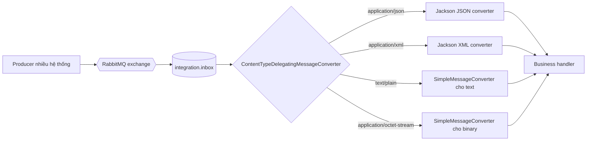
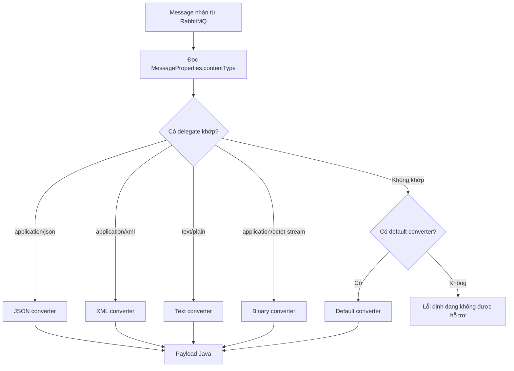
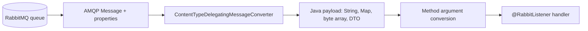
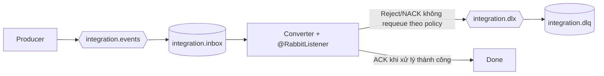

# ContentTypeDelegatingMessageConverter và nhiều định dạng nội dung

**Chương:** Chuyển đổi dữ liệu

**Phạm vi:** Spring AMQP (`spring-rabbit`) với RabbitMQ; sử dụng `RabbitTemplate`, `@RabbitListener` và `MessageConverter` trong hệ thống có nhiều loại payload.

Một hệ thống RabbitMQ có thể nhận sự kiện đơn hàng bằng JSON, thông báo đơn giản dưới dạng chuỗi văn bản, tệp đính kèm ở dạng nhị phân và đôi khi cả XML từ hệ thống cũ. Nếu mọi message đều được giải mã bằng một converter duy nhất, dữ liệu dễ bị đọc sai hoặc gây exception. **`ContentTypeDelegatingMessageConverter`** cho phép cấu hình **một bộ phân phối converter**: dựa vào trường `contentType` trong `MessageProperties` để chọn converter thực sự cho từng message.

Bài học này giải thích cơ chế hoạt động ở cả producer và consumer, cách nối với Spring Boot/Spring AMQP, giới hạn của định tuyến theo MIME, lưu ý bảo mật khi giải mã dữ liệu không đáng tin cậy và cách xử lý message sai định dạng để không gây vòng retry vô hạn.

**Sau khi học, bạn có thể:**

1. Phân biệt `contentType`, `contentEncoding`, payload và những header như `__TypeId__`.
2. Cấu hình `ContentTypeDelegatingMessageConverter` cho `application/json`, `application/xml`, `text/plain` và `application/octet-stream`.
3. Biết cách **đặt content type trước khi chuyển đổi outbound**; không phụ thuộc vào thao tác gắn header quá muộn.
4. Tích hợp converter với `RabbitTemplate`, listener container và `@RabbitListener`.
5. Chọn fallback an toàn, kiểm soát schema/type mapping, retry/DLQ và giám sát các lỗi chuyển đổi.

> Bài này dùng API `spring-rabbit` của Spring AMQP với giao thức RabbitMQ AMQP 0.9.1. Các client AMQP 1.0 tổng quát có bộ converter và mô hình metadata khác; không bê nguyên cấu hình sang `spring-amqp-client`.

## 1. Vì sao cần phân phối converter theo `contentType`?

Giả sử một exchange `integration.events` định tuyến các message đến queue `integration.inbox`. Producer từ những hệ thống khác nhau sử dụng định dạng riêng:

| Producer | `contentType` trên message | Ví dụ body | Java object mong muốn |
| --- | --- | --- | --- |
| Order service | `application/json` | `{"orderId":"O-100","amount":75000}` | DTO/`Map` |
| Legacy ERP | `application/xml` | `<order><id>O-100</id></order>` | DTO/`Map` theo cấu hình XML |
| Monitoring agent | `text/plain` | `payment gateway recovered` | `String` |
| Document service | `application/octet-stream` | Các byte của tệp PDF | `byte[]` |

Một `JacksonJsonMessageConverter` chỉ nên được dùng để phân tích cú pháp JSON. Nếu cố dùng nó cho XML hoặc PDF, consumer có thể giải mã sai, nhận lại `byte[]` hoặc ném lỗi. Ngược lại, `SimpleMessageConverter` xử lý chuỗi và byte tốt nhưng **không tự biến JSON thành DTO**.

Có hai thiết kế phổ biến:

- **Tách queue theo định dạng/hợp đồng:** mỗi queue dùng một converter cố định. Dễ vận hành và là lựa chọn tốt khi có thể phân tuyến theo routing key.
- **Một queue phải hỗ trợ nhiều định dạng:** chọn converter dựa trên `contentType`, đặc biệt hữu ích khi cần tương thích dần trong quá trình migration hoặc nhận dữ liệu từ nhiều producer chung endpoint.

`ContentTypeDelegatingMessageConverter` giải quyết tình huống thứ hai mà không buộc mã xử lý gọi `if/else` để parse từng định dạng ở mọi nơi.



**Điểm mấu chốt:** RabbitMQ **không tự chuyển JSON thành Java object**. Broker lưu và chuyển body cùng properties; lựa chọn converter do **Spring AMQP ở phía ứng dụng** thực hiện.

## 2. Hiểu đúng `Message`, `MessageProperties` và metadata

Ở lớp Spring AMQP:

```java
org.springframework.amqp.core.Message
org.springframework.amqp.core.MessageProperties
org.springframework.amqp.support.converter.MessageConverter
```

`Message` chứa `byte[] body` và `MessageProperties`. `MessageConverter` định nghĩa hai chiều:

```java
Message toMessage(Object object, MessageProperties properties);
Object fromMessage(Message message);
```

- **`toMessage` (outbound):** Java object → body bytes và message properties trước khi gửi.
- **`fromMessage` (inbound):** body bytes cùng properties → Java object sau khi nhận.
- **`contentType`:** định dạng payload, ví dụ `application/json` hay `text/plain`.
- **`contentEncoding`:** thường dùng để chỉ mã hóa ký tự, ví dụ `UTF-8`. Một `contentType` có thể chứa tham số `charset=...`; cách diễn giải tùy converter.
- **`__TypeId__` hoặc type headers:** metadata do Jackson converter có thể dùng để suy Java type; **khác `contentType`**, không phải định dạng MIME.
- **`messageId`, `correlationId`, `headers`:** dùng truy vết, tương quan request/reply hay thông tin nghiệp vụ, không tự quyết định converter của `ContentTypeDelegatingMessageConverter`.

Ví dụ một message JSON:

```text
AMQP properties:
  contentType      = application/json
  contentEncoding  = UTF-8
  messageId        = evt-8f5c...
  headers:
    eventType      = order.created
    schemaVersion  = 2
    __TypeId__     = ... (tùy cấu hình Jackson)

body (UTF-8 bytes):
  {"orderId":"O-100","amount":75000}
```

Producer **cần phát content type đúng với body thật**. Thêm `contentType=application/json` vào một payload thực chất là Java-serialized object không khiến dữ liệu đó trở thành JSON.

### 2.1. `contentType` không phải routing key

Exchange của RabbitMQ route dựa trên exchange type, routing key và binding. `ContentTypeDelegatingMessageConverter` không tự đổi exchange, routing key hoặc queue:

```text
RabbitTemplate.publish(exchange, routingKey, message)
                         |
                 RabbitMQ routing
                         |
                       Queue
                         |
              MessageConverter.fromMessage
                         |
                      Handler
```

Nếu muốn mỗi format đi một queue khác nhau, hãy khai báo exchange và binding tương ứng. Nếu muốn **cùng queue** hỗ trợ nhiều format, mới cân nhắc delegating converter.

## 3. `ContentTypeDelegatingMessageConverter` hoạt động như thế nào?

Lớp `org.springframework.amqp.support.converter.ContentTypeDelegatingMessageConverter` xuất hiện từ **Spring AMQP 1.4.2** và triển khai giao diện `MessageConverter`. Nó nắm một bản đồ:

```text
content-type string -> MessageConverter
```

Một số API quan trọng:

| API | Ý nghĩa |
| --- | --- |
| `new ContentTypeDelegatingMessageConverter()` | Tạo composite với **fallback `SimpleMessageConverter`** |
| `new ContentTypeDelegatingMessageConverter(defaultConverter)` | Tạo composite với fallback tùy chọn; có thể truyền `null` để yêu cầu match chặt |
| `addDelegate("application/json", jsonConverter)` | Gán converter cho một content type |
| `setDelegates(map)` | Cấu hình nhiều delegate từ map |
| `removeDelegate(contentType)` | Bỏ một delegate |
| `getDelegates()` | Xem các delegate hiện tại |
| `fromMessage(message)` | Chọn delegate bằng content type của message nhận vào |
| `toMessage(object, properties)` | Chọn delegate bằng content type **đang có trên input properties** rồi thực hiện mã hóa |

Theo mặc định, nếu `contentType` không có hoặc không khớp delegate, composite dùng `SimpleMessageConverter`. Điều này giúp tương thích dữ liệu cũ nhưng có thể **che giấu producer gửi sai định dạng**.

### 3.1. Sơ đồ luồng inbound



Trong lớp composite, tra cứu delegate dựa trên **chuỗi `contentType`**. Khi quản lý nhiều MIME types, đừng tự giả định map `"application/json"` nhận mọi biến thể như `"application/json; charset=utf-8"` hay `"application/vnd.company+json"`. Cần **kiểm thử chính xác cách khớp của phiên bản dùng** hoặc chủ động chuẩn hóa/đăng ký khóa cần hỗ trợ. Việc Jackson JSON converter có thể nhận nhiều subtype tương thích không tự làm **bảng ánh xạ của composite** trở thành wildcard MIME router.

### 3.2. Delegate có quyền thay đổi metadata sau chuyển đổi

Đối với outbound, composite dùng `contentType` ban đầu để **chọn delegate**, nhưng delegate có thể **đặt lại `contentType`/encoding** theo định dạng thực sự nó tạo ra.

Ví dụ:

1. Input `MessageProperties.contentType="application/json"`.
2. Composite chọn `JacksonJsonMessageConverter`.
3. Jackson mã hóa Java object ra JSON và cập nhật properties cần thiết.
4. `RabbitTemplate` gửi body cùng properties cuối cùng.

Không nên trông đợi composite giữ nguyên 100% mọi property được cung cấp nếu delegate cần hiệu chỉnh nội dung cho phù hợp.

## 4. Các converter phù hợp cho từng định dạng

| Định dạng | Converter gợi ý | Điều cần lưu ý |
| --- | --- | --- |
| JSON | `JacksonJsonMessageConverter` (Spring AMQP 4.x) | JSON → DTO/Map cần kiểm soát type mapping và schema |
| XML | `JacksonXmlMessageConverter` (Spring AMQP 4.x) | Cần dependency Jackson XML và cấu hình type mapping an toàn |
| Văn bản | `SimpleMessageConverter` | `text/plain` thường được giải mã thành `String`; chú ý charset |
| Byte nhị phân | `SimpleMessageConverter` hoặc converter tự viết | Với `application/octet-stream` thường trả `byte[]` |
| Định dạng khác như Avro, Protobuf | Converter tự viết dựa trên schema/serializer phù hợp | Không có auto-conversion chỉ vì khai `contentType`; cần code, schema registry/compatibility tương ứng |

**Khác biệt phiên bản:** từ Spring AMQP 4.0, `JacksonJsonMessageConverter` và `JacksonXmlMessageConverter` dựa trên **Jackson 3** là các lựa chọn mới. Trong nhánh Spring AMQP 3.x, các lớp tương ứng là `Jackson2JsonMessageConverter` và `Jackson2XmlMessageConverter` (Jackson 2). Không trộn tùy tiện các class của các thế hệ và dependency Jackson khác nhau.

### 4.1. `SimpleMessageConverter` làm gì?

Nếu nhận message có `contentType` bắt đầu bằng `text/`, converter thường giải mã byte thành `String` theo `contentEncoding` hoặc charset mặc định. Với các content type không được nó nhận biết, thường trả `byte[]`.

Khi gửi, nó chọn cách mã hóa dựa trên kiểu Java, như `String` hoặc `byte[]`, và có thể thiết lập `contentType` phù hợp.

**Cảnh báo quan trọng:** `SimpleMessageConverter` còn có nhánh **Java deserialization** cho `application/x-java-serialized-object`. Deserialization các byte do bên không đáng tin cậy tạo ra có thể gây rủi ro bảo mật. Production nên ưu tiên JSON/Protobuf/Avro với DTO hoặc schema được kiểm soát, và kiểm soát chặt những type được phép nếu phải dùng Java serialization.

### 4.2. Jackson converter không tự bảo đảm hợp đồng dữ liệu

Một JSON object có thể hợp lệ về cú pháp nhưng vi phạm schema nghiệp vụ:

```json
{"orderId":"","amount":-1}
```

`JacksonJsonMessageConverter` có thể vẫn chuyển được sang Java object. **Validation và semantic checks** vẫn thuộc ứng dụng:

- Bắt buộc `orderId` không rỗng.
- Số tiền dương, đơn vị tiền hợp lệ.
- `schemaVersion` được hỗ trợ.
- Không xử lý lặp cùng `eventId`.

Đừng đánh đồng “deserialize thành công” với “message hợp lệ cho nghiệp vụ”.

## 5. Cấu hình Java cho nhiều định dạng

Ví dụ dưới đây sử dụng **Spring AMQP 4.x** và các lớp Jackson 3. Ứng dụng cần có các dependency tương thích, gồm `spring-rabbit` và Jackson JSON/XML tương ứng với phiên bản Spring Boot/Spring AMQP.

### 5.1. Tạo composite converter

```java
import org.springframework.amqp.support.converter.ContentTypeDelegatingMessageConverter;
import org.springframework.amqp.support.converter.JacksonJsonMessageConverter;
import org.springframework.amqp.support.converter.JacksonXmlMessageConverter;
import org.springframework.amqp.support.converter.MessageConverter;
import org.springframework.amqp.support.converter.SimpleMessageConverter;
import org.springframework.context.annotation.Bean;
import org.springframework.context.annotation.Configuration;

@Configuration(proxyBeanMethods = false)
class MultiFormatConverterConfig {

    @Bean("mixedConverter")
    ContentTypeDelegatingMessageConverter mixedConverter() {
        // Strict mode: không cho message lạ rơi về default Java deserialization.
        ContentTypeDelegatingMessageConverter converter =
                new ContentTypeDelegatingMessageConverter((MessageConverter) null);

        converter.addDelegate(
                "application/json", new JacksonJsonMessageConverter());

        converter.addDelegate(
                "application/xml", new JacksonXmlMessageConverter());

        converter.addDelegate(
                "text/plain", new SimpleMessageConverter());

        converter.addDelegate(
                "application/octet-stream", new SimpleMessageConverter());

        return converter;
    }
}
```

Chế độ strict (`defaultConverter = null`) có nghĩa **không có fallback cho MIME không được khai báo**. Nếu hệ thống bắt buộc nhận một định dạng mới, cần đăng ký delegate trước khi chuyển lưu lượng. Tùy cách triển khai/phiên bản, unrecognized content type sẽ dẫn tới lỗi chuyển đổi; ứng dụng cần cơ chế ghi nhận/đưa vào luồng xử lý lỗi thay vì retry vô hạn.

Ví dụ **tương thích ngược** nếu muốn giữ hành vi mặc định:

```java
ContentTypeDelegatingMessageConverter converter =
        new ContentTypeDelegatingMessageConverter();

converter.addDelegate("application/json", new JacksonJsonMessageConverter());
// Các contentType chưa đăng ký sẽ được xử lý bởi SimpleMessageConverter.
```

**Khuyến nghị:** với nguồn dữ liệu không đáng tin cậy, đừng để fallback âm thầm deserialize Java object. Thay vào đó, dùng strict mode hoặc một **default converter do bạn kiểm soát** trả về bytes/đưa vào quarantine; giới hạn các content type và kích thước payload được phép.

### 5.2. Cấu hình trên `RabbitTemplate`

Khi tự cấu hình `RabbitTemplate`:

```java
import org.springframework.amqp.rabbit.connection.ConnectionFactory;
import org.springframework.amqp.rabbit.core.RabbitTemplate;
import org.springframework.amqp.support.converter.ContentTypeDelegatingMessageConverter;
import org.springframework.context.annotation.Bean;
import org.springframework.context.annotation.Configuration;

@Configuration(proxyBeanMethods = false)
class RabbitProducerConfig {

    @Bean
    RabbitTemplate rabbitTemplate(
            ConnectionFactory connectionFactory,
            ContentTypeDelegatingMessageConverter mixedConverter) {

        RabbitTemplate template = new RabbitTemplate(connectionFactory);
        template.setMessageConverter(mixedConverter);
        return template;
    }
}
```

Nếu Spring Boot đã cung cấp `RabbitTemplate`, có thể cấu hình/customize nó thay vì tạo thêm bean. Mục tiêu là producer đang dùng **đúng converter**, không phải số lượng `RabbitTemplate` càng nhiều càng tốt.

### 5.3. Cấu hình listener container

Ở phía consumer, `SimpleRabbitListenerContainerFactory` được cấu hình để **bước chuyển đổi đầu tiên** dùng composite:

```java
import org.springframework.amqp.rabbit.connection.ConnectionFactory;
import org.springframework.amqp.rabbit.config.SimpleRabbitListenerContainerFactory;
import org.springframework.amqp.support.converter.ContentTypeDelegatingMessageConverter;
import org.springframework.context.annotation.Bean;
import org.springframework.context.annotation.Configuration;

@Configuration(proxyBeanMethods = false)
class RabbitConsumerConfig {

    @Bean("rabbitListenerContainerFactory")
    SimpleRabbitListenerContainerFactory rabbitListenerContainerFactory(
            ConnectionFactory connectionFactory,
            ContentTypeDelegatingMessageConverter mixedConverter) {

        SimpleRabbitListenerContainerFactory factory =
                new SimpleRabbitListenerContainerFactory();

        factory.setConnectionFactory(connectionFactory);
        factory.setMessageConverter(mixedConverter);
        factory.setDefaultRequeueRejected(false); // chỉ khi đã có kế hoạch DLQ
        return factory;
    }
}
```

**Cẩn trọng với `setDefaultRequeueRejected(false)`:** đoạn này có chủ đích tránh vòng lặp message không hợp lệ, nhưng chỉ nên áp dụng khi đã thiết kế DLX/DLQ hoặc kênh xử lý lỗi thích hợp. Nếu không có DLX, reject không requeue có thể dẫn đến message bị loại bỏ. Không coi cấu hình này là “bật lên là đáng tin cậy”.

**Quan trọng:** cấu hình converter ở `RabbitTemplate` **không mặc nhiên bảo đảm mọi `@RabbitListener` đang dùng cùng converter**. Hãy cấu hình listener factory/endpoint thật sự hoạt động. Nếu đặt nhiều factory, một listener có thể chỉ rõ `containerFactory = "..."` hoặc chỉ định bean converter bằng `messageConverter` khi phiên bản hỗ trợ.

## 6. Outbound: phải đặt `contentType` **trước khi** composite chuyển đổi

Đây là lỗi tinh vi nhất khi sử dụng `ContentTypeDelegatingMessageConverter` ở producer.

### 6.1. Vì sao `MessagePostProcessor` không luôn phù hợp?

Đoạn mã tưởng đúng:

```java
rabbitTemplate.convertAndSend(
        "integration.events",
        "event.created",
        orderEvent,
        message -> {
            message.getMessageProperties()
                   .setContentType("application/json");
            return message;
        });
```

Trong các overload `convertAndSend(..., MessagePostProcessor)`, `RabbitTemplate` **chuyển đổi object thành `Message` trước**, sau đó mới gọi postprocessor lên message đã được tạo. Nếu composite cần `contentType` để **chọn converter ngay từ đầu**, việc đặt nó trong postprocessor là **quá muộn**.

Hệ quả:

- Composite đã chọn fallback hoặc nhánh khác dựa vào content type ban đầu.
- Postprocessor đổi nhãn content type thành JSON nhưng **body thực tế có thể không phải JSON**.
- Consumer chọn Jackson vì header JSON rồi lỗi parse.

**Quy tắc:** chọn converter **trước** khi chuyển đổi, hoặc tạo `MessageProperties` với content type mong muốn rồi gọi `toMessage` trước khi `RabbitTemplate.send(...)`.

### 6.2. Cách gửi JSON đúng

```java
import java.util.Map;
import org.springframework.amqp.core.Message;
import org.springframework.amqp.core.MessageProperties;
import org.springframework.amqp.rabbit.core.RabbitTemplate;
import org.springframework.amqp.support.converter.ContentTypeDelegatingMessageConverter;
import org.springframework.stereotype.Service;

@Service
class MixedEventPublisher {

    private final RabbitTemplate rabbitTemplate;
    private final ContentTypeDelegatingMessageConverter converter;

    MixedEventPublisher(
            RabbitTemplate rabbitTemplate,
            ContentTypeDelegatingMessageConverter converter) {
        this.rabbitTemplate = rabbitTemplate;
        this.converter = converter;
    }

    void publishJson(String orderId) {
        MessageProperties props = new MessageProperties();
        props.setContentType("application/json");
        props.setMessageId("order-" + orderId);

        Map<String, Object> event =
                Map.of("eventType", "order.created", "orderId", orderId);

        Message outbound = converter.toMessage(event, props);
        rabbitTemplate.send("integration.events", "event.created", outbound);
    }
}
```

Ở đây converter biết `application/json` **trước khi tạo body**, nên chọn Jackson. `RabbitTemplate.send(...)` nhận một `Message` đã có bytes và properties, **không gọi `convertAndSend` để chuyển đổi body thêm lần nữa**.

Đặt `messageId` giúp truy vết; với thực tế cần thêm `eventId` có tính duy nhất/ổn định và schema version theo hợp đồng nghiệp vụ.

### 6.3. Gửi văn bản và binary

```java
void publishText(
        RabbitTemplate rabbitTemplate,
        ContentTypeDelegatingMessageConverter converter) {

    MessageProperties props = new MessageProperties();
    props.setContentType("text/plain");
    props.setContentEncoding("UTF-8");

    Message outbound =
            converter.toMessage("System ready", props);

    rabbitTemplate.send("integration.events", "event.text", outbound);
}

void publishBinary(
        RabbitTemplate rabbitTemplate,
        ContentTypeDelegatingMessageConverter converter,
        byte[] data) {

    MessageProperties props = new MessageProperties();
    props.setContentType("application/octet-stream");

    Message outbound = converter.toMessage(data, props);

    rabbitTemplate.send("integration.events", "event.binary", outbound);
}
```

Với binary, `SimpleMessageConverter` nhận `byte[]` và trả byte body. Nếu thực chất đây là PDF, media type `application/pdf` là mô tả chính xác hơn, nhưng **phải đăng ký delegate** hoặc gửi bằng `Message` trực tiếp trong hệ thống strict, đồng thời kiểm tra giới hạn kích thước message và chính sách lưu trữ.

### 6.4. Gửi XML

```java
MessageProperties props = new MessageProperties();
props.setContentType("application/xml");

Message outbound =
        mixedConverter.toMessage(orderEvent, props);

rabbitTemplate.send("integration.events", "event.xml", outbound);
```

Ở đây `JacksonXmlMessageConverter` yêu cầu kiểu `orderEvent` được Jackson XML biểu diễn phù hợp và producer/consumer thống nhất schema. Không nên giả định XML có thể tự chuyển sang mọi DTO chỉ nhờ content type.

## 7. Inbound: chuyển đổi trước khi listener chạy

Với `@RabbitListener`, Spring AMQP thường có **hai lớp chuyển đổi**:

1. **AMQP message conversion:** `org.springframework.amqp.core.Message` chứa body bytes được `MessageConverter` chuyển thành payload Java. `ContentTypeDelegatingMessageConverter` thuộc tầng này.
2. **Method argument conversion:** Spring Messaging chuyển hoặc gán payload sang kiểu tham số mà phương thức listener khai báo, thông qua `HandlerMethodArgumentResolver`/`ConversionService` khi cần.

Hai lớp này khác nhau. Một message có `contentType=application/json` chọn đúng Jackson converter nhưng vẫn có thể lỗi vì payload không ánh xạ được tới kiểu tham số hoặc vi phạm validation của listener.



### 7.1. Một listener nhận nhiều định dạng

Với một queue có nhiều định dạng, có thể nhận **payload đã được converter biến đổi**:

```java
import java.util.Map;
import org.springframework.amqp.rabbit.annotation.RabbitListener;
import org.springframework.stereotype.Component;

@Component
class MixedInboxConsumer {

    @RabbitListener(
            queues = "integration.inbox",
            containerFactory = "rabbitListenerContainerFactory")
    void handle(Object payload) {
        if (payload instanceof String text) {
            handleText(text);
        } else if (payload instanceof byte[] bytes) {
            handleBinary(bytes);
        } else if (payload instanceof Map<?, ?> map) {
            handleMap(map);
        } else {
            handleTypedEvent(payload);
        }
    }

    private void handleText(String text) { /* ... */ }
    private void handleBinary(byte[] bytes) { /* ... */ }
    private void handleMap(Map<?, ?> map) { /* ... */ }
    private void handleTypedEvent(Object event) { /* ... */ }
}
```

**Đây là ví dụ minh họa logic phân loại payload.** Kiểu kết quả thực tế của Jackson phụ thuộc type headers, class mapper, schema và suy luận kiểu từ listener. Với dữ liệu không tin cậy, **không cho phép producer tùy ý quyết định lớp Java được tạo** qua `__TypeId__`. Nên dùng DTO/schema đã kiểm soát, alias/type mapper với danh sách lớp cho phép và validation.

Nếu cần đọc chính xác `contentType` ngay cả trước khi giải mã, có thể nhận trực tiếp `org.springframework.amqp.core.Message` ở một listener có nhiệm vụ làm cổng vào (ingress), kiểm tra danh sách MIME được phép, rồi **tự gọi `converter.fromMessage(raw)`**. Khi chọn cách đó, tránh chuyển đổi tự động thêm lần nữa hoặc mất metadata cần ghi log.

### 7.2. Nhiều listener/queue chuyên biệt

Đôi khi không cần một listener với `Object` và nhiều nhánh xử lý. Nếu publisher biết routing key:

```text
exchange integration.events
    |-- routing key event.json --> integration.json.q
    |-- routing key event.xml  --> integration.xml.q
    |-- routing key event.text --> integration.text.q
```

Mỗi listener có thể khai báo tham số cụ thể (`OrderEvent`, `String`...), converter phù hợp. Cách này dễ áp SLO, retry, DLQ và giới hạn tài nguyên riêng cho từng loại dữ liệu.

**Lưu ý:** một queue được nhiều phương thức `@RabbitListener` đăng ký không có nghĩa mỗi phương thức chỉ nhận format phù hợp của mình. Đó là **competing consumers**; message có thể rơi vào listener không xử lý format tương ứng. Cần một ingress consumer duy nhất hoặc định tuyến sang queue riêng từ exchange.

### 7.3. `messageConverter` trên `@RabbitListener`

Các phiên bản Spring AMQP hỗ trợ chỉ định converter bean cho listener:

```java
@RabbitListener(
        queues = "integration.inbox",
        messageConverter = "mixedConverter")
public void receive(Object event) {
    // Payload đã qua converter của endpoint này.
}
```

Ví dụ trên tránh việc đổi converter chung của toàn bộ listener container, phù hợp khi chỉ một endpoint cần nhiều format. Khi kết hợp `containerFactory` riêng với `messageConverter`, cần đọc precedence của phiên bản Spring AMQP đang dùng để tránh hai nơi cấu hình mâu thuẫn.

### 7.4. Request/reply và `replyContentType`

Khi phương thức listener **trả về một object** để Spring AMQP tự gửi reply, composite cũng cần biết **content type mong muốn của reply**. `@RabbitListener` hỗ trợ `replyContentType`:

```java
@RabbitListener(
        queues = "rpc.requests",
        messageConverter = "mixedConverter",
        replyContentType = "application/json")
public OrderReply handle(OrderRequest request) {
    return new OrderReply(request.orderId(), "ACCEPTED");
}
```

Ví dụ giả định `OrderRequest` và `OrderReply` là DTO đã được định nghĩa, converter hỗ trợ JSON và hạ tầng request/reply đã được cấu hình.

Trường `replyContentType` cung cấp đầu vào giúp composite **chọn đúng delegate outbound**. Thuộc tính `converterWinsContentType` của listener điều khiển cách content type do delegate tạo ra được ưu tiên hoặc bị ghi đè bởi giá trị cấu hình reply; khi reply là `String` có sẵn nội dung JSON, đây là một điểm dễ tạo header `text/plain` không như mong muốn.

Các thuộc tính này không thay việc quản lý `replyTo`, correlation, reply timeout và idempotency của RPC.

## 8. MIME type không phải “hợp đồng API” hoàn chỉnh

`ContentTypeDelegatingMessageConverter` lựa chọn **kiểu biểu diễn bytes**, không phải version hay ngữ nghĩa nghiệp vụ. Hai message cùng `application/json` có thể có schema khác:

```json
{"orderId":"O-100","amount":75000}
```

và:

```json
{"id":"O-100","total":{"value":75000,"currency":"VND"}}
```

Cả hai đều hợp lệ về mặt JSON, nhưng có thể không chuyển được sang cùng một DTO hoặc có ý nghĩa khác nhau.

Vì vậy cần quy ước thêm:

- **`eventType`**: `order.created`, `order.cancelled`,...
- **`schemaVersion`**: version của payload nghiệp vụ.
- **`eventId`/`messageId`**: định danh để theo dõi và chống xử lý trùng.
- **Charset**: ví dụ UTF-8 cho text/JSON.
- **Type mapping**: alias/DTO được phê duyệt, không dựa vào tên class Java do producer bên ngoài tùy ý gửi.
- **Schema validation**: kiểm tra trường bắt buộc, giá trị, kích thước và tương thích ngược.

### 8.1. `application/*+json` và vendor media types

Một producer có thể gửi:

```text
application/vnd.rental.order+json
application/json; charset=utf-8
application/cloudevents+json
```

Jackson JSON converter có thể hỗ trợ nhiều JSON-compatible MIME types, nhưng **bảng định tuyến của composite phải được cấu hình để chọn Jackson cho các khóa đó**.

Ví dụ muốn hỗ trợ vendor type cố định:

```java
ContentTypeDelegatingMessageConverter converter =
        new ContentTypeDelegatingMessageConverter((MessageConverter) null);

MessageConverter json = new JacksonJsonMessageConverter();

converter.addDelegate("application/json", json);
converter.addDelegate("application/vnd.rental.order+json", json);
```

Nếu producer dùng thêm tham số charset, cần có chính sách **chuẩn hóa content type và kiểm thử thực tế**. Không tự tuyên bố composite tự áp `*+json` wildcard. Với số format lớn, có thể cần một adapter/custom converter chuẩn hóa theo `MimeType` và ánh xạ allowlist trước khi chọn delegate, thay vì thêm hàng trăm chuỗi không quản lý.

### 8.2. Không chỉ dựa vào tên định dạng để tin tưởng dữ liệu

Kể cả `contentType=application/json` cũng có thể kèm payload sai cú pháp, sai encoding hoặc cố tình rất lớn. Cần kiểm tra:

- Giới hạn kích thước body, số phần tử và độ sâu lồng nhau.
- Charset và khả năng phát hiện dữ liệu không hợp lệ.
- Danh sách content type được phép cho từng producer.
- Schema validation/JSON parser constraints/XML parser security.
- Phân quyền vhost, exchange, routing key và xác thực producer.
- Không cho dữ liệu đầu vào không tin cậy kích hoạt **Java deserialization**.

Khi dùng XML, cần cấu hình parser bảo mật (ví dụ không cho entity ngoài/XXE khi có liên quan), thử nghiệm thư viện và cấm các kiểu mở rộng không cần thiết.

## 9. Xử lý lỗi conversion, ACK, retry và dead-letter

### 9.1. Lỗi có thể xảy ra trước khi phương thức listener được gọi

Ví dụ message mang `contentType=application/json` nhưng body là:

```text
{orderId: O-100, missing quote}
```

Jackson có thể ném `MessageConversionException`. Khi converter chạy trong listener container, **handler nghiệp vụ có thể chưa được gọi**. Bắt `try/catch` chỉ bên trong `@RabbitListener` không đảm bảo chặn được lỗi của bước chuyển đổi trước đó.

Phải thiết kế cơ chế ở hạ tầng listener/error handler cho những trường hợp:

- Content type không được phép.
- JSON/XML không parse được.
- Type headers trỏ tới class không được phép hoặc class không tồn tại.
- Payload không thể chuyển sang tham số listener.
- Validation thất bại.

### 9.2. Không retry vô hạn với lỗi không thể tự phục hồi

Một message không parse được sẽ thường **tiếp tục không parse được** sau mỗi lần giao lại, nếu không có code/schema mới. Retry ngay vô hạn tạo **poison message loop**, tiêu tốn CPU, connection/channel và cản trở các message hợp lệ.

Chiến lược cơ bản:

| Loại lỗi | Phản ứng đề xuất |
| --- | --- |
| Sai cú pháp JSON/XML, MIME chưa được hỗ trợ | Phân loại lỗi vĩnh viễn; reject không requeue hoặc đưa vào quarantine/DLQ |
| Thiếu schema version hoặc type mapping không hợp lệ | Ghi eventId/contentType/schemaVersion; DLQ để phân tích |
| Timeout DB/HTTP dependency | Retry có giới hạn, backoff, cuối cùng DLQ nếu quá ngưỡng |
| Message hợp lệ nhưng business rule từ chối | Ghi mã lỗi nghiệp vụ, không retry như lỗi mạng |
| Lỗi deploy converter mới | Cân nhắc dừng tiêu thụ/rollback rồi replay từ DLQ có kiểm soát |

Spring AMQP có cơ chế error handler và `ConditionalRejectingErrorHandler` để phân loại một số lỗi fatal ở listener; hành vi chính xác tùy cấu hình container, retry advice và phiên bản. Cần **kiểm thử** để xác nhận message lỗi đi vào DLQ, không bị drop ngoài dự kiến.

### 9.3. Topology DLQ và tính bất biến của payload

Luồng lỗi gợi ý:



DLQ thường giữ lại body/properties và bổ sung metadata dead-letter theo broker, giúp phân tích. Tuy nhiên việc chuyển đến DLQ có bảo đảm ở mức nào còn phụ thuộc queue type, dead-letter configuration, quyền và trạng thái broker. Không suy ra “DLQ tồn tại” đồng nghĩa mọi message lỗi chắc chắn được lưu bền.

Khi replay từ DLQ sau khi sửa converter:

1. Kiểm tra format, schema và nguyên nhân lỗi ban đầu.
2. Giữ **`eventId`** để bảo vệ idempotency.
3. Xem lại `contentType`/`contentEncoding` đúng với body thực tế.
4. Replay có giới hạn tốc độ và quan sát số lỗi lặp lại.
5. Không tự xóa toàn bộ DLQ trước khi đối soát.

### 9.4. Converter không thay ACK và publisher confirms

`ContentTypeDelegatingMessageConverter` chỉ giải/mã hóa body; các tính năng sau vẫn độc lập:

- `RabbitTemplate` dùng exchange/routing key/binding để publish.
- Publisher confirms/returns giúp phát hiện một số tình huống broker chưa xác nhận hoặc message không được route.
- Listener ACK/NACK quyết định kết quả delivery khi thành công/thất bại.
- Retry/backoff, dead-letter và idempotency giải quyết redelivery.
- Transactional outbox giúp xử lý khoảng trống giữa DB commit và publish.
- Metrics queue depth/age, conversion failures và DLQ chứng minh dịch vụ có đang vận hành đáng tin cậy.

Nếu Java object đã convert thành công nhưng publish không được xác nhận, cần xử lý lỗi gửi. Nếu publish được xác nhận nhưng consumer không thể decode, đó là lỗi **schema/content contract** chứ không phải lỗi TCP.

## 10. Quan sát vận hành và cách chẩn đoán

Đặt một vài chỉ số và structured logs cho đường chuyển đổi:

| Tín hiệu | Ý nghĩa |
| --- | --- |
| `message_conversion_success_total{contentType, direction}` | Số lần mã hóa/giải mã thành công theo format |
| `message_conversion_failure_total{contentType, cause}` | MIME lạ, lỗi parse, type mapping hoặc schema |
| `unknown_content_type_total` | Producer phát format chưa được phê duyệt |
| `message_body_size_bytes` | Payload quá lớn hoặc bất thường theo loại format |
| `queue_ready`, `queue_unacked`, `queue_age` | Backlog/consumer nghẽn, không chỉ riêng converter |
| `dlq_messages_total`, `redelivery_count` | Poison messages hoặc retry vô hạn |
| `publish_confirm_latency`, `publisher_returns` | Khả năng broker chấp nhận/routing message |

Các tên metric trên là **đề xuất**, không khẳng định Spring AMQP tự phát tất cả tên đó mặc định. Có thể dùng Micrometer/Observation hoặc interceptor của ứng dụng để đo.

Log lỗi nên gồm `messageId`, `correlationId`, `eventType`, `schemaVersion`, `contentType`, queue/routing key và **mã lỗi**, nhưng **không ghi tràn body nhạy cảm** (PII, token, nội dung file). Giới hạn số lượng nhãn metric: đừng dùng messageId làm label vì cardinality rất lớn.

### 10.1. Bảng tình huống lỗi thường gặp

| Triệu chứng | Nguyên nhân hay gặp | Cách kiểm tra |
| --- | --- | --- |
| Payload JSON tới listener dưới dạng `byte[]` | Composite không chọn JSON delegate, MIME không khớp | Log `getContentType()` thật, xem `getDelegates()` |
| `convertAndSend` phát body không đúng format | Producer chỉ set content type trong postprocessor sau bước conversion | Tạo `MessageProperties` trước `toMessage` hoặc chọn converter trực tiếp |
| Có Jackson JSON nhưng bị lỗi object type | Sai `__TypeId__`, type không trust, DTO/schema khác | Kiểm tra type mapper, inferred type, contract producer-consumer |
| Dữ liệu XML không parse | Thiếu Jackson XML, schema không khớp, thiếu type hint | Kiểm tra dependency, XML mapper và trusted packages |
| Text thành ký tự lỗi | Sai `contentEncoding`/charset | Đồng nhất UTF-8 và kiểm thử chuỗi Unicode |
| MIME mới bị xử lý như bytes | Đang dùng default `SimpleMessageConverter` hoặc thiếu delegate | Đăng ký MIME hoặc bật strict policy |
| Listener không chạy nhưng queue vẫn có message | Lỗi conversion trước handler, exception bị retry liên tục | Xem container logs, redelivery và DLQ |
| Nội dung `application/json` vẫn lỗi parse | Producer ghi sai content type hoặc body không phải JSON | So sánh bytes đầu vào và thông điệp đầu ra từ converter |
| Trả RPC reply sai `contentType` | Chưa đặt `replyContentType` hoặc bị converter ghi đè | Kiểm tra cấu hình listener và header reply |
| DLQ không có message lỗi | DLX/binding/permission thiếu hoặc policy reject không như dự kiến | Kiểm tra topology, `defaultRequeueRejected` và error handler |

## 11. Thực hành từng bước

### Bài A — Test converter không cần broker

Mục tiêu là chứng minh composite chọn đúng delegate và thực hiện round-trip.

```java
import java.util.Map;
import org.junit.jupiter.api.Test;
import org.springframework.amqp.core.Message;
import org.springframework.amqp.core.MessageProperties;
import org.springframework.amqp.support.converter.ContentTypeDelegatingMessageConverter;
import org.springframework.amqp.support.converter.JacksonJsonMessageConverter;
import org.springframework.amqp.support.converter.SimpleMessageConverter;
import static org.junit.jupiter.api.Assertions.*;

class MultiFormatConverterTest {

    @Test
    void jsonAndTextUseDifferentConverters() {
        var converter =
                new ContentTypeDelegatingMessageConverter(
                        (org.springframework.amqp.support.converter.MessageConverter) null);

        converter.addDelegate(
                "application/json", new JacksonJsonMessageConverter());
        converter.addDelegate(
                "text/plain", new SimpleMessageConverter());

        MessageProperties jsonProps = new MessageProperties();
        jsonProps.setContentType("application/json");
        Message json = converter.toMessage(
                Map.of("orderId", "O-100"), jsonProps);

        assertEquals("application/json",
                json.getMessageProperties().getContentType());
        assertNotNull(converter.fromMessage(json));

        MessageProperties textProps = new MessageProperties();
        textProps.setContentType("text/plain");
        Message text = converter.toMessage("hello", textProps);

        assertEquals("hello", converter.fromMessage(text));
    }
}
```

Bài test này kiểm tra cấu hình hoạt động, chưa xác nhận schema/type mapping production. Nếu Jackson chọn một DTO thay vì `Map` tùy type headers và type mapper, hãy đặt assertion phù hợp với hợp đồng của hệ thống.

**Mở rộng:** thử `application/xml`, `application/octet-stream`, MIME không hỗ trợ, `application/json; charset=utf-8` và `application/vnd.rental.order+json`. Ghi lại format nào khớp delegate, format nào bị từ chối.

### Bài B — Producer gửi nhiều format qua cùng exchange

1. Tạo exchange `integration.events` loại topic hoặc direct.
2. Tạo queue `integration.inbox` và binding cho các routing key muốn nhận.
3. Tạo `mixedConverter` với JSON/text/binary; chỉ thêm XML nếu có dependency và DTO đã chuẩn bị.
4. Publish một JSON bằng cách tạo `MessageProperties` **trước** `converter.toMessage`.
5. Publish text và byte[] bằng các MIME phù hợp.
6. Quan sát body và content type tại RabbitMQ Management UI/debug logs.
7. Thử cố ý dùng `convertAndSend` rồi set content type trong postprocessor; phân tích vì sao có thể sai format.

### Bài C — Consumer nhận hỗn hợp và xử lý lỗi

1. Đặt converter trên `SimpleRabbitListenerContainerFactory`.
2. Cho một `@RabbitListener` nhận payload đa định dạng hoặc nhận raw `Message` rồi convert theo whitelist.
3. Gửi JSON hợp lệ, text UTF-8 và một message `contentType=application/json` nhưng body không hợp lệ.
4. Theo dõi lỗi trước khi handler chạy; xác định `MessageConversionException`/handler tương ứng.
5. Cấu hình DLX/DLQ và reject không requeue theo chiến lược đã kiểm chứng.
6. Xem DLQ chứa message lỗi, sửa nguyên nhân và replay có giới hạn.

### Bài D — Migration nhiều định dạng

Một hệ thống cũ phát XML, trong khi dịch vụ mới chuyển sang JSON:

1. Tài liệu hóa hai schema và version payload.
2. Đăng ký cả `application/xml` và `application/json` trong composite.
3. Cho consumer mới chạy song song, log conversion theo format.
4. Chuyển producer dần sang JSON; theo dõi tỷ lệ XML/JSON và lỗi schema.
5. Chỉ bỏ XML delegate khi không còn message XML trong backlog/DLQ và producer cũ đã được cắt hẳn.
6. Xác định rollback: nếu producer JSON lỗi, có thể quay lại XML mà consumer vẫn tương thích không?

**Bài học:** delegating converter hỗ trợ quá trình **chuyển đổi định dạng** từng bước, nhưng không giải quyết giúp bạn việc **thay đổi schema nghiệp vụ** nếu thiếu hợp đồng và migration.

## 12. Checklist thiết kế production

Trước khi đưa hệ thống multi-format vào vận hành:

1. **Hợp đồng:** Mỗi event type sử dụng những `contentType` nào? Có schema version và charset chuẩn không?
2. **Routing:** Có thật sự cần nhiều format trên cùng một queue hay nên tách queue qua exchange/binding?
3. **Outbound:** Producer đã đặt `contentType` trước `toMessage`, hay đang gắn nhãn sau conversion?
4. **Inbound:** `RabbitTemplate` và listener factory/endpoint có đúng converter? Có hai tầng conversion cần theo dõi không?
5. **Security:** Đã kiểm soát Java deserialization, type headers, Jackson trusted packages và XML parsing chưa?
6. **Fail-fast:** MIME không hỗ trợ có bị chặn hoặc đưa vào quarantine? Có fallback nào âm thầm trả `byte[]` làm sai nghiệp vụ không?
7. **Reliability:** Publisher confirms/returns, ACK/NACK, retry giới hạn, DLX/DLQ và idempotency đã được thử cùng dữ liệu lỗi chưa?
8. **Versioning:** Đã pin version Spring AMQP/Jackson và kiểm tra thay đổi `Jackson2*` ↔ `Jackson*` nếu nâng 3.x lên 4.x?
9. **Observability:** Có metric conversion error theo MIME/schema, giới hạn kích thước payload và correlationId trong logs không?
10. **Rollout:** Có cách để đồng thời nhận format cũ/mới, đối soát backlog/DLQ và rollback nếu producer mới phát lỗi không?

## 13. Câu hỏi tự kiểm tra

1. `ContentTypeDelegatingMessageConverter` chọn delegate dựa trên routing key, Java class hay `MessageProperties.contentType`?
2. Vì sao `MessagePostProcessor` trong `convertAndSend` có thể quá muộn để quyết định dùng JSON converter?
3. Khi nào nên dùng constructor fallback `SimpleMessageConverter` và khi nào nên bật strict mode?
4. Content type `application/vnd.rental.order+json` có tự khớp key `application/json` trong composite không?
5. `contentEncoding` khác gì `contentType`? Nếu đọc tiếng Việt thành ký tự lạ, nên kiểm tra gì?
6. Vì sao type header `__TypeId__` cần được quản lý riêng với định dạng MIME?
7. Một listener nhận `Object` có ưu và nhược điểm gì so với tách queue/listener theo từng event type?
8. Nếu JSON sai cú pháp làm converter ném lỗi trước khi `@RabbitListener` chạy, đặt `try/catch` trong listener đã đủ chưa?
9. Lý do nào khiến một message bị dead-letter dù producer đã nhận publisher confirm thành công?
10. Trong quá trình migration XML → JSON, cần kiểm tra gì trước khi xóa XML delegate?

## 14. Ghi nhớ

**`ContentTypeDelegatingMessageConverter` là bộ định tuyến converter ở tầng ứng dụng:** nó đọc **`MessageProperties.contentType`** và giao việc mã hóa/giải mã cho `MessageConverter` đã đăng ký tương ứng. Hệ thống có thể dùng JSON, XML, text và binary trong cùng một mô-đun Spring AMQP.

Nhưng **MIME routing khác business routing**: exchange/queue/binding vẫn quyết định message đi đâu; `contentType` chỉ giúp giải mã body. Với outbound, hãy **chọn `contentType` trước khi composite tạo `Message`**. Với inbound, phải hiểu hai tầng conversion của `@RabbitListener` và quản lý class/schema được phép. Đối với production, ưu tiên fallback được kiểm soát, không deserialize Java từ nguồn không tin cậy và tránh retry vô hạn khi payload sai định dạng.

Kết hợp message conversion với publisher confirms/returns, ACK, retry/DLQ, idempotency, transactional outbox và metrics để hệ thống RabbitMQ/Spring AMQP xử lý bất đồng bộ **đúng định dạng, đúng nghiệp vụ và có thể quan sát khi lỗi**.

### Tài liệu tham khảo chính thức

- [Spring AMQP — Message Converters](https://docs.spring.io/spring-amqp/reference/amqp/message-converters.html): `SimpleMessageConverter`, Jackson JSON/XML, `ContentTypeDelegatingMessageConverter` và Java deserialization.
- [Spring AMQP — `ContentTypeDelegatingMessageConverter` Javadoc](https://docs.spring.io/spring-amqp/docs/3.1.x/api/org/springframework/amqp/support/converter/ContentTypeDelegatingMessageConverter.html): constructors, fallback, `addDelegate` và `toMessage`/`fromMessage`.
- [Spring AMQP — Message Conversion for Annotated Methods](https://docs.spring.io/spring-amqp/reference/amqp/receiving-messages/async-annotation-driven/conversion.html): hai giai đoạn chuyển đổi và cấu hình converter trên listener.
- [Spring AMQP — Reply ContentType](https://docs.spring.io/spring-amqp/reference/amqp/receiving-messages/async-annotation-driven/reply-content-type.html): `replyContentType`, `converterWinsContentType` khi trả reply bằng delegating converter.
- [Spring AMQP — Sending Messages](https://docs.spring.io/spring-amqp/reference/amqp/sending-messages.html): `RabbitTemplate`, `send`, `convertAndSend` và message post-processing.
- [Spring AMQP 4.0 — Message Converters](https://docs.spring.io/spring-amqp/reference/4.0/amqp/message-converters.html): sự khác biệt `JacksonJsonMessageConverter`/`JacksonXmlMessageConverter` với thế hệ Jackson 2.
- [RabbitMQ — Dead Letter Exchanges](https://www.rabbitmq.com/docs/dlx): routing message bị reject/hết hạn sang DLX/DLQ.
