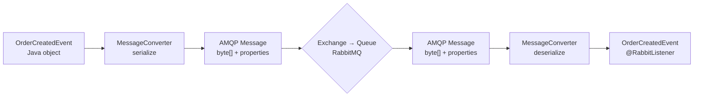
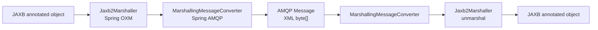
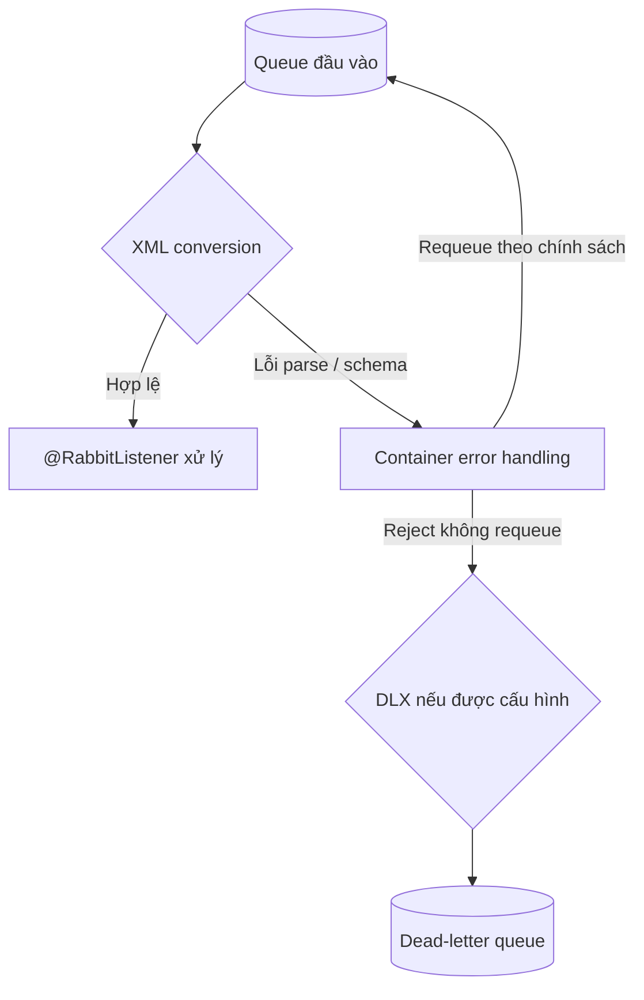

# Jackson XML, marshalling và converter tùy biến khi cần

## Mục tiêu bài học

Trong **SPRING_AMQP**, ứng dụng dùng `RabbitTemplate` để gửi thông điệp và `@RabbitListener` để xử lý bất đồng bộ. Exchange, queue và binding quyết định **thông điệp đi đến đâu**; còn **message converter** quyết định **đối tượng Java được biểu diễn thành byte như thế nào** và **bên nhận khôi phục dữ liệu từ các byte đó ra sao**.

JSON là lựa chọn phổ biến, nhưng nhiều hệ thống tích hợp với đối tác, phần mềm cũ hoặc hợp đồng dữ liệu có XML Schema (XSD) cần sử dụng **XML**. Khi đó, bạn có thể chọn **Jackson XML**, bộ chuyển đổi **marshalling/unmarshalling** thông qua Spring OXM hoặc tự viết **Spring AMQP `MessageConverter`** để kiểm soát chính xác quá trình chuyển đổi.

Sau bài học, bạn có thể:

1. Giải thích body `byte[]`, `MessageProperties`, `contentType` và vai trò của AMQP `MessageConverter`.
2. Phân biệt **Jackson `XmlMapper`**, **Spring OXM `Marshaller`/`Unmarshaller`** và **`MarshallingMessageConverter`** của Spring AMQP.
3. Tự cài đặt converter XML bằng `XmlMapper` với kiểu payload, encoding, content type và kiểm tra đầu vào rõ ràng.
4. Cấu hình cùng converter cho `RabbitTemplate` và `@RabbitListener` để đảm bảo publisher/consumer có cùng hợp đồng dữ liệu.
5. Xác định khi nào dùng Jackson XML, khi nào dùng JAXB/OXM và khi nào cần converter tùy biến.
6. Nhận diện lỗi sai content type, lỗi deserialize, XML không tin cậy và liên hệ của lỗi conversion với retry/dead-letter.

> **Giới hạn phiên bản trong ví dụ:** Mã Jackson dùng namespace `com.fasterxml.jackson.*` và JAXB dùng `jakarta.xml.bind.*`, phù hợp với cách tích hợp thường thấy của **Spring Boot 3.x / Jackson 2.x**. Khi dùng Spring Boot hoặc Jackson major khác, cần kiểm tra package, API converter và dependency theo phiên bản của dự án thay vì sao chép nguyên tên lớp.

## 1. Conversion nằm ở đâu trong đường đi của message?

RabbitMQ truyền body của message ở dạng **byte**, chứ không hiểu `OrderCreated`, record Java hoặc XML DOM mà ứng dụng định nghĩa. AMQP có metadata mô tả nội dung, nhưng broker không tự thực thi quy tắc deserialize dữ liệu nghiệp vụ.



Ở đây, hai API thường gặp của Spring AMQP là:

```java
// Đã có message gồm body byte[] và AMQP MessageProperties:
rabbitTemplate.send(exchange, routingKey, amqpMessage);

// Có một object Java và muốn converter tạo AMQP Message:
rabbitTemplate.convertAndSend(exchange, routingKey, javaObject);
```

Với `convertAndSend(...)`, Spring AMQP gọi converter để chuyển Java object thành `org.springframework.amqp.core.Message` trước khi publish. Khi listener nhận message, adapter có thể sử dụng converter để chuyển body bytes thành kiểu mà phương thức handler cần.

### Ba kiểu dữ liệu cần phân biệt

| Kiểu/API | Chứa gì? | Vị trí trong luồng |
|---|---|---|
| `org.springframework.amqp.core.Message` | `byte[] body` và `MessageProperties` | Đại diện thông điệp AMQP nhận/gửi với RabbitMQ |
| `org.springframework.amqp.support.converter.MessageConverter` | `toMessage(Object, MessageProperties)` và `fromMessage(Message)` | Chuyển đổi giữa Java object và AMQP Message |
| `org.springframework.messaging.Message<T>` | Payload kiểu `T` và `MessageHeaders` | Abstraction ứng dụng; có thể xuất hiện trong listener adapter |

Đừng nhầm `MessageConverter` thuộc `org.springframework.amqp.support.converter` với interface cùng tên của **Spring Messaging**. Converter gắn với `RabbitTemplate` và listener container trong ví dụ này là **AMQP converter**.

## 2. Hai hướng chuyển đổi: serialization và deserialization

| Chiều | Tên thao tác | Ví dụ | Rủi ro nếu cấu hình sai |
|---|---|---|---|
| Java object → body bytes | **Serialization / marshalling** | `OrderCreatedEvent` → XML UTF-8 | Sai định dạng, sai tên element, thiếu thuộc tính, nội dung không được hỗ trợ |
| Body bytes → Java object | **Deserialization / unmarshalling** | XML UTF-8 → `OrderCreatedEvent` | Sai encoding, thiếu field, XML không hợp lệ, mismatch schema, input độc hại |

Hai hướng phải có **hợp đồng dữ liệu tương thích**. Một publisher ghi XML nhưng consumer mặc định xử lý JSON sẽ không khôi phục được DTO chỉ vì tên queue và binding đúng.

Ví dụ dữ liệu XML:

```xml
<orderCreated>
    <orderId>ORD-42</orderId>
    <occurredAtEpochMillis>1760000000000</occurredAtEpochMillis>
</orderCreated>
```

Body thực tế trên AMQP là chuỗi byte được mã hóa, chẳng hạn UTF-8. Bên ngoài body có các basic properties:

```text
AMQP Message
├── body: byte[] của XML
└── MessageProperties
    ├── contentType: application/xml
    ├── contentEncoding: UTF-8
    ├── messageId: ...
    ├── correlationId: ...
    └── headers:
        └── schemaVersion: 1
```

**`contentType = application/xml` là metadata, không phải bộ phân tích XML.** Nó giúp consumer quyết định cách đọc body. Cả XML hợp lệ lẫn XML sai cú pháp đều có thể mang giá trị content type này nếu publisher gán sai.

## 3. Các lựa chọn chuyển đổi XML trong Spring AMQP

| Lựa chọn | Cơ chế | Phù hợp nhất khi | Điều cần chuẩn bị |
|---|---|---|---|
| **Jackson XML + converter tùy biến** | Jackson `XmlMapper` đọc/ghi XML, một adapter triển khai AMQP `MessageConverter` | Đã dùng Jackson, DTO/record Java, muốn kiểm soát schema/type/header | Dependency `jackson-dataformat-xml`; code adapter rõ kiểu |
| **Spring OXM + `MarshallingMessageConverter`** | Spring OXM `Marshaller`/`Unmarshaller`, ví dụ `Jaxb2Marshaller`, được bọc thành AMQP converter | Hệ thống dùng JAXB, XML contract và annotations | `spring-oxm`, JAXB annotations/runtime hoặc OXM provider thích hợp |
| **`SimpleMessageConverter` với `String`/`byte[]`** | Gửi/nhận văn bản hoặc bytes; ứng dụng tự parse XML | Chỉ chuyển tiếp XML hoặc muốn kiểm soát XML ngoài messaging layer | Tự đặt metadata và tự parse trong nghiệp vụ |
| **Converter đa định dạng tùy biến** | Nhánh theo `contentType`/schema version rồi chuyển đến parser tương ứng | Migration JSON ↔ XML, nhiều producer hoặc đối tác | Quy tắc rõ ràng, giới hạn định dạng/kiểu, xử lý lỗi nhất quán |

RabbitMQ **không có yêu cầu** ứng dụng phải sử dụng Jackson XML hoặc JAXB. Broker chỉ lưu/định tuyến bytes và properties. Việc chọn công nghệ chuyển đổi là quyết định của producer/consumer cùng hợp đồng dữ liệu.

### Điểm cần nhớ về tên lớp

`XmlMapper` thuộc **Jackson XML**. Nó xử lý dữ liệu XML nhưng **không tự động trở thành bean `org.springframework.amqp.support.converter.MessageConverter`** chỉ nhờ thêm dependency vào ứng dụng.

Ngược lại, `MarshallingMessageConverter` là adapter **Spring AMQP** đã được thiết kế để gọi các API **Spring OXM**. Nó không đồng nhất với `Jackson2JsonMessageConverter` (converter JSON) và không tự biến mọi XML thành một POJO bất kỳ nếu không có cấu hình unmarshaller phù hợp.

## 4. Sử dụng Jackson XML và `XmlMapper`

### 4.1. Thêm dependency

Với Gradle Groovy DSL:

```groovy
dependencies {
    implementation 'org.springframework.boot:spring-boot-starter-amqp'
    implementation 'com.fasterxml.jackson.dataformat:jackson-dataformat-xml'
}
```

Với Maven:

```xml
<dependencies>
    <dependency>
        <groupId>org.springframework.boot</groupId>
        <artifactId>spring-boot-starter-amqp</artifactId>
    </dependency>
    <dependency>
        <groupId>com.fasterxml.jackson.dataformat</groupId>
        <artifactId>jackson-dataformat-xml</artifactId>
    </dependency>
</dependencies>
```

Đây là phần dependency cần thêm vào file build hiện có. Nếu dự án được quản lý bằng Spring Boot BOM, nên để BOM quản lý các phiên bản hỗ trợ; tránh ép riêng Jackson XML khác major với Jackson mà Boot đang sử dụng. Kiểm tra lại cây dependency nếu dự án có thêm thư viện XML/StAX từ tổ chức.

### 4.2. Định nghĩa DTO XML

Ví dụ file `OrderCreatedEvent.java`:

```java
package com.example.amqp.xml;

import com.fasterxml.jackson.dataformat.xml.annotation.JacksonXmlRootElement;

@JacksonXmlRootElement(localName = "orderCreated")
public record OrderCreatedEvent(
        String orderId,
        long occurredAtEpochMillis) {
}
```

Annotation `@JacksonXmlRootElement` chỉ định tên element gốc. Bản thân record chỉ mô tả cấu trúc Java; converter mới thực hiện serialization/deserialization. Ví dụ này dùng hai field đơn giản để tập trung vào cơ chế XML, không áp dụng cho mọi dạng XML phức tạp như attributes, namespaces hay mixed content.

### 4.3. Dùng `XmlMapper` để kiểm tra XML trước

```java
import com.fasterxml.jackson.dataformat.xml.XmlMapper;

XmlMapper xmlMapper = new XmlMapper();

OrderCreatedEvent event =
        new OrderCreatedEvent("ORD-42", 1760000000000L);

byte[] xmlBytes = xmlMapper.writeValueAsBytes(event);
OrderCreatedEvent reconstructed =
        xmlMapper.readValue(xmlBytes, OrderCreatedEvent.class);
```

Hai lời gọi trên là **Jackson API thuần túy**. Chúng không gửi message vào RabbitMQ, chưa tạo `MessageProperties` và chưa chọn exchange/routing key. Để dùng với `RabbitTemplate.convertAndSend(...)`, ta cần nối `XmlMapper` với interface converter của Spring AMQP.

## 5. Tự viết `MessageConverter` dành cho một loại event XML

Khi hợp đồng dữ liệu chỉ có một hoặc một nhóm DTO xác định rõ, converter theo kiểu cụ thể giúp tránh việc tin tưởng một header tùy ý có quyền quyết định **class nào được deserialize**.

### 5.1. Triển khai adapter cho AMQP

Tạo file `OrderCreatedXmlMessageConverter.java`:

```java
package com.example.amqp.xml;

import java.io.IOException;
import java.nio.charset.StandardCharsets;
import java.util.Objects;

import com.fasterxml.jackson.dataformat.xml.XmlMapper;
import org.springframework.amqp.core.Message;
import org.springframework.amqp.core.MessageProperties;
import org.springframework.amqp.support.converter.MessageConversionException;
import org.springframework.amqp.support.converter.MessageConverter;

public final class OrderCreatedXmlMessageConverter
        implements MessageConverter {

    private static final String CONTENT_TYPE = "application/xml";
    private static final String SCHEMA_VERSION = "1";
    private final XmlMapper xmlMapper;

    public OrderCreatedXmlMessageConverter(XmlMapper xmlMapper) {
        this.xmlMapper = Objects.requireNonNull(xmlMapper);
    }

    @Override
    public Message toMessage(Object object, MessageProperties properties)
            throws MessageConversionException {

        if (!(object instanceof OrderCreatedEvent event)) {
            throw new MessageConversionException(
                    "Only OrderCreatedEvent is supported");
        }
        validate(event);

        try {
            byte[] body = xmlMapper.writeValueAsBytes(event);
            properties.setContentType(CONTENT_TYPE);
            properties.setContentEncoding(
                    StandardCharsets.UTF_8.name());
            properties.setHeader("schemaVersion", SCHEMA_VERSION);
            return new Message(body, properties);
        } catch (IOException ex) {
            throw new MessageConversionException(
                    "Cannot serialize OrderCreatedEvent as XML", ex);
        }
    }

    @Override
    public Object fromMessage(Message message)
            throws MessageConversionException {

        MessageProperties properties = message.getMessageProperties();
        if (!CONTENT_TYPE.equals(properties.getContentType())) {
            throw new MessageConversionException(
                    "Unexpected contentType: " + properties.getContentType());
        }
        if (!StandardCharsets.UTF_8.name().equalsIgnoreCase(
                properties.getContentEncoding())) {
            throw new MessageConversionException(
                    "Only UTF-8 XML is supported");
        }
        if (!SCHEMA_VERSION.equals(
                properties.getHeaders().get("schemaVersion"))) {
            throw new MessageConversionException(
                    "Unsupported schemaVersion");
        }

        try {
            OrderCreatedEvent event = xmlMapper.readValue(
                    message.getBody(), OrderCreatedEvent.class);
            validate(event);
            return event;
        } catch (IOException ex) {
            throw new MessageConversionException(
                    "Cannot deserialize OrderCreatedEvent XML", ex);
        }
    }

    private static void validate(OrderCreatedEvent event) {
        if (event == null || event.orderId() == null
                || event.orderId().isBlank()) {
            throw new MessageConversionException(
                    "orderId is required");
        }
    }
}
```

**Giải thích kỹ thuật:**

1. `toMessage(...)` tạo body `byte[]` từ object bằng `XmlMapper`; đồng thời điền `contentType`, `contentEncoding` và header phiên bản schema.
2. `fromMessage(...)` kiểm tra metadata trước khi deserialize, đọc bytes thành **`OrderCreatedEvent.class` cố định** rồi validate dữ liệu quan trọng.
3. `MessageConversionException` báo lỗi ở ranh giới chuyển đổi, tránh đưa một object sai kiểu vào handler và khiến lỗi khó chẩn đoán.
4. XML body, AMQP message properties và application headers được đặt ở ba vị trí rõ ràng; exchange và routing key vẫn do lời gọi publish quyết định.
5. `validate(...)` mới chỉ là kiểm tra nghiệp vụ tối thiểu. Với XML contract đầy đủ, cần kiểm tra trường bắt buộc, giới hạn giá trị, namespace, version và có thể cả XSD.

**Lưu ý mã hóa:** Mẫu này giả định dữ liệu sử dụng UTF-8 và từ chối metadata khác. Khi cần chấp nhận nhiều charset, phải chuyển đổi bytes theo charset đúng, bảo đảm khai báo encoding XML khớp body và có policy an toàn cho charset được phép. Không được tự coi tất cả XML là UTF-8 nếu đối tác gửi encoding khác.

**Lưu ý XML không tin cậy:** Đoạn converter minh họa nghiệp vụ; trước khi nhận XML từ bên ngoài, cần cấu hình parser StAX/Jackson để vô hiệu hóa DTD và external entities, đặt giới hạn kích thước/độ sâu đầu vào và dùng phiên bản thư viện đã được bảo trì. Mặc định của XML parser không nên được coi là bằng chứng hệ thống miễn nhiễm XXE hoặc tấn công mở rộng entity. Xem phần an toàn ở cuối bài.

### 5.2. Spring Boot cấu hình converter cho cả publisher và listener

Để tránh tình huống publisher tạo XML nhưng consumer lại dùng converter mặc định, khai báo converter và gắn rõ vào cả hai bên. Ví dụ file `XmlMessagingConfiguration.java`:

```java
package com.example.amqp.xml;

import com.fasterxml.jackson.dataformat.xml.XmlMapper;
import org.springframework.amqp.core.Queue;
import org.springframework.amqp.core.QueueBuilder;
import org.springframework.amqp.rabbit.config.SimpleRabbitListenerContainerFactory;
import org.springframework.amqp.rabbit.connection.ConnectionFactory;
import org.springframework.amqp.rabbit.core.RabbitTemplate;
import org.springframework.amqp.support.converter.MessageConverter;
import org.springframework.beans.factory.annotation.Qualifier;
import org.springframework.context.annotation.Bean;
import org.springframework.context.annotation.Configuration;

@Configuration
public class XmlMessagingConfiguration {

    public static final String QUEUE = "demo.order.created.xml";

    @Bean
    Queue orderCreatedXmlQueue() {
        return QueueBuilder.durable(QUEUE).build();
    }

    @Bean
    XmlMapper orderXmlMapper() {
        return new XmlMapper();
    }

    @Bean
    MessageConverter orderXmlConverter(XmlMapper orderXmlMapper) {
        return new OrderCreatedXmlMessageConverter(orderXmlMapper);
    }

    @Bean
    RabbitTemplate rabbitTemplate(
            ConnectionFactory connectionFactory,
            @Qualifier("orderXmlConverter") MessageConverter converter) {
        RabbitTemplate template = new RabbitTemplate(connectionFactory);
        template.setMessageConverter(converter);
        return template;
    }

    @Bean
    SimpleRabbitListenerContainerFactory xmlListenerContainerFactory(
            ConnectionFactory connectionFactory,
            @Qualifier("orderXmlConverter") MessageConverter converter) {
        SimpleRabbitListenerContainerFactory factory =
                new SimpleRabbitListenerContainerFactory();
        factory.setConnectionFactory(connectionFactory);
        factory.setMessageConverter(converter);
        return factory;
    }
}
```

Trong cấu hình này:

- `RabbitTemplate` phát XML khi nhận `OrderCreatedEvent` qua `convertAndSend(...)`.
- `xmlListenerContainerFactory` sử dụng **cùng converter** để chuyển body của message thành `OrderCreatedEvent` cho listener.
- Queue được khai báo dưới dạng bean `Queue`; trong cấu hình Spring Boot có `RabbitAdmin` phù hợp, queue sẽ được khai báo với broker khi có kết nối.
- Nếu dự án đã có bean `RabbitTemplate`, hãy cập nhật bean đang dùng hoặc dùng tên/`@Qualifier` rõ ràng; không tạo nhiều bean trùng mục đích rồi phụ thuộc vào việc Spring chọn ngẫu nhiên.

Mã trên cố ý dùng listener factory đơn giản để minh họa conversion. Với ứng dụng thật có retry advice, concurrency, acknowledgement mode, prefetch hoặc observation, cần giữ những tùy chỉnh đó trên factory thực tế (hoặc dùng Boot factory configurer phù hợp) khi thay đổi converter.

### 5.3. Publisher và listener

File `OrderXmlPublisher.java`:

```java
package com.example.amqp.xml;

import org.springframework.amqp.rabbit.core.RabbitTemplate;
import org.springframework.stereotype.Service;

@Service
public class OrderXmlPublisher {

    private final RabbitTemplate rabbitTemplate;

    public OrderXmlPublisher(RabbitTemplate rabbitTemplate) {
        this.rabbitTemplate = rabbitTemplate;
    }

    public void publish(String orderId) {
        OrderCreatedEvent event =
                new OrderCreatedEvent(orderId, System.currentTimeMillis());

        rabbitTemplate.convertAndSend(
                "", // default exchange
                XmlMessagingConfiguration.QUEUE,
                event
        );
    }
}
```

File `OrderXmlListener.java`:

```java
package com.example.amqp.xml;

import org.springframework.amqp.rabbit.annotation.RabbitListener;
import org.springframework.stereotype.Component;

@Component
public class OrderXmlListener {

    @RabbitListener(
            queues = XmlMessagingConfiguration.QUEUE,
            containerFactory = "xmlListenerContainerFactory")
    public void handle(OrderCreatedEvent event) {
        System.out.println("Received XML order: " + event.orderId());
    }
}
```

File `XmlApplication.java`:

```java
package com.example.amqp.xml;

import org.springframework.boot.ApplicationRunner;
import org.springframework.boot.SpringApplication;
import org.springframework.boot.autoconfigure.SpringBootApplication;
import org.springframework.amqp.rabbit.annotation.EnableRabbit;
import org.springframework.context.annotation.Bean;

@SpringBootApplication
@EnableRabbit
public class XmlApplication {

    public static void main(String[] args) {
        SpringApplication.run(XmlApplication.class, args);
    }

    @Bean
    ApplicationRunner sendOnce(OrderXmlPublisher publisher) {
        return args -> publisher.publish("ORD-42");
    }
}
```

Ứng dụng sử dụng **default exchange** `""` với routing key bằng tên queue `demo.order.created.xml` để ví dụ tập trung vào chuyển đổi dữ liệu. Trong dự án có topic/direct exchange, thay tham số exchange và routing key cho phù hợp binding. **Định dạng XML không làm thay đổi cơ chế routing.**

Output dự kiến:

```text
Received XML order: ORD-42
```

Nếu có consumer khác trên cùng queue hoặc queue tồn đọng message từ phiên bản converter cũ, kết quả có thể khác. Nên dùng môi trường lab và queue chuyên biệt khi kiểm tra.

## 6. Spring OXM: marshalling, unmarshalling và JAXB

Jackson XML không phải lựa chọn duy nhất. **Spring OXM (Object/XML Mapping)** cung cấp abstraction cho việc chuyển object ↔ XML:

- `org.springframework.oxm.Marshaller`: ghi một object ra XML.
- `org.springframework.oxm.Unmarshaller`: đọc XML thành object.
- `org.springframework.oxm.jaxb.Jaxb2Marshaller`: một implementation dùng JAXB, đồng thời có thể làm marshaller và unmarshaller.
- `org.springframework.amqp.support.converter.MarshallingMessageConverter`: adapter của **Spring AMQP** dùng OXM để chuyển Object ↔ AMQP `Message`.



### 6.1. Khi nào marshalling qua OXM phù hợp?

OXM hữu ích nếu dự án đã dùng JAXB annotations, có yêu cầu tương thích cấu trúc XML đối tác hoặc muốn làm việc với XML schema/document binding. Nếu dự án đang dùng Jackson để mô hình hóa DTO và mong cấu hình đơn giản, Jackson XML có thể dễ thích nghi hơn.

| Tiêu chí | Jackson XML | Spring OXM + JAXB |
|---|---|---|
| Khai báo kiểu dữ liệu | POJO/record và Jackson XML annotations | JAXB annotations và các quy tắc mapping JAXB |
| Đọc/ghi XML | `XmlMapper` | `Jaxb2Marshaller` |
| Gắn vào RabbitTemplate | Viết adapter `MessageConverter` hoặc dùng adapter riêng của dự án | Dùng `MarshallingMessageConverter` |
| Phù hợp với XML schema truyền thống | Có thể đáp ứng tùy mapping/validation | Thường thuận tiện khi đã dùng JAXB/XSD |
| Điều cần chú ý | Cấu hình XML parser, kiểu đích, namespace, record support, Jackson version | JAXB runtime, đúng namespace `jakarta`/`javax`, JAXB context/annotations |

### 6.2. Dependency bổ sung cho Spring OXM/JAXB

Với ứng dụng Spring Boot 3.x, ví dụ Gradle:

```groovy
dependencies {
    implementation 'org.springframework.boot:spring-boot-starter-amqp'
    implementation 'org.springframework:spring-oxm'
    implementation 'jakarta.xml.bind:jakarta.xml.bind-api'
    runtimeOnly 'org.glassfish.jaxb:jaxb-runtime'
}
```

Với Maven, các dependency tương ứng là:

```xml
<dependency>
    <groupId>org.springframework</groupId>
    <artifactId>spring-oxm</artifactId>
</dependency>
<dependency>
    <groupId>jakarta.xml.bind</groupId>
    <artifactId>jakarta.xml.bind-api</artifactId>
</dependency>
<dependency>
    <groupId>org.glassfish.jaxb</groupId>
    <artifactId>jaxb-runtime</artifactId>
    <scope>runtime</scope>
</dependency>
```

Thêm các dòng vào `<dependencies>` hiện có. Các version để trống khi Spring Boot BOM của dự án quản lý chúng. Trên Java 17, JAXB không còn là một phần mặc định của JDK như các bản Java cũ; cần bảo đảm runtime tương thích có mặt trên classpath.

Nếu dự án Spring Boot 2.x còn dùng bộ `javax.xml.bind.*`, **đừng tự động copy các import `jakarta.xml.bind.*` từ ví dụ Boot 3.x**. Chọn bộ JAXB và Spring OXM tương thích với đúng dòng framework đang dùng.

### 6.3. DTO dùng JAXB annotations

File `JaxbOrderCreated.java`:

```java
package com.example.amqp.xml;

import jakarta.xml.bind.annotation.XmlAccessType;
import jakarta.xml.bind.annotation.XmlAccessorType;
import jakarta.xml.bind.annotation.XmlRootElement;

@XmlRootElement(name = "orderCreated")
@XmlAccessorType(XmlAccessType.FIELD)
public class JaxbOrderCreated {

    private String orderId;
    private long occurredAtEpochMillis;

    // JAXB cần constructor không tham số có thể truy cập.
    public JaxbOrderCreated() {
    }

    public JaxbOrderCreated(String orderId, long occurredAtEpochMillis) {
        this.orderId = orderId;
        this.occurredAtEpochMillis = occurredAtEpochMillis;
    }

    public String getOrderId() {
        return orderId;
    }

    public long getOccurredAtEpochMillis() {
        return occurredAtEpochMillis;
    }
}
```

Khác với record trong ví dụ Jackson, DTO JAXB ở đây là class có constructor không tham số và annotation ánh xạ field. Nếu hợp đồng XML có namespace/attribute hoặc schema phức tạp, khai báo thêm annotation tương ứng và kiểm chứng XML sinh ra trên một fixture thực tế.

### 6.4. Cấu hình `MarshallingMessageConverter`

```java
package com.example.amqp.xml;

import org.springframework.amqp.support.converter.MarshallingMessageConverter;
import org.springframework.amqp.support.converter.MessageConverter;
import org.springframework.context.annotation.Bean;
import org.springframework.context.annotation.Configuration;
import org.springframework.oxm.jaxb.Jaxb2Marshaller;

@Configuration
public class JaxbConverterConfiguration {

    @Bean
    Jaxb2Marshaller orderJaxbMarshaller() {
        Jaxb2Marshaller marshaller = new Jaxb2Marshaller();
        marshaller.setClassesToBeBound(JaxbOrderCreated.class);
        marshaller.setSupportDtd(false);
        marshaller.setProcessExternalEntities(false);
        return marshaller;
    }

    @Bean
    MessageConverter jaxbOrderMessageConverter(
            Jaxb2Marshaller orderJaxbMarshaller) {
        return new MarshallingMessageConverter(
                orderJaxbMarshaller, orderJaxbMarshaller);
    }
}
```

`MarshallingMessageConverter` gọi OXM marshaller khi gửi và OXM unmarshaller khi nhận. **Cấu hình này là lựa chọn thay thế cho converter Jackson ở mục 5**, không phải phần bắt buộc phải đăng ký đồng thời trong cùng ứng dụng thử nghiệm.

Nếu bạn dùng converter JAXB này để publish/consume, gắn nó vào `RabbitTemplate.setMessageConverter(...)` và `SimpleRabbitListenerContainerFactory.setMessageConverter(...)` tương tự như ví dụ Jackson, đồng thời chỉnh DTO trong publisher/listener thành `JaxbOrderCreated`. Với ứng dụng có nhiều converter, dùng `@Qualifier` để chọn chính xác bean, và xác định ai chịu trách nhiệm chọn định dạng cho từng queue.

**Về content type:** Kiểm tra `MessageProperties.contentType` mà converter cụ thể tạo ra và chuẩn hóa metadata XML (thường `application/xml`), encoding và schema version theo hợp đồng của hệ thống. Không mặc định mọi cấu hình OXM sẽ sinh metadata giống hệt converter Jackson tự viết.

## 7. Khi nào thật sự cần converter tùy biến?

Không phải lúc nào cũng cần viết một converter mới. Hãy xem đầu vào, đầu ra và quy tắc chuyển đổi trước:

| Yêu cầu | Hướng giải quyết |
|---|---|
| Gửi XML dưới dạng text, consumer tự parse ở tầng ứng dụng | Có thể dùng `SimpleMessageConverter` với `String` hoặc gửi `byte[]` và đặt content type đúng |
| XML một kiểu DTO cố định | Adapter `XmlMapper` theo kiểu cụ thể, như `OrderCreatedXmlMessageConverter` |
| XML đã dùng JAXB/XSD trong dự án | `Jaxb2Marshaller` + `MarshallingMessageConverter` |
| Cần đọc cả XML và JSON trong giai đoạn chuyển đổi hệ thống | Converter hoặc routing layer lựa chọn theo content type và version **được whitelist** |
| Payload được nén, mã hóa hay bọc envelope nội bộ | Converter chuyên biệt hoặc tầng xử lý rõ thứ tự giải mã/giải nén/deserialize |
| Muốn metadata correlation/trace tùy biến | Dùng `MessagePostProcessor` hoặc header mapper khi đủ, không cần viết lại toàn bộ converter |

### 7.1. Khi cần chuyển đổi khác nhau theo content type

Ví dụ hệ thống đang di chuyển từ JSON sang XML. Có hai nhóm message:

```text
contentType=application/json, schemaVersion=1 -> JSON parser -> OrderCreatedEvent
contentType=application/xml,  schemaVersion=2 -> XML parser  -> OrderCreatedEvent
```

Một converter tổng hợp có thể chọn converter con:

```java
@Override
public Object fromMessage(Message message) {
    String contentType =
            message.getMessageProperties().getContentType();

    return switch (contentType) {
        case "application/json" -> jsonConverter.fromMessage(message);
        case "application/xml"  -> xmlConverter.fromMessage(message);
        default -> throw new MessageConversionException(
                "Unsupported contentType: " + contentType);
    };
}
```

Đây là **đoạn minh họa bên trong class converter tổng hợp**; nó giả định hai biến `jsonConverter` và `xmlConverter` đã được inject và đều là AMQP `MessageConverter`. Cần bổ sung kiểm tra schema version, encoding, size limit và loại payload. Không deserialize theo tên class lấy trực tiếp từ header không tin cậy.

Trong nhiều hệ thống, tách queue hoặc routing key theo phiên bản sự kiện còn **đơn giản và dễ quan sát** hơn một converter xử lý mọi định dạng trên cùng queue.

### 7.2. Dùng `MessagePostProcessor` khi chỉ muốn thêm metadata

Nếu đã có converter XML phù hợp và chỉ cần gắn correlation ID hoặc trace:

```java
rabbitTemplate.convertAndSend(
        "orders.events",
        "order.created",
        event,
        amqpMessage -> {
            amqpMessage.getMessageProperties()
                    .setCorrelationId("request-42");
            amqpMessage.getMessageProperties()
                    .setHeader("sourceService", "order-service");
            return amqpMessage;
        });
```

`MessagePostProcessor` nhận **AMQP `Message` đã được converter tạo ra**. Bạn có thể bổ sung header mà không cần tạo một converter mới cho chính thao tác này. Tuy nhiên, nếu thay body bytes, phải đồng thời cập nhật content type, encoding và các thuộc tính liên quan để tránh làm sai hợp đồng dữ liệu.

## 8. Bảo mật và độ bền của XML message

XML là định dạng biểu diễn dữ liệu, **không phải ranh giới tin cậy**. Khi tiêu thụ XML từ producer khác, converter có thể là nơi đầu tiên tiếp xúc với dữ liệu không hợp lệ hoặc độc hại.

### 8.1. Phòng tránh XXE và entity expansion

Với parser XML hoặc StAX được dùng phía dưới Jackson/JAXB, cần kiểm soát:

- **DTD** nếu hệ thống không thực sự cần.
- **External entity resolution**, tránh đọc file nội bộ hoặc gọi URL ngoài ý muốn.
- Kích thước body, độ sâu nested elements, số lượng phần tử và tổng độ dài text.
- Các tính năng polymorphic/deserialization có thể tạo kiểu Java không được phép.

Trong ví dụ OXM phía trên, `Jaxb2Marshaller.setSupportDtd(false)` và `setProcessExternalEntities(false)` thể hiện ý định tắt các cơ chế nguy hiểm. Với Jackson XML, cần cấu hình StAX/XML parser backing `XmlMapper` tương ứng theo phiên bản thư viện và kiểm thử bằng dữ liệu có DTD/external entity. **Không chỉ dựa vào việc body mang `application/xml` để quyết định nó an toàn.**

### 8.2. Kiểm tra schema, version và encoding

| Thứ cần kiểm tra | Nếu bỏ qua |
|---|---|
| `contentType` | Có thể đưa JSON/bytes vào XML parser và gây lỗi không rõ nguyên nhân |
| `contentEncoding` và XML declaration | Nội dung Unicode có thể bị đọc sai hoặc từ chối |
| Header phiên bản schema | Producer thay đổi cấu trúc nhưng consumer vẫn dùng DTO cũ |
| Trường bắt buộc và giới hạn giá trị | Message deserialize thành công nhưng dữ liệu sai nghiệp vụ |
| Giới hạn kích thước body | Consumer có thể tốn CPU/RAM lớn trên message bất thường |
| XML namespace, attributes, element ordering | Bên nhận khác có thể không tương thích dù XML đúng cú pháp |

Với hợp đồng XML nghiêm ngặt, cân nhắc **XSD validation** trên dữ liệu đầu vào và bộ test fixture versioned. Việc deserialize thành một Java record hoặc class thành công **không chứng minh** payload đáp ứng tất cả ràng buộc nghiệp vụ.

### 8.3. Lỗi conversion ảnh hưởng retry và dead-letter ra sao?

Giả sử listener nhận một message XML không hợp lệ:

1. Broker giao message từ queue tới listener container.
2. Converter ném `MessageConversionException` trong quá trình đọc body.
3. Phương thức `@RabbitListener` **chưa được gọi** vì không có payload Java hợp lệ.
4. Listener container/error handler xử lý ngoại lệ theo cấu hình: reject, requeue, retry hoặc dead-letter tùy trường hợp.



Spring AMQP có các cơ chế phân loại một số lỗi conversion nghiêm trọng là **fatal**, nhưng hành vi cụ thể phụ thuộc phiên bản, listener container, error handler và cấu hình requeue/retry. **Không giả định** một message XML sai sẽ luôn được đưa vào DLQ nếu bạn chưa khai báo DLX, binding và chính sách xử lý lỗi tương ứng.

Một message liên tục lỗi vì không parse được thường **không tự trở nên hợp lệ** nếu được giao lại y nguyên. Nếu retry vô hạn, hệ thống có thể tạo vòng lặp tiêu tốn tài nguyên. Hãy phân biệt **lỗi tạm thời** (dịch vụ phụ trợ chưa sẵn sàng) với **lỗi dữ liệu vĩnh viễn** (XML malformed/schema không tương thích) để chọn chiến lược xử lý thích hợp.

### 8.4. Conversion không bảo đảm giao nhận

Converter chỉ quyết định **dạng dữ liệu**, không bảo đảm:

- Publisher đã được RabbitMQ xác nhận hay chưa (**publisher confirms**).
- Message có được định tuyến vào queue đích hay không (**returns**, binding, alternate exchange).
- Message còn nguyên sau sự cố broker hay không (durability, persistence, loại queue).
- Consumer đã hoàn thành nghiệp vụ hay chưa (**acknowledgement**, idempotency, giao dịch).

Vì vậy, một hệ thống dùng XML converter chính xác vẫn cần những cơ chế về giao nhận đáng tin cậy và khả năng quan sát như mọi ứng dụng Spring AMQP khác.

## 9. Thực hành trên RabbitMQ

### 9.1. Chuẩn bị broker local

Nếu máy đã có Docker, bạn có thể dùng RabbitMQ Management:

```bash
docker run -d --name rabbitmq-xml-lab \
  -p 5672:5672 -p 15672:15672 \
  rabbitmq:4-management
```

Cổng `5672` dùng cho AMQP; quản trị qua `http://localhost:15672`. Nếu môi trường đã có broker, chỉ cần dùng broker đó và cấu hình kết nối tương ứng.

Ví dụ `application.yml` cho Spring Boot chạy trên máy local:

```yaml
spring:
  rabbitmq:
    host: localhost
    port: 5672
    username: guest
    password: guest
    virtual-host: /
```

`guest/guest` là tài khoản thử nghiệm local, không phải cấu hình production. Ở môi trường thật, dùng credentials và secret management phù hợp.

### 9.2. Kiểm tra XML converter

1. Bổ sung các file `OrderCreatedEvent`, `OrderCreatedXmlMessageConverter`, `XmlMessagingConfiguration`, `OrderXmlPublisher`, `OrderXmlListener` và `XmlApplication` trong cùng package gốc.
2. Khởi chạy ứng dụng, kiểm tra queue `demo.order.created.xml` tồn tại và listener kết nối được.
3. Kiểm tra log `Received XML order: ORD-42`.
4. Tạm dừng listener nếu muốn quan sát message còn trong queue trên RabbitMQ Management. Có consumer hoạt động, message có thể được nhận và ack ngay.
5. Thử publish XML sai cú pháp hoặc content type khác trong **môi trường lab riêng**. Quan sát log lỗi conversion và chính sách requeue của listener.
6. Thử thay `schemaVersion` từ `1` sang `2` trên message; converter minh họa phải từ chối payload không đúng phiên bản.

Trong RabbitMQ Management, mục “Get messages” có thể lấy message ra khỏi queue, làm thay đổi trạng thái delivery/ack tùy lựa chọn. Để đánh giá message nguyên vẹn, tốt nhất sử dụng một queue test riêng và ghi nhận thao tác quản trị đã thực hiện.

### 9.3. Bảng kiểm chứng đầu vào và kết quả kỳ vọng

| Tình huống | Kết quả mong đợi của converter ở mục 5 |
|---|---|
| Object `OrderCreatedEvent("ORD-42", timestamp)` | Serialize thành XML bytes, set `application/xml`, `UTF-8`, `schemaVersion=1` |
| Message XML hợp lệ với metadata đúng | Deserialize thành `OrderCreatedEvent` |
| `contentType=application/json` | Từ chối trước khi parse XML |
| Không có header `schemaVersion` | Từ chối vì không đủ hợp đồng dữ liệu |
| `schemaVersion=2` | Từ chối vì consumer minh họa chỉ hỗ trợ version `1` |
| XML sai cú pháp | Ném `MessageConversionException` |
| XML thiếu `orderId` | Từ chối do `validate(...)` |
| Producer gửi `String` thay vì `OrderCreatedEvent` | `toMessage(...)` từ chối kiểu không được hỗ trợ |

Nếu cần tương thích với producer đã tồn tại từ trước không gửi `contentEncoding` hoặc header version, hãy định nghĩa chính sách tương thích có kiểm soát (ví dụ giá trị mặc định trong giai đoạn migration) và kiểm thử fixture. Đừng âm thầm chấp nhận mọi format không rõ nguồn gốc.

## 10. Những lỗi thường gặp khi tích hợp XML

| Triệu chứng | Nguyên nhân thường gặp | Cách xử lý |
|---|---|---|
| `ClassCastException` khi listener nhận payload | Publisher/consumer dùng converter khác hoặc DTO kỳ vọng khác thực tế | Gắn đúng converter vào template và listener factory, kiểm tra type mapping |
| Message là `byte[]`/`String` trong listener dù muốn DTO | Converter mặc định không có quy tắc XML → DTO | Đăng ký XML converter hoặc unmarshaller phù hợp |
| `MessageConversionException` khi gửi | Converter chỉ hỗ trợ DTO cố định nhưng publisher đưa kiểu khác | Thống nhất hợp đồng message và kiểu Java được phép |
| Parse XML thất bại vì ký tự tiếng Việt | Body và encoding không đồng nhất | Chuẩn hóa UTF-8 và đối chiếu `contentEncoding`/XML declaration |
| JAXB ném lỗi không tìm được context/root | Thiếu `@XmlRootElement`, sai mapping hoặc chưa khai báo class JAXB | Kiểm tra annotations và `setClassesToBeBound(...)` |
| `ClassNotFoundException` hoặc lỗi JAXB runtime | Thiếu implementation JAXB hoặc trộn `javax`/`jakarta` sai major version | Đồng bộ Spring Boot/Spring OXM/JAXB và dependency runtime |
| Handler chưa chạy dù broker đã giao message | Conversion lỗi trước khi gọi `@RabbitListener` | Kiểm tra container error handler và log converter |
| Message bị giao lại liên tục | Requeue/retry lỗi XML vĩnh viễn | Phân loại fatal lỗi dữ liệu, giới hạn retry và cấu hình DLQ |
| Đổi Jackson version rồi phát sinh lỗi API | Tự ép dependency khác bộ BOM | Xem dependency tree và version được Spring Boot hỗ trợ |
| XML được parse nhưng thiếu dữ liệu nghiệp vụ | Converter chưa validate field hoặc contract thay đổi | Validate DTO, schema version và XSD nếu cần |
| Dùng XML serializer nhưng message không đến queue | Sai exchange/routing key/binding | Kiểm tra topology; converter không quyết định routing |
| Nhận header `__TypeId__` rồi deserialize arbitrary class | Tin type metadata không được kiểm soát | Chỉ cho phép class cụ thể/whitelist và tránh polymorphic unsafe |

## 11. Bài tập tự kiểm tra

### Câu 1. Thêm Jackson XML dependency đã đủ để `RabbitTemplate` tự gửi XML chưa?

**Đáp án:** Chưa. `XmlMapper` là API Jackson XML; `RabbitTemplate` cần một **AMQP `MessageConverter`** phù hợp được cấu hình rõ, chẳng hạn adapter tùy biến dùng `XmlMapper`.

### Câu 2. `contentType=application/xml` có đảm bảo body là XML hợp lệ không?

**Đáp án:** Không. Đó là metadata do publisher/adapter đặt. Consumer phải parse, validate schema/version và xử lý dữ liệu không tin cậy.

### Câu 3. `MarshallingMessageConverter` dùng gì để đọc object từ XML?

**Đáp án:** Nó sử dụng một **Spring OXM `Unmarshaller`**, ví dụ `Jaxb2Marshaller` đã biết những JAXB class được bind. Nó không có cơ chế chung tự nhận mọi kiểu DTO bất kỳ.

### Câu 4. Publisher gửi XML nhưng listener dùng converter JSON. Có thể sửa bằng đổi exchange không?

**Đáp án:** Không. Exchange và binding giải quyết định tuyến. Publisher/consumer phải thống nhất **dạng dữ liệu** và converter.

### Câu 5. XML deserialize thất bại, handler `@RabbitListener` chưa chạy. Có nên retry vô hạn không?

**Đáp án:** Thường không. XML sai cú pháp hoặc sai schema là lỗi dữ liệu có thể lặp lại mãi. Nên phân loại lỗi, giới hạn retry, cấu hình reject/dead-letter và quan sát nguyên nhân.

### Câu 6. Muốn thêm `correlationId` vào message XML, có nhất thiết viết converter mới không?

**Đáp án:** Không. Nếu XML converter đã đáp ứng chuyển đổi body, có thể dùng `MessagePostProcessor` sau conversion để thêm `MessageProperties.correlationId` mà không cần thay đổi cơ chế serialize.

### Câu 7. Có thể dùng một XML message từ RabbitMQ để chọn tên class Java từ header bất kỳ không?

**Đáp án:** Không nên. Header là dữ liệu có thể bị producer bên ngoài kiểm soát. Chỉ deserialize sang tập kiểu được phép và kiểm soát schema, tránh dùng thông tin class tùy ý làm quyền thực thi deserialization.

## Ghi nhớ

- RabbitMQ vận chuyển **`byte[]`**; `MessageConverter` của Spring AMQP chuyển **Java object ↔ AMQP Message**.
- **Jackson `XmlMapper`** đọc/ghi XML; để gắn vào `RabbitTemplate.convertAndSend(...)` và `@RabbitListener`, cần AMQP converter hoặc bridge phù hợp.
- **Spring OXM `Marshaller`/`Unmarshaller`** kết hợp với **`MarshallingMessageConverter`** là lựa chọn thuận tiện khi hệ thống đã dùng JAXB/XML contract.
- Converter tùy biến hữu ích khi cần kiểm soát **kiểu payload**, **content type**, **UTF-8**, **schema version**, validation và xử lý nhiều định dạng. Không mở deserialize arbitrary class dựa trên header không tin cậy.
- Cùng một hợp đồng dữ liệu phải được áp dụng ở **publisher và consumer**; định tuyến exchange/queue/binding không tự sửa định dạng dữ liệu.
- XML conversion cần đi cùng bảo vệ parser, kiểm soát lỗi, publisher confirms, consumer acknowledgements, retry, dead-letter, giao dịch và giám sát để xây xử lý bất đồng bộ đáng tin cậy.
