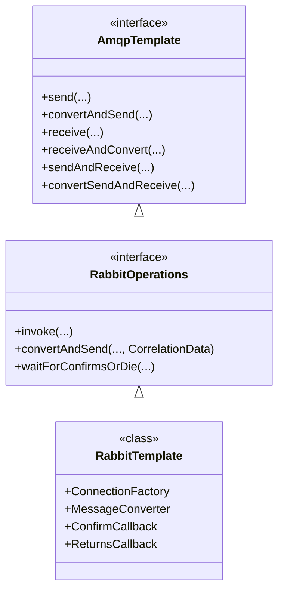
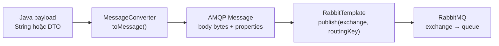
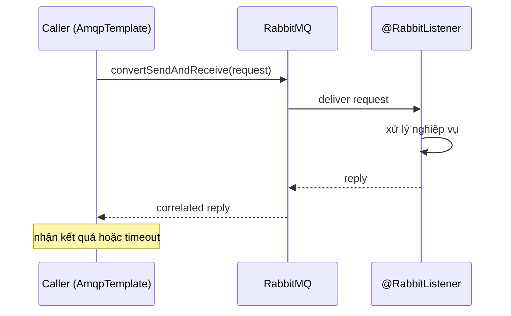
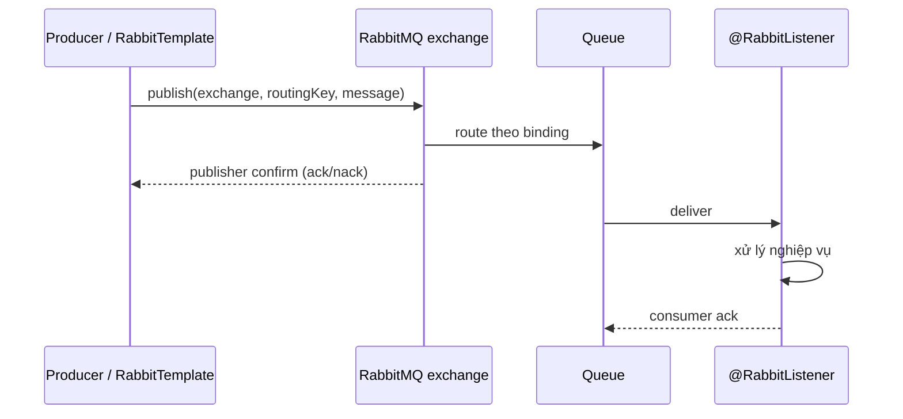

# AmqpTemplate, RabbitOperations và RabbitTemplate

## 1. Vì sao có ba tên API để gửi message?

Trong chương **Gửi thông điệp** của module **SPRING_AMQP**, ứng dụng Java cần gửi dữ liệu bất đồng bộ qua RabbitMQ: producer tạo sự kiện, exchange định tuyến bằng routing key, queue giữ message và `@RabbitListener` tiêu thụ. Khi viết code, bạn có thể gặp ba tên:

- `AmqpTemplate`
- `RabbitOperations`
- `RabbitTemplate`

Chúng **không phải ba cơ chế gửi độc lập** và cũng **không phải ba giao thức AMQP khác nhau**. Chúng là **các lớp trừu tượng và triển khai** trong Spring AMQP, được sử dụng ở những mức phụ thuộc khác nhau.

Bài học giúp bạn trả lời: nên inject interface nào, khi nào cần dùng class cụ thể, `send` khác `convertAndSend` thế nào, khi nào nên dùng request/reply, và vì sao lời gọi publish trả về bình thường vẫn chưa bảo đảm xử lý nghiệp vụ thành công.

### Mục tiêu

Sau khi học, bạn có thể:

1. Giải thích quan hệ giữa `AmqpTemplate`, `RabbitOperations` và `RabbitTemplate`.
2. Chọn kiểu dependency injection phù hợp cho service chỉ gửi/nhận message hay cần tính năng RabbitMQ riêng.
3. Gửi AMQP message thô với `send` và gửi Java object qua `convertAndSend`.
4. Phân biệt gửi một chiều, pull receive, `@RabbitListener` và request/reply.
5. Cấu hình Spring Boot với exchange, queue, binding và gọi template chạy được trong một ví dụ tối thiểu.
6. Bổ sung publisher confirms/returns, correlation ID và xử lý thất bại để phát triển thành hệ thống đáng tin cậy.

## 2. Quan hệ API: interface, interface mở rộng, implementation



Cách đọc sơ đồ:

- **`AmqpTemplate`** là interface cấp cao của Spring AMQP, định nghĩa các thao tác AMQP phổ biến như gửi, nhận, chuyển đổi payload và request/reply.
- **`RabbitOperations`** là interface **mở rộng `AmqpTemplate`** với các thao tác và overload gắn với RabbitMQ, ví dụ correlation data và scoped operations.
- **`RabbitTemplate`** là class **triển khai `RabbitOperations`**, dùng RabbitMQ Java client và `ConnectionFactory` để thực hiện thao tác thực tế.

Trong một phiên bản Spring AMQP cụ thể, interface có thể có thêm method hoặc kế thừa interface phụ khác; mô hình phụ thuộc cốt lõi vẫn là:

```text
AmqpTemplate                  abstraction AMQP phổ biến
    ^
    |
RabbitOperations              RabbitMQ-specific operations
    ^
    |
RabbitTemplate                triển khai dùng RabbitMQ client
```

### Import đúng namespace

```java
import org.springframework.amqp.core.AmqpTemplate;
import org.springframework.amqp.rabbit.core.RabbitOperations;
import org.springframework.amqp.rabbit.core.RabbitTemplate;
```

Tên `AmqpTemplate` không nằm cùng package với `RabbitTemplate`, còn `RabbitOperations` và `RabbitTemplate` cùng thuộc `org.springframework.amqp.rabbit.core`.

**Quan trọng:** `RabbitTemplate` ở đây giao tiếp bằng **AMQP 0-9-1** qua RabbitMQ Java client. Nó không tự biến thành client **AMQP 1.0** hoặc **RabbitMQ Stream protocol** khi bạn nâng cấp broker. Để dùng giao thức khác, cần chọn client/API tương ứng.

## 3. Khi nào nên inject AmqpTemplate?

`AmqpTemplate` phù hợp khi service chỉ cần các API giao tiếp chung mà không muốn phụ thuộc vào cơ chế mở rộng riêng của RabbitMQ.

Ví dụ:

```java
package com.example.publishing;

import org.springframework.amqp.core.AmqpTemplate;
import org.springframework.stereotype.Service;

@Service
public class OrderEventPublisher {

    private final AmqpTemplate amqpTemplate;

    public OrderEventPublisher(AmqpTemplate amqpTemplate) {
        this.amqpTemplate = amqpTemplate;
    }

    public void orderCreated(String orderId) {
        amqpTemplate.convertAndSend(
                "orders.events",
                "orders.created",
                orderId
        );
    }
}
```

Đây là cách dùng **dependency injection theo interface**: lớp nghiệp vụ phụ thuộc vào hợp đồng `AmqpTemplate`, trong khi Spring Boot có thể cung cấp bean `RabbitTemplate` làm implementation.

Lợi ích:

- Giảm coupling của lớp nghiệp vụ với API riêng của RabbitMQ.
- Dễ đọc: service chỉ cần publish/receive ở mức phổ biến.
- Dễ thay bằng mock/stub interface trong unit test.
- Code ứng dụng không cần biết quản lý connection, channel hay publisher callbacks bên dưới.

**Không nên hiểu quá mức:** inject interface không làm ứng dụng tự tương thích với mọi broker AMQP. Cấu hình thực tế vẫn đang dùng `RabbitTemplate`, RabbitMQ Java client và những khả năng của broker.

### Ưu và nhược điểm

| Khi dùng `AmqpTemplate` | Ý nghĩa |
| --- | --- |
| Chỉ cần `send`, `convertAndSend`, `receive`, request/reply cơ bản | Thường là đủ |
| Muốn làm rõ lớp service phụ thuộc ít API nhất | Phù hợp |
| Cần overload gửi kèm `CorrelationData` | Có thể cần `RabbitOperations` |
| Cần cấu hình `setConfirmCallback` hoặc `setReturnsCallback` | Cần tiếp cận `RabbitTemplate` |
| Cần `invoke` để dùng cùng channel và đợi confirms | Dùng `RabbitOperations`/`RabbitTemplate` tùy API |

## 4. RabbitOperations: interface khi cần các thao tác riêng của RabbitMQ

`RabbitOperations` mở rộng `AmqpTemplate`. Nó cho phép service tiếp tục lập trình theo interface, nhưng có thể sử dụng các khả năng gắn với `RabbitTemplate`.

Ví dụ publisher muốn gắn một `CorrelationData` để theo dõi publisher confirms:

```java
package com.example.publishing;

import java.util.UUID;

import org.springframework.amqp.rabbit.connection.CorrelationData;
import org.springframework.amqp.rabbit.core.RabbitOperations;
import org.springframework.stereotype.Service;

@Service
public class ReliableOrderPublisher {

    private final RabbitOperations operations;

    public ReliableOrderPublisher(RabbitOperations operations) {
        this.operations = operations;
    }

    public CorrelationData publish(String orderId) {
        CorrelationData data =
                new CorrelationData(UUID.randomUUID().toString());

        operations.convertAndSend(
                "orders.events",
                "orders.created",
                orderId,
                data
        );

        return data;
    }
}
```

`CorrelationData` liên kết một lần publish với kết quả xác nhận của broker. **Chỉ tạo `CorrelationData` chưa đủ**: `CachingConnectionFactory`/Spring Boot phải bật publisher confirms, và ứng dụng cần theo dõi kết quả confirm để biết broker đã ack hay nack.

Với workload yêu cầu biết **publish nào đã được broker xác nhận**, `RabbitOperations` là mức trừu tượng phù hợp hơn `AmqpTemplate`.

### Scoped operations

`RabbitOperations` còn hỗ trợ `invoke(...)` với `OperationsCallback` để thực hiện một nhóm thao tác trong **phạm vi channel được cấp riêng**.

Ví dụ minh họa khi muốn publish rồi đợi broker confirms:

```java
operations.invoke(ops -> {
    ops.convertAndSend(
            "orders.events",
            "orders.created",
            "order-101"
    );
    ops.waitForConfirmsOrDie(10_000);
    return null;
});
```

Đoạn này cần **publisher confirms được cấu hình đúng**. Nó minh họa thao tác RabbitMQ riêng mà bạn sẽ không có nếu biến chỉ được khai báo là `AmqpTemplate`. Không dùng `invoke` cho mọi lần publish theo thói quen: mỗi phạm vi sử dụng channel và việc chờ confirm có chi phí; lựa chọn cần dựa trên throughput, latency và bảo đảm giao nhận mong muốn.

## 5. RabbitTemplate: implementation thực hiện giao tiếp với RabbitMQ

Trong ứng dụng Spring Boot với starter AMQP, `RabbitTemplate` là implementation phổ biến nhất. Nó phối hợp:

- **`ConnectionFactory`:** tạo/cấp connection và channel tới RabbitMQ.
- **`MessageConverter`:** chuyển `String`, `byte[]` hoặc DTO sang AMQP `Message` và ngược lại.
- **Exchange/routing defaults:** lưu default exchange và default routing key của template khi caller không truyền trực tiếp.
- **Publisher confirm/returns:** cung cấp callback hoặc tương quan kết quả khi đã bật tính năng thích hợp.
- **Request/reply:** gửi request, chờ reply và theo dõi tương quan message.
- **Cấu hình retry, timeout, transaction:** phục vụ những tình huống cụ thể với giới hạn cần hiểu.

Thông thường, `RabbitTemplate` được tạo làm **singleton bean** và được dùng từ nhiều service/thread. Framework quản lý việc mượn/trả channel qua connection factory. **Không** nên tự chia sẻ một RabbitMQ Java client `Channel` giữa các thread mà chưa có cơ chế phù hợp; cũng không cần tạo một `RabbitTemplate` mới cho từng message.

### Khi nào inject class cụ thể?

Khi code cần method/cấu hình cụ thể chỉ có ở implementation, bạn có thể inject `RabbitTemplate`:

```java
@Service
public class NotificationPublisher {

    private final RabbitTemplate rabbitTemplate;

    public NotificationPublisher(RabbitTemplate rabbitTemplate) {
        this.rabbitTemplate = rabbitTemplate;
    }

    public void send(String payload) {
        rabbitTemplate.convertAndSend(
                "notifications.events",
                "notifications.email",
                payload
        );
    }
}
```

Nhưng nếu service chỉ gọi `convertAndSend`, inject `AmqpTemplate` thường biểu thị dependency nhỏ hơn. Chọn dựa trên **API thực tế cần dùng**, không phải dựa vào tên class “phổ biến nhất”.

## 6. Bảng chọn nhanh ba kiểu dependency

| Tiêu chí | `AmqpTemplate` | `RabbitOperations` | `RabbitTemplate` |
| --- | --- | --- | --- |
| Loại | Interface | Interface mở rộng `AmqpTemplate` | Class triển khai |
| Mức trừu tượng | AMQP cơ bản | AMQP + RabbitMQ-specific operations | API vận hành/config cụ thể |
| Gửi `send`/`convertAndSend` | Có | Có | Có |
| Nhận `receive`/`receiveAndConvert` | Có | Có | Có |
| Request/reply cơ bản | Có | Có | Có |
| Overload với `CorrelationData` | Không phải khả năng cốt lõi chung | Có | Có |
| Scoped operations `invoke` | Không | Có | Có |
| Cấu hình callback confirms/returns bằng setters | Không | Thường không thao tác như trên class trực tiếp | Có |
| Phù hợp service nghiệp vụ | Khi chỉ cần API cơ bản | Khi cần API RabbitMQ-specific | Khi cần cấu hình/khả năng implementation |

**Quy tắc thực hành:** ưu tiên kiểu **hẹp nhất** đủ đáp ứng nghiệp vụ. Một ứng dụng có thể inject `AmqpTemplate` ở các service thông thường, `RabbitOperations` ở publisher tin cậy, và cấu hình `RabbitTemplate` tập trung tại một `@Configuration`.

## 7. Nhóm API gửi: send và convertAndSend

### 7.1. `send(...)` gửi AMQP Message đã có body bytes

`send` nhận `org.springframework.amqp.core.Message`, gồm:

- `byte[] body`;
- `MessageProperties` như content type, encoding, headers, delivery mode, message ID.

Ví dụ:

```java
byte[] body = "order-101".getBytes(StandardCharsets.UTF_8);

MessageProperties props = new MessageProperties();
props.setContentType(MessageProperties.CONTENT_TYPE_TEXT_PLAIN);
props.setContentEncoding(StandardCharsets.UTF_8.name());
props.setMessageId("event-101");

Message amqpMessage = new Message(body, props);

amqpTemplate.send(
        "orders.events",
        "orders.created",
        amqpMessage
);
```

Ví dụ này cần imports:

```java
import java.nio.charset.StandardCharsets;

import org.springframework.amqp.core.AmqpTemplate;
import org.springframework.amqp.core.Message;
import org.springframework.amqp.core.MessageProperties;
```

**Khi nào dùng?** Khi bạn đã có body bytes, phải kiểm soát chính xác AMQP properties, hoặc cần gửi message theo format chuyên biệt như binary/Protobuf với codec riêng.

`send` không tự thay bạn xác nhận body là JSON hợp lệ. Nếu đặt `contentType=application/json` nhưng body không phải JSON, consumer JSON có thể gặp lỗi conversion.

### 7.2. `convertAndSend(...)` gửi Java object

Đối với code nghiệp vụ, cách thường dùng là:

```java
amqpTemplate.convertAndSend(
        "orders.events",
        "orders.created",
        "order-101"
);
```

Template dùng `MessageConverter`:



Cách sử dụng này tiết kiệm code nhưng mang một **trách nhiệm cấu hình**: producer và consumer phải thống nhất wire format. `SimpleMessageConverter` phù hợp với `String`/`byte[]`; với DTO giữa các service, hãy dùng JSON converter/schema ổn định thay vì phụ thuộc Java native serialization.

Ví dụ DTO:

```java
public record OrderCreatedEvent(
        String eventId,
        String orderId,
        int schemaVersion
) {}
```

`convertAndSend` với DTO cần một converter như Jackson JSON được cấu hình đúng trên template; nếu không, bạn có thể gặp `MessageConversionException` hoặc wire format không như mong muốn.

### 7.3. Thêm MessagePostProcessor

Có thể thêm headers và metadata sau bước conversion:

```java
amqpTemplate.convertAndSend(
        "orders.events",
        "orders.created",
        "order-101",
        message -> {
            message.getMessageProperties()
                    .setHeader("event-type", "orders.created");
            message.getMessageProperties()
                    .setMessageId("evt-101");
            return message;
        }
);
```

`MessagePostProcessor` không quyết định queue đích. Queue đích vẫn do **exchange + routing key + binding** quyết định. Các headers trên là metadata ứng dụng hoặc dùng trong những trường hợp định tuyến khác như headers exchange, tùy topology.

### 7.4. Ba overload thường gặp và giá trị mặc định

```java
// 1. Ghi rõ exchange và routing key.
amqpTemplate.convertAndSend("orders.events", "orders.created", payload);

// 2. Dùng exchange mặc định của template, truyền routing key.
amqpTemplate.convertAndSend("orders.created.q", payload);

// 3. Dùng cả exchange và routing key mặc định của template.
amqpTemplate.convertAndSend(payload);
```

Chú ý: ở ví dụ số 2, `orders.created.q` là **routing key**. Nếu template đang dùng **default exchange** (`""`), RabbitMQ có thể route trực tiếp tới queue có tên bằng routing key vì mỗi queue thường được broker bind vào default exchange theo tên queue.

Ở ví dụ số 3, nếu template chưa đặt routing key mặc định, giá trị mặc định có thể là chuỗi rỗng. **Không nên mặc định một payload tự tìm được queue thích hợp**; cần hiểu exchange và routing key của template đang dùng.

Các tham số **exchange và routing key truyền trực tiếp** vào method sẽ ghi đè các default tương ứng của template cho lần gọi đó.

### Định tuyến không giống chuyển đổi payload

| Hành động | Tham số/đối tượng quyết định |
| --- | --- |
| Chuyển `OrderCreatedEvent` thành JSON bytes | `MessageConverter` |
| Đặt loại event và ID | `MessagePostProcessor` / message properties |
| Chọn exchange nhận message | `exchange` khi publish |
| Chọn queue đích | Exchange type + routing key + bindings |
| Quyết định consumer xử lý thành công | Listener + business logic + acknowledgement |
| Biết broker xác nhận publish | Publisher confirms; không phải converter |

## 8. Nhận message: receive, receiveAndConvert và @RabbitListener

Cả `AmqpTemplate` và `RabbitOperations` có nhóm API **nhận chủ động (pull/polling)**:

```java
Message message = amqpTemplate.receive("orders.work.q");

Object payload = amqpTemplate.receiveAndConvert("orders.work.q");
```

- `receive(queueName)` trả về AMQP `Message` chứa body bytes và properties; khi queue không có message, kết quả có thể là `null`.
- `receiveAndConvert(queueName)` dùng `MessageConverter` để trả về object tương ứng.
- `receiveTimeout` của `RabbitTemplate` ảnh hưởng cách thức chờ khi pull; trong cấu hình thông dụng mặc định, một thao tác `receive` không đợi vô hạn.

Ví dụ kiểm tra null:

```java
Object payload = amqpTemplate.receiveAndConvert("orders.work.q");

if (payload == null) {
    System.out.println("Chưa có message để nhận");
} else {
    System.out.println("Đã nhận: " + payload);
}
```

**`receive(...)` không phải cách sử dụng chủ đạo cho worker liên tục.** Mỗi lần polling là một lần ứng dụng chủ động lấy message; polling liên tục có thể kém hiệu quả hơn listener container, và ngữ nghĩa acknowledgement không giống một `@RabbitListener` được cấu hình thủ công.

Đối với consumer xử lý bất đồng bộ liên tục, Spring AMQP thường khuyến nghị:

```java
@RabbitListener(queues = "orders.work.q")
public void onOrder(String orderId) {
    System.out.println("Processing " + orderId);
}
```

Listener container duy trì consumer subscription, quản lý lifecycle/channel, prefetch, concurrency và acknowledgement theo cấu hình. **Producer dùng template** và **consumer dùng listener** là cặp API thông dụng; template không phải bắt buộc ở phía tiêu thụ.

## 9. Request/reply: sendAndReceive và convertSendAndReceive

Bên cạnh gửi sự kiện một chiều, `AmqpTemplate` có thể hỗ trợ **request/reply (RPC qua RabbitMQ)**:

```java
Object reply = amqpTemplate.convertSendAndReceive(
        "pricing.rpc",
        "pricing.calculate",
        "order-101"
);
```

Ý nghĩa:

1. Client gửi request đến exchange/routing key.
2. Template cung cấp cơ chế reply-to/correlation phù hợp.
3. Server nhận request, xử lý và phát reply.
4. Template đợi kết quả hoặc hết `replyTimeout`.

Sơ đồ:



Ví dụ listener xử lý request và trả kết quả:

```java
@Component
public class PricingHandler {

    @RabbitListener(queues = "pricing.requests.q")
    public String calculate(String orderId) {
        return "estimated-price-for-" + orderId;
    }
}
```

Trong topology phù hợp, listener return value có thể được Spring AMQP dùng làm reply theo thông tin reply-to của request. Producer gọi RPC cần exchange `pricing.rpc` và binding tới `pricing.requests.q` theo `pricing.calculate`; và hai phía cần converter tương thích.

**Các điểm phải hiểu trước khi dùng RPC:**

- `convertSendAndReceive` **chờ** phản hồi; nó không còn là mô hình fire-and-forget thuần túy.
- Khi timeout, kết quả có thể là `null` trong cấu hình mặc định; **timeout không chứng minh server chưa xử lý request**.
- RabbitMQ hỗ trợ **direct reply-to** và Spring AMQP có thể sử dụng tự động khi phù hợp; không cần tự tạo reply queue riêng cho demo cơ bản.
- Reply correlation phải được xử lý chính xác, đặc biệt nếu tự cấu hình fixed reply queue.
- Retry request sau timeout có thể làm công việc server chạy **hai lần**. Dùng request ID/idempotency key nếu tác vụ có side effect.
- RPC không thay thế hoàn toàn HTTP/gRPC; chọn theo nhu cầu latency, vận hành và khả năng chịu lỗi.

Với xử lý nền kéo dài hoặc công việc cần tách rời vòng đời request, ưu tiên **publish một chiều và nhận event kết quả** thay vì giữ một thread chờ RPC quá lâu.

## 10. Demo Spring Boot: cấu hình, gửi và nhận message đầu tiên

Ví dụ này chỉ sử dụng các API AMQP cơ bản và `String` để tập trung vào sự khác nhau của template. Dùng Java 17+, Spring Boot phù hợp và RabbitMQ đang hoạt động.

### 10.1. Chạy broker local

```bash
docker run -d --name rabbitmq-publishing-demo \
  -p 5672:5672 -p 15672:15672 rabbitmq:4-management
```

Nếu máy đã có RabbitMQ ở `localhost:5672`, không cần chạy container thứ hai. Giao diện quản trị (khi plugin management được bật) ở `http://localhost:15672`; tài khoản `guest/guest` chỉ sử dụng cho lab local theo cấu hình mặc định.

### 10.2. Dependency Maven

Với dự án Spring Boot Maven:

```xml
<dependency>
    <groupId>org.springframework.boot</groupId>
    <artifactId>spring-boot-starter-amqp</artifactId>
</dependency>
```

Nếu dùng Gradle:

```groovy
implementation 'org.springframework.boot:spring-boot-starter-amqp'
```

Starter bao gồm tích hợp RabbitMQ và cơ chế auto-configuration. Với cấu hình mặc định phù hợp, Spring Boot tạo `ConnectionFactory` và `RabbitTemplate` để inject vào các service.

### 10.3. application.yml

```yaml
spring:
  application:
    name: spring-amqp-publishing-demo
  rabbitmq:
    host: localhost
    port: 5672
    username: guest
    password: guest
    listener:
      simple:
        acknowledge-mode: auto
```

Đây là cấu hình cho Spring Boot chạy **trực tiếp trên máy host**, RabbitMQ được expose từ Docker. Nếu cả hai chạy trong hai container, phải dùng host/service name của RabbitMQ trong Docker network thay vì `localhost` trong container ứng dụng.

### 10.4. Khai báo exchange, queue và binding

Tạo `MessagingTopology.java` trong package `com.example.publishing`:

```java
package com.example.publishing;

import org.springframework.amqp.core.Binding;
import org.springframework.amqp.core.BindingBuilder;
import org.springframework.amqp.core.DirectExchange;
import org.springframework.amqp.core.Queue;
import org.springframework.amqp.core.QueueBuilder;
import org.springframework.context.annotation.Bean;
import org.springframework.context.annotation.Configuration;

@Configuration
public class MessagingTopology {

    public static final String EXCHANGE = "orders.events";
    public static final String ROUTING_KEY = "orders.created";
    public static final String QUEUE = "orders.created.q";

    @Bean
    DirectExchange orderExchange() {
        return new DirectExchange(EXCHANGE);
    }

    @Bean
    Queue orderQueue() {
        return QueueBuilder.durable(QUEUE).build();
    }

    @Bean
    Binding orderBinding(
            Queue orderQueue,
            DirectExchange orderExchange) {
        return BindingBuilder.bind(orderQueue)
                .to(orderExchange)
                .with(ROUTING_KEY);
    }
}
```

Với Spring Boot thông thường, `RabbitAdmin` khai báo các bean topology này lên broker khi kết nối. `DirectExchange` dùng so khớp chính xác routing key với binding key.

### 10.5. Publisher inject AmqpTemplate

Tạo `DemoPublisher.java`:

```java
package com.example.publishing;

import org.springframework.amqp.core.AmqpTemplate;
import org.springframework.stereotype.Service;

@Service
public class DemoPublisher {

    private final AmqpTemplate template;

    public DemoPublisher(AmqpTemplate template) {
        this.template = template;
    }

    public void publish(String orderId) {
        template.convertAndSend(
                MessagingTopology.EXCHANGE,
                MessagingTopology.ROUTING_KEY,
                orderId
        );
        System.out.println("[PUBLISH] requested: " + orderId);
    }
}
```

Trong Spring Boot AMQP auto-configuration tiêu chuẩn, bean implementation được inject là một `RabbitTemplate`, nhưng service chỉ phụ thuộc `AmqpTemplate`.

**Ý nghĩa của log:** `[PUBLISH] requested` không phải một publisher confirm; nó chỉ cho biết lời gọi đã hoàn thành ở phía code ứng dụng mà không ném exception đồng bộ.

### 10.6. Consumer dùng @RabbitListener

Tạo `DemoListener.java`:

```java
package com.example.publishing;

import org.springframework.amqp.rabbit.annotation.RabbitListener;
import org.springframework.stereotype.Component;

@Component
public class DemoListener {

    @RabbitListener(queues = MessagingTopology.QUEUE)
    public void onMessage(String orderId) {
        System.out.println("[CONSUMER] received: " + orderId);
    }
}
```

Ở acknowledge mode `AUTO` của Spring listener container, framework ack **sau khi listener xử lý thành công**. Không nhầm với `autoAck=true` ở mức RabbitMQ Java client, vốn có cơ chế xác nhận ngay lúc giao.

### 10.7. Khởi chạy ứng dụng

Tạo `PublishingApplication.java`:

```java
package com.example.publishing;

import org.springframework.boot.ApplicationRunner;
import org.springframework.boot.SpringApplication;
import org.springframework.boot.autoconfigure.SpringBootApplication;
import org.springframework.context.annotation.Bean;

@SpringBootApplication
public class PublishingApplication {

    public static void main(String[] args) {
        SpringApplication.run(PublishingApplication.class, args);
    }

    @Bean
    ApplicationRunner firstPublish(DemoPublisher publisher) {
        return args -> publisher.publish("order-101");
    }
}
```

Khởi động từ thư mục dự án:

```bash
./mvnw spring-boot:run
```

Trên Windows PowerShell:

```powershell
.\mvnw.cmd spring-boot:run
```

Đầu ra dự kiến tương tự:

```text
[PUBLISH] requested: order-101
[CONSUMER] received: order-101
```

Thứ tự log thực tế có thể khác vì listener xử lý bất đồng bộ. Mỗi lần ứng dụng khởi động, `ApplicationRunner` sẽ publish thêm một message mới.

Bạn có thể mở RabbitMQ Management UI để xem `orders.events`, binding `orders.created`, queue `orders.created.q` và số consumer. Nếu message được xử lý rất nhanh, queue có thể hiển thị `Ready=0`; điều đó không chứng minh không có message từng đi qua queue.

## 11. Thay đổi interface injection mà không thay đổi hành vi gửi

Đây là một thí nghiệm đơn giản để nhận ra quan hệ ba API.

### Cách A — Inject AmqpTemplate

```java
private final AmqpTemplate template;

public void publish(String id) {
    template.convertAndSend("orders.events", "orders.created", id);
}
```

### Cách B — Inject RabbitOperations

```java
private final RabbitOperations operations;

public void publish(String id) {
    operations.convertAndSend("orders.events", "orders.created", id);
}
```

### Cách C — Inject RabbitTemplate

```java
private final RabbitTemplate template;

public void publish(String id) {
    template.convertAndSend("orders.events", "orders.created", id);
}
```

Khi cả ba kiểu đều được Spring resolve về **cùng bean `RabbitTemplate`** và dùng cùng cấu hình exchange/queue/converter, **một lời gọi `convertAndSend` tương đương về ý nghĩa gửi**.

Sự khác nhau xuất hiện ở **API mà code được phép sử dụng** và **mức phụ thuộc**:

- `AmqpTemplate`: chỉ API AMQP chung.
- `RabbitOperations`: có thêm khả năng RabbitMQ-specific.
- `RabbitTemplate`: có thể tiếp cận trực tiếp cấu hình/lifecycle cụ thể của implementation.

**Không cast từ `AmqpTemplate` sang `RabbitTemplate` trong mọi service** chỉ để dùng thêm API. Hãy chọn dependency type đúng hoặc bọc RabbitMQ-specific logic trong một service chuyên trách.

## 12. Biến publish thành quy trình đáng tin cậy

`RabbitTemplate` không tự bảo đảm message sẽ đến consumer chỉ vì lời gọi `convertAndSend` không báo lỗi. Cần phân biệt nhiều mốc.



### 12.1. Publisher confirms

Confirm báo broker đã xử lý publish theo điều kiện xác nhận của broker, **không** chứng minh consumer đã hoàn tất xử lý.

Cấu hình Spring Boot ví dụ:

```yaml
spring:
  rabbitmq:
    publisher-confirm-type: correlated
```

Khi publisher dùng `CorrelationData`, có thể chờ hoặc đăng ký callback/future để nhận kết quả:

```java
CorrelationData data = new CorrelationData("event-101");

rabbitOperations.convertAndSend(
        "orders.events",
        "orders.created",
        "order-101",
        data
);

data.getFuture().whenComplete((confirm, error) -> {
    if (error != null) {
        System.err.println("Confirm failed: " + error.getMessage());
    } else if (!confirm.isAck()) {
        System.err.println("Broker nack: " + confirm.getReason());
    } else {
        System.out.println("Broker confirmed event-101");
    }
});
```

Đây là ví dụ logic xử lý asynchronous confirm. Cần đảm bảo application lifecycle và chiến lược lưu/truy vết message chưa xác nhận, nhất là khi process kết thúc trước callback.

**Một confirm ack chưa chứng minh message đã đến queue đích.** Exchange có thể nhận message nhưng routing key không khớp binding.

### 12.2. Publisher returns khi message không được route

Có thể bật:

```yaml
spring:
  rabbitmq:
    publisher-confirm-type: correlated
    publisher-returns: true
    template:
      mandatory: true
```

`mandatory=true` cùng cấu hình publisher returns cho phép nhận thông tin message không được route vào queue khi điều kiện return được đáp ứng.

Với `RabbitTemplate`, có thể đăng ký `ReturnsCallback` trong phần cấu hình:

```java
rabbitTemplate.setReturnsCallback(returned -> {
    System.err.printf(
            "Unroutable: exchange=%s key=%s reply=%s%n",
            returned.getExchange(),
            returned.getRoutingKey(),
            returned.getReplyText()
    );
});
```

Callback nên được đăng ký **một lần tại cấu hình bean**, không đăng ký lại mỗi lần publish; một template chỉ hỗ trợ một returns callback tại một thời điểm. Khi nhiều thành phần cần thông tin, nên có một handler tập trung để phân phối sự kiện.

Trong hệ thống sử dụng correlated confirms, `CorrelationData` cũng có thể hỗ trợ kiểm tra thông tin returned message theo phiên bản API. Cần kiểm tra kết quả **confirm lẫn return** trước khi đánh dấu publish đúng đích.

### 12.3. Consumer ack và redelivery

Sau khi broker đưa message vào queue và giao cho listener, consumer có thể:

- Xử lý thành công, rồi ack.
- Ném exception hoặc mất connection trước ack; broker có thể giao lại tùy mode.
- Từ chối message với requeue hoặc dead-letter theo chính sách.

Nếu consumer đã ghi DB nhưng mất kết nối trước ack, message có thể được xử lý lại. Vì vậy cần **idempotency** theo business ID; một lệnh thanh toán không được thu tiền hai lần chỉ vì message được redeliver.

### 12.4. Retry và dead-letter không thuộc phạm vi template đơn thuần

Có thể cấu hình retry khi template publish gặp lỗi kết nối và retry ở listener khi xử lý thất bại, nhưng đó là **hai bài toán khác nhau**.

| Lỗi | Phía chịu trách nhiệm chính | Chiến lược |
| --- | --- | --- |
| Broker chưa kết nối lúc publish | Producer / RabbitTemplate | Retry có giới hạn, backoff, giữ job/outbox |
| Message không route được | Producer + topology | Publisher returns/alternate exchange, sửa binding |
| Queue đầy và broker reject publish | Producer + broker policy | Xử lý nack, backpressure, retry/outbox |
| Listener không deserialize được JSON | Consumer/converter | Quarantine/DLQ; tránh requeue vô hạn |
| DB timeout sau khi nhận | Consumer | Retry/backoff, DLQ khi hết lượt |
| Consumer crash sau khi ghi DB nhưng trước ack | Consumer + business DB | Idempotency/deduplication |

Không nên chọn “retry tất cả” mà không phân loại lỗi. Một lỗi schema không hợp lệ sẽ không tự sửa sau mười lần gửi lại.

## 13. RabbitTemplate, @Transactional và giới hạn giao dịch

Khi code service có `@Transactional` với database, điều đó **không tự biến** thao tác publish RabbitMQ thành một phần của cùng transaction DB.

Ví dụ sai về mặt kỳ vọng:

```java
@Transactional
public void createOrder(Order order) {
    orderRepository.save(order);
    rabbitTemplate.convertAndSend(
            "orders.events",
            "orders.created",
            order.getId()
    );
    // Không có bảo đảm commit DB và publish RabbitMQ là atomic.
}
```

Nếu publish thành công nhưng DB rollback, consumer có thể nhìn thấy một sự kiện cho đơn hàng không tồn tại. Nếu DB commit mà broker mất kết nối, event có thể không được phát.

Với nghiệp vụ yêu cầu nhất quán, giải pháp phổ biến là **transactional outbox**:

1. Trong **cùng transaction DB**, ghi entity và bản ghi outbox chứa event ID/payload.
2. Sau commit, worker đọc outbox và publish qua RabbitMQ.
3. Theo dõi publisher confirm, đánh dấu outbox đã gửi hoặc retry có giới hạn.
4. Consumer dùng event ID để xử lý idempotent.

Spring AMQP cũng hỗ trợ channel transactions và các cấu hình đồng bộ transaction trong giới hạn nhất định, nhưng không nên coi đó là distributed atomic transaction giữa broker và mọi loại DB.

## 14. Lưu ý về thread, resource và hiệu năng

### 14.1. Chia sẻ RabbitTemplate là bình thường

Một singleton `RabbitTemplate` được thiết kế để nhiều phần của ứng dụng dùng chung. `CachingConnectionFactory` giúp quản lý/cached connections và channels. Không cần tạo một template cho mỗi thông điệp; cách đó tăng áp lực lên broker và việc quản lý tài nguyên.

**Đừng lạm dụng thao tác trên channel thủ công**. Nếu cần nhiều publish trên một channel được kiểm soát, xem `RabbitOperations.invoke`; còn nếu chỉ publish event độc lập, API `convertAndSend` thường đơn giản và phù hợp hơn.

### 14.2. MessageConverter và payload

Với `String`, `SimpleMessageConverter` thường đủ. Với DTO, cấu hình JSON converter và schema tương thích giữa producer/consumer. Template không biết trước các semantics nghiệp vụ của body:

- Content type và encoding phải khớp wire format.
- Tránh Java native serialization giữa các service vì coupling và nguy cơ bảo mật.
- Không log dữ liệu nhạy cảm của message khi gặp lỗi.
- Khi body lớn, đánh giá giới hạn kích thước message và tác động memory/network; có thể gửi ID/URI thay vì toàn bộ file.

### 14.3. Timeout trong request/reply khác publish một chiều

- `replyTimeout` áp cho thời gian chờ **reply** khi gọi `convertSendAndReceive`.
- `receiveTimeout` áp cho các thao tác **polling receive**.
- Timeout nhận reply **không nói** rằng broker không nhận request hay server chưa xử lý.
- Publisher confirms có thời điểm và cơ chế xử lý riêng, không nên đồng nhất với reply timeout.

## 15. Các lỗi thường gặp và cách chẩn đoán

| Hiện tượng | Nguyên nhân có thể | Cách kiểm tra |
| --- | --- | --- |
| Không inject được `AmqpTemplate` | Thiếu starter, auto-configuration không áp dụng hoặc custom config sai | Kiểm tra `spring-boot-starter-amqp`, bean `RabbitTemplate`, connection factory |
| Có nhiều candidate khi inject interface | Ứng dụng định nghĩa nhiều template bean | Dùng `@Qualifier` hoặc `@Primary` phù hợp |
| `RabbitOperations` không có setter callback | Setter là API của implementation `RabbitTemplate` | Đăng ký callback ở cấu hình `RabbitTemplate`, hoặc cấu trúc một wrapper service |
| `convertAndSend` thành công nhưng consumer không nhận | Sai exchange/routing/binding, khác vhost, consumer chưa chạy | Theo dõi topology, confirms, returns và queue |
| `NOT_FOUND - no exchange` | Exchange chưa được khai báo hoặc sai tên | Kiểm tra `RabbitAdmin`, exchange thực tế và quyền broker |
| Gửi DTO mà converter báo lỗi | Chưa cấu hình JSON converter hoặc sai schema | Kiểm tra `MessageConverter` ở template và listener |
| `receive` trả `null` | Queue trống hoặc đã hết timeout | Kiểm tra Ready, consumer khác, `receiveTimeout` |
| `convertSendAndReceive` trả `null` | Reply timeout, server lỗi hoặc reply sai route/correlation | Kiểm tra RPC listener, reply-to/correlation, log và timeout |
| Publisher nhận confirm ack nhưng queue đích không có message | Message không route được, hoặc consumer đã nhận rất nhanh | Kiểm tra publisher returns, bindings và delivery/ack rates |
| Message được xử lý nhiều lần | Redelivery/retry hoặc publisher gửi lại sau timeout | Dùng event ID, publisher correlation, idempotency |
| Client bị connection refused | Broker chưa chạy, sai host/port hoặc kết nối từ container sai địa chỉ | Kiểm tra `localhost:5672`, network Docker và log broker |

## 16. Bài tập tự kiểm tra

### Bài tập 1 — Chọn interface

Một service chỉ cần publish `OrderCreated` bằng `convertAndSend`. Nên khai báo dependency nào? **`AmqpTemplate`** thường đủ. Nếu cần truyền `CorrelationData` và nhận confirm từng message, cân nhắc **`RabbitOperations`**.

### Bài tập 2 — Dùng default exchange

Tạo queue `tasks.email.q`. Thử:

```java
amqpTemplate.convertAndSend("tasks.email.q", "email-job-1");
```

Điều kiện: template đang dùng **default exchange**. Hãy giải thích vì sao routing key bằng tên queue có thể đưa message vào `tasks.email.q` mà không cần khai báo exchange riêng.

### Bài tập 3 — send hay convertAndSend?

Bạn nhận được dữ liệu Protobuf đã serialize thành `byte[]` và phải đặt content type riêng. Nên dùng `send` để kiểm soát `Message` và properties, hoặc cấu hình converter phù hợp. Nếu có DTO Java và JSON converter đã được cấu hình, `convertAndSend` thường tự nhiên hơn.

### Bài tập 4 — Ba loại kết quả

Producer publish message có routing key sai; listener không nhận. Hãy xác định:

1. Vì sao `convertAndSend` không ném exception vẫn có thể thất bại về routing?
2. Publisher **confirm** trả lời câu hỏi nào?
3. Publisher **return** trả lời câu hỏi nào?
4. **Consumer ack** trả lời câu hỏi nào?

### Bài tập 5 — Chờ reply và chống trùng

RPC `convertSendAndReceive` timeout sau vài giây. Caller có nên lập tức gửi lại một lệnh thu tiền không? Không, trừ khi đã có **idempotency key/logic điều tra trạng thái**, vì server có thể đã hoàn tất lệnh trước khi reply bị mất hoặc đến muộn.

## 17. Ghi nhớ

- **`AmqpTemplate`:** interface cơ bản cho gửi, nhận và request/reply.
- **`RabbitOperations`:** interface mở rộng `AmqpTemplate` với API đặc thù RabbitMQ như correlation data và scoped operations.
- **`RabbitTemplate`:** class triển khai `RabbitOperations`, sử dụng connection factory/client RabbitMQ và cung cấp khả năng cấu hình cụ thể.
- **`send`** dùng `Message` body bytes đã chuẩn bị; **`convertAndSend`** dùng `MessageConverter` để biến Java object thành AMQP message.
- **`receive`/`receiveAndConvert`** là pull APIs; với worker bất đồng bộ lâu dài, `@RabbitListener` thường phù hợp hơn.
- **`sendAndReceive`/`convertSendAndReceive`** dùng request/reply và có timeout; không bảo đảm “RPC chạy đúng một lần”.
- **Publish trả về không phải broker confirm, broker confirm không phải consumer ack.** Cần kiểm soát routing bằng returns, xử lý retry, DLQ và idempotency để hệ thống đáng tin cậy.

Về thiết kế code, hãy **inject abstraction nhỏ nhất đủ dùng**, rồi tập trung cấu hình `RabbitTemplate` ở một nơi. Về độ tin cậy, kết hợp exchange/queue/binding, publisher confirms/returns, acknowledgement của `@RabbitListener`, retry/dead-letter, transaction/outbox và giám sát end-to-end theo yêu cầu nghiệp vụ.

### Tài liệu chính thức

- [Spring AMQP — AmqpTemplate](https://docs.spring.io/spring-amqp/reference/amqp/template.html)
- [Spring AMQP — Sending Messages](https://docs.spring.io/spring-amqp/reference/amqp/sending-messages.html)
- [Spring AMQP — Receiving Messages](https://docs.spring.io/spring-amqp/reference/amqp/receiving-messages.html)
- [Spring AMQP — Request/Reply Messaging](https://docs.spring.io/spring-amqp/reference/amqp/request-reply.html)
- [Spring AMQP — Publisher Confirms and Returns](https://docs.spring.io/spring-amqp/reference/amqp/template.html#_correlated_publisher_confirms_and_returns)
- [Spring AMQP — API RabbitOperations](https://docs.spring.io/spring-amqp/api/org/springframework/amqp/rabbit/core/RabbitOperations.html)
- [RabbitMQ — Consumer Acknowledgements and Publisher Confirms](https://www.rabbitmq.com/docs/confirms)
