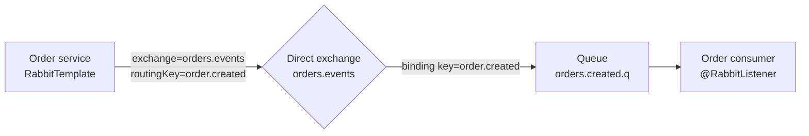
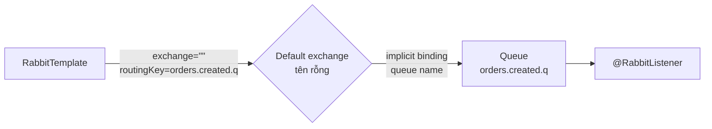

# Gửi theo exchange và routing key hoặc dùng giá trị mặc định

Trong Spring AMQP, một lời gọi `RabbitTemplate.convertAndSend(...)` có thể chỉ truyền **payload**, truyền **routing key và payload**, hoặc truyền đầy đủ **exchange, routing key và payload**. Cả ba cách đều có thể gửi message thành công, nhưng **đích gửi thực tế khác nhau tùy cấu hình mặc định của `RabbitTemplate` và topology RabbitMQ**.

Ví dụ dịch vụ đặt hàng cần phát sự kiện `order.created`. Khi dùng exchange `orders.events` và routing key `order.created`, broker định tuyến theo các binding của exchange. Khi dùng **default exchange** của RabbitMQ (tên là chuỗi rỗng `""`), routing key thường phải chính là **tên queue** để message đến đúng queue. Nhầm hai trường hợp này khiến lời gọi gửi chạy mà consumer không nhận được gì.

Bài thuộc chương **Gửi thông điệp** của module **SPRING_AMQP**. Chúng ta sẽ dùng `RabbitTemplate`, `@RabbitListener`, exchange, queue và binding để phân biệt các cách publish, cách cấu hình giá trị mặc định, cách xác minh định tuyến và cách phát hiện message bị mất tuyến. Các cơ chế publisher confirm, consumer acknowledgement, retry, dead-letter và quan sát hệ thống được liên hệ tại những điểm chúng ảnh hưởng trực tiếp đến độ tin cậy của bước gửi.

## 1. Publisher gửi tới exchange, broker quyết định queue nhận

Với AMQP 0-9-1, một lần publish có các thành phần cơ bản:

| Thành phần | Ví dụ | Vai trò |
|---|---|---|
| `exchange` | `orders.events` | Điểm nhận message từ publisher; lựa chọn queue dựa vào kiểu exchange và các binding. |
| `routingKey` | `order.created` | Chuỗi do publisher gửi kèm để exchange xét quy tắc định tuyến. |
| `message` | Body và các `MessageProperties` | Nội dung, content type, message ID, correlation ID, custom headers... |
| `binding` | `orders.events` → `orders.created.q` với key `order.created` | Quy tắc gắn queue với exchange, được khai báo trên broker. |



**Exchange và routing key là tham số của thao tác publish**, không phải hai custom header có cùng tên. Thêm header `routingKey=order.created` vào message **không thay đổi routing key đã truyền cho `convertAndSend`** khi đang dùng direct/topic exchange.

Publisher cũng không nhất thiết biết **bao nhiêu consumer** đang hoạt động. Nó giao message cho broker; broker định tuyến đến zero, một hoặc nhiều queue, rồi các consumer đọc từ queue của mình. Một publisher confirm ACK (nếu đã bật confirms) chỉ xác nhận broker xử lý lần publish, **không chứng minh consumer đã xử lý nghiệp vụ**.

## 2. Những overload cần nhớ của RabbitTemplate

Spring AMQP có hai nhóm API chính:

- `send(...)` nhận một đối tượng `org.springframework.amqp.core.Message` đã có **`byte[] body`** và `MessageProperties`.
- `convertAndSend(...)` nhận một **đối tượng Java** hoặc payload, chuyển thành `Message` bằng `MessageConverter` rồi gửi. Có thể truyền thêm `MessagePostProcessor` để điều chỉnh message sau chuyển đổi, trước khi publish.

Các overload thông dụng:

| Lời gọi | Exchange dùng | Routing key dùng |
|---|---|---|
| `rabbitTemplate.send(message)` | Exchange mặc định **của template** | Routing key mặc định **của template** |
| `rabbitTemplate.send(routingKey, message)` | Exchange mặc định của template | `routingKey` được truyền |
| `rabbitTemplate.send(exchange, routingKey, message)` | `exchange` được truyền | `routingKey` được truyền |
| `rabbitTemplate.convertAndSend(payload)` | Exchange mặc định của template | Routing key mặc định của template |
| `rabbitTemplate.convertAndSend(routingKey, payload)` | Exchange mặc định của template | `routingKey` được truyền |
| `rabbitTemplate.convertAndSend(exchange, routingKey, payload)` | `exchange` được truyền | `routingKey` được truyền |

**Hai lớp “mặc định” cần phân biệt:**

1. **Mặc định của `RabbitTemplate`:** các thuộc tính `exchange` và `routingKey` trên object template. Nếu không cấu hình, cả hai thông thường đều là chuỗi rỗng `""`.
2. **Default exchange của RabbitMQ:** một direct exchange đặc biệt có **tên `""`**, tồn tại sẵn trong mỗi virtual host và có các implicit binding đến queue theo tên queue.

Do đó, **chỉ dùng `convertAndSend(payload)` không tự suy ra tên queue**, tên exchange từ listener, hay binding dựa trên nội dung message. Lời gọi này hoàn toàn phụ thuộc vào hai giá trị mặc định đã cấu hình trên template.

### 2.1. Cẩn thận với overload hai tham số

```java
// Hai tham số: String đầu tiên là ROUTING KEY, không phải exchange!
rabbitTemplate.convertAndSend("orders.created.q", "Hello order");

// Ba tham số: String đầu tiên là EXCHANGE, String thứ hai là ROUTING KEY.
rabbitTemplate.convertAndSend(
        "orders.events", "order.created", "Hello order");
```

Nếu template có exchange mặc định `""`, lời gọi đầu tiên định tuyến qua default exchange đến queue tên `orders.created.q`. Nếu template đã được cấu hình `exchange=orders.events`, lời gọi đầu tiên **vẫn chọn exchange `orders.events`** nhưng dùng routing key `orders.created.q`; nó có thể không khớp binding key `order.created`!

Đây là lỗi phổ biến vì nhìn `convertAndSend("orders.events", payload)` có vẻ như đã truyền tên exchange; trên thực tế, đoạn đó **truyền `orders.events` làm routing key**.

## 3. Khai báo một topology để thực hành gửi tường minh

Giả sử ứng dụng Spring Boot kết nối được RabbitMQ, có starter RabbitMQ AMQP 0-9-1 phù hợp với phiên bản Boot và `RabbitAdmin` được bật. Ví dụ đặt topology trong package thuộc phạm vi component scan:

```java
package com.example.orders.messaging;

import org.springframework.amqp.core.Binding;
import org.springframework.amqp.core.BindingBuilder;
import org.springframework.amqp.core.DirectExchange;
import org.springframework.amqp.core.Queue;
import org.springframework.context.annotation.Bean;
import org.springframework.context.annotation.Configuration;

@Configuration(proxyBeanMethods = false)
public class OrderTopology {
    public static final String EXCHANGE = "orders.events";
    public static final String QUEUE = "orders.created.q";
    public static final String ROUTING_KEY = "order.created";

    @Bean
    DirectExchange ordersExchange() {
        return new DirectExchange(EXCHANGE, true, false);
    }

    @Bean
    Queue ordersCreatedQueue() {
        return new Queue(QUEUE, true);
    }

    @Bean
    Binding ordersCreatedBinding(Queue ordersCreatedQueue,
                                 DirectExchange ordersExchange) {
        return BindingBuilder.bind(ordersCreatedQueue)
                .to(ordersExchange)
                .with(ROUTING_KEY);
    }
}
```

Ở đây:

1. `orders.events` là **direct exchange** durable, không auto-delete.
2. `orders.created.q` là queue durable. Chỉ khai báo queue durable **chưa đủ** để bảo đảm message sống sót trong mọi tình huống mất điện hoặc broker lỗi; độ bền còn liên quan delivery mode, queue type và xác nhận publish.
3. Binding key `order.created` khớp chính xác routing key mà publisher sẽ gửi.

Spring bean chỉ là **mô tả topology trong ứng dụng**. `RabbitAdmin` cần kết nối được broker để khai báo exchange/queue/binding thực tế. Nếu queue hoặc exchange cùng tên đã tồn tại với thuộc tính không tương đương, RabbitMQ có thể trả lỗi `PRECONDITION_FAILED`; không sửa vấn đề đó bằng cách xóa queue có dữ liệu thật tùy tiện.

### 3.1. Publisher gửi rõ exchange và routing key

```java
package com.example.orders.messaging;

import org.springframework.amqp.rabbit.core.RabbitTemplate;
import org.springframework.stereotype.Service;

@Service
public class OrderPublisher {
    private final RabbitTemplate rabbitTemplate;

    public OrderPublisher(RabbitTemplate rabbitTemplate) {
        this.rabbitTemplate = rabbitTemplate;
    }

    public void publishOrderCreated(String payload) {
        rabbitTemplate.convertAndSend(
                OrderTopology.EXCHANGE,
                OrderTopology.ROUTING_KEY,
                payload);
    }
}
```

Trong code này, `convertAndSend(exchange, routingKey, payload)` **không phụ thuộc vào giá trị mặc định của template**. Direct exchange đối chiếu `order.created` với binding cùng tên rồi định tuyến message tới `orders.created.q`.

Một consumer tối thiểu:

```java
package com.example.orders.messaging;

import org.springframework.amqp.rabbit.annotation.RabbitListener;
import org.springframework.stereotype.Component;

@Component
public class OrderConsumer {

    @RabbitListener(queues = OrderTopology.QUEUE)
    public void onOrderCreated(String payload) {
        System.out.println("Received order event: " + payload);
    }
}
```

`@RabbitListener` nhận theo **tên queue**, không cần nhắc lại tên exchange hoặc routing key ở phương thức nhận. Ví dụ dùng string payload và message converter mặc định thông dụng; khi gửi DTO/JSON theo contract thật, nên cấu hình converter và schema rõ ràng. Listener được container ACK theo cấu hình container; thành công khi gọi publish **không đồng nghĩa** với nghiệp vụ listener đã hoàn tất.

### 3.2. Gửi Message đã có body và properties

Khi cần kiểm soát body bytes, content type, message ID hoặc delivery mode, dùng `send(...)`:

```java
import java.nio.charset.StandardCharsets;
import org.springframework.amqp.core.Message;
import org.springframework.amqp.core.MessageDeliveryMode;
import org.springframework.amqp.core.MessageProperties;

MessageProperties props = new MessageProperties();
props.setContentType(MessageProperties.CONTENT_TYPE_JSON);
props.setContentEncoding("UTF-8");
props.setMessageId("evt-001");
props.setHeader("eventId", "evt-001");
props.setDeliveryMode(MessageDeliveryMode.PERSISTENT);

// Nội dung JSON là ví dụ cố định; ứng dụng thật dùng JSON serializer.
byte[] bytes = "{\"orderId\":1001}".getBytes(StandardCharsets.UTF_8);
Message message = new Message(bytes, props);

rabbitTemplate.send(
        OrderTopology.EXCHANGE, OrderTopology.ROUTING_KEY, message);
```

`send(...)` không tự chuyển object thành body vì bạn đã đưa `Message` đầy đủ. `convertAndSend(...)` thì dùng converter, do đó nếu truyền một DTO mà vẫn dùng converter mặc định không phù hợp, body có thể là Java serialization hoặc phát sinh lỗi chuyển đổi. Khi liên thông các ngôn ngữ, hãy chọn JSON/Avro/Protobuf cùng hợp đồng version nhất quán.

## 4. Dùng giá trị mặc định được cấu hình trên RabbitTemplate

Thay vì luôn truyền exchange và routing key ở mọi lời gọi, bạn có thể **cấu hình chúng một lần trên template**. Phù hợp khi một publisher chủ yếu phát cùng loại sự kiện qua một tuyến cố định.

```java
package com.example.orders.messaging;

import org.springframework.amqp.rabbit.connection.ConnectionFactory;
import org.springframework.amqp.rabbit.core.RabbitTemplate;
import org.springframework.context.annotation.Bean;
import org.springframework.context.annotation.Configuration;

@Configuration(proxyBeanMethods = false)
public class OrdersTemplateConfig {

    @Bean("ordersRabbitTemplate")
    RabbitTemplate ordersRabbitTemplate(ConnectionFactory connectionFactory) {
        RabbitTemplate template = new RabbitTemplate(connectionFactory);
        template.setExchange(OrderTopology.EXCHANGE);
        template.setRoutingKey(OrderTopology.ROUTING_KEY);
        return template;
    }
}
```

Với bean `ordersRabbitTemplate` trên, các lời gọi sau có cùng tuyến đối với direct exchange trong ví dụ:

```java
// Dùng cả hai default của template.
ordersRabbitTemplate.convertAndSend("Order 1001 created");

// Dùng exchange default nhưng truyền routing key tường minh.
ordersRabbitTemplate.convertAndSend(
        "order.created", "Order 1002 created");

// Truyền cả exchange và routing key, không phụ thuộc defaults.
ordersRabbitTemplate.convertAndSend(
        "orders.events", "order.created", "Order 1003 created");
```

**Đừng ghép nguyên ví dụ `OrdersTemplateConfig` vào ứng dụng đang có nhiều template mà không xác định đúng bean được tiêm.** Khi cần cả template mặc định do Boot tạo và một template chuyên dụng, dùng tên bean và `@Qualifier("ordersRabbitTemplate")` để chọn chính xác. Đây là cách tổ chức **thay thế** cho publisher inject template mặc định trong phần 3.

### 4.1. Cấu hình default qua Spring Boot properties

Khi dùng `RabbitTemplate` do Spring Boot auto-configure, có thể đặt mặc định bằng application properties (cú pháp phổ biến của Spring Boot cho RabbitMQ template):

```yaml
spring:
  rabbitmq:
    host: localhost
    port: 5672
    username: guest
    password: guest
    template:
      exchange: orders.events
      routing-key: order.created
```

Với cấu hình trên, `rabbitTemplate.convertAndSend(payload)` sẽ phát tới `orders.events` bằng routing key `order.created`. Khi gọi overload có routing key riêng, routing key được truyền **ghi đè routing key mặc định cho lần gọi đó**; khi dùng overload ba tham số, cả hai giá trị được truyền đều được sử dụng.

Nếu ứng dụng **tự tạo `RabbitTemplate` bean thủ công** bằng `new RabbitTemplate(connectionFactory)`, hãy tự cấu hình `setExchange` / `setRoutingKey` như phần trên hoặc áp dụng customization phù hợp. Không nên tự giả định rằng mọi property trong YAML đã được Boot áp lên template bạn tự tạo.

### 4.2. Vì sao defaults cũng có rủi ro?

Một template dùng chung nhiều dịch vụ phát message có thể bị cấu hình default khiến một lời gọi hai tham số bất ngờ chuyển sang exchange khác:

```java
// ordersRabbitTemplate có default exchange = "orders.events".
ordersRabbitTemplate.convertAndSend(
        "orders.created.q", "Hello");
```

Đoạn trên **không gửi trực tiếp tới queue `orders.created.q`**. Nó publish vào `orders.events` với routing key `orders.created.q`. Nếu direct exchange chỉ có binding key `order.created`, message sẽ **không khớp** và có thể không đến queue nào. Khi ứng dụng phải publish tới nhiều tuyến, truyền cả exchange/routing key tường minh thường làm code dễ đọc và tránh phụ thuộc cấu hình ngầm.

## 5. Default exchange của RabbitMQ: gửi theo tên queue

RabbitMQ có một **default exchange** kiểu `direct`, tên là **chuỗi rỗng `""`**. Exchange này tồn tại sẵn trong mỗi virtual host. Khi queue được tạo, RabbitMQ thiết lập **implicit binding** từ default exchange đến queue với binding key đúng bằng **tên queue**.



Không cần tự khai báo exchange này hoặc tạo thêm binding cho nó. Với queue `orders.created.q` đã tồn tại trong đúng virtual host, hai lệnh sau đều publish đến queue qua default exchange:

```java
// An toàn với mọi cấu hình defaults của template: nêu rõ exchange rỗng.
rabbitTemplate.convertAndSend(
        "", "orders.created.q", "Hello direct-to-queue");

// Chỉ tương đương khi exchange DEFAULT của RabbitTemplate đang là "".
rabbitTemplate.convertAndSend(
        "orders.created.q", "Hello via template default exchange");
```

Nếu template đang có mặc định `exchange=""` và `routingKey="orders.created.q"`, thậm chí có thể gọi:

```java
rabbitTemplate.convertAndSend("Hello using two template defaults");
```

Nhưng nếu vừa tạo một `RabbitTemplate` không cấu hình, các default thông thường là **exchange rỗng, routing key rỗng**. Khi đó:

```java
// exchange="" và routingKey="" nếu chưa cấu hình gì:
rabbitTemplate.convertAndSend("Where will this go?");
```

Thao tác trên **không tự tìm queue của `@RabbitListener`**. Default exchange chỉ định tuyến nếu có queue có tên trùng routing key. Vì queue thông thường có tên **khác chuỗi rỗng**, message có thể trở thành **unroutable**. Nếu chưa bật `mandatory` và publisher returns, publisher có thể không nhận thấy việc không có queue nhận; ngay cả khi bật publisher confirms, broker vẫn có thể ACK lần publish.

### 5.1. Default exchange không đồng nghĩa default routing key

| Trường hợp | Exchange thực tế | Routing key thực tế | Kết quả mong đợi |
|---|---|---|---|
| `convertAndSend("", "orders.created.q", payload)` | RabbitMQ default exchange | Tên queue `orders.created.q` | Đến queue đó nếu queue tồn tại. |
| `convertAndSend("orders.created.q", payload)` khi template exchange rỗng | RabbitMQ default exchange | Tên queue `orders.created.q` | Đến queue đó nếu tồn tại. |
| `convertAndSend("order.created", payload)` khi template exchange rỗng | RabbitMQ default exchange | `order.created` | Chỉ đến queue **tên chính xác** `order.created`, nếu tồn tại. |
| `convertAndSend(payload)` khi cả hai template default rỗng | RabbitMQ default exchange | Chuỗi rỗng | Thường không đến queue ứng dụng nào. |
| `convertAndSend("orders.events", "order.created", payload)` | Exchange `orders.events` | `order.created` | Áp dụng binding của `orders.events`. |
| `convertAndSend("orders.created.q", payload)` khi template exchange là `orders.events` | Exchange `orders.events` | `orders.created.q` | Chỉ đến queue nếu **binding của exchange** khớp key này. |

Từ bảng có thể thấy, routing key `order.created` là **tên sự kiện** trong topology `orders.events` ở phần 3, còn routing key `orders.created.q` là **tên queue** khi dùng default exchange. Hai chuỗi khác nhau vì đang dùng **hai con đường định tuyến khác nhau**, dù cuối cùng có thể đến cùng một queue.

### 5.2. Khi nào nên dùng default exchange?

Gửi qua default exchange phù hợp với **gửi trực tiếp tới một queue đã biết tên**, chẳng hạn demo đơn giản hoặc hàng đợi công việc nội bộ. Tuy nhiên, publisher sẽ phụ thuộc trực tiếp vào tên queue và cấu trúc tiêu thụ.

Gửi qua **exchange do ứng dụng định nghĩa** phù hợp hơn khi muốn tách publisher khỏi tên queue, cho phép nhiều consumer group có queue riêng, đổi binding mà ít ảnh hưởng publisher, hoặc dùng topic/fanout để mở rộng hệ thống. Chọn cách nào phụ thuộc **mục đích định tuyến và ranh giới trách nhiệm**, không phải do overload nào ngắn hơn.

## 6. Routing key có ý nghĩa khác nhau theo loại exchange

Cùng một giá trị `routingKey="order.created"` sẽ được broker diễn giải khác nhau theo **exchange type**:

| Exchange type | Quy tắc | Ví dụ |
|---|---|---|
| `direct` | So khớp routing key với binding key theo **chuỗi chính xác**. | `order.created` khớp binding `order.created`. |
| `topic` | Routing key gồm các từ ngăn bằng dấu `.`, binding có wildcard `*` (một từ) hoặc `#` (không hoặc nhiều từ). | `order.created` khớp `order.*` và `order.#`. |
| `fanout` | Broadcast đến tất cả queue được binding với exchange; không dựa vào routing key. | `order.created` hay `any.key` đều không ảnh hưởng việc chọn queue. |
| `headers` | Lọc dựa trên message header và binding arguments theo cấu hình của headers exchange. | Binding yêu cầu header `region=apac`; routing key thường không phải tiêu chí chính. |

Ví dụ với topic exchange:

```java
@Bean
TopicExchange orderTopicExchange() {
    return new TopicExchange("orders.topic", true, false);
}

@Bean
Binding orderEventsBinding(Queue ordersCreatedQueue,
                           TopicExchange orderTopicExchange) {
    return BindingBuilder.bind(ordersCreatedQueue)
            .to(orderTopicExchange)
            .with("order.*");
}
```

Đoạn này là **biến thể cho bài thực hành topic exchange**; cần import `org.springframework.amqp.core.TopicExchange`, `Binding` và `BindingBuilder` tương ứng. Nếu cùng giữ `ordersCreatedQueue` được khai báo ở phần 3, queue đó có thể nhận message từ cả **direct exchange `orders.events`** lẫn **topic exchange `orders.topic`** khi cả hai binding được khai báo.

Các lệnh publish:

```java
// Có binding order.* → sẽ đến orders.created.q.
rabbitTemplate.convertAndSend(
        "orders.topic", "order.created", "Created");
rabbitTemplate.convertAndSend(
        "orders.topic", "order.cancelled", "Cancelled");

// order.* không khớp ba từ ngăn dấu chấm:
rabbitTemplate.convertAndSend(
        "orders.topic", "order.created.v2", "Versioned event");
```

Khi một message được định tuyến tới nhiều queue theo nhiều binding, **mỗi queue có bản sao để consumer của queue đó nhận**, còn các consumer cùng một queue là các đối tượng cạnh tranh delivery. Publisher không lựa chọn consumer instance nào sẽ xử lý; đó là trách nhiệm của broker và listener container.

## 7. Làm sao biết message đã được định tuyến hay chưa?

Một lời gọi `convertAndSend(...)` trả về mà không ném exception **không đủ để kết luận** message đã đến queue hoặc đã được xử lý. Có ba kết quả khác nhau cần theo dõi:

| Câu hỏi | Cơ chế | Điều có thể kết luận |
|---|---|---|
| Broker có phản hồi cho lần publish không? | **Publisher confirms** — `ConfirmCallback`, `CorrelationData` | Broker ACK/NACK lần publish; ACK **không tự chứng minh** message đã đến một queue có consumer. |
| Message có bị trả về vì không định tuyến được không? | **Publisher returns** với `mandatory=true` — `ReturnsCallback` | Message publish vào exchange hiện có nhưng không tìm thấy queue nhận theo bindings; broker trả lại nội dung và thông tin lỗi. |
| Consumer đã xác nhận một delivery chưa? | **Consumer acknowledgement** — ACK/NACK ở listener/container | Trạng thái **delivery đã giao tới consumer**; độc lập với publisher confirm/return. |

### 7.1. Bật publisher confirms và returns trong Spring Boot

```yaml
spring:
  rabbitmq:
    publisher-confirm-type: correlated
    publisher-returns: true
    template:
      mandatory: true
```

Đoạn YAML là **phần cấu hình bổ sung** cho ví dụ kết nối ở các phần trước, không thay thế toàn bộ cấu hình host, username, password và vhost của ứng dụng. `correlated` cho phép liên hệ publisher confirm với `CorrelationData`. `publisher-returns=true` cùng `mandatory=true` giúp publisher nhận callback khi message không định tuyến được đến queue nào.

Ví dụ dưới đây minh họa việc đăng ký callback trên **một template** đã được cấu hình thích hợp; thực hiện trong phần khởi tạo ứng dụng, không gán callback lại cho mỗi message:

```java
// Đặt khi cấu hình/khởi tạo RabbitTemplate:
rabbitTemplate.setMandatory(true);
rabbitTemplate.setConfirmCallback((correlation, ack, reason) -> {
    String id = correlation == null ? "unknown" : correlation.getId();
    if (ack) {
        System.out.println("Broker confirm ACK, eventId=" + id);
    } else {
        System.err.println("Broker confirm NACK, eventId=" + id
                + ", reason=" + reason);
    }
});
rabbitTemplate.setReturnsCallback(returned -> {
    System.err.println("Unroutable: exchange=" + returned.getExchange()
            + ", routingKey=" + returned.getRoutingKey()
            + ", reply=" + returned.getReplyText());
});
```

`RabbitTemplate` hỗ trợ callback cho xác nhận và message return; nếu nhiều thành phần cần nhận thông tin, hãy đăng ký tập trung một nơi và điều phối sự kiện nội bộ. Callback chỉ ghi log như ví dụ **chưa phải** cơ chế retry/đối soát bền vững.

### 7.2. Gắn correlation ID cho lần publish

```java
import org.springframework.amqp.rabbit.connection.CorrelationData;

String eventId = "evt-001";
CorrelationData correlation = new CorrelationData(eventId);
rabbitTemplate.convertAndSend(
        OrderTopology.EXCHANGE,
        OrderTopology.ROUTING_KEY,
        "Order 1001 created",
        correlation);
```

`CorrelationData` hỗ trợ đối chiếu **kết quả publish** với một sự kiện ứng dụng. Nó không phải `deliveryTag` của consumer. Trong ứng dụng thực, nên lưu `eventId` cùng trạng thái phát sự kiện để xử lý khi mất kết nối, timeout hoặc nhận NACK.

**Tình huống quan trọng:** gửi vào exchange `orders.events` có tồn tại nhưng với routing key `order.unknown`, trong khi chỉ có binding key `order.created`. Broker vẫn có thể **confirm ACK** vì đã xử lý lần publish, đồng thời **return** message vì không định tuyến được nếu đã bật mandatory/returns. Hai phản hồi này không mâu thuẫn.

Nếu exchange **không tồn tại**, broker có thể đóng channel với lỗi `NOT_FOUND`. Đây là lỗi publish vào đích không hợp lệ, **khác** với tình huống exchange có tồn tại nhưng thiếu binding; không mặc nhiên kỳ vọng nhận `ReturnsCallback` như lỗi unroutable bình thường.

### 7.3. Mất confirm và nguy cơ gửi trùng

Nếu publisher mất kết nối sau khi gửi nhưng trước khi nhận confirm, trạng thái có thể là **chưa biết**: broker đã nhận message hoặc chưa. Vì vậy, retry không nên đơn giản tạo một `eventId` mới rồi gửi lại, vì consumer có thể nhận hai sự kiện giống nhau. Dùng ID nghiệp vụ ổn định, chính sách đối soát, **idempotent consumer** và cân nhắc **transactional outbox** nếu việc ghi DB của publisher phải nhất quán với phát message.

Mọi giá trị mặc định của template đều chỉ ảnh hưởng **đường đi gửi message**; chúng không tự bật confirm, retry, transaction, DLX hay bảo đảm exactly-once.

## 8. Thêm header nghiệp vụ mà vẫn giữ routing tường minh

Đôi khi publisher muốn kèm `eventId`, `traceId`, `tenantId` hoặc content type để consumer xử lý đúng và hệ thống truy vết được. Với `convertAndSend`, có thể dùng `MessagePostProcessor` để điều chỉnh `MessageProperties`:

```java
import org.springframework.amqp.core.MessageProperties;

String eventId = "evt-2026-002";
String traceId = "trace-abc";

rabbitTemplate.convertAndSend(
        OrderTopology.EXCHANGE,
        OrderTopology.ROUTING_KEY,
        "Order 1002 created",
        message -> {
            MessageProperties props = message.getMessageProperties();
            props.setMessageId(eventId);
            props.setCorrelationId(traceId);
            props.setHeader("eventId", eventId);
            props.setHeader("traceId", traceId);
            return message;
        });
```

Việc đặt `messageId`, `correlationId` hoặc custom header **không tự thay đổi exchange/routing key**. Với direct/topic exchange, tham số `OrderTopology.ROUTING_KEY` trong lời gọi vẫn quyết định cách broker so với binding. Khi ứng dụng dùng **headers exchange**, các header được thiết kế để tham gia định tuyến, nhưng đó là cấu hình exchange/binding khác.

Không sử dụng `deliveryTag` như ID nghiệp vụ trong publisher: giá trị này do broker gắn với từng **delivery trên channel nhận**, không tồn tại ở thời điểm gửi. Muốn đối soát nhiều lần gửi hoặc redelivery, dùng ID ổn định như `eventId` và lưu trạng thái trong nghiệp vụ.

## 9. Những lỗi thường gặp khi chọn exchange, routing key và defaults

| Hiện tượng | Nguyên nhân thường gặp | Cách sửa |
|---|---|---|
| `convertAndSend(payload)` chạy nhưng queue không nhận | Template chưa cấu hình exchange/routing key, cả hai mặc định rỗng. | Cấu hình `template.exchange`/`template.routing-key` hoặc truyền đủ `exchange, routingKey`. |
| `convertAndSend("orders.events", payload)` không đến queue mong muốn | Đã nhầm tham số đầu của overload hai tham số là exchange. | Dùng `convertAndSend("orders.events", "order.created", payload)`. |
| `convertAndSend("orders.created.q", payload)` chạy được ở một môi trường nhưng thất bại ở môi trường khác | Template khác nhau về default exchange. | Dùng `convertAndSend("", "orders.created.q", payload)` nếu muốn default exchange; hoặc cấu hình defaults nhất quán. |
| Publish vào custom exchange nhưng routing key là tên queue | Direct/topic binding dùng `order.created`, không phải `orders.created.q`. | Đọc bindings thực tế trên broker, dùng routing key khớp. |
| `NOT_FOUND - no exchange`, channel bị đóng | Exchange tên sai, chưa khai báo hoặc đang ở vhost khác. | Kiểm tra `RabbitAdmin`, tên exchange, virtual host, quyền và thời điểm kết nối. |
| `PRECONDITION_FAILED` khi khai báo topology | Tài nguyên cùng tên đã tồn tại với exchange type/durable/arguments khác. | Đối chiếu cấu hình hiện có; migration có kiểm soát. |
| Publisher confirm ACK nhưng consumer không nhận | Không có binding phù hợp, queue không có consumer, hoặc listener gặp lỗi. | Bật mandatory/returns, kiểm tra queue ready/unacked, log listener và DLQ. |
| Không có return dù routing key sai | Chưa bật `mandatory` hoặc publisher returns, hoặc message đã được định tuyến sang queue khác. | Kiểm tra cấu hình callback, bindings và alternate exchange nếu có. |
| Message xuất hiện ở queue nhưng listener không giải mã được | Content type/converter hoặc schema không đồng nhất. | Đồng bộ serialization contract và converter ở publisher/consumer. |
| Gửi lại sau timeout làm nghiệp vụ bị ghi hai lần | Trạng thái publish chưa biết; retry tạo message trùng, consumer thiếu idempotency. | Giữ `eventId` ổn định, xử lý idempotent, giới hạn retry và đối soát. |
| Gửi vào queue qua default exchange nhưng sai vhost | Queue cùng tên ở vhost khác hoặc chưa tồn tại ở vhost đang kết nối. | Kiểm tra `ConnectionFactory` và topology trong đúng virtual host. |

**Cẩn trọng với thứ tự khai báo:** trong ví dụ test, `RabbitAdmin` thường có thể khai báo bean topology khi kết nối được thiết lập. Nhưng ở hệ thống có nhiều ứng dụng deploy độc lập, publisher có thể chạy trước khi exchange/queue/binding được tạo. Khi đó cần quy trình provision topology, retry hợp lý hoặc chỉ đưa publisher vào phục vụ khi các phụ thuộc đã sẵn sàng.

## 10. Kiểm tra trong RabbitMQ Management UI

Để thấy rõ hai con đường publish đến cùng queue, dùng một RabbitMQ broker test với topology ở phần 3, sau đó:

1. Mở Management UI, chọn đúng **virtual host**; kiểm tra `orders.events` là direct exchange và có binding key `order.created` tới `orders.created.q`.
2. Chạy consumer `@RabbitListener`, publish `"from-custom-exchange"` qua `convertAndSend("orders.events", "order.created", ...)`. Đối chiếu log nhận.
3. Publish `"from-default-exchange"` qua `convertAndSend("", "orders.created.q", ...)`. Cả hai message có thể đi đến cùng queue nhưng từ hai exchange khác nhau.
4. Dừng consumer, lặp lại hai lần publish hợp lệ và quan sát `messages_ready` của queue tăng; bật lại consumer, kiểm tra delivery/ack. Nếu consumer chạy nhanh, queue có thể liên tục ở `ready=0` mà không có lỗi.
5. Gửi với routing key sai `order.unknown` đến `orders.events`; quan sát không có message đến queue ví dụ, đồng thời theo dõi `ReturnsCallback` khi mandatory/returns đã bật.

Với hệ thống đã có nhiều binding, cần đọc danh sách binding đầy đủ: một routing key sai đối với queue **đang kiểm tra** có thể vẫn khớp **queue khác**. Không nên kết luận message bị broker loại chỉ từ việc `orders.created.q` không tăng. Tương tự, một alternate exchange (nếu được cấu hình) có thể nhận message không khớp binding của exchange ban đầu.

## 11. Bài thực hành

**Bài 1 — phân biệt overload.** Viết ba lời gọi `convertAndSend` với một, hai và ba tham số. Không thay đổi topology, lần lượt đặt default của template: (a) `exchange=""`, `routingKey=""`; (b) `exchange="orders.events"`, `routingKey="order.created"`. Trước khi chạy, ghi lại exchange và routing key **thực tế** của từng lời gọi, sau đó kiểm chứng.

**Bài 2 — cùng queue, hai exchange.** Dùng `orders.created.q` ở phần 3. Gửi message A qua `orders.events` và binding key `order.created`, message B qua default exchange `""` và routing key `orders.created.q`. Kiểm tra cả hai vào cùng queue, nhưng publisher chọn hai đường định tuyến khác nhau.

**Bài 3 — phát hiện overload sai.** Cấu hình template có default exchange `orders.events`, sau đó thử `convertAndSend("orders.created.q", payload)`. Giải thích vì sao message không đến queue khi binding chỉ là `order.created`; sửa bằng overload ba tham số đúng.

**Bài 4 — topic exchange.** Khai báo topic exchange `orders.topic` cùng binding `order.*`. Publish với routing key `order.created`, `order.cancelled` và `order.created.v2`. Dự đoán hai key đầu khớp, key thứ ba không khớp, trừ khi có binding khác.

**Bài 5 — publisher returns và confirms.** Bật `publisher-confirm-type=correlated`, `publisher-returns=true` và `mandatory=true`. Gửi message với routing key không khớp; xem callback return và confirm. Diễn giải vì sao confirm ACK có thể đi kèm return.

**Bài 6 — mất kết nối và gửi lại.** Trong môi trường test, tạo `eventId` cố định, phát sự kiện có `CorrelationData`, rồi giả lập publisher mất kết nối quanh thời điểm nhận confirm. Quan sát rằng kết quả có thể chưa biết và phải thiết kế retry/idempotency; không kiểm chứng bằng cách cho rằng mọi timeout đồng nghĩa message chưa được gửi.

## 12. Câu hỏi tự kiểm tra

1. **`convertAndSend("orders.events", payload)` có coi `orders.events` là exchange không?** Không. Đây là overload `(routingKey, payload)`; exchange lấy từ default của template.
2. **`convertAndSend(payload)` gửi tới đâu?** Tới default exchange và default routing key **được cấu hình trên chính `RabbitTemplate`**; nếu không cấu hình, hai giá trị thông thường là `""`.
3. **Default exchange của RabbitMQ tên gì?** Chuỗi rỗng `""`. Nó là direct exchange có implicit binding đến mỗi queue bằng tên queue.
4. **Gửi trực tiếp đến queue `orders.created.q` qua default exchange cần routing key nào?** `orders.created.q`, tức **tên queue**, không phải tên loại sự kiện `order.created`.
5. **Vì sao `convertAndSend("orders.created.q", payload)` không phải lúc nào cũng gửi trực tiếp tới queue?** Vì tham số `orders.created.q` chỉ là routing key; exchange vẫn lấy từ template default.
6. **`send(...)` và `convertAndSend(...)` khác nhau thế nào?** `send` nhận `Message` đã có body/properties; `convertAndSend` chuyển object thành message qua converter trước khi publish.
7. **RabbitTemplate cấu hình default exchange có buộc mọi publish dùng exchange đó không?** Không. Overload ba tham số vẫn nhận exchange/routing key được truyền riêng cho lời gọi.
8. **Publisher confirm ACK có chắc message đã vào queue không?** Không. Phải xét bindings, returns/mandatory và topology.
9. **Lỗi gửi vào exchange không tồn tại giống với message unroutable không?** Không. Exchange không tồn tại có thể làm broker đóng channel với lỗi `NOT_FOUND`; unroutable là exchange có tồn tại nhưng không tìm được queue theo routing.
10. **Muốn broker định tuyến theo business header cần làm gì?** Khai báo **headers exchange** và binding arguments thích hợp; chỉ đặt custom header lên message khi dùng direct/topic exchange không thay routing key của lần publish.

**Ghi nhớ:** Chọn **một trong ba cách** có chủ đích: truyền rõ `exchange + routingKey`; cấu hình mặc định trên `RabbitTemplate` rồi dùng overload ngắn; hoặc sử dụng **RabbitMQ default exchange `""` với routing key bằng tên queue**. Luôn đối chiếu exchange, binding và queue thực tế. Với luồng cần tin cậy, kết hợp publisher confirms, returns, consumer acknowledgement và idempotent processing.

### Tài liệu tham khảo

- Spring AMQP — [RabbitTemplate và cách gửi message](https://docs.spring.io/spring-amqp/reference/amqp/template.html).
- Spring AMQP — [Broker Configuration](https://docs.spring.io/spring-amqp/reference/amqp/broker-configuration.html).
- RabbitMQ — [Exchanges và default exchange](https://www.rabbitmq.com/docs/exchanges).
- RabbitMQ — [Publisher Confirms](https://www.rabbitmq.com/docs/confirms).
