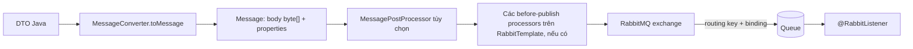

# MessagePostProcessor và bổ sung properties trước khi gửi

Một message không chỉ có phần **body**. Khi ứng dụng gửi sự kiện `orders.created` qua RabbitMQ, consumer thường cần thêm định danh sự kiện, mã liên kết request, phiên bản schema, loại sự kiện hoặc thời gian hết hạn. Trong **Spring AMQP**, `MessagePostProcessor` giúp bổ sung hay điều chỉnh các thông tin đó **sau khi đối tượng được chuyển đổi thành message và trước khi publish**.

Bài học thuộc chương **Gửi thông điệp** của module **SPRING_AMQP**. Ta sẽ dùng `RabbitTemplate`, `convertAndSend()`, `send()`, `MessageProperties` và `MessagePostProcessor` trong một topology exchange–queue–binding thực tế. Đồng thời, bài phân biệt metadata ứng dụng với những cơ chế RabbitMQ như publisher confirms, consumer acknowledgement, retry, dead-letter, transaction và quan sát hệ thống để xây xử lý bất đồng bộ đáng tin cậy.

## 1. MessagePostProcessor nằm ở đâu trong quá trình publish?

Với `RabbitTemplate.convertAndSend(exchange, routingKey, object, processor)`, trình tự khái quát là:



`MessagePostProcessor` là giao diện thuộc package `org.springframework.amqp.core`, có một phương thức:

```java
@FunctionalInterface
public interface MessagePostProcessor {
    Message postProcessMessage(Message message) throws AmqpException;
}
```

Đoạn trên là **chữ ký rút gọn** để giải thích; import giao diện từ Spring AMQP khi lập trình. Hàm nhận một `org.springframework.amqp.core.Message` đã có `byte[]` và `MessageProperties`, sau đó trả lại message để gửi. Cách sử dụng phổ biến là bổ sung thuộc tính rồi **`return message;`**.

| Thời điểm | Thành phần xử lý | Việc thực hiện |
| --- | --- | --- |
| Trước conversion | Mã producer | Tạo DTO và quyết định eventId, schemaVersion, routing key |
| Conversion | `MessageConverter` | Serialize object thành bytes, thiết lập metadata định dạng |
| Sau conversion | **`MessagePostProcessor`** truyền cho `convertAndSend` | Thêm `messageId`, `correlationId`, `type`, headers, expiration... |
| Ngay trước publish | **Before-publish post-processors** đã đăng ký trên template (nếu có) | Xử lý chung cho nhiều lần gửi, ví dụ bổ sung metadata/biến đổi có kiểm soát |
| Tại broker | RabbitMQ exchange và bindings | Quyết định queue đích; không chạy Java `MessagePostProcessor` |
| Sau khi nhận | Converter / listener / error handler | Deserialize, xác thực payload, xử lý nghiệp vụ và ack/reject |

**MessagePostProcessor chạy trong tiến trình producer**, không phải một consumer, broker plugin hay một bước định tuyến. Sửa `MessageProperties` có thể ảnh hưởng cách consumer hiểu message, nhưng **exchange vẫn định tuyến chủ yếu theo exchange, routing key và binding**. Không thể thay một `DirectExchange` thành fanout chỉ bằng cách thêm header `eventType`.

## 2. Phân biệt body, properties và headers

Mô hình message thường được hình dung như sau:

```text
AMQP Message
├── body: byte[]                  <- JSON, text, protobuf, v.v.
└── MessageProperties
    ├── contentType               <- "application/json"
    ├── contentEncoding           <- "UTF-8"
    ├── deliveryMode              <- PERSISTENT / NON_PERSISTENT
    ├── messageId                 <- ID sự kiện/message
    ├── correlationId             <- ID liên kết luồng xử lý
    ├── type                      <- Loại event theo hợp đồng
    ├── timestamp                 <- Dấu thời gian publisher cung cấp
    ├── expiration                <- Thời gian sống của message (milliseconds dạng chuỗi)
    └── headers                   <- schemaVersion, tenantId, eventSource...
```

| Property | Ý nghĩa | Điều **không** được ngầm suy ra |
| --- | --- | --- |
| `messageId` | Định danh message, hữu ích cho log và idempotency ở ứng dụng | Broker không mặc định tự loại message trùng ID |
| `correlationId` | Liên hệ một message với request hoặc workflow | Không tự bật distributed tracing hay publisher confirm |
| `type` | Mô tả loại message, ví dụ `orders.created` | Không tự chọn một routing key hoặc queue |
| `contentType` / `contentEncoding` | Mô tả cách diễn giải bytes | Không biến body sai format thành JSON hợp lệ |
| `deliveryMode` | Yêu cầu chế độ lưu message | Không thay durable queue, confirms hoặc replication |
| `expiration` | TTL riêng cho message, dạng chuỗi biểu thị mili-giây | Không phải độ trễ bắt buộc trước khi consumer nhận |
| `priority` | Mức ưu tiên nếu queue type và cấu hình hỗ trợ | Không bảo đảm ưu tiên tuyệt đối trong mọi queue |
| `headers` | Key–value metadata nghiệp vụ/kỹ thuật | Không tự xác thực dữ liệu hoặc bảo mật message |

**Application headers** là các cặp key–value bạn định nghĩa, chẳng hạn `schemaVersion=1`. Chúng khác các thuộc tính AMQP chuẩn như `messageId` hoặc `correlationId`. Các header do RabbitMQ/Spring dùng cho retry, dead-letter và conversion (ví dụ `x-death`, `x-delivery-count` hoặc header type mapping) nên được xử lý đúng giao thức, không tùy tiện ghi đè.

## 3. Chuẩn bị Spring Boot và topology để thực hành

Ứng dụng dùng dependency do Spring Boot parent/BOM quản lý:

```xml
<dependency>
    <groupId>org.springframework.boot</groupId>
    <artifactId>spring-boot-starter-amqp</artifactId>
</dependency>
```

Ví dụ cấu hình local trong `application-local.yml`, với giả định broker đã có user và virtual host phù hợp:

```yaml
spring:
  rabbitmq:
    host: localhost
    port: 5672
    username: app_local
    password: local-demo-only
    virtual-host: orders_local
```

Đây là **credential minh họa**, chỉ sử dụng trên RabbitMQ test/local. Môi trường production cần quản lý secret riêng, TLS khi phù hợp và quyền tối thiểu trên virtual host.

Để thấy rõ message đến queue nào, khai báo một `DirectExchange`, một queue và binding:

```java
import org.springframework.amqp.core.Binding;
import org.springframework.amqp.core.BindingBuilder;
import org.springframework.amqp.core.DirectExchange;
import org.springframework.amqp.core.Queue;
import org.springframework.amqp.core.QueueBuilder;
import org.springframework.context.annotation.Bean;
import org.springframework.context.annotation.Configuration;

@Configuration
public class OrderPublishTopology {
    public static final String EXCHANGE = "orders.publish.events";
    public static final String KEY = "orders.created";
    public static final String QUEUE = "orders.publish.created";

    @Bean
    DirectExchange ordersPublishExchange() {
        return new DirectExchange(EXCHANGE, true, false);
    }

    @Bean
    Queue ordersPublishQueue() {
        return QueueBuilder.durable(QUEUE).build();
    }

    @Bean
    Binding ordersPublishBinding(Queue ordersPublishQueue,
                                 DirectExchange ordersPublishExchange) {
        return BindingBuilder.bind(ordersPublishQueue)
                .to(ordersPublishExchange)
                .with(KEY);
    }
}
```

Spring Boot có thể tự cấu hình `RabbitAdmin` để khai báo các bean topology trên broker khi có kết nối và quyền phù hợp. Kiểm tra RabbitMQ Management trước khi publish; **tạo Java bean `Queue` không đồng nghĩa queue đã tồn tại trên broker**.

## 4. convertAndSend() với MessagePostProcessor theo từng message

### 4.1. Gửi DTO JSON

Giả sử producer phát một sự kiện:

```java
public record OrderCreatedEvent(
        String eventId,
        String orderId,
        String occurredAt,
        int schemaVersion
) {}
```

Nếu dùng **Spring AMQP 3.x và Jackson 2**, có thể khai báo converter:

```java
import org.springframework.amqp.support.converter.Jackson2JsonMessageConverter;
import org.springframework.amqp.support.converter.MessageConverter;
import org.springframework.context.annotation.Bean;
import org.springframework.context.annotation.Configuration;

@Configuration
public class RabbitJsonConverterConfig {
    @Bean
    MessageConverter rabbitJsonConverter() {
        return new Jackson2JsonMessageConverter();
    }
}
```

Các dòng Spring AMQP mới hơn có thể dùng API converter **Jackson 3** (chẳng hạn `JacksonJsonMessageConverter`). Chọn class phù hợp với **phiên bản Spring Boot/Spring AMQP thực tế**, đảm bảo dependency JSON có sẵn và converter được dùng ở cả producer/consumer. Ví dụ không ngụ ý rằng `SimpleMessageConverter` mặc định sẽ tự serialize record Java thành JSON.

Producer thêm metadata bằng lambda `MessagePostProcessor`:

```java
import org.springframework.amqp.core.MessageDeliveryMode;
import org.springframework.amqp.rabbit.core.RabbitTemplate;
import org.springframework.stereotype.Service;

@Service
public class OrderEventPublisher {
    private final RabbitTemplate rabbitTemplate;

    public OrderEventPublisher(RabbitTemplate rabbitTemplate) {
        this.rabbitTemplate = rabbitTemplate;
    }

    public void publish(OrderCreatedEvent event, String requestId) {
        rabbitTemplate.convertAndSend(
                OrderPublishTopology.EXCHANGE,
                OrderPublishTopology.KEY,
                event,
                message -> {
                    var properties = message.getMessageProperties();
                    properties.setMessageId(event.eventId());
                    properties.setCorrelationId(requestId);
                    properties.setType("orders.created");
                    properties.setHeader("eventType", "orders.created");
                    properties.setHeader("schemaVersion", event.schemaVersion());
                    properties.setHeader("sourceService", "order-service");
                    properties.setDeliveryMode(MessageDeliveryMode.PERSISTENT);
                    return message;
                });
    }
}
```

Giả sử `event` có dữ liệu:

```json
{
  "eventId": "f037cb75-c4ce-40aa-9baa-96ca09447cfb",
  "orderId": "ORD-1001",
  "occurredAt": "2026-11-26T02:00:00Z",
  "schemaVersion": 1
}
```

Với JSON converter hoạt động đúng, body sau chuyển đổi là JSON và `contentType` thường là `application/json`. Lambda **không cần serialize lại body**: nó bổ sung metadata lên `Message` mà converter đã tạo.

Lưu ý:

- `eventId` nên được tạo **một lần cho sự kiện nghiệp vụ** và giữ ổn định nếu ứng dụng phải gửi lại. Đừng tạo UUID mới mỗi khi callback thực hiện lại, nếu mục tiêu là chống xử lý trùng.
- `requestId` giúp liên kết log, nhưng không mặc nhiên là trace context chuẩn; nếu ứng dụng có Micrometer tracing, hãy tuân theo cơ chế propagation thay vì tự ghi đè những header tracing.
- `setDeliveryMode(PERSISTENT)` là yêu cầu lưu bền; **không** tự đảm bảo message sống sót trước mọi sự cố và **không** thay publisher confirms.
- `schemaVersion` trong headers giúp consumer chọn quy tắc đọc payload; việc nâng schema vẫn cần chính sách tương thích.
- MPP ở đây chạy **mỗi lần gửi thông qua overload trên**. Nếu producer khác gọi `convertAndSend` không có MPP, headers bổ sung không tự xuất hiện.

### 4.2. Tránh vô tình thay đổi contentType

Giả sử JSON converter đặt `contentType=application/json`. Nếu sau đó MPP đổi thành `text/plain` nhưng không sửa body, consumer có thể chọn sai converter hoặc giải mã sai. Tương tự, không nên ghi `contentEncoding=UTF-8` khi body thật là một định dạng nhị phân khác.

**Quy tắc:** Converter chịu trách nhiệm bytes và metadata định dạng; MPP bổ sung **thông tin nghiệp vụ**. Chỉ đổi `contentType`, `contentEncoding`, body hoặc header type mapping khi đã thiết kế lại hợp đồng wire format và có kiểm thử producer–consumer.

## 5. Dùng send() với Message đã được chuẩn bị

`RabbitTemplate.send(exchange, routingKey, Message)` nhận một **`org.springframework.amqp.core.Message` hoàn chỉnh**. Không có bước `MessageConverter.toMessage(object)` như `convertAndSend`. Khi đã có bytes JSON từ một serializer, bạn có thể đặt properties trực tiếp:

```java
import java.nio.charset.StandardCharsets;
import org.springframework.amqp.core.Message;
import org.springframework.amqp.core.MessageDeliveryMode;
import org.springframework.amqp.core.MessageProperties;
import org.springframework.amqp.rabbit.core.RabbitTemplate;

public void publishRaw(RabbitTemplate template, String json, String eventId) {
    MessageProperties properties = new MessageProperties();
    properties.setContentType(MessageProperties.CONTENT_TYPE_JSON);
    properties.setContentEncoding(StandardCharsets.UTF_8.name());
    properties.setMessageId(eventId);
    properties.setHeader("schemaVersion", 1);
    properties.setDeliveryMode(MessageDeliveryMode.PERSISTENT);

    Message message = new Message(
            json.getBytes(StandardCharsets.UTF_8),
            properties
    );
    template.send(OrderPublishTopology.EXCHANGE, OrderPublishTopology.KEY, message);
}
```

Với `send()`, việc thiết lập metadata có thể nằm trước khi gọi template. Nếu muốn **tái sử dụng một `MessagePostProcessor`**, có thể gọi nó trực tiếp:

```java
import org.springframework.amqp.core.MessagePostProcessor;

MessagePostProcessor addSource = message -> {
    message.getMessageProperties().setHeader("sourceService", "order-service");
    return message;
};

Message preparedMessage = addSource.postProcessMessage(message);
rabbitTemplate.send(
        OrderPublishTopology.EXCHANGE,
        OrderPublishTopology.KEY,
        preparedMessage);
```

Đoạn sau là **mảnh mã minh họa**, giả định `message` và `rabbitTemplate` đã được tạo trong cùng phạm vi. Đừng gọi một `send(..., Message)` rồi kỳ vọng overload đó tự chạy một MPP truyền riêng nếu API bạn gọi không nhận tham số MPP; hãy xử lý message trước hoặc dùng cơ chế processor toàn cục trên template.

### MessagePostProcessor theo message và processor toàn cục khác gì?

`RabbitTemplate` còn có cơ chế **before-publish post-processors** được cấu hình trên template để chạy cho nhiều thao tác publish, gồm các luồng gửi `Message` đã chuẩn bị. Điều này phù hợp với metadata hoặc xử lý chung, nhưng có một số ranh giới:

| Cách cấu hình | Phạm vi | Ưu điểm | Lưu ý |
| --- | --- | --- | --- |
| Truyền MPP trực tiếp cho `convertAndSend(..., processor)` | **Một lần gửi** | Biết rõ properties phụ thuộc sự kiện nào | Phải truyền ở từng call site cần metadata |
| Xử lý message trước `send(..., Message)` | **Một message cụ thể** | Toàn quyền chủ động với body/properties | Ứng dụng chịu trách nhiệm đảm bảo bytes đúng format |
| Đăng ký before-publish processors trên `RabbitTemplate` | **Các lần publish dùng template đó** | Áp dụng quy tắc chung, giảm lặp mã | Phải xét thứ tự processors, tránh ghi đè header và không phá cấu hình sẵn có |

Một số phiên bản Spring AMQP có API `setBeforePublishPostProcessors(...)` và thao tác thêm processor tương ứng. Khi tự quản lý `RabbitTemplate`, hãy kiểm tra API đúng phiên bản dự án; tránh gọi `set...` chỉ để thêm một processor rồi vô tình thay toàn bộ processor đã được framework hoặc code khác đăng ký.

**Phạm vi chỉ là template hiện tại:** nếu có nhiều `RabbitTemplate`, producer dùng API raw client, hoặc một ứng dụng khác gửi message, processor trên template A không tự áp dụng cho chúng.

## 6. Những thuộc tính đặc biệt: expiration, priority và correlation

### 6.1. TTL riêng cho message

`MessageProperties.setExpiration(String)` nhận **số mili-giây dạng chuỗi**, ví dụ `"30000"` cho 30 giây:

```java
rabbitTemplate.convertAndSend(
        OrderPublishTopology.EXCHANGE,
        OrderPublishTopology.KEY,
        event,
        message -> {
            message.getMessageProperties().setExpiration("30000");
            return message;
        });
```

RabbitMQ có thể áp dụng TTL theo message hoặc theo queue/policy. Message hết hạn có thể bị loại bỏ hoặc dead-letter nếu đã cấu hình DLX phù hợp. **TTL không phải cơ chế trì hoãn gửi message đúng 30 giây** và không cam kết message sẽ luôn được tiêu thụ trước khi hết hạn. Với nhiều TTL và cấu trúc queue, thời điểm message thực sự được loại ra còn phụ thuộc cách queue xử lý expiration.

### 6.2. Priority chỉ có ý nghĩa khi queue hỗ trợ

```java
message.getMessageProperties().setPriority(5);
```

Priority cần queue hỗ trợ và đã được khai báo cấu hình tương ứng, ví dụ `x-max-priority` cho classic queue ở phiên bản RabbitMQ phù hợp. **Không giả định** quorum/stream queue hỗ trợ cơ chế priority của classic, hay priority làm message luôn đi trước message đã được giao cho consumer.

### 6.3. Correlation ID là metadata ứng dụng

`correlationId` trong AMQP properties thường giúp ghép message với workflow hoặc request. Trong khi đó, **`CorrelationData` của Spring Rabbit** được dùng để liên hệ publisher confirm/return callback với một lần publish theo cơ chế template. Hai khái niệm có thể sử dụng cùng giá trị để quan sát, nhưng **không tự đồng nhất và không tự thiết lập lẫn nhau**.

| Giá trị | Nơi sử dụng | Trả lời câu hỏi |
| --- | --- | --- |
| `messageId` | Trong AMQP message properties | “Message/sự kiện này là gì?” |
| `correlationId` | Trong AMQP message properties | “Message này liên quan đến request/workflow nào?” |
| `CorrelationData` | Đối tượng Spring Rabbit ở phía producer khi dùng confirms | “Broker đã xác nhận lần publish nào?” |
| `traceId`/context tracing | Hệ thống observability theo cấu hình | “Những thao tác nào thuộc cùng một trace?” |

Không viết code nghiệp vụ theo giả định **có `correlationId` tức publisher confirm thành công**. Việc xác nhận publish phải bật cấu hình và nhận kết quả qua cơ chế riêng.

## 7. Consumer đọc properties như thế nào?

Để kiểm chứng metadata được bổ sung, một consumer demo có thể nhận **message thô**:

```java
import org.slf4j.Logger;
import org.slf4j.LoggerFactory;
import org.springframework.amqp.core.Message;
import org.springframework.amqp.rabbit.annotation.RabbitListener;
import org.springframework.stereotype.Component;

@Component
public class OrderMetadataConsumer {
    private static final Logger log =
            LoggerFactory.getLogger(OrderMetadataConsumer.class);

    @RabbitListener(queues = OrderPublishTopology.QUEUE)
    public void consume(Message message) {
        var properties = message.getMessageProperties();
        Object schemaVersion = properties.getHeaders().get("schemaVersion");

        log.info(
                "eventId={}, type={}, correlationId={}, schemaVersion={}, contentType={}, bodyBytes={}",
                properties.getMessageId(),
                properties.getType(),
                properties.getCorrelationId(),
                schemaVersion,
                properties.getContentType(),
                message.getBody().length);

        // Tại đây parse/validate payload theo content type và schemaVersion.
        // Không log toàn bộ nội dung có thể chứa dữ liệu cá nhân.
    }
}
```

Listener nhận `org.springframework.amqp.core.Message` để quan sát `MessageProperties`. Nếu muốn nhận `OrderCreatedEvent` trực tiếp, phải cấu hình converter bên nhận và đảm bảo contract JSON tương thích. Một số consumer còn sử dụng các header trong phương thức listener qua `@Header`, nhưng không nên giả định header tùy chọn luôn tồn tại; cần validation và chính sách mặc định rõ.

Ví dụ kết quả log hợp lệ:

```text
eventId=f037cb75-c4ce-40aa-9baa-96ca09447cfb,
type=orders.created, correlationId=req-20261126-001,
schemaVersion=1, contentType=application/json, bodyBytes=143
```

**Body size chỉ là ví dụ**; kích thước thực thay đổi theo converter và giá trị dữ liệu. Nếu producer gửi theo đường raw `send()`, consumer vẫn đọc được properties tương tự khi chúng được thiết lập trên `Message`.

### Cẩn trọng với header do broker bổ sung

Khi message bị retry hoặc dead-letter, broker có thể bổ sung metadata như `x-death` hay những header liên quan redelivery. Header đó **khác metadata producer gắn trước khi gửi**. Không tự tạo `x-death` để “giả vờ” message đã dead-letter; consumer chỉ nên dùng thông tin này theo đặc tả RabbitMQ, đồng thời giữ idempotency riêng.

## 8. Những lỗi sử dụng MessagePostProcessor thường gặp

| Hiện tượng | Nguyên nhân điển hình | Cách xử lý |
| --- | --- | --- |
| `NullPointerException`/message không được publish | Processor trả `null` hoặc làm hỏng message | Luôn trả lại `Message` hợp lệ; kiểm tra logic |
| DTO JSON bị consumer coi là text | MPP ghi đè `contentType` do converter tạo | Giữ metadata định dạng nhất quán với body |
| Consumer nhận header cũ từ lần publish trước | Dùng chung `Message`/properties có thể bị mutate không an toàn giữa các lần gửi | Tạo message/properties theo lần gửi; không chia sẻ trạng thái mutable tùy tiện |
| Nhiều lần retry có `messageId` khác nhau | Sinh ID mới trong MPP ở mỗi lần gọi | Sinh `eventId` một lần từ nghiệp vụ; dùng lại cho cùng sự kiện |
| Thêm `expiration=30` nhưng không thấy delay 30s | Giá trị TTL được hiểu là **30 mili-giây**, không phải 30 giây | Dùng `"30000"`; không dùng TTL như delay đảm bảo |
| Message có priority nhưng xử lý không đúng thứ tự kỳ vọng | Queue không hỗ trợ priority hoặc consumer đã nhận message khác | Kiểm tra queue type và `x-max-priority` |
| Correlation ID có nhưng không nhận confirm callback | AMQP property không bật publisher confirms | Bật confirm type, sử dụng `CorrelationData`/callback phù hợp |
| Gắn header nhưng consumer không thấy | Producer dùng template khác, MPP chưa được truyền, hoặc converter/header mapper thay đổi metadata | Kiểm tra call site, template, before-publish processors, message raw |
| Tốn CPU hoặc publish bị treo | Processor gọi API/DB đồng bộ, serialize lại hoặc xử lý nặng | Giữ processor gọn, không thực hiện I/O chậm; tính toán trước ở tầng service |
| Lộ dữ liệu nhạy cảm qua properties/log | Đưa password, token, thông tin khách hàng vào header | Chỉ gắn metadata tối thiểu; redaction và chính sách bảo mật phù hợp |

### Có nên thay đổi body ngay trong processor?

Có thể trả về một `Message` mới với body đã được biến đổi, nhưng lúc này phải **đồng bộ lại content type, encoding và type metadata**; consumer phải hiểu đúng wire format. Nếu cần chuyển DTO thành JSON/Avro/Protobuf, phần lớn trường hợp nên dùng `MessageConverter` thích hợp hoặc một bước serialize chuyên trách. Đừng dùng MPP để âm thầm thay đổi hợp đồng dữ liệu mà những consumer khác không biết.

## 9. Tính tin cậy: metadata không thay acknowledgements

Một message có `messageId`, `correlationId`, `PERSISTENT` và headers đầy đủ **vẫn có thể không đến queue**, hoặc đến queue nhưng consumer xử lý lỗi. Cần phân biệt các mốc:

```text
DTO -> converter -> MPP -> RabbitTemplate publish
                              |
                              +--> publisher confirm/return (nếu cấu hình)
                              |
                              v
                        RabbitMQ exchange
                              |
                              v
                            Queue
                              |
                              v
                      Consumer @RabbitListener
                              |
                              +--> DB/business effect
                              |
                              +--> ack / reject / retry / DLQ
```

- **Publisher confirms** cho producer biết broker xác nhận publish ở mức broker. Nếu chưa rõ kết quả sau mất kết nối, gửi lại có thể tạo bản sao; nên có eventId ổn định và consumer idempotent.
- **Publisher returns** (khi bật `mandatory` và cấu hình phù hợp) giúp nhận biết message không được route đến queue. Message có header `eventType` đúng **không cứu được** routing key sai của direct exchange.
- **Consumer ack/nack** phản ánh việc xử lý delivery ở phía consumer theo cấu hình listener container; không tự chứng minh database transaction đã commit đúng một lần.
- **Retry/dead-letter** cần được cấu hình tại listener, queue/policy, exchange/binding hoặc hệ xử lý lỗi. MPP không thay thế retry interceptor hay DLX/DLQ.
- **Transaction boundary** giữa DB và RabbitMQ cần thiết kế riêng. Với yêu cầu ghi DB rồi phát event một cách nhất quán, có thể cân nhắc transactional outbox.
- **Observability** cần ghi eventId/correlationId, kết quả publish, queue depth, lỗi conversion, redelivery và DLQ; không chỉ in log “đã gọi convertAndSend”.

Với Spring Boot hỗ trợ các thuộc tính tương ứng, một cấu hình minh họa bật confirms và returns:

```yaml
spring:
  rabbitmq:
    publisher-confirm-type: correlated
    publisher-returns: true
    template:
      mandatory: true
```

Sau đó cần cấu hình callback/API xử lý confirm/return tương ứng với phiên bản Spring AMQP. Chỉ bật ba thuộc tính trên **chưa tự động bảo đảm** ứng dụng đã xử lý đúng những lần publish thất bại.

## 10. Kiểm tra MessagePostProcessor bằng thí nghiệm có kiểm soát

### 10.1. Thử các đường gửi

Trong local/test:

1. Khởi chạy RabbitMQ, xác minh exchange `orders.publish.events`, queue `orders.publish.created`, binding `orders.created` trong đúng virtual host.
2. Publish `OrderCreatedEvent` bằng `convertAndSend(..., processor)`. Quan sát log consumer thấy `messageId`, `correlationId`, `type`, `schemaVersion` và `contentType`.
3. Dùng `send(Message)` với JSON bytes đã chuẩn bị và properties tương đương. So sánh phần body và các thuộc tính trong consumer.
4. Bỏ tạm MPP khỏi một lần `convertAndSend` để quan sát những metadata tùy chỉnh không xuất hiện, trong khi converter vẫn cung cấp các thuộc tính định dạng.
5. Tạo một MPP không được dùng trong call site và xác minh nó **không tự động áp dụng** chỉ vì có class trong ứng dụng. Nếu muốn dùng chung, phải đăng ký đúng lên template hoặc gọi trực tiếp.
6. Đổi `contentType` sai một cách có kiểm soát, thử consumer đọc DTO, ghi nhận lỗi conversion và khôi phục cấu hình đúng.

### 10.2. Thử TTL, routing key và tình huống lỗi

1. Tạo event với `expiration="30000"` qua MPP và quan sát hành vi trên queue test; không coi 30 giây là một thời gian delay gửi cố định.
2. Thử gửi cùng payload tới exchange đúng nhưng routing key **không khớp binding**, bật publisher returns/mandatory để phân biệt lỗi định tuyến với lỗi metadata.
3. Thử consumer throw exception sau khi nhận message; theo dõi requeue, retry hoặc DLQ theo chính sách đã thiết lập, không để vòng lặp vô hạn.
4. Gửi lại cùng `eventId` để xác minh consumer chống trùng bằng logic nghiệp vụ; chỉ có `messageId` không tự kích hoạt RabbitMQ deduplication.

### Checklist trước khi triển khai

- [ ] Quyết định rõ thuộc tính do converter gán và thuộc tính do MPP bổ sung.
- [ ] Giữ `messageId`/eventId ổn định cho cùng một sự kiện, dùng `correlationId` khi có workflow liên quan.
- [ ] Có `schemaVersion` và hợp đồng payload tương thích giữa producer và consumer.
- [ ] Không ghi đè `contentType`/encoding/type mapping một cách tùy tiện.
- [ ] Không đưa secret/PII không cần thiết vào headers hoặc application logs.
- [ ] Hiểu TTL, priority và delivery mode chỉ phát huy hiệu lực theo tính năng/configuration của broker.
- [ ] Đã kiểm chứng exchange, queue, binding, routing key và virtual host thật.
- [ ] Có publisher confirms/returns, consumer ack, retry/DLQ, idempotency và metric riêng cho từng mốc.

## 11. Câu hỏi tự kiểm tra

1. Vì sao `MessagePostProcessor` trong `convertAndSend` thường được chạy sau `MessageConverter`, và điều gì xảy ra nếu đổi `contentType` sai?
2. `messageId`, `correlationId` và `CorrelationData` khác nhau ở điểm nào? Broker có mặc định khử trùng lặp theo `messageId` không?
3. Nếu muốn mọi publish từ một `RabbitTemplate` có cùng header nguồn, nên dùng MPP từng lần hay before-publish processor dùng chung? Vì sao phải cân nhắc các processor đã được đăng ký?
4. Với `send(Message)`, phần nào phải do ứng dụng tự chuẩn bị? Nó có dùng `MessageConverter.toMessage` lần nữa không?
5. `expiration="5000"` nghĩa là bao lâu? TTL có bảo đảm message sẽ đến consumer sau đúng khoảng đó không?
6. Làm sao chứng minh một message vừa được publish **đã route vào queue**, thay vì chỉ có log thông báo producer đã gửi?
7. Một consumer có thể nhận lại cùng sự kiện sau khi DB commit nhưng trước ack; MPP nên cung cấp metadata nào và ứng dụng phải làm gì để xử lý an toàn?

## 12. Tài liệu để tra cứu API

- [Spring AMQP Reference – Sending Messages](https://docs.spring.io/spring-amqp/reference/amqp/sending-messages.html): `RabbitTemplate`, `convertAndSend`, `MessagePostProcessor` và publish.
- [Spring AMQP API – RabbitTemplate](https://docs.spring.io/spring-amqp/docs/current/api/org/springframework/amqp/rabbit/core/RabbitTemplate.html): những overload của `send`, `convertAndSend` và các processor.
- [Spring AMQP API – MessageProperties](https://docs.spring.io/spring-amqp/docs/current/api/org/springframework/amqp/core/MessageProperties.html): `contentType`, `correlationId`, `expiration`, `messageId`, headers và delivery mode.
- [RabbitMQ – Publishers and Message Properties](https://www.rabbitmq.com/docs/publishers): publish, routing và tính chất message.
- [RabbitMQ – TTL](https://www.rabbitmq.com/docs/ttl): message expiration, queue TTL và dead-lettering do hết hạn.

**Ghi nhớ:** `MessagePostProcessor` là điểm mở rộng **sau conversion, trước publish** để bổ sung `MessageProperties` và headers có kiểm soát. Dùng overload `convertAndSend(..., processor)` khi metadata phụ thuộc từng sự kiện; dùng `send(Message)` khi đã chuẩn bị bytes/properties; cân nhắc before-publish processors nếu muốn áp dụng chung trên template. Bổ sung metadata chính xác giúp truy vết, tương thích schema và xử lý trùng, nhưng độ tin cậy của Spring AMQP vẫn đòi hỏi xác nhận publish, ack, retry/dead-letter, transaction boundary và quan sát riêng.
