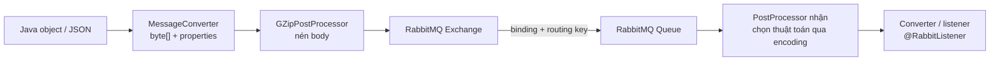
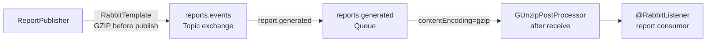

# GzipPostProcessor và giải nén theo content encoding khi phù hợp

Trong ứng dụng **Spring AMQP kết nối RabbitMQ**, `RabbitTemplate` có thể gửi sự kiện ở dạng JSON, văn bản hoặc byte. Nếu payload lớn, việc nén body trước khi publish có thể giảm số byte đi qua mạng và lượng dữ liệu cần lưu trong queue. Tuy nhiên, consumer phải biết **message nào được nén, thuật toán nén gì và khi nào cần giải nén**. Nếu đọc byte GZIP như UTF-8/JSON bình thường, việc chuyển đổi dữ liệu sẽ thất bại; ngược lại, nếu giải nén nhầm một message không nén, consumer cũng có thể gặp lỗi.

Spring AMQP cung cấp `GZipPostProcessor` để nén trước khi gửi và `GUnzipPostProcessor` hoặc `DelegatingDecompressingPostProcessor` để giải nén ở phía nhận. Tên lớp Java chính xác là **`GZipPostProcessor`** (chữ `Z` viết hoa), dù tiêu đề chủ đề thường được gọi ngắn là *GzipPostProcessor*.

Bài học thuộc chương **Gửi thông điệp**. Mục tiêu là thiết kế luồng publish → exchange/binding/queue → consume có metadata nhất quán, giải nén đúng chỗ, phù hợp với `@RabbitListener` và vẫn quan sát được các cơ chế publisher confirm, consumer ACK, retry, dead-letter và giao dịch nghiệp vụ.

Sau bài này, bạn có thể:

- Phân biệt `contentType` với `contentEncoding`, hiểu cách nén ảnh hưởng đến `byte[] body` và metadata.
- Cấu hình `RabbitTemplate` dùng `GZipPostProcessor` cho một lần gửi hoặc toàn bộ template.
- Cấu hình listener giải nén **trước bước chuyển đổi payload**, phân biệt nhận GZIP với nhận message không nén.
- Hiểu vai trò của header `MessageProperties.SPRING_AUTO_DECOMPRESS` và sự khác biệt giữa `GUnzipPostProcessor` mặc định, chế độ `alwaysDecompress` và `DelegatingDecompressingPostProcessor`.
- Đánh giá khả năng tương thích, hiệu năng, kích thước giải nén, lỗi dữ liệu và các ranh giới độ tin cậy.

## 1. Vị trí của nén trong luồng gửi message

Message RabbitMQ AMQP 0-9-1 chứa **body byte** và các **properties/headers**. Spring xử lý chuyển đổi object sang byte ở ứng dụng publisher; broker định tuyến message qua exchange, binding đến queue mà không cần hiểu JSON hay giải nén nội dung.



**Thứ tự đúng:**

1. Publisher chuyển object sang body byte bằng converter, ví dụ JSON UTF-8.
2. Bộ nén sử dụng `GZIPOutputStream` để biến body thành byte GZIP, đồng thời cập nhật `contentEncoding`.
3. `RabbitTemplate` publish body đã nén; RabbitMQ giữ và định tuyến byte đó như các message khác.
4. Consumer nhận message; một post-processor thích hợp **kiểm tra encoding và giải nén**.
5. Converter hoặc listener mới parse dữ liệu đã giải nén thành String, JSON hay DTO.

Nén/giải nén ở đây là **xử lý ứng dụng**, không phải đặc tính mặc định của exchange hoặc queue. Broker không tự giải nén chỉ vì message có header `contentEncoding=gzip`.

### 1.1. Content type và content encoding khác nhau

| Trường | Ví dụ | Câu hỏi trả lời |
| --- | --- | --- |
| `contentType` | `application/json`, `text/plain` | Byte sau khi giải mã các bước encoding có **định dạng dữ liệu gì**? |
| `contentEncoding` | `gzip`, hoặc chuỗi thể hiện `gzip` kết hợp `UTF-8` | Body đang dùng **cách biểu diễn/nén** gì để consumer khôi phục nội dung? |
| `SPRING_AUTO_DECOMPRESS` | Header Spring do bộ nén có thể thêm | Có cho phép post-processor Spring mặc định tự giải nén theo cơ chế của nó không? |
| `headers` ứng dụng | `schemaVersion`, `eventId` | Metadata nghiệp vụ, không thay thế khai báo encoding |

Một JSON sau nén **vẫn có content type là JSON**, nhưng body vật lý trên wire **không còn là chuỗi JSON có thể đọc trực tiếp**. Để parse JSON, consumer cần giải nén trước.

### 1.2. Ví dụ trước và sau nén

Giả sử publisher tạo message:

```text
body            = {"eventId":"evt-1001","orderId":"ORD-1001", ...}
contentType     = application/json
contentEncoding = UTF-8
```

Sau `GZipPostProcessor`, có thể quan sát:

```text
body            = <binary GZIP>
contentType     = application/json
contentEncoding = gzip, UTF-8    # biểu diễn thường gặp ở bản Spring mới
header          = springAutoDecompress: true  # tên/giá trị do Spring xử lý
```

Đây là **hình minh họa ngữ nghĩa**, không phải khẳng định mọi phiên bản đều ghi đúng cùng một chuỗi metadata. Spring AMQP thay đổi dấu phân cách chuỗi encoding giữa các phiên bản; nội dung thật phải được kiểm chứng bằng `MessageProperties.getContentEncoding()` ở phiên bản đang dùng. Không nên tự điền chuỗi `gzip, UTF-8` rồi gửi body chưa nén.

## 2. Khi nào nên nén, khi nào không?

Nén GZIP thường có lợi với payload dạng văn bản lặp lại như JSON dài, dữ liệu xuất báo cáo hoặc nhiều bản ghi cùng schema. Tuy nhiên, nén sử dụng CPU, cấp phát bộ nhớ và có phần header riêng; với message nhỏ, có thể **tăng** kích thước và làm latency cao hơn.

| Tình huống | Đánh giá |
| --- | --- |
| JSON lớn, nhiều trường lặp, đi qua mạng chậm hoặc hàng đợi lưu lâu | Có thể giảm đáng kể số byte; nên benchmark |
| Message rất nhỏ, vài chục hoặc vài trăm byte | Overhead GZIP và CPU có thể lớn hơn lợi ích |
| Body đã là ZIP/GZIP, ảnh/video nén hoặc dữ liệu ngẫu nhiên | Nén thêm thường ít lợi ích, có khi làm payload lớn hơn |
| Consumer nhiều ngôn ngữ, hệ thống bên thứ ba | Chỉ nén khi tất cả bên nhận hiểu encoding và hợp đồng message |
| Xử lý cực nhạy latency | Đo CPU, thời gian nén/giải nén và tốc độ publish/consume trước khi áp dụng |
| Payload do nguồn không tin cậy tạo | Cần giới hạn **kích thước sau giải nén** để tránh compression bomb |

Không có quy tắc “mọi message đều phải nén”. Một cách triển khai thực tế là **chọn nén theo kích thước, loại payload và năng lực consumer**, với contract/version rõ ràng.

## 3. GZipPostProcessor hoạt động như thế nào?

`GZipPostProcessor` thuộc package:

```java
import org.springframework.amqp.support.postprocessor.GZipPostProcessor;
```

Nó là một `MessagePostProcessor`: nhận một `Message`, nén phần `body` với `GZIPOutputStream` và cập nhật metadata liên quan. API có các cách khởi tạo:

| API | Ý nghĩa |
| --- | --- |
| `new GZipPostProcessor()` | Nén GZIP; theo mặc định đánh dấu header Spring để cho phép auto-decompress ở phía nhận |
| `new GZipPostProcessor(false)` | Nén nhưng **không đặt cờ auto-decompress của Spring**; hữu ích khi hợp đồng giải nén do consumer tự quản |
| `setCopyProperties(true)` | Sao chép `MessageProperties` trước khi thay đổi khi nén, tránh làm thay đổi properties được đối tượng message gốc giữ |
| `setEncodingDelimiter(...)` | Điều chỉnh dấu phân cách các thành phần của content encoding khi cần tương thích với consumer Spring cũ |
| `setOrder(...)` | Thứ tự áp dụng khi có nhiều post-processor; cần thiết nếu pipeline có nhiều phép biến đổi |

Theo tài liệu Spring AMQP, mặc định `GZipPostProcessor` **tái sử dụng và sửa `MessageProperties` của message gốc** vì hiệu năng; muốn giữ tham chiếu message/properties trước nén để so sánh, retry hoặc log thì nên cân nhắc `setCopyProperties(true)`.

### 3.1. Nén một message bằng tay

```java
import java.nio.charset.StandardCharsets;
import org.springframework.amqp.core.Message;
import org.springframework.amqp.core.MessageBuilder;
import org.springframework.amqp.core.MessageProperties;
import org.springframework.amqp.support.postprocessor.GZipPostProcessor;

Message source = MessageBuilder
        .withBody("Báo cáo tổng hợp đơn hàng".getBytes(StandardCharsets.UTF_8))
        .setContentType(MessageProperties.CONTENT_TYPE_TEXT_PLAIN)
        .setContentEncoding("UTF-8")
        .setMessageId("evt-1001")
        .build();

GZipPostProcessor gzip = new GZipPostProcessor();
gzip.setCopyProperties(true);

Message compressed = gzip.postProcessMessage(source);

// compressed.getBody() chứa GZIP bytes
// compressed.getMessageProperties().getContentEncoding()
// phản ánh lớp GZIP cùng encoding gốc (nếu có).
```

Ví dụ trên **chỉ tạo `Message` đã nén trong Java**, chưa publish tới RabbitMQ. Việc đọc trực tiếp `compressed.getBody()` bằng `new String(..., UTF_8)` sẽ không thể khôi phục văn bản gốc vì đây là dãy byte nén.

## 4. Tích hợp nén vào RabbitTemplate

Có hai điểm mở rộng khác nhau: **nén riêng một lần gửi** hoặc **nén mọi lần publish qua một template**.

### 4.1. Nén cho một lần convertAndSend

```java
import org.springframework.amqp.rabbit.core.RabbitTemplate;
import org.springframework.amqp.support.postprocessor.GZipPostProcessor;

public class ReportPublisher {
    private final RabbitTemplate rabbitTemplate;

    public ReportPublisher(RabbitTemplate rabbitTemplate) {
        this.rabbitTemplate = rabbitTemplate;
    }

    public void sendReport(String reportJson) {
        rabbitTemplate.convertAndSend(
                "reports.events",
                "report.generated",
                reportJson,
                new GZipPostProcessor());
    }
}
```

Trong `convertAndSend(..., MessagePostProcessor)`, Spring chuyển `reportJson` thành `Message` **trước**, rồi áp dụng post-processor để nén. Vì chỉ truyền post-processor ở lời gọi này, các lần `convertAndSend` khác không bị ảnh hưởng bởi ví dụ trên.

Khi gửi JSON, `reportJson` đang là `String`; converter mặc định có thể đặt `contentType` tương ứng với text. Nếu muốn payload thực sự mang `contentType=application/json`, nên dùng JSON converter hoặc tự tạo `Message` với properties chính xác. **GZIP không tự đổi text thành JSON.**

### 4.2. Nén tất cả message publish qua một template

`RabbitTemplate` có `setBeforePublishPostProcessors(...)`. Processor được áp dụng **sau khi message được chuẩn bị để publish và ngay trước khi gửi lên RabbitMQ**.

```java
import org.springframework.amqp.rabbit.connection.ConnectionFactory;
import org.springframework.amqp.rabbit.core.RabbitTemplate;
import org.springframework.amqp.support.postprocessor.GZipPostProcessor;
import org.springframework.context.annotation.Bean;
import org.springframework.context.annotation.Configuration;

@Configuration
public class GzipPublisherConfiguration {

    @Bean("gzipRabbitTemplate")
    public RabbitTemplate gzipRabbitTemplate(
            ConnectionFactory connectionFactory) {

        RabbitTemplate template = new RabbitTemplate(connectionFactory);

        GZipPostProcessor gzip = new GZipPostProcessor();
        gzip.setCopyProperties(true);

        template.setBeforePublishPostProcessors(gzip);
        return template;
    }
}
```

Publisher sử dụng template này thông qua tên bean:

```java
import org.springframework.amqp.rabbit.core.RabbitTemplate;
import org.springframework.beans.factory.annotation.Qualifier;
import org.springframework.stereotype.Service;

@Service
public class OrderEventPublisher {

    private final RabbitTemplate gzipRabbitTemplate;

    public OrderEventPublisher(
            @Qualifier("gzipRabbitTemplate") RabbitTemplate gzipRabbitTemplate) {
        this.gzipRabbitTemplate = gzipRabbitTemplate;
    }

    public void publish(String orderId) {
        gzipRabbitTemplate.convertAndSend(
                "orders.events",
                "order.created",
                orderId);
    }
}
```

Ví dụ này cho phép dùng **template chuyên dụng** cho luồng đã thỏa thuận nén. Những publisher dùng một template khác sẽ không mặc nhiên phải nén.

**Cẩn thận nén hai lần:** nếu một template đã có `GZipPostProcessor` trong `beforePublishPostProcessors`, không đồng thời truyền một `GZipPostProcessor` nữa ở từng lời gọi `convertAndSend` trừ khi bạn chủ đích tạo hai lớp nén và phía nhận có cách tháo đúng hai lớp. Bản thân message bị nén hai lần có thể làm encoding chain khó quản lý và tốn CPU.

### 4.3. Thứ tự với converter, batching và publisher confirm

```text
Java object
    -> MessageConverter
    -> MessagePostProcessor của convertAndSend (nếu truyền)
    -> tập hợp batch (nếu có BatchingStrategy)
    -> beforePublishPostProcessors (GZip)
    -> AMQP publish
    -> broker tiếp nhận / routing / queue
    -> publisher confirm/return (nếu cấu hình và xử lý)
```

Ở cơ chế batching của `RabbitTemplate`, `beforePublishPostProcessors` được áp dụng **sau khi batch đã được lắp thành message và trước khi publish**, theo tài liệu Spring AMQP. Điều này khác với nén từng message trước khi batch được tạo. Không nên tự thay đổi thứ tự nếu đang dùng batching và content encoding đặc biệt mà chưa đo/kiểm chứng.

Nén thành công **không phải publisher confirm**. `RabbitTemplate.convertAndSend(...)` trả về không chứng minh message đã được broker giữ bền vững hay consumer đã xử lý. Hệ thống cần publisher confirm/return khi yêu cầu bảo đảm đầu gửi.

## 5. Giải nén theo content encoding ở phía nhận

Phần dễ gây lỗi nhất là consumer có thể nhận **cả message nén lẫn không nén**. Chỉ giải nén theo **metadata phù hợp và cấu hình decoder**, không gọi `GZIPInputStream` trên mọi body.

Spring cung cấp ba lựa chọn liên quan:

| Component | Tác dụng | Khi nào chọn |
| --- | --- | --- |
| `GUnzipPostProcessor` | Giải nén GZIP khi encoding khớp điều kiện và cờ auto-decompress/`alwaysDecompress` phù hợp | Hợp đồng chỉ chấp nhận GZIP hoặc plain |
| `DelegatingDecompressingPostProcessor` | Chọn post-processor giải nén dựa trên `contentEncoding`; mặc định hỗ trợ `gzip`, `zip`, `deflate` | Có nhiều loại compression hoặc cần giải nén theo encoding |
| `RabbitTemplate.setAfterReceivePostProcessors(...)` | Xử lý **message mà template tự nhận** qua `receive`/`receiveAndConvert`, v.v. | Consumer dùng API `RabbitTemplate.receive(...)` |
| Listener container `setAfterReceivePostProcessors(...)` | Xử lý message **trước khi listener/converter nhận được** | Dùng `@RabbitListener` / asynchronous consumer |

**Quan trọng:** cấu hình `RabbitTemplate.setAfterReceivePostProcessors(...)` **không phải** cấu hình tự động cho mọi `@RabbitListener`. Listener chạy qua container riêng và cần after-receive processor trên **container hoặc listener container factory**.

### 5.1. Header SPRING_AUTO_DECOMPRESS có ý nghĩa gì?

`GZipPostProcessor` theo mặc định thêm dấu hiệu `MessageProperties.SPRING_AUTO_DECOMPRESS`. Theo ngữ nghĩa của Spring AMQP:

- `new GUnzipPostProcessor()`: chỉ giải nén kiểu được hỗ trợ khi metadata có `SPRING_AUTO_DECOMPRESS` được đặt là `true`.
- `new GUnzipPostProcessor(true)`: có thể giải nén message với encoding GZIP phù hợp **kể cả khi thiếu cờ Spring**, thuận tiện khi nhận từ producer khác.
- `new DelegatingDecompressingPostProcessor()`: mặc định có các decoder cho `gzip`, `zip`, `deflate` với khả năng giải nén theo encoding, kể cả trong cấu hình tương thích producer không dùng header tự động của Spring.

**`alwaysDecompress=true` không có nghĩa giải nén bất kỳ byte nào**: processor vẫn dựa vào content encoding thuộc loại mà nó hỗ trợ. Tuy nhiên, `contentEncoding` do sender cung cấp cũng cần được coi là dữ liệu đầu vào có thể sai hoặc bị giả mạo; quá trình giải nén có thể ném lỗi nếu body không đúng định dạng.

### 5.2. Cấu hình @RabbitListener giải nén GZIP

Để listener nhận body đã giải nén, tạo `SimpleRabbitListenerContainerFactory` gắn `GUnzipPostProcessor(true)`. Chọn `true` khi hợp đồng cho phép nhận GZIP từ cả producer Spring và producer bên ngoài không gắn cờ auto-decompress.

```java
import org.springframework.amqp.rabbit.config.SimpleRabbitListenerContainerFactory;
import org.springframework.amqp.rabbit.connection.ConnectionFactory;
import org.springframework.amqp.support.postprocessor.GUnzipPostProcessor;
import org.springframework.context.annotation.Bean;
import org.springframework.context.annotation.Configuration;

@Configuration
public class GzipConsumerConfiguration {

    @Bean("gzipListenerContainerFactory")
    public SimpleRabbitListenerContainerFactory gzipListenerContainerFactory(
            ConnectionFactory connectionFactory) {

        SimpleRabbitListenerContainerFactory factory =
                new SimpleRabbitListenerContainerFactory();
        factory.setConnectionFactory(connectionFactory);

        GUnzipPostProcessor gunzip = new GUnzipPostProcessor(true);
        gunzip.setMaxDecompressedSize(4L * 1024 * 1024); // Giới hạn 4 MiB
        factory.setAfterReceivePostProcessors(gunzip);

        return factory;
    }
}
```

`setMaxDecompressedSize(...)` có trong các phiên bản Spring AMQP hỗ trợ API này (từ các bản 2.4.x phù hợp; kiểm tra JavaDoc cho bản đang dùng). Hạn mức 4 MiB chỉ là **ví dụ**, cần thiết kế theo kích thước message lớn nhất cho phép và đặt kèm các kiểm soát khác để bảo vệ khỏi payload nén rất nhỏ nhưng bung ra quá lớn.

Listener chỉ định container factory:

```java
import java.nio.charset.StandardCharsets;
import org.springframework.amqp.core.Message;
import org.springframework.amqp.rabbit.annotation.RabbitListener;
import org.springframework.stereotype.Component;

@Component
public class OrderCreatedListener {

    @RabbitListener(
            queues = "orders.created",
            containerFactory = "gzipListenerContainerFactory")
    public void onMessage(Message message) {
        // Lúc này afterReceivePostProcessors đã có cơ hội giải nén.
        String orderId = new String(
                message.getBody(), StandardCharsets.UTF_8);
        System.out.println("Received order " + orderId);
    }
}
```

Đây là ví dụ một luồng gửi **text UTF-8**. Trong ứng dụng thật, phải validate `contentType` và schema trước khi parse, đồng thời kiểm tra tính idempotent của nghiệp vụ trước khi listener xử lý xong.

### 5.3. Nếu consumer nhận nhiều thuật toán nén

Dùng `DelegatingDecompressingPostProcessor` để chọn decoder theo `contentEncoding`:

```java
import org.springframework.amqp.rabbit.config.SimpleRabbitListenerContainerFactory;
import org.springframework.amqp.rabbit.connection.ConnectionFactory;
import org.springframework.amqp.support.postprocessor.DelegatingDecompressingPostProcessor;
import org.springframework.context.annotation.Bean;

@Bean("multiEncodingListenerFactory")
public SimpleRabbitListenerContainerFactory multiEncodingListenerFactory(
        ConnectionFactory connectionFactory) {
    SimpleRabbitListenerContainerFactory factory =
            new SimpleRabbitListenerContainerFactory();

    factory.setConnectionFactory(connectionFactory);
    factory.setAfterReceivePostProcessors(
            new DelegatingDecompressingPostProcessor());

    return factory;
}
```

Đây là **phương án thay thế** cho factory chỉ hỗ trợ GZIP. Đừng đồng thời đăng ký cả hai decoder vào cùng một listener nếu không có chủ đích về thứ tự; **giải nén hai lần** trên message chỉ có một lớp GZIP sẽ làm lỗi.

Với message có `contentEncoding` là `gzip`, delegate chọn giải nén GZIP; với `zip` hoặc `deflate`, dùng decoder tương ứng. Message không mang encoding nén trong danh sách **không nên bị ép giải nén GZIP**. Nếu hợp đồng ứng dụng **chỉ cho phép gzip hoặc plain**, có thể dùng factory ở phần 5.2 và từ chối rõ ràng encoding khác thay vì chấp nhận quá nhiều thuật toán.

### 5.4. Nếu nhận message bằng RabbitTemplate.receive()

Consumer đồng bộ dùng `RabbitTemplate` để nhận trực tiếp, **không thông qua `@RabbitListener`**, thì cấu hình trên chính template:

```java
import org.springframework.amqp.rabbit.core.RabbitTemplate;
import org.springframework.amqp.support.postprocessor.DelegatingDecompressingPostProcessor;

// Giả sử template dùng để receive; cấu hình trước khi sử dụng.
template.setAfterReceivePostProcessors(
        new DelegatingDecompressingPostProcessor());

// receiveAndConvert sau đó nhận message đã qua post-processor;
// kiểu Java trả về còn tùy MessageConverter của template.
Object value = template.receiveAndConvert("orders.created");
```

**Không nhầm hai đường nhận:** `RabbitTemplate.receive(...)` dùng `setAfterReceivePostProcessors` của template; `@RabbitListener` dùng after-receive processor của listener container factory.

## 6. Vấn đề tương thích content encoding

### 6.1. Dấu phân cách thay đổi theo phiên bản Spring AMQP

Khi payload đã có content encoding ban đầu (ví dụ `UTF-8`), compressor cần mô tả thêm một lớp nén. Theo tài liệu Spring AMQP:

- Các bản đến **2.2.11** dùng dấu phân cách `:` giữa các thành phần.
- Từ **2.2.12**, dấu phân cách được cấu hình được; mặc định chuyển sang `, `.
- Decompressor ở các bản mới hiểu cả hai dạng. Nếu **producer ≥ 2.3** gửi cho **consumer ≤ 2.2.11**, có thể cần đặt `encodingDelimiter=":"` ở compressor cho tới khi consumer được nâng cấp.

Ví dụ cấu hình tương thích:

```java
import org.springframework.amqp.support.postprocessor.GZipPostProcessor;

GZipPostProcessor gzip = new GZipPostProcessor();
gzip.setEncodingDelimiter(":"); // Chỉ khi consumer cũ cần format này
```

Đây là vấn đề tương thích **chuỗi metadata**, không phải hai thuật toán GZIP khác nhau. Khi triển khai nhiều service lệch phiên bản, phải thử round-trip thực tế với đúng các phiên bản đang chạy.

### 6.2. Hệ thống khác ngôn ngữ và header riêng của Spring

Producer Spring có thể đặt `SPRING_AUTO_DECOMPRESS`, nhưng consumer Python/Go/Node.js không có nghĩa vụ hiểu header nội bộ của Spring. Hợp đồng liên service cần mô tả rõ:

- `contentType` của nội dung sau giải nén;
- `contentEncoding` hoặc quy ước thuật toán nén;
- giới hạn kích thước và phiên bản schema;
- khả năng chấp nhận message **không nén**;
- chính sách xử lý nếu encoding không được hỗ trợ.

Nếu consumer tự đọc byte và thấy encoding GZIP, nó phải **giải nén bằng thư viện GZIP của ngôn ngữ đó trước khi parse JSON/text**. Việc producer Spring đặt header auto-decompress không khiến một consumer bên ngoài tự động thay đổi hành vi.

### 6.3. Không để nhiều nơi chỉnh sửa content encoding độc lập

Bộ nén Spring quản lý `contentEncoding` giúp tháo lớp nén và khôi phục encoding trước đó. Không nên đồng thời:

1. Tự nén body bằng `GZIPOutputStream`.
2. Tự đặt `contentEncoding=gzip`.
3. Lại áp dụng `GZipPostProcessor` trong `RabbitTemplate`.

Trừ khi cố ý nén hai lớp và kiểm chứng đầy đủ, cách trên tạo metadata khó hiểu và consumer có thể giải nén không đủ hoặc quá số lớp. **Chọn một lớp chịu trách nhiệm nén và khai báo encoding** cho mỗi tuyến publish.

## 7. Ví dụ hoàn chỉnh với exchange, queue và binding

Một ứng dụng học tập có thể sử dụng topology sau để kiểm tra pipeline:



Khai báo topology bằng Spring AMQP:

```java
import org.springframework.amqp.core.Binding;
import org.springframework.amqp.core.BindingBuilder;
import org.springframework.amqp.core.Queue;
import org.springframework.amqp.core.QueueBuilder;
import org.springframework.amqp.core.TopicExchange;
import org.springframework.amqp.core.ExchangeBuilder;
import org.springframework.context.annotation.Bean;
import org.springframework.context.annotation.Configuration;

@Configuration
public class ReportTopology {
    public static final String EXCHANGE = "reports.events";
    public static final String QUEUE = "reports.generated";
    public static final String ROUTING_KEY = "report.generated";

    @Bean
    public TopicExchange reportExchange() {
        return ExchangeBuilder.topicExchange(EXCHANGE).durable(true).build();
    }

    @Bean
    public Queue reportQueue() {
        return QueueBuilder.durable(QUEUE).build();
    }

    @Bean
    public Binding reportBinding(
            Queue reportQueue,
            TopicExchange reportExchange) {
        return BindingBuilder.bind(reportQueue)
                .to(reportExchange)
                .with(ROUTING_KEY);
    }
}
```

Nếu muốn chạy theo topology `reports.*`, hãy đổi tên exchange/queue/routing key ở publisher và listener cho **nhất quán**. Không dùng publisher `reports.events` với listener ở `orders.created` mà mong message tự chuyển qua hai queue.

Ví dụ `application.yml`:

```yaml
spring:
  rabbitmq:
    host: ${RABBITMQ_HOST:localhost}
    port: ${RABBITMQ_PORT:5672}
    virtual-host: ${RABBITMQ_VHOST:/reports}
    username: ${RABBITMQ_USERNAME}
    password: ${RABBITMQ_PASSWORD}
    publisher-confirm-type: correlated
    publisher-returns: true
    template:
      mandatory: true
    listener:
      simple:
        acknowledge-mode: auto
```

Vhost `/reports` phải được tạo và user phải được cấp quyền tương ứng. RabbitMQ sẽ lưu message trong queue đã bind bất kể body có nén hay không. Với `RabbitAdmin` được cấu hình phù hợp, Spring có thể khai báo exchange, queue và binding khi connection được thiết lập.

**Bài thực hành:** dùng bean `gzipRabbitTemplate` của phần 4.2 để gửi tới `ReportTopology.EXCHANGE` / `ReportTopology.ROUTING_KEY` và listener factory ở phần 5.2 để nhận từ `ReportTopology.QUEUE`. Hãy kiểm tra dữ liệu bằng `Message` để thấy text sau giải nén, thay vì đổi sang String converter quá sớm.

## 8. Kiểm chứng nén/giải nén không cần RabbitMQ

Trước khi thử nghiệm end-to-end, có thể kiểm tra round-trip ngay trong một unit test bằng post-processors. Ví dụ JUnit 5:

```java
import static org.junit.jupiter.api.Assertions.assertArrayEquals;
import static org.junit.jupiter.api.Assertions.assertEquals;
import static org.junit.jupiter.api.Assertions.assertNotSame;

import java.nio.charset.StandardCharsets;

import org.junit.jupiter.api.Test;
import org.springframework.amqp.core.Message;
import org.springframework.amqp.core.MessageBuilder;
import org.springframework.amqp.core.MessageProperties;
import org.springframework.amqp.support.postprocessor.GUnzipPostProcessor;
import org.springframework.amqp.support.postprocessor.GZipPostProcessor;

class GzipMessageTest {

    @Test
    void compressionRoundTripKeepsBody() {
        byte[] originalBytes = """
                {"eventId":"evt-1","orderId":"ORD-1001"}
                """.getBytes(StandardCharsets.UTF_8);

        Message source = MessageBuilder.withBody(originalBytes)
                .setContentType(MessageProperties.CONTENT_TYPE_JSON)
                .setContentEncoding("UTF-8")
                .build();

        GZipPostProcessor gzip = new GZipPostProcessor();
        gzip.setCopyProperties(true);

        Message compressed = gzip.postProcessMessage(source);

        assertNotSame(source, compressed);
        assertEquals("UTF-8",
                source.getMessageProperties().getContentEncoding());

        // true: đọc theo content encoding dù không phụ thuộc cờ Spring.
        GUnzipPostProcessor unzip = new GUnzipPostProcessor(true);
        Message decompressed = unzip.postProcessMessage(compressed);

        assertArrayEquals(originalBytes, decompressed.getBody());
        assertEquals("UTF-8",
                decompressed.getMessageProperties().getContentEncoding());
    }
}
```

Phép kiểm tra này cho thấy **body được khôi phục** và encoding gốc được giữ/khôi phục theo API. Nó **không** chứng minh queue sẽ nhận đúng routing key hoặc publisher confirm/consumer ACK thành công; những điều đó cần kiểm thử tích hợp riêng.

### 8.1. Thử message không nén

Một consumer hỗ trợ cả message GZIP lẫn plain cần thử:

```java
Message plain = MessageBuilder
        .withBody("ORD-1002".getBytes(StandardCharsets.UTF_8))
        .setContentType(MessageProperties.CONTENT_TYPE_TEXT_PLAIN)
        .setContentEncoding("UTF-8")
        .build();

Message after = new GUnzipPostProcessor(true).postProcessMessage(plain);
// Không cố giải nén nếu content encoding không phải gzip.
assertArrayEquals(plain.getBody(), after.getBody());
```

Ví dụ là phần bổ sung cho test trước và giả định đã import `assertArrayEquals`, `Message`, `MessageBuilder`, `MessageProperties`, `StandardCharsets`. Nếu gặp message có metadata ghi là GZIP nhưng body sai, decoder **phải báo lỗi** thay vì coi như text hợp lệ.

### 8.2. Bài test thực tế trên RabbitMQ

Trong môi trường thử nghiệm:

1. Khởi động RabbitMQ với vhost đã cấu hình, tạo topology exchange–binding–queue.
2. Dùng publisher có `GZipPostProcessor` gửi một message text/JSON đủ lớn.
3. Tạm dừng listener, xem `contentEncoding` và độ dài body qua công cụ kiểm tra message phù hợp. Dữ liệu GZIP không đọc trực tiếp như văn bản.
4. Bật listener factory có `GUnzipPostProcessor`/delegate; xác nhận body khôi phục đúng, message được ACK và không còn trong queue.
5. Gửi một message **không nén** có encoding `UTF-8` để xác nhận consumer hỗ trợ hỗn hợp.
6. Gửi thử message ghi sai encoding hoặc GZIP hỏng, quan sát lỗi ở **after-receive processor trước method `@RabbitListener`**.
7. Thử producer–consumer khác phiên bản Spring và kiểm tra dấu phân cách `contentEncoding` nếu cần.

Để quan sát broker:

```bash
rabbitmqctl list_exchanges -p /reports name type
rabbitmqctl list_queues -p /reports name messages_ready messages_unacknowledged consumers
rabbitmqctl list_bindings -p /reports source_name destination_name routing_key
```

RabbitMQ Management UI cũng giúp quan sát số message, tốc độ publish/consume và ACK. Nếu listener đang tiêu thụ liên tục, `messages_ready=0` ngay sau khi gửi có thể đơn giản là message đã được xử lý.

## 9. Lỗi thường gặp

| Triệu chứng | Nguyên nhân có thể | Cách xử lý |
| --- | --- | --- |
| Consumer nhận byte “rác”, JSON parser lỗi | Body đã nén nhưng listener/converter đọc trực tiếp; thiếu after-receive processor | Giải nén đúng theo encoding **trước khi chuyển đổi** |
| `GZIPInputStream` báo lỗi header hoặc EOF | Đánh dấu gzip cho body không nén, dữ liệu hỏng hoặc đã giải nén rồi | Kiểm tra contract, processor chạy đúng một lần, integrity của message |
| Chỉ `RabbitTemplate.receive()` hoạt động, `@RabbitListener` lỗi | Chỉ cấu hình `RabbitTemplate.setAfterReceivePostProcessors` | Cấu hình trên listener container factory |
| Message plain bị giải nén nhầm | Code tự gọi GZIP trên mọi byte, bỏ qua `contentEncoding` | Dùng `GUnzipPostProcessor`/delegate theo encoding và validate metadata |
| Producer mới, consumer Spring cũ lỗi encoding | Khác dấu phân cách `, ` và `:` | Kiểm tra phiên bản, dùng `setEncodingDelimiter(":")` khi thực sự cần |
| Message gốc đổi content encoding bất ngờ sau nén | Mặc định compressor có thể dùng lại mutable properties | Đặt `setCopyProperties(true)` nếu giữ reference gốc |
| Message nén không giảm kích thước | Payload nhỏ, đã nén sẵn hoặc entropy cao | Chọn nén có điều kiện, đo tỷ lệ nén và CPU |
| Listener lỗi giải nén liên tục/requeue mãi | Message sai định dạng được retry không giới hạn | Giới hạn retry, reject không requeue, DLX/quarantine theo hợp đồng |
| Nguy cơ memory spike khi giải nén | Payload nén nhỏ nhưng bung ra rất lớn | Giới hạn kích thước decompressed và prefetch/concurrency |
| Publish thành công nhưng consumer không thấy message | Sai exchange, binding, routing key, vhost hoặc queue | Phân biệt lỗi routing với lỗi nén |
| Message tới queue nhưng quá hạn | TTL, policy hoặc consumer không bắt kịp | Theo dõi expiration/DLX; nén không loại bỏ quy tắc TTL |

## 10. An toàn, hiệu năng và độ tin cậy

### 10.1. GZIP không phải mã hóa

Nén GZIP **không cung cấp bảo mật nội dung**. Nếu message chứa thông tin nhạy cảm, cần TLS, quyền RabbitMQ theo vhost/exchange, quản lý secret và chính sách log thích hợp. Không đưa toàn bộ body giải nén chứa dữ liệu cá nhân vào log để debug.

Metadata do sender cung cấp cũng không phải bằng chứng xác thực; consumer cần kiểm tra kiểu dữ liệu, schema và giới hạn đầu vào trước khi xử lý nghiệp vụ.

### 10.2. Tránh decompression bomb

Một message nén nhỏ có thể bung thành lượng dữ liệu rất lớn. Vì vậy:

- Giới hạn kích thước **sau giải nén**, không chỉ giới hạn `body.length` đang nén.
- Dùng `setMaxDecompressedSize(...)` ở `GUnzipPostProcessor` khi phiên bản Spring AMQP hỗ trợ và đặt hạn mức phù hợp.
- Giới hạn prefetch/concurrency khi consumer xử lý message lớn; theo dõi CPU/RAM và thời gian parse.
- Validate schema, kích thước collection và chuỗi sau giải nén; không tin vào `contentType` hoặc header bên ngoài một cách tuyệt đối.
- Áp dụng chính sách reject/DLQ cho dữ liệu hỏng thay vì retry không giới hạn.

### 10.3. Nén và xác nhận giao nhận là hai vấn đề riêng

| Cơ chế | Giải quyết điều gì? | Không bảo đảm điều gì? |
| --- | --- | --- |
| `GZipPostProcessor` | Giảm body bytes theo GZIP và ghi metadata | Message đã đến broker/được consumer ACK |
| `GUnzipPostProcessor` | Khôi phục body trước consumer | Nghiệp vụ đã commit thành công |
| Publisher confirm | Broker thông báo kết quả xử lý publish ở phía broker | Tất cả consumer đã xử lý |
| Publisher return | Message mandatory không route được tới queue nào | Mọi queue mong đợi đều tồn tại |
| Consumer ACK | Delivery đã được xác nhận theo logic consumer/container | Không còn rủi ro xử lý trùng do các lần publish khác |
| Retry + DLX | Xử lý lỗi tạm thời hoặc đưa lỗi đến tuyến được quản lý | Exactly-once end-to-end |
| Transaction AMQP | Ranh giới transaction của channel AMQP | Atomic commit với database ngoài RabbitMQ |

Nếu publisher retry vì kết quả confirm không rõ ràng hoặc consumer mất kết nối trước ACK, cùng một sự kiện có thể xuất hiện lại. Vì vậy, **event ID ổn định và idempotency** vẫn cần thiết dù body đã được nén chính xác.

### 10.4. Quan sát những chỉ số nào?

Ở producer, theo dõi **kích thước trước/sau nén**, tỷ lệ nén, CPU, thời gian nén, số publish, confirm/return và lỗi. Ở consumer, theo dõi thời gian giải nén, kích thước sau giải nén, lỗi encoding, tỷ lệ parse lỗi, latency nghiệp vụ và DLQ. Ở RabbitMQ, theo dõi queue depth, ready/unacked, publish/ack rates và cảnh báo bộ nhớ/đĩa.

Đo chất lượng thực tế bằng **toàn bộ pipeline**, không chỉ đo kích thước một body mẫu. Nén mạnh hơn có thể giảm network/disk nhưng tăng CPU đến mức throughput tổng giảm.

## 11. Checklist trước khi triển khai

- [ ] Xác định service nào nén và service nào giải nén; không mặc định mọi consumer đều hỗ trợ GZIP.
- [ ] Đặt `contentType` đúng với dữ liệu **sau giải nén**, `contentEncoding` đúng với các lớp encoding thực tế.
- [ ] Chọn nén từng lần `convertAndSend(..., MessagePostProcessor)` hoặc theo template `setBeforePublishPostProcessors`, tránh nén hai lần.
- [ ] Với `@RabbitListener`, cấu hình after-receive processor trên **container factory**, không chỉ trên `RabbitTemplate`.
- [ ] Dùng `GUnzipPostProcessor` nếu chỉ hỗ trợ gzip, hoặc delegate có kiểm soát nếu cần nhiều thuật toán.
- [ ] Quyết định có chấp nhận producer không gắn `SPRING_AUTO_DECOMPRESS` hay không; hiểu sự khác nhau của `alwaysDecompress`.
- [ ] Kiểm chứng cả **message nén, không nén, sai encoding, body hỏng và payload giải nén quá lớn**.
- [ ] Kiểm tra tương thích dấu phân cách content encoding khi các service chạy khác phiên bản Spring AMQP.
- [ ] Giới hạn kích thước sau giải nén, prefetch/concurrency và tài nguyên CPU/RAM.
- [ ] Khi giữ message gốc, cân nhắc `GZipPostProcessor.setCopyProperties(true)`.
- [ ] Thiết kế publisher confirms/returns, consumer ACK, retry, DLX, event ID và idempotency độc lập với việc nén.
- [ ] Đo tỉ lệ nén, thời gian xử lý và quan sát lỗi sau triển khai trước khi bật nén toàn bộ lưu lượng.

**Ghi nhớ:** `GZipPostProcessor` nén **body** trước khi RabbitMQ nhận message; phần `contentEncoding` mô tả việc nén để consumer biết cách khôi phục dữ liệu. Phía nhận chỉ nên giải nén với thuật toán và metadata phù hợp, thực hiện **trước bước chuyển đổi String/JSON/DTO**. Kết hợp cấu hình nén đúng với publisher confirm, ACK, retry/dead-letter, idempotency và quan sát mới tạo thành một luồng Spring AMQP bất đồng bộ đáng tin cậy.

### Tài liệu tham khảo chính thức

- [Spring AMQP — Modifying Messages: Compression and More](https://docs.spring.io/spring-amqp/reference/amqp/post-processing.html)
- [Spring AMQP API — GZipPostProcessor](https://docs.spring.io/spring-amqp/api/org/springframework/amqp/support/postprocessor/GZipPostProcessor.html)
- [Spring AMQP API — GUnzipPostProcessor](https://docs.spring.io/spring-amqp/api/org/springframework/amqp/support/postprocessor/GUnzipPostProcessor.html)
- [Spring AMQP API — DelegatingDecompressingPostProcessor](https://docs.spring.io/spring-amqp/api/org/springframework/amqp/support/postprocessor/DelegatingDecompressingPostProcessor.html)
- [Spring AMQP API — AbstractDecompressingPostProcessor](https://docs.spring.io/spring-amqp/api/org/springframework/amqp/support/postprocessor/AbstractDecompressingPostProcessor.html)
- [Spring AMQP — Annotation-driven Listener Endpoints](https://docs.spring.io/spring-amqp/reference/amqp/receiving-messages/async-annotation-driven/enable.html)
- [RabbitMQ — AMQP 0-9-1 Model Explained](https://www.rabbitmq.com/tutorials/amqp-concepts)
- [RabbitMQ — Consumer Acknowledgements and Publisher Confirms](https://www.rabbitmq.com/docs/confirms)
- [RabbitMQ — Dead Letter Exchanges](https://www.rabbitmq.com/docs/dlx)

