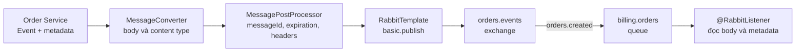
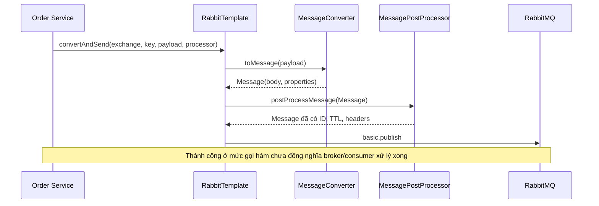
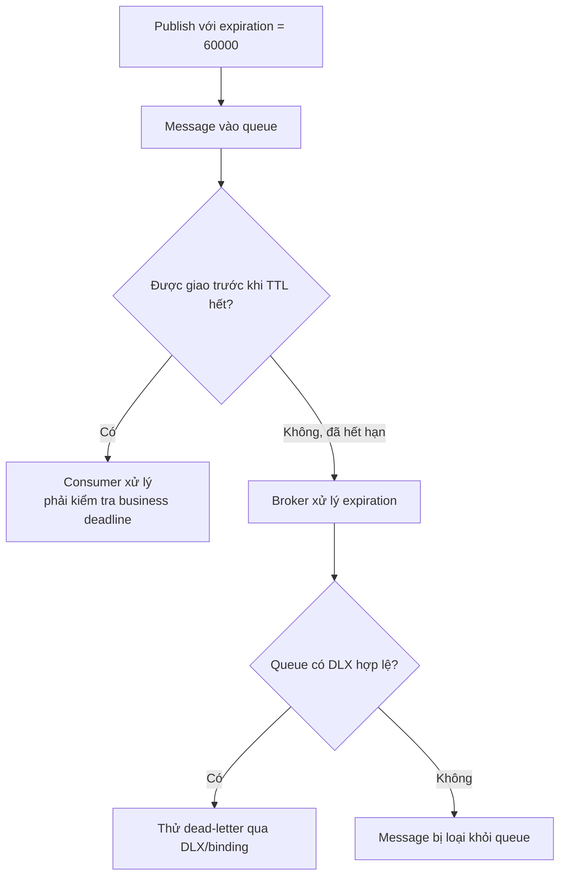
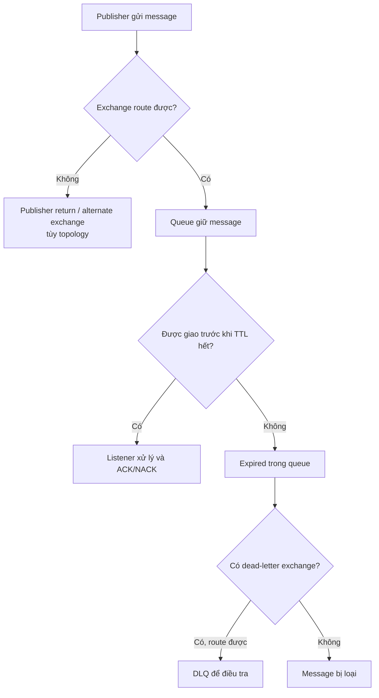
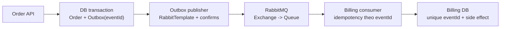

# Đặt messageId, thời hạn và metadata nghiệp vụ

## 1. Bối cảnh và mục tiêu bài học

Trong ứng dụng **SPRING_AMQP** tích hợp **RabbitMQ**, `RabbitTemplate` có thể gửi một `String`, mảng byte hoặc đối tượng Java qua exchange đến queue. Nhưng một body như `"order-123"` chưa trả lời được các câu hỏi vận hành: sự kiện nào đang được gửi, nó thuộc yêu cầu nghiệp vụ nào, đã quá hạn hay chưa, schema phiên bản mấy và nếu broker giao lại thì đã xử lý trước đó chưa?

RabbitMQ vận chuyển **body cùng các message properties và headers**. Spring AMQP cho phép ứng dụng đặt metadata ngay trước khi publish. Một thiết kế metadata nhất quán giúp kết nối các mảnh quan trọng của xử lý bất đồng bộ: **định tuyến qua exchange/queue/binding, publisher confirms, consumer acknowledgements, retry, dead-letter, transaction/outbox và quan sát hệ thống**.

Bài này thuộc chương **Gửi thông điệp**, tập trung vào ba việc:

1. **Định danh message** với `messageId` và phân biệt nó với `correlationId`, delivery tag, trace ID.
2. **Quy định thời hạn** với thuộc tính `expiration` (per-message TTL), phân biệt TTL trên queue với deadline nghiệp vụ.
3. **Gắn metadata nghiệp vụ** bằng `MessageProperties`, AMQP headers và `MessagePostProcessor` để producer/consumer trao đổi đúng hợp đồng dữ liệu.

Sau bài, bạn có thể viết publisher Spring AMQP phát thông điệp kèm ID, hạn dùng và metadata; dùng listener kiểm tra chúng; đọc đúng tín hiệu publisher confirm/return; và kiểm thử message hết hạn, xử lý lại, hoặc lỗi contract.

## 2. Cấu trúc AMQP Message trong Spring

`org.springframework.amqp.core.Message` gồm hai phần:

- **Body (`byte[]`):** nội dung thực sự được truyền, ví dụ chuỗi UTF-8, JSON, Protobuf hoặc một dạng nhị phân khác.
- **`MessageProperties`:** metadata chuẩn và bảng headers ứng dụng. Spring ánh xạ các thuộc tính phù hợp sang AMQP 0-9-1 basic properties.



Các trường thường được dùng:

| Thuộc tính | Ý nghĩa chính | Ví dụ | Lưu ý |
| --- | --- | --- | --- |
| `messageId` | Định danh một message/sự kiện do ứng dụng gán | `evt-8cf2...` | Không phải khóa dedup tự động của RabbitMQ |
| `correlationId` | Liên hệ nhiều message trong một request/workflow | `checkout-492` | Có thể có nhiều event chung một correlation ID |
| `type` | Nhận dạng kiểu message | `orders.created` | Không tự tạo binding hay chọn Java class |
| `appId` | Định danh ứng dụng phát | `order-service` | Không phải bằng chứng xác thực người gửi |
| `timestamp` | Mốc thời gian ứng dụng ghi vào message | `2026-11-26T01:00Z` | Broker không dùng trường này để bắt đầu đếm TTL |
| `expiration` | Per-message TTL tính bằng **mili giây dạng chuỗi số** | `"60000"` | Bắt đầu theo ngữ nghĩa thời gian lưu trong queue; không phải ISO date |
| `contentType` | Định dạng body | `text/plain`, `application/json` | Phải khớp nội dung thực |
| `contentEncoding` | Mã hóa body, thường liên quan charset | `UTF-8` | Không tự sửa một body bị mã hóa sai |
| `deliveryMode` | Chế độ lưu trữ message | `PERSISTENT` | Cần xem cả durability, confirms và loại queue |
| `priority` | Mức ưu tiên message | `5` | Có tác dụng phù hợp khi queue hỗ trợ/cấu hình priority |
| `headers` | Metadata mở rộng của ứng dụng | `schemaVersion=2` | Nên dùng key/type ổn định và hạn chế kích thước |

**Định tuyến không phụ thuộc mặc định vào `messageId` hay `expiration`.** Với direct/topic exchange, routing key của `RabbitTemplate.convertAndSend(exchange, routingKey, ...)` và bindings mới quyết định queue nhận. Headers exchange là trường hợp đặc biệt có thể xét headers theo binding.

### Message properties và business headers khác nhau ra sao?

Các thuộc tính chuẩn có tên, kiểu và ý nghĩa quy ước theo AMQP, chẳng hạn `messageId`, `correlationId`, `timestamp`, `expiration`. Header ứng dụng như `eventType`, `schemaVersion` hoặc `tenantCode` là **hợp đồng do nhóm phát triển định nghĩa**; broker không tự hiểu chúng thành chính sách timeout, xác nhận hoặc idempotency.

Ví dụ một message mang body dạng text:

```text
exchange      = orders.events          # đích publish, không nằm mặc định trong body
routingKey    = orders.created
body          = "order-123"
properties:
  contentType = text/plain
  contentEncoding = UTF-8
  messageId   = evt-b8d62e
  correlationId = checkout-71
  type        = orders.created
  timestamp   = 2026-11-26T01:00:00Z
  expiration  = "90000"
headers:
  schemaVersion = 2
  producer      = order-service
  businessExpiresAt = "2026-11-26T01:01:30Z"
```

Đây là **biểu diễn để học**, không phải YAML có thể gửi nguyên văn tới RabbitMQ. Khi publish, `body` là byte, còn properties/headers được converter/template ánh xạ theo giao thức.

## 3. `messageId`: định danh message, không phải cơ chế chống trùng tự động

### 3.1. Dùng ID nào?

Một nghiệp vụ có thể phát ra các message:

```text
Order order-123
  ├─ Event evt-001: orders.created
  ├─ Event evt-002: orders.confirmed
  └─ Event evt-003: orders.shipped
```

Trong mô hình này:

- `orderId = order-123` nhận diện **thực thể nghiệp vụ**; một order có nhiều event.
- `messageId/eventId = evt-001` nhận diện **một sự kiện logic**, nên ổn định qua những lần retry gửi chính sự kiện đó.
- `correlationId = checkout-71` nối các hoạt động thuộc cùng một workflow; có thể dùng chung cho nhiều message.
- `traceId` (nếu hệ thống dùng tracing) giúp theo dõi luồng phân tán, thường theo chuẩn telemetry của tổ chức.

**Không chọn `orderId` làm `messageId` cho mọi event của order** nếu mỗi event khác nhau cần được xử lý riêng. Nếu có cơ chế dedup dựa trên messageId, cách đặt này sẽ khiến những sự kiện hợp lệ bị hiểu nhầm là bản trùng.

### 3.2. RabbitMQ có tự loại message trùng messageId không?

Trong queue thông thường qua AMQP 0-9-1, RabbitMQ **không tự đảm bảo dedup chỉ nhờ `messageId`**. Hai lần publish cùng body và cùng `messageId` vẫn có thể tạo **hai message được nhận và xử lý**. Message ID là metadata giúp ứng dụng nhận biết, log, truy vết và triển khai **idempotent consumer**.

Tình huống điển hình:

1. Producer publish `evt-001`.
2. Broker nhận message, nhưng connection mất trước khi publisher nhận confirm.
3. Producer không biết lần gửi đầu đã thành công hay chưa, quyết định retry **cùng `evt-001`**.
4. Consumer có thể nhận hai delivery mang cùng event ID.
5. Ứng dụng cần kiểm tra event ID trong kho lưu trạng thái xử lý, dùng unique constraint/giao dịch phù hợp để không nhân đôi tác dụng phụ.

Nếu producer tạo UUID mới **mỗi lần retry** của cùng event, hệ thống downstream khó xác định chúng là một sự kiện logic. Hãy tạo event ID tại thời điểm tạo event/outbox record và dùng lại khi retry.

### 3.3. Phân biệt ID hay gặp

| ID | Ai quản lý? | Phạm vi | Dùng để làm gì? |
| --- | --- | --- | --- |
| `messageId` | Thường do publisher đặt | Một message/event logic | Dedup ở tầng ứng dụng, truy vết sự kiện |
| `correlationId` | Publisher/workflow | Nhiều message liên quan | Ghép request với response, tìm cùng workflow |
| `CorrelationData.id` | Spring AMQP publisher | Lời gọi gửi có theo dõi confirm | Ghép publisher confirm với thao tác gửi |
| Delivery tag | RabbitMQ channel | **Chỉ trên channel nhận delivery** | `basicAck`/`basicNack` đúng delivery |
| Trace ID / span ID | Hệ thống tracing | Một trace hoặc span | Quan sát giao tiếp xuyên dịch vụ |
| `orderId` / business key | Ứng dụng nghiệp vụ | Một aggregate/thực thể | Xác định đối tượng cần cập nhật |

Không dùng delivery tag làm business event ID, và không dùng `CorrelationData.id` như một đảm bảo message đã được consumer xử lý. Có thể **chủ động đặt trùng giá trị** giữa `messageId` và `CorrelationData.id` để việc đối chiếu dễ hơn, nhưng chúng vẫn là hai khái niệm khác tầng.

## 4. Đặt `messageId` bằng `MessagePostProcessor`

### 4.1. Vì sao dùng MessagePostProcessor?

`RabbitTemplate.convertAndSend(...)` nhận payload Java, dùng `MessageConverter` tạo body/properties, sau đó có thể chạy một `MessagePostProcessor` để chỉnh metadata **trước khi publish**.



Đây là điểm phù hợp để gắn metadata cho một message cụ thể. Nếu muốn áp dụng metadata chung cho tất cả publish, có thể cấu hình interceptor/template-level processor phù hợp; tuy nhiên cần tránh vô tình ghi đè ID hoặc content type của message đã được chuẩn bị.

### 4.2. Ví dụ Java: event ID ổn định và metadata

Dependency Spring Boot cơ bản:

```xml
<dependency>
    <groupId>org.springframework.boot</groupId>
    <artifactId>spring-boot-starter-amqp</artifactId>
</dependency>
```

Một publisher dùng payload text là `orderId` để tập trung vào metadata (ví dụ JSON sẽ được nói riêng):

```java
package example.messaging;

import java.time.Duration;
import java.time.Instant;
import java.util.Date;
import java.util.Objects;

import org.springframework.amqp.core.MessageDeliveryMode;
import org.springframework.amqp.core.MessageProperties;
import org.springframework.amqp.rabbit.core.RabbitTemplate;
import org.springframework.stereotype.Service;

@Service
public class OrderEventsPublisher {
    public static final String EXCHANGE = "orders.events";
    public static final String ROUTING_KEY = "orders.created";

    private final RabbitTemplate rabbitTemplate;

    public OrderEventsPublisher(RabbitTemplate rabbitTemplate) {
        this.rabbitTemplate = rabbitTemplate;
    }

    public void publish(OrderCreatedEvent event) {
        Objects.requireNonNull(event, "event");

        rabbitTemplate.convertAndSend(
                EXCHANGE,
                ROUTING_KEY,
                event.orderId(),                 // String -> text/plain
                message -> {
                    MessageProperties properties =
                            message.getMessageProperties();

                    // ID tạo khi sinh event và GIỮ NGUYÊN khi retry.
                    properties.setMessageId(event.eventId());
                    properties.setCorrelationId(event.correlationId());
                    properties.setType("orders.created");
                    properties.setAppId("order-service");
                    properties.setTimestamp(Date.from(event.occurredAt()));

                    // Hạn kỹ thuật: TTL tương đối tại lúc publish.
                    long ttlMs = Duration.between(
                            Instant.now(), event.expiresAt()).toMillis();
                    if (ttlMs <= 0L) {
                        throw new IllegalArgumentException(
                                "Event already expired: " + event.eventId());
                    }
                    properties.setExpiration(Long.toString(ttlMs));

                    // Metadata nghiệp vụ: truyền deadline TUYỆT ĐỐI.
                    properties.setHeader("eventType", "orders.created");
                    properties.setHeader("schemaVersion", 1);
                    properties.setHeader("businessExpiresAt",
                            event.expiresAt().toString());

                    properties.setDeliveryMode(MessageDeliveryMode.PERSISTENT);
                    return message;
                });
    }

    public record OrderCreatedEvent(
            String eventId,
            String orderId,
            String correlationId,
            Instant occurredAt,
            Instant expiresAt) {}
}
```

Điểm cần hiểu:

- Giá trị `eventId` phải được tạo **một lần** khi sự kiện nghiệp vụ sinh ra. Một publish retry dùng cùng object/same event ID.
- Payload là `String` nên SimpleMessageConverter mặc định tạo text body; processor không giả vờ rằng body đó là JSON.
- `timestamp` phản ánh thời điểm **sự kiện phát sinh**, không điều khiển TTL của RabbitMQ.
- `expiration` phải là **chuỗi số mili giây**, ví dụ `"90000"`. Đừng đặt `Instant.toString()` hoặc `"90s"` vào thuộc tính này.
- Header `businessExpiresAt` là deadline tuyệt đối để **consumer tự kiểm tra thời gian còn hiệu lực**, không làm broker tự áp dụng TTL mới.
- `MessageDeliveryMode.PERSISTENT` thích hợp với message quan trọng khi đi cùng queue durable và thiết kế broker phù hợp, nhưng **không một mình** đảm bảo không mất message.
- Processor có thể ném exception nếu sự kiện đã hết hạn trước khi publish; việc kiểm tra business deadline ở publisher giúp tránh gửi việc đã vô nghĩa, nhưng **consumer vẫn cần kiểm tra lại**.

Ví dụ này dùng sự kiện text đơn giản để dễ quan sát; trong sản xuất, nếu payload cần nhiều field, hãy thống nhất JSON/Avro/Protobuf và converter thực sự hỗ trợ định dạng đó.

### 4.3. Đặt MessageProperties bằng `send()`

Khi ứng dụng đã có `byte[]` của định dạng mong muốn, có thể tạo `Message` thủ công:

```java
import java.nio.charset.StandardCharsets;
import org.springframework.amqp.core.Message;
import org.springframework.amqp.core.MessageProperties;

MessageProperties props = new MessageProperties();
props.setContentType(MessageProperties.CONTENT_TYPE_TEXT_PLAIN);
props.setContentEncoding("UTF-8");
props.setMessageId("evt-001");
props.setExpiration("45000");
props.setHeader("schemaVersion", 1);

Message message = new Message(
        "order-123".getBytes(StandardCharsets.UTF_8), props);

rabbitTemplate.send("orders.events", "orders.created", message);
```

Với `send(Message)`, bạn tự chịu trách nhiệm bảo đảm body/`contentType`/`contentEncoding` khớp nhau. `convertAndSend(Object, processor)` thường thuận tiện hơn khi đã có converter phù hợp và chỉ cần bổ sung metadata.

## 5. Thời hạn message: TTL trong RabbitMQ hoạt động thế nào?

### 5.1. `expiration` là thời gian sống tương đối của message

`MessageProperties.setExpiration("60000")` gắn per-message TTL **60.000 mili giây**. Khi message nằm trong queue vượt thời hạn có hiệu lực, RabbitMQ có thể xem message là expired và loại khỏi hàng chờ, hoặc **dead-letter** nếu queue có DLX được cấu hình và route được.

Lưu ý về ngữ nghĩa:

- TTL **không phải thời điểm tuyệt đối** và không được tính từ `MessageProperties.timestamp`.
- Per-message expiration được broker áp dụng trong ngữ cảnh queue sau khi message được route; không phải lời hứa “đúng 60 giây sau lập tức xóa khỏi mọi thứ”.
- Message đã được giao tới consumer trước khi TTL hết không tự động bị thu hồi khi consumer đang xử lý; **deadline nghiệp vụ cần được kiểm tra ở handler**.
- Message hết hạn thường không còn được phát cho consumer như message hợp lệ, nhưng việc dọn khỏi queue và dead-letter có thể chịu chi tiết triển khai, đặc biệt với thứ tự message và loại queue.
- TTL không thay thế publisher confirms, xác nhận xử lý hay cơ chế retry.



### 5.2. Phân biệt ba mốc thời gian

| Khái niệm | Cách biểu diễn | Ai sử dụng? | Ý nghĩa |
| --- | --- | --- | --- |
| **Thời điểm phát sinh (`occurredAt`)** | `Instant` trong event, hoặc `timestamp` AMQP | Ứng dụng/log/analytics | Message được tạo khi nào |
| **TTL kỹ thuật** | `expiration = "60000"`, hoặc queue `message-ttl` | RabbitMQ broker | Message được phép chờ tối đa bao lâu trong queue |
| **Hạn nghiệp vụ (`businessExpiresAt`)** | ISO-8601 trong body/header (hoặc field schema) | Producer và consumer | Sau thời điểm nào thao tác không còn hợp lệ |

Ví dụ: coupon chỉ hợp lệ đến 12:00 UTC. Producer gửi message lúc 11:59:30 UTC, TTL mong muốn là 30 giây. Nếu mất kết nối, retry đến 12:01 UTC mà producer vẫn đặt `expiration="30000"`, message có thể còn được lưu trong queue nhưng đã **quá hạn nghiệp vụ**. Vì vậy, trong ví dụ ở mục 4, TTL được tính từ **`expiresAt - Instant.now()` tại thời điểm publish**, và consumer vẫn kiểm tra deadline tuyệt đối.

Một thiết kế nhất quán:

1. Lưu `eventId` và `businessExpiresAt` vào record sự kiện/outbox.
2. Khi gửi hoặc retry, tính lại TTL còn lại từ deadline cố định.
3. Nếu deadline đã qua, không publish như tác vụ còn hiệu lực; xử lý theo quy tắc hết hạn.
4. Khi consumer nhận, kiểm tra deadline theo đồng hồ đáng tin cậy và chính sách nghiệp vụ, kể cả message được giao trước khi TTL hết.

### 5.3. TTL toàn queue và per-message TTL

RabbitMQ có thể cấu hình TTL cho message theo hai cấp:

- **Per-message TTL:** `MessageProperties.expiration` trong từng publish.
- **Per-queue message TTL:** policy `message-ttl` hoặc queue argument `x-message-ttl` áp dụng cho các message trong một queue.

Nếu cả hai cùng tồn tại, **thời gian sống hiệu lực là ngưỡng chặt hơn**. Ví dụ queue policy 30 giây và message expiration 90 giây thì message chỉ có thời gian chờ hiệu lực tối đa 30 giây trong queue đó.

Ví dụ RabbitMQ policy trên vhost `/`:

```bash
rabbitmqctl set_policy -p / --apply-to queues BILLING_TTL "^billing[.]orders$" '{"message-ttl":30000}'
```

Ví dụ thay thế bằng queue x-argument Spring AMQP:

```java
Queue billingQueue = QueueBuilder.durable("billing.orders")
        .ttl(30_000)
        .build();
```

**Hai ví dụ là hai cách cấu hình cho cùng chính sách giới hạn**; không nên đặt hai giá trị mâu thuẫn mà không hiểu precedence. RabbitMQ policy thường thuận tiện hơn để điều chỉnh ở runtime, còn queue x-arguments được xác lập khi declare, có thể gây lỗi `PRECONDITION_FAILED` nếu queue đã tồn tại với thuộc tính khác.

### 5.4. TTL message khác TTL của queue

Đừng nhầm `message-ttl`/`x-message-ttl` với `expires`/`x-expires` của queue. **Message TTL** quy định thời gian message được chờ; **queue expiration** quản lý vòng đời của **chính queue** khi không được sử dụng theo tiêu chí RabbitMQ. Xóa một queue còn có thể kéo theo mất toàn bộ message lưu trong đó. Chọn đúng cấu hình theo bài toán.

### 5.5. TTL không phải công cụ hẹn giờ chính xác

Đôi khi hệ thống dùng queue có TTL rồi dead-letter vào exchange đích để tạo **delayed delivery**. Cơ chế này có thể hữu ích cho retry đơn giản nhưng không phải một scheduler chính xác:

- Message expired có thể phải đợi đến vị trí thích hợp trong queue mới được dead-letter; message sau có TTL ngắn hơn có thể bị ảnh hưởng bởi message trước TTL dài hơn.
- Tốc độ xử lý, cluster và loại queue tác động đến thời điểm broker thực hiện.
- Khi dead-letter, routing, binding, retry count và vòng lặp phải được kiểm soát.
- Không dùng per-message TTL để hứa thực thi đúng thời điểm tuyệt đối; nếu cần hẹn giờ nghiêm ngặt, chọn cơ chế scheduler/delayed messaging phù hợp và thử trên broker mục tiêu.

Một message đến queue trước deadline nhưng được consumer giữ lâu vẫn có thể thực hiện **sau deadline**. Đó là lý do TTL kỹ thuật và kiểm tra nghiệp vụ phải đi cùng nhau.

## 6. Metadata nghiệp vụ: chọn trường và cách mã hóa

Metadata giúp consumer quyết định xử lý, log/trace và tiến hóa hợp đồng dữ liệu mà không cần giải mã toàn bộ body trong mọi trường hợp.

### 6.1. Nhóm trường nên cân nhắc

| Header / field | Ví dụ | Ý nghĩa |
| --- | --- | --- |
| `eventType` | `orders.created` | Cho biết loại sự kiện trong hợp đồng |
| `schemaVersion` | `2` | Phiên bản cấu trúc payload, hỗ trợ migration |
| `sourceService` | `order-service` | Nguồn phát để quan sát |
| `businessExpiresAt` | `2026-11-26T01:30:00Z` | Deadline tuyệt đối của nghiệp vụ |
| `tenantCode` | `tenant-a` | Phân tách logic nhiều tenant nếu kiến trúc cần |
| `operationId` | `checkout-71` | Liên hệ nhiều sự kiện của một nghiệp vụ |
| `attempt` | `1` | Số lần ứng dụng tự publish/redrive, nếu có tracking đáng tin |
| `traceparent` | W3C trace context | Liên kết distributed tracing nếu công cụ của tổ chức hỗ trợ |

**Không phải mọi thứ đều nên nhét vào headers**. Business payload chính nên nằm trong body có schema rõ ràng. Headers nên nhỏ, ổn định, hữu ích cho định tuyến/phân loại/observability. Tránh thông tin bí mật, token, số tài khoản hoặc dữ liệu cá nhân nhạy cảm ở headers vì chúng có thể xuất hiện trong log, UI hoặc DLQ.

### 6.2. Kiểu dữ liệu header

AMQP field table hỗ trợ những dạng dữ liệu được giao thức và client ánh xạ như string, số, boolean, byte array, timestamp, mảng/bảng lồng nhau tùy khả năng client. Khi trao đổi nhiều ngôn ngữ, nên chọn kiểu **đơn giản và nhất quán**:

```java
props.setHeader("eventType", "orders.created");         // String
props.setHeader("schemaVersion", 2);                    // Integer
props.setHeader("isReplay", false);                     // Boolean
props.setHeader("businessExpiresAt",
                "2026-11-26T01:30:00Z");                 // ISO-8601 String
```

Đừng đặt object Java tùy ý vào header rồi kỳ vọng ứng dụng Python/Go đọc được. Các header lớn cũng làm tăng chi phí mạng/bộ nhớ và có thể chạm giới hạn của broker/client. Dữ liệu quan trọng cần được quản lý bằng schema, không dựa vào chi tiết runtime Java.

### 6.3. Header nghiệp vụ và header do broker quản lý

RabbitMQ có thể thêm thông tin dead-letter như `x-death` và các metadata delivery khác. **Đừng dùng tên header hệ thống để lưu nghiệp vụ** hoặc tự giả mạo chúng. Với retry/redrive, nên dùng header ứng dụng riêng và kiểm tra cách broker/consumer giữ hoặc sửa headers qua các lần phát lại.

**Thứ tự ưu tiên thông tin** cũng cần rõ: nếu `eventType` trong header mâu thuẫn với `type` property hoặc `type` trong body, consumer phải có một quy tắc nhất quán (ví dụ reject/quarantine). Một message “có đủ headers” vẫn có thể là message không hợp lệ về nghiệp vụ.

## 7. Ví dụ Spring Boot end-to-end: topology, publish, consume

### 7.1. Cấu hình kết nối và quan sát publish

```yaml
spring:
  rabbitmq:
    host: ${RABBITMQ_HOST:localhost}
    port: ${RABBITMQ_PORT:5672}
    username: ${RABBITMQ_USERNAME:guest}
    password: ${RABBITMQ_PASSWORD:guest}
    virtual-host: ${RABBITMQ_VHOST:/}
    publisher-confirm-type: correlated
    publisher-returns: true
    template:
      mandatory: true
    listener:
      simple:
        acknowledge-mode: auto
        prefetch: 20
```

Ở đây, `publisher-confirm-type: correlated` cho phép theo dõi publish qua correlation data và confirm callback; `publisher-returns` kết hợp `template.mandatory` giúp nhận biết publish không route được theo cơ chế RabbitMQ. Chúng **không làm TTL dài hơn** hoặc khiến broker dedup theo `messageId`.

Tài khoản `guest` thường chỉ được kết nối từ localhost theo cấu hình RabbitMQ mặc định; triển khai thật cần user/vhost và quyền thích hợp. Tên property cần kiểm tra theo Spring Boot release đang dùng.

### 7.2. Khai báo exchange, queue, binding và DLX

```java
package example.messaging;

import org.springframework.amqp.core.Binding;
import org.springframework.amqp.core.BindingBuilder;
import org.springframework.amqp.core.Declarables;
import org.springframework.amqp.core.DirectExchange;
import org.springframework.amqp.core.Queue;
import org.springframework.amqp.core.QueueBuilder;
import org.springframework.context.annotation.Bean;
import org.springframework.context.annotation.Configuration;

@Configuration
public class OrderMessagingTopology {
    public static final String EXCHANGE = "orders.events";
    public static final String ROUTING_KEY = "orders.created";
    public static final String QUEUE = "billing.orders";

    public static final String DLX = "orders.dead";
    public static final String DEAD_KEY = "orders.expired";
    public static final String DLQ = "billing.expired.q";

    @Bean
    public Declarables orderResources() {
        DirectExchange primary =
                new DirectExchange(EXCHANGE, true, false);
        DirectExchange deadExchange =
                new DirectExchange(DLX, true, false);

        Queue workQueue = QueueBuilder.durable(QUEUE)
                .deadLetterExchange(DLX)
                .deadLetterRoutingKey(DEAD_KEY)
                .build();
        Queue deadQueue = QueueBuilder.durable(DLQ).build();

        Binding workBinding = BindingBuilder.bind(workQueue)
                .to(primary).with(ROUTING_KEY);
        Binding deadBinding = BindingBuilder.bind(deadQueue)
                .to(deadExchange).with(DEAD_KEY);

        return new Declarables(
                primary, deadExchange,
                workQueue, deadQueue,
                workBinding, deadBinding);
    }
}
```

Với `RabbitAdmin` được cấu hình phù hợp và có quyền khai báo, Spring có thể tạo các resource trên broker. DLX giúp **thử định tuyến** message hết hạn từ queue nguồn đến `billing.expired.q`; nó **không** đảm bảo dead-letter luôn thành công qua mọi sự cố hay mọi cấu hình. Nếu hệ thống đã có queue cùng tên nhưng arguments khác, declare có thể lỗi `PRECONDITION_FAILED`; hãy quản lý migration có chủ đích.

### 7.3. Gửi event và gắn CorrelationData

Ví dụ mục 4 cho thấy cách gắn metadata vào `MessageProperties`. Nếu muốn theo dõi confirm ứng với event ID, dùng một `CorrelationData` do producer tạo:

```java
import org.springframework.amqp.rabbit.connection.CorrelationData;

// eventId được lưu từ lúc phát sinh sự kiện; dùng lại cho retry.
CorrelationData confirmId = new CorrelationData(event.eventId());

rabbitTemplate.convertAndSend(
        OrderMessagingTopology.EXCHANGE,
        OrderMessagingTopology.ROUTING_KEY,
        event.orderId(),
        message -> {
            message.getMessageProperties().setMessageId(event.eventId());
            message.getMessageProperties()
                    .setCorrelationId(event.correlationId());
            message.getMessageProperties().setType("orders.created");
            message.getMessageProperties().setHeader("schemaVersion", 1);
            return message;
        },
        confirmId);
```

Đoạn này là **biến thể gửi riêng** để minh họa overloaded API; khi ứng dụng cần TTL và các metadata khác, kết hợp processor ở mục 4 vào cùng lời gọi. `CorrelationData.id` do Spring dùng để tương quan confirm; `messageId` là AMQP property được gửi cho consumer. Có thể dùng chung giá trị `event.eventId()` nhưng không được đồng nhất phạm vi của hai API.

### 7.4. Quan sát publisher confirms/returns

```java
import org.springframework.amqp.rabbit.core.RabbitTemplate;
import org.springframework.stereotype.Component;

@Component
public class PublishTelemetry {
    public PublishTelemetry(RabbitTemplate template) {
        template.setConfirmCallback((correlation, ack, cause) -> {
            String id = correlation != null ? correlation.getId() : "unknown";
            if (ack) {
                System.out.println("Confirmed publish: " + id);
            } else {
                System.err.println(
                        "Publish NACK: " + id + ", cause=" + cause);
            }
        });

        template.setReturnsCallback(returned -> {
            System.err.println(
                    "Unroutable: key=" + returned.getRoutingKey()
                    + ", reply=" + returned.getReplyText());
        });
    }
}
```

Code minh họa này giả định một component duy nhất phụ trách đăng ký callbacks cho template. Trong production, dùng logger/metrics có correlation ID, không để nhiều component ghi đè callback của nhau và xử lý kết quả thành trạng thái bền vững của outbox nếu cần.

**Tín hiệu có ý nghĩa khác nhau:**

- **Publisher confirm ACK:** broker xử lý publish theo semantics của confirm; message có thể đang ở queue, đã được consumer lấy hoặc đã hết TTL. Nó không chứng minh business processing thành công.
- **Publisher return:** message không route tới queue trong trường hợp `mandatory` áp dụng; không dùng để nhận biết message đã hết hạn sau khi được route vào queue.
- **Consumer ACK:** delivery được consumer xác nhận trong phạm vi channel nhận. Không tự truyền kết quả xử lý đến publisher.
- **Expired/dead-lettered:** là sự kiện vòng đời message trong queue; không làm đảo ngược publisher confirm đã gửi trước đó.

### 7.5. Đọc metadata ở @RabbitListener

Ví dụ listener nhận raw `Message` để nhìn chính xác properties/headers:

```java
package example.messaging;

import java.nio.charset.StandardCharsets;
import java.time.Instant;

import org.springframework.amqp.core.Message;
import org.springframework.amqp.core.MessageProperties;
import org.springframework.amqp.rabbit.annotation.RabbitListener;
import org.springframework.stereotype.Component;

@Component
public class BillingEventsListener {
    @RabbitListener(queues = OrderMessagingTopology.QUEUE)
    public void onCreated(Message message) {
        MessageProperties props = message.getMessageProperties();

        String eventId = props.getMessageId();
        if (eventId == null || eventId.isBlank()) {
            throw new IllegalArgumentException("Missing messageId");
        }

        Object header = props.getHeaders().get("businessExpiresAt");
        if (!(header instanceof String deadlineText)) {
            throw new IllegalArgumentException("Invalid business deadline");
        }

        Instant deadline = Instant.parse(deadlineText);
        if (!Instant.now().isBefore(deadline)) {
            // Theo policy nghiệp vụ: ghi nhận expired, bỏ qua xử lý,
            // hoặc chuyển đến một luồng giám sát riêng.
            return;
        }

        String orderId = new String(
                message.getBody(), StandardCharsets.UTF_8);

        // Phần thực tế cần giao dịch/idempotency theo eventId:
        // 1. Đăng ký eventId đã xử lý bằng unique constraint.
        // 2. Chỉ cập nhật order/billing nếu đây là lần đầu.
        System.out.println("Handle " + eventId + " for " + orderId);
    }
}
```

Listener trên dùng `AUTO` acknowledge mode của Spring theo cấu hình `application.yml`: **return bình thường** được xem là xử lý thành công và container sẽ ack. Vì vậy, trường hợp `businessExpiresAt` đã qua cần **quy tắc nghiệp vụ rõ ràng**: chấp nhận bỏ qua và ack, lưu audit, hay chuyển sang quy trình khác. Nếu muốn dead-letter message do business deadline, không thể chỉ `return`; cần lựa chọn cơ chế reject/nack/recoverer phù hợp.

Ví dụ chưa triển khai hẳn transactional dedup; comment mô tả bước bắt buộc đối với hệ thống có tác dụng phụ quan trọng. Trên thực tế, nên đảm bảo bước lưu event ID và cập nhật nghiệp vụ nằm trong **cùng giao dịch DB phù hợp**; tách hai thao tác có thể tạo lỗ hổng khi ứng dụng crash.

### 7.6. Bài học từ một event đã nhận trước hạn nhưng xử lý sau hạn

Giả sử message có `expiration="60000"` và listener nhận ở giây thứ 10 nhưng API thanh toán chạy 2 phút. Broker không tự hủy tác vụ đã giao khi TTL hết ở giây 60. Consumer phải tự kiểm tra deadline **trước khi commit** tác dụng nghiệp vụ, hoặc thực thi timeout ở tầng xử lý. Vì thế, `businessExpiresAt` không nên chỉ nằm ở broker TTL mà còn phải được đọc trong business handler.

## 8. Thời hạn và dead-letter: hiểu đúng đường đi



### TTL không đồng nghĩa retry

Một queue có TTL và DLX có thể là một mảnh của **delayed retry**, nhưng bạn còn cần:

- Quy tắc phân biệt lỗi tạm thời với lỗi không thể sửa.
- Số lần thử tối đa, backoff và giới hạn thời gian xử lý.
- Cơ chế thay đổi hoặc giữ nguyên `eventId` sao cho dedup và lịch sử retry rõ ràng.
- Ngăn **dead-letter cycle** giữa queue chính và queue retry.
- Theo dõi `x-death`/metadata broker và event ID khi đọc từ DLQ.

Khi dead-letter, RabbitMQ có thể thay đổi một số properties/headers của message (chẳng hạn xử lý `expiration` để tránh lặp TTL ở destination). **Đừng giả định per-message expiration và toàn bộ metadata broker giữ nguyên tuyệt đối sau mỗi lần dead-letter.** Business deadline cần được lưu rõ trong payload/header của ứng dụng và được kiểm tra độc lập.

### TTL không đồng nghĩa thời hạn request HTTP

Một request API có timeout 5 giây nhưng message có TTL 90 giây là hai giới hạn riêng. Nếu client HTTP đã timeout, consumer vẫn có thể xử lý một event đến sau đó. Muốn quyết định có hủy tác vụ hay không, nghiệp vụ phải có một chính sách bền vững với `operationId`, trạng thái request và `businessExpiresAt`; RabbitMQ không tự biết request đã hết giá trị.

## 9. Khi nào đặt property, khi nào đặt header hoặc body?

| Dữ liệu cần truyền | Nơi nên đặt | Lý do |
| --- | --- | --- |
| ID message/event logic | `messageId` và có thể cả field trong event envelope | Truy vết/dedup rõ ràng; payload tự chứa khi lưu trữ hoặc chuyển hệ thống |
| ID request/workflow | `correlationId` (có thể cả trace headers) | Liên kết các publish/consume |
| Kiểu nội dung | `contentType`, `contentEncoding` | Converter giải mã đúng body |
| TTL chờ trong RabbitMQ | `expiration` hoặc queue policy TTL | Broker áp dụng vòng đời queue |
| Deadline tuyệt đối nghiệp vụ | Field trong body hoặc header `businessExpiresAt` | Consumer kiểm tra ở mọi giai đoạn |
| Phiên bản schema | Header hoặc field `schemaVersion` | Producer/consumer cùng hiểu version; thống nhất một nguồn chính |
| Thông tin khách hàng nhạy cảm | Body có bảo vệ/mã hóa và phân quyền phù hợp | Tránh lộ qua headers/log |
| Exchange/routing key | Tham số publish và bindings | Metadata message không thay binding trừ cơ chế định tuyến phù hợp |
| Delivery tag | Broker cấp khi consume | Không tự đặt từ publisher; chỉ dùng để ack đúng channel |
| Xác nhận publish | `CorrelationData`/publisher confirm | Không thể thay bằng header `published=true` tự gắn |

**Một metadata field có thể được sao chép có chủ đích sang nhiều nơi** (ví dụ event ID trong header và body) để tương thích nhiều client. Nếu làm vậy, phải định nghĩa nguồn dữ liệu chính và kiểm tra chúng không mâu thuẫn; đừng coi hai bản sao tự đồng bộ.

### Vì sao không dùng `timestamp` để broker hiểu deadline?

`MessageProperties.timestamp` chỉ là thuộc tính thời gian, thường dùng để quan sát hoặc hỗ trợ business logic. RabbitMQ không tự trừ `timestamp` khỏi `expiration` theo cách “deadline tuyệt đối”. `expiration` diễn đạt TTL tương đối; app tự tính thời gian còn lại khi cần hạn tuyệt đối.

## 10. Các lỗi thường gặp và cách chẩn đoán

| Triệu chứng | Nguyên nhân thường gặp | Hướng xử lý |
| --- | --- | --- |
| Message có `messageId` trùng nhưng vẫn được xử lý hai lần | RabbitMQ không dedup tự động theo ID | Unique constraint/idempotent handler, outbox và event ID ổn định |
| Retry publish tạo message ID mới liên tục | ID sinh bên trong mỗi lần gọi mà không lưu event identity | Tạo ID từ event/outbox record rồi dùng lại |
| Publisher confirm ACK nhưng consumer không nhận | Message có thể unroutable, đã expired, đang chờ, hoặc listener lỗi | Kiểm tra returns, binding, queue depth, TTL, consumer errors |
| `expiration="2026-..."` hoặc `"30s"` gây lỗi | TTL đòi chuỗi số mili giây | Đặt `"30000"`; deadline ISO đặt vào header/body |
| Message hết hạn nhưng vẫn thấy trong dashboard | Broker có thể loại/dead-letter theo thời điểm và kiểu queue, không luôn dọn ngay | Phân biệt ready/unacked, kiểm tra TTL có hiệu lực, vị trí message và loại queue |
| Message được giao trước hạn nhưng xử lý sau deadline | TTL không thu hồi xử lý đang chạy | Check business deadline trong consumer và trước commit |
| DLQ không có message expired | DLX/binding không khớp, policy khác, message chưa đến điều kiện xử lý | Kiểm tra effective TTL, DLX route, logs và broker version |
| Header `schemaVersion` bị thiếu hoặc sai kiểu | Producer/consumer không thống nhất contract | Validate khi receive và chọn reject/quarantine thích hợp |
| `contentType` báo JSON nhưng body là Java serialization/text | Processor ghi đè sai metadata của converter | Đặt content type phù hợp body thật; dùng JSON converter đúng |
| Metadata bị lẫn giữa các message | Tái sử dụng mutable `MessageProperties` hoặc giữ message dùng chung không an toàn | Tạo/proc metadata riêng mỗi publish, không chia sẻ mutable instance xuyên thread |
| Handler return khi deadline quá hạn nhưng muốn DLQ | AUTO ack sau khi method return bình thường | Thiết kế nhánh reject/recoverer/dead-letter riêng; không chỉ return |
| Thay TTL nhưng không thấy tác dụng | Queue x-arguments/policy precedence, vhost/pattern sai hoặc chưa cấu hình per-message | Kiểm tra effective policy/arguments và metadata nhận thực tế |

### Các kiểm tra tối thiểu khi nghi message “biến mất”

1. Kiểm tra **exchange**, **routing key**, bindings, alternate exchange hoặc publisher returns: message có route tới queue nào không?
2. Kiểm tra publisher **confirm ACK/NACK/timeout**; phân biệt thành công ở broker và thành công nghiệp vụ.
3. Kiểm tra `messages_ready`, `messages_unacknowledged`, số consumer, retry/DLQ và effective TTL của queue.
4. Kiểm tra message `expiration` và header `businessExpiresAt`; không nhầm expired trong broker với expired do business.
5. Đối chiếu `messageId` xuyên publisher, consumer, outbox và log DLQ; phân biệt cùng ID được giao lại với message mới của nghiệp vụ.
6. Xác định event đã commit tác dụng phụ hay chưa bằng dữ liệu bền vững; log “received” không chứng minh commit thành công.

## 11. Bảo đảm tin cậy và quyền riêng tư khi dùng metadata

### 11.1. `messageId` kết hợp outbox và idempotency

Một kiến trúc phù hợp khi Order Service phải cập nhật DB và phát event đáng tin cậy:



Producer lưu event/outbox record cùng transaction cập nhật order. Worker lấy event chưa gửi, publish với `messageId=eventId` và dùng publisher confirms để đánh dấu trạng thái. Nếu publisher chết ngay sau lúc broker nhận nhưng trước khi outbox được đánh dấu, nó có thể publish lại; consumer có thể chặn xử lý lặp bằng unique key gắn với event ID.

Đây là một mẫu **at-least-once với idempotent processing**, không phải lời hứa exactly-once end-to-end khi thiếu ràng buộc dữ liệu và xử lý lỗi đầy đủ.

### 11.2. Metadata không phải bằng chứng bảo mật

`appId`, `type`, `sourceService` hoặc `tenantCode` do publisher đặt **không tự xác thực danh tính producer**. Hãy dùng TLS, credentials/vhost và permissions RabbitMQ, kiểm soát ai được publish/consume, xác thực/ủy quyền ở tầng ứng dụng khi cần.

Không log toàn bộ headers/body nếu chứa dữ liệu nhạy cảm, nhất là trên fallback queue, DLQ và dashboard quan sát. Dùng event ID, loại event và deadline để điều tra trước; chỉ truy xuất payload khi có quyền hợp lệ.

### 11.3. Header phải có hợp đồng version

Khi schema tiến hóa từ `schemaVersion=1` sang `2`:

- Producer xác định loại sự kiện, version và định dạng body rõ ràng.
- Consumer hỗ trợ các version trong giai đoạn rollout theo kế hoạch tương thích.
- Nếu gặp version không hỗ trợ, cần reject/quarantine hoặc tuyến xử lý khác; retry mãi một payload không tương thích thường không giúp ích.
- Thời hạn nghiệp vụ nên được truyền ở định dạng chuẩn, ví dụ `Instant.toString()` (UTC ISO-8601), có quy tắc timezone và đồng hồ phù hợp.

## 12. Kiểm thử và bài thực hành

### 12.1. Kiểm tra metadata bằng unit test không cần broker

Có thể tạo `Message` bằng SimpleMessageConverter và chạy processor trực tiếp; mục tiêu là xác minh properties **trước khi publish**:

```java
import static org.junit.jupiter.api.Assertions.*;

import org.junit.jupiter.api.Test;
import org.springframework.amqp.core.Message;
import org.springframework.amqp.core.MessageProperties;
import org.springframework.amqp.core.MessagePostProcessor;
import org.springframework.amqp.support.converter.SimpleMessageConverter;

class MetadataTest {
    @Test
    void messageIdAndExpirationAreSet() {
        Message original = new SimpleMessageConverter()
                .toMessage("order-123", new MessageProperties());

        MessagePostProcessor processor = message -> {
            message.getMessageProperties().setMessageId("evt-001");
            message.getMessageProperties().setExpiration("60000");
            message.getMessageProperties().setHeader("schemaVersion", 2);
            return message;
        };

        Message result = processor.postProcessMessage(original);
        MessageProperties props = result.getMessageProperties();

        assertEquals("evt-001", props.getMessageId());
        assertEquals("60000", props.getExpiration());
        assertEquals(2, props.getHeaders().get("schemaVersion"));
    }
}
```

Test chứng minh **metadata được gắn vào `Message`**, chưa chứng minh broker thực thi TTL, DLX hoặc publisher confirm. Để xác minh các hành vi đó, cần integration test với RabbitMQ thật.

### 12.2. Bài lab 1: truy vết messageId và correlationId

1. Tạo event `evt-001` của order `order-123`, correlation ID `checkout-71` và business deadline trong tương lai.
2. Gửi qua `RabbitTemplate.convertAndSend` với processor ở mục 4.
3. Nhận ở `@RabbitListener(Message message)`, log `messageId` và `correlationId`.
4. Gửi lại **cùng event ID** như retry. Xác nhận broker có thể giao hai lần; sau đó thêm unique constraint/idempotency trong consumer và quan sát tác dụng phụ chỉ được commit một lần.
5. Gửi event khác `evt-002` cùng orderId nhưng loại nghiệp vụ khác; chứng minh dedup phải dùng đúng event identity.

### 12.3. Bài lab 2: xác minh TTL và DLX

Trên broker thử nghiệm, dùng queue `billing.orders` với DLX ở mục 7:

1. Tạm dừng consumer để message phải chờ queue.
2. Gửi message với `expiration="3000"` và `businessExpiresAt` trong tương lai.
3. Quan sát message ở queue nguồn rồi kiểm tra `billing.expired.q` sau khi broker xử lý expiration/dead-letter. Thời điểm chuyển có thể không chính xác từng mili giây.
4. Gửi message không có `expiration`; đối chiếu tác động của queue-level `message-ttl` nếu đã cấu hình.
5. Gửi message với `expiration="30000"` vào queue có policy TTL 5 giây; kiểm tra giới hạn **chặt hơn** có hiệu lực.
6. Kiểm tra metadata sau dead-letter: không giả định expiration property giữ nguyên, xem broker-provided death metadata nếu cần.

**Chỉ thực hiện lab trên môi trường local/test có quyền thao tác topology.** Thay TTL trên queue production có thể ảnh hưởng message tồn tại.

### 12.4. Bài lab 3: business deadline khác TTL

1. Gửi một message có TTL kỹ thuật 90 giây và deadline nghiệp vụ chỉ còn 10 giây.
2. Cho consumer nhận message sau 2 giây nhưng mô phỏng xử lý mất 15 giây.
3. Kiểm tra deadline trước khi commit dữ liệu: hoạt động nghiệp vụ phải tuân theo quy tắc expired của tổ chức, kể cả broker đã giao message hợp lệ khi nhận.
4. Gửi lại event sau deadline; producer tính lại `Duration.between(now, expiresAt)` và quyết định không publish message còn hiệu lực.
5. Quan sát rằng TTL của broker không thay thế được kiểm soát hạn nghiệp vụ tại consumer.

### 12.5. Bảng tình huống kiểm chứng

| Tình huống | Publisher làm gì? | Broker/consumer có thể làm gì? | Điều cần chứng minh |
| --- | --- | --- | --- |
| Message ID mới | Đặt `evt-001` | Route và xử lý message | ID xuất hiện trong log và payload contract |
| Retry cùng event | Gửi lại `evt-001` | Có thể giao trùng | Idempotency chặn tác dụng phụ trùng |
| Không có queue phù hợp | Publish với mandatory | Return hoặc AE tùy topology | Không nhầm lỗi routing với TTL |
| TTL hết khi còn ready | `expiration="3000"` | Broker loại/dead-letter khi điều kiện phù hợp | DLX/binding, metric, độ trễ expire |
| Consumer nhận trước hạn, commit sau hạn | Header `businessExpiresAt` | Consumer tự quyết định | Check deadline tại business boundary |
| Confirm ACK rồi message hết hạn | Theo dõi confirm | Message có thể bị expire sau đó | Confirm không bảo đảm consumer xử lý |
| Header sai schemaVersion | Gửi version không hỗ trợ | Conversion/validation báo lỗi | Reject/quarantine; không retry vô hạn |

## 13. Checklist thiết kế trước khi đưa vào production

- [ ] `messageId` nhận diện **một event logic**, được tạo một lần và giữ ổn định qua retry.
- [ ] `correlationId` có ngữ nghĩa workflow rõ ràng; phân biệt với delivery tag và confirm correlation data.
- [ ] Producer đặt `contentType`, `contentEncoding` đúng với body.
- [ ] `expiration` dùng **mili giây dạng chuỗi**, không dùng timestamp tuyệt đối.
- [ ] Có chính sách thống nhất cho queue-level TTL và per-message TTL; biết ngưỡng nào được áp dụng.
- [ ] Business deadline được lưu ở dạng tuyệt đối và được consumer kiểm tra trước tác dụng phụ quan trọng.
- [ ] Metadata nghiệp vụ có tên, kiểu, schemaVersion, quy tắc kiểm tra và giới hạn kích thước rõ ràng.
- [ ] Không dùng các headers do broker quản lý để chứa metadata tùy ý.
- [ ] Có publisher confirms và returns/alternate exchange khi phù hợp; không nhầm confirm ACK với xử lý hoàn tất.
- [ ] Consumer idempotent theo eventId và có quy trình retry/dead-letter cho lỗi tạm thời và dữ liệu không hợp lệ.
- [ ] DLX/DLQ được khai báo đúng; có chính sách retention, quan sát và redrive an toàn.
- [ ] Đã kiểm chứng TTL, broker restart, event trùng và chuyển đổi schema trên broker thử nghiệm.

## 14. Câu hỏi tự đánh giá

1. Vì sao `messageId=orderId` có thể gây lỗi dedup khi một order phát nhiều event khác nhau?
2. Có đúng là RabbitMQ tự loại message trùng nếu chúng cùng `messageId`? Nếu không, nên thiết kế consumer thế nào?
3. `messageId`, `correlationId`, `CorrelationData.id` và delivery tag khác nhau về phạm vi và vai trò ra sao?
4. `MessageProperties.setExpiration("60000")` tương ứng thời hạn gì? `setTimestamp(...)` có làm broker bắt đầu đếm TTL từ ngày đó không?
5. Nếu queue policy TTL = 15 giây, còn message có expiration = 90 giây, giới hạn nào có hiệu lực?
6. Message đã được giao cho consumer ở giây thứ 5 và xử lý tới giây 80, trong khi TTL là 60 giây. RabbitMQ có tự dừng tác vụ không? Bạn sẽ kiểm tra deadline nghiệp vụ ở đâu?
7. Vì sao một publisher confirm ACK không đồng nghĩa message đã đến consumer, còn publisher return không phải tín hiệu message vừa hết hạn?
8. Một event bị dead-letter vì hết TTL rồi được republish: bạn có nên giả định `expiration` cũ luôn được giữ nguyên không?
9. Nếu converter tạo `text/plain` nhưng processor lại đổi thành `application/json` mà body vẫn là text ID, consumer JSON có thể gặp lỗi gì?
10. Làm sao phối hợp messageId cố định, transactional outbox và unique constraint của consumer để tránh xử lý cùng sự kiện hai lần sau khi publisher mất kết nối?

**Ghi nhớ:** `messageId` giúp nhận diện **event logic** nhưng không tự chống trùng; `expiration` là **TTL kỹ thuật tương đối trong RabbitMQ**, không phải deadline nghiệp vụ tuyệt đối; metadata trong `MessageProperties` và headers giúp producer/consumer thống nhất contract. Sử dụng `MessagePostProcessor` để gắn đúng ID, TTL và metadata trước khi publish, rồi kết hợp publisher confirms, ACK/NACK, idempotency, retry, dead-letter và quan sát vận hành để bảo đảm hành vi bất đồng bộ có thể giải thích và kiểm soát.
