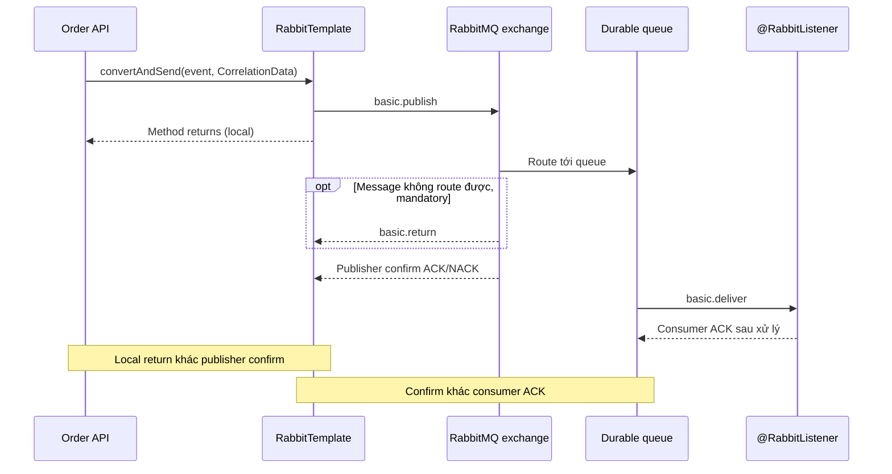
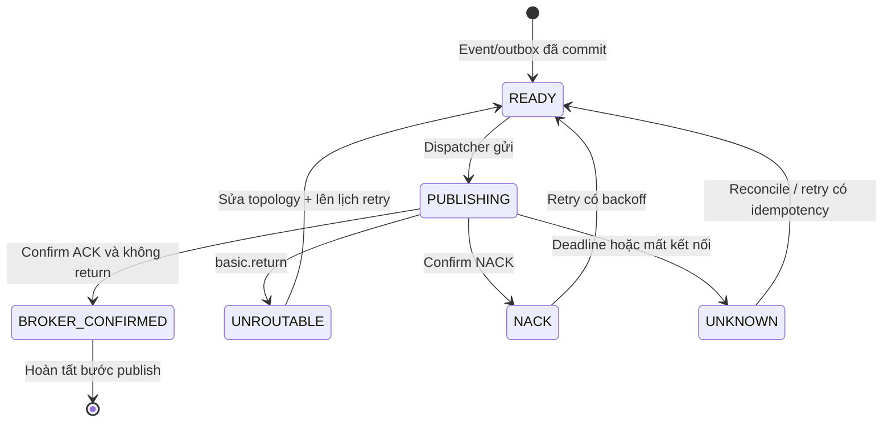
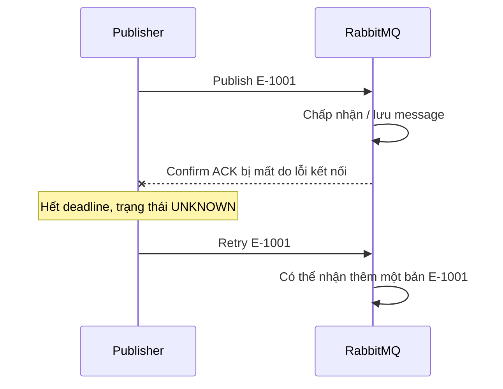
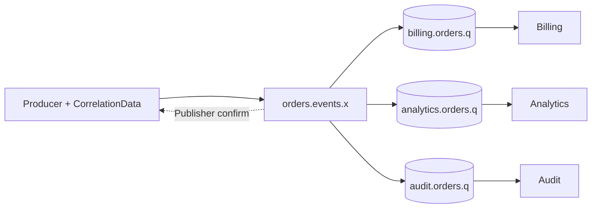

# Chọn điểm kết thúc nghiệp vụ gửi dựa trên confirm thay vì chỉ gọi hàm thành công

Một API tạo đơn hàng gọi `rabbitTemplate.convertAndSend(...)` và không nhận exception. Liệu có thể lập tức ghi `notificationSent=true` vào database hoặc trả về cho người dùng rằng “sự kiện đã được gửi thành công”? **Chưa thể kết luận như vậy.** Method gửi trả về chủ yếu cho biết lệnh đã được thực thi ở phía ứng dụng tại thời điểm đó; nó không phải bằng chứng broker đã chấp nhận và bảo đảm message theo cách mà nghiệp vụ cần.

Bài học thuộc chương **Gửi thông điệp** trong module **SPRING_AMQP**. Mục tiêu là chọn **điểm kết thúc của bước gửi message** dựa trên **publisher confirms**, phối hợp **publisher returns**, thay vì đồng nhất “hàm `RabbitTemplate` chạy xong” với “gửi thành công”. Đây là nền móng cho tích hợp RabbitMQ đáng tin cậy với `RabbitTemplate`, `@RabbitListener`, exchange, queue, binding, retry, dead-letter, transaction và quan sát hệ thống.

Sau bài này, bạn có thể:

- Phân biệt **local send**, **broker confirm**, **routing return**, **consumer ACK** và **hoàn tất nghiệp vụ**.
- Cấu hình publisher confirms dạng `correlated`, publisher returns và `mandatory` trong Spring Boot.
- Gắn `CorrelationData` cho từng lần publish, xử lý ACK/NACK và tình trạng không có kết quả.
- Định nghĩa state machine cho message/outbox để chọn đúng điểm ghi nhận **đã xác nhận gửi**.
- Phân biệt lỗi **unroutable**, **NACK**, **timeout** và tình huống kết quả không xác định.
- Thiết kế retry, idempotency, transactional outbox và dashboard để không mất message hoặc tạo xử lý trùng không kiểm soát.

> **Phạm vi API:** Ví dụ hướng tới Spring Boot 3.x / Spring AMQP 3.x, Java 17 trở lên và RabbitMQ dùng AMQP 0-9-1. Đối chiếu tài liệu và dependency BOM của bản đang chạy trước khi dùng ở sản xuất. Các đoạn code tập trung vào luồng publish; nếu dùng Spring AMQP 4.x hoặc cấu hình factory tùy chỉnh, cần đối chiếu API tương ứng.

## 1. Trả về từ `RabbitTemplate` không phải điểm hoàn tất gửi

Hãy phân biệt năm mốc:

| Mốc | Bằng chứng | Có thể kết luận gì? | **Chưa** được kết luận gì? |
| --- | --- | --- | --- |
| **A. Gọi method gửi** | `convertAndSend(...)` trả về, không exception | Ứng dụng không phát hiện lỗi đồng bộ ở bước gọi. | Broker đã nhận, định tuyến, lưu message hay chưa. |
| **B. Broker confirm ACK** | Publisher confirm liên kết với publish trả `ack=true` | Broker đã chấp nhận publish theo cơ chế confirm và queue type. | Consumer xử lý xong; message vào đúng queue mong muốn. |
| **C. Publisher return** | `basic.return` / returned message | Message không route được qua exchange theo điều kiện return; thường do không có binding phù hợp. | Confirm NACK; một returned message vẫn có thể được broker confirm ACK. |
| **D. Consumer delivery/ACK** | Consumer nhận, sau đó gửi `basic.ack` | Broker có thể coi delivery đã được consumer xác nhận. | Database/side effect phía consumer đã exactly-once. |
| **E. Nghiệp vụ hoàn tất** | Trạng thái nghiệp vụ hoặc event/response riêng | Tác vụ phía consumer được xác nhận theo hợp đồng ứng dụng. | Thay thế cho confirm hoặc cơ chế lưu event ở producer. |

Một pipeline bất đồng bộ điển hình:



Thứ tự trong sơ đồ mang tính khái niệm: delivery cho consumer có thể xảy ra trước khi producer xử lý callback confirm; message được return khi unroutable cũng có thể nhận confirm ACK. **Không dùng thứ tự thời gian của log từ hai ứng dụng làm phép chứng minh rằng callback đã bảo đảm tiêu thụ xong.**

### 1.1. Chọn “thành công” phải gắn với mục tiêu nghiệp vụ

| Nhu cầu của ứng dụng | Điểm có thể dùng để ghi nhận | Cần bổ sung gì? |
| --- | --- | --- |
| API chỉ cần **chấp nhận yêu cầu** để xử lý bất đồng bộ | Sau khi **ghi yêu cầu/outbox bền vững vào DB** thành công | Trạng thái `ACCEPTED`; không nói rằng broker đã nhận. |
| Hệ thống cần biết **broker đã xác nhận publish** | Confirm `ack=true` và xử lý return nếu áp dụng | CorrelationData, confirm timeout, retry khi kết quả chưa rõ. |
| Hệ thống cần biết **message đã vào queue đích cụ thể** | Confirm/returns chưa đủ một mình | Topology được kiểm soát, tên queue/routing key chính xác, hoặc tín hiệu riêng từ phía nhận. |
| Người dùng cần biết **công việc hoàn thành** | Kết quả được consumer ghi/đáp ứng | Business acknowledgment/callback/status query, idempotency. |

Như vậy, cùng một hệ thống có thể có hai trạng thái cùng đúng: **“Yêu cầu đã được tiếp nhận”** và **“Message đã được broker xác nhận”**. Không gọi cả hai là `SENT` nếu như thế khiến người vận hành hiểu sai độ tin cậy.

## 2. Publisher confirms và returns giải quyết hai câu hỏi khác nhau

### 2.1. Publisher confirms: broker đã xử lý publish chưa?

Khi channel bật confirm mode, RabbitMQ gửi **publisher confirm** về publisher cho các message đã publish. Mỗi publish có một sequence number trên channel; Spring AMQP có thể liên hệ kết quả với `CorrelationData` của ứng dụng.

- **ACK (`ack=true`):** broker đã chấp nhận publish ở mức bảo đảm của broker/queue type. Với persistent message được route vào durable queue, confirm liên quan tới cơ chế lưu trữ bền vững phù hợp, nhưng điều đó vẫn không tạo ra transaction xuyên broker–database.
- **NACK (`ack=false`):** broker không thể xác nhận publish thành công; ứng dụng cần ghi nhận thất bại và thực hiện xử lý phù hợp.
- **Không thấy confirm trước deadline:** trạng thái **chưa rõ**, không được mặc nhiên xem là NACK hoặc xem là thành công. Confirm có thể đến muộn hoặc đã bị mất do đứt kết nối.

Publisher confirms khác **AMQP consumer acknowledgements**. ACK phía publisher không chờ consumer, không phải xác nhận đã xử lý xong. Một queue có thể chưa có consumer và vẫn xác nhận publish đã được chấp nhận.

### 2.2. Publisher returns: message có route được không?

Một exchange có thể chấp nhận publish nhưng **không tìm được queue đích**. Với `mandatory=true` và returns được bật, RabbitMQ có thể trả lại message không định tuyến được.

Ví dụ direct exchange `orders.events.x` chỉ có binding `order.created`:

```text
Publish key order.created  -> route vào orders.audit.q -> broker confirm ACK.
Publish key order.cretaed  -> không khớp binding -> basic.return (nếu mandatory)
                         -> publisher confirm ACK vẫn có thể xảy ra.
```

Vì thế **ACK của publisher không có nghĩa routing thành công**. Một returned message không nhất thiết là broker NACK.

**Giới hạn quan trọng:** Không có return chỉ cho biết broker không trả message theo điều kiện áp dụng. Nếu exchange có **alternate exchange**, hoặc binding không đúng mong đợi, broker có thể route tới queue khác mà không return. Confirm + không return **không chứng minh** message đã tới đúng queue nghiệp vụ, và càng không chứng minh consumer đã xử lý.

### 2.3. Điều kiện để kết luận “gửi đã được xác nhận”

Trong bài toán có một exchange và binding được quản lý đúng, một tiêu chí thực dụng để ghi nhận bước gửi hoàn thành là:

1. Publisher confirm nhận **ACK** tương ứng với message/event.
2. Không nhận **returned message** tương ứng, khi `mandatory` và publisher returns đã được cấu hình phù hợp.
3. Không có lỗi đồng bộ chưa giải quyết ở quá trình publish.

Gọi trạng thái này là `BROKER_CONFIRMED` hoặc `PUBLISHED_CONFIRMED`, **không** gọi là `BUSINESS_COMPLETED`. Nếu hệ thống đòi bằng chứng message đến một queue cụ thể hoặc đã được xử lý, phải có hợp đồng và cách xác nhận riêng ở phía consumer.

## 3. Cấu hình Spring Boot để nhận confirms và returns

Với Spring Boot 3.x hỗ trợ các property này:

```yaml
spring:
  rabbitmq:
    host: localhost
    port: 5672
    publisher-confirm-type: correlated
    publisher-returns: true
    template:
      mandatory: true
```

| Property | Vai trò |
| --- | --- |
| `publisher-confirm-type: correlated` | Bật publisher confirms có tương quan với publish, hỗ trợ `CorrelationData` và confirm future. |
| `publisher-returns: true` | Cho phép xử lý thông báo return với message không định tuyến được. |
| `template.mandatory: true` | Yêu cầu broker trả message unroutable (khi không có đường route hợp lệ và không có cấu hình làm thay đổi kết quả). |

**Chỉ bật YAML chưa đủ để nghiệp vụ chờ xác nhận.** Bạn còn phải tạo correlation data cho publish, xử lý confirm/return, đặt deadline và cập nhật trạng thái lưu bền vững của yêu cầu gửi.

Trong ứng dụng Spring Boot mặc định, `CachingConnectionFactory`, `RabbitTemplate` và listener infrastructure thường được auto-configure. Khi bạn tự tạo `ConnectionFactory` hoặc `RabbitTemplate`, cần đảm bảo **publisher confirms/returns thực sự bật trên factory/template được sử dụng**. Đừng suy đoán từ việc property tồn tại nhưng không có callback/future.

### 3.1. Topology ví dụ cho publisher

Khai báo exchange, queue, binding trong project thực hành:

```java
import org.springframework.amqp.core.Binding;
import org.springframework.amqp.core.BindingBuilder;
import org.springframework.amqp.core.DirectExchange;
import org.springframework.amqp.core.ExchangeBuilder;
import org.springframework.amqp.core.Queue;
import org.springframework.amqp.core.QueueBuilder;
import org.springframework.beans.factory.annotation.Qualifier;
import org.springframework.context.annotation.Bean;
import org.springframework.context.annotation.Configuration;

@Configuration
class OrderPublishTopology {
    @Bean
    DirectExchange orderEventsExchange() {
        return ExchangeBuilder.directExchange("orders.events.x")
                .durable(true).build();
    }

    @Bean
    Queue orderAuditQueue() {
        return QueueBuilder.durable("orders.audit.q").build();
    }

    @Bean
    Binding orderAuditBinding(
            @Qualifier("orderAuditQueue") Queue queue,
            @Qualifier("orderEventsExchange") DirectExchange exchange) {
        return BindingBuilder.bind(queue).to(exchange)
                .with("order.created");
    }
}
```

Với `spring-boot-starter-amqp` và kết nối phù hợp, `RabbitAdmin` có thể declare các bean tài nguyên khi ứng dụng kết nối broker. Trong môi trường có nhiều service, cần thống nhất **quyền sở hữu topology** để tránh các ứng dụng khai báo cùng exchange/queue với thuộc tính khác nhau.

`orderAuditQueue()` dùng durable queue cho bài tập. Khi bảo toàn message quan trọng, producer còn phải chọn **persistent delivery mode** và kiểm tra queue type/broker durability. `durable` ở queue không thay thế publisher confirm; producer không biết được một message cụ thể đã được chấp nhận chỉ vì queue tồn tại.

## 4. Đợi confirm của **đúng publish** bằng `CorrelationData`

Một publisher xử lý hàng nghìn message đồng thời không thể đánh đồng callback “vừa nhận ACK” với “mọi message đang chờ đều thành công”. Mỗi lần publish cần **định danh tương quan** riêng để liên kết kết quả với bản ghi nghiệp vụ.

Trong Spring AMQP 3.x, `CorrelationData` hỗ trợ:

- `getId()`: ID tương quan do ứng dụng chỉ định.
- `getFuture()`: một `CompletableFuture<CorrelationData.Confirm>` hoàn tất khi có confirm tương ứng.
- `getReturned()`: thông tin returned message liên kết với correlation data khi returns được kích hoạt và message có return.

Với correlated confirms và returns đúng cấu hình, Spring AMQP sắp xếp thông tin returned message trên `CorrelationData` **trước khi** confirm future hoàn tất, giúp kiểm tra cùng một publish ở một nơi. Tuy nhiên, cần kiểm thử trên bản framework đang triển khai và không suy rộng điều này sang mọi callback tự viết.

### 4.1. Một publisher trả về kết quả thay vì tự coi là thành công

Ví dụ sau minh họa **Spring AMQP 3.x, Java 17+**. Nó trả về kết quả bất đồng bộ, không chặn thread HTTP để chờ broker:

```java
import java.util.concurrent.CompletableFuture;
import java.util.concurrent.CompletionStage;

import org.springframework.amqp.AmqpException;
import org.springframework.amqp.core.MessageDeliveryMode;
import org.springframework.amqp.rabbit.connection.CorrelationData;
import org.springframework.amqp.rabbit.core.RabbitTemplate;
import org.springframework.stereotype.Service;

@Service
public class ConfirmedOrderPublisher {
    public enum Status {
        BROKER_CONFIRMED,
        UNROUTABLE,
        NACK,
        UNKNOWN
    }

    public record Decision(
            String eventId, Status status, String detail) {}

    private final RabbitTemplate template;

    public ConfirmedOrderPublisher(RabbitTemplate template) {
        this.template = template;
    }

    public CompletionStage<Decision> publish(
            String eventId, String jsonPayload) {

        CorrelationData correlation = new CorrelationData(eventId);
        CompletableFuture<Decision> result = new CompletableFuture<>();

        try {
            template.convertAndSend(
                    "orders.events.x",
                    "order.created",
                    jsonPayload,
                    message -> {
                        var properties = message.getMessageProperties();
                        properties.setMessageId(eventId);
                        properties.setContentType("application/json");
                        properties.setDeliveryMode(
                                MessageDeliveryMode.PERSISTENT);
                        return message;
                    },
                    correlation);
        } catch (AmqpException ex) {
            // Một số lỗi đồng bộ chắc chắn chưa gửi; với lỗi mạng,
            // không nên tự kết luận broker không hề nhận message.
            result.complete(new Decision(
                    eventId, Status.UNKNOWN, ex.getMessage()));
            return result;
        }

        correlation.getFuture().whenComplete((confirm, error) -> {
            if (error != null || confirm == null) {
                result.complete(new Decision(
                        eventId, Status.UNKNOWN, "Không có confirm rõ ràng"));
                return;
            }
            if (!confirm.isAck()) {
                result.complete(new Decision(
                        eventId, Status.NACK, confirm.getReason()));
                return;
            }

            var returned = correlation.getReturned();
            if (returned != null) {
                result.complete(new Decision(
                        eventId, Status.UNROUTABLE,
                        returned.getReplyText()));
                return;
            }

            result.complete(new Decision(
                    eventId, Status.BROKER_CONFIRMED,
                    "Broker confirm ACK; không có return"));
        });

        return result;
    }
}
```

Điểm quan trọng trong ví dụ:

1. **Mỗi lần publish có `CorrelationData` mới**; không tái sử dụng một correlation object cho nhiều publish đang bay.
2. `eventId` có thể là ID của bản ghi outbox hoặc event, dùng để đối chiếu confirm với yêu cầu gửi. `messageId` gửi trên wire không có nghĩa RabbitMQ tự khử trùng lặp.
3. `convertAndSend(...)` hoàn thành nhưng **kết quả chưa được `BROKER_CONFIRMED`**; code chỉ hoàn tất `result` sau khi quan sát confirm hoặc lỗi.
4. **Confirm ACK + returned message** được phân loại thành `UNROUTABLE`, không phải `BROKER_CONFIRMED`.
5. `Status.UNKNOWN` là trạng thái thận trọng khi mất kết quả; không đánh đồng với `NACK`.

Ví dụ cố ý chỉ trả **technical publish decision**, chưa cập nhật database. Trong hệ thống production, callback hoàn thành trên các thread liên quan đến client/connection; **không nên thực hiện tác vụ database nặng, chặn thread hoặc publish lặp trong confirm callback**. Hãy chuyển kết quả sang một executor/worker giới hạn tải và cập nhật trạng thái một cách idempotent.

> **Một chú ý về JSON:** ví dụ gửi `String` chứa JSON, sau đó gắn `contentType=application/json` để minh họa properties. Consumer cần converter/hợp đồng tương thích. Với đối tượng Java, hãy cấu hình JSON converter cho `RabbitTemplate` thay vì mặc định nghĩ rằng mọi object đều được serialize thành JSON.

### 4.2. Có cần đăng ký `ConfirmCallback` không?

`RabbitTemplate` cũng có callbacks:

```java
template.setConfirmCallback((correlation, ack, cause) -> {
    if (!ack) {
        System.err.println("Publisher NACK: " + cause);
    }
});

template.setReturnsCallback(returned -> {
    System.err.println("Returned: " + returned.getReplyText());
});
```

Đây là **minh họa API**, không đặt vào nhiều component tùy tiện. Với một `RabbitTemplate`, callback confirm/return phải do **một cấu hình trung tâm** quản lý; code đăng ký sau có thể thay callback trước. Bạn có thể chọn dùng `CorrelationData.getFuture()` cho luồng outbox và callback tập trung cho metrics, nhưng phải tránh cập nhật nghiệp vụ **hai lần** từ cả hai con đường.

`ConfirmCallback` chỉ cung cấp sự kiện xác nhận chung với correlation data; nếu muốn đánh dấu một bản ghi cụ thể, phải dùng `correlation.getId()` hoặc ID đã ánh xạ. `ReturnsCallback` cũng cần được gắn vào hệ thống correlation/trace; không lấy returned message A để kết luận publish B thất bại.

### 4.3. Cách chờ đồng bộ có giới hạn: chỉ cho luồng thật sự cần

Một số quy trình quản trị hoặc thử nghiệm cần đợi kết quả trong cùng thread:

```java
import java.util.concurrent.TimeUnit;
import java.util.concurrent.TimeoutException;

CorrelationData data = new CorrelationData("evt-1001");
template.convertAndSend(
        "orders.events.x", "order.created", "O-1001", data);

try {
    CorrelationData.Confirm confirm =
            data.getFuture().get(5, TimeUnit.SECONDS);

    if (!confirm.isAck()) {
        // NACK: thất bại, xử lý riêng.
    } else if (data.getReturned() != null) {
        // Return: routing không đạt yêu cầu.
    } else {
        // Broker confirm ACK, không có return.
    }
} catch (TimeoutException ex) {
    // UNKNOWN: không được tự kết luận NACK.
}
```

Đây là mã **minh họa** để chỉ ra rằng có deadline, không phải hàm đầy đủ để sao chép vào production: cần xử lý thêm `InterruptedException`, `ExecutionException` và lỗi `AmqpException`, đồng thời không được chặn trên connection callback thread. Phần `convertAndSend` trong ví dụ này sử dụng converter/default delivery mode hiện có; với dữ liệu quan trọng hãy đặt persistent rõ ràng như mục 4.1.

**Khuyến nghị:** Đối với API có tải lớn, không giữ một HTTP request/thread để chờ hàng loạt confirms. Thay vào đó, ghi bền vững yêu cầu, trả về trạng thái `ACCEPTED` và theo dõi confirm bất đồng bộ; nếu nghiệp vụ bắt buộc phải chờ, phải giới hạn timeout và trả trạng thái rõ ràng khi chưa xác định.

## 5. State machine: khi nào đánh dấu message “đã gửi”?

Để tránh lỗi ngữ nghĩa, hãy đặt tên các trạng thái rõ ràng:

| Trạng thái | Ý nghĩa | Có được coi là gửi hoàn tất? |
| --- | --- | --- |
| `READY` | Yêu cầu sự kiện đã lưu, chờ publisher thực hiện. | **Chưa**. |
| `PUBLISHING` | Đã bắt đầu một attempt; chưa có kết quả broker. | **Chưa**. |
| `BROKER_CONFIRMED` | Publish được broker ACK, không quan sát return tương ứng. | **Có** cho bước gửi tới broker theo điều kiện đã thống nhất. |
| `UNROUTABLE` | Message bị return vì không định tuyến được theo điều kiện áp dụng. | **Không**; cần xử lý routing/topology. |
| `NACK` | Broker báo không xác nhận publish thành công. | **Không**. |
| `UNKNOWN` | Lỗi mạng, timeout hoặc mất kết quả; chưa biết broker có nhận chưa. | **Không**; cần kiểm tra/retry an toàn. |
| `BUSINESS_COMPLETED` | Consumer đã thực hiện và xác nhận nghiệp vụ qua cơ chế riêng. | Đây là **mốc khác**, không nên trộn với publisher confirm. |



### 5.1. Một trạng thái kỹ thuật, không phải “đơn hàng hoàn thành”

Đơn hàng có thể ở trạng thái `CREATED` trong database, event publish ở trạng thái `BROKER_CONFIRMED`, nhưng hệ thống hóa đơn vẫn chưa xử lý. Việc gửi message chỉ hoàn tất **bước phát sự kiện**, không hoàn tất toàn bộ workflow.

Nếu API trả về:

```json
{
  "orderId": "O-1001",
  "requestStatus": "ACCEPTED",
  "eventPublishStatus": "PENDING"
}
```

thì đó là trả lời đúng nếu request đã được commit cùng outbox nhưng chưa có confirm. Đến khi có confirm, hệ thống có thể cập nhật event publish status và/hoặc phát tín hiệu cập nhật tiến độ. Trả `200 OK` hay `202 Accepted` là lựa chọn API contract, không phải đặc tính tự động của RabbitMQ.

### 5.2. Không để confirm muộn làm đảo ngược trạng thái

Một publish có thể timeout ở giây thứ 5 nhưng confirm ACK đến ở giây thứ 6. Nếu ứng dụng đã lên lịch retry, cả attempt cũ và mới có thể ảnh hưởng trạng thái một event.

Để kiểm soát race:

- Lưu **event ID** và **attempt ID** riêng.
- Chỉ chấp nhận chuyển trạng thái theo các điều kiện hợp lệ; cập nhật database bằng version hoặc compare-and-set.
- Khi nhận confirm muộn cho attempt cũ, ghi audit và đối chiếu với trạng thái mới.
- Không để một callback cũ tự ghi đè `BROKER_CONFIRMED` thành `UNKNOWN` hoặc `NACK` sau khi một attempt khác đã thành công.

Ví dụ quy tắc nghiệp vụ: “Một event chỉ cần **một publish đã được xác nhận** để chuyển `BROKER_CONFIRMED`”. Điều đó không chứng minh các attempt khác không được broker nhận; consumer vẫn cần xử lý trùng.

## 6. Transactional outbox: đừng mất event trước cả khi đợi confirm

Chỉ đổi từ `convertAndSend(...)` sang `getFuture()` vẫn chưa giải quyết được một lỗi rất quan trọng: **ứng dụng chết sau khi ghi dữ liệu nghiệp vụ nhưng trước khi gửi event**.

Ví dụ:

```text
1. HTTP POST /orders
2. INSERT orders (O-1001) thành công và COMMIT.
3. Process Java chết trước khi convertAndSend("order.created").
4. Database có đơn hàng, RabbitMQ không có event.
```

Nếu event chỉ tồn tại trong bộ nhớ của producer, sau restart có thể không còn dấu vết để gửi lại. **Publisher confirm không sửa được đoạn trống này** vì publish chưa từng diễn ra.

Giải pháp thường dùng cho nghiệp vụ cần độ tin cậy là **transactional outbox**:

1. Trong **cùng transaction database**, ghi thay đổi nghiệp vụ và bản ghi outbox ở trạng thái `READY`.
2. Commit database thành công; HTTP có thể trả `ACCEPTED` theo API contract.
3. Dispatcher nền đọc outbox, gửi message có `CorrelationData` liên quan đến bản ghi.
4. Chỉ đánh dấu `BROKER_CONFIRMED` sau ACK và không có return theo tiêu chí đã chọn.
5. Khi gặp NACK, return hoặc UNKNOWN, ghi nguyên nhân và lên lịch retry/reconciliation; không xóa outbox ngay.

```mermaid
sequenceDiagram
    participant U as HTTP client
    participant S as Order service
    participant DB as Business DB + Outbox
    participant D as Outbox dispatcher
    participant R as RabbitMQ
    participant C as Consumer
    U->>S: Create order
    S->>DB: BEGIN + INSERT order + INSERT outbox READY
    DB-->>S: COMMIT
    S-->>U: 202 Accepted (đã lưu yêu cầu)
    D->>DB: Claim READY event
    D->>R: basic.publish + CorrelationData
    R-->>D: Confirm ACK / NACK; optional basic.return
    alt ACK và không return
        D->>DB: BROKER_CONFIRMED
    else NACK, return hoặc UNKNOWN
        D->>DB: Ghi attempt + hẹn retry/điều tra
    end
    R->>C: Delivery
    C->>C: Xử lý có idempotency
    C-->>R: Consumer ACK
```

### 6.1. Mô hình dữ liệu outbox tối giản

Ví dụ DDL mang tính minh họa (cần điều chỉnh cú pháp theo database):

```sql
CREATE TABLE outbox_event (
    event_id       VARCHAR(100) PRIMARY KEY,
    aggregate_id   VARCHAR(100) NOT NULL,
    exchange_name  VARCHAR(200) NOT NULL,
    routing_key    VARCHAR(200) NOT NULL,
    payload_json   TEXT NOT NULL,
    publish_status VARCHAR(32) NOT NULL,
    attempt_count  INTEGER NOT NULL DEFAULT 0,
    next_attempt_at TIMESTAMP NULL,
    confirmed_at   TIMESTAMP NULL,
    updated_at     TIMESTAMP NOT NULL
);
```

Ví dụ dữ liệu:

| `event_id` | `aggregate_id` | `publish_status` | `attempt_count` |
| --- | --- | --- | --- |
| `evt-1001` | `O-1001` | `READY` | 0 |
| `evt-1002` | `O-1002` | `PUBLISHING` | 1 |
| `evt-1003` | `O-1003` | `BROKER_CONFIRMED` | 1 |
| `evt-1004` | `O-1004` | `UNKNOWN` | 2 |

Nên có thêm bảng attempts hoặc các trường cho `attempt_id`, confirm reason, returned reply code/text, last error, deadline và trace ID. Một bản ghi outbox có thể được publish **nhiều lần** vì retry, nên `event_id` và `attempt_id` là hai khái niệm khác nhau.

### 6.2. Tại sao không đánh dấu thành công trước khi publish?

Sai:

```java
// Sai nếu status có nghĩa "broker đã xác nhận".
outbox.markAsSent(eventId);
rabbitTemplate.convertAndSend(exchange, routingKey, payload);
```

Nếu publish thất bại hoặc process chết, database đã ghi `SENT` trong khi broker chưa nhận gì.

Vẫn sai:

```java
rabbitTemplate.convertAndSend(exchange, routingKey, payload);
outbox.markAsSent(eventId); // Chưa chờ publisher confirm.
```

Code thứ hai chỉ di chuyển lỗi sang một khoảng thời gian khác. Một publish có thể chưa được broker ACK, hoặc đã bị return do sai binding. Cách đúng về ý nghĩa là **sau khi kiểm tra confirm tương quan và returns**, chuyển trạng thái sang `BROKER_CONFIRMED`.

### 6.3. Đừng coi outbox và RabbitMQ là một transaction duy nhất

Ngay cả với outbox, còn một khoảng trống:

1. Broker đã chấp nhận message và gửi confirm ACK.
2. Dispatcher chết **trước khi cập nhật `BROKER_CONFIRMED` trong database**.
3. Sau restart, dispatcher gửi lại cùng event.

Đây là lý do **transactional outbox thường cung cấp ít nhất một lần thử gửi (at-least-once)**, không phải exactly-once end-to-end. Consumer phải chịu được message trùng bằng event ID, unique constraint, cập nhật idempotent hoặc inbox/deduplication table.

Khi hệ thống có RabbitMQ transaction và Spring database transaction, đừng cho rằng hai transaction đã tự biến thành một distributed two-phase commit. Cần thẩm định khả năng phối hợp transaction ở công nghệ đang dùng; với phần lớn ứng dụng nghiệp vụ, outbox + consumer idempotency rõ ràng và dễ phục hồi hơn.

### 6.4. Cập nhật kết quả confirm phải bền vững

Không nên chỉ đặt:

```java
boolean sent = true; // Chỉ ở RAM.
```

mà cần lưu trạng thái theo ID đã tương quan. Khi callback đến, hệ thống cập nhật một bản ghi theo điều kiện phù hợp để chống race:

```sql
-- Minh họa: tránh ghi đè trạng thái đã được xác nhận.
UPDATE outbox_event
SET publish_status = 'BROKER_CONFIRMED',
    confirmed_at = CURRENT_TIMESTAMP,
    updated_at = CURRENT_TIMESTAMP
WHERE event_id = :eventId
  AND publish_status <> 'BROKER_CONFIRMED';
```

Trong thực tế, điều kiện UPDATE phải xét **attempt/version** và tình trạng claim của dispatcher để xử lý nhiều callback đến lệch thứ tự. SQL trên chỉ minh họa nguyên tắc **không đảo ngược trạng thái đã xác nhận**; không phải toàn bộ thuật toán locking/retry.

## 7. Ma trận lỗi: ACK, NACK, return và UNKNOWN

Tách đúng nguyên nhân giúp tránh retry sai và tránh biến những sự kiện chưa xác nhận thành “đã gửi”.

| Quan sát | Diễn giải | Trạng thái đề xuất | Phản ứng phù hợp |
| --- | --- | --- | --- |
| `convertAndSend` trả về, chưa có confirm | Chưa có bằng chứng broker ACK. | `PUBLISHING` | Theo dõi correlation future; không đánh dấu thành công. |
| Confirm ACK, không return | Broker xác nhận publish và không có return theo cấu hình. | `BROKER_CONFIRMED` | Kết thúc bước publish, lưu trạng thái bền vững. |
| Confirm ACK và có return | Broker chấp nhận publish nhưng routing không đạt yêu cầu. | `UNROUTABLE` | Kiểm tra exchange, binding, key, alternate exchange; cảnh báo. |
| Confirm NACK | Broker không xác nhận publish thành công. | `NACK` | Lưu lý do, retry có backoff/điều tra. |
| Timeout confirm | Chưa biết broker đã nhận chưa. | `UNKNOWN` | Reconcile hoặc retry an toàn, có thể sinh duplicate. |
| Connection reset khi publish | Publish có thể chưa hoặc đã tới broker. | `UNKNOWN` | Không tự kết luận “chưa gửi”; retry idempotent. |
| Exchange không tồn tại | Channel exception/`NOT_FOUND` hoặc lỗi AMQP khác. | `FAILED` / `UNKNOWN` tùy bằng chứng | Sửa topology/permission, không retry nóng vô hạn. |
| Consumer đã ACK | Delivery được consumer xác nhận. | Không phải trạng thái publish | Kiểm tra business outcome riêng nếu cần. |

### 7.1. Timeout không đồng nghĩa NACK

Tình huống:



Nếu publisher coi timeout là “chắc chắn chưa gửi”, rồi thử lại không có event ID/deduplication, consumer có thể xử lý hai lần. Nếu publisher coi timeout là “đã gửi”, event có thể mất khi broker thực sự chưa nhận. **Không có lựa chọn hoàn toàn an toàn chỉ dựa trên timeout**; cần lưu sự kiện và chấp nhận retry có thể tạo duplicate với cơ chế chống trùng.

### 7.2. Return và DLX là hai cơ chế khác nhau

Không nên nhầm:

- **Publisher return**: xảy ra ở chiều **publish → exchange/routing** khi broker không route được message theo điều kiện `mandatory`.
- **Dead-letter exchange (DLX)**: áp dụng khi message **đang nằm trong queue** và bị dead-letter do reject, TTL, giới hạn hoặc điều kiện broker.

Nếu exchange không route được message vào queue nào, chỉ cấu hình DLX trên một queue không liên quan sẽ **không cứu** publish đó. Cần kiểm tra binding, publisher returns hoặc **alternate exchange** phù hợp.

### 7.3. Phân loại lỗi để retry đúng

| Nhóm lỗi | Ví dụ | Phản ứng |
| --- | --- | --- |
| **Tạm thời** | Broker kết nối chập chờn, resource alarm, confirm timeout. | Backoff, jitter, giới hạn attempts, circuit breaker khi cần. |
| **Cấu hình/topology** | Sai exchange, routing key, thiếu binding hoặc quyền. | Dừng retry nóng, alert và sửa cấu hình; có thể phát lại từ outbox. |
| **Dữ liệu/hợp đồng** | Payload không hợp lệ, converter thất bại trước publish. | Validate và sửa payload/schema; không lặp vô hạn cùng dữ liệu lỗi. |
| **Từ chối do tải** | Queue overflow `reject-publish` hoặc broker backpressure. | Giảm publish rate, xử lý confirm NACK và điều chỉnh capacity. |
| **Kết quả không xác định** | Mất kết nối đúng lúc gửi hoặc mất confirm ACK. | Retry idempotent; ghi nhận nguy cơ duplicate, không xóa outbox. |

Backoff ví dụ: chờ 1 giây → 2 giây → 4 giây, có jitter và giới hạn tối đa. Chọn các con số theo SLA và khả năng chịu tải của hệ thống; không coi đây là quy tắc mặc định của Spring AMQP.

## 8. Consumer ACK, retry và idempotency vẫn cần thiết

Giả sử publisher được confirm ACK; ngay sau đó consumer nhận message:

```java
import org.springframework.amqp.rabbit.annotation.RabbitListener;
import org.springframework.stereotype.Component;

@Component
class OrderConsumer {
    @RabbitListener(queues = "orders.audit.q")
    public void handle(String orderId) {
        // Nghiệp vụ thực tế phải idempotent theo event ID.
        System.out.println("Consume: " + orderId);
    }
}
```

Nếu listener trả về bình thường trong chế độ Spring `AcknowledgeMode.AUTO`, container thường ACK sau khi method hoàn tất. Nếu process chết sau khi ghi database nhưng trước ACK, message có thể được giao lại; **publisher confirm đã thành công cũng không chặn được duplicate delivery**.

Một consumer đáng tin cậy nên:

1. Nhận **event ID** ổn định; không lẫn event ID với mỗi attempt publish.
2. Kiểm tra event đã xử lý chưa, dùng unique constraint/inbox table hoặc cập nhật nghiệp vụ idempotent.
3. Ghi side effect và trạng thái xử lý trong transaction thích hợp của database.
4. Chỉ để listener thành công/ACK sau khi công việc cần thiết đã hoàn thành.
5. Phân biệt lỗi tạm thời và lỗi không thể hồi phục, dùng retry có giới hạn hoặc dead-letter.

**Lưu ý:** `AcknowledgeMode.AUTO` của Spring không phải RabbitMQ consumer auto-ack; Spring container chủ động xác nhận delivery khi method hoàn tất theo chính sách. `AcknowledgeMode.NONE` có semantics khác và có thể làm message bị mất khi consumer chết trước khi xử lý.

Nếu nghiệp vụ cần biết consumer **đã thực hiện** công việc (không chỉ broker nhận message), hãy thiết kế **business acknowledgment** riêng: lưu trạng thái `PROCESSED`, phát event kết quả, callback hoặc endpoint truy vấn. Không dùng publisher confirm để trả lời câu hỏi này.

## 9. Quan sát publisher và điểm kết thúc gửi

Nếu ứng dụng chỉ ghi log “Đã gọi `RabbitTemplate`” thì dashboard vẫn có thể hiển thị màu xanh trong khi broker không nhận được publish. Quan sát tốt phải theo dõi **kết quả được broker xác nhận**.

| Chỉ số/sự kiện | Ý nghĩa | Cảnh báo gợi ý |
| --- | --- | --- |
| `publish_attempts_total` | Số lần ứng dụng thử publish. | Tăng bất thường có thể do retry loop. |
| `publisher_confirms_ack_total` | Số publish được broker ACK. | Giảm mạnh so với attempts hoặc lệch SLA. |
| `publisher_confirms_nack_total` | Số publish bị broker NACK. | Báo lỗi broker/queue quá tải hoặc tình trạng bất thường. |
| `publisher_returns_total` | Số publish bị return vì unroutable. | Thường là sai exchange/binding/routing hoặc rollout topology chưa khớp. |
| `publish_unknown_total` | Attempts quá hạn hoặc mất kết quả. | Cần reconciliation; không coi là đã gửi. |
| `publish_confirm_latency` | Thời gian từ publish đến confirm. | Theo dõi p50/p95/p99 và deadline. |
| `outbox_ready_age_seconds` | Tuổi của bản ghi chờ publish lâu nhất. | SLA phát sự kiện có thể bị vi phạm. |
| `outbox_pending_count` | Số event chưa có publish confirm. | Tăng liên tục báo publisher bị nghẽn. |
| `consumer_redeliveries_total` | Delivery được giao lại cho consumer. | Lỗi xử lý/ACK hoặc duplicate sau retry publish. |

Tên metric trong bảng là **quy ước gợi ý cho ứng dụng**, không phải cam kết tên metric RabbitMQ/Micrometer mặc định. Dự án có thể dùng tên khác; quan trọng là ý nghĩa và khả năng đối chiếu **event ID ↔ attempt ID ↔ confirm ↔ outbox status**.

### 9.1. Log tối thiểu để điều tra một event

Ví dụ log có cấu trúc:

```json
{
  "eventId": "evt-1001",
  "attemptId": "attempt-3",
  "exchange": "orders.events.x",
  "routingKey": "order.created",
  "status": "BROKER_CONFIRMED",
  "confirmAck": true,
  "returned": false,
  "elapsedMs": 48
}
```

Khi có lỗi return, ghi reply code, reply text, exchange và routing key. Khi có NACK, ghi reason và attempt; khi UNKNOWN, ghi timeout/deadline và trạng thái connection. **Không ghi toàn bộ payload nhạy cảm** hoặc credentials vào log chỉ để debug confirms.

Để tracing xuyên service, có thể gắn correlation/trace ID vào message headers và cấu hình Micrometer Observation theo phiên bản Spring AMQP đang dùng. Trace giữa producer và consumer cho biết đường đi, **không thay** confirm hoặc ACK.

### 9.2. Cân bằng số publish đang bay

Với tải lớn, publisher có thể tạo nhiều in-flight publish trong khi broker chậm confirm. Nếu ứng dụng giữ vô hạn future/CorrelationData trong RAM hoặc tạo retry liên tục, nó có thể hết bộ nhớ trước khi RabbitMQ phục hồi.

Giải pháp vận hành:

- Giới hạn số in-flight publish bằng worker pool/semaphore hoặc rate limiter.
- Đặt deadline và chuyển sang `UNKNOWN` theo một quy trình có lưu bền vững.
- Dùng backpressure/queue từ outbox thay vì dồn mọi message vào RAM.
- Theo dõi xác nhận từng attempt, không tái sử dụng `CorrelationData`.
- Đặt max attempts/backoff và cảnh báo khi một event bị kẹt quá lâu.

Nếu broker đang có memory/disk alarms, việc retry ngay lập tức có thể làm tình trạng tệ hơn. Hệ thống nên giảm tải và chờ broker phục hồi; với dữ liệu không được phép mất, nguồn sự kiện cần nằm trong kho bền vững.

## 10. Phân biệt confirm, return và queue type

Không phải mọi queue type có cùng chi phí và mức bảo đảm lưu trữ. Khi lựa chọn thời điểm kết thúc bước gửi, hãy hiểu **ACK của broker gắn với cơ chế mà loại queue sử dụng**:

| Queue type | Cơ chế liên quan | Hệ quả cho điểm kết thúc |
| --- | --- | --- |
| **Classic** | Durable queue và persistent message có cơ chế ghi lưu trữ riêng trên node chứa queue. | Confirm giúp biết broker đã chấp nhận publish theo semantics đó; không có replication dữ liệu classic queue trên các node khác. |
| **Quorum** | Queue replicated, với yêu cầu quorum phù hợp để bảo vệ dữ liệu khi node lỗi. | Confirm phản ánh cơ chế chấp nhận của quorum queue; cần theo dõi đủ replica/quorum và tài nguyên disk. |
| **Stream** | Lưu dữ liệu dạng log với retention/offset và cơ chế publish riêng tùy API. | Không tự suy luận toàn bộ nghiệp vụ stream từ ví dụ `RabbitTemplate` dùng queue AMQP truyền thống. |

**Không được hứa hẹn “đã ghi đĩa ở mọi nơi, không thể mất” chỉ vì confirm ACK.** Độ bền thực sự phụ thuộc queue type, số replica, bảo đảm lưu trữ của broker và các lỗi nằm ngoài phạm vi cơ chế confirm. Nếu SLA yêu cầu HA/recovery sau mất node, phải chọn queue type và cluster topology phù hợp ngay từ đầu.

### 10.1. Exchange → nhiều queue: confirm không phải phiếu giao cho từng subscriber

Khi một topic exchange route `order.created` tới Billing, Analytics và Audit, một publish có thể được broker confirm thành công nhưng publisher không nhận ba business ACK riêng.



Nếu Analytics lỗi parse JSON, Billing vẫn có thể hoàn tất. **Một publisher confirm không phân biệt thành công nghiệp vụ từng nhóm**. Để biết trạng thái từng subscriber, các service cần lưu tiến độ, phát result event hoặc có workflow riêng.

### 10.2. Overflow với nhiều queue có thể gây kết quả không đồng đều

Nếu exchange định tuyến tới hai queue và một queue chạm giới hạn `max-length` với `overflow=reject-publish`, broker có thể NACK publish dù queue còn lại đã chấp nhận message. **Retry cùng event có thể khiến queue đã nhận trước đó nhận thêm một bản**. Vì vậy:

- Consumer của mọi queue cần idempotency.
- Producer không được giả định NACK nghĩa là *không queue nào* nhận message.
- Alert/metrics phải cho biết queue nào bị quá tải và chính sách overflow cụ thể.
- Nếu phân phối tới nhiều subscriber mang tính giao dịch, cần thiết kế phối hợp ở tầng ứng dụng.

## 11. Kiểm thử tích hợp: đừng chỉ mock `RabbitTemplate`

Một unit test xác minh method `convertAndSend(...)` được gọi **không chứng minh publisher confirms hoạt động**. Cần integration test với broker RabbitMQ, các property confirms/returns đang bật, topology thực và cơ chế chờ kết quả có deadline.

### 11.1. Ma trận thí nghiệm

| Test | Thiết lập | Kết quả cần xác nhận |
| --- | --- | --- |
| **T1 — Happy path** | Exchange, binding, durable queue hợp lệ; publish persistent. | Correlation future nhận confirm ACK; không return; outbox chuyển `BROKER_CONFIRMED`. |
| **T2 — Sai routing key** | Publish `order.cretaed` thay `order.created`, bật mandatory/returns. | Có returned message; có thể vẫn confirm ACK; **không** đánh dấu thành công. |
| **T3 — Không có consumer** | Queue có binding nhưng không chạy listener. | Confirm ACK vẫn có thể đến, chứng minh confirm không phải business ACK. |
| **T4 — Exchange không tồn tại** | Gửi vào `orders.missing.x`. | Gặp lỗi AMQP/channel hoặc confirm bất thường; phân loại, không đánh dấu thành công. |
| **T5 — Confirm timeout** | Làm broker/network chậm hoặc ngắt kết nối trong lab. | Chuyển `UNKNOWN`; outbox giữ event và retry có kiểm soát. |
| **T6 — NACK** | Dùng tình huống broker từ chối publish, ví dụ overflow phù hợp. | Ghi nhận NACK theo correlation; không coi là thành công. |
| **T7 — Consumer thất bại** | Consumer ném exception sau khi broker confirm. | Publish đã confirm; consumer retry/DLQ độc lập với trạng thái gửi. |
| **T8 — Confirm ACK, DB update lỗi** | Mô phỏng dispatcher không lưu được status sau confirm. | Outbox còn pending; restart có thể publish lại; consumer cần dedupe. |
| **T9 — Confirm đến muộn** | Deadline hết trước khi ACK được xử lý. | Không có callback cũ ghi đè trạng thái mới; audit attempt và duplicate được xử lý. |
| **T10 — Nhiều subscriber** | Topic exchange với ba queue nhận cùng event. | Confirm không thay cho kết quả xử lý riêng của ba subscriber. |
| **T11 — Alternate exchange** | Message không match binding chính nhưng AE nhận. | Có thể không return; xác minh queue đích mong muốn qua topology và contract. |
| **T12 — Đứt consumer trước ACK** | Consumer ghi DB rồi mất connection trước ACK. | Message có thể redeliver; xử lý nghiệp vụ idempotent. |

### 11.2. Code gọi bài lab happy path

Với `ConfirmedOrderPublisher` ở mục 4:

```java
import java.util.concurrent.TimeUnit;

ConfirmedOrderPublisher.Decision decision = publisher.publish(
        "evt-lab-001",
        "{\"orderId\":\"O-LAB-001\",\"status\":\"CREATED\"}")
    .toCompletableFuture()
    .get(10, TimeUnit.SECONDS);

System.out.println(decision.status());
```

Đây là mã **đoạn gọi trong test/lab**, nơi biến `publisher` đã được inject hoặc khởi tạo theo ứng dụng. Nó phải được bao bởi test method có xử lý checked exceptions. Chạy khi broker và topology từ mục 3 đã sẵn sàng; nếu không có confirm, `get(...)` sẽ timeout — đó là dấu hiệu cần kiểm tra cấu hình, **không phải bằng chứng message chưa tới broker**.

### 11.3. Thực hành sai routing key để thấy ACK và return cùng tồn tại

Trong method publish, tạm đổi routing key thành `order.cretaed`. Giữ exchange `orders.events.x` nhưng không thêm binding cho key sai. Với `mandatory=true` và returns đang bật, kết quả mong đợi là:

```text
CorrelationData ID: evt-lab-002
Publisher confirm: ACK
ReturnedMessage: present (NO_ROUTE)
Business publish decision: UNROUTABLE
```

Nội dung này cho thấy một **confirm ACK không đủ để quyết định bước gửi thành công theo hợp đồng routing**. Sau đó sửa key, publish lại và ghi nhận từng attempt với event ID ổn định. Nếu dùng một hệ thống outbox thật, nhớ giữ retry theo backoff, không lặp nóng liên tục.

### 11.4. Phép thử nhiều message đồng thời

Gửi 100 message với 100 `CorrelationData` và event ID khác nhau. Xác minh:

- Số kết quả ACK/NACK/return/UNKNOWN có thể đối chiếu theo ID.
- Không đánh dấu nhầm confirm của event này cho event khác.
- Khi khóa kết nối trong lab, mọi attempt chưa rõ kết quả được đưa vào hàng phục hồi, không biến mất khỏi RAM mà không có dấu vết bền vững.
- Không để callback confirm làm các thao tác blocking kéo dài.

**Lưu ý môi trường:** Không áp dụng các thao tác ngắt broker, xóa queue, gây overflow hoặc chặn mạng trên hệ thống production đang phục vụ yêu cầu thật.

## 12. Những lỗi triển khai khiến “gửi thành công” bị ghi nhận sai

| Triệu chứng / cách làm sai | Vì sao sai? | Cách sửa |
| --- | --- | --- |
| Đánh dấu `SENT` ngay sau `convertAndSend` | Mới chỉ biết lệnh phía ứng dụng không báo lỗi đồng bộ. | Chờ confirm tương quan, xử lý return và lưu trạng thái kỹ thuật chính xác. |
| Chỉ bật `publisher-confirm-type` nhưng không quan sát future/callback | Ứng dụng bỏ qua kết quả confirm. | Đọc `CorrelationData.getFuture()` hoặc callback tập trung, có deadline. |
| Bật `publisher-returns` nhưng `mandatory=false` | Unroutable message có thể bị bỏ mà không return theo cơ chế mặc định. | Dùng `mandatory=true` khi muốn phát hiện message unroutable. |
| Confirm ACK rồi kết luận message đã vào đúng queue | Confirm không chỉ rõ queue nghiệp vụ được chọn; alternate exchange có thể route nơi khác. | Kiểm chứng topology/binding và dùng business acknowledgment khi cần. |
| Confirm ACK rồi kết luận consumer xử lý xong | Publisher confirm không chờ consumer. | Theo dõi trạng thái consumer/job bằng kênh khác. |
| Timeout confirm rồi đánh dấu `FAILED_NOT_SENT` | Broker có thể đã nhận trước khi confirm mất. | `UNKNOWN`, giữ nguồn sự kiện và retry idempotent. |
| NACK xong retry không có backoff | Dễ tăng tải khi broker đang lỗi hoặc queue quá tải. | Retry có giới hạn, jitter, cảnh báo và kiểm soát in-flight. |
| Callback confirm cập nhật database nặng hoặc publish lại trực tiếp | Có thể chặn thread liên quan connection/callback và tạo vòng lặp. | Chuyển xử lý sang executor/worker với queue hữu hạn. |
| Nhiều component tự đặt `setConfirmCallback` | Callback cuối có thể thay callback trước, mất kết quả. | Một đầu mối quản lý callbacks; đối chiếu `CorrelationData`. |
| Retry không giữ event ID ổn định | Consumer không biết hai message là hai lần gửi cùng một event. | Event ID ổn định xuyên các attempts; attempt ID riêng. |
| Ghi DB trước, sau đó gửi RabbitMQ nhưng không có outbox | Process chết giữa hai bước làm mất event. | Ghi thay đổi nghiệp vụ và outbox trong một DB transaction. |
| Dùng `@Transactional` database quanh `RabbitTemplate` rồi mặc định atomic | Broker transaction và DB transaction không tự tạo distributed transaction. | Outbox + idempotent consumer; xem xét consistency contract. |
| Dùng DLQ để phát hiện mọi lỗi publish | DLX xử lý message đã ở queue, không phải mọi lỗi routing lúc publish. | Publisher returns, confirms, alternate exchange nếu cần. |
| Thấy queue `ready=0` rồi kết luận mọi event đã hoàn tất | Message có thể `unacked`, bị dead-letter hoặc consumer đã nhận nhưng chưa commit. | Theo dõi ready/unacked, business status và DLQ. |
| Đánh dấu `BROKER_CONFIRMED` chỉ từ ACK trên một queue `non-durable` | Broker đã chấp nhận theo semantics queue, nhưng không bảo đảm sống qua restart như durable queue. | Chọn durable queue, persistent delivery mode, queue type/replication phù hợp. |

### 12.1. Confirm future “không bao giờ hoàn tất”: kiểm tra gì?

Khi một attempt đứng ở `PUBLISHING` quá lâu:

1. Xác minh ứng dụng đang dùng đúng `RabbitTemplate` và `ConnectionFactory` có correlated publisher confirms.
2. Đảm bảo mỗi publish nhận một `CorrelationData` riêng và future mà code đợi chính là của correlation đó.
3. Kiểm tra broker/network, exchange, channel closure và application logs.
4. Nếu sử dụng callback/future async, xem thread xử lý callback có bị block bởi database/HTTP call không.
5. Kiểm tra số in-flight publish, connection/channel cache và tài nguyên broker.
6. Khi deadline đến, chuyển `UNKNOWN`; không kết luận broker chắc chắn chưa nhận.

**Không tự tạo `CompletableFuture.completedFuture(ack=true)` sau `convertAndSend`** để tránh việc chờ. Làm vậy chỉ biến một tín hiệu local thành xác nhận giả.

### 12.2. Trả response HTTP thế nào khi confirm chậm?

Giả sử API tạo đơn hàng trong một hệ thống có outbox. Một lựa chọn contract:

| Tình trạng khi HTTP trả về | Response phù hợp theo hợp đồng | Cần diễn giải |
| --- | --- | --- |
| DB transaction ghi order + outbox thành công; chưa có confirm | `202 Accepted` hoặc response thành công có `eventPublishStatus=PENDING` | Yêu cầu đã được lưu bền vững; publish sẽ tiếp tục. |
| Broker confirm ACK nhưng consumer chưa xử lý | `eventPublishStatus=BROKER_CONFIRMED` | Publish được xác nhận, **không** phải xử lý đã xong. |
| Không ghi được order/outbox | Lỗi phù hợp API contract, chẳng hạn 5xx | Chưa có bảo đảm yêu cầu được lưu. |
| Confirm timeout nhưng outbox đã commit | `PENDING/UNKNOWN` theo hợp đồng API | Không tuyên bố mất event hoặc chắc chắn đã gửi. |
| Business processing đã hoàn tất | `COMPLETED` hoặc trạng thái nghiệp vụ riêng | Xác minh từ consumer/workflow, không suy từ confirm. |

Mã trạng thái HTTP là quyết định kiến trúc API và SLA; RabbitMQ không tự chọn `202` hay `200`. Nếu API có yêu cầu **chỉ trả thành công sau khi broker confirm**, phải dùng timeout có giới hạn, trả trạng thái không xác định khi vượt deadline và có idempotency key để client không tạo cùng đơn hàng hai lần khi retry.

## 13. Checklist trước khi đưa publisher vào production

### 13.1. Độ tin cậy và trạng thái

1. **Nguồn dữ liệu bền vững:** Đảm bảo event không mất nếu process chết trước publish; cân nhắc outbox trong cùng DB transaction.
2. **Định danh tương quan:** Mỗi event có ID ổn định, mỗi lần publish có attempt ID riêng và `CorrelationData` riêng.
3. **Điểm hoàn tất xác định:** Chỉ ghi `BROKER_CONFIRMED` sau ACK tương quan và kiểm tra return theo cấu hình đã chốt.
4. **Nhánh lỗi đầy đủ:** NACK, unroutable, timeout, sync exception, connection reset đều có trạng thái và chiến lược riêng.
5. **Kết quả chưa rõ:** Không coi timeout là chắc chắn chưa gửi; thực hiện retry với deduplication.
6. **Callback an toàn:** Không block thread callbacks; có giới hạn bộ nhớ, executor và số in-flight.

### 13.2. Broker, routing và consumer

1. Exchange, queue, binding và routing key được định nghĩa như hợp đồng; có test khi thay topology.
2. Queue type, durability, delivery mode, publisher confirms được phối hợp theo yêu cầu độ bền.
3. `mandatory` và publisher returns được bật khi cần phân biệt unroutable.
4. Có quy trình kiểm soát alternate exchange và policy thay đổi cách routing.
5. Consumer ACK/NACK/requeue, retry và DLX được kiểm thử độc lập với publisher confirms.
6. Business side effects có idempotency; message ID không tự khử trùng lặp trong broker.

### 13.3. Vận hành và quan sát

1. Metrics theo dõi confirm ACK/NACK, returns, timeout, publish latency và tuổi backlog outbox.
2. Dashboard tách `broker confirmed` và `business completed`.
3. Logs có event ID, attempt ID, exchange, key, status, reason; không lộ payload nhạy cảm.
4. Có runbook cho sai routing, broker down, queue overflow, consumer stuck, mất confirm và backlog tăng.
5. Định kỳ kiểm thử recovery, đối chiếu message chưa xác nhận và cleanup outbox **chỉ sau khi có trạng thái cuối hợp lệ và chính sách retention rõ ràng**.

## 14. Bài tập áp dụng và câu hỏi ôn tập

### Bài 1 — Chứng minh method thành công khác broker confirm

Tạo Spring Boot app dùng topology mục 3, bật correlated confirms. Gọi `convertAndSend` gửi 10 events; ghi timestamp của lúc method trả về và lúc `CorrelationData.getFuture()` hoàn tất. So sánh hai mốc và giải thích vì sao không dùng timestamp method return làm lúc hoàn tất gửi.

### Bài 2 — Confirm ACK nhưng bị return

Giữ exchange và queue hợp lệ, gửi event với key sai `order.cretaed`. Bật mandatory/returns và xác minh cùng một event có thể nhận **confirm ACK** và **returned message**. Trong code phân loại kết quả thành `UNROUTABLE` thay vì `BROKER_CONFIRMED`.

### Bài 3 — Không chạy consumer

Dừng `@RabbitListener` nhưng để queue và binding tồn tại. Publish một persistent message vào durable queue. Quan sát confirm ACK trong publisher và số message `ready` tăng ở broker. Viết một câu giải thích: “Broker đã xác nhận publish nhưng nghiệp vụ phía consumer chưa hoàn tất”.

### Bài 4 — Timeout confirm và nguy cơ gửi trùng

Trong lab, mô phỏng connection reset đúng thời điểm publish hoặc dùng một deadline ngắn để tạo `UNKNOWN`. Từ bản ghi outbox, phát lại event với **cùng event ID**, attempt ID mới. Thiết kế consumer dùng một bảng `processed_events(event_id)` có unique constraint để không thực hiện side effect hai lần.

### Bài 5 — Cập nhật outbox chỉ sau confirm

Tạo trạng thái `READY`, `PUBLISHING`, `BROKER_CONFIRMED`, `UNROUTABLE`, `NACK`, `UNKNOWN`. Viết logic cập nhật theo `eventId` và `attemptId`. Mô phỏng confirm của attempt 1 đến sau attempt 2; bảo đảm callback cũ không đưa trạng thái đã xác nhận về trạng thái kém chắc chắn.

### Bài 6 — Phân biệt publisher failure và consumer failure

Gửi event với routing đúng và quan sát confirm ACK. Để listener ném exception có chủ đích; kiểm tra retry/requeue/DLQ phù hợp cấu hình. Giải thích vì sao publisher vẫn có thể ở `BROKER_CONFIRMED` trong khi event xử lý phía consumer đang lỗi.

### Bài 7 — Dashboard vận hành

Thiết kế dashboard với publish attempts, confirm ACK/NACK, returns, unknown attempts, confirm p95 latency, outbox pending count/age, queue ready/unacked và số message DLQ. Đưa ra một alert khi `outbox_ready_age_seconds` vượt SLA và một alert khi `publisher_returns_total` tăng đột biến.

### Câu hỏi tự kiểm tra

1. `RabbitTemplate.convertAndSend(...)` trả về không exception có chứng minh broker đã ACK message không?
2. Publisher confirms khác consumer ACK ở đâu?
3. Vì sao một message bị `basic.return` vẫn có thể đi kèm publisher confirm ACK?
4. Trong cấu hình Spring Boot, ba property nào cần phối hợp để quan sát confirms và returns?
5. Tại sao mỗi publish phải có `CorrelationData` riêng?
6. Với `CorrelationData.getFuture()`, bạn nên phân biệt ACK, NACK, return và timeout như thế nào?
7. Khi timeout không có confirm, vì sao đánh dấu `NOT_SENT` là sai?
8. Một publish được confirm ACK nhưng gửi vào alternate exchange. Làm sao biết queue nghiệp vụ có nhận message không?
9. Vì sao outbox cần commit cùng transaction database của dữ liệu nghiệp vụ?
10. Vì sao outbox + publisher confirms vẫn có thể tạo message trùng?
11. Nếu `publish_status=BROKER_CONFIRMED`, có thể ghi `order_status=PAID` ngay không?
12. Vì sao consumer vẫn cần idempotency khi producer có publisher confirms và retry an toàn?
13. DLX và publisher returns xử lý lỗi ở những giai đoạn nào?
14. Đối với một HTTP API chậm confirm nhưng đã lưu outbox, nên diễn giải response thế nào để không nói quá mức bảo đảm?
15. Nếu publish tới hai queue và một queue từ chối do overflow, vì sao retry phải tính đến duplicate ở queue còn lại?

## 15. Tài liệu tham khảo

- [Spring AMQP — RabbitTemplate Publisher Confirms and Returns](https://docs.spring.io/spring-amqp/reference/amqp/template.html#template-confirms): `CorrelationData`, confirms, returns và callback behavior.
- [Spring AMQP — Sending Messages](https://docs.spring.io/spring-amqp/reference/amqp/sending-messages.html): `RabbitTemplate`, `convertAndSend`, `MessagePostProcessor` và message properties.
- [Spring Boot — AMQP](https://docs.spring.io/spring-boot/reference/messaging/amqp.html): RabbitMQ connection, template và configuration properties.
- [RabbitMQ — Consumer Acknowledgements and Publisher Confirms](https://www.rabbitmq.com/docs/confirms): phân biệt producer confirm với consumer delivery ACK.
- [RabbitMQ — Publishers](https://www.rabbitmq.com/docs/publishers): unroutable messages, mandatory publishing và publishing reliability.
- [RabbitMQ — Reliability Guide](https://www.rabbitmq.com/docs/reliability): kết nối, failure recovery, lưu trữ và giới hạn bảo đảm.
- [RabbitMQ — Queues](https://www.rabbitmq.com/docs/queues): durability, queue types và lifecycle.
- [RabbitMQ — Queue Length Limit](https://www.rabbitmq.com/docs/maxlength): overflow và tác động đến publisher.
- [Transactional Outbox Pattern](https://microservices.io/patterns/data/transactional-outbox.html): giải quyết dual-write giữa database và message broker.

**Điểm ghi nhớ:** Với RabbitMQ, **hàm gửi chạy xong chưa phải điểm kết thúc gửi**. Với yêu cầu cần biết broker đã tiếp nhận, hãy tương quan từng publish bằng `CorrelationData`, chờ **confirm ACK**, kiểm tra **returned message** khi dùng mandatory/returns, và chỉ lúc đó cập nhật trạng thái **`BROKER_CONFIRMED`**. Khi mất kết quả, giữ `UNKNOWN` và phục hồi theo outbox + idempotency. Publisher confirm kết thúc **bước publish tới broker**, không kết thúc công việc phía consumer và không thay thế transaction, retry, dead-letter hay quan sát nghiệp vụ.
