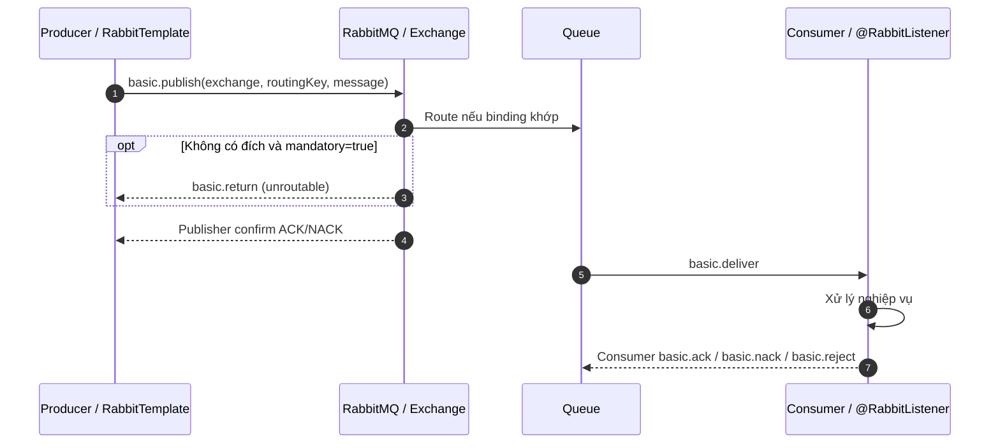
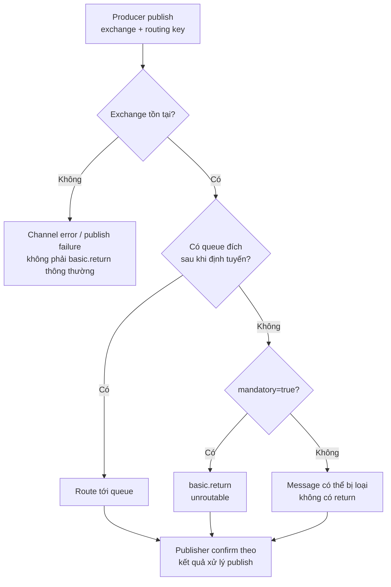
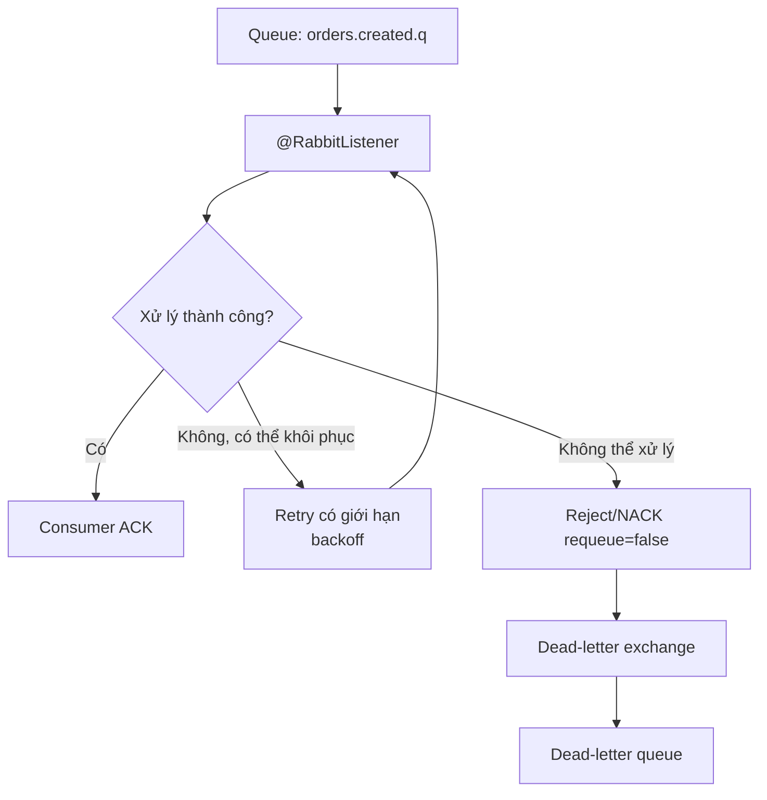

# Phân biệt broker nhận publish với consumer hoàn thành xử lý

## 1. Câu hỏi nền tảng: gửi thành công có nghĩa là gì?

Trong ứng dụng **Spring AMQP**, chúng ta thường viết:

```java
rabbitTemplate.convertAndSend(
    "orders.events",
    "orders.created",
    "order-101"
);
```

Nếu lệnh trên không ném exception, liệu có thể kết luận **Email Service đã gửi email**, **Payment Service đã cập nhật cơ sở dữ liệu**, hoặc ít nhất **message đã nằm trong queue đích**? **Không.**

Một message đi qua nhiều ranh giới độc lập:

1. **Ứng dụng gọi API gửi:** `RabbitTemplate` tạo AMQP message, publish qua kết nối RabbitMQ.
2. **Broker xử lý publish:** RabbitMQ nhận và xử lý publish, có thể phát **publisher confirm** cho producer.
3. **Broker định tuyến message:** exchange tìm queue đích; nếu message không route được và publisher yêu cầu, broker gửi **basic.return**.
4. **Consumer xử lý delivery:** broker giao message từ queue đến consumer; consumer xác nhận bằng **consumer acknowledgement** khi công việc đã hoàn tất theo cấu hình.

Những tín hiệu này có **người gửi, người nhận, mục đích và thời điểm khác nhau**. Chúng không tạo thành một “ACK duy nhất” bảo đảm toàn bộ nghiệp vụ.

Bài thuộc chương **Confirm và return** của module **SPRING_AMQP**, tập trung vào mối quan hệ giữa `RabbitTemplate`, exchange, queue, binding và `@RabbitListener`. Phân biệt các ranh giới sẽ giúp bạn cấu hình xác nhận giao nhận, retry, dead-letter, giao dịch và quan sát hệ thống bất đồng bộ đáng tin cậy.

### Kết quả học tập

Sau bài, bạn có thể:

- Giải thích **publisher confirm ACK/NACK**, **publisher return** và **consumer ACK/NACK/reject**.
- Xác định từng tín hiệu **chứng minh điều gì và không chứng minh điều gì**.
- Đọc đúng tình huống **confirm ACK nhưng không có queue nhận message**.
- Cấu hình `publisher-confirm-type: correlated`, `publisher-returns` và `mandatory` trong Spring Boot.
- Dùng `CorrelationData` để theo dõi confirm/return của từng lần publish.
- Dùng `@RabbitListener` để quan sát việc hoàn tất xử lý, redelivery và ranh giới acknowledgement.
- Thiết kế trạng thái nghiệp vụ, idempotency và outbox khi kết quả publish không chắc chắn.

## 2. Sơ đồ: một message, ba loại phản hồi khác nhau



**Sơ đồ biểu diễn các vai trò, không áp đặt thứ tự tuyệt đối giữa publisher confirm và consumer acknowledgement.** Consumer nhanh có thể nhận/xử lý message trước khi ứng dụng producer quan sát callback confirm; các sự kiện trên nhiều connection/channel không có một thứ tự chung mà ứng dụng có thể lấy làm bảo đảm nghiệp vụ. Nếu có publisher return cùng confirm, Spring AMQP cung cấp quy tắc phối hợp để người gửi xử lý thông tin return trước khi hoàn tất future confirm tương ứng.

### Bảng phân biệt cốt lõi

| Tín hiệu | Ai gửi? | Ai nhận? | Nó nói lên điều gì? | Nó **không** chứng minh |
| --- | --- | --- | --- | --- |
| **Publisher confirm ACK** | RabbitMQ broker | Publisher | Broker đã xử lý/chấp nhận publish theo điều kiện của confirm và queue type/topology | Consumer đã nhận hoặc xử lý nghiệp vụ; routing key chắc chắn có queue đích |
| **Publisher confirm NACK** | RabbitMQ broker | Publisher | Broker không thể xác nhận publish theo cơ chế confirm | Message chắc chắn chưa tồn tại ở mọi nơi; việc thử lại sẽ không tạo trùng |
| **Publisher return** | RabbitMQ broker | Publisher | Publish `mandatory` không thể route tới queue thích hợp | Broker bị lỗi hoặc nhất định phải gửi confirm NACK |
| **Consumer ACK** | Consumer hoặc listener container | RabbitMQ broker | Delivery đã được consumer xác nhận theo cách ứng dụng/container cấu hình | Publisher đã quan sát confirm; side effect được transaction toàn hệ thống bảo đảm |
| **Consumer NACK/REJECT** | Consumer hoặc listener container | RabbitMQ broker | Delivery bị từ chối, có thể requeue hoặc dead-letter theo lựa chọn | Publisher bị NACK; broker sẽ tự retry vô hạn một cách an toàn |

Lưu ý **publisher confirm ACK** và **consumer ACK** đều có chữ “ack”, nhưng chúng thuộc **hai cơ chế tách biệt**. Một ứng dụng có thể quan sát publisher confirm thành công trong lúc chưa có bất kỳ consumer nào đang chạy.

## 3. Publisher confirms: broker xử lý publish

### 3.1. Bản chất publisher confirm

RabbitMQ hỗ trợ **publisher confirms** như một cơ chế mở rộng của AMQP 0-9-1. Khi publisher bật confirm trên channel, broker thông báo các publish đã được xử lý theo điều kiện của broker bằng:

- **ACK:** broker xác nhận publish.
- **NACK:** broker từ chối xác nhận publish, thường gắn với lỗi phía broker hoặc điều kiện đặc biệt.
- **Không có confirm đúng hạn:** producer **chưa biết chắc** publish đã được broker xử lý chưa; đó là **kết quả chưa xác định**, không đồng nghĩa một NACK rõ ràng.

Các confirm có thể được nhận bất đồng bộ và được tương quan với publish bằng sequence/channel. Spring AMQP hỗ trợ ánh xạ theo `CorrelationData` để code ứng dụng không phải tự quản lý chi tiết delivery tag trên channel.

### 3.2. Confirm ACK bảo đảm điều gì?

Một publisher confirm ACK thể hiện broker đã chấp nhận/xử lý publish theo điều kiện xác nhận áp dụng cho queue liên quan. Đối với message persistent được route tới durable queue, thời điểm xác nhận liên quan những bảo đảm lưu trữ của queue type; với quorum queue, cơ chế đồng thuận/replication có vai trò quan trọng.

Tuy nhiên, ACK **không** đồng nghĩa:

- Mọi lỗi hạ tầng trong tương lai đều không thể làm mất dữ liệu.
- Message đã được giao tới listener.
- Listener đã hoàn thành việc gửi email hoặc ghi DB.
- Publish chắc chắn đã route tới queue trong trường hợp **unroutable**.
- Hệ thống có bảo đảm **exactly-once end-to-end**.

Độ tin cậy cần xét cùng **durable exchange/queue**, delivery mode của message, loại queue (classic/quorum), số node, cơ chế replication và chính sách vận hành.

### 3.3. Confirm ACK khi không route được

Đây là tình huống rất quan trọng:

```text
Producer:
  exchange   = orders.events
  routingKey = orders.unknown

RabbitMQ:
  Exchange orders.events tồn tại.
  Không có binding phù hợp.
  Message không được route tới queue nào.

Nếu mandatory=false:
  Có thể không có basic.return.
  Publisher vẫn có thể nhận confirm ACK.

Nếu mandatory=true và không có đích (kể cả đường định tuyến dự phòng):
  Broker gửi basic.return.
  Publisher vẫn có thể nhận confirm ACK cho publish đã được xử lý.
```

Vì sao? **Confirm** trả lời “broker xử lý publish ra sao”, còn **return** trả lời “có queue đích nhận được message từ routing không”. Chúng là hai thông tin khác nhau.

### 3.4. Confirm NACK và mất kết nối

Broker NACK thường hiếm khi so với ACK trong điều kiện bình thường. Nhưng **mất kết nối hoặc hết timeout khi đợi confirm** là kịch bản hay gặp hơn về mặt thiết kế:

- Client gửi publish.
- Broker có thể đã nhận và lưu message.
- Connection bị đứt trước khi client đọc được confirm.
- Client không thể kết luận publish đã thất bại chỉ vì không thấy ACK.

Nếu publisher **retry ngay**, có thể tạo hai message tương đương. Vì vậy phải dùng `eventId`/`commandId` ổn định, lưu trạng thái publish và thiết kế consumer idempotent. Publisher confirm là nền tảng cho **at-least-once publishing**, không tự tạo exactly-once.

## 4. Publisher returns: tìm ra message không được định tuyến

### 4.1. Khi nào RabbitMQ gửi basic.return?

Trong AMQP 0-9-1, producer publish đến **exchange** kèm **routing key**. Exchange chọn queue theo binding.

Khi message không thể route tới queue, RabbitMQ chỉ trả lại message qua `basic.return` trong trường hợp có yêu cầu thích hợp, điển hình là **`mandatory=true`** và không có đường đi tới queue đích.



Nếu exchange có **alternate exchange** và alternate exchange route message thành công, đường định tuyến dự phòng có thể giúp message tới queue khác mà không bị return. Vì vậy khi debug cần xem **toàn bộ topology**, không chỉ một binding chính.

### 4.2. Return không phải confirm NACK

| Trường hợp | Publisher return | Publisher confirm |
| --- | --- | --- |
| Exchange hợp lệ, routing key không khớp, `mandatory=true` | Có thể nhận **return** | Thường nhận **ACK** |
| Exchange hợp lệ, routing key không khớp, `mandatory=false` | Thường **không có return** | Vẫn có thể nhận **ACK** |
| Exchange hợp lệ, message được route tới queue | Không có return do unroutable | Có thể nhận ACK |
| Publish tới exchange không tồn tại | Không phải trường hợp return thông thường; channel bị lỗi | Có thể gây exception/đóng channel, không giả định sẽ có một NACK thông thường |
| Broker không thể xử lý publish | Không nhất thiết có return | Có thể NACK hoặc connection/channel lỗi |

**Cần cả confirms và returns** nếu nghiệp vụ muốn phân biệt “broker đã chấp nhận publish” với “message thực sự có đích đến”. Nhưng kể cả khi biết đã route vào queue, bạn vẫn chưa biết consumer đã hoàn tất xử lý.

### 4.3. Một publish có nhiều queue đích

Với topic exchange, một message có thể khớp **ba binding tới ba queue**. Broker có thể route bản sao message tới cả ba. Publisher có thể nhận **một confirm cho lần publish**, không phải ba consumer ACK tương ứng.

Sau đó mỗi queue có consumer và vòng đời ack riêng:

```text
                    -> notifications.q -> NotificationListener -> ACK
Producer -> Exchange
                    -> analytics.q     -> AnalyticsListener     -> ACK
                    -> audit.q         -> AuditListener         -> lỗi / chưa ACK
```

Publisher đã có confirm ACK **không thể suy ra** cả ba listener thành công. Nếu yêu cầu nghiệp vụ là “cả ba dịch vụ đã hoàn tất”, cần một cơ chế **theo dõi trạng thái ở tầng ứng dụng** (event kết quả, DB trạng thái, saga/workflow...), không phải chỉ dựa vào publisher confirm.

## 5. Consumer acknowledgement: delivery đã xử lý đến đâu?

### 5.1. Vòng đời từ queue đến consumer

Broker chuyển message từ queue tới consumer. Với manual acknowledgement của AMQP 0-9-1, consumer có thể:

- `basic.ack` để xác nhận delivery.
- `basic.nack` với lựa chọn `requeue=true/false`.
- `basic.reject` để từ chối delivery.

Trong Spring AMQP, `@RabbitListener` thường chạy qua listener container quản lý consumer, conversion và acknowledge.

Ví dụ:

```java
@RabbitListener(queues = "orders.work.q")
public void onMessage(String orderId) {
    processOrder(orderId);   // Phải xử lý xong trước khi trả về.
}
```

Ở chế độ **`AcknowledgeMode.AUTO`**, Spring listener container thông thường **ACK sau khi phương thức xử lý thành công**. Nếu listener ném exception, container có thể reject/nack, requeue hoặc đưa message vào dead-letter flow theo cấu hình.

**`AUTO` của Spring không phải RabbitMQ `autoAck=true`:** tên giống nhưng ngữ nghĩa khác nhau.

### 5.2. Ba chế độ acknowledge trong Spring listener container

| Spring listener acknowledge mode | Ai xác nhận? | Hệ quả |
| --- | --- | --- |
| **AUTO** | Listener container ACK sau xử lý thành công hoặc reject/nack theo quy tắc lỗi | Thường hợp lý cho `@RabbitListener` cơ bản |
| **MANUAL** | Code consumer tự gọi ACK/NACK/REJECT qua `Channel` | Kiểm soát chi tiết, đồng thời phải chịu trách nhiệm tránh quên ACK |
| **NONE** | Consumer sử dụng cơ chế auto-ack của RabbitMQ | Message được xem là đã giao mà không đợi nghiệp vụ hoàn tất; tăng nguy cơ mất việc nếu consumer crash |

**AUTO** giúp tránh viết code quản lý delivery tag thủ công nhưng **không** tạo transaction tự động với DB hoặc email provider. Nếu method trả về bình thường sau khi **nuốt exception**, framework có thể ACK dù nghiệp vụ chưa thực hiện đúng.

### 5.3. Khi consumer gặp lỗi

Giả sử listener ghi DB:

```java
@RabbitListener(queues = "payments.capture.q")
public void capturePayment(String paymentId) {
    paymentService.capture(paymentId);
}
```

Các kết quả khả dĩ:

| Tình huống | Kết quả consumer | Publisher confirm liên quan? |
| --- | --- | --- |
| Xử lý thành công và container gửi ACK | Queue hoàn tất delivery | **Không thay đổi** confirm đã gửi tới publisher |
| Exception trước khi cập nhật DB | Có thể requeue, retry hoặc DLQ tùy cấu hình | Không làm broker gửi publisher NACK ngược về publisher ban đầu |
| DB commit xong nhưng connection mất trước ACK | Có thể redelivery, dẫn tới xử lý trùng | Publisher có thể đã nhận confirm ACK từ lâu |
| JSON hỏng, lỗi conversion trước khi gọi method | Container error handler xử lý | Publisher confirm không xác minh schema/logic consumer |
| Consumer không chạy | Message có thể vẫn nằm ready trong queue | Publisher vẫn có thể nhận confirm ACK |

### 5.4. ACK không đồng nghĩa nghiệp vụ đã hoàn tất theo mọi hệ thống

Nếu listener chỉ gọi một API bên ngoài rồi nhận “202 Accepted”, bản thân ACK của listener chỉ chứng minh method đã hoàn tất theo **định nghĩa thành công của ứng dụng**. Nó không bảo đảm dịch vụ ngoài đã thực hiện công việc cuối cùng.

Tương tự, nếu phương thức xử lý bất đồng bộ và trả về trước khi công việc hoàn tất, cần thiết kế lifecycle listener/asynchronous return phù hợp và xử lý lỗi; không tự coi ACK là trạng thái end-to-end.

**Ranh giới nghiệp vụ** cần định nghĩa rõ: “đã nhận command”, “đã ghi DB”, “đã gửi thông báo” hay “đã hoàn tất quy trình thanh toán”.

## 6. Bảng quyết định: ba tín hiệu phối hợp ra sao?

Giả sử producer gửi `OrderCreated`:

| Tình huống | Confirm | Return | Consumer | Kết luận an toàn |
| --- | --- | --- | --- | --- |
| Exchange tồn tại, queue có binding, listener xử lý tốt | ACK | Không | ACK | Broker đã xử lý publish; listener hoàn thành theo logic hiện tại |
| Exchange tồn tại, routing sai, `mandatory=true` | Thường ACK | Có | Không có delivery | **Unroutable**, không được đánh dấu gửi đúng đích |
| Exchange tồn tại, routing sai, `mandatory=false` | Có thể ACK | Không | Không có delivery | Confirm ACK **không đủ** chứng minh routing thành công |
| Exchange không tồn tại | Channel error; không giả định có normal NACK | Không phải basic.return thông thường | Không có delivery | Lỗi topology/publish cần xử lý |
| Queue có message nhưng không có consumer | ACK có thể xảy ra | Không | Chưa có ACK | Message đang chờ; xử lý nghiệp vụ chưa xong |
| Consumer xử lý lỗi và requeue | ACK đã có thể được gửi trước đó | Không | NACK/requeue/redelivery | Publisher không nhận “consumer failed” qua confirms |
| Consumer ghi DB xong rồi crash trước ACK | ACK đã có thể được gửi trước đó | Không | Chưa ACK; có thể redelivery | Cần idempotency |
| Producer mất connection khi đang đợi confirm | Không biết ACK/NACK | Có thể không quan sát được | Có thể đã hoặc chưa xử lý | **Unknown outcome**, tránh retry mù |
| Message route tới 2 queue, chỉ 1 consumer xử lý xong | Một confirm cho publish | Không nếu có queue đích | Một ACK, một chưa ACK | Cần tracking ứng dụng nếu chờ cả hai |

Các tín hiệu có thể được ghi log ở những thời điểm khác nhau, nhưng **bảng này không ngụ ý tất cả trạng thái đều quan sát được từ một ứng dụng duy nhất**. Publisher không trực tiếp biết consumer đã ACK, trừ khi hệ thống xây thêm kênh trạng thái nghiệp vụ.

## 7. Cấu hình Spring Boot: correlated confirms + returns

### 7.1. Chuẩn bị

Ví dụ dùng:

- Java 17+.
- Spring Boot có `spring-boot-starter-amqp`.
- RabbitMQ đang chạy tại `localhost:5672`, Management UI ở `http://localhost:15672`.
- Một direct exchange `orders.events`, queue `orders.created.q` và binding key `orders.created`.

Chạy RabbitMQ local nếu chưa có:

```bash
docker run -d --name rabbitmq-confirms-demo \
  -p 5672:5672 -p 15672:15672 rabbitmq:4-management
```

Trong môi trường local mặc định, có thể đăng nhập Management UI bằng `guest/guest`. Với production hãy dùng tài khoản riêng; RabbitMQ có giới hạn kết nối từ xa cho tài khoản `guest` và không nên lưu thông tin đăng nhập thật trong source.

### 7.2. Dependency Maven

Thêm vào `pom.xml` của một project Spring Boot được quản lý dependency phù hợp:

```xml
<dependency>
    <groupId>org.springframework.boot</groupId>
    <artifactId>spring-boot-starter-amqp</artifactId>
</dependency>
```

Nếu dùng Gradle, dependency tương đương là:

```groovy
implementation 'org.springframework.boot:spring-boot-starter-amqp'
```

### 7.3. application.yml

```yaml
spring:
  application:
    name: confirms-returns-demo
  rabbitmq:
    host: localhost
    port: 5672
    username: guest
    password: guest
    publisher-confirm-type: correlated
    publisher-returns: true
    template:
      mandatory: true
    listener:
      simple:
        acknowledge-mode: auto
```

Giải thích các khóa quan trọng:

| Khóa | Ý nghĩa |
| --- | --- |
| `publisher-confirm-type: correlated` | Bật correlated publisher confirms để map kết quả đến từng publish qua `CorrelationData`. |
| `publisher-returns: true` | Cho phép publisher nhận thông tin return của message không route được. |
| `template.mandatory: true` | Yêu cầu broker return message khi không thể route đến queue theo điều kiện `mandatory`. |
| `acknowledge-mode: auto` | Listener container xác nhận delivery sau khi phương thức xử lý thành công. |

Ba cấu hình đầu ở **phía publisher**, khóa cuối ở **phía consumer**. Chúng không thay thế cho nhau.

**Nếu chỉ bật `publisher-returns=true` mà `mandatory=false`**, broker có thể loại message unroutable mà không gửi basic.return; cần bật cả hai theo mục tiêu nhận diện lỗi routing.

## 8. Ví dụ Spring Boot: publisher, topology, listener

Mục tiêu demo: một lần publish **đúng routing key** và một lần publish **sai routing key**, để quan sát việc confirm ACK có thể xuất hiện trong **cả hai** lần trong khi chỉ một lần có queue đích.

Các class Java dùng package `com.example.confirmsdemo`.

### 8.1. Khai báo direct exchange, queue, binding

File `RabbitTopology.java`:

```java
package com.example.confirmsdemo;

import org.springframework.amqp.core.Binding;
import org.springframework.amqp.core.BindingBuilder;
import org.springframework.amqp.core.DirectExchange;
import org.springframework.amqp.core.Queue;
import org.springframework.amqp.core.QueueBuilder;
import org.springframework.context.annotation.Bean;
import org.springframework.context.annotation.Configuration;

@Configuration
public class RabbitTopology {

    public static final String EXCHANGE = "orders.events";
    public static final String ROUTING_KEY = "orders.created";
    public static final String QUEUE = "orders.created.q";

    @Bean
    DirectExchange ordersExchange() {
        return new DirectExchange(EXCHANGE);
    }

    @Bean
    Queue ordersQueue() {
        return QueueBuilder.durable(QUEUE).build();
    }

    @Bean
    Binding ordersBinding(
            Queue ordersQueue,
            DirectExchange ordersExchange) {
        return BindingBuilder.bind(ordersQueue)
                .to(ordersExchange)
                .with(ROUTING_KEY);
    }
}
```

`QueueBuilder.durable(...)` khai báo queue bền vững; đây chỉ là một phần của độ tin cậy. Để bảo đảm publish vào đúng queue, producer cần quan sát confirm/return; để xử lý nghiệp vụ an toàn, consumer cần ack/idempotency.

Với Spring Boot thông dụng, `RabbitAdmin` sẽ khai báo các bean topology khi có connection; nếu ứng dụng không có quyền tạo topology hoặc broker đã có queue/exchange cùng tên nhưng thuộc tính không tương thích, cần provision trước hoặc điều chỉnh cấu hình cho nhất quán.

### 8.2. Publisher theo dõi CorrelationData

File `ConfirmedPublisher.java`:

```java
package com.example.confirmsdemo;

import java.util.UUID;

import org.springframework.amqp.core.ReturnedMessage;
import org.springframework.amqp.rabbit.connection.CorrelationData;
import org.springframework.amqp.rabbit.core.RabbitTemplate;
import org.springframework.stereotype.Service;

@Service
public class ConfirmedPublisher {

    private final RabbitTemplate rabbitTemplate;

    public ConfirmedPublisher(RabbitTemplate rabbitTemplate) {
        this.rabbitTemplate = rabbitTemplate;
    }

    public void publish(String routingKey, String orderId) {
        String publishId = UUID.randomUUID().toString();
        CorrelationData correlation = new CorrelationData(publishId);

        correlation.getFuture().whenComplete((confirm, error) -> {
            if (error != null) {
                System.err.printf(
                    "[CONFIRM] id=%s error=%s%n",
                    publishId, error.getMessage()
                );
                return;
            }

            if (!confirm.isAck()) {
                System.err.printf(
                    "[CONFIRM] id=%s NACK reason=%s%n",
                    publishId, confirm.getReason()
                );
                return;
            }

            ReturnedMessage returned = correlation.getReturned();
            if (returned != null) {
                System.err.printf(
                    "[RETURN] id=%s exchange=%s key=%s reply=%s%n",
                    publishId,
                    returned.getExchange(),
                    returned.getRoutingKey(),
                    returned.getReplyText()
                );
                System.out.printf(
                    "[CONFIRM] id=%s ACK but UNROUTABLE%n",
                    publishId
                );
                return;
            }

            System.out.printf(
                "[CONFIRM] id=%s ACK and no RETURN observed%n",
                publishId
            );
        });

        rabbitTemplate.convertAndSend(
            RabbitTopology.EXCHANGE,
            routingKey,
            orderId,
            correlation
        );

        System.out.printf(
            "[SENT] id=%s key=%s payload=%s%n",
            publishId, routingKey, orderId
        );
    }
}
```

Phân tích ví dụ:

1. `CorrelationData` mang ID để ánh xạ kết quả confirm vào **lần publish cụ thể**.
2. `getFuture()` cung cấp kết quả confirm bất đồng bộ.
3. `confirm.isAck()` mô tả broker ACK/NACK cho publish.
4. `correlation.getReturned()` cho phép xem message có bị return vì không route được hay không, khi tính năng returns và mandatory được bật.
5. Nếu confirm ACK nhưng `returned != null`, ứng dụng phải coi lần publish này **không đến được queue như mong đợi**, dù broker đã xử lý publish.
6. Nếu confirm ACK và `returned == null`, có cơ sở xem publish không bị trả lại trong điều kiện topology/mandatory hiện tại, **nhưng không suy ra consumer đã xử lý xong**.

Trong Spring AMQP phiên bản hỗ trợ correlated returns, thông tin returned message được gắn vào `CorrelationData` trước khi confirm future tương ứng hoàn thành, giúp xử lý cả hai kết quả cùng một publish. Hãy kiểm tra API của phiên bản Spring AMQP đang sử dụng nếu code production cần dựa vào thứ tự này.

**Dòng `[SENT]` không phải chứng cứ broker đã nhận.** Callback có thể xuất hiện sau hoặc thậm chí trước khi dòng `[SENT]` được in, tùy tốc độ xử lý.

### 8.3. Consumer minh họa ACK sau xử lý

File `OrdersListener.java`:

```java
package com.example.confirmsdemo;

import org.springframework.amqp.rabbit.annotation.RabbitListener;
import org.springframework.stereotype.Component;

@Component
public class OrdersListener {

    @RabbitListener(queues = RabbitTopology.QUEUE)
    public void onOrder(String orderId) {
        System.out.println("[CONSUMER] starting " + orderId);

        // Trong ứng dụng thật: kiểm tra idempotency, cập nhật DB, ...
        System.out.println("[CONSUMER] completed " + orderId);
    }
}
```

Ở mode `AUTO`, khi method kết thúc thành công, listener container gửi consumer ACK. Log `[CONSUMER] completed` cho thấy method đã chạy đến cuối, nhưng **không phải bản thân gói tin ACK** và không bảo đảm DB hay dịch vụ bên ngoài đã commit nếu code nghiệp vụ không kiểm tra.

### 8.4. Bootstrap gửi hai message

File `ConfirmsDemoApplication.java`:

```java
package com.example.confirmsdemo;

import org.springframework.boot.ApplicationRunner;
import org.springframework.boot.SpringApplication;
import org.springframework.boot.autoconfigure.SpringBootApplication;
import org.springframework.context.annotation.Bean;

@SpringBootApplication
public class ConfirmsDemoApplication {

    public static void main(String[] args) {
        SpringApplication.run(ConfirmsDemoApplication.class, args);
    }

    @Bean
    ApplicationRunner demo(ConfirmedPublisher publisher) {
        return args -> {
            publisher.publish("orders.created", "order-101");
            publisher.publish("orders.unknown", "order-102");
        };
    }
}
```

Chạy:

```bash
./mvnw spring-boot:run
```

Trên Windows PowerShell:

```powershell
.\mvnw.cmd spring-boot:run
```

Ứng dụng gửi một message hợp lệ và một message không có binding. Broker vẫn chạy, listener vẫn đăng ký queue, nên chúng ta quan sát được confirm bất đồng bộ qua log console.

**Kết quả kỳ vọng về mặt ý nghĩa** (thứ tự dòng log có thể khác):

```text
[SENT] id=<id-1> key=orders.created payload=order-101
[SENT] id=<id-2> key=orders.unknown payload=order-102

[CONFIRM] id=<id-1> ACK and no RETURN observed
[CONSUMER] starting order-101
[CONSUMER] completed order-101

[RETURN] id=<id-2> exchange=orders.events key=orders.unknown reply=NO_ROUTE
[CONFIRM] id=<id-2> ACK but UNROUTABLE
```

**Không suy ra thứ tự** `[CONFIRM]` phải đứng trước `[CONSUMER]`; confirm và consumer delivery/ack đi qua các luồng/kết nối riêng. Lần publish thứ hai có thể được ACK ở phía publisher trong khi **không một listener nào nhận `order-102`**.

Trong RabbitMQ Management UI, tìm exchange `orders.events`, queue `orders.created.q` và binding key `orders.created`. Queue không có binding cho `orders.unknown` nên publish đó bị return khi `mandatory=true`.

## 9. Dùng ReturnsCallback khi cần quan sát tập trung

Ngoài `CorrelationData.getReturned()`, `RabbitTemplate` hỗ trợ callback toàn cục khi broker trả lại message:

```java
rabbitTemplate.setReturnsCallback(returned -> {
    System.err.printf(
        "[RETURN CALLBACK] exchange=%s key=%s code=%d text=%s%n",
        returned.getExchange(),
        returned.getRoutingKey(),
        returned.getReplyCode(),
        returned.getReplyText()
    );
});
```

Đặt callback **một lần trong cấu hình bean**, không đăng ký lại cho mỗi lần publish. Ví dụ khi cần đăng ký ở `@Configuration`:

```java
@Bean
RabbitTemplate rabbitTemplate(
        org.springframework.amqp.rabbit.connection.ConnectionFactory factory) {

    RabbitTemplate template = new RabbitTemplate(factory);
    template.setMandatory(true);
    template.setReturnsCallback(returned ->
        System.err.println("Unroutable: " + returned.getRoutingKey())
    );
    return template;
}
```

**Lưu ý cấu hình thực tế:** Khi bạn tự định nghĩa `RabbitTemplate` thay cho bean auto-configured của Spring Boot, cần đảm bảo các thiết lập confirms/returns, converter và cấu hình khác được áp đầy đủ. Nếu không muốn thay bean auto-configured, có thể tập trung callback qua cấu hình/customizer phù hợp với phiên bản Spring Boot đang dùng.

Một template chỉ hỗ trợ một `ReturnsCallback` tại một thời điểm; nhiều thành phần muốn lắng nghe nên dùng một callback tập trung để phân phối thông tin đến các service theo ID.

**Không nhầm callback trả lại message với consumer error handler.** ReturnsCallback chạy ở phía publisher khi message không có queue đích, còn listener error handler chạy ở phía consumer khi xử lý delivery gặp lỗi.

## 10. Consumer manual ACK: khi nào cần quyền kiểm soát trực tiếp?

Với use case đơn giản, `@RabbitListener` và `AUTO` thường đủ. Nếu cần quyết định rõ thời điểm ACK/NACK, Spring AMQP có thể sử dụng `MANUAL` cùng RabbitMQ Java client `Channel`.

Ví dụ minh họa:

```java
@RabbitListener(queues = "orders.work.q", ackMode = "MANUAL")
public void handle(
        org.springframework.amqp.core.Message message,
        com.rabbitmq.client.Channel channel) throws java.io.IOException {

    long tag = message.getMessageProperties().getDeliveryTag();

    try {
        process(message.getBody());
        channel.basicAck(tag, false);
    } catch (KnownInvalidPayloadException ex) {
        channel.basicReject(tag, false); // Không requeue; xem DLX policy.
    } catch (Exception ex) {
        channel.basicNack(tag, false, true); // Requeue: có nguy cơ vòng lặp.
    }
}
```

Đây là **đoạn minh họa**, không phải một class chạy độc lập: `process(...)` và `KnownInvalidPayloadException` cần được định nghĩa trong ứng dụng. Trên các phiên bản Spring AMQP, annotation `ackMode = "MANUAL"` được hỗ trợ; có thể cấu hình ở listener factory khi cần kiểm soát thống nhất.

Điểm cần nhớ:

- `basicAck(tag, false)` xác nhận delivery đang xử lý trên channel tương ứng.
- `basicReject(tag, false)` không requeue; message có thể đi DLQ nếu queue đã cấu hình dead-letter exchange.
- `basicNack(tag, false, true)` yêu cầu requeue. Nếu làm vô hạn cho message hỏng, broker có thể quay vòng message liên tục.
- **Không ACK trước khi side effect cần thiết hoàn tất** trừ khi nghiệp vụ chấp nhận nguy cơ mất việc.
- Không gọi ACK hai lần cho cùng delivery tag; có thể dẫn đến lỗi channel.
- Nếu channel đóng trước ACK, message chưa xác nhận có thể được giao lại.

Manual ACK không làm publisher confirm mang ý nghĩa mới. Đây vẫn là xác nhận **ở phía consumer**.

## 11. Retry và dead-letter: điều gì xảy ra sau consumer NACK?

Giả sử listener xử lý `order-101` nhưng DB tạm thời không kết nối được:



Tùy cấu hình Spring listener container và broker:

- Exception có thể khiến delivery bị requeue và giao lại.
- Retry advice có thể thử xử lý nhiều lần rồi quyết định reject.
- Với DLX được cấu hình, message bị reject không requeue có thể đi tới DLQ.
- Conversion error trước khi gọi method có thể được listener error handler xử lý; việc chỉ `try/catch` trong method không đủ bao trùm mọi lỗi.

**Publisher confirm cho message ban đầu vẫn không bị “đảo thành NACK”** vì listener sau đó lỗi. Hãy quan sát retry/DLQ ở phía consumer, chứ không dùng publisher callback làm chỉ số nghiệp vụ đã hoàn tất.

### Ví dụ chính sách tránh requeue vô hạn

```yaml
spring:
  rabbitmq:
    listener:
      simple:
        default-requeue-rejected: false
```

Cấu hình này khiến các exception bị reject theo chế độ không requeue trong những đường xử lý áp dụng (trừ trường hợp các exception/quy tắc chuyên biệt). Nếu muốn giữ message lỗi để điều tra, **phải tạo DLX, binding và DLQ**. Chỉ đặt `default-requeue-rejected=false` mà không có DLX có thể khiến message bị loại, nên không nên sao chép thẳng vào production mà chưa xây đường xử lý lỗi.

## 12. Thiết kế trạng thái nghiệp vụ theo từng ranh giới

Một mô hình trạng thái publish có thể là:

| Trạng thái ứng dụng | Điều kiện vào trạng thái | Hành động phù hợp |
| --- | --- | --- |
| `PENDING` | Event đã được tạo trong hệ thống, chờ publish | Lưu trong outbox hoặc hàng công việc producer |
| `PUBLISHING` | Đã gửi qua client, đang đợi confirm | Chờ confirm trong thời hạn có kiểm soát |
| `BROKER_CONFIRMED` | Confirm ACK và không có return unroutable đã quan sát theo chính sách | Ghi nhận publish đã được broker chấp nhận |
| `UNROUTABLE` | Có returned message | Sửa routing/topology, cảnh báo, chuyển hướng xử lý |
| `PUBLISH_REJECTED` | Nhận confirm NACK | Áp retry/backoff và điều tra broker |
| `UNKNOWN` | Connection mất hoặc timeout khi chờ confirm | Reconcile, retry có kiểm soát và chống trùng |
| `BUSINESS_COMPLETED` | Được chính **consumer hoặc workflow ứng dụng** xác nhận đã hoàn tất | Ghi trạng thái nghiệp vụ độc lập với publisher confirm |

**Không suy `BUSINESS_COMPLETED` từ `BROKER_CONFIRMED`.** Nếu producer thật sự cần biết Email Service đã gửi email, cần một **event kết quả, RPC có hợp đồng thích hợp, callback nghiệp vụ, status DB hoặc saga/workflow**.

### Ví dụ vì sao cần Idempotency

```text
T0 Producer gửi OrderCreated(eventId=evt-101)
T1 RabbitMQ nhận, route và lưu
T2 Producer mất connection trước khi thấy confirm
T3 Producer retry với cùng eventId=evt-101
T4 Consumer nhận hai delivery tương đương
T5 Consumer kiểm tra DB: evt-101 đã xử lý? Nếu có thì bỏ qua side effect
```

Nếu consumer chỉ tin rằng “broker đã confirm nên không có duplicate”, đơn hàng có thể bị xử lý hai lần. Một phương án là tạo unique constraint trên `eventId`/`commandId` trong DB, cập nhật trạng thái cùng transaction với side effect có thể giao dịch, và xử lý redelivery bằng khóa đó.

### Transactional outbox

Khi producer tạo đơn hàng trong DB rồi publish event, `@Transactional` trên service Java **không tự biến DB transaction và RabbitMQ publish thành một transaction phân tán nguyên tử**.

Mô hình outbox thường gồm:

1. Trong cùng DB transaction, lưu đơn hàng và bản ghi outbox có `eventId` duy nhất.
2. Publisher đọc outbox, dùng `RabbitTemplate` gửi message.
3. Theo dõi confirm/return; đánh dấu hoàn tất publish hoặc retry theo kết quả.
4. Consumer xử lý idempotent vì publisher có thể gửi lại khi kết quả không chắc chắn.

Outbox làm vững hơn mối liên hệ giữa **thay đổi DB của producer** và **việc phát event**. Nó không tự xác nhận mọi consumer downstream đã hoàn thành nghiệp vụ.

## 13. Bốn thí nghiệm bắt buộc để phân biệt ba loại tín hiệu

### Thí nghiệm A — Publish đúng key, consumer đang hoạt động

1. Chạy RabbitMQ và ứng dụng demo ở mục 8.
2. Gửi `orders.created` và quan sát `[CONFIRM] ACK`.
3. Quan sát `[CONSUMER] completed`.
4. Trong Management UI, xem consumer count, delivery/ack rates của queue.

**Rút ra:** Publisher và consumer có các tín hiệu riêng. Hai log này cùng xuất hiện khi luồng hoàn tất bình thường, nhưng publisher không nhận consumer ACK bằng confirm callback.

### Thí nghiệm B — Publish sai key, mandatory=true

1. Giữ exchange `orders.events` và queue `orders.created.q` với binding `orders.created`.
2. Gửi `orders.unknown`.
3. Quan sát `[RETURN]` và `[CONFIRM] ACK but UNROUTABLE`.
4. Không có `@RabbitListener` nào nhận message này.

**Rút ra:** Đây là ví dụ trực tiếp chứng minh **confirm ACK không đồng nghĩa routing thành công**, càng không đồng nghĩa consumer hoàn tất.

### Thí nghiệm C — Consumer lỗi, publisher vẫn có confirm

1. Trong bản lab riêng, tạo listener có điều kiện ném exception cho `order-101`.
2. Cấu hình retry giới hạn và DLX/DLQ trước khi thử, tránh vòng requeue nóng.
3. Gửi `orders.created`, quan sát publisher confirm ACK.
4. Quan sát exception/retry/DLQ ở consumer.

**Rút ra:** Consumer error xảy ra **sau ranh giới publish**. Broker không gửi publisher NACK trở lại chỉ vì nghiệp vụ của listener thất bại.

### Thí nghiệm D — Mất confirm hoặc kết nối

1. Dùng môi trường thử nghiệm, phát một message có `eventId` cố định.
2. Giả lập ngắt kết nối publisher trong lúc đợi confirm.
3. Ghi nhận trạng thái **UNKNOWN** thay vì tự kết luận thất bại.
4. Thử gửi lại cùng `eventId` và xác minh logic idempotency của consumer.

**Rút ra:** Với một kết nối không chắc chắn, producer phải chịu khả năng duplicate. Không chạy fault injection này trên môi trường production khi chưa có kế hoạch quản lý dữ liệu.

## 14. Quan sát và metric cần tách riêng

Một dashboard chỉ có “publish success count” là chưa đủ. Hãy phân tách các nhóm chỉ số:

| Nhóm | Ví dụ metric/log | Dùng để trả lời |
| --- | --- | --- |
| **Publisher attempts** | Số lần `convertAndSend`, lỗi đồng bộ, correlation ID | Ứng dụng đã cố gửi bao nhiêu lần? |
| **Publisher confirm** | ACK/NACK count, confirm latency, timeout/unknown | Broker đã phản hồi gì cho các publish? |
| **Publisher returns** | Unroutable count, exchange, routing key, reply code/text | Có message nào không vào được queue đích? |
| **Queue** | Ready, Unacked, queue depth, tuổi message, số consumer | Message đang đợi, đang xử lý hay tồn backlog? |
| **Consumer** | Delivery count, ACK/NACK, redelivery, retry, DLQ | Delivery đã được xử lý/không thể xử lý thế nào? |
| **Nghiệp vụ** | Order status, payment ID, email sent, event ID | Công việc cuối cùng đã hoàn tất chưa? |

Sử dụng `CorrelationData` ID để liên kết **publisher attempt** với confirm/return, và **business event ID** trong body/header để liên kết các lần retry, consumer processing và log nghiệp vụ. Hai ID có thể có mục đích khác nhau:

- **`publishAttemptId`:** có thể thay đổi ở mỗi lần thử gửi.
- **`eventId`:** nên giữ ổn định cho cùng một sự kiện nghiệp vụ được retry.

Khi giám sát, không log toàn bộ message body nếu chứa dữ liệu cá nhân/secret. Chỉ giữ metadata cần thiết như event ID, routing key, queue, outcome, elapsed time và exception type.

## 15. Những ngộ nhận phổ biến

| Ngộ nhận | Điều đúng |
| --- | --- |
| “`convertAndSend` không ném exception thì broker đã lưu và consumer xử lý.” | Lời gọi hoàn thành chỉ là mốc API client; cần confirm, return và consumer/business signal riêng. |
| “Publisher confirm ACK chứng minh có queue nhận.” | ACK có thể xuất hiện với message unroutable. |
| “Bật `publisher-returns=true` là luôn nhận được unroutable.” | Cần điều kiện `mandatory` thích hợp, topology và cơ chế callback/returned message. |
| “Nếu message bị return thì publisher bắt buộc nhận NACK.” | Return và confirm độc lập; unroutable vẫn có thể confirm ACK. |
| “Consumer ném exception sẽ làm publisher confirm chuyển thành NACK.” | Publisher confirm không phản ánh kết quả xử lý nghiệp vụ của consumer. |
| “Consumer ACK nghĩa là DB transaction toàn hệ thống chắc chắn commit.” | ACK là xác nhận delivery theo logic container/app; cần quản lý DB boundary riêng. |
| “Không nhận confirm trước timeout chứng minh message chưa publish.” | Kết quả có thể chưa xác định do connection failure. |
| “Quorum queue loại bỏ duplicate vì broker đã xác nhận lưu bền.” | Redelivery/retry vẫn có thể tạo duplicate; cần idempotency. |
| “Một publish tới 3 queue sẽ có 3 publisher confirms.” | Confirm gắn với publish; từng consumer/queue có vòng đời delivery riêng. |
| “DLQ giúp bảo đảm producer biết consumer thất bại.” | DLQ phục vụ luồng xử lý lỗi phía broker/consumer; producer muốn biết phải có kênh trạng thái nghiệp vụ. |

## 16. Câu hỏi tự kiểm tra

**1. Publisher gửi message đến một exchange hợp lệ nhưng routing key không khớp bất kỳ binding nào. Có thể nhận confirm ACK không?**

Có. Nếu `mandatory=true` trong điều kiện phù hợp, còn có thể nhận **basic.return** để biết unroutable.

**2. Producer nhận confirm ACK, sau đó consumer ném exception. Broker có thu hồi confirm ACK không?**

Không. Hai cơ chế độc lập; phía consumer xử lý lỗi bằng ack/nack, retry hoặc dead-letter theo cấu hình.

**3. Consumer đã ghi DB nhưng mất kết nối trước khi ACK. Điều gì có thể xảy ra?**

Broker có thể redeliver; cần bảo vệ side effect bằng idempotency và transaction DB phù hợp.

**4. Vì sao publisher có thể không thấy confirm dù broker đã nhận message?**

Connection/channel bị mất hoặc kết quả đến muộn trước khi client quan sát; đây là trạng thái **unknown**, không phải xác nhận thất bại chắc chắn.

**5. Nếu một event cần được ba service xử lý xong, có thể chờ một publisher confirm để đánh dấu quy trình hoàn tất không?**

Không. Cần tracking kết quả nghiệp vụ của ba service qua workflow, event kết quả hoặc cơ chế lưu trạng thái phù hợp.

**6. Tại sao cần cấu hình cả `publisher-returns` và `mandatory`?**

Returns chỉ hữu ích để phát hiện unroutable khi broker được yêu cầu trả lại và client có đăng ký nhận; chỉ bật một cờ có thể không tạo đầy đủ hành vi mong đợi.

## 17. Kết luận và ghi nhớ

Có thể tóm lược bằng một công thức:

```text
RabbitTemplate.convertAndSend(...)
    ≠ Broker publisher confirm ACK
    ≠ Message đã được route tới queue
    ≠ Consumer delivery/ACK
    ≠ Nghiệp vụ hoàn tất end-to-end

Publisher confirm → broker xử lý publish thế nào?
Publisher return  → message mandatory có bị unroutable không?
Consumer ACK      → delivery đã được consumer xác nhận chưa?
Business result   → nghiệp vụ thật sự hoàn thành đến đâu?
```

Trong Spring AMQP, dùng `RabbitTemplate` cùng `CorrelationData`, correlated publisher confirms và returns để theo dõi **ranh giới producer–broker**. Dùng `@RabbitListener` cùng acknowledge/retry/DLQ để theo dõi **ranh giới broker–consumer**. Dùng transaction/outbox, idempotency và event kết quả hoặc trạng thái DB để bảo vệ **ranh giới nghiệp vụ**.

Chính việc **không đồng nhất ba ranh giới** này là nền tảng để xây hệ thống bất đồng bộ đáng tin cậy với RabbitMQ.

### Tài liệu chính thức

- [RabbitMQ — Consumer Acknowledgements and Publisher Confirms](https://www.rabbitmq.com/docs/confirms)
- [RabbitMQ — AMQP 0-9-1 Model Explained](https://www.rabbitmq.com/tutorials/amqp-concepts)
- [RabbitMQ — Dead Letter Exchanges](https://www.rabbitmq.com/docs/dlx)
- [Spring AMQP — Publisher Confirms and Returns](https://docs.spring.io/spring-amqp/reference/amqp/template.html)
- [Spring AMQP — Receiving Messages / Listener Containers](https://docs.spring.io/spring-amqp/reference/amqp/receiving-messages/async-consumer.html)
- [Spring AMQP — Exception Handling](https://docs.spring.io/spring-amqp/reference/amqp/exception-handling.html)
- [Spring Boot — RabbitMQ Auto-configuration](https://docs.spring.io/spring-boot/reference/messaging/amqp.html)
