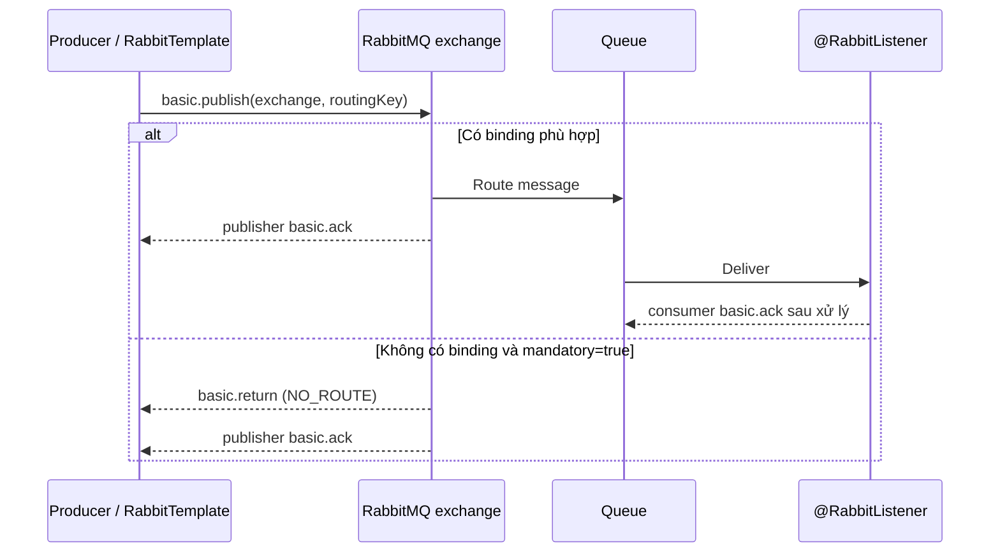
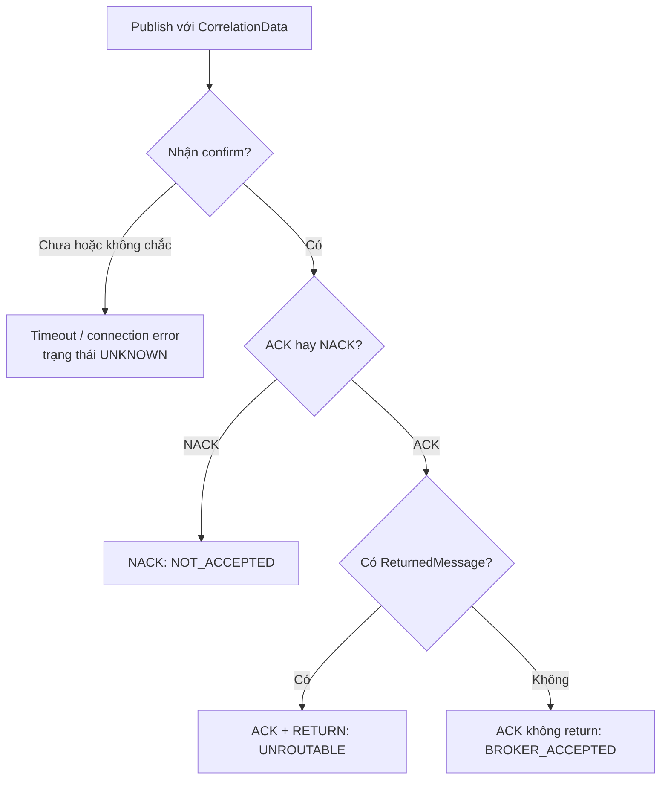

# Publisher confirm kiểu SIMPLE và CORRELATED

**Chương:** Confirm và return

Trong Spring AMQP, khi `RabbitTemplate.convertAndSend(...)` hoàn tất, điều đó **không có nghĩa message chắc chắn đã được RabbitMQ nhận và lưu thành công**, cũng không có nghĩa nó đã vào đúng queue hay được `@RabbitListener` xử lý. Gửi message qua mạng là một quá trình bất đồng bộ. Mạng có thể đứt ngay sau khi broker nhận message, một exchange có thể không có binding phù hợp, hoặc broker có thể gặp lỗi khi chấp nhận publish.

RabbitMQ cung cấp **publisher confirms** để broker phản hồi trạng thái chấp nhận message cho producer. Spring AMQP triển khai cơ chế này qua `CachingConnectionFactory.ConfirmType` với hai lựa chọn đáng quan tâm:

- **`SIMPLE`**: producer **chờ xác nhận cho các publish trong một phạm vi thao tác**, thường dùng `RabbitTemplate.invoke(...)` và `waitForConfirms(...)` hoặc `waitForConfirmsOrDie(...)`.
- **`CORRELATED`**: producer **ghép xác nhận với từng message** thông qua `CorrelationData`; xử lý bất đồng bộ bằng `CompletableFuture` hoặc `RabbitTemplate.ConfirmCallback`.

Hai lựa chọn dùng **cùng cơ chế publisher confirms ở RabbitMQ**; chúng khác cách Spring AMQP quản lý tương quan, callback và chờ kết quả.

Bài học thuộc mô-đun **SPRING_AMQP** về tích hợp RabbitMQ qua `RabbitTemplate`, `@RabbitListener`, exchange, queue và binding. Nội dung kết nối publisher confirms với publisher returns, consumer ACK, retry, dead-letter, giao dịch/outbox và giám sát để thiết kế xử lý bất đồng bộ đáng tin cậy.

**Mục tiêu:**

1. Giải thích đúng `basic.ack`/`basic.nack` của **publisher** và sự khác biệt với ACK của **consumer**.
2. Chọn `ConfirmType.SIMPLE` hay `ConfirmType.CORRELATED` theo throughput, nhu cầu theo dõi từng message và tính phức tạp vận hành.
3. Cấu hình `RabbitTemplate` cho từng mode và xử lý confirm, timeout, exception.
4. Hiểu vì sao **ACK thành công vẫn có thể đi kèm `basic.return`** khi message không có route đến queue.
5. Thiết kế lưu trạng thái gửi/retry/idempotency và kiểm thử khi mất connection, không có exchange hoặc không có binding.

> Phạm vi chính: `spring-rabbit` sử dụng **RabbitMQ AMQP 0.9.1**. Các API dành cho `spring-amqp-client` AMQP 1.0 tổng quát hoặc RabbitMQ Stream khác với `RabbitTemplate`/`CachingConnectionFactory` trong bài.

## 1. Vì sao chỉ gọi `convertAndSend` chưa đủ?

Giả sử `order-service` commit một đơn hàng, sau đó gọi:

```java
rabbitTemplate.convertAndSend(
        "orders.events",
        "order.created",
        new OrderCreated("ORD-1024"));
```

Dòng code thể hiện **ý định publish**. Để kết luận an toàn, ta cần phân biệt nhiều mốc:

| Mốc | Điều gì đã xảy ra? | Đã được xác nhận bởi ai? |
| --- | --- | --- |
| A | Ứng dụng gọi API gửi | Ứng dụng |
| B | Client ghi frame vào socket | RabbitMQ Java client / hệ điều hành |
| C | Broker nhận và xử lý publish | Broker |
| D | Broker xác nhận publish (publisher confirm) | **RabbitMQ → producer** |
| E | Message được route đến queue phù hợp | Exchange và binding tại broker |
| F | Broker giao message cho consumer | RabbitMQ → consumer |
| G | Consumer xử lý thành công và ACK | **Consumer → RabbitMQ** |
| H | Tác dụng phụ nghiệp vụ bền vững: ghi DB, gửi email... | Hệ thống nghiệp vụ |

**Publisher confirm chỉ giải quyết phần xác nhận phía broker đối với publish**. Nó không tự chứng minh rằng tất cả các mốc E–H đã thành công.

Hai ví dụ:

- **Mạng đứt sau C nhưng trước khi producer nhận D:** broker **có thể đã nhận message**, còn producer chỉ thấy timeout/lỗi. Việc publish lại có thể tạo message trùng.
- **Exchange tồn tại nhưng không có binding cho routing key:** broker vẫn có thể phát publisher ACK (D), trong khi message không đến queue nào (E thất bại); cần **publisher return** để phát hiện khi publish với `mandatory=true`.



Sơ đồ mô tả luồng logic. Trên hệ thống thật, delivery đến consumer và thời điểm publisher confirm có thể xen kẽ; **publisher ACK và consumer ACK hoàn toàn độc lập**.

## 2. Publisher confirm ở cấp giao thức RabbitMQ

### 2.1. `confirm.select` và sequence number

Ở AMQP 0.9.1, client bật publisher confirms trên một **channel** bằng phương thức `confirm.select`. Từ đó, các publish trên channel được đánh số tuần tự. Broker phản hồi bằng:

- **`basic.ack`:** broker đã chấp nhận trách nhiệm với một hoặc nhiều publish theo ngữ nghĩa queue và loại message.
- **`basic.nack`:** broker không thể xử lý publish thành công trong một tình huống bất thường.

Phản hồi có **delivery tag/sequence number** và có thể có cờ **`multiple`**, cho phép ACK/NACK một dải publish thay vì chỉ một.

**Delivery tag của publisher confirm không phải delivery tag của consumer ACK.** Hai nhóm số thuộc hai luồng khác nhau và đều có phạm vi theo channel. Spring AMQP che giấu nhiều chi tiết này ở mức `RabbitTemplate`; với `CORRELATED`, ta thường làm việc bằng `CorrelationData` thay vì tự quản lý sequence number.

### 2.2. Publisher ACK thực sự chứng minh điều gì?

RabbitMQ xác nhận tùy tình huống:

- **Message không route được:** broker có thể ACK sau khi exchange xác định không có queue đích; nếu `mandatory=true`, broker gửi `basic.return` **trước** publisher confirm.
- **Message route được đến queue:** broker ACK khi các queue đích đã chấp nhận message theo cơ chế của chúng.
- **Persistent message đến durable queue:** confirm được gửi sau khi broker đạt điều kiện lưu bền áp dụng (ví dụ ghi xuống đĩa).
- **Quorum queue:** confirm phụ thuộc việc một quorum replica chấp nhận theo giao thức replication.
- **Một publish fan-out đến nhiều queue:** điều kiện xác nhận liên quan đến các queue mà message được route tới, không chỉ một queue bất kỳ.

Điều này là cơ sở quan trọng cho producer có yêu cầu an toàn dữ liệu. Tuy nhiên, mức độ lưu bền cụ thể còn phụ thuộc **delivery mode**, queue type, broker configuration và môi trường khôi phục. Publisher ACK không xác nhận consumer đã xử lý xong.

### 2.3. Không trộn publisher confirm với AMQP transaction trên cùng channel

Trong AMQP 0.9.1, một channel đã bật confirm mode **không thể đồng thời là transactional channel**. Spring AMQP có các cấu hình giao dịch và listener container riêng, nhưng không nên kỳ vọng vừa dùng `tx.select` vừa dùng `confirm.select` trên cùng một channel.

Trong hệ thống cần độ tin cậy:

- Publisher confirms thường phù hợp để theo dõi publish với overhead thấp hơn AMQP transaction.
- Nếu dữ liệu nghiệp vụ đã commit vào database, publisher confirm **không tạo giao dịch nguyên tử xuyên DB và broker**.
- Dùng **transactional outbox** hoặc phương án đối soát phù hợp nếu cần tránh khoảng trống “DB commit nhưng message chưa được publish”.

### 2.4. Confirms bất đồng bộ và thứ tự trả về

Broker có thể xác nhận từng message hoặc nhiều message. Thông thường ACK trên một channel xuất hiện gần thứ tự publish, nhưng **không nên dựa vào thứ tự callback làm thứ tự nghiệp vụ**: thời điểm xác nhận còn phụ thuộc queue type, persistence và tải. `CORRELATED` giúp nối chính xác callback với publish bất kể thứ tự phản hồi.

## 3. `ConfirmType.NONE`, `SIMPLE` và `CORRELATED`

`CachingConnectionFactory.ConfirmType` có ba giá trị:

| Tiêu chí | `NONE` | `SIMPLE` | `CORRELATED` |
| --- | --- | --- | --- |
| Publisher confirms | Tắt | Bật | Bật |
| Cách xem kết quả tiêu biểu | Không có publisher ACK/NACK | `RabbitTemplate.invoke(...)` + `waitForConfirms(...)` | `CorrelationData.getFuture()` hoặc `ConfirmCallback` |
| Theo dõi từng message bằng `CorrelationData` | Không | Không phải mục tiêu chính | **Có** |
| Kiểu làm việc | Không xác minh phía broker | Chờ đồng bộ theo một scope/batch | **Bất đồng bộ** với correlation |
| Phù hợp với | Môi trường không yêu cầu xác nhận publish | Batch nhỏ, thao tác quản trị/test hoặc đường gửi có thể chờ | Hệ thống nhiều event, cần trạng thái từng event, retry có kiểm soát |
| Tác động tới luồng gọi | Nhẹ nhưng thiếu tín hiệu thành công broker | Chờ ACK/NACK có thể chặn thread | Có thể không chặn thread; phải quản lý in-flight futures |
| Publisher return | Cơ chế tách biệt, cần `publisherReturns` và `mandatory` | Có thể bật nhưng phải xử lý return riêng | Có thể kết hợp return với `CorrelationData` để biết message nào không route |

**`NONE` là giá trị mặc định của enum ở Spring AMQP**, nhưng không nên đoán runtime đang ở chế độ nào chỉ dựa vào tên starter. Spring Boot có thể auto-configure theo property cụ thể; luôn kiểm tra cấu hình đã resolve.

**Quy tắc chọn nhanh:**

- Cần **chờ “cả lô đã được broker xác nhận”** mà không cần ánh xạ từng confirm: đánh giá `SIMPLE`.
- Cần **theo dõi từng eventId/messageId**, callback hoặc future để cập nhật outbox và chọn message cần xử lý lại: ưu tiên `CORRELATED`.
- Không nên dùng `NONE` cho sự kiện nghiệp vụ mà mất publish gây hậu quả đáng kể.

## 4. Chuẩn bị topology dùng chung cho các ví dụ

Ta dùng mô hình `order-service` gửi sự kiện vào direct exchange `orders.events` với routing key `order.created`. Queue `orders.created.q` lắng nghe; routing key `order.missing` **không có binding** để thực hành publisher return.

```mermaid
flowchart LR
    P[order-service<br/>RabbitTemplate]
    X{{Direct exchange<br/>orders.events}}
    Q[(Durable queue<br/>orders.created.q)]
    C[notification-service<br/>@RabbitListener]
    P -->|order.created| X
    X -->|Binding order.created| Q
    Q --> C
    P -.->|order.missing: không có route| X
```

Cấu hình Spring AMQP trong môi trường **local/test**, khi ứng dụng được phép khai báo tài nguyên:

```java
import org.springframework.amqp.core.Binding;
import org.springframework.amqp.core.BindingBuilder;
import org.springframework.amqp.core.DirectExchange;
import org.springframework.amqp.core.Queue;
import org.springframework.amqp.core.QueueBuilder;
import org.springframework.context.annotation.Bean;
import org.springframework.context.annotation.Configuration;
import org.springframework.context.annotation.Profile;

@Configuration(proxyBeanMethods = false)
@Profile("local")
class OrderTopology {

    static final String EXCHANGE = "orders.events";
    static final String QUEUE = "orders.created.q";
    static final String ROUTING_KEY = "order.created";

    @Bean
    DirectExchange ordersExchange() {
        return new DirectExchange(EXCHANGE, true, false);
    }

    @Bean
    Queue ordersQueue() {
        return QueueBuilder.durable(QUEUE).build();
    }

    @Bean
    Binding ordersBinding(
            DirectExchange ordersExchange,
            Queue ordersQueue) {

        return BindingBuilder.bind(ordersQueue)
                .to(ordersExchange)
                .with(ROUTING_KEY);
    }
}
```

Để cấu hình trên được tạo thật trên broker, cần `RabbitAdmin`/Spring Boot auto-configuration phù hợp và tài khoản có quyền `configure`. Ở staging/production, nhiều đội chọn **IaC/provisioning** thay vì để producer/consumer runtime tự tạo queue/exchange/binding.

**Quan trọng:** xác nhận có đủ binding và listener trước khi kiểm thử confirms. Một publish `ack=true` không có nghĩa queue đã đúng, vì trường hợp không route được vẫn có thể ACK.

## 5. Cấu hình `ConfirmType.SIMPLE`

### 5.1. Java Configuration

Một cấu hình tối thiểu:

```java
import org.springframework.amqp.rabbit.connection.CachingConnectionFactory;
import org.springframework.amqp.rabbit.connection.CachingConnectionFactory.ConfirmType;
import org.springframework.amqp.rabbit.core.RabbitTemplate;
import org.springframework.context.annotation.Bean;
import org.springframework.context.annotation.Configuration;
import org.springframework.context.annotation.Profile;

@Configuration(proxyBeanMethods = false)
@Profile("simple-confirms")
class SimpleConfirmConfiguration {

    @Bean
    CachingConnectionFactory rabbitConnectionFactory() {
        CachingConnectionFactory factory =
                new CachingConnectionFactory("localhost");

        factory.setPublisherConfirmType(ConfirmType.SIMPLE);
        return factory;
    }

    @Bean
    RabbitTemplate rabbitTemplate(
            CachingConnectionFactory rabbitConnectionFactory) {

        return new RabbitTemplate(rabbitConnectionFactory);
    }
}
```

Nếu Spring Boot đang tạo `CachingConnectionFactory` và `RabbitTemplate` sẵn, **không cần copy cấu hình Java trên**. Chỉ chọn một cách cấu hình để tránh tạo thêm connection factory hoặc template ngoài ý muốn.

YAML Spring Boot tương ứng (với starter RabbitMQ AMQP 0.9.1 thích hợp cho phiên bản Boot đang dùng):

```yaml
spring:
  rabbitmq:
    host: localhost
    port: 5672
    publisher-confirm-type: simple
```

Tên enum là `SIMPLE`; giá trị cấu hình Boot thường dùng dạng chữ thường `simple`. Chế độ này tập trung vào **đợi xác nhận theo scope**; nó không tự gọi `waitForConfirms` sau mỗi `convertAndSend`.

### 5.2. Gửi batch bằng `invoke` và chờ confirm

`RabbitTemplate` sử dụng cached channels. Nếu bạn publish một số message bằng các lệnh template độc lập, mỗi lệnh không được bảo đảm dùng đúng cùng một channel. `waitForConfirms(...)` cần biết **channel chứa những publish nào**, nên Spring AMQP cung cấp `invoke(...)` để thao tác trong một scope trên cùng channel.

```java
import java.util.List;
import org.springframework.amqp.rabbit.core.RabbitTemplate;
import org.springframework.stereotype.Service;

@Service
class SimpleConfirmedBatchPublisher {

    private final RabbitTemplate template;

    SimpleConfirmedBatchPublisher(RabbitTemplate template) {
        this.template = template;
    }

    void publishBatch(List<String> orderIds) {
        template.invoke(operations -> {
            for (String orderId : orderIds) {
                operations.convertAndSend(
                        OrderTopology.EXCHANGE,
                        OrderTopology.ROUTING_KEY,
                        orderId);
            }

            // Chờ broker ACK tất cả publish trong scope;
            // có thể ném exception khi NACK hoặc timeout.
            operations.waitForConfirmsOrDie(10_000L);
            return null;
        });
    }
}
```

**`waitForConfirmsOrDie(10_000L)` nhận timeout theo mili giây**. Nếu một publish bị NACK hoặc chờ hết hạn, thao tác sẽ báo lỗi; chỉ khi hoàn thành thành công mới có thể coi **toàn bộ publish trong scope đã nhận confirm** theo contract. `invoke` giúp các lệnh dùng chung một dedicated channel trong scope.

Một phiên bản dùng giá trị boolean thay vì exception:

```java
boolean allConfirmed = template.invoke(operations -> {
    operations.convertAndSend(
            "orders.events", "order.created", "ORD-1024");

    return operations.waitForConfirms(10_000L);
});

if (!allConfirmed) {
    // Có ít nhất một publish không được ACK thành công.
    // Không tự kết luận message nào đã thất bại.
}
```

Lưu ý `waitForConfirms(...)` có thể ném exception khi timeout/channel lỗi. Xử lý `false` **và** exception. Ngoài `invoke(...)`, không gọi `template.waitForConfirms(...)` tùy tiện: method này **chỉ hợp lệ trong scope chuyên dụng**, vì channel dùng cho các lệnh riêng lẻ có thể khác nhau.

### 5.3. Hạn chế của `SIMPLE`

`SIMPLE` phù hợp khi producer quan tâm “cả nhóm publish đã được broker ACK chưa?”, nhưng có các ràng buộc:

- **Không biết message nào trong batch bị NACK** chỉ từ kết quả boolean/exception tổng.
- Nếu scope thất bại sau khi một phần message đã được broker chấp nhận, **retry cả batch có nguy cơ trùng**.
- Scope chờ confirm **giữ thread**, làm tăng độ trễ phản hồi nếu dùng trong HTTP request.
- Nếu gửi một message rồi chờ confirm trước khi gửi message tiếp theo, throughput có thể giảm mạnh do phải chờ network và persistence từng lượt.
- `SIMPLE` không tự phát hiện message không route được nếu không có cơ chế publisher return.
- Chờ confirm không thay thế ACK từ consumer.

**Tối ưu hợp lý:** gửi **một batch có giới hạn**, chờ confirms một lần và có chiến lược idempotency/retry cho batch; hoặc chọn `CORRELATED` nếu cần biết trạng thái của từng event.

### 5.4. Dùng callback cấp RabbitMQ client trong scoped operation

Spring AMQP còn có overload `invoke` nhận callback ACK/NACK từ RabbitMQ Java client:

```java
template.invoke(
        operations -> {
            operations.convertAndSend(
                    "orders.events", "order.created", "ORD-1024");
            operations.waitForConfirmsOrDie(10_000L);
            return null;
        },
        (deliveryTag, multiple) -> {
            System.out.println("publisher ACK tag=" + deliveryTag);
        },
        (deliveryTag, multiple) -> {
            System.out.println("publisher NACK tag=" + deliveryTag);
        });
```

Hai callback này là loại `com.rabbitmq.client.ConfirmCallback`, **không phải** `RabbitTemplate.ConfirmCallback` dùng với `CORRELATED`. Delivery tag có phạm vi theo channel; không thay thế `eventId` nghiệp vụ. Đoạn mã chỉ minh họa cách quan sát, không cần thiết nếu mục tiêu chỉ là biết batch thành công.

## 6. Cấu hình `ConfirmType.CORRELATED`

`CORRELATED` là lựa chọn phù hợp hơn khi muốn theo dõi **từng message**, không chặn thread publish và cập nhật trạng thái gửi một cách rõ ràng.

### 6.1. Java Configuration

```java
import org.springframework.amqp.rabbit.connection.CachingConnectionFactory;
import org.springframework.amqp.rabbit.connection.CachingConnectionFactory.ConfirmType;
import org.springframework.amqp.rabbit.core.RabbitTemplate;
import org.springframework.context.annotation.Bean;
import org.springframework.context.annotation.Configuration;
import org.springframework.context.annotation.Profile;

@Configuration(proxyBeanMethods = false)
@Profile("correlated-confirms")
class CorrelatedConfirmConfiguration {

    @Bean
    CachingConnectionFactory rabbitConnectionFactory() {
        CachingConnectionFactory factory =
                new CachingConnectionFactory("localhost");

        factory.setPublisherConfirmType(ConfirmType.CORRELATED);
        factory.setPublisherReturns(true);

        return factory;
    }

    @Bean
    RabbitTemplate rabbitTemplate(
            CachingConnectionFactory rabbitConnectionFactory) {

        RabbitTemplate template =
                new RabbitTemplate(rabbitConnectionFactory);

        template.setMandatory(true); // Để phát hiện NO_ROUTE.
        return template;
    }
}
```

**`publisherReturns=true` và `mandatory=true` là bổ sung cho confirms**, không phải hai tên của cùng một tính năng. Cài đặt này giúp quan sát cả broker ACK/NACK và message không có route.

Spring Boot YAML tương ứng:

```yaml
spring:
  rabbitmq:
    host: localhost
    port: 5672
    publisher-confirm-type: correlated
    publisher-returns: true
    template:
      mandatory: true
```

Với Spring Boot có nhiều starter messaging, cần xác nhận đang dùng starter/auto-configuration cho **RabbitMQ AMQP 0.9.1**, cùng version Spring AMQP được resolve. Không gộp các config từ client AMQP 1.0 tổng quát vào cùng `RabbitTemplate`.

### 6.2. Gắn `CorrelationData` cho từng publish

Để kiểm soát mỗi event:

```java
import java.util.UUID;
import org.springframework.amqp.rabbit.connection.CorrelationData;
import org.springframework.amqp.rabbit.core.RabbitTemplate;
import org.springframework.stereotype.Service;

@Service
class CorrelatedOrderPublisher {

    private final RabbitTemplate template;

    CorrelatedOrderPublisher(RabbitTemplate template) {
        this.template = template;
    }

    String publishOrderCreated(String orderId) {
        String eventId = UUID.randomUUID().toString();
        CorrelationData correlation = new CorrelationData(eventId);

        template.convertAndSend(
                "orders.events",
                "order.created",
                orderId,
                correlation);

        correlation.getFuture().whenComplete((confirm, failure) -> {
            if (failure != null) {
                recordUnknown(eventId, failure);
                return;
            }

            if (!confirm.isAck()) {
                recordNack(eventId, confirm.getReason());
                return;
            }

            if (correlation.getReturn() != null) {
                recordUnroutable(
                        eventId,
                        correlation.getReturn().getReplyText());
                return;
            }

            recordBrokerAccepted(eventId);
        });

        // Kết quả ở đây chỉ nói rằng yêu cầu gửi đã được phát;
        // confirm vẫn được xử lý bất đồng bộ.
        return eventId;
    }

    private void recordUnknown(String id, Throwable error) { /* ... */ }
    private void recordNack(String id, String reason) { /* ... */ }
    private void recordUnroutable(String id, String reason) { /* ... */ }
    private void recordBrokerAccepted(String id) { /* ... */ }
}
```

**Điểm quan trọng trong ví dụ:**

- `CorrelationData(eventId)` cho phép gắn kết confirm với một **ID ứng dụng**.
- `CorrelationData#getFuture()` trả về `CompletableFuture<CorrelationData.Confirm>`. Future hoàn thành khi có kết quả confirm theo cơ chế framework.
- `Confirm#isAck()` cho biết ACK/NACK; `getReason()` có thể là `null`, nhất là broker-generated NACK.
- `CorrelationData#getReturn()` chứa thông tin return nếu message không route được và publisher returns/mandatory đã bật.
- Theo Spring AMQP, khi **cả confirms và returns được bật**, return được gắn vào `CorrelationData` **trước khi future hoàn tất với ACK**. Vì vậy trong callback của future có thể kiểm tra `getReturn()` sau `isAck()`.
- ID trả về ngay sau `convertAndSend` **không phải xác nhận publish thành công**; trạng thái thật được cập nhật từ callback.

Trong ứng dụng thật, các hàm `record...` không nên chỉ ghi log. Chúng nên cập nhật **trạng thái outbox/attempt** hoặc hệ thống theo dõi bền vững. Cần bảo đảm callback không làm nghẽn executor và xử lý cả trường hợp callback không bao giờ được gọi trước thời hạn vận hành.

### 6.3. `ConfirmCallback` trên `RabbitTemplate`

Ngoài futures, có thể đăng ký callback tập trung:

```java
@Bean
RabbitTemplate correlatedTemplate(
        CachingConnectionFactory factory) {

    RabbitTemplate template = new RabbitTemplate(factory);
    template.setMandatory(true);

    template.setConfirmCallback((correlationData, ack, cause) -> {
        String eventId = correlationData != null
                ? correlationData.getId()
                : "<unknown>";

        if (ack) {
            System.out.println("Broker ACK for " + eventId);
        } else {
            System.out.println(
                    "Broker NACK for " + eventId + ": " + cause);
        }
    });

    template.setReturnsCallback(returned -> {
        System.out.println(
                "Returned: " + returned.getReplyText()
                + ", exchange=" + returned.getExchange()
                + ", routingKey=" + returned.getRoutingKey());
    });

    return template;
}
```

Đây là **cách cấu hình thay thế** ở `CORRELATED`. Không đăng ký bean này đồng thời với một bean `RabbitTemplate` mặc định cùng tên trong một cấu hình production mà chưa quyết định cái nào được dùng.

Một `RabbitTemplate` chỉ hỗ trợ **một `ConfirmCallback` và một `ReturnsCallback`**. Nếu nhiều thành phần muốn theo dõi cùng template, hãy có **một callback phân phối nội bộ** hoặc dùng future riêng từng `CorrelationData`.

**Không nhầm `CorrelationData` với message property `correlationId`:** `CorrelationData` ở phía template dùng theo dõi publisher confirm; `MessageProperties.correlationId` thường dùng request/reply hoặc trace. Có thể cùng dùng một eventId, nhưng là hai khái niệm và hai đường dữ liệu khác nhau.

### 6.4. Callback hay future?

| Tiêu chí | `ConfirmCallback` | `CorrelationData.getFuture()` |
| --- | --- | --- |
| Cách dùng | Một callback tập trung trên template | Từng lần publish tự gắn handler cho correlation |
| Tương quan message | Nhận `CorrelationData` nếu có | Giữ trực tiếp object `CorrelationData` của publish |
| Phù hợp | Logging/metrics/dispatch trạng thái chung | Gắn mỗi eventId với trạng thái outbox hoặc future nghiệp vụ |
| Mối nguy | Callback xử lý nặng gây nghẽn executor | Tạo quá nhiều future/in-flight nếu không giới hạn |
| Kết hợp returns | Có `ReturnsCallback` độc lập | Kiểm tra `correlation.getReturn()` sau confirm |

**Không xử lý trạng thái outbox hai lần** bằng cách đăng ký cả callback tập trung và future làm cùng một thao tác cập nhật. Có thể dùng cả hai cho mục đích khác nhau (ví dụ callback cho metrics, future cho trạng thái event) nếu thiết kế idempotent và rõ trách nhiệm.

### 6.5. Đừng chặn thread callback

Spring AMQP từ các phiên bản hiện đại gọi callbacks trên executor của connection factory thay vì trực tiếp trên I/O thread của RabbitMQ. Dù vậy, callback không nên thực hiện truy vấn DB nặng, chờ network vô hạn hoặc chặn trên `join()` của một thao tác RabbitMQ khác.

Phương án tốt:

1. Handler nhận confirm và ghi một event trạng thái nhỏ hoặc đưa vào hàng đợi công việc nội bộ có kiểm soát.
2. Worker riêng xử lý cập nhật DB/metrics với retry của chính nó.
3. Giới hạn số publish in-flight để tránh tăng memory vô hạn khi broker chậm phản hồi.
4. Lập job reconciliation quét những event `PENDING` quá lâu nếu callback không đến do process crash.

## 7. Publisher returns: vì sao `ack=true` chưa chắc có route?

Đây là khác biệt rất dễ bị bỏ sót khi xây hệ thống đáng tin cậy.

### 7.1. Message không có binding phù hợp

Giả sử exchange `orders.events` tồn tại nhưng routing key `order.unknown` không khớp binding nào:

```java
CorrelationData cd = new CorrelationData("evt-no-route-001");

rabbitTemplate.convertAndSend(
        "orders.events",
        "order.unknown",
        "ORD-1024",
        cd);
```

Nếu `mandatory=true`, RabbitMQ có thể trả:

```text
basic.return:
  replyCode = 312
  replyText = NO_ROUTE
  exchange = orders.events
  routingKey = order.unknown

publisher basic.ack:
  ack = true
```

Tại sao? Broker **đã xử lý publish ở exchange**, xác định không có queue để route và phát ACK theo contract publisher confirms. **Return** thông báo rằng message không được route đến queue, còn **ACK** nói broker đã xử lý publish ở mức tương ứng. Không có mâu thuẫn.

Nếu `mandatory=false` (mặc định giao thức), một message không route được thường bị loại bỏ mà **không có `basic.return`**. Nếu exchange có alternate exchange và broker route được qua đó, kết quả phụ thuộc topology, không chỉ vào binding trực tiếp của exchange ban đầu.

### 7.2. Ba điều kiện để Spring nhận return

Để ứng dụng quan sát returns qua `RabbitTemplate`:

1. `CachingConnectionFactory#setPublisherReturns(true)`.
2. `RabbitTemplate#setMandatory(true)` hoặc mandatory expression trả `true` cho message cụ thể.
3. Có `RabbitTemplate.ReturnsCallback` để xử lý tập trung, **hoặc** với `CORRELATED` và `CorrelationData`, kiểm tra `getReturn()` sau future để biết message đó bị return.

Ví dụ handler return tập trung:

```java
template.setReturnsCallback(returned -> {
    log.warn(
            "UNROUTABLE exchange={}, routingKey={}, code={}, reason={}",
            returned.getExchange(),
            returned.getRoutingKey(),
            returned.getReplyCode(),
            returned.getReplyText());
});
```

Biến `log` trong ví dụ này tượng trưng cho logger của ứng dụng (ví dụ SLF4J). Không in toàn bộ payload vào log production nếu có dữ liệu cá nhân/bí mật.

### 7.3. Exchange không tồn tại là lỗi khác

Nếu publish tới một exchange **không tồn tại**, broker thường đóng **channel** bằng lỗi như `NOT_FOUND`. Trường hợp này **không phải NO_ROUTE từ một exchange hợp lệ** nên không có return thông thường.

Ứng dụng có thể quan sát shutdown/channel exception hoặc NACK/cause do framework tổng hợp khi các confirm còn pending. Phải theo dõi:

- Channel/connection shutdown events.
- `ConfirmCallback` hoặc future (nếu có).
- Exception khi gọi publish/scope và log framework.
- Việc broker thực tế có exchange, binding và quyền phù hợp.

**Không coi thiếu `ReturnedMessage` là bằng chứng publish thành công**: chưa có exchange, thiếu quyền, connection bị mất, timeout và một số lỗi khác cần đường quan sát riêng.

### 7.4. Bảng kết quả publish và cách hiểu

| Tình huống | Publisher confirm | Return | Cách diễn giải |
| --- | --- | --- | --- |
| Exchange tồn tại, route đến queue thành công | Thường `ACK=true` sau khi các queue chấp nhận | Không | Broker chấp nhận publish, **consumer chưa chắc xử lý** |
| Exchange tồn tại, không có route, `mandatory=true` | Có thể `ACK=true` | **Có `NO_ROUTE`** | **Không được xem là đã đưa vào queue thành công** |
| Exchange tồn tại, không có route, `mandatory=false` | Có thể `ACK=true` | Không | Broker đã xử lý nhưng message có thể bị loại bỏ |
| Exchange không tồn tại | Channel error, kết quả confirm có thể NACK do framework hoặc mất khi shutdown | Thường không | Lỗi topology/configuration |
| Broker gửi `basic.nack` | **`ACK=false`** | Có thể có hoặc không tùy trường hợp | Broker không chấp nhận trách nhiệm với publish |
| Mất mạng khi publish hoặc chờ confirm | **Không biết chắc** publish đã được nhận hay chưa | Không kết luận | Trạng thái **UNKNOWN**, cần đối soát/retry idempotent |
| Publish ACK, consumer ném lỗi | Publisher vẫn có thể ACK | Không nhất thiết | Lỗi downstream; xem consumer ACK/NACK/retry/DLQ |

Quy trình xử lý kết quả trong `CORRELATED` có thể hình dung như sau:



Mọi nhánh đều cần log/metrics và cơ chế phục hồi phù hợp; riêng `BROKER_ACCEPTED` chưa phải trạng thái **BUSINESS_COMPLETED**.

## 8. `SIMPLE` và `CORRELATED` dưới góc nhìn sản phẩm

### 8.1. Vì sao `SIMPLE` tiện cho batch?

Một job theo lịch cần publish 100 sự kiện báo cáo. Nếu sau khi gửi cả 100, job chỉ cần biết **toàn bộ lô đã nhận publisher ACK** trước khi chuyển bước, `SIMPLE` + `invoke`/`waitForConfirmsOrDie` là thiết kế tương đối đơn giản.

Ưu điểm:

- Mã sử dụng ngắn, không quản lý hàng trăm `CorrelationData` trong ứng dụng.
- Có thể gửi nhiều publish trên cùng một channel rồi chờ một lần, hiệu quả hơn chờ sau từng message.
- Có thể tích hợp với luồng đồng bộ của một batch job đã có checkpoint.

Giới hạn:

- Lô 100 thất bại không chỉ ra 1–2 message nào thực sự được chấp nhận.
- Retry nguyên lô có thể sinh duplicate; cần idempotency ở downstream.
- Nếu lô quá lớn, thời gian chờ confirm và số publish chưa chắc chắn tăng cao.
- Chỉ nhìn `waitForConfirmsOrDie` có thể bỏ sót **returns** nếu batch có message không route được.

### 8.2. Vì sao `CORRELATED` thường phù hợp event-driven microservice?

Một service phát liên tục nhiều sự kiện `order.created`, `payment.authorized` và `shipment.created`. Mỗi event có `eventId`, trạng thái outbox và SLA khác nhau.

`CORRELATED` cho phép:

- Gắn `eventId` vào `CorrelationData`.
- Gửi nhiều message mà không phải đồng bộ chờ từng ACK.
- Khi ACK/NACK/return đến, cập nhật trạng thái **từng event**.
- Retry có chọn lọc những event bị return hoặc không được xác nhận theo chính sách.
- Đo `publish_confirm_latency` và tỷ lệ NACK/NO_ROUTE theo exchange/routing key.

Đánh đổi: hệ thống cần kiểm soát **số lượng publish in-flight**, callback concurrency, trạng thái gửi bền vững, timeout và xử lý khi callback đến muộn hoặc process chết giữa lúc publish và ghi nhận confirm.

### 8.3. Chọn theo các yêu cầu cụ thể

| Yêu cầu | Khuyến nghị |
| --- | --- |
| Script/batch nhỏ, chỉ cần bảo đảm “cả nhóm ACK” | `SIMPLE` + `invoke` + `waitForConfirmsOrDie` |
| Batch lớn, muốn biết từng item nào bị NACK/return | `CORRELATED` với eventId riêng |
| API cần trả kết quả đồng bộ sau một publish, tần suất thấp | Có thể `SIMPLE` cho một publish hoặc chờ `CORRELATED` future với timeout rõ |
| Hệ thống cần throughput cao và không chặn thread ứng dụng | `CORRELATED` bất đồng bộ, hạn chế in-flight và có backpressure |
| Cần quan sát message không route được | **Publisher returns + mandatory**, độc lập việc chọn SIMPLE/CORRELATED |
| Cần biết consumer đã xử lý nghiệp vụ | **Application-level acknowledgment/reply/status**, không phải publisher confirm |
| Cần atomicity DB → event | **Transactional outbox**, không phải riêng SIMPLE/CORRELATED |
| Muốn “publish là xong, không cần log kết quả” | Không phù hợp khi mất event gây tổn thất nghiệp vụ |

## 9. Timeout, mất kết nối và nguy cơ duplicate

### 9.1. Timeout không khẳng định publish thất bại

Ví dụ:

1. Producer gửi event `evt-1024`.
2. Broker chấp nhận, lưu bền và gửi ACK.
3. Đường truyền đứt trước khi ACK đến producer.
4. Producer timeout, tưởng event chưa gửi.
5. Producer retry cùng event.

Broker có thể nhận **hai message cùng nghiệp vụ**. Do đó:

> **Không thể suy ra “không thấy confirm” = “broker chắc chắn không có message”.**

Đối với hệ thống quan trọng, trạng thái đúng là `UNKNOWN`/`PENDING_CONFIRM` cho tới khi đối soát hoặc retry an toàn.

### 9.2. Idempotency ở consumer

`@RabbitListener` cần được thiết kế cho **at-least-once delivery** nếu sử dụng retry/redelivery hoặc producer republish. Một chiến lược điển hình:

```java
@Component
class IdempotentOrderConsumer {

    private final ProcessedEventRepository repository;

    IdempotentOrderConsumer(ProcessedEventRepository repository) {
        this.repository = repository;
    }

    @RabbitListener(queues = "orders.created.q")
    public void consume(OrderCreatedEvent event) {
        // Minh họa logic; cần transaction DB và unique constraint
        // để việc check + insert + tác dụng phụ nhất quán.
        if (repository.existsById(event.eventId())) {
            return;
        }

        // Ghi trạng thái xử lý với unique key(eventId),
        // thực hiện nghiệp vụ và commit theo chính sách.
        repository.saveProcessed(event.eventId());
    }
}
```

Ví dụ minh họa này giả định có DTO `OrderCreatedEvent` và repository do ứng dụng định nghĩa, không phải class có sẵn của Spring AMQP.

**Cảnh báo race condition:** `existsById` rồi `saveProcessed` tách rời **không đủ** để chống trùng khi nhiều consumer chạy đồng thời. Production cần **unique constraint/atomic insert**, transaction đúng phạm vi và xử lý trường hợp insert conflict. Nếu có tác dụng phụ ngoài DB (gửi email, gọi cổng thanh toán), cần thiết kế idempotency riêng cho phía ngoài.

### 9.3. Transactional outbox và trạng thái gửi

Giả sử DB commit thành công nhưng JVM chết ngay trước lúc `RabbitTemplate` publish. Publisher confirms không cứu được một event **chưa từng được gửi**. Outbox giải quyết khoảng trống đó:

```mermaid
flowchart LR
    API[API order-service]
    DB[(Order DB)]
    OB[(Outbox table)]
    JOB[Outbox dispatcher]
    MQ[(RabbitMQ)]
    C[@RabbitListener]
    API -->|DB transaction| DB
    API -->|Cùng DB transaction| OB
    OB --> JOB
    JOB -->|Publish + CorrelationData| MQ
    MQ -->|ACK/Return| JOB
    MQ --> C
```

Một state machine gửi đơn giản:

| Trạng thái outbox | Ý nghĩa | Hướng xử lý |
| --- | --- | --- |
| `NEW` | Event đã ghi DB, chưa dispatch | Dispatcher lấy và gửi |
| `PENDING_CONFIRM` | Đã yêu cầu gửi, đang chờ ACK/NACK | Có timeout/reconciliation |
| `BROKER_ACCEPTED` | Confirm ACK, không có return trong nhánh có giám sát returns | Đánh dấu publish hoàn tất |
| `UNROUTABLE` | Broker return, không có queue đích phù hợp | Sửa routing/topology rồi gửi lại |
| `NACKED` | Broker từ chối trách nhiệm | Retry có backoff sau khi kiểm tra lỗi |
| `UNKNOWN` | Connection/timeout làm kết quả không rõ | Retry an toàn hoặc đối soát với eventId |
| `DEAD`/`FAILED_PERMANENT` | Hết số lần thử hoặc lỗi không phục hồi | Cảnh báo/điều tra, không retry vô hạn |

**Không đánh dấu outbox `BROKER_ACCEPTED` chỉ vì `convertAndSend` trả về bình thường.** Chờ confirm và xem return khi `mandatory`/`publisherReturns` đã bật.

Khi dùng `CORRELATED`, lựa chọn thực tế là lưu event trước khi publish, truyền cùng `eventId` qua lần retry và cập nhật trạng thái bằng confirm handler. Callback có thể bị mất nếu process crash; dispatcher cần quét những item kẹt `PENDING_CONFIRM`.

## 10. Liên hệ với consumer ACK, retry, DLQ và giao dịch

Publisher confirms và consumer ACK đều có tên ACK nhưng là **hai hướng thông tin độc lập**:

```text
Producer ---basic.publish---> RabbitMQ ---basic.deliver---> Consumer
Producer <--publisher ack---- RabbitMQ <---consumer ack---- Consumer
```

- Publisher ACK: broker xác nhận **publish** theo điều kiện nó áp dụng.
- Consumer ACK: broker được consumer thông báo **delivery đã xử lý** theo chế độ ACK của listener.
- Nếu consumer NACK/requeue, publisher ACK trước đó **không bị đảo ngược**.
- Nếu message vào DLQ sau quá số lần thử, publisher confirm của lần publish ban đầu vẫn có thể thành công.
- Nếu consumer xử lý DB xong nhưng crash trước ACK, RabbitMQ có thể redeliver; cần idempotency.
- Nếu producer retry do thiếu confirm, cũng có thể tạo duplicate; đây là **hai nguồn duplicate khác nhau**.

### 10.1. Dead-letter không sửa lỗi routing của producer

DLX/DLQ dùng cho message **đã vào queue** rồi bị reject/expired/quá giới hạn hoặc theo chính sách broker. Nếu message không có binding nên bị **publisher return**, nó chưa vào queue đích; **DLX của queue đó không thể tự “cứu” message không route được**.

Đừng trông chờ “đã cấu hình DLQ” là an toàn khi publish tới sai routing key. Phải bật returns và xử lý `NO_ROUTE` riêng.

### 10.2. Publisher confirms không phải exactly-once

Ngay cả khi có publisher confirm, persistent message, durable/quorum queue và consumer ACK:

- Mất ACK ở producer có thể dẫn đến **republish**.
- Mất ACK ở consumer có thể dẫn đến **redelivery**.
- Business side effect có thể thành công trước khi ứng dụng đánh dấu xử lý hoàn tất.

Vì vậy, kiến trúc thực tế là **at-least-once với idempotency**, theo dõi eventId và đối soát; không dùng `CORRELATED` làm lời hứa exactly-once.

### 10.3. Có nên bật AMQP transaction để thay confirms?

Transactions có chi phí lớn hơn và không tự gộp với transaction database. RabbitMQ khuyến nghị confirms để theo dõi publish một cách hiệu quả; chọn AMQP transaction chỉ khi có lý do rất cụ thể và hiểu giới hạn của nó.

Không cấu hình một channel vừa transactional vừa ở confirm mode, và không hiểu `@Transactional` trên service là tự động bảo đảm cùng lúc DB + broker atomic.

## 11. Hiệu năng và quản lý tài nguyên

### 11.1. Vì sao chờ từng message thường chậm?

Nếu producer làm tuần tự:

```text
publish msg-1 -> wait confirm
publish msg-2 -> wait confirm
publish msg-3 -> wait confirm
...
```

Mỗi lượt thêm round-trip và có thể đợi broker ghi bền. Với persistent messages, RabbitMQ có thể batch các thao tác lưu trữ, nên **chờ đơn lẻ trước khi gửi tiếp** thường làm throughput thấp hơn gửi nhiều publish rồi xử lý confirms bất đồng bộ hoặc theo batch.

Chiến lược chọn:

| Cách gửi | Ưu điểm | Đánh đổi |
| --- | --- | --- |
| Publish từng item và chờ từng confirm | Dễ hiểu, đơn giản | Chậm khi số lượng lớn |
| `SIMPLE` gửi batch rồi chờ một lần | Giảm số lượt chờ | Khó biết item nào thất bại |
| `CORRELATED` nhiều in-flight + future | Throughput và giám sát từng item | Cần cap in-flight, timeout, state persistence |

### 11.2. Giới hạn in-flight với `CORRELATED`

Đừng tạo vô số `CorrelationData` và callback khi broker đang bận. Ví dụ 20.000 events/s, ACK bị trễ 5 giây có thể tạo khoảng **100.000 publish đang chờ confirm** nếu producer không giới hạn (tính gần đúng 20.000 × 5).

Cần:

- Giới hạn số publish in-flight theo RAM, broker và throughput mục tiêu.
- Có hàng đợi outbox/dispatcher để trì hoãn publish thay vì giữ mọi future trong bộ nhớ.
- Cảnh báo khi `oldest_unconfirmed_age` vượt ngưỡng.
- Không publish lại lập tức tất cả item khi broker đang quá tải; dùng backoff và jitter.
- Đo `confirm_latency`, tỷ lệ NACK, returns và số connection/channel.

Ví dụ giới hạn 1.000 publish in-flight chỉ là **điểm bắt đầu giả định**; phải benchmark với workload thật. Không nhầm in-flight publisher confirms với số `unacked` của **consumer** trên RabbitMQ Management UI.

### 11.3. Channel cache và callback lifetime

`RabbitTemplate` mượn channel từ `CachingConnectionFactory`. Từ các nhánh Spring AMQP hiện đại, framework tránh trả channel về cache khi còn confirms chưa được xử lý, nhằm hạn chế việc một tác vụ khác đóng channel làm mất confirm.

Khi channel cache quá nhỏ, channel bị tạo/đóng liên tục; việc quản lý callback/confirm và latency có thể tốn thêm tài nguyên. Hãy quan sát `CachingConnectionFactory#getCacheProperties()` và RabbitMQ Management UI thay vì chỉ tăng cache theo cảm tính.

Sử dụng publisher connection riêng có thể giúp tách traffic publish khỏi một số ảnh hưởng của consumer connection, nhưng điều đó **khác** với việc bật publisher confirms, và không thay cơ chế giới hạn in-flight.

## 12. Logging, metrics và alert

Đề xuất các chỉ số sau (tên minh họa, **không khẳng định Spring AMQP xuất sẵn tất cả**):

| Metric / log | Ý nghĩa | Khi nào cần cảnh báo? |
| --- | --- | --- |
| `publisher_confirm_ack_total` | Số publish được broker ACK | Đối chiếu với số attempt |
| `publisher_confirm_nack_total` | Số NACK | Bất kỳ spike bất thường nào |
| `publisher_return_total{reason}` | Message bị return, ví dụ `NO_ROUTE` | > 0 ở luồng production quan trọng |
| `publisher_confirm_latency_ms` | Độ trễ từ publish đến confirm | p95/p99 tăng vượt SLO |
| `publisher_confirm_timeout_total` | Chờ quá timeout | Tăng khi broker/network lỗi |
| `publisher_inflight_count` | Publish đang chờ confirm | Tăng liên tục hoặc chạm giới hạn |
| `publisher_oldest_unconfirmed_age` | Event lâu nhất chưa có confirm | Vượt threshold vận hành |
| `outbox_pending_count` | Event chưa xác nhận publish | Tăng, không drain sau incident |
| `queue_ready`, `queue_unacked`, `dlq_count` | Đường downstream/consumer | Backlog, redelivery, poison message |
| Channel close / `NOT_FOUND` / `ACCESS_REFUSED` | Lỗi topology/quyền | Xử lý như sự cố cấu hình |

Log có thể gồm:

```text
eventId=evt-123
messageId=msg-123
exchange=orders.events
routingKey=order.created
confirmMode=CORRELATED
publishAttempt=3
confirmStatus=BROKER_ACCEPTED
confirmLatencyMs=45
```

Không log payload nhạy cảm nguyên văn hoặc dùng `eventId` làm label của metric (cardinality vô hạn). Truy vết message theo `eventId`/`traceId` trong structured log và tracing có sample hợp lý.

## 13. Bài thực hành có kiểm chứng

**Chuẩn bị:** RabbitMQ local/test, Spring Boot có starter `spring-rabbit` đúng version, exchange `orders.events` và queue `orders.created.q` với binding `order.created` như mục 4. Nếu dùng Spring Boot có nhiều starter AMQP, kiểm tra dependency tree để chắc chắn `RabbitTemplate` thực sự thuộc RabbitMQ AMQP 0.9.1.

### Bài A — `SIMPLE` và batch confirm

1. Cấu hình `spring.rabbitmq.publisher-confirm-type=simple`.
2. Dùng `template.invoke(...)` publish 10 message `order.created` trong cùng scope.
3. Gọi `waitForConfirmsOrDie(10_000L)` ở cuối scope.
4. Ghi thời gian bắt đầu và kết thúc, quan sát broker receives/queue depth.
5. Thử gọi `waitForConfirmsOrDie` **ngoài** `invoke` trong lab để thấy cách dùng không hợp lệ; sửa lại đúng.
6. Tạo tình huống channel/connection lỗi trong môi trường test, xem cách method báo exception/timeout.
7. So sánh latency giữa chờ từng message và chờ một lần cho batch.

**Tiêu chí:** phân biệt được kết quả **cả batch** với trạng thái **từng message**; không kết luận các consumer đã xử lý.

### Bài B — `CORRELATED` nhận confirm theo từng event

1. Chuyển `publisher-confirm-type` sang `correlated`; bật `publisher-returns=true`, `template.mandatory=true`.
2. Publish 10 messages, mỗi message một `CorrelationData(eventId)` duy nhất.
3. Gắn `getFuture().whenComplete(...)` và log eventId, ACK/NACK, latency.
4. Xác minh mỗi eventId được ghép với confirm riêng dù callback đến không theo thứ tự mã publish dự đoán.
5. Thử ngắt connection ở môi trường test để nhận trạng thái không chắc chắn/exception; không đánh dấu publish thành công nếu chưa có confirm.
6. Thiết lập giới hạn số in-flight rồi đo ảnh hưởng khi publish liên tục.

**Tiêu chí:** biết theo dõi một event qua `CorrelationData` và xử lý cả ACK, NACK, exception lẫn timeout.

### Bài C — Phân biệt publisher return và confirm

1. Giữ exchange `orders.events` và queue/binding đúng.
2. Publish routing key `order.created`; mong đợi `ACK=true` và không có return.
3. Publish routing key `order.missing` **không có binding**; với mandatory bật, mong đợi một `basic.return`/`ReturnedMessage` kèm `NO_ROUTE`, **có thể đồng thời `ACK=true`**.
4. Tắt mandatory, lặp lại và so sánh khả năng phát hiện message không route.
5. Publish vào một exchange không tồn tại **chỉ trong test**; kiểm tra channel exception, không trông chờ `NO_ROUTE`.
6. Tóm tắt vì sao logic `if (ack) success` là sai khi chưa kiểm tra return.

**Tiêu chí:** phân biệt **BROKER_ACCEPTED**, **UNROUTABLE** và **UNKNOWN** trong mô hình trạng thái gửi.

### Bài D — Mất ACK và duplicate an toàn

1. Dùng eventId ổn định trong payload; tạo consumer lưu eventId đã xử lý với unique constraint.
2. Publish event bằng `CORRELATED`, theo dõi trạng thái outbox.
3. Mô phỏng producer mất kết nối ngay sau publish hoặc trong lúc chờ confirm.
4. Đánh dấu attempt là `UNKNOWN`, sau đó retry cùng eventId với backoff.
5. Xác minh consumer không thực hiện tác dụng phụ hai lần, ngay cả khi RabbitMQ có hai message.
6. Thử consumer xử lý xong rồi crash trước ACK; quan sát redelivery và cùng logic idempotency.

**Tiêu chí:** giải thích vì sao publisher confirms không tự ngăn duplicate, kể cả khi broker và producer đều xử lý theo đúng giao thức.

### Bài E — DLQ, ACK và hoàn tất nghiệp vụ

1. Cho `@RabbitListener` ném exception khi gặp một eventId đã định.
2. Cấu hình retry giới hạn, NACK/reject theo chiến lược và DLX/DLQ.
3. Xác nhận publisher confirm **có thể ACK** trước khi consumer thất bại.
4. Quan sát message tới DLQ và các số liệu `queue_unacked`/redelivery.
5. Trình bày ba trạng thái độc lập: publish accepted, consumer processing failed, dead-lettered.

**Tiêu chí:** không dùng publisher confirm để báo rằng nghiệp vụ đã hoàn tất.

## 14. Các lỗi hiểu sai thường gặp

| Quan niệm/hiện tượng | Diễn giải đúng |
| --- | --- |
| “`convertAndSend` không ném exception thì broker chắc chắn đã lưu message” | Gửi bất đồng bộ; cần publisher confirms và xử lý lỗi |
| “`SIMPLE` nghĩa là publisher ACK đơn giản hơn, yếu hơn” | Broker protocol như nhau; khác cơ chế chờ/correlation của Spring |
| “`CORRELATED` bảo đảm exactly-once” | Chỉ tương quan từng confirm; retry vẫn có thể duplicate |
| “`waitForConfirms` có thể gọi ở bất kỳ đâu sau `convertAndSend`” | Với `RabbitTemplate`, phải dùng trong scoped `invoke` |
| “`SIMPLE` tự gọi wait sau mỗi publish” | Phải chủ động gọi wait trong scope |
| “`ack=true` nghĩa là chắc chắn message có queue nhận” | Unroutable mandatory message có thể `basic.return` trước ACK |
| “Bật `publisherReturns=true` là đủ để có return” | Cần cả `mandatory=true`/expression phù hợp |
| “Không thấy return là chắc chắn thành công” | Còn lỗi exchange không tồn tại, network, channel, callback/config |
| “Confirm ACK là ACK của `@RabbitListener`” | Hai loại ACK độc lập, ngược hướng |
| “Callback đến theo thứ tự gửi nên không cần eventId” | Confirms bất đồng bộ, có thể khác thứ tự; nên có correlation |
| “Timeout nghĩa là broker chưa nhận message” | Có thể broker đã lưu, ACK bị mất trên đường về |
| “DLQ sẽ bắt mọi message publish sai routing key” | DLQ liên quan message đã vào queue; NO_ROUTE cần publisher return |
| “Đã bật publisher confirms thì khỏi cần transactional outbox” | Outbox xử lý tình huống chưa publish sau DB commit |
| “Callback càng nặng càng bảo đảm ghi trạng thái” | Callback nặng làm nghẽn executor; cần job/state bền vững và retry riêng |

## 15. Checklist production

Trước khi triển khai publisher confirms cho một luồng sự kiện quan trọng:

1. Đã xác nhận Spring AMQP/RabbitMQ version và `publisher-confirm-type` thực tế là `SIMPLE` hay `CORRELATED` chưa?
2. Nếu `SIMPLE`: `waitForConfirmsOrDie` có nằm trong `invoke`? Batch size và timeout có phù hợp throughput không?
3. Nếu `CORRELATED`: mỗi event có `eventId` ổn định, `CorrelationData` duy nhất và handler cho ACK/NACK/exception/timeout chưa?
4. `publisherReturns` và `mandatory` đã bật khi cần phát hiện routing không khớp chưa? Có kiểm tra cả `getReturn()` khi confirm ACK không?
5. Exchange, queue, binding, vhost và permission đã được provision, kiểm thử ở staging và quản lý thay đổi chưa?
6. Producer có giới hạn publish in-flight, backoff và reconciliation cho event `PENDING_CONFIRM` quá hạn không?
7. Nếu publish lại do timeout, consumer có idempotency bằng unique key/transaction/đối soát không?
8. Publisher confirms, returns, consumer ACK/retry/DLQ và kết quả nghiệp vụ có được đo **riêng** không?
9. Có kế hoạch xử lý khi broker chậm confirm hoặc queue persistent/quorum latency tăng không?
10. Với dữ liệu tạo từ DB, đã đánh giá transactional outbox để tránh mất event giữa commit và publish chưa?

## 16. Câu hỏi tự kiểm tra

1. `basic.ack` của publisher khác `basic.ack` của consumer về thời điểm và hướng truyền như thế nào?
2. Nếu `RabbitTemplate.convertAndSend(...)` hoàn thành, có thể kết luận broker đã persist message chưa?
3. Khi nào chọn `ConfirmType.SIMPLE` thay vì `CORRELATED`?
4. Tại sao `RabbitTemplate.waitForConfirmsOrDie(...)` phải nằm trong `invoke(...)`?
5. `CorrelationData` dùng làm gì? Nó có giống AMQP `MessageProperties.correlationId` không?
6. Tại sao `ack=true` vẫn có thể đi kèm `NO_ROUTE`?
7. Để xử lý publisher returns, vì sao cần cả `publisherReturns` và `mandatory`?
8. Publish tới exchange không tồn tại khác gì với routing key không khớp binding?
9. Nếu future bị timeout sau khi broker đã persist, retry có thể gây ra tình huống nào?
10. Vì sao publisher confirms không thay thế DLQ, consumer ACK và transactional outbox?
11. Trong một batch 100 publish với `SIMPLE`, NACK một message làm thay đổi chiến lược retry như thế nào?
12. Khi gửi liên tục với `CORRELATED`, phải giới hạn những tài nguyên nào để tránh sụt hiệu năng?

## 17. Tổng kết

Publisher confirms là cơ chế **broker xác nhận với producer** rằng nó đã xử lý publish theo ngữ nghĩa AMQP/RabbitMQ:

- **`ConfirmType.SIMPLE`**: phù hợp thao tác **scoped synchronous waits** bằng `RabbitTemplate.invoke(...)` và `waitForConfirms(...)`/`waitForConfirmsOrDie(...)`; đơn giản nhưng không tự tương quan từng message.
- **`ConfirmType.CORRELATED`**: dùng `CorrelationData` cùng `CompletableFuture` hoặc `ConfirmCallback` để **theo dõi từng publish bất đồng bộ**; thích hợp outbox và nhiều event in-flight.
- **Publisher returns**: cần `mandatory` + `publisherReturns` để phát hiện `NO_ROUTE`; **ACK=true không tự chứng minh message đã vào queue**.
- **Consumer ACK**: hoàn toàn độc lập; publisher confirm không phải xác nhận handler `@RabbitListener` đã hoàn tất.

Một hệ thống Spring AMQP đáng tin cậy cần phối hợp **exchange/queue/binding đúng**, publisher confirm + return, persistent/durable configuration, retry/backoff giới hạn, idempotency, DLQ, outbox khi cần và quan sát end-to-end. Đích cuối không phải “có một ACK”, mà là **biết message đang ở giai đoạn nào và có cách khôi phục an toàn khi mất một tín hiệu**.

### Tài liệu tham khảo chính thức

- [Spring AMQP 4.1 — AmqpTemplate: Correlated Publisher Confirms and Returns](https://docs.spring.io/spring-amqp/reference/4.1/amqp/template.html): `RabbitTemplate.ConfirmCallback`, `ReturnsCallback`, `CorrelationData.getFuture()` và `getReturn()`.
- [Spring AMQP — AmqpTemplate: Scoped Operations](https://docs.spring.io/spring-amqp/reference/amqp/template.html): `invoke`, `waitForConfirms`, `waitForConfirmsOrDie` và `SIMPLE`.
- [Spring AMQP — CachingConnectionFactory.ConfirmType API](https://docs.spring.io/spring-amqp/docs/3.1.x/api/org/springframework/amqp/rabbit/connection/CachingConnectionFactory.ConfirmType.html): các giá trị `NONE`, `SIMPLE`, `CORRELATED`.
- [Spring AMQP — Connection and Resource Management](https://docs.spring.io/spring-amqp/reference/amqp/connections.html): cấu hình publisher confirms/returns và channel cache.
- [Spring AMQP — Sending Messages](https://docs.spring.io/spring-amqp/reference/amqp/sending-messages.html): overload `convertAndSend`/`send` với `CorrelationData`.
- [RabbitMQ — Consumer Acknowledgements and Publisher Confirms](https://www.rabbitmq.com/docs/confirms): publisher ACK/NACK, sequence number, durability và khác biệt với consumer ACK.
- [RabbitMQ — Publishers](https://www.rabbitmq.com/docs/publishers): chiến lược confirms, mandatory returns, lỗi exchange và xử lý uncertainty.
- [RabbitMQ — Dead Letter Exchanges](https://www.rabbitmq.com/docs/dlx): dead-letter/retry cho message đã vào queue.
