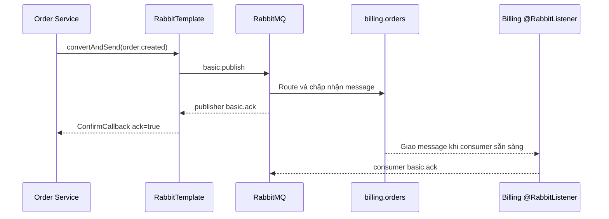
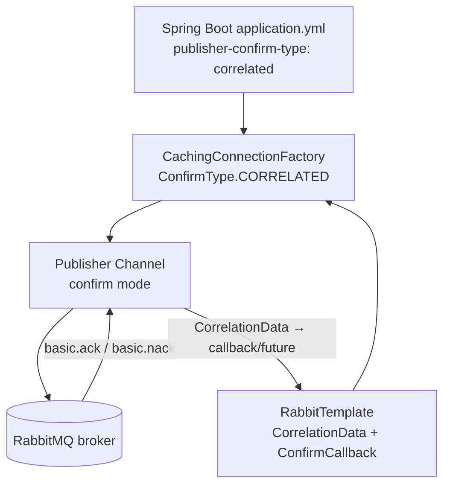

# Cấu hình publisher confirm trên connection factory

## 1. Mục tiêu bài học

Trong module **SPRING_AMQP**, một ứng dụng dùng `RabbitTemplate` phát sự kiện tới exchange RabbitMQ. Exchange định tuyến message theo routing key và binding để đưa vào queue, sau đó `@RabbitListener` nhận và xử lý bất đồng bộ. Vấn đề là: **lời gọi gửi message kết thúc mà không ném exception chưa chứng minh broker đã nhận trách nhiệm đối với message**.

RabbitMQ hỗ trợ **publisher confirms** để trả lời cho publisher rằng broker đã xử lý một lần publish ở mức giao thức. Spring AMQP đưa cơ chế này vào `RabbitTemplate` thông qua cấu hình **connection factory**, đặc biệt là `CachingConnectionFactory`.

Bài thuộc chương **Confirm và return**, với đề bài chính **cấu hình publisher confirm trên connection factory**. Sau khi hoàn thành, bạn có thể:

1. Phân biệt **publisher confirm**, **publisher return** và **consumer acknowledgement**.
2. Hiểu tại sao cần bật confirm ở `CachingConnectionFactory` thay vì chỉ đăng ký callback trên template.
3. Cấu hình `ConfirmType.CORRELATED` bằng `application.yml` của Spring Boot hoặc bằng Java.
4. Gắn `CorrelationData` vào từng lần gửi và xử lý `ack` / `nack` bất đồng bộ.
5. Kết hợp confirms với returns và `mandatory` để phát hiện message không đi tới queue đích.
6. Biết các giới hạn: mất kết nối giữa chừng, trùng message do retry, durability, giao dịch AMQP và quan sát production.

> **Nguyên tắc cốt lõi:** Publisher confirm xác nhận **trách nhiệm xử lý publish của broker**, không xác nhận consumer đã xử lý xong nghiệp vụ. Nếu cần biết message **có được định tuyến tới queue nào hay không**, phải xem thêm publisher returns hoặc cơ chế định tuyến phù hợp.

## 2. Publisher confirm giải quyết vấn đề gì?

Lấy ví dụ **Order Service** gửi sự kiện `order.created` để Billing Service xử lý:



Sơ đồ thể hiện đường đi thành công. Trong thực tế, **publisher confirm là bất đồng bộ**: callback có thể chạy sau khi `convertAndSend(...)` đã trả về, và không nhất thiết theo cùng thứ tự các lời gọi publish.

### 2.1. Không có confirm, publisher thiếu thông tin gì?

Giả sử publisher đã ghi dữ liệu ra socket nhưng broker gặp lỗi ngay sau đó. `convertAndSend(...)` có thể kết thúc mà ứng dụng vẫn không biết chính xác broker đã nhận và xử lý message chưa. Nếu ứng dụng **không có cơ chế xác nhận**, việc đánh dấu “đã gửi thành công” ngay khi phương thức trả về có thể là quá sớm.

Với publisher confirm, RabbitMQ bật **confirm mode trên AMQP channel** và phản hồi:

- `basic.ack`: broker xác nhận publish đã được xử lý theo ngữ nghĩa của confirm.
- `basic.nack`: broker không thể chịu trách nhiệm cho publish đó trong tình huống lỗi tương ứng.

Đây là **publisher acknowledgement**. Nó không phải `basic.ack` mà consumer gửi khi nhận xong message. Hai loại acknowledgement ở hai phía độc lập.

### 2.2. Confirm không tự đồng nghĩa queue đã nhận

Xét publish tới một exchange **có tồn tại** nhưng routing key **không khớp bất kỳ binding nào**:

```text
Publisher --routingKey=order.unknown--> exchange orders.events
                                             |
                                             +-- không có queue phù hợp
                                             |
                                             +-- broker vẫn có thể confirm ACK
```

RabbitMQ có thể xác nhận `ack=true` vì exchange đã xử lý việc định tuyến và kết quả là **không có queue đích**. Khi `mandatory=false` và không có alternate exchange phù hợp, message không định tuyến được có thể bị loại bỏ mà publisher chỉ nhìn confirm vẫn thấy `ack=true`.

Do đó, khi yêu cầu **message phải vào ít nhất một queue**, hãy bật **publisher returns** và `mandatory` bên cạnh confirms.

## 3. Ba cơ chế thường bị nhầm lẫn

| Cơ chế | Hướng thông báo | Trả lời câu hỏi | Không khẳng định điều gì? |
|---|---|---|---|
| **Publisher confirm** | RabbitMQ → Publisher | Broker đã xác nhận hoặc từ chối trách nhiệm cho lần publish? | Consumer đã xử lý nghiệp vụ thành công? |
| **Publisher return** | RabbitMQ → Publisher | Message `mandatory` có bị trả về vì không định tuyến được tới queue không? | Message đã được xử lý bởi consumer? |
| **Consumer acknowledgement** | Consumer → RabbitMQ | Delivery tới consumer có được ack/nack/reject theo chế độ nhận hay không? | Publisher đã nhận confirm hay không? |

Đừng dùng biến `ack` trong callback confirm để suy ra consumer `@RabbitListener` đã thực thi. Tương tự, một message có thể được confirm **trước khi** một consumer bắt đầu xử lý.

### 3.1. Tình huống quan trọng

| Trạng thái publish | Publisher confirm | Publisher return khi bật `mandatory` + returns | Diễn giải |
|---|---|---|---|
| Exchange tồn tại, binding khớp queue và broker chấp nhận publish | Thường `ack=true` | Không | Broker xác nhận đã xử lý publish và message đã được định tuyến. |
| Exchange tồn tại, không có queue đích, không có alternate exchange | Có thể `ack=true` | **Có**, nếu bật đủ điều kiện | Broker đã xử lý một publish không định tuyến được; confirm không thay thế return. |
| Exchange không tồn tại | Channel bị broker đóng với lỗi | **Không phải** một return kiểu `NO_ROUTE` | Phải xử lý channel exception và trạng thái confirm có thể thất bại/không xác định. |
| Mất kết nối trước hoặc trong lúc publish | Có thể ném exception hoặc không nhận confirm | Không bảo đảm | Trạng thái publish có thể **không xác định**; cần timeout và đối soát. |
| Consumer nhận message nhưng xử lý thất bại | Confirm trước đó vẫn có thể `ack=true` | Không liên quan | Retry, requeue, dead-letter và consumer ack là vấn đề phía nhận. |

Nếu exchange có **alternate exchange**, một message không khớp binding ban đầu nhưng được định tuyến thành công qua alternate exchange **không nhất thiết bị trả về**. Return chỉ dùng để phát hiện trường hợp message `mandatory` không được định tuyến tới đích phù hợp theo quy tắc broker.

## 4. Publisher confirm được bật ở tầng nào?

Trong Spring AMQP, `RabbitTemplate` dùng **`ConnectionFactory`** để có AMQP connection/channel. Với Spring Boot, factory phổ biến là **`CachingConnectionFactory`**, có hỗ trợ publisher confirms/returns.



**Hai phần phải khớp nhau:**

1. **Connection factory** được cấu hình cho publisher confirms, ví dụ `setPublisherConfirmType(ConfirmType.CORRELATED)`.
2. **RabbitTemplate** đăng ký callback hoặc gửi kèm `CorrelationData` để nhận và liên kết confirm với lần publish cụ thể.

Nếu chỉ gọi `rabbitTemplate.setConfirmCallback(...)` nhưng factory **không bật confirms**, callback sẽ không có confirm tương ứng để xử lý. Nếu factory bật confirms nhưng không có callback/future được theo dõi, broker vẫn có thể gửi xác nhận nhưng ứng dụng không có quy trình nghiệp vụ để xử lý kết quả.

### 4.1. Các chế độ `ConfirmType`

| Confirm type | Ý nghĩa | Cách dùng điển hình |
|---|---|---|
| `NONE` | Không bật publisher confirms trên factory. | Chỉ khi ứng dụng chấp nhận không theo dõi xác nhận từ broker. |
| `SIMPLE` | Hỗ trợ việc chờ confirms trực tiếp với thao tác theo phạm vi channel. | Luồng publish đồng bộ hoặc kiểm thử nhỏ với `waitForConfirms` khi API/phiên bản cho phép. |
| `CORRELATED` | Hỗ trợ publisher confirms **có gắn tương quan** tới từng lần publish. | Phù hợp cho nhiều ứng dụng Spring AMQP cần callback/future và theo dõi các message đang chờ confirm. |

Ví dụ trong bài dùng **`CORRELATED`**, vì đây là chế độ đáp ứng rõ nhất yêu cầu quan sát trạng thái **từng publish** mà không bắt ứng dụng chặn luồng sau mỗi lời gọi gửi.

Không bật đồng thời `ConfirmType.SIMPLE` và `ConfirmType.CORRELATED` trên cùng một factory; đó là **những lựa chọn cấu hình**. Tên giá trị có thể được ánh xạ thành `none`, `simple`, `correlated` trong Spring Boot properties.

## 5. Cấu hình bằng Spring Boot `application.yml`

### 5.1. Dependency

Dự án Spring Boot sử dụng `spring-boot-starter-amqp`. Với Gradle Groovy DSL:

```groovy
dependencies {
    implementation 'org.springframework.boot:spring-boot-starter-amqp'
}
```

Với Maven:

```xml
<dependency>
    <groupId>org.springframework.boot</groupId>
    <artifactId>spring-boot-starter-amqp</artifactId>
</dependency>
```

Hãy để Spring Boot parent/BOM hoặc Gradle dependency management chọn phiên bản tương thích, thay vì gắn phiên bản `spring-rabbit` tùy ý.

### 5.2. Bật correlated confirms

Trong `src/main/resources/application.yml`:

```yaml
spring:
  rabbitmq:
    host: localhost
    port: 5672
    username: guest
    password: guest
    virtual-host: /
    publisher-confirm-type: correlated
```

Thuộc tính **`spring.rabbitmq.publisher-confirm-type: correlated`** là tâm điểm của bài. Với auto-configuration thông dụng, Spring Boot tạo `CachingConnectionFactory` và cấu hình publisher confirm type theo giá trị này. `RabbitTemplate` sử dụng factory đó để publish.

Nếu chỉ cần **publisher confirms**, bạn có thể bắt đầu với phần cấu hình trên. Tuy nhiên, để biết message có bị **không định tuyến được** hay không, cần kết hợp returns.

### 5.3. Bật thêm publisher returns để quan sát routing

```yaml
spring:
  rabbitmq:
    host: localhost
    port: 5672
    username: guest
    password: guest
    virtual-host: /
    publisher-confirm-type: correlated
    publisher-returns: true
    template:
      mandatory: true
```

Ba thuộc tính có nhiệm vụ khác nhau:

| Thuộc tính Spring Boot | Thiết lập | Tác dụng |
|---|---|---|
| `spring.rabbitmq.publisher-confirm-type` | `correlated` | Bật correlated confirms trên connection factory. |
| `spring.rabbitmq.publisher-returns` | `true` | Cho phép connection factory xử lý publisher returns. |
| `spring.rabbitmq.template.mandatory` | `true` | Yêu cầu broker trả về message không định tuyến được nếu không có queue đích phù hợp. |

**Bật riêng `publisher-returns=true` chưa đủ** nếu template không bật `mandatory` (hoặc mandatory expression không chọn message đó). Và `mandatory=true` không thay thế việc bật returns và cài handler để ứng dụng quan sát kết quả.

Những thiết lập trong `spring.rabbitmq.*` được Boot áp dụng khi **Boot sở hữu việc tạo/cấu hình bean phù hợp**. Nếu bạn tự khởi tạo `CachingConnectionFactory` và bỏ qua cấu hình của Boot, các dòng trên không tự động áp dụng lên bean tự tạo; xem cách cấu hình trực tiếp ở mục sau.

> `guest/guest` chỉ dùng để học tập với RabbitMQ local, nơi chính sách mặc định thường chỉ cho phép account guest kết nối từ loopback. Môi trường thật phải sử dụng tài khoản riêng, secrets và TLS theo chính sách vận hành.

## 6. Cấu hình trực tiếp trên `CachingConnectionFactory`

Khi không sử dụng auto-configuration của Boot hoặc cần cấu hình tường minh, bạn có thể tạo factory:

```java
package com.example.confirms;

import org.springframework.amqp.rabbit.connection.CachingConnectionFactory;
import org.springframework.context.annotation.Bean;
import org.springframework.context.annotation.Configuration;

@Configuration
public class ManualFactoryConfiguration {

    @Bean
    CachingConnectionFactory connectionFactory() {
        CachingConnectionFactory factory =
                new CachingConnectionFactory("localhost");

        factory.setUsername("guest");
        factory.setPassword("guest");
        factory.setVirtualHost("/");

        // Cần cho RabbitTemplate.ConfirmCallback và CorrelationData.
        factory.setPublisherConfirmType(
                CachingConnectionFactory.ConfirmType.CORRELATED);

        // Bổ sung khi muốn phát hiện message unroutable.
        factory.setPublisherReturns(true);

        return factory;
    }
}
```

Đây là **phương án thay thế** cho việc để Spring Boot tự tạo connection factory. **Không đăng ký thêm class `ManualFactoryConfiguration`** vào ví dụ Boot ở mục 5 nếu muốn Boot tự điều khiển factory. Một `ConnectionFactory` do ứng dụng khai báo thường khiến Boot không tạo bean mặc định của nó.

Nếu tự cấu hình factory, bạn phải thiết lập đủ **host, port, virtual host, credentials, SSL, timeouts, heartbeat** theo môi trường. Đừng vừa tự tạo factory với địa chỉ `localhost` vừa kỳ vọng `spring.rabbitmq.host` trong YAML sẽ tự sửa địa chỉ đó.

### 6.1. Vì sao cấu hình ở factory chứ không phải chỉ ở template?

Publisher confirms hoạt động ở **AMQP channel**. Một channel muốn nhận publisher acknowledgements phải được đặt vào confirm mode bằng cơ chế của giao thức RabbitMQ. `CachingConnectionFactory` quyết định cách cấp channel và kích hoạt tính năng này. `RabbitTemplate` cung cấp abstraction để publish và xử lý callbacks với những channel đã được cấu hình đúng.

Spring AMQP có thể cần giữ channel đủ lâu để nhận các confirm còn đang chờ. Vì vậy, kích thước cache/channel lifecycle cũng ảnh hưởng chi phí tài nguyên. Ở production, giám sát số channel tạo/đóng và thời gian chờ confirms để điều chỉnh cấu hình hợp lý, thay vì tăng cache theo cảm tính.

## 7. Gắn `CorrelationData` và xử lý confirm

### 7.1. Vì sao cần correlation?

Khi publisher gửi đồng thời nhiều sự kiện, confirm sẽ đến **bất đồng bộ**. Ứng dụng cần biết callback `ack=true` tương ứng với message nào để cập nhật trạng thái gửi của message đó.

```text
Publish order-101  + CorrelationData("order-101/attempt-1")
Publish order-102  + CorrelationData("order-102/attempt-1")
Publish order-103  + CorrelationData("order-103/attempt-1")
                            |
                            v
                     RabbitMQ broker
                            |
             +--------------+--------------+
             |              |              |
            ACK            NACK            ACK
             |              |              |
        correlation      correlation     correlation
          order-103       order-102        order-101
```

Thứ tự callback không nhất thiết giống thứ tự publish. `CorrelationData` cho phép liên kết xác nhận với một lần gửi cụ thể.

**Nên dùng ID duy nhất cho mỗi lần publish** (chẳng hạn UUID hoặc business event ID + attempt ID). Nếu một sự kiện được thử gửi lại, giữ **business event ID** để deduplicate nghiệp vụ và dùng **attempt ID** để phân biệt từng lần publish.

### 7.2. Đăng ký callbacks trên `RabbitTemplate`

Ví dụ cấu hình một `RabbitTemplate` chủ động dùng factory do Spring Boot hoặc ứng dụng cung cấp:

```java
package com.example.confirms;

import org.springframework.amqp.rabbit.connection.ConnectionFactory;
import org.springframework.amqp.rabbit.core.RabbitTemplate;
import org.springframework.context.annotation.Bean;
import org.springframework.context.annotation.Configuration;

@Configuration
public class ConfirmTemplateConfiguration {

    @Bean
    RabbitTemplate rabbitTemplate(ConnectionFactory connectionFactory) {
        RabbitTemplate template = new RabbitTemplate(connectionFactory);

        // Bắt buộc cho phép message không route được được trả về.
        template.setMandatory(true);

        template.setConfirmCallback((correlationData, ack, cause) -> {
            String publishId = correlationData != null
                    ? correlationData.getId() : "(unknown)";

            if (ack) {
                System.out.printf(
                        "BROKER CONFIRM ACK: publishId=%s%n", publishId);
            } else {
                System.err.printf(
                        "BROKER CONFIRM NACK: publishId=%s cause=%s%n",
                        publishId, cause);
            }
        });

        template.setReturnsCallback(returned -> {
            // Không log toàn bộ body trong hệ thống chứa dữ liệu nhạy cảm.
            System.err.printf(
                    "RETURN: exchange=%s routingKey=%s code=%d reason=%s%n",
                    returned.getExchange(),
                    returned.getRoutingKey(),
                    returned.getReplyCode(),
                    returned.getReplyText());
        });

        return template;
    }
}
```

Trong ví dụ này, `ConnectionFactory` được inject chính là bean đã được cấu hình **publisher confirms/returns**. Nếu dùng cấu hình Spring Boot ở mục 5, Boot tạo factory hỗ trợ `CORRELATED`; bean `RabbitTemplate` ở đây chỉ thêm callbacks và `mandatory`.

**Đừng đăng ký callback tràn lan ở nhiều nơi**: một `RabbitTemplate` hỗ trợ một `ConfirmCallback` và một `ReturnsCallback` tại một thời điểm. Khi nhiều thành phần cần kết quả, hãy tạo một bộ điều phối trạng thái gửi (publish tracker) và phân phát thông tin cho các thành phần liên quan.

### 7.3. Publisher gửi message với correlation

```java
package com.example.confirms;

import java.util.UUID;
import org.springframework.amqp.rabbit.connection.CorrelationData;
import org.springframework.amqp.rabbit.core.RabbitTemplate;
import org.springframework.stereotype.Service;

@Service
public class OrderEventPublisher {

    public static final String EXCHANGE = "demo.confirm.events";

    private final RabbitTemplate rabbitTemplate;

    public OrderEventPublisher(RabbitTemplate rabbitTemplate) {
        this.rabbitTemplate = rabbitTemplate;
    }

    public String publish(String routingKey, String payload) {
        String publishId = UUID.randomUUID().toString();
        CorrelationData correlation = new CorrelationData(publishId);

        rabbitTemplate.convertAndSend(
                EXCHANGE, routingKey, payload, correlation);

        // Đây là ID theo dõi; chưa phải kết quả broker confirm.
        return publishId;
    }
}
```

Lời gọi `convertAndSend(exchange, routingKey, payload, correlationData)` là overload của `RabbitTemplate`. Giá trị trả về `publishId` giúp bên gọi liên kết với kết quả xác nhận, **không** phải “biên nhận đã xử lý nghiệp vụ” của broker.

`CorrelationData` lưu metadata tương quan ở phía publisher; bản thân ID này **không tự trở thành AMQP `messageId`** hoặc header nghiệp vụ trong message. Nếu consumer cũng phải biết event ID để xử lý idempotent, hãy gắn nó vào `MessageProperties.messageId` hoặc một application header rõ ràng, với quy ước nhất quán.

### 7.4. Khi nhận confirm, xử lý ack/nack thế nào?

`ack=true` nghĩa là broker gửi xác nhận cho publish trên channel confirm. Một số message có thể **được trả về vì không route được** mà vẫn nhận ACK. Vì thế không nên đánh dấu trạng thái **ROUTED** chỉ từ `ack=true`.

Với `ack=false`, broker hoặc framework báo publish không được xác nhận thành công. `cause` có thể có mô tả lỗi nhưng **không phải lúc nào cũng có**; không xây quy trình dựa trên giả định chuỗi lỗi luôn đầy đủ.

Một mô hình trạng thái có thể là:

| Trạng thái ứng dụng | Khi nào áp dụng |
|---|---|
| `PENDING` | Đã yêu cầu publish, đang chờ kết quả. |
| `CONFIRMED` | Confirm ACK và không phát hiện lỗi return theo yêu cầu định tuyến. |
| `RETURNED` | Broker trả message vì không có queue phù hợp cho `mandatory` publish. |
| `NACKED` | Nhận publisher confirm NACK. |
| `UNKNOWN` | Kết nối bị mất hoặc hết timeout trước khi có kết quả rõ ràng. |

Đây là **mô hình trạng thái gợi ý**, không phải enum được Spring AMQP tự cung cấp. Nếu sử dụng trạng thái gửi trong database, cần cập nhật idempotent và xử lý callback chạy trên thread khác với thread gửi.

## 8. Ví dụ Spring Boot hoàn chỉnh: publish đúng và sai routing key

Ví dụ này dùng **một direct exchange**, một queue và một binding. Nó minh họa hai trường hợp:

- Publish `order.created`: có queue đích phù hợp.
- Publish `order.unknown`: exchange tồn tại nhưng **không có binding khớp**, nên có thể nhận publisher return, trong khi publisher confirm vẫn có thể ACK.

### 8.1. Khai báo topology

File `ConfirmTopology.java`:

```java
package com.example.confirms;

import org.springframework.amqp.core.Binding;
import org.springframework.amqp.core.BindingBuilder;
import org.springframework.amqp.core.DirectExchange;
import org.springframework.amqp.core.Queue;
import org.springframework.amqp.core.QueueBuilder;
import org.springframework.beans.factory.annotation.Qualifier;
import org.springframework.context.annotation.Bean;
import org.springframework.context.annotation.Configuration;

@Configuration
public class ConfirmTopology {

    public static final String EXCHANGE = "demo.confirm.events";
    public static final String QUEUE = "demo.confirm.orders";

    @Bean
    DirectExchange confirmExchange() {
        return new DirectExchange(EXCHANGE, true, false);
    }

    @Bean
    Queue confirmQueue() {
        return QueueBuilder.durable(QUEUE).build();
    }

    @Bean
    Binding confirmBinding(
            @Qualifier("confirmQueue") Queue queue,
            @Qualifier("confirmExchange") DirectExchange exchange) {
        return BindingBuilder.bind(queue)
                .to(exchange)
                .with("order.created");
    }
}
```

Các bean exchange, queue và binding được Spring AMQP `RabbitAdmin` đủ điều kiện khai báo lên RabbitMQ khi có kết nối. Bảo đảm broker đang hoạt động, user có quyền khai báo và ứng dụng không tắt `spring.rabbitmq.dynamic` nếu dựa vào admin của Boot.

File `OrderConsumer.java`:

```java
package com.example.confirms;

import org.springframework.amqp.rabbit.annotation.RabbitListener;
import org.springframework.stereotype.Component;

@Component
public class OrderConsumer {

    @RabbitListener(queues = ConfirmTopology.QUEUE)
    public void handle(String payload) {
        System.out.println("CONSUMER RECEIVED: " + payload);
    }
}
```

Consumer chỉ được dùng để quan sát đường định tuyến thành công. **Việc consumer in log không tham gia cơ chế publisher confirm**.

### 8.2. Chạy phép thử một lần khi ứng dụng khởi động

File `ConfirmApplication.java`:

```java
package com.example.confirms;

import org.springframework.amqp.rabbit.annotation.EnableRabbit;
import org.springframework.boot.ApplicationRunner;
import org.springframework.boot.SpringApplication;
import org.springframework.boot.autoconfigure.SpringBootApplication;
import org.springframework.context.annotation.Bean;

@SpringBootApplication
@EnableRabbit
public class ConfirmApplication {

    public static void main(String[] args) {
        SpringApplication.run(ConfirmApplication.class, args);
    }

    @Bean
    ApplicationRunner demo(OrderEventPublisher publisher) {
        return args -> {
            publisher.publish("order.created", "orderId=101");
            publisher.publish("order.unknown", "orderId=102");
        };
    }
}
```

Để chạy, dùng `application.yml` ở mục 5.3 cùng `ConfirmTemplateConfiguration` và **không** đồng thời bật `ManualFactoryConfiguration` ở mục 6.

Nếu môi trường chưa có RabbitMQ, có thể dùng Docker để tạo broker local:

```bash
docker run -d --name rabbitmq-confirm-lab \
  -p 5672:5672 -p 15672:15672 \
  rabbitmq:4-management
```

Khởi chạy Spring Boot bằng wrapper Maven/Gradle hiện có:

```bash
./mvnw spring-boot:run
# Hoặc:
./gradlew bootRun
```

Đầu ra **có thể** tương tự:

```text
CONSUMER RECEIVED: orderId=101
BROKER CONFIRM ACK: publishId=...
RETURN: exchange=demo.confirm.events routingKey=order.unknown code=312 reason=NO_ROUTE
BROKER CONFIRM ACK: publishId=...
```

**Không dựa vào thứ tự log**: callback confirm, return và consumer có thể chạy trên các thread khác nhau. `NO_ROUTE` thường có reply code `312` trong AMQP 0-9-1, nhưng code log thực tế nên lấy từ `ReturnedMessage` thay vì hard-code.

Kết quả quan trọng là **message `order.unknown` bị RETURN nhưng vẫn có thể được CONFIRM ACK**. Đây là minh chứng rõ ràng rằng bật publisher confirms **không thay thế** publisher returns.

### 8.3. Xem kết quả trên RabbitMQ Management

Mở giao diện quản lý ở `http://localhost:15672` (nếu đã map cổng), rồi kiểm tra:

1. Exchange `demo.confirm.events` là `direct` và có binding key `order.created`.
2. Queue `demo.confirm.orders` tồn tại và listener đăng ký consumer.
3. `order.created` được định tuyến đến queue; `order.unknown` không khớp binding này.
4. Số message `Ready` có thể bằng 0 vì consumer đã lấy message.
5. Theo dõi số channel/connection của publisher, log callback và lỗi publish.

Nếu broker đã có tài nguyên cùng tên nhưng type/arguments khác, `RabbitAdmin` có thể báo `PRECONDITION_FAILED`; hãy dùng tài nguyên thử nghiệm riêng và không xóa queue production để làm ví dụ chạy được.

## 9. Đợi confirm của một publish bằng `CorrelationData.getFuture()`

Callback phù hợp với luồng publish bất đồng bộ, nhưng đôi khi ứng dụng cần đợi **kết quả confirm của một message cụ thể** (ví dụ bước kiểm thử, tác vụ vận hành hoặc một thao tác hiếm).

Với `ConfirmType.CORRELATED`, `CorrelationData` cung cấp future để nhận kết quả:

```java
import java.util.UUID;
import java.util.concurrent.TimeUnit;
import org.springframework.amqp.rabbit.connection.CorrelationData;
import org.springframework.amqp.rabbit.core.RabbitTemplate;

public class ConfirmWaitExample {

    private final RabbitTemplate rabbitTemplate;

    public ConfirmWaitExample(RabbitTemplate rabbitTemplate) {
        this.rabbitTemplate = rabbitTemplate;
    }

    public void sendAndWait(String exchange, String routingKey, String body)
            throws Exception {

        CorrelationData data =
                new CorrelationData(UUID.randomUUID().toString());

        rabbitTemplate.convertAndSend(
                exchange, routingKey, body, data);

        CorrelationData.Confirm confirm =
                data.getFuture().get(10, TimeUnit.SECONDS);

        if (!confirm.isAck()) {
            throw new IllegalStateException(
                    "Broker NACK: " + confirm.getReason());
        }

        // Return cũng có thể đi cùng confirm ACK.
        if (data.getReturned() != null) {
            throw new IllegalStateException(
                    "Message unroutable: "
                    + data.getReturned().getReplyText());
        }
    }
}
```

**Điều kiện:** Factory phải bật `CORRELATED`; để nhận `ReturnedMessage` phải cấu hình returns/mandatory tương ứng. Ứng dụng phải xử lý riêng `TimeoutException`, `InterruptedException`, connection errors và chính sách retry; ví dụ trên chỉ trình bày ngữ nghĩa đường thành công/thất bại.

Việc `getFuture().get(...)` hoàn thành thành công chỉ cho biết **future đã nhận confirm**, không tự bảo đảm queue cuối có consumer đang hoạt động hay handler đã xử lý. Đồng thời, nếu mất kết nối trước confirm, **timeout không chứng minh message chưa tới broker**. Đó là trạng thái **không xác định** cần xử lý cẩn thận.

### 9.1. Vì sao không chặn sau mỗi publish?

Nếu gửi hàng nghìn message mà mỗi lần đều đợi một round trip confirm:

```text
send A → wait confirm A
send B → wait confirm B
send C → wait confirm C
...
```

Thông lượng có thể giảm mạnh vì mỗi publish bị tuần tự hóa theo độ trễ xác nhận. Ứng dụng thông thường nên gửi **nhiều message đang chờ confirm** và xử lý kết quả bằng callback/future có giới hạn số lượng pending, thay vì chặn sau mọi lần gửi.

Tuy nhiên, không được duy trì **vô hạn** pending correlation data: cần timeout, backpressure và ngưỡng số message in-flight để tránh tiêu thụ bộ nhớ hoặc phát tải quá khả năng của broker.

## 10. `ConfirmType.SIMPLE` và các thao tác chờ confirm theo channel

Ngoài `CORRELATED`, Spring AMQP có chế độ `SIMPLE` cho trường hợp cần xác nhận theo **channel** mà không dùng correlated callback như trên. Khi dùng `RabbitTemplate.invoke(...)` với cùng một dedicated channel, có thể thực hiện publish rồi gọi `waitForConfirmsOrDie(...)` trong phạm vi đó:

```java
// Ví dụ dành cho factory dùng ConfirmType.SIMPLE.
rabbitTemplate.invoke(operations -> {
    operations.convertAndSend(
            "demo.confirm.events", "order.created", "orderId=201");

    // Đợi publisher confirms trên channel được giữ trong invoke scope.
    operations.waitForConfirmsOrDie(10_000);
    return null;
});
```

`waitForConfirmsOrDie(...)` **không phải** hàm thay thế tùy tiện cho correlated confirms trên một template thông thường. Khi dùng scoped operations, cần kiểm tra API và chế độ confirms của **phiên bản Spring AMQP** đang chạy. Chọn `CORRELATED` cho bài toán theo dõi từng publish ở mức ứng dụng, nhất là khi có nhiều message concurrent.

Publisher confirms **không tương thích với transaction mode trên cùng một AMQP channel**: channel đã ở confirm mode không thể đồng thời trở thành transactional channel. Không “nâng độ tin cậy” bằng cách bật cả confirm lẫn AMQP transaction trên chính channel đó; cần lựa chọn mô hình gửi thích hợp.

## 11. Tình huống lỗi và cách xử lý thực tế

### 11.1. Confirm ACK nhưng có return

`ack=true` đi kèm `ReturnedMessage` hoặc `ReturnsCallback` báo `NO_ROUTE`. Nếu yêu cầu message phải đến một queue, đây là **lỗi định tuyến**, không phải publish thành công nghiệp vụ.

Hãy ghi lại exchange, routing key, business event ID, publish attempt ID, reply code và lý do. Kiểm tra binding và cấu hình topology trước khi tự động gửi lại, vì gửi lại cùng routing key khi binding chưa được sửa chỉ làm lặp lỗi.

### 11.2. Broker NACK

`ack=false`: đánh dấu publish attempt thất bại và ghi nguyên nhân nếu có. Broker NACK hiếm hơn return do unroutable; nó có thể biểu thị lỗi nội bộ khiến broker không thể xử lý message.

**Không kết luận** rằng mọi NACK đều do một binding sai. Với routing sai, trường hợp thường gặp hơn là **return** (nếu mandatory) hoặc bị loại bỏ (nếu không mandatory).

### 11.3. Publisher mất kết nối trước confirm

Khi connection đóng trong lúc một publish còn chờ kết quả, ứng dụng có thể không biết broker đã chấp nhận message hay chưa. Ví dụ:

```text
Publisher gửi event-42  ----->
                              RabbitMQ có thể đã nhận
                       X      nhưng kết nối đứt trước ACK
Publisher không thấy confirm
```

Nếu retry, sự kiện có thể được publish **hai lần**. Nếu không retry, sự kiện có thể không được gửi. Một chiến lược an toàn hơn thường gồm:

- Lưu **business event ID** ổn định cho mỗi sự kiện.
- Ghi trạng thái gửi và kết quả confirm trong một cơ chế theo dõi bền vững, nếu yêu cầu không mất sự kiện.
- Retry với **backoff và giới hạn số lần**; phân loại `UNKNOWN` khác `NACKED`.
- Thiết kế consumer **idempotent** bằng business key để chịu được duplicate deliveries.
- Khi cập nhật database và phát sự kiện phải đồng bộ ý nghĩa nghiệp vụ, cân nhắc **transactional outbox** và publisher xác nhận sau khi broker xử lý.

**Publisher confirms + retry không tương đương exactly-once end-to-end.** Nó hỗ trợ phát tin cậy hơn nhưng không tự loại bỏ trùng lặp.

### 11.4. Publisher confirm ACK nhưng consumer không xử lý

Khả năng bao gồm:

- Listener chưa chạy, queue vẫn giữ message.
- Listener xử lý lỗi, message bị requeue hoặc đưa tới DLX.
- Queue khác với queue bạn đang quan sát do nhầm virtual host hoặc binding.
- Consumer chưa acknowledgement hoặc đã xử lý nhưng chưa cập nhật trạng thái nghiệp vụ.

Hãy kiểm tra **queue depth, unacked messages, consumer count, dead-letter, listener logs**. Publisher callback không thể thay thế những chỉ số này.

### 11.5. Không nhận được callback confirm

Checklist:

1. `spring.rabbitmq.publisher-confirm-type` có là `correlated` (hoặc factory được cấu hình trực tiếp `ConfirmType.CORRELATED`) không?
2. `RabbitTemplate` thực sự sử dụng **đúng factory** ấy không?
3. Callback đã được đăng ký trước khi publish chưa?
4. Có tạo `CorrelationData` riêng và truyền vào overload `convertAndSend` phù hợp không?
5. Broker có đang kết nối và publish có xảy ra không, hay exception đã ném trước bước gửi?
6. Connection/channel có bị đóng trong lúc confirm pending không?
7. Nếu theo dõi future, có xử lý timeout và trạng thái unknown thay vì chờ vô hạn không?

### 11.6. Không nhận publisher return

Kiểm tra đủ bộ ba:

```text
connectionFactory.publisherReturns = true
rabbitTemplate.mandatory = true
rabbitTemplate.setReturnsCallback(...)
```

Sau đó xác nhận exchange **tồn tại** nhưng routing key **không khớp** queue nào và message không được định tuyến qua alternate exchange. Gửi vào **exchange không tồn tại** không phải test đúng cho `NO_ROUTE` return, vì broker sẽ trả lỗi channel.

## 12. Observability và vận hành production

Đối với một publisher quan trọng, nên có một số chỉ số:

| Metric/nhật ký | Ý nghĩa |
|---|---|
| `publisher_confirm_ack_total` | Số lần nhận confirm ACK. |
| `publisher_confirm_nack_total` | Số lần nhận confirm NACK. |
| `publisher_return_total` | Số message mandatory bị trả về vì không route được. |
| `publisher_confirm_timeout_total` | Số lần không nhận kết quả trong thời hạn theo dõi. |
| `publisher_pending_confirms` | Số publish attempt đang chờ xác nhận. |
| `publisher_confirm_latency` | Độ trễ từ lúc publish đến khi có confirm. |
| `publisher_connection_errors_total` | Số lỗi liên quan kết nối/channel khi gửi. |

Các tên trên chỉ là **gợi ý đặt metric**, không khẳng định Spring Boot/Spring AMQP tự xuất sẵn đúng tên đó. Có thể dùng Micrometer, custom tracker hoặc hệ thống quan sát hiện có để thống nhất tên và dimensions.

### 12.1. Log có cấu trúc

Một log sự kiện publish có thể có:

```text
eventId=order-42
publishAttemptId=2c4b...
exchange=demo.confirm.events
routingKey=order.created
confirmStatus=ACK
returned=false
latencyMs=14
```

Tránh log nguyên body message, credentials hoặc dữ liệu cá nhân. Nếu callback chạy bất đồng bộ, bảo đảm bộ theo dõi correlation thread-safe và xử lý trạng thái kết quả theo thứ tự phù hợp với database hoặc state machine.

### 12.2. Channel cache và hiệu năng

`CachingConnectionFactory` quản lý channel cache. Nếu lượng publish lớn, nhiều channel bị mở/đóng liên tục hoặc backlog confirms tăng, kiểm tra:

- Số channel mở tại RabbitMQ Management.
- Pending confirms và confirm latency theo tải thực.
- Channel cache size, checkout timeout và concurrency của publisher.
- Số kết nối, độ trễ mạng và khả năng xử lý/persistence của broker.

Publisher confirms có chi phí theo dõi nhưng thường thực dụng hơn việc dùng AMQP transactions cho mọi message. Khi cần hiệu năng, có thể tăng số message in-flight có kiểm soát và đợi/nhận confirmations theo lô, nhưng vẫn cần backpressure, timeout và giới hạn tài nguyên.

## 13. Bài tập tự kiểm tra

### Câu 1. Chỉ thêm callback đã đủ chưa?

Một ứng dụng có:

```java
rabbitTemplate.setConfirmCallback((data, ack, cause) -> {
    System.out.println("confirmed=" + ack);
});
```

Nhưng connection factory chưa bật publisher confirms. Liệu callback có hoạt động đúng kỳ vọng?

**Đáp án:** Không. Phải cấu hình publisher confirm type tương ứng ở **connection factory**, ví dụ `ConfirmType.CORRELATED`, rồi template mới nhận được correlated confirms.

### Câu 2. Confirm ACK có đảm bảo consumer đã xử lý?

Publisher nhận `ack=true`, nhưng consumer đang tắt. Có mâu thuẫn không?

**Đáp án:** Không. Broker có thể đã chấp nhận publish vào queue trong khi chưa có consumer. Confirm và consumer acknowledgement là hai cơ chế độc lập.

### Câu 3. Không có queue khớp binding thì confirm có thể ACK?

Publisher gửi vào exchange tồn tại với routing key không khớp queue nào. `mandatory=false`. Có thể nhận `ack=true` không?

**Đáp án:** Có. Broker có thể xác nhận đã xử lý publish ngay cả khi không có queue phù hợp. Muốn biết message có bị không định tuyến được, dùng `mandatory` và returns với cấu hình phù hợp.

### Câu 4. Bật `publisher-returns=true` nhưng `mandatory=false`

Ứng dụng mong thấy callback return cho một routing key sai. Điều gì thiếu?

**Đáp án:** `mandatory=true` trên `RabbitTemplate` (hoặc mandatory expression đánh giá true với message). Đồng thời phải đăng ký `ReturnsCallback` để quan sát sự kiện.

### Câu 5. Mất kết nối trước confirm

Publisher không nhận confirm trong timeout. Có được khẳng định broker không hề nhận message không?

**Đáp án:** Không. Broker có thể đã nhận rồi nhưng kết nối hỏng trước khi publisher nhận ACK. Cần quản lý trạng thái **UNKNOWN**, retry có kiểm soát và consumer idempotent.

### Câu 6. Dùng cùng một `CorrelationData.id` cho tất cả publish có tốt không?

**Đáp án:** Không. ID trùng khiến việc đối soát các publish attempt khó hoặc không đáng tin cậy. Hãy dùng ID duy nhất cho từng attempt và một business event ID ổn định cho deduplication.

### Câu 7. Có thể dùng confirm mode và transaction mode đồng thời trên một channel?

**Đáp án:** Không. RabbitMQ không cho cùng một channel vừa ở publisher confirm mode vừa ở AMQP transaction mode.

### Câu 8. Confirm ACK và RETURN xuất hiện cùng lúc thì phải đánh dấu thành công?

**Đáp án:** Nếu mục tiêu là **giao message đến ít nhất một queue**, không. Return báo lần publish không định tuyến được; ACK chỉ báo broker đã xử lý publish. Cần xử lý lỗi routing thay vì đánh dấu phát sự kiện hoàn tất.

## 14. Tài liệu tham khảo

- [Spring AMQP — Correlated Publisher Confirms and Returns](https://docs.spring.io/spring-amqp/reference/amqp/template.html): cấu hình `RabbitTemplate.ConfirmCallback`, `ReturnsCallback` và `mandatory`.
- [Spring AMQP — Connection and Resource Management](https://docs.spring.io/spring-amqp/reference/amqp/connections.html): `CachingConnectionFactory`, publisher confirms và returns.
- [Spring Boot — Common Application Properties](https://docs.spring.io/spring-boot/3.5/appendix/application-properties/index.html): `spring.rabbitmq.publisher-confirm-type`, `publisher-returns`, `template.mandatory`.
- [RabbitMQ — Consumer Acknowledgements and Publisher Confirms](https://www.rabbitmq.com/docs/confirms): khác biệt publisher confirm/consumer ack, điều kiện ACK/NACK và tác động của durability.
- [RabbitMQ — Publishers](https://www.rabbitmq.com/docs/publishers): trường hợp unroutable, exchange không tồn tại và publisher returns.

## Ghi nhớ

- **Bật publisher confirms trên `CachingConnectionFactory`**, ưu tiên `ConfirmType.CORRELATED` khi cần theo dõi từng publish bất đồng bộ.
- Với Spring Boot, cấu hình `spring.rabbitmq.publisher-confirm-type: correlated`; nếu muốn phát hiện message không route được, bổ sung `publisher-returns: true` và `template.mandatory: true`.
- `RabbitTemplate.ConfirmCallback` nhận **`CorrelationData`**, `ack` và `cause`; `CorrelationData.getFuture()` hỗ trợ đợi xác nhận của một lần publish cụ thể.
- **Confirm ACK không đồng nghĩa message đã đến đúng queue hoặc được consumer xử lý**. Message unroutable có thể được ACK nhưng đồng thời bị return.
- Với timeout, mất kết nối hoặc retry, trạng thái publish có thể không xác định; kết hợp **correlation ID, publisher tracker, idempotency, backoff và monitoring**.
- Độ tin cậy end-to-end cần thêm **durable topology, persistence, consumer acknowledgements, retry, dead-letter, giao dịch/outbox và quan sát vận hành**; không một cấu hình confirm đơn lẻ nào thay thế tất cả các cơ chế đó.
