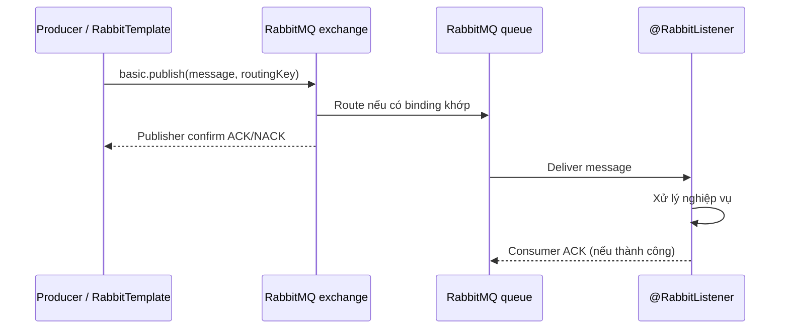
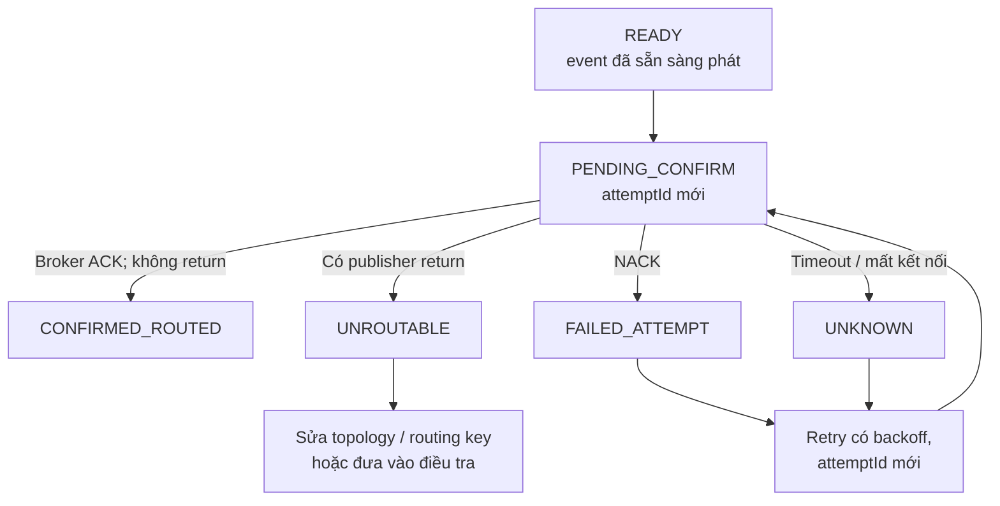
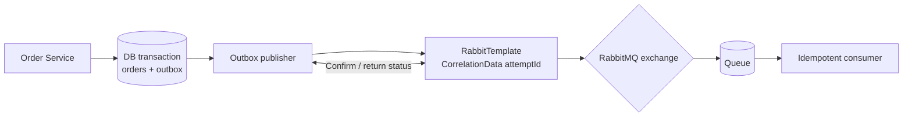

# ConfirmCallback và CorrelationData cho từng lần gửi

Một ứng dụng Spring Boot gọi `RabbitTemplate.convertAndSend(...)` để phát sự kiện `order.created`. Lời gọi trả về bình thường, nhưng điều đó chưa chứng minh RabbitMQ đã xử lý publish, message đã vào queue phù hợp hoặc consumer đã hoàn thành công việc. Nếu ứng dụng gửi đồng thời hàng nghìn message, mỗi lần gửi cần một cách nhận diện riêng để biết **publish nào được broker ACK, publish nào bị NACK, publish nào không định tuyến được và publish nào chưa có kết quả chắc chắn**.

Spring AMQP giải quyết phần quan sát phía producer bằng **publisher confirms**, `RabbitTemplate.ConfirmCallback` và `CorrelationData`. Mỗi lần publish có thể mang một `CorrelationData` riêng; khi broker phản hồi, ứng dụng gắn ACK/NACK về đúng lần gửi. Kết hợp thêm publisher returns và tùy chọn `mandatory` giúp phát hiện message đến exchange nhưng không có queue đích.

Bài thuộc chương **Confirm và return** của module **SPRING_AMQP**. Các ví dụ dùng RabbitMQ AMQP 0-9-1 với `RabbitTemplate`, `DirectExchange`, queue, binding và `@RabbitListener`. Nội dung tập trung vào **ConfirmCallback và CorrelationData cho từng lần gửi**, đồng thời phân biệt rõ publisher confirms với consumer acknowledgement, retry, dead-letter, transaction và tính nhất quán nghiệp vụ.

Sau bài học, bạn có thể:

1. Đọc đúng callback `confirm(CorrelationData, boolean ack, String cause)`.
2. Tạo `CorrelationData` duy nhất cho mỗi lần gửi và liên hệ nó với event ID, attempt ID.
3. Cấu hình `publisher-confirm-type: correlated`, `publisher-returns` và `template.mandatory`.
4. Phân biệt ACK, NACK, return `NO_ROUTE`, exception đồng bộ và timeout.
5. Dùng `CorrelationData.getFuture()` để theo dõi kết quả của một lần gửi; ghép dữ liệu return với confirm.
6. Thiết kế trạng thái publish, retry và quan sát an toàn khi nhiều lời gọi đồng thời.
7. Hiểu tại sao publisher confirms cần đi cùng outbox, idempotency và consumer ACK để tạo hệ thống bất đồng bộ đáng tin cậy.

## 1. Vì sao không thể dựa vào convertAndSend trả về?

Trong AMQP 0-9-1, việc gửi message qua connection/channel và việc broker xử lý message là các bước bất đồng bộ. Khi gọi:

```java
rabbitTemplate.convertAndSend(
        "orders.events",
        "order.created",
        "order-1001");
```

ta chỉ biết quá trình gọi API không ném lỗi đồng bộ ngay tại thời điểm đó. Broker có thể gặp sự cố sau khi client bắt đầu publish, exchange có thể không có binding phù hợp, hoặc consumer có thể đang tạm ngừng.

Một đường đi điển hình:



Các bước xác nhận trả lời **những câu hỏi khác nhau**:

| Cơ chế | Nguồn phát | Ý nghĩa |
|---|---|---|
| `convertAndSend(...)` trả về | Mã producer | Gọi API đã hoàn tất tại phía ứng dụng, không đồng nghĩa message vào queue |
| **Publisher confirm ACK** | Broker → producer | Broker xác nhận đã xử lý lần publish theo bảo đảm áp dụng của broker/queue |
| **Publisher confirm NACK** | Broker/framework → producer | Lần publish không được xác nhận thành công; `cause` có thể cung cấp thêm lý do |
| **Publisher return** | Broker → producer | Message không được định tuyến tới queue theo các điều kiện `mandatory`/returns |
| **Consumer ACK** | Consumer → broker | Consumer xác nhận delivery đã được xử lý theo logic của nó |

**ACK của publisher không phải ACK của consumer.** Broker có thể xác nhận publish trong khi message vẫn nằm chờ trong queue hàng giờ. Producer không thể dùng publisher confirm để kết luận email đã gửi, kho đã cập nhật hay hóa đơn đã tạo.

## 2. Confirm, return và lỗi có thể kết hợp như thế nào?

Một direct exchange tên `orders.events` có binding `order.created` đến queue `orders.created.q`. Xét các tình huống:

| Tình huống | Publisher confirm | Publisher return | Diễn giải |
|---|---|---|---|
| Exchange tồn tại, binding khớp, broker nhận publish thành công | Thường ACK | Không | Message đã được broker xử lý, nhưng consumer chưa chắc đã xử lý |
| Exchange tồn tại, **không** có queue phù hợp, `mandatory=true` | Vẫn có thể ACK | Có, thường `NO_ROUTE` | Broker xử lý publish nhưng message **không tới queue đích** |
| Exchange không tồn tại | Có thể NACK / lỗi channel; cần kiểm tra cause | Không phải `NO_ROUTE` kiểu thông thường | Lỗi exchange, broker có thể đóng channel |
| Kết nối mất trước khi producer nhận confirm | Không thấy kết quả chắc chắn | Có thể không thấy | Broker có thể đã nhận message; trạng thái từ phía producer là **chưa rõ** |
| Listener ném exception sau khi message được route | Confirm có thể đã ACK trước đó | Không phải lỗi routing | Xử lý qua consumer retry, reject/NACK, DLQ |

Điểm khó nhất: **`confirm.ack=true` và `returned != null` có thể cùng xuất hiện cho một lần publish**. Nếu chỉ kiểm tra ACK và đánh dấu “đã giao đến queue”, ứng dụng sẽ ghi nhận sai message không có đích.

Ngược lại, `NACK` và `Return` không phải hai tên gọi khác nhau của cùng lỗi. NACK liên quan chặng broker xác nhận publish; return phản ánh không có tuyến đến queue trong điều kiện được yêu cầu.

## 3. Bật correlated publisher confirms trong Spring Boot

Với Spring Boot dùng RabbitMQ AMQP 0-9-1, cấu hình:

```yaml
spring:
  rabbitmq:
    host: localhost
    port: 5672
    username: demo
    password: demo-local-only
    publisher-confirm-type: correlated
    publisher-returns: true
    template:
      mandatory: true
```

Ba thuộc tính quan trọng:

- `publisher-confirm-type: correlated` yêu cầu cơ chế confirm có liên hệ từng lần gửi, để `RabbitTemplate` trả lại `CorrelationData` trong callback hoặc hoàn thành future.
- `publisher-returns: true` cho phép nhận message bị broker trả về qua `ReturnsCallback` và `CorrelationData` khi điều kiện cho phép.
- `template.mandatory: true` yêu cầu broker trả lại message không route được theo hành vi AMQP liên quan; nếu không bật, message không có đích có thể bị loại bỏ mà producer không được báo return.

**Chỉ bật YAML chưa đủ**: ứng dụng cần đăng ký callback, đọc future hoặc cả hai để thực sự xử lý kết quả; phải có logic cho timeout, retry và ghi nhận trạng thái.

### 3.1. Chọn đúng dependency theo Spring Boot

Ví dụ trong bài áp dụng cho **Spring Boot 4.2.x + RabbitMQ AMQP 0-9-1**:

```groovy
dependencies {
    implementation 'org.springframework.boot:spring-boot-starter-rabbitmq'
}
```

Với **Spring Boot 3.x hoặc 4.0–4.1**, starter RabbitMQ AMQP 0-9-1 thường là:

```groovy
implementation 'org.springframework.boot:spring-boot-starter-amqp'
```

Trong **Spring Boot 4.2**, `spring-boot-starter-amqp` chuyển sang hỗ trợ **AMQP 1.0 generic**; để giữ `RabbitTemplate` và `@RabbitListener` theo RabbitMQ AMQP 0-9-1, dùng `spring-boot-starter-rabbitmq`. Đây là thay đổi thuộc phiên bản Boot, không thay đổi ý nghĩa `ConfirmCallback`.

Các class trong ví dụ được import từ `org.springframework.amqp.*`, không phải API AMQP 1.0 generic. Khi xây dự án, dùng BOM/dependency management của phiên bản Boot đã chọn.

### 3.2. Điều kiện để callback hoạt động

`ConfirmCallback` cần một `RabbitTemplate` sử dụng connection factory có kiểu confirm **`CORRELATED`**. Nếu tự tạo connection factory hoặc template thay cho auto-configuration của Boot, bạn phải bảo đảm cấu hình của chúng tương ứng.

Nếu chỉ bật `publisher-confirm-type: simple`, đây là cơ chế khác phù hợp với một số scoped operations; nó **không** thay thế correlated confirm khi bài toán là nhận kết quả cho từng lần gửi qua `CorrelationData`.

Lưu ý khi có nhiều `RabbitTemplate` bean: cấu hình property hoặc callback trên template A không bảo đảm template B cũng được cấu hình giống vậy. Hãy kiểm tra template thực sự được inject vào producer.

## 4. ConfirmCallback: quan sát ACK/NACK của từng lần gửi

Callback của `RabbitTemplate` có chữ ký:

```java
void confirm(
        CorrelationData correlationData,
        boolean ack,
        String cause);
```

Ý nghĩa:

| Tham số | Giải thích |
|---|---|
| `correlationData` | Đối tượng producer gửi kèm; có thể `null` nếu publish không gắn dữ liệu correlation |
| `ack` | `true` nếu broker xác nhận ACK; `false` nếu nhận NACK hoặc framework xác định thất bại theo cơ chế confirm |
| `cause` | Thông tin nguyên nhân nếu có, thường quan trọng với NACK; có thể `null` |

Ví dụ một bean đăng ký callback cho template:

```java
package com.example.confirm;

import org.slf4j.Logger;
import org.slf4j.LoggerFactory;
import org.springframework.amqp.rabbit.core.RabbitTemplate;
import org.springframework.stereotype.Component;

@Component
public final class PublisherConfirmCallbacks {
    private static final Logger log =
            LoggerFactory.getLogger(PublisherConfirmCallbacks.class);

    public PublisherConfirmCallbacks(RabbitTemplate rabbitTemplate) {
        rabbitTemplate.setConfirmCallback((data, ack, cause) -> {
            String attemptId = data == null
                    ? "unknown" : data.getId();

            if (ack) {
                log.info("BROKER_ACK attemptId={}", attemptId);
            } else {
                log.warn("BROKER_NACK attemptId={} cause={}",
                        attemptId, cause);
            }
        });

        rabbitTemplate.setReturnsCallback(returned -> {
            String attemptId = returned.getMessage()
                    .getMessageProperties().getMessageId();

            log.warn(
                    "PUBLISH_RETURN attemptId={} exchange={} key={} "
                    + "replyCode={} replyText={}",
                    attemptId,
                    returned.getExchange(),
                    returned.getRoutingKey(),
                    returned.getReplyCode(),
                    returned.getReplyText());
        });
    }
}
```

Bean trên dùng cho **chẩn đoán và quan sát**. Nó chỉ log; không nên xem là xử lý trạng thái publish bền vững. Để có quyết định nghiệp vụ chính xác, cần lưu trạng thái gửi theo attempt ID, xét cả return, confirm và timeout.

**Chỉ một `ConfirmCallback` và một `ReturnsCallback` được hỗ trợ trên mỗi `RabbitTemplate`.** Không để nhiều component tùy tiện gọi `setConfirmCallback(...)` rồi ghi đè nhau. Một nơi duy nhất cần sở hữu callback và phân phát thông báo tới các thành phần cần biết kết quả.

### 4.1. Callback không chạy đồng bộ trên luồng HTTP

Khi gọi `convertAndSend(...)`, không nên mong đợi `ConfirmCallback` đã chạy trước dòng code tiếp theo. Callback được kích hoạt khi hệ thống nhận kết quả xác nhận bất đồng bộ. Có thể có nhiều lần publish đang chờ kết quả và thứ tự callback không tương ứng với thứ tự nghiệp vụ cần xử lý.

Callback nên thực hiện các công việc **nhanh, an toàn trên nhiều luồng và không chặn lâu**: ghi metric, đẩy trạng thái vào hàng đợi xử lý nội bộ, hoặc chuyển điều khiển sang worker chuyên trách. Tránh truy vấn database chậm, chờ khóa lâu, dùng I/O blocking nặng hoặc sleep ngay trong callback.

Trong Spring AMQP hiện đại, confirm/return callback được gọi trên executor của connection factory; tuy nhiên, điều đó không làm tác vụ callback nặng trở nên không có chi phí. Khi callback chậm, việc quan sát confirm có thể bị trì hoãn, từ đó làm tăng số publish chưa được giải quyết.

### 4.2. Tại sao cần xử lý correlationData = null?

Không phải mọi overload của `RabbitTemplate.convertAndSend(...)` đều truyền `CorrelationData`. Nếu một code path khác chỉ gửi chuỗi bình thường, callback có thể thiếu đối tượng tương quan. Vì vậy:

- Không gọi `data.getId()` trước khi kiểm tra `data != null`.
- Chuẩn hóa producer để mọi message cần theo dõi đều truyền `CorrelationData`.
- Cảnh báo hoặc thống kê các confirm không có correlation khi đó là tình huống bất thường trong ứng dụng.

## 5. CorrelationData: một đối tượng cho một lần publish

`CorrelationData` là đối tượng Spring AMQP gắn kết quả broker trở lại lời gọi publish ban đầu. Mẫu cơ bản:

```java
import org.springframework.amqp.rabbit.connection.CorrelationData;

CorrelationData correlation =
        new CorrelationData("send-attempt-0001");

rabbitTemplate.convertAndSend(
        "orders.events",
        "order.created",
        "order-1001",
        correlation);
```

**Mỗi lần publish cần một `CorrelationData` riêng** khi muốn theo dõi từng kết quả. Nếu phát 100 message, hãy tạo 100 đối tượng riêng, gắn mỗi đối tượng cho một message. Không tái sử dụng cùng `CorrelationData` đang chờ confirm cho nhiều lần publish đồng thời.

### 5.1. Phân biệt event ID và attempt ID

Một message nghiệp vụ có thể được publish lại vì lần đầu không nhận được confirm. Cần hai loại định danh:

| Định danh | Ý nghĩa | Khi gửi lại |
|---|---|---|
| **Event ID** | Danh tính nghiệp vụ của một sự kiện đã xảy ra | **Giữ nguyên** để consumer có thể chống xử lý trùng |
| **Attempt ID** | Danh tính của một **lần thử publish** | **Tạo mới** cho mỗi attempt để phân biệt ACK/NACK/timeout |
| `CorrelationData.id` | ID dùng để liên hệ confirm với lần gửi | Nên dùng attempt ID |
| AMQP `messageId` | Metadata có thể gắn trong message properties | Có thể chứa attempt ID hoặc một ID đã thống nhất |
| `correlationId` trong AMQP message properties | Metadata truyền trên wire, thường dùng request/reply hoặc tracing | Không tự đồng nghĩa với `CorrelationData.id` |

Ví dụ:

```text
eventId     = evt-42      (giữ nguyên giữa các lần thử)
attemptId-1 = send-001    (timeout, kết quả chưa rõ)
attemptId-2 = send-002    (nhận broker ACK)

Cả hai attempt có thể đã đưa cùng sự kiện evt-42 vào broker.
Consumer phải nhận diện eventId để tránh áp dụng nghiệp vụ hai lần.
```

**`CorrelationData.id` tự nó không phải AMQP message header**. Nó là dữ liệu correlation ở phía client Spring AMQP. Nếu muốn người nhận hoặc callback return nhìn thấy ID tương ứng trong message properties, hãy chủ động đặt `messageId`/header theo hợp đồng rõ ràng.

### 5.2. CorrelationData() không truyền ID

Spring AMQP hỗ trợ constructor `new CorrelationData()`. Theo API hiện đại, nếu ID không được cung cấp, framework tự tạo ID duy nhất khi cần. Tuy nhiên, trong ứng dụng có outbox và bảng theo dõi, thường nên **truyền ID tường minh** để ghép log, kết quả publisher và trạng thái database.

Không dùng một biến mutable toàn cục như `currentCorrelationId` để đoán message nào được xác nhận. Khi nhiều luồng publish, biến đó có thể đã chuyển sang message khác trước khi callback chạy.

## 6. Ví dụ Spring Boot đầy đủ: xác nhận từng lần gửi

Ví dụ tạo topology, publisher có `CorrelationData` riêng cho mỗi lần gửi, callback log thông báo và listener xử lý message đúng routing key.

### 6.1. Khởi chạy RabbitMQ

Dùng Docker cho môi trường thử nghiệm:

```bash
docker run -d --rm --name rabbitmq-confirms-lab -p 5672:5672 -p 15672:15672 -e RABBITMQ_DEFAULT_USER=demo -e RABBITMQ_DEFAULT_PASS=demo-local-only rabbitmq:4-management
```

Các địa chỉ:

- Kết nối RabbitMQ AMQP: `localhost:5672`.
- Trang quản trị: `http://localhost:15672`.
- Tài khoản thử nghiệm: `demo` / `demo-local-only`.

Không dùng mật khẩu và cách mở cổng minh họa này trong production. Ứng dụng thật nên sử dụng quyền riêng cho producer/consumer, secrets và TLS khi phù hợp.

Cấu hình `application.yml` như mục 3. Đặt các lớp Java dưới cùng package `com.example.confirm` và sử dụng starter phù hợp với phiên bản Boot.

### 6.2. Exchange, queue và binding

Tạo `RabbitRoutes.java`:

```java
package com.example.confirm;

import org.springframework.amqp.core.Binding;
import org.springframework.amqp.core.BindingBuilder;
import org.springframework.amqp.core.DirectExchange;
import org.springframework.amqp.core.Queue;
import org.springframework.amqp.core.QueueBuilder;
import org.springframework.context.annotation.Bean;
import org.springframework.context.annotation.Configuration;

@Configuration
public class RabbitRoutes {
    public static final String EXCHANGE = "confirm.orders.direct";
    public static final String QUEUE = "confirm.orders.created.q";
    public static final String KEY = "order.created";

    @Bean
    DirectExchange ordersDirectExchange() {
        return new DirectExchange(EXCHANGE, true, false);
    }

    @Bean
    Queue createdQueue() {
        return QueueBuilder.durable(QUEUE).build();
    }

    @Bean
    Binding orderCreatedBinding(
            Queue createdQueue,
            DirectExchange ordersDirectExchange) {
        return BindingBuilder.bind(createdQueue)
                .to(ordersDirectExchange)
                .with(KEY);
    }
}
```

Spring Boot và `RabbitAdmin` thông thường có thể khai báo các bean topology lên broker khi kết nối. Exchange tồn tại và binding đúng là điều kiện cho trường hợp publisher confirm ACK **không có return** trong bài lab.

### 6.3. Kết quả publish ở mức từng attempt

Tạo record `PublishOutcome.java`:

```java
package com.example.confirm;

public record PublishOutcome(
        String eventId,
        String attemptId,
        Status status,
        String detail
) {
    public enum Status {
        CONFIRMED_ROUTED,
        RETURNED_UNROUTABLE,
        NACKED,
        UNKNOWN
    }
}
```

Ý nghĩa trạng thái:

- `CONFIRMED_ROUTED`: broker ACK và không phát hiện return theo cấu hình của bài lab. Nó **chưa** có nghĩa consumer xử lý xong.
- `RETURNED_UNROUTABLE`: broker báo message không có tuyến đến queue theo điều kiện return.
- `NACKED`: nhận publisher negative confirmation.
- `UNKNOWN`: không có kết luận chắc chắn vì lỗi kết nối, thiếu confirm hoặc lỗi theo dõi; **không** đồng nghĩa chắc chắn chưa publish.

Trong production, nên lưu trạng thái cùng thời điểm, lỗi, số lần thử và dữ liệu cần thiết để retry ở nơi bền vững thay vì chỉ giữ record trong bộ nhớ.

### 6.4. Publisher có future cho từng message

Tạo `ConfirmedOrderPublisher.java`:

```java
package com.example.confirm;

import java.util.UUID;
import java.util.concurrent.CompletableFuture;
import org.springframework.amqp.AmqpException;
import org.springframework.amqp.core.ReturnedMessage;
import org.springframework.amqp.rabbit.connection.CorrelationData;
import org.springframework.amqp.rabbit.core.RabbitTemplate;
import org.springframework.stereotype.Service;

@Service
public class ConfirmedOrderPublisher {
    private final RabbitTemplate rabbitTemplate;

    public ConfirmedOrderPublisher(RabbitTemplate rabbitTemplate) {
        this.rabbitTemplate = rabbitTemplate;
    }

    public CompletableFuture<PublishOutcome> publish(
            String eventId, String routingKey) {

        String attemptId = UUID.randomUUID().toString();
        CorrelationData correlation = new CorrelationData(attemptId);
        CompletableFuture<PublishOutcome> outcome =
                new CompletableFuture<>();

        correlation.getFuture().whenComplete((confirm, error) -> {
            if (error != null || confirm == null) {
                outcome.complete(new PublishOutcome(
                        eventId, attemptId,
                        PublishOutcome.Status.UNKNOWN,
                        String.valueOf(error)));
                return;
            }

            // Return được đọc cùng correlation của đúng attempt.
            ReturnedMessage returned = correlation.getReturned();

            if (!confirm.ack()) {
                outcome.complete(new PublishOutcome(
                        eventId, attemptId,
                        PublishOutcome.Status.NACKED,
                        confirm.reason()));
            } else if (returned != null) {
                outcome.complete(new PublishOutcome(
                        eventId, attemptId,
                        PublishOutcome.Status.RETURNED_UNROUTABLE,
                        returned.getReplyText()));
            } else {
                outcome.complete(new PublishOutcome(
                        eventId, attemptId,
                        PublishOutcome.Status.CONFIRMED_ROUTED,
                        "Broker ACK, no return observed"));
            }
        });

        try {
            rabbitTemplate.convertAndSend(
                    RabbitRoutes.EXCHANGE,
                    routingKey,
                    eventId,
                    message -> {
                        // Message ID ở AMQP properties, phục vụ truy vết return.
                        message.getMessageProperties()
                                .setMessageId(attemptId);
                        message.getMessageProperties()
                                .setHeader("event-id", eventId);
                        return message;
                    },
                    correlation);
        } catch (AmqpException sendError) {
            // Lỗi đồng bộ vẫn không nhất thiết chứng minh broker
            // chưa nhận message nếu lỗi xảy ra giữa quá trình gửi.
            outcome.complete(new PublishOutcome(
                    eventId, attemptId,
                    PublishOutcome.Status.UNKNOWN,
                    sendError.getMessage()));
        }

        return outcome;
    }
}
```

Đây là ví dụ **bất đồng bộ**: `publish(...)` trả về một `CompletableFuture<PublishOutcome>`, có thể hoàn thành sau khi lời gọi gửi đã kết thúc. Ứng dụng bên ngoài phải tiêu thụ kết quả future, không được bỏ qua nó rồi tuyên bố đã publish thành công.

**Chú ý API:** trong Spring AMQP 4.x, `CorrelationData.getFuture()` trả `CompletableFuture<CorrelationData.Confirm>`; `Confirm` là record với `ack()` và `reason()`; message bị trả lại có thể lấy bằng `CorrelationData.getReturned()`. Các bài viết cũ có thể sử dụng `isAck()`, `getReason()` hoặc `getReturn()`; hãy đọc API đúng version đang biên dịch.

### 6.5. Listener đọc message

Tạo `OrderListener.java`:

```java
package com.example.confirm;

import org.springframework.amqp.rabbit.annotation.RabbitListener;
import org.springframework.stereotype.Component;

@Component
public class OrderListener {
    @RabbitListener(queues = RabbitRoutes.QUEUE)
    public void handle(String eventId) {
        System.out.println("Consumer received eventId=" + eventId);
    }
}
```

Listener nhận message dạng `String` ở routing key khớp. Trong `AUTO` acknowledgement mode thông thường của Spring, container ACK khi phương thức xử lý thành công.

Việc listener chạy và in log **không tham gia tính toán `PublishOutcome` ở producer**. Publisher xác nhận một chặng giao tiếp với broker; consumer xác nhận một chặng riêng.

### 6.6. Chạy hai lần gửi để so sánh

Tạo `ConfirmDemoApplication.java`:

```java
package com.example.confirm;

import org.springframework.boot.CommandLineRunner;
import org.springframework.boot.SpringApplication;
import org.springframework.boot.autoconfigure.SpringBootApplication;
import org.springframework.context.annotation.Bean;

@SpringBootApplication
public class ConfirmDemoApplication {
    public static void main(String[] args) {
        SpringApplication.run(ConfirmDemoApplication.class, args);
    }

    @Bean
    CommandLineRunner publishTwoEvents(
            ConfirmedOrderPublisher publisher) {
        return args -> {
            publisher.publish("evt-100", "order.created")
                    .thenAccept(result -> System.out.println(
                            "FIRST: " + result));

            publisher.publish("evt-101", "order.unknown")
                    .thenAccept(result -> System.out.println(
                            "SECOND: " + result));
        };
    }
}
```

Hai lần publish có **hai attempt ID khác nhau**, dù cùng một `RabbitTemplate` và cùng exchange.

Kỳ vọng khi RabbitMQ/topology sẵn sàng:

| Attempt | Routing key | Tín hiệu dự kiến |
|---|---|---|
| Lần 1 | `order.created` | Confirm ACK, không return, kết quả `CONFIRMED_ROUTED`; listener nhận `evt-100` |
| Lần 2 | `order.unknown` | Broker return `NO_ROUTE` và vẫn có thể ACK confirm, kết quả `RETURNED_UNROUTABLE`; listener không nhận `evt-101` |

Log callback và future có thể xuất hiện không theo thứ tự `FIRST`/`SECOND`. Thứ tự nghiệp vụ và cách xử lý lỗi không được phụ thuộc vào thứ tự in console.

Nếu tắt `template.mandatory` hoặc `publisher-returns`, lần gửi sai routing key có thể vẫn được ACK mà ứng dụng không quan sát được return. Đây là lý do phải kiểm tra **cả ba** thuộc tính cấu hình.

## 7. ConfirmCallback và CorrelationData.getFuture(): nên dùng thế nào?

Hai API bổ trợ cho cùng mục tiêu xác nhận, nhưng có điểm mạnh khác nhau.

| Cách dùng | Phù hợp khi | Điều cần chú ý |
|---|---|---|
| `RabbitTemplate.setConfirmCallback(...)` | Muốn có điểm nhận confirm chung cho template, phát metric/log, điều phối nhiều publisher | Một callback/template; tránh ghi đè, xử lý `correlationData == null` |
| `CorrelationData.getFuture()` | Muốn một đối tượng theo dõi kết quả cho **mỗi publish attempt**, ghép với pending state | Mỗi lần gửi một `CorrelationData` riêng; tránh giữ pending vô hạn |
| `RabbitTemplate.setReturnsCallback(...)` | Muốn log hoặc xử lý tập trung các message bị return | Chỉ một callback/template; return không đồng nghĩa NACK |
| `CorrelationData.getReturned()` | Muốn ghép return với đúng future/correlation | Phải bật returns/mandatory và dùng correlation duy nhất |

Có thể đăng ký một callback chung **đồng thời** sử dụng future theo từng lần gửi để phân loại kết quả. Tuy nhiên, nếu cả hai nơi đều cập nhật database hoặc phát retry, có nguy cơ thực hiện hành động hai lần. Hãy chọn **một nơi chịu trách nhiệm quyết định trạng thái cuối cùng**, các nơi khác chỉ quan sát hoặc chuyển dữ liệu.

### 7.1. Khi nào future hoàn thành?

Khi broker gửi publisher confirm, Spring hoàn thành future tương ứng. Ứng dụng có thể sử dụng:

```java
CorrelationData data = new CorrelationData("attempt-123");

rabbitTemplate.convertAndSend(
        "confirm.orders.direct",
        "order.created",
        "evt-123",
        data);

data.getFuture().whenComplete((confirm, error) -> {
    if (error != null) {
        System.err.println("No confirmed outcome: " + error);
    } else {
        System.out.println("brokerAck=" + confirm.ack()
                + " cause=" + confirm.reason());
    }
});
```

`whenComplete(...)` không block luồng gọi. Nếu muốn chủ động chờ, có thể dùng `get(timeout, unit)` hoặc `orTimeout(...)` với timeout phù hợp. Nhưng phải hiểu **timeout thuộc phía ứng dụng**: nó chỉ nói ứng dụng chưa nhận kết quả trong hạn, không chứng minh broker chắc chắn chưa ghi message.

### 7.2. Thứ tự return và confirm

Trong Spring AMQP hiện đại, khi đồng thời bật correlated confirms và returns, đối tượng `CorrelationData` có thể chứa returned message. Spring bảo đảm return được gắn vào correlation **trước khi future confirm hoàn thành**, nếu message bị trả lại theo điều kiện hỗ trợ.

Vì vậy mẫu kiểm tra đáng tin cậy là **đợi future hoàn thành rồi đọc `correlation.getReturned()`** như mục 6.4. Đừng đọc return ngay sau `convertAndSend(...)` và kết luận `null` nghĩa là chắc chắn đã route.

Với callback chung, Spring điều phối return callback trước confirm theo cơ chế của framework; tài liệu cũng nêu giới hạn thời gian khi return callback chạy quá lâu. Điều đó càng củng cố nguyên tắc callback phải nhanh và logic trạng thái không phụ thuộc vào sleep/đọc biến chia sẻ tùy tiện.

### 7.3. CorrelationData không phải message store

`CorrelationData` và future thông thường chỉ nằm trong bộ nhớ của process producer. Nếu JVM chết khi message đã được broker nhận nhưng confirm chưa tới, dữ liệu trong RAM không đủ để phục hồi chính xác.

Với sự kiện quan trọng, nên có:

- Một bản ghi nghiệp vụ bền vững của event (thường qua outbox).
- Event ID ổn định khi gửi lại.
- Attempt ID khác nhau để liên hệ confirm từng lần.
- Trạng thái pending, confirmed, failed/returned, retry-scheduled và thông tin lỗi.
- Quy trình xác minh/retry sau khi ứng dụng restart.

## 8. Các trường hợp lỗi cần kiểm thử riêng

### 8.1. Routing key không khớp binding

Giữ exchange `confirm.orders.direct` đã tồn tại, publish bằng `order.unknown`. Nếu `mandatory=true` và returns có hiệu lực, message không vào queue nên phát sinh return. Confirm vẫn có thể ACK.

**Kết luận đúng:** ACK xác nhận broker xử lý publish; return chứng minh không có queue đích. Đừng để nhánh `if (ack) markSuccess()` chạy trước khi xét returned message.

### 8.2. Exchange không tồn tại

Cố ý publish tới `confirm.orders.missing` bằng một lời gọi thử riêng:

```java
CorrelationData data = new CorrelationData("attempt-missing-exchange");
rabbitTemplate.convertAndSend(
        "confirm.orders.missing",
        "order.created",
        "evt-missing",
        data);
```

Một exchange không tồn tại có thể dẫn tới lỗi channel, confirm NACK hoặc phản hồi do framework phát hiện tùy thời điểm. Đừng chờ publisher return `NO_ROUTE`, vì return điển hình ở mục trước áp dụng cho **exchange hợp lệ nhưng không có tuyến queue phù hợp**.

**Kết luận đúng:** phân biệt tên exchange sai với routing key sai bằng broker logs, channel shutdown và confirm/cause.

### 8.3. Mất kết nối trước khi nhận confirm

Producer gửi event, sau đó network bị ngắt trước khi kết quả đến. Có hai khả năng quan trọng:

1. Broker chưa chấp nhận publish.
2. Broker đã xử lý publish nhưng confirm chưa về producer.

Ứng dụng không thể phân biệt chắc chắn chỉ bằng việc “không nhận ACK”. Vì thế **không đánh dấu message là chưa từng gửi**; dùng trạng thái UNKNOWN/PENDING, retry có kiểm soát và consumer idempotent.

### 8.4. Callback đã nhận ACK nhưng consumer chưa xử lý

Dừng listener, publish với routing key đúng. Producer vẫn có thể nhận confirm ACK trong khi message đang nằm ở trạng thái ready. Khi bật listener trở lại, consumer mới xử lý.

Cách thử này giúp thấy rõ publisher confirm thuộc phía broker, không phải chứng nhận hoàn tất nghiệp vụ downstream.

### 8.5. Message không thể deserialize

Thay listener để nhận JSON/DTO nhưng gửi body sai định dạng. Broker có thể vẫn ACK publish nếu message đã được route; consumer sẽ thất bại khi chuyển đổi dữ liệu. Retry, DLQ và error handler của listener phải xử lý riêng. ConfirmCallback không cung cấp ngoại lệ deserialize của consumer.

## 9. Tư duy trạng thái publish có độ tin cậy cao

Khi producer phát nhiều event đồng thời, log callback thường không đủ để quản lý nghiệp vụ. Một state machine tối thiểu có thể là:



Sơ đồ là **gợi ý thiết kế trạng thái**, không phải behavior tự động có sẵn của Spring AMQP. Trong hệ thống có yêu cầu audit mạnh, trạng thái nên được lưu vào database với transaction phù hợp và có tiến trình quét pending/unknown quá lâu.

### 9.1. Bảng chuyển trạng thái

| Tín hiệu | Trạng thái gợi ý | Hành động |
|---|---|---|
| Chuẩn bị publish | `PENDING_CONFIRM` | Lưu eventId, attemptId, deadline |
| Confirm ACK, không return | `CONFIRMED_ROUTED` | Ghi nhận broker đã xử lý publish; chưa đánh dấu consumer hoàn thành |
| Return `NO_ROUTE` | `UNROUTABLE` | Kiểm tra exchange/binding; có thể dừng retry nếu cấu hình chưa sửa |
| Confirm NACK | `FAILED_ATTEMPT` | Ghi nguyên nhân, backoff và retry theo giới hạn |
| Không có confirm trước deadline | `UNKNOWN` | Giữ event ID, xử lý retry không gây tác dụng phụ lặp |
| Consumer ACK nghiệp vụ | Trạng thái ở phía consumer | Cập nhật kết quả xử lý riêng, không trộn với publisher confirm |

Không nên xử lý `UNROUTABLE` bằng cách retry vô hạn với **cùng exchange/routing key sai**, vì nguyên nhân sẽ không tự biến mất. Với NACK hoặc timeout, cũng không retry dồn dập khiến broker quá tải khi kết nối đang lỗi.

### 9.2. Vì sao cần attempt ID duy nhất?

Giả sử gửi lại sự kiện `evt-42` hai lần:

```text
evt-42 / attempt-001 → timeout
evt-42 / attempt-002 → broker ACK
evt-42 / attempt-001 → confirm đến muộn (hoặc dữ liệu cũ được phục hồi)

Quy tắc cần giữ:
- eventId = evt-42 cho cả hai lần
- attemptId khác nhau cho từng lần
- chỉ một cập nhật nghiệp vụ cho evt-42 ở consumer
- việc ghi nhận confirm phải gắn đúng attemptId
```

Nếu chỉ lưu một biến `lastPublishSucceeded` hoặc dùng cùng `CorrelationData` cho cả hai, callback đến muộn có thể làm trạng thái sai. Tách hai ID giúp xử lý cạnh tranh giữa nhiều lần thử.

## 10. Đa luồng và xử lý callback an toàn

`RabbitTemplate` thường được dùng như bean singleton và có thể phục vụ nhiều luồng publish thông qua `CachingConnectionFactory`. Điều này không có nghĩa mọi trạng thái producer tự viết đều thread-safe.

Những lỗi dễ gặp:

- Lưu `currentCorrelationData` trong một field singleton rồi ghi đè khi request kế tiếp đến.
- Đăng ký lại `setConfirmCallback(...)` cho mỗi lần gửi, khiến callback của lần trước bị thay thế.
- Dùng `HashMap` thường cho pending attempts từ nhiều thread mà không đồng bộ.
- Giữ một `CorrelationData` rồi tái sử dụng trong vòng lặp publish.
- Ghi dữ liệu vào map mà không có chính sách xóa khi success, timeout hoặc restart.
- Block callback với tác vụ database lâu khiến confirm processing bị nghẽn.

Nếu cần map pending trong RAM để ghép kết quả:

```java
import java.util.concurrent.ConcurrentHashMap;

ConcurrentHashMap<String, PendingPublish> pending =
        new ConcurrentHashMap<>();
```

`ConcurrentHashMap` chỉ là cấu trúc luồng an toàn cho thao tác map; nó **không thay thế** outbox hay cơ chế lưu bền vững. Khi ứng dụng restart, map biến mất. Cần có deadline, cơ chế quét/xóa, giới hạn bộ nhớ và kiểm tra điều kiện cập nhật để xử lý confirm đến muộn.

### 10.1. Callback nhanh và tránh lặp trạng thái

Nếu cả `ConfirmCallback` lẫn `correlation.getFuture().whenComplete(...)` cùng được đăng ký, cả hai có thể quan sát **một** kết quả. Không để mỗi nơi tạo một lần retry riêng, vì như vậy một NACK có thể kích hoạt hai attempt mới.

Cách tổ chức thường dễ kiểm soát:

- `ConfirmCallback`/`ReturnsCallback` dùng để ghi metric và log chuẩn hóa.
- Future theo từng `CorrelationData` dùng để tính kết quả publish và gọi một service quản lý trạng thái.
- Service quản lý trạng thái dùng eventId/attemptId và kiểm tra transition hợp lệ, chỉ một nơi quyết định retry.

Hoặc có thể chọn một callback trung tâm làm nơi quyết định, nếu mọi producer đều bắt buộc cung cấp correlation và callback này có quyền truy cập dữ liệu trạng thái cần thiết.

### 10.2. Channel cache và confirm đang chờ

Publisher confirms gắn với cơ chế AMQP channel. Spring AMQP hiện đại có quản lý channel khi còn confirm chưa xử lý, nhằm tránh trả channel về cache quá sớm rồi bị dùng cho thao tác có thể làm đóng channel.

Nếu `CachingConnectionFactory` có cache quá nhỏ, ứng dụng tải cao có thể mở/đóng channel thường xuyên. Theo dõi số channel, tốc độ mở/đóng, số confirm pending và confirm latency; điều chỉnh cache size, giới hạn concurrency và resource broker dựa trên đo đạc. Không tạo/đóng `Channel` thủ công cho từng message để thay thế cơ chế của template.

## 11. Publisher confirm không thay thế outbox, transaction hay consumer ACK

Ví dụ Order Service cần vừa ghi đơn hàng vào PostgreSQL vừa phát `order.created`:

```text
INSERT INTO orders (...)      -- thao tác database
RabbitTemplate.convertAndSend(...) -- thao tác RabbitMQ
```

Hai thao tác thuộc hai hệ thống. Nếu database commit nhưng publish thất bại, đơn hàng tồn tại mà event chưa được phát. Nếu publish thành công rồi database rollback, consumer có thể nhận sự kiện cho đơn chưa được ghi.

**Transactional outbox** giải quyết khoảng hở ở phía producer bằng cách ghi đơn hàng **và** bản ghi event vào bảng outbox trong cùng một transaction database:



Outbox publisher theo dõi `CorrelationData` và kết quả confirm/return. Nếu không có kết quả chắc chắn, nó có thể thử lại với **cùng event ID** nhưng **attempt ID mới**. Consumer cần idempotency bằng event ID ổn định và cơ chế database phù hợp để tránh tạo hai hóa đơn, trừ kho hai lần hoặc gửi một hành động không được phép lặp.

RabbitMQ channel transactions không tự tạo một distributed transaction nguyên tử chung với database. Publisher confirms và outbox là các lớp bổ sung; không mô tả chúng thành bảo đảm exactly-once tuyệt đối.

### 11.1. Consumer ACK và retry thuộc vòng đời khác

Khi message đã vào queue, listener có thể:

1. Xử lý thành công rồi ACK.
2. Gặp lỗi tạm thời, retry có giới hạn.
3. Gặp lỗi vĩnh viễn, reject/NACK và chuyển dead-letter nếu DLX/DLQ được cấu hình.
4. Đã ghi dữ liệu thành công nhưng mất kết nối trước ACK, khiến message được giao lại.

Cả bốn trường hợp đều có thể xảy ra **sau khi** producer đã nhận publisher confirm ACK. Consumer idempotency, DLQ, retry và monitoring phải được thiết kế tại phía nhận, không đặt kỳ vọng vào ConfirmCallback.

## 12. Giám sát, cảnh báo và chẩn đoán

Một hệ thống có thể đang phát message đều nhưng callback không được xử lý, hoặc tất cả message bị return do routing sai. Nên theo dõi các chỉ số sau:

| Nhóm | Chỉ số | Dấu hiệu |
|---|---|---|
| Publisher | Số publish attempts/giây | Producer có phát event theo dự kiến không? |
| Confirm | ACK/NACK count và tỷ lệ NACK | Broker có xác nhận publish thành công không? |
| Latency | Thời gian từ publish đến confirm | Tắc mạng, disk, broker hoặc callback processing? |
| Pending | Số attempt chưa có confirm, tuổi lâu nhất | Có callback mất, timeout hoặc backlog không? |
| Return | `NO_ROUTE` count theo exchange/routing key | Topology hoặc routing key có sai không? |
| Connection | Channel shutdown, reconnect, heartbeat errors | Có sự cố broker/network gây UNKNOWN không? |
| Queue | Ready, unacked, publish/deliver/ACK rates | Message đã route nhưng consumer có xử lý kịp không? |
| Dead-letter | DLQ depth, retry/redelivery rate | Lỗi phía consumer/conversion hay logic nghiệp vụ? |
| Tracing | eventId, attemptId, correlationId | Có truy được một event qua các lần gửi không? |

Không nên ghi log toàn bộ payload chứa dữ liệu nhạy cảm trong `ConfirmCallback` hay `ReturnsCallback`. Với returned message, log exchange, routing key, reply code, event/attempt ID và hash hoặc schema version là đủ cho nhiều trường hợp điều tra.

### 12.1. Phân biệt nguyên nhân theo tín hiệu

| Triệu chứng | Ưu tiên kiểm tra |
|---|---|
| Confirm ACK nhưng queue không có message | Có return `NO_ROUTE` không? Consumer đã lấy message chưa? |
| Return tăng đột biến | Tên exchange, routing key, binding, vhost, thay đổi topology |
| Confirm NACK | Broker/network/channel error, `cause`, resource alarm |
| Timeout nhiều nhưng broker vẫn có message | Kết nối mất confirm, callback executor nghẽn, outbox retry |
| Publisher bình thường nhưng consumer không chạy | Listener container, consumer count, queue, ACK/exception |
| Nhiều message trùng | Publisher retry sau UNKNOWN hoặc consumer redelivery; kiểm tra idempotency |
| CorrelationData null trong ConfirmCallback | Code path nào gửi không truyền correlation? |
| Số pending không giảm | Future không hoàn thành, callback lỗi, thiếu cleanup hoặc timeout handling |

## 13. Các sai lầm thường gặp

| Sai lầm | Điều đúng |
|---|---|
| “`convertAndSend` trả về là broker đã lưu an toàn.” | Lời gọi gửi và publisher confirm là hai mốc khác nhau |
| “`ack=true` đồng nghĩa message đã tới queue.” | Phải xét cả publisher return khi exchange không có binding phù hợp |
| “`ack=true` nghĩa là consumer xử lý xong.” | Consumer ACK là cơ chế riêng |
| “Mỗi lần gửi phải tạo một `RabbitTemplate`.” | Thường dùng một template và một `CorrelationData` riêng cho mỗi attempt |
| “Đăng ký một ConfirmCallback cho mỗi message.” | Mỗi template chỉ hỗ trợ một callback; dùng correlation để phân biệt |
| “`CorrelationData.id` tự xuất hiện trong AMQP headers.” | Phải đặt header/messageId riêng nếu muốn truyền trên wire |
| “Dùng một `CorrelationData` cho mọi lần retry.” | Tạo correlation mới cho mỗi attempt; giữ event ID ổn định |
| “Không nhận confirm là chắc chắn chưa publish.” | Trạng thái có thể không xác định; retry cần chống trùng |
| “Return và NACK là một loại lỗi.” | Return là không route được; NACK là negative publisher confirm |
| “Tăng retry sẽ sửa routing key sai.” | Phải sửa exchange/binding/routing key hoặc đưa vào điều tra |
| “ConfirmCallback hoàn thành transaction của database.” | Cần outbox/thiết kế nhất quán riêng |
| “Có publisher confirms là exactly-once.” | Trùng publish và redelivery vẫn có thể xảy ra |

## 14. Bài tập vận dụng

### Bài 1 — Giải mã kết quả

Một lần publish có `ack=true`, `cause=null` và `CorrelationData.getReturned()` chứa `replyText=NO_ROUTE`. Hãy xác định trạng thái publish và giải thích vì sao không được đánh dấu “đã giao tới queue”.

### Bài 2 — Phân biệt các ID

Order Service phát `evt-900` với attempt `send-001`, bị timeout; sau đó gửi lại cùng event với attempt `send-002` và nhận ACK. Mỗi lần nên có `CorrelationData.id`, `messageId` và `eventId` như thế nào? Làm sao consumer tránh xử lý hai lần?

### Bài 3 — Callback dưới tải cao

Một producer gửi 10.000 message qua một singleton `RabbitTemplate`. Developer lưu `CorrelationData currentData` trong field singleton rồi đọc field đó ở ConfirmCallback. Vì sao ID có thể bị sai? Hãy sửa thiết kế thành dữ liệu tương quan riêng cho từng lần gửi.

### Bài 4 — Exchange sai và routing key sai

Thử publish tới exchange không tồn tại; sau đó thử exchange tồn tại nhưng routing key không khớp. Quan sát confirm, return, channel error và queue. Hai kịch bản có thể được chẩn đoán khác nhau thế nào?

### Bài 5 — Future và timeout

Dùng `CorrelationData.getFuture()` để chờ confirm tối đa 5 giây trong một bài lab. Nếu hết 5 giây, bạn sẽ lưu trạng thái gì? Có được tự xóa outbox event hay không? Tại sao?

### Bài 6 — Confirm và consumer xử lý

Dừng listener, publish message đúng binding rồi quan sát publisher ACK. Sau đó bật listener lại. Hãy giải thích ở thời điểm nhận publisher confirm, producer biết và chưa biết những gì.

### Bài 7 — Thiết kế outbox

Tạo bảng outbox có `event_id`, `payload`, `status`, `attempt_id`, `attempt_count`, `next_retry_at`. Viết giả mã các transition khi callback ACK, return, NACK hoặc không có confirm trong deadline. Đề xuất cách ngăn callback đến muộn làm trạng thái quay ngược.

### Bài 8 — Giám sát production

Queue vẫn có message nhưng producer báo tỷ lệ `NO_ROUTE` tăng. Bạn cần thu thập những metrics/log nào để biết message đã đi đến đâu? Phân biệt routing failure với consumer failure và đề xuất cảnh báo phù hợp.

## 15. Tài liệu tham khảo theo phiên bản

- [Spring AMQP — AmqpTemplate, correlated publisher confirms and returns](https://docs.spring.io/spring-amqp/reference/amqp/template.html): contract của `ConfirmCallback`, `ReturnsCallback`, `CorrelationData.getFuture()` và thứ tự return/confirm.
- [Spring AMQP 4.0 API — CorrelationData](https://docs.spring.io/spring-amqp/docs/4.0.0/api/org/springframework/amqp/rabbit/connection/CorrelationData.html): `getId()`, `getFuture()`, `getReturned()`.
- [Spring AMQP 4.0 API — CorrelationData.Confirm](https://docs.spring.io/spring-amqp/docs/4.0.0/api/org/springframework/amqp/rabbit/connection/CorrelationData.Confirm.html): record `ack()` và `reason()`.
- [Spring AMQP 4.0 API — ReturnedMessage](https://docs.spring.io/spring-amqp/docs/4.0.0/api/org/springframework/amqp/core/ReturnedMessage.html): reply code, reply text, routing key và exchange.
- [Spring Boot 4.2 — AMQP](https://docs.spring.io/spring-boot/reference/messaging/amqp.html): chọn đúng starter RabbitMQ AMQP 0-9-1.
- [Spring Boot 4.2 Release Notes](https://github.com/spring-projects/spring-boot/wiki/Spring-Boot-4.2-Release-Notes): việc đổi tên starter.
- [RabbitMQ — Publisher Confirms](https://www.rabbitmq.com/docs/confirms): bản chất xác nhận publish từ broker và sự khác biệt với consumer acknowledgements.

## 16. Ghi nhớ cốt lõi

- **`ConfirmCallback`** nhận `CorrelationData`, `ack` và `cause`, giúp producer biết broker trả kết quả cho **lần gửi nào**.
- **`CorrelationData` riêng cho từng attempt** giúp ghép ACK/NACK chính xác khi publish đồng thời. Dùng **event ID ổn định** cho nghiệp vụ và **attempt ID mới** khi gửi lại.
- Cấu hình `publisher-confirm-type: correlated` để nhận confirms theo message; thêm `publisher-returns: true` và `template.mandatory: true` nếu cần phát hiện message không được định tuyến.
- **Publisher confirm ACK và return có thể cùng xảy ra**. Muốn xác định message không có queue đích, phải kiểm tra return, không chỉ ACK.
- **`CorrelationData.getFuture()`** giúp theo dõi từng publish và đọc returned message trong cùng correlation; timeout là trạng thái **chưa chắc chắn**, không phải chứng cứ broker chưa nhận message.
- **Callback là cơ chế quan sát bất đồng bộ**. Không block lâu, không đăng ký lại callback cho từng send và không giữ trạng thái pending vô hạn trong RAM.
- **Độ tin cậy end-to-end** còn cần consumer ACK, retry/DLQ, outbox, idempotency, giao dịch database và metrics. Publisher confirm chỉ giải quyết chặng producer ↔ broker.

Khi theo dõi đủ **ACK/NACK, return và trạng thái chưa chắc chắn** theo từng `CorrelationData`, ứng dụng Spring AMQP có thể ra quyết định retry chính xác hơn, hỗ trợ điều tra lỗi định tuyến và hạn chế mất hoặc xử lý trùng sự kiện trong hệ thống bất đồng bộ.
