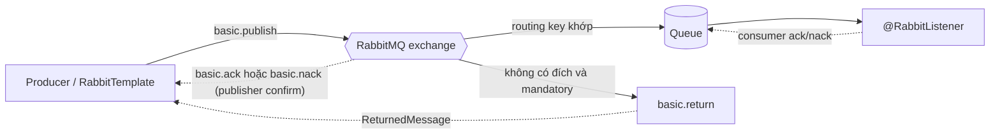
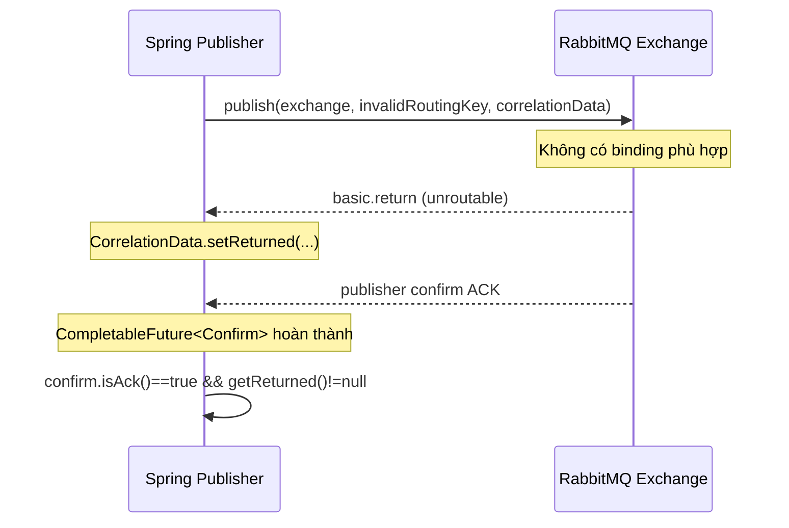

# CompletableFuture từ CorrelationData và xử lý confirm bất đồng bộ

Khi một ứng dụng gửi message qua `RabbitTemplate.convertAndSend(...)`, việc phương thức trả về bình thường **không có nghĩa** RabbitMQ đã xử lý publish thành công. Kết nối có thể mất sau khi producer gửi dữ liệu; broker có thể từ chối publish; hoặc exchange nhận message nhưng không tìm thấy queue phù hợp để định tuyến. Nếu ứng dụng chỉ ghi log “đã gửi” rồi xóa dữ liệu nguồn, sự kiện có thể bị mất mà không có dấu hiệu rõ ràng.

Trong **Spring AMQP**, `CorrelationData` có **`CompletableFuture<CorrelationData.Confirm>`** để producer theo dõi kết quả publisher confirm theo từng lần gửi **mà không cần chặn thread bằng `Future.get()`**. Kết hợp với **publisher returns**, ứng dụng còn nhận biết được trường hợp message không được route.

Bài học nằm trong chương **Confirm và return** của module **SPRING_AMQP**. Ta sẽ cấu hình Spring Boot/RabbitMQ, viết producer bất đồng bộ bằng `RabbitTemplate`, phân loại **ACK, NACK, returned, timeout**, kiểm chứng bằng exchange–queue–binding và thiết kế retry, idempotency, dead-letter, transaction boundary cùng giám sát hệ thống một cách an toàn.

## 1. Publisher confirm và publisher return là hai câu hỏi khác nhau

**Publisher confirm** là phản hồi AMQP từ RabbitMQ cho producer về việc broker đã xử lý một lần publish ở mức broker. Nó không phải acknowledgement của consumer.

**Publisher return** là đường phản hồi cho message **không thể được định tuyến đến queue** theo cơ chế publish `mandatory`. Nó không phải `NACK` và không phải message bị dead-letter sau khi consumer xử lý lỗi.



| Kết quả | Phát sinh ở đâu? | Cho biết điều gì? | **Không** bảo đảm |
| --- | --- | --- | --- |
| Publisher **ACK** | Broker → producer | Broker xác nhận publish theo cơ chế publisher confirms | Đúng queue đích, mọi consumer xử lý xong, DB đã commit |
| Publisher **NACK** | Broker/framework → producer | Publish không được xác nhận thành công; có thể có nguyên nhân đi kèm | Tự động xác định message chắc chắn chưa đến nơi trong mọi sự cố |
| Publisher **return** | Broker → producer | Message không được route và bị trả về khi có `mandatory`/returns phù hợp | Publisher confirm nhất thiết là NACK |
| Consumer **ACK** | Consumer → broker | Consumer xác nhận delivery của mình | Các consumer khác đã xử lý, transaction DB exactly-once |
| Consumer **reject/nack** | Consumer → broker | Consumer từ chối/hoàn lại delivery theo chế độ chọn | Producer nhận một publisher NACK tương ứng |

Trường hợp dễ nhầm nhất: **publish tới exchange có thật, nhưng routing key không khớp bất kỳ binding nào**. RabbitMQ có thể trả **publisher ACK** vì đã xử lý publish, đồng thời gửi **publisher return** vì không có queue đích. Vậy `confirm.isAck() == true` **không đủ** để kết luận sự kiện đã được route.

### Ma trận quyết định ở phía producer

| Confirm | ReturnedMessage | Kết luận thực tế | Xử lý mẫu |
| --- | --- | --- | --- |
| ACK | Không có return | Broker xác nhận; không có tín hiệu unroutable theo cấu hình returns | Ghi trạng thái `CONFIRMED_NO_RETURN`, tiếp tục theo dõi consumer độc lập |
| ACK | Có return | Broker xác nhận publish nhưng message đã bị trả vì không route được | Ghi `UNROUTABLE`, sửa exchange/binding/routing key |
| NACK | Có hoặc không | Broker/framework không xác nhận thành công | Ghi `NACK`, đối chiếu reason và chính sách retry |
| Chưa có confirm sau ngưỡng chờ | Chưa đủ dữ kiện | Kết quả **không chắc chắn** | Đánh dấu `UNKNOWN`, truy vết và retry theo idempotency |
| Lỗi ngay tại `convertAndSend()` | Chưa đủ dữ kiện | Có thể lỗi conversion/kết nối trước hoặc trong publish | Phân loại exception; không giả định future sẽ luôn hoàn tất |

Ma trận giả định **publisher confirms và publisher returns đã bật đúng**. Nếu returns chưa được bật, giá trị `null` của `CorrelationData.getReturned()` **không chứng minh** routing thành công.

## 2. Cơ chế CorrelationData và CompletableFuture

`CorrelationData` nằm trong `org.springframework.amqp.rabbit.connection`. Mỗi lần publish có thể tạo một instance để liên hệ kết quả từ broker với yêu cầu gửi cụ thể.

Các API quan trọng với Spring AMQP 3.x:

```java
CorrelationData correlation = new CorrelationData("attempt-unique-id");

CompletableFuture<CorrelationData.Confirm> future =
        correlation.getFuture();

future.whenComplete((confirm, failure) -> {
    if (failure != null) {
        // Bất thường trong đường hoàn tất future.
    } else if (confirm.isAck()) {
        // Broker ACK.
    } else {
        String reason = confirm.getReason(); // Có thể null.
        // Broker/framework NACK.
    }
});

ReturnedMessage returned = correlation.getReturned(); // Có thể null.
```

Đoạn này là **mảnh mã minh họa**, không phải phương thức Java hoàn chỉnh. Các kiểu:

- `CorrelationData.getId()`: định danh **lần publish** do ứng dụng đặt hoặc framework tạo.
- `getFuture()`: `CompletableFuture<CorrelationData.Confirm>`; có thể dùng `whenComplete`, `thenApply` và các phép kết hợp bất đồng bộ khác.
- `CorrelationData.Confirm.isAck()`: `true` khi broker xác nhận, `false` khi báo NACK.
- `CorrelationData.Confirm.getReason()`: lý do NACK **nếu có**, không được giả định luôn khác `null`; broker-generated NACK có thể không đi kèm lý do.
- `CorrelationData.getReturned()`: một `ReturnedMessage` nếu message không route được và returns đang hoạt động; chứa message và các thông tin reply code/text, exchange, routing key.

Ở những dòng Spring AMQP cũ hơn, API future hoặc tên phương thức truy cập returned message có thể khác. Ví dụ bài này hướng đến **dòng Spring AMQP dùng `CompletableFuture` và `getReturned()`** (điển hình Spring AMQP 3.x). Hãy dùng dependency do Spring Boot parent/BOM quản lý và đối chiếu API thực tế, không tự trộn phiên bản `spring-rabbit`/RabbitMQ client.

### Phân biệt eventId, messageId và CorrelationData.id

| ID | Phạm vi | Ví dụ | Có giữ nguyên khi retry không? |
| --- | --- | --- | --- |
| **`eventId`** | Sự kiện nghiệp vụ | `evt-47` | **Có**, nếu retry cùng sự kiện |
| AMQP **`messageId`** | Metadata của message trên wire | `evt-47` | Nên giữ ổn định với cùng sự kiện khi dùng để deduplicate |
| **`CorrelationData.id`** | Một **publish attempt** từ producer | `pub-8e5...` | Nên **khác** cho lần publish mới để phân biệt confirmations |
| AMQP **`correlationId`** | Chuỗi request/workflow liên quan | `req-120` | Theo mục đích tracing/nghiệp vụ |

**`CorrelationData.id` không tự động là AMQP `messageId` hoặc `correlationId`.** Chúng phục vụ các mục đích khác nhau; không giả định RabbitMQ dùng chúng để tự loại bỏ message trùng.

## 3. Cấu hình Spring Boot để bật publisher confirms và returns

Với một ứng dụng Spring Boot đã có parent/BOM, khai báo starter:

```xml
<dependency>
    <groupId>org.springframework.boot</groupId>
    <artifactId>spring-boot-starter-amqp</artifactId>
</dependency>
```

Ví dụ `src/main/resources/application-local.yml` dành cho RabbitMQ **local/test**:

```yaml
spring:
  rabbitmq:
    host: localhost
    port: 5672
    username: app_local
    password: local-demo-only
    virtual-host: orders_local

    publisher-confirm-type: correlated
    publisher-returns: true

    template:
      mandatory: true
```

Giải thích ba thuộc tính cốt lõi:

1. **`publisher-confirm-type: correlated`**: kích hoạt publisher confirms có thông tin correlation, cần thiết để dùng future trên `CorrelationData` theo từng lần gửi.
2. **`publisher-returns: true`**: bật tiếp nhận publisher returns từ RabbitMQ.
3. **`template.mandatory: true`**: yêu cầu broker trả về message không được route, thay vì bỏ qua không có tín hiệu return trong luồng publish mặc định.

Tài khoản và vhost trên là **giả định của broker thực hành**, không phải thông tin production. Production cần inject secrets, cấu hình TLS, quyền publish và topology tương ứng. Nếu tự tạo `RabbitTemplate` hay `ConnectionFactory` thay cho bean auto-configured, phải **xác minh chính bean được dùng thật** đã bật correlated confirms và returns; thuộc tính YAML không chắc tác động lên custom factory theo mọi cách khai báo.

### Không nhầm ba chế độ publisher confirm

| Chế độ | Ý nghĩa trong Spring Boot/Spring Rabbit | Phù hợp |
| --- | --- | --- |
| `none` | Không bật publisher confirms theo cơ chế được cấu hình | Khi yêu cầu xác nhận broker không tồn tại, thường không phù hợp sự kiện quan trọng |
| `simple` | Hỗ trợ mô hình xác nhận đồng bộ trong scoped operations theo cơ chế tương ứng | Trường hợp cần đợi confirm theo đợt/operation, có thể chấp nhận chặn luồng |
| **`correlated`** | Liên hệ từng publish với `CorrelationData`/callback | **Bài này:** theo dõi nhiều publish bất đồng bộ |

Để xây producer bất đồng bộ có future cho từng sự kiện, dùng **`correlated`**, không nhầm với cấu hình `simple` hoặc `none`.

## 4. Khai báo exchange, queue và binding để thử nghiệm

Ta sử dụng **`DirectExchange`** có một queue khớp routing key `orders.created`. Gửi `orders.unknown` tới cùng exchange sẽ tạo tình huống **unroutable** dễ kiểm chứng.

```java
import org.springframework.amqp.core.Binding;
import org.springframework.amqp.core.BindingBuilder;
import org.springframework.amqp.core.DirectExchange;
import org.springframework.amqp.core.Queue;
import org.springframework.amqp.core.QueueBuilder;
import org.springframework.context.annotation.Bean;
import org.springframework.context.annotation.Configuration;

@Configuration
public class ConfirmDemoTopology {
    public static final String EXCHANGE = "orders.confirm.demo";
    public static final String QUEUE = "orders.confirm.queue";
    public static final String ROUTING_KEY = "orders.created";

    @Bean
    DirectExchange confirmDemoExchange() {
        return new DirectExchange(EXCHANGE, true, false);
    }

    @Bean
    Queue confirmDemoQueue() {
        return QueueBuilder.durable(QUEUE).build();
    }

    @Bean
    Binding confirmDemoBinding(
            Queue confirmDemoQueue,
            DirectExchange confirmDemoExchange) {
        return BindingBuilder.bind(confirmDemoQueue)
                .to(confirmDemoExchange)
                .with(ROUTING_KEY);
    }
}
```

Với Spring Boot và `RabbitAdmin` được auto-configure hợp lệ, các bean có thể được khai báo lên broker khi kết nối. Kiểm tra trên RabbitMQ Management UI: exchange `orders.confirm.demo` phải là **direct**, queue `orders.confirm.queue` phải tồn tại trong đúng vhost, và binding key là `orders.created`. Nếu topology thiếu, thí nghiệm confirm/return có thể cho kết quả khác dự kiến.

## 5. Ví dụ Java: xử lý confirm hoàn toàn bất đồng bộ

Ví dụ dưới sử dụng Java 17+, Spring Boot và Spring AMQP có `CorrelationData.getFuture()` trả `CompletableFuture`. Để không phụ thuộc JSON converter riêng, producer gửi một **chuỗi** (payload minh họa). Khi dùng converter mặc định cho `String`, content type có thể là `text/plain`; nếu bạn muốn giao thức JSON, cấu hình converter và schema thống nhất với consumer.

### 5.1. Producer: kết hợp confirm và returned trong cùng một kết quả

```java
import java.util.UUID;
import java.util.concurrent.CompletableFuture;

import org.springframework.amqp.AmqpException;
import org.springframework.amqp.core.ReturnedMessage;
import org.springframework.amqp.rabbit.connection.CorrelationData;
import org.springframework.amqp.rabbit.core.RabbitTemplate;
import org.springframework.stereotype.Service;

@Service
public class AsyncConfirmOrderPublisher {

    public enum Status {
        CONFIRMED_NO_RETURN,
        UNROUTABLE,
        NACK
    }

    public record PublishOutcome(
            String eventId,
            String attemptId,
            Status status,
            String detail
    ) {}

    private final RabbitTemplate rabbitTemplate;

    public AsyncConfirmOrderPublisher(RabbitTemplate rabbitTemplate) {
        this.rabbitTemplate = rabbitTemplate;
    }

    public CompletableFuture<PublishOutcome> publish(
            String eventId, String payload, String routingKey) {

        // Một correlation ID mới cho MỖI lần publish, kể cả khi retry.
        CorrelationData data = new CorrelationData(UUID.randomUUID().toString());
        CompletableFuture<PublishOutcome> result = new CompletableFuture<>();

        // Gắn callback trước khi gửi để không bỏ lỡ confirm đến rất sớm.
        data.getFuture().whenComplete((confirm, failure) -> {
            if (failure != null) {
                result.completeExceptionally(failure);
                return;
            }

            // Khi confirms + returns được bật, returned data được gắn
            // trước khi future confirm hoàn thành.
            ReturnedMessage returned = data.getReturned();

            if (!confirm.isAck()) {
                result.complete(new PublishOutcome(
                        eventId, data.getId(), Status.NACK,
                        confirm.getReason())); // reason có thể null
            } else if (returned != null) {
                result.complete(new PublishOutcome(
                        eventId, data.getId(), Status.UNROUTABLE,
                        "replyCode=" + returned.getReplyCode()
                                + ", replyText=" + returned.getReplyText()
                                + ", routingKey=" + returned.getRoutingKey()));
            } else {
                result.complete(new PublishOutcome(
                        eventId, data.getId(), Status.CONFIRMED_NO_RETURN,
                        "Broker ACK; no publisher return observed"));
            }
        });

        try {
            rabbitTemplate.convertAndSend(
                    ConfirmDemoTopology.EXCHANGE,
                    routingKey,
                    payload,
                    message -> {
                        message.getMessageProperties().setMessageId(eventId);
                        message.getMessageProperties()
                                .setHeader("eventType", "orders.created");
                        return message;
                    },
                    data);
        } catch (AmqpException exception) {
            // Conversion/connection/publish có thể lỗi ngay tại call site.
            // Không chờ vô hạn một confirm có thể không bao giờ tới.
            result.completeExceptionally(exception);
        }

        return result;
    }
}
```

**Đặc tính của mã mẫu:**

- `publish(...)` trả `CompletableFuture<PublishOutcome>` ngay sau khi thực hiện lời gọi publish; **không chờ broker confirm bằng `get()`** trong luồng caller. Lời gọi `convertAndSend` bản thân vẫn có thể bị chặn ngắn hoặc ném lỗi đồng bộ, nên “bất đồng bộ” ở đây chủ yếu nói về **quá trình chờ confirm**.
- Mỗi lần gửi có `CorrelationData` riêng, dùng ID ngẫu nhiên; trường `eventId` của sự kiện được giữ ổn định để consumer chống trùng.
- **`data.getFuture().whenComplete(...)`** chỉ biến kết quả thành trạng thái nhỏ; không gọi DB/API hoặc publish lại ngay trong callback.
- **`data.getReturned()`** được kiểm tra sau confirm; với API và returns được cấu hình đúng, returned message đã được ghi vào correlation data trước khi confirm future hoàn tất.
- Trường `NACK` giữ `getReason()` tùy chọn; **không log body** của returned message vì có thể chứa thông tin nhạy cảm.
- Exception trực tiếp tại publish hoàn tất future kết quả bằng lỗi; **không biến mọi lỗi đồng bộ thành NACK**, vì đây là các đường lỗi khác nhau.

Để có kết luận **đã route đến queue mong đợi**, phải kiểm tra topology, returns và các yêu cầu riêng của hệ thống. `CONFIRMED_NO_RETURN` chỉ biểu thị **ACK và không có tín hiệu return**, không tuyên bố consumer đã xử lý thành công hay mọi queue mong muốn đều nhận.

### 5.2. Caller tiếp nhận kết quả mà không block

Chẳng hạn, một service gọi:

```java
publisher.publish(
        "evt-1001",
        "Order created: ORD-1001",
        ConfirmDemoTopology.ROUTING_KEY
).whenComplete((outcome, failure) -> {
    if (failure != null) {
        log.warn("Publish failed before/while awaiting confirm",
                failure);
        return;
    }

    switch (outcome.status()) {
        case CONFIRMED_NO_RETURN ->
                log.info("Broker confirmed attempt={}", outcome.attemptId());
        case UNROUTABLE ->
                log.warn("Publish returned, eventId={}, detail={}",
                        outcome.eventId(), outcome.detail());
        case NACK ->
                log.warn("Broker NACK, eventId={}, reason={}",
                        outcome.eventId(), outcome.detail());
    }
});
```

Mảnh mã trên giả định các biến `publisher` và `log` đã được inject/khởi tạo trong class caller. Nó minh họa cách tiêu thụ future, không phải class Java đầy đủ.

**Không thực hiện `future.get()`, `join()`, truy vấn DB chậm hoặc retry hàng loạt bên trong callback của broker.** `whenComplete` có thể chạy trên luồng hoàn tất confirm hoặc executor của framework. Nếu cần cập nhật trạng thái lâu dài, chuyển kết quả sang queue nội bộ/executor phù hợp và bảo đảm idempotency. Trong Spring AMQP hiện hành, xử lý callback có điều phối thread của framework, nhưng quy tắc giữ callback ngắn và không chặn vẫn rất quan trọng.

## 6. Trình tự của return và confirm

Với publisher returns, `mandatory=true` và `CorrelationData` được đi kèm một publish, RabbitMQ có thể phát cả **basic.return** lẫn **publisher ACK**.



Ở các phiên bản Spring AMQP hỗ trợ `getReturned()`, dữ liệu returned được gắn vào `CorrelationData` **trước khi confirm future hoàn thành**. Điều này cho phép xử lý cả hai kết quả trong **một** `whenComplete`, thay vì dùng hai callback không có quan hệ với nhau.

Cơ chế `RabbitTemplate.ReturnsCallback` vẫn có ích khi ứng dụng muốn một điểm xử lý return tập trung; chỉ có **một returns callback** được gắn trên mỗi template. Khi đã phân loại return qua `CorrelationData.getReturned()`, đừng vô tình ghi nhận **cùng một lỗi hai lần** nếu đồng thời dùng returns callback toàn cục. Nếu callback returns làm việc quá chậm, thứ tự hoàn tất confirm có thể chịu giới hạn thời gian điều phối của framework; giữ callback nhẹ và không chặn.

### Nếu một message được route đến một queue nhưng thiếu hai queue khác?

Publisher return **không phải công cụ xác minh toàn bộ danh sách subscriber mong đợi**. Ví dụ fanout exchange có ba nhóm `billing`, `notification`, `analytics`, nhưng chỉ còn một queue được binding: message vẫn được route tới **ít nhất một** queue, nên **không có return** chỉ vì hai binding khác đã mất.

Để bảo đảm tất cả nhóm nhận sự kiện, phải quản lý topology, xác minh bindings, theo dõi consumer/queue/DLQ và thiết kế cơ chế xác nhận xử lý cấp nghiệp vụ khi cần. Publisher confirms và returns chỉ quan sát đường publish ở cấp broker.

## 7. Quản lý timeout của CompletableFuture đúng cách

Một future có thể chưa hoàn thành do mất kết nối, sự cố broker hoặc quá trình xử lý xác nhận kéo dài. Không chờ vô hạn trong request HTTP hoặc giữ hàng nghìn bản ghi pending trong RAM.

Nếu muốn đặt timeout **cho phần theo dõi** mà không làm thay đổi future gốc của `CorrelationData`, có thể tạo một dependent stage:

```java
import java.util.concurrent.CompletableFuture;
import java.util.concurrent.TimeUnit;
import java.util.function.Function;

CompletableFuture<AsyncConfirmOrderPublisher.PublishOutcome> publishFuture =
        publisher.publish("evt-1002", "Order created: ORD-1002", "orders.created");

// Tạo stage khác, tránh gọi orTimeout() trực tiếp trên publishFuture
// khi vẫn muốn quan sát confirm đến muộn trên future gốc.
publishFuture
        .thenApply(Function.identity())
        .orTimeout(10, TimeUnit.SECONDS)
        .whenComplete((outcome, failure) -> {
            if (failure != null) {
                // Timeout/exception => kết quả có thể chưa xác định.
                // Ghi nhận và chuyển xử lý sang cơ chế đáng tin cậy riêng.
            } else {
                // Đánh giá CONFIRMED_NO_RETURN / UNROUTABLE / NACK.
            }
        });
```

`orTimeout` **hoàn tất future mà nó được gọi trên bằng exception** khi quá hạn; vì vậy ví dụ tạo **stage mới** trước khi áp timeout. Việc làm này giúp `publishFuture` gốc vẫn có thể hoàn tất với confirm đến muộn.

**Timeout không chứng minh publish thất bại.** Broker có thể đã nhận message nhưng phản hồi không tới producer kịp. Nếu tự publish lại mà không có `eventId` ổn định và consumer idempotent, hệ thống có thể tạo duplicate.

Trong production, cần đặt giới hạn số pending confirmations, metric thời gian chờ, chính sách timeout và khả năng **khôi phục sau khi producer restart**. Một `CompletableFuture` trong bộ nhớ sẽ mất khi JVM chết; nó không phải cơ chế lưu trạng thái bền vững.

### Vì sao không chỉ `get(10, TimeUnit.SECONDS)`?

```java
// Minh họa đồng bộ: chặn thread gọi trong tối đa 10 giây.
CorrelationData.Confirm confirm =
        correlationData.getFuture().get(10, TimeUnit.SECONDS);
```

Đoạn này phù hợp cho **test hoặc công cụ vận hành đồng bộ** khi có xử lý `InterruptedException`, `ExecutionException`, `TimeoutException`. Với producer throughput cao, mô hình này có thể lãng phí thread và làm chậm request. `whenComplete`/composed future giúp xử lý kết quả bất đồng bộ, nhưng **không thay** cơ chế backpressure và theo dõi pending state.

## 8. Thực hành ba tình huống quan trọng

### 8.1. Trường hợp A: publish thành công đến queue

1. Khởi chạy RabbitMQ local và ứng dụng Spring Boot với profile `local`.
2. Mở Management UI, xác nhận exchange `orders.confirm.demo`, queue `orders.confirm.queue` và binding key `orders.created`.
3. Gọi:

```java
publisher.publish("evt-good-1", "order-created", "orders.created");
```

4. Quan sát future hoàn tất với `Status.CONFIRMED_NO_RETURN`; message có thể xuất hiện trong queue hoặc được consumer nhận ngay nếu listener chạy.

**Giới hạn:** Nếu queue có listener đang hoạt động, `Ready=0` không có nghĩa message đã bị mất. Cần xem consumer logs, delivery rate, `Unacked` và kết quả nghiệp vụ riêng.

### 8.2. Trường hợp B: exchange tồn tại nhưng routing key sai

Gọi cùng publisher nhưng đổi routing key:

```java
publisher.publish("evt-unroutable-1", "order-created", "orders.unknown");
```

Vì direct exchange không có binding tương ứng, khi `mandatory=true` và returns được bật, `CorrelationData.getReturned()` có thông tin trả về. Thường producer nhận **ACK + returned**, nên kết quả ứng dụng là **`UNROUTABLE`**, không phải `NACK`.

Kiểm tra `replyCode`, `replyText`, `exchange` và `routingKey` để biết nguyên nhân. Chỉ log thông tin kỹ thuật cần thiết, không log toàn bộ body returned message.

### 8.3. Trường hợp C: broker không thể xác nhận

Trong môi trường **test**, dừng broker trước khi gửi hoặc tạm thời ngắt kết nối mạng. Tùy thời điểm:

- `RabbitTemplate.convertAndSend()` có thể ném `AmqpConnectException`/`AmqpException` **ngay tại call site**.
- Nếu publish đã được giao vào đường gửi rồi kết nối mất, framework có thể tạo publisher NACK với reason, hoặc future chưa hoàn thành trong khoảng quan sát.
- Nếu caller chỉ thấy timeout, **không thể kết luận** broker có nhận message hay không.

Không dựa vào việc đóng exchange không tồn tại để mô phỏng “NACK chắc chắn” cho mọi phiên bản; RabbitMQ có thể đóng channel với lỗi giao thức và cách framework đưa lỗi vào future phụ thuộc thời điểm. Mục tiêu của test là **quan sát và phân loại đúng những kết quả thực xảy ra**, không ép mỗi sự cố vào một nhãn duy nhất.

### Bảng kiểm kết quả

| Ca test | RabbitMQ topology | Dự kiến | Quan sát thêm |
| --- | --- | --- | --- |
| A | Exchange + binding hợp lệ | ACK, không return | Queue depth, consumer, eventId |
| B | Exchange hợp lệ, key không khớp | ACK **và** return | Reply code/text, routing key |
| C | Broker/ngắt mạng | Exception, NACK hoặc timeout tùy thời điểm | Connection logs, pending confirms |

**Không chạy các thử nghiệm lỗi mạng trên production** nếu không có quy trình thay đổi được phê duyệt. Với test local, khôi phục broker và xác minh queue/consumer hoạt động bình thường sau mỗi lần thử.

## 9. Retry, idempotency và transactional outbox

Publisher confirms không phải giải pháp hoàn chỉnh cho các tình huống “DB đã ghi nhưng publish chưa rõ kết quả”.

Giả sử ứng dụng tạo đơn hàng:

```text
1. DB commit Order(ORD-1001)
2. Producer publish orders.created
3. RabbitMQ nhận event
4. Kết nối mất trước khi producer nhận confirm
5. Producer thấy timeout và không biết event đã tới broker hay chưa
```

Nếu producer publish lại, message có thể xuất hiện **hai lần**. Nếu producer không publish lại, message có thể bị mất trong trường hợp broker thực sự chưa nhận.

### Cách tiếp cận phù hợp

1. **`eventId` ổn định:** Một sự kiện nghiệp vụ có một ID duy nhất; mọi lần gửi lại cùng sự kiện giữ nguyên ID.
2. **`CorrelationData.id` theo từng attempt:** Mỗi lần publish có ID mới để liên hệ kết quả ACK/NACK/return của lần thử đó, không ghi đè lịch sử.
3. **Consumer idempotent:** Consumer kiểm tra `eventId` hoặc khóa nghiệp vụ bằng constraint/giao dịch DB để tránh áp dụng tác dụng phụ hai lần.
4. **Transactional outbox khi cần:** Ghi sự kiện vào bảng outbox **cùng giao dịch DB nghiệp vụ**. Worker phát message, lưu trạng thái/attempt; ACK/return/timeout được phản ánh vào quá trình phát lại có kiểm soát.
5. **Giới hạn retry:** Chỉ retry tự động khi chính sách cho phép, với backoff và cảnh báo; phân biệt unroutable do sai topology với broker tạm thời không sẵn sàng.

| Kết quả | Gợi ý xử lý |
| --- | --- |
| `CONFIRMED_NO_RETURN` | Ghi nhận publish đã được broker xác nhận; chuyển sang theo dõi xử lý downstream nếu nghiệp vụ yêu cầu |
| `UNROUTABLE` | Kiểm tra exchange/binding/routing key, phát cảnh báo cấu hình; không requeue vô hạn cùng routing key sai |
| `NACK` | Ghi reason nếu có, kiểm tra broker trạng thái; retry có giới hạn và chống trùng |
| Exception đồng bộ | Phân loại lỗi converter, mạng, permission, topology; tránh retry dữ liệu invalid vô hạn |
| Timeout/`UNKNOWN` | Giữ event pending/durable, kiểm tra sức khỏe broker và retry theo idempotency; không coi chắc chắn chưa gửi |

**Outbox không tự làm consumer exactly-once.** Nó giải quyết vấn đề nhất quán khi ghi DB và phát sự kiện, thường hướng đến **at-least-once publication**. Consumer vẫn phải chịu được message bị gửi/giao lặp.

## 10. Kết hợp với @RabbitListener, retry, DLQ và observability

Nếu muốn quan sát downstream, thêm một listener demo trên queue đã khai báo:

```java
import org.slf4j.Logger;
import org.slf4j.LoggerFactory;
import org.springframework.amqp.core.Message;
import org.springframework.amqp.rabbit.annotation.RabbitListener;
import org.springframework.stereotype.Component;

@Component
public class ConfirmDemoConsumer {
    private static final Logger log =
            LoggerFactory.getLogger(ConfirmDemoConsumer.class);

    @RabbitListener(queues = ConfirmDemoTopology.QUEUE)
    public void consume(Message message) {
        String eventId = message.getMessageProperties().getMessageId();
        log.info("Received eventId={}, bodyBytes={}",
                eventId, message.getBody().length);

        // Trong hệ thống thật: validate, xử lý idempotent,
        // hoàn thành nghiệp vụ trước khi được ack theo cấu hình listener.
    }
}
```

**Listener nhận được message không làm future publisher thay đổi.** Publish confirm và consumer acknowledgement là hai cơ chế độc lập. Lỗi listener có thể được retry/requeue hoặc dead-letter theo cấu hình container, queue và DLX; publisher không nhận NACK mới chỉ vì consumer xử lý thất bại vài giây sau đó.

Để giám sát production, theo dõi các chỉ số:

- **Publish attempt:** tổng số lần gửi, trạng thái `CONFIRMED_NO_RETURN`, `UNROUTABLE`, `NACK`, exception, `UNKNOWN`, latency tới confirm và số pending confirms.
- **Connection/channel:** reconnect, shutdown, broker blocked/unblocked, tình trạng certificate/TLS và quyền.
- **Routing:** returns theo exchange/routing key, bindings thiếu, số queue nhận message theo kỳ vọng.
- **Consumer:** tốc độ delivery, `Ready`, `Unacked`, thời gian xử lý, redelivery, retry và DLQ.
- **Nghiệp vụ:** số event chưa publish trong outbox, số event xử lý trùng, số lỗi chưa giải quyết và tuổi event lâu nhất.

Gắn `eventId`, `attemptId` và tracing context vào log/metric khi phù hợp, nhưng tránh tạo **metric label có cardinality quá cao** từ từng eventId/attemptId. ID chi tiết nên nằm trong structured logs hoặc trace; metric nên tổng hợp theo exchange, loại event và mã kết quả ở phạm vi giới hạn.

## 11. Những lỗi phổ biến khi dùng CompletableFuture

| Lỗi | Vì sao nguy hiểm? | Cách sửa |
| --- | --- | --- |
| Chỉ kiểm tra `confirm.isAck()` | ACK vẫn có thể đi kèm returned message | Kiểm tra thêm `CorrelationData.getReturned()` khi returns được bật |
| Không bật `publisher-confirm-type: correlated` | Không có cơ chế confirm tương ứng cho từng CorrelationData | Kiểm tra bean `CachingConnectionFactory`/template thực tế |
| Bật returns nhưng quên `mandatory` | Broker không nhất thiết trả message không route | Bật `template.mandatory=true` hoặc thiết lập mandatory expression phù hợp |
| Tái sử dụng một CorrelationData cho nhiều publish | Không phân biệt được từng attempt, có thể xung đột correlation | Tạo instance/ID riêng cho **mỗi** lần publish |
| Coi `getReason()` chắc chắn khác null | Broker NACK có thể không có nguyên nhân cụ thể | Xử lý `null` và tra broker logs |
| Gọi `future.get()` trong request thread | Chặn thread và giảm throughput, tạo timeout dây chuyền | Dùng `whenComplete` và điều phối bất đồng bộ |
| Đặt `orTimeout()` trực tiếp lên shared future gốc | Có thể làm future gốc hoàn tất ngoại lệ trước khi confirm tới | Dùng dependent stage nếu muốn quan sát timeout độc lập |
| Retry ngay trong confirm callback | Có nguy cơ deadlock/blocking hoặc bão retry | Chuyển quyết định retry sang executor/outbox/worker có backoff |
| Coi timeout là publish chắc chắn thất bại | Có thể broker đã nhận event | Giữ `eventId` ổn định và consumer idempotent |
| Coi return là consumer reject | Return phát sinh ở **giai đoạn routing**, không phải consumer | Phân biệt returns với ack/nack/DLQ |
| Mất trạng thái khi JVM restart | CompletableFuture tồn tại trong RAM | Dùng outbox hoặc persistent publish ledger khi yêu cầu dữ liệu không mất |
| Log body và ID làm metric labels | Rò rỉ dữ liệu hoặc cardinality lớn | Redaction, structured log và nhãn metric giới hạn |

### Những câu hỏi kiểm tra nhanh

1. Vì sao `convertAndSend()` trả về mà không ném exception vẫn chưa chứng minh message vào queue?
2. Khi `confirm.isAck() == true` và `getReturned() != null`, publish đã xảy ra những gì?
3. `CorrelationData.id` nên thay đổi thế nào qua hai lần gửi lại cùng một `eventId`?
4. `thenApply`, `whenComplete` và `orTimeout` giúp phần nào của xử lý publisher bất đồng bộ? Chúng có lưu trạng thái qua JVM restart không?
5. `publisherConfirmType=correlated` và `mandatory=true` có vai trò riêng ra sao?
6. Vì sao publisher ACK không thể thay thế consumer ACK, idempotency và transaction DB?

## 12. Tài liệu chính thức để đối chiếu phiên bản

- [Spring AMQP – RabbitTemplate / Publisher Confirms and Returns](https://docs.spring.io/spring-amqp/reference/amqp/template.html): `CorrelationData.getFuture()`, confirm callback, returns và thứ tự xử lý.
- [Spring AMQP API – CorrelationData](https://docs.spring.io/spring-amqp/docs/3.2.x/api/org/springframework/amqp/rabbit/connection/CorrelationData.html): `getFuture()`, `getReturned()`, `getId()`.
- [Spring AMQP API – CorrelationData.Confirm](https://docs.spring.io/spring-amqp/docs/3.2.x/api/org/springframework/amqp/rabbit/connection/CorrelationData.Confirm.html): `isAck()`, `getReason()`.
- [Spring AMQP API – RabbitTemplate](https://docs.spring.io/spring-amqp/docs/3.2.x/api/org/springframework/amqp/rabbit/core/RabbitTemplate.html): overload `convertAndSend(..., CorrelationData)` và `MessagePostProcessor`.
- [RabbitMQ – Publisher Confirms](https://www.rabbitmq.com/docs/confirms): xác nhận publish ở cấp AMQP 0-9-1 và phạm vi cam kết.
- [RabbitMQ – Publishers](https://www.rabbitmq.com/docs/publishers): routing, `mandatory`, unroutable messages và các tình huống mất kết nối.

**Ghi nhớ:** Với Spring AMQP, cấu hình **`publisher-confirm-type: correlated`**, tạo **`CorrelationData` riêng cho từng lần publish** và theo dõi `getFuture().whenComplete(...)` để nhận ACK/NACK bất đồng bộ. Nếu cần phát hiện message không route được, bật **publisher returns + mandatory** và đọc `getReturned()` bên cạnh kết quả confirm. **ACK không phải consumer thành công; timeout không chắc chắn là thất bại.** Muốn hệ thống RabbitMQ thực sự tin cậy phải bổ sung retry có giới hạn, eventId/idempotency, outbox khi cần, quan sát queue và xử lý lỗi downstream.
